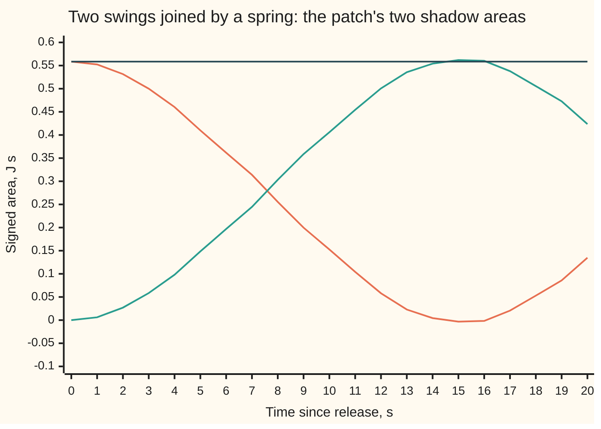

# Symplectic form: the two-form behind Hamiltonian mechanics

[Syllabus](../../../SYLLABUS.md) → [Differential geometry and Lie groups](../README.md) → [Differential Forms](../README.md#s04) → Symplectic form

---

## General Overview

A 20 kg child sits on a playground swing with rigid 2 m rods. The seat is pulled back to 60 degrees and let go. One full swing, there and back, takes 3.044624552 s.

Now picture a small crowd of starts instead of one. Release from anywhere between 58 and 62 degrees, with a nudge that gives the seat any momentum from 0 to 8 kg m²/s. Each start is a point in the plane of angle and momentum, the **phase plane**. Together the starts fill a small rectangle there: 0.069813 rad wide (4 degrees) by 8 kg m²/s tall, an area of 0.558505 J s (joule-seconds: radians times kg m²/s).

Let every start swing for 3.044624552 s. The points move to new places, because a higher release takes a little longer to swing. But the region they fill still has area 0.558505 J s. A computer that steps with forward Euler's rule (each step moves straight along the current rates) gets 0.915131 J s instead: 1.638536 times the true area.

[Hamilton's equations](../../08-Differential%20equations%20and%20dynamics/12-Calculus%20of%20Variations%20and%20Optimal%20Control/05-hamiltons-equations.md) already proves that the swing keeps area. This card names that area as a two-form, the **symplectic form** $`\omega = dq \wedge dp`$. Hamilton's two equations become one form equation, and the motion keeps $`\omega`$ itself. With two or more swings, that is stronger than keeping volume.

**Hamilton's equations say one thing: the state's velocity, fed into the symplectic form, gives the slope of the energy; because both the form and that slope have zero exterior derivative, the motion carries the symplectic form to itself, so it keeps the summed phase-plane area of every patch, in any number of dimensions.**

**What kind of fact this is:** definitions (the symplectic form, the interior product $`\iota_X`$) and a theorem, proved on this card in Why it works: a Hamiltonian flow keeps $`\omega`$. The theorem is global in time: it holds on all of phase space for as long as the motion exists. Cartan's formula is quoted from Lee's textbook; the fold proves the theorem without it. Darboux's theorem, that every symplectic form looks like $`dq \wedge dp`$ near a point, is stated without proof.

### The picture: one swing's patch of starts, measured after the swing

```
patch after one swing (J s)  one block = 0.025 J s
at release              ██████████████████████                 0.558505
exact motion            ██████████████████████                 0.558505
leapfrog, 60 steps      ██████████████████████                 0.558505
Euler, 60 steps         █████████████████████████████████████  0.915131
```

Each bar is the area the starts fill. The exact motion and the leapfrog step keep it. Euler's step, with the same 60 steps of 0.050744 s, grows it by a factor of 1.638536.

---

## The formula

Notation first. The state of one swing is its angle $`q`$ (radians from straight down; the $`\theta`$ of Hamilton's equations card) and its momentum $`p`$ (kg m²/s). The **Hamiltonian** $`H(q, p)`$ is the energy written in angle and momentum; here $`H`$ is not the mean curvature of shelf 02. For the swing:

```math
H(q, p) = \frac{p^2}{2 m l^2} - m g l \cos q, \qquad m l^2 = 80, \quad m g l = 392.4
```

The **symplectic form** is the two-form that measures signed area in the phase plane ([Differential form](01-forms-and-the-wedge-product.md)). For two small changes of state $`u = (u_q, u_p)`$ and $`v = (v_q, v_p)`$:

```math
\omega = dq \wedge dp, \qquad \omega(u, v) = u_q v_p - u_p v_q
```

**Read it aloud:** omega is d q wedge d p; on two arrows it gives the signed area of the parallelogram they span.

The **interior product** $`\iota_X \omega`$ (read "iota X omega") feeds one arrow $`X`$ into the first slot of $`\omega`$ and leaves a one-form: $`(\iota_X \omega)(v) = \omega(X, v)`$. The letter $`\iota`$ is used so that $`i`$ stays free for the square root of −1.

Hamilton's equations, as one form equation, and what the motion does to $`\omega`$:

```math
\iota_X \omega = dH, \qquad \varphi_t^{*}\,\omega = \omega
```

**Read it aloud:** the velocity field, put into the symplectic form, equals the exterior derivative of the energy; and pulling the form back through the motion gives the same form.

Here $`X`$ is the **Hamiltonian vector field**, the velocity of the state at each point. $`\varphi_t`$ is its **flow** (where every state is after time $`t`$; [Vector field and its flow](../03-Manifolds/07-vector-fields-and-flows.md)). $`\varphi_t^{*}`$ is the [Pullback](02-pullback-and-change-of-variables.md). With $`n`$ swings, $`\omega = dq_1 \wedge dp_1 + \dots + dq_n \wedge dp_n`$: one shadow area per swing, added.

| Symbol | Plain meaning | In our example | Push it up and the answer… |
| --- | --- | --- | --- |
| $`q`$, $`p`$ | angle (rad) and momentum (kg m²/s): the state | release (−60°, 0) | — |
| $`m`$, $`l`$, $`g`$ | mass, rod length, gravity | 20 kg, 2 m, 9.81 m/s²; $`m l^2`$ = 80, $`m g l`$ = 392.4 J | longer rods: slower swing |
| $`H`$ | the Hamiltonian, energy in $`q`$ and $`p`$, J | −196.2 J for the release | past 392.4 J the seat goes over the top |
| $`\omega`$ | the symplectic form, $`dq \wedge dp`$ | 0.558505 J s on the patch | — |
| $`u`$, $`v`$; $`\Sigma`$ | two small changes of state; a patch of states | the patch's edges: 0.069813 rad and 8 kg m²/s | area grows with each |
| $`X`$ | Hamiltonian vector field $`(q', p')`$ | (0, 339.8284) at release | — |
| $`\iota_X`$ | interior product: put $`X`$ in the first slot | $`\iota_X\omega`$ = −339.8284 $`dq`$ at release | — |
| $`d`$, $`dH`$ | exterior derivative; the energy's slope as a one-form | $`dH`$ = −339.8284 $`dq`$ at release | — |
| $`\varphi_t`$, $`\varphi_t^{*}`$, $`\mathcal{L}_X`$ | the flow for time $`t`$; pullback through it; Lie derivative, the rate of change riding the flow | $`t`$ = 3.044624552 s, one swing; $`\mathcal{L}_X \omega = 0`$ | — |
| $`h`$ | a numerical method's time step, s | 0.050744, 60 steps a swing | Euler's stretch per step grows as $`h^2`$, per swing about as $`h`$ |
| $`c`$; $`q_1, p_1, q_2, p_2`$ | spring joining two seats, J/rad²; the two swings' states | 40 | faster trade between the swings |
| $`n`$, $`z`$, $`J`$, $`I_n`$, $`M`$, $`S`$ | in the proof: number of swings, the full state, the matrix of $`\omega`$, the identity, the flow's Jacobian, $`H`$'s second slopes | $`n`$ = 1 or 2 | — |

### When it holds

- **The form is closed: $`d\omega = 0`$.** This kills one of the two terms in Step 3. On the plane every two-form is closed, so the condition first bites from four dimensions up. With a form that is not closed, that term need not vanish, and the flow can change the form.
- **The form is nondegenerate.** Every nonzero arrow $`u`$ has a partner $`v`$ with $`\omega(u, v) \neq 0`$. Then $`\iota_X \omega = dH`$ fixes $`X`$. With two swings, $`dq_1 \wedge dp_1`$ alone is degenerate: it never sees swing 2, so the equation says nothing about swing 2's motion.
- **Every force comes from $`H`$.** Friction is not part of any Hamiltonian; a damped swing's patch shrinks.
- **The exact motion, or a symplectic step such as leapfrog.** Euler's step is neither, and the patch grows from 0.558505 to 0.915131 J s in one swing.
- **$`H`$ is smooth.** Then the flow exists and is smooth; for the swing it exists for all time, since the energy bounds the momentum.

---

## Why it works

### Step 0: the energy's slope, turned a quarter turn, is the velocity

Hamilton's equations say: take the energy's slope $`dH`$, turn it a quarter turn with $`\omega`$, and that arrow is the velocity. Moving that way never climbs the energy. It never stretches $`\omega`$ either, because $`\omega`$ and $`dH`$ both have zero exterior derivative.

### Step 1: the form measures signed area, and it is nondegenerate

$`\omega(u, v) = u_q v_p - u_p v_q`$ is the determinant of the two arrows. It is the area of the parallelogram they span, positive when $`v`$ is anticlockwise from $`u`$ in the $`(q, p)`$ plane. For the patch's two edges, (0.069813, 0) and (0, 8):

```math
\omega(u, v) = 0.069813 \times 8 - 0 \times 0 = 0.558505 \text{ J s}
```

The unit is radians times kg m²/s, which is joule-seconds: the unit of **action**, the same unit as Planck's constant.

If $`u \neq 0`$, choose $`v = (-u_p, u_q)`$, which is $`u`$ turned a quarter turn; then $`\omega(u, v) = u_q^2 + u_p^2 > 0`$. So no arrow is invisible to $`\omega`$: it is **nondegenerate**. It is also **closed**: $`d\omega = 0`$ ([Closed and exact forms](04-closed-and-exact-forms-and-the-poincare-lemma.md)), since its coefficient is the constant 1. A closed, nondegenerate two-form is called **symplectic**.

### Step 2: Hamilton's equations are one form equation

Write $`X = (X_q, X_p)`$. Put it in the first slot:

```math
\iota_X \omega = X_q\, dp - X_p\, dq, \qquad dH = \frac{\partial H}{\partial q}\, dq + \frac{\partial H}{\partial p}\, dp
```

**Read it aloud:** iota X omega has the momentum rate, negated, on dq and the angle rate on dp; dH has the energy's two slopes.

Match the $`dq`$ parts and the $`dp`$ parts. The equation $`\iota_X \omega = dH`$ says exactly $`X_q = \partial H/\partial p`$ and $`X_p = -\partial H/\partial q`$. Those are Hamilton's equations, minus sign included. Nondegeneracy (Step 1) is what makes the solution $`X`$ unique.

At the release, $`(q, p) = (-60^\circ, 0)`$:

- $`X = (0/80,\ -392.4 \sin(-60^\circ)) = (0, 339.8284)`$: the seat is still, and the torque pushes it toward the bottom.
- $`\iota_X \omega = 0\, dp - 339.8284\, dq = -339.8284\, dq`$.
- $`dH = 392.4 \sin(-60^\circ)\, dq + 0\, dp = -339.8284\, dq`$. They agree.

At the bottom of the swing, $`X = (2.2147, 0)`$ and both sides are $`2.2147\, dp`$. The code checks $`dH`$ by nudging $`H`$, not by its formula.

The energy is constant along the motion: $`dH(X) = \omega(X, X) = 0`$, since any arrow spans zero area with itself. Hamilton's equations card proves the same thing by the chain rule.

### Step 3: the motion keeps the form, by Cartan's formula

The Lie derivative $`\mathcal{L}_X \omega`$ is the rate at which $`\omega`$ changes as seen riding the flow ([Lie bracket](../03-Manifolds/08-lie-brackets-and-frobenius-theorem.md) defines it for vector fields; for forms it is the time rate of the pullback). Cartan's formula splits it into two pieces, each built from $`d`$ ([Exterior derivative](03-exterior-derivative.md)) and $`\iota_X`$:

```math
\mathcal{L}_X \omega = d(\iota_X \omega) + \iota_X(d\omega) = d(dH) + \iota_X(0) = 0
```

**Read it aloud:** the change of omega along the flow is d of iota X omega plus iota X of d omega; the first is d of dH, which is zero, and the second is zero because omega is closed.

The rate is zero at every moment, so $`\varphi_t^{*}\omega = \omega`$ for every time $`t`$. Nothing here used the number of swings. The fold proves it directly in coordinates, with matrices.

<details>
<summary>Detailed proof: a Hamiltonian flow keeps omega, in any number of dimensions</summary>

Write the state as $`z = (q_1, \dots, q_n, p_1, \dots, p_n)`$ and let $`J`$ be the $`2n \times 2n`$ matrix with blocks $`\begin{pmatrix} 0 & I_n \\ -I_n & 0 \end{pmatrix}`$, where $`I_n`$ is the identity. Then $`\omega(u, v) = u^{\mathsf T} J v`$, and Hamilton's equations are $`z' = J\, \nabla H(z)`$.

Let $`M(t)`$ be the Jacobian matrix of $`\varphi_t`$ at a starting state: column $`k`$ is where a small change along axis $`k`$ is carried. Differentiating the equations along the motion gives $`M' = J S M`$ with $`M(0) = I`$, where $`S`$ is the symmetric matrix of second slopes of $`H`$. Then, using $`J^{\mathsf T} = -J`$ and $`J^2 = -I`$:

$`\displaystyle \frac{d}{dt}\big(M^{\mathsf T} J M\big) = (JSM)^{\mathsf T} J M + M^{\mathsf T} J J S M = M^{\mathsf T} S J^{\mathsf T} J M - M^{\mathsf T} S M = M^{\mathsf T} S M - M^{\mathsf T} S M = 0.`$

So $`M^{\mathsf T} J M`$ stays at its starting value $`J`$. That says $`\omega(Mu, Mv) = \omega(u, v)`$ for every pair of arrows: the flow keeps $`\omega`$. Taking determinants, $`\det(M)^2 = 1`$, and $`\det M`$ starts at 1 and moves continuously, so $`\det M = 1`$: volume is kept too (Liouville's theorem). On a general symplectic manifold Darboux's theorem gives coordinates where $`\omega`$ has this form, so the same proof applies chart by chart; Cartan's formula gives a chart-free proof (Lee, Chapter 14).

</details>

### Step 4: keeping the form means keeping each patch's integral

To measure a whole patch $`\Sigma`$, add $`\omega`$ over it: $`\int_\Sigma \omega`$ ([Integration on an oriented manifold](05-integration-on-manifolds.md)). Moving the patch by the flow and pulling back:

```math
\int_{\varphi_t(\Sigma)} \omega = \int_\Sigma \varphi_t^{*}\omega = \int_\Sigma \omega
```

In the phase plane $`\int_\Sigma \omega`$ is the patch's area. The code traces the patch's boundary, carries each boundary point through one swing with a fine RK4 integration (the classical fourth-order Runge–Kutta step, 600 steps), and measures the result by the shoelace rule (a polygon's area from its corner coordinates). With 25 points a side it gets 0.558505 J s, error 5.0e-07; with 100 a side, error 3.1e-08. The error comes from the straight chords between boundary points.

### Step 5: with two swings the form, not each area, is kept

Hang a second identical swing beside the first. Join the seats with a soft spring, adding $`\tfrac12 c\,(q_1 - q_2)^2`$ to $`H`$ with $`c`$ = 40 J/rad². Start the same patch in swing 1's plane, swing 2 hanging still. Now

```math
\omega = dq_1 \wedge dp_1 + dq_2 \wedge dp_2
```

has two shadows: the patch's shadow on swing 1's plane and on swing 2's. The spring passes the motion from one swing to the other, and the area goes with it.



The falling line (orange) is the shadow on swing 1's plane; the rising line (green) is the shadow on swing 2's; the flat line (dark) is their sum, $`\int\omega`$. By 15 s swing 1's shadow is −0.003267 J s and swing 2's is 0.561770 J s. Neither area is kept. Their sum stays at 0.558505 J s, to 4.3e-06 at 20 s with 50 boundary points a side (1.7e-05 with 25).

Keeping $`\omega`$ also keeps four-dimensional volume, since the volume form is $`\tfrac12\,\omega \wedge \omega = dq_1 \wedge dp_1 \wedge dq_2 \wedge dp_2`$. The reverse fails. Stretch every $`q_1`$ by 2 and squeeze every $`q_2`$ by half: volume is kept (factor 1.000000), but $`\omega`$ on the patch doubles to 1.117011 J s. No Hamiltonian motion can do that.

### Step 6: why leapfrog keeps the form and Euler does not

[Symplectic steps](../../08-Differential%20equations%20and%20dynamics/05-Numerical%20Evolution/07-symplectic-steps-for-oscillators.md), the oscillator card in the differential-equations wing, shows a leapfrog step holding an oscillator's energy in a narrow band for a million steps. [Hamilton's equations](../../08-Differential%20equations%20and%20dynamics/12-Calculus%20of%20Variations%20and%20Optimal%20Control/05-hamiltons-equations.md) already finds Euler's stretch per step and splits leapfrog into three shears that each keep area. What is new here: each shear is the exact flow of a Hamiltonian, so it keeps $`\omega`$ itself, in any number of dimensions.

Split $`H`$ into its two parts. The potential part alone, $`-m g l \cos q`$, has an exact flow: hold $`q`$, change $`p`$ (a **kick**). The kinetic part alone, $`p^2/160`$, has one too: hold $`p`$, change $`q`$ (a **drift**). Each is the exact flow of a Hamiltonian, so by Step 3 each keeps $`\omega`$ exactly. Leapfrog is half a kick, a drift, half a kick: a chain of three exact Hamiltonian flows, so it keeps $`\omega`$ exactly too.

Euler's step moves $`q`$ and $`p`$ together using the old slopes. It is not the flow of any Hamiltonian. Its Jacobian determinant is $`1 + h^2 (g/l) \cos q`$:

- at the release, $`1 + 0.002575 \times 4.905 \times 0.5`$ = 1.006315;
- at the bottom, $`1 + 0.002575 \times 4.905`$ = 1.012630.

Over 60 steps these stretches compound: the patch comes out 1.638536 times too big, 0.915131 J s. The same stretching shows up as Euler's swing gaining energy and spiralling outward.

---

## Worked numbers, by hand

| Step | Arithmetic | Value |
| --- | --- | --- |
| swing constants | 20 × 2²; 20 × 9.81 × 2 | 80 kg m²; 392.4 J |
| energy at release | 0²/160 − 392.4 × cos(−60°) | −196.2 J |
| patch width | 4 × π/180 | 0.069813 rad |
| patch area, $`\omega(u, v)`$ | 0.069813 × 8 − 0 × 0 | 0.558505 J s |
| velocity at release, $`X`$ | (0/80, −392.4 × sin(−60°)) | (0, 339.8284) |
| $`\iota_X \omega`$ and $`dH`$ at release | −339.8284 $`dq`$ + 0 $`dp`$, both | equal |
| Euler's stretch per step at the bottom | 1 + 0.002575 × 4.905 | 1.012630 |
| patch after one swing, exact motion | shoelace on the carried boundary | **0.558505 J s** |

The swing hands back every patch of starting states with its area unchanged, 0.558505 J s, even though each point in it has moved.

### What breaks if you drop a piece

| Mistake | Comes out at | What went wrong |
| --- | --- | --- |
| Euler's step, 60 per swing | 0.915131 J s after one swing, ratio 1.638536 | Not a Hamiltonian flow: each step stretches area |
| Watch only swing 1's shadow | −0.003267 J s at 15 s | The kept quantity is the sum of shadows: 0.558503 J s |
| Keep volume only: $`q_1`$ × 2, $`q_2`$ × ½ | $`\omega`$ = 1.117011 J s, volume factor 1.000000 | Volume is weaker than $`\omega`$ from four dimensions up |

The code prints all three.

---

## Code, from first principles, and it actually runs

Nothing is imported but `math`. The code takes four independent roads: the period by the arithmetic–geometric mean formula and by RK4 timing a quarter swing; the carried patch's shoelace area against the exact starting area, at two boundary resolutions; $`\iota_X \omega`$ against $`dH`$ found by nudging $`H`$, then $`X`$ solved back from $`dH`$ under both sign conventions; and, for two swings, the two shadow areas measured separately, their sum against the start.

### Python

```python
# Symplectic form and Hamiltonian flow -- the check behind the card.  Standard library only.
# A 20 kg swing on 2 m rods, released from rest at -60 degrees.  State: angle q (rad), momentum
# p (kg m^2/s).  H = p^2/160 - 392.4 cos q.  The symplectic form is omega = dq ^ dp.
# Roads: the period by the AGM formula and by RK4; a patch of states carried by RK4, by
# leapfrog and by Euler, its area by the shoelace rule at two boundary resolutions; the
# form equation iota_X omega = dH against finite differences of H; two coupled swings,
# where the two shadow areas trade places but their sum, the integral of omega, stays.
import math
I, K, C = 80.0, 392.4, 40.0                  # m l^2, m g l, spring between the seats (J/rad^2)
Q0 = -math.pi / 3
def f6(x): return f"{x:.6f}"
def rates(z, c):                             # Hamilton's equations for 1 or 2 swings
    n = len(z) // 2
    f = [-K * math.sin(z[i]) for i in range(n)]
    if n == 2:
        f[0] -= c * (z[0] - z[1]); f[1] -= c * (z[1] - z[0])
    return [z[n + i] / I for i in range(n)] + f
def rk4(z, h, c):
    k1 = rates(z, c); k2 = rates([a + h / 2 * b for a, b in zip(z, k1)], c)
    k3 = rates([a + h / 2 * b for a, b in zip(z, k2)], c); k4 = rates([a + h * b for a, b in zip(z, k3)], c)
    return [a + h / 6 * (b + 2 * u + 2 * v + w) for a, b, u, v, w in zip(z, k1, k2, k3, k4)]
def euler(z, h): return [z[0] + h * z[1] / I, z[1] - h * K * math.sin(z[0])]
def leap(z, h):                              # half kick, drift, half kick
    p = z[1] - h / 2 * K * math.sin(z[0]); q = z[0] + h * p / I
    return [q, p - h / 2 * K * math.sin(q)]
def H(q, p): return p * p / (2 * I) - K * math.cos(q)
def det(M):                                  # determinant by Laplace expansion along the first row
    return M[0][0] if len(M) == 1 else sum((-1) ** j * M[0][j] * det([r[:j] + r[j + 1:] for r in M[1:]]) for j in range(len(M)))
def solve_X(om, g):                          # the X with iota_X om = g on (dq, dp), by Cramer's rule
    a, b = (om((1, 0), (1, 0)), om((1, 0), (0, 1))), (om((0, 1), (1, 0)), om((0, 1), (0, 1)))
    D = a[0] * b[1] - b[0] * a[1]
    return ((g[0] * b[1] - b[0] * g[1]) / D + 0.0, (a[0] * g[1] - g[0] * a[1]) / D + 0.0)
def agm_period(q0):                          # T = 2 pi sqrt(l/g) / AGM(1, cos(q0/2))
    a, b = 1.0, math.cos(q0 / 2)
    for _ in range(30): a, b = (a + b) / 2, math.sqrt(a * b)
    return 2 * math.pi * math.sqrt(2 / 9.81) / a
def square(n, q0):                           # boundary of q0-2..q0+2 deg by 0..8, anticlockwise
    lo, hi, d = q0 - math.radians(2), q0 + math.radians(2), math.radians(4) / n
    return ([(lo + d * k, 0.0) for k in range(n)] + [(hi, 8 * k / n) for k in range(n)]
            + [(hi - d * k, 8.0) for k in range(n)] + [(lo, 8 - 8 * k / n) for k in range(n)])
def shoelace(pts):
    return sum(pts[i][0] * pts[(i + 1) % len(pts)][1] - pts[(i + 1) % len(pts)][0] * pts[i][1]
               for i in range(len(pts))) / 2
def carry(pts, step, h, steps, c=0.0):
    out = []
    for q, p in pts:
        z = [q, p]
        for _ in range(steps): z = step(z, h, c) if step is rk4 else step(z, h)
        out.append((z[0], z[1]))
    return out
print("swing: m l^2 = 80 kg m^2, m g l = 392.4 J, release -60 deg, H =", f6(H(Q0, 0.0)), "J")
T = agm_period(Q0)
z, t, h = [Q0, 0.0], 0.0, 0.001              # road two: RK4 until the seat passes the bottom
while True:
    assert t < 10, "the seat never reached the bottom in 10 s"
    z2 = rk4(z, h, 0.0)
    if z2[0] >= 0: break
    z, t = z2, t + h
tq = t + h * (-z[0]) / (z2[0] - z[0])
print("period: AGM", f"{T:.9f}", "s, RK4 quarter swing x 4", f"{4 * tq:.9f}", "s")
assert abs(4 * tq - T) < 1e-6
A0 = math.radians(4) * 8
print("patch at release, 4 deg =", f6(math.radians(4)), "rad, x 8 kg m^2/s:", f6(A0), "J s; shoelace", f6(shoelace(square(100, Q0))))
ex = {}
for n in (25, 100):
    ex[n] = shoelace(carry(square(n, Q0), rk4, T / 600, 600))
    print(f"one swing, exact flow (RK4, 600 steps), {n} points a side:", f6(ex[n]), f"error {abs(ex[n] - A0):.1e}")
assert abs(ex[100] - A0) < 1e-6 and abs(ex[100] - A0) < abs(ex[25] - A0)
h = T / 60
print("Euler's step stretches area by 1 + h^2 (K/I) cos q, h^2 =", f6(h * h), "s^2, K/I =", f"{K / I:.3f}", "1/s^2")
lf = shoelace(carry(square(100, Q0), leap, h, 60))
eu = shoelace(carry(square(100, Q0), euler, h, 60))
print("one swing, 60 steps of", f6(h), "s: leapfrog", f6(lf), "Euler", f6(eu), "ratio", f6(eu / A0))
assert abs(lf - A0) < 1e-6 and eu > 1.5 * A0
def jac(step, z, e=1e-6):                    # one-step Jacobian by central differences
    a = [(x - y) / (2 * e) for x, y in zip(step([z[0] + e, z[1]], h), step([z[0] - e, z[1]], h))]
    b = [(x - y) / (2 * e) for x, y in zip(step([z[0], z[1] + e], h), step([z[0], z[1] - e], h))]
    return a[0] * b[1] - a[1] * b[0]
pb = math.sqrt(2 * I * (H(Q0, 0.0) + K))
for name, z in (("release", [Q0, 0.0]), ("the bottom", [0.0, pb])):
    de, dl, rule = jac(euler, z), jac(leap, z), 1 + h * h * (K / I) * math.cos(z[0])
    print(f"area factor per step at {name}: Euler {de:.6f} (rule {rule:.6f}), leapfrog {dl:.6f}")
    assert abs(de - rule) < 1e-6 and abs(dl - 1) < 1e-8
for name, (q, p) in (("release", (Q0, 0.0)), ("the bottom", (0.0, pb))):
    X = [x + 0.0 for x in rates([q, p], 0.0)]                   # iota_X omega = X_q dp - X_p dq
    iw = (-X[1] + 0.0, X[0])
    dH = ((H(q + 1e-6, p) - H(q - 1e-6, p)) / 2e-6, (H(q, p + 1e-6) - H(q, p - 1e-6)) / 2e-6)
    print(f"at {name}: X = ({X[0]:.4f}, {X[1]:.4f}), iota_X omega = ({iw[0]:.4f} dq, {iw[1]:.4f} dp),"
          f" dH = ({dH[0]:.4f} dq, {dH[1]:.4f} dp)")
    assert abs(iw[0] - dH[0]) < 1e-5 and abs(iw[1] - dH[1]) < 1e-5
g0 = ((H(Q0 + 1e-6, 0.0) - H(Q0 - 1e-6, 0.0)) / 2e-6, (H(Q0, 1e-6) - H(Q0, -1e-6)) / 2e-6)   # dH at release
Xw, Xr = solve_X(lambda u, v: u[0] * v[1] - u[1] * v[0], g0), solve_X(lambda u, v: u[1] * v[0] - u[0] * v[1], g0)
print(f"solve iota_X omega = dH at release: omega = dq^dp, X = ({Xw[0]:.4f}, {Xw[1]:.4f}); omega = dp^dq, X = ({Xr[0]:.4f}, {Xr[1]:.4f})")
assert abs(Xw[1] - rates([Q0, 0.0], 0.0)[1]) < 1e-5 and abs(Xr[1] + rates([Q0, 0.0], 0.0)[1]) < 1e-5
print("two swings, spring 40 J/rad^2: t (s), shadow q1p1, shadow q2p2, sum (J s)")
chart, s = [[], [], []], {}
for n in (25, 50):
    pts, hs = [[q, 0.0, p, 0.0] for q, p in square(n, Q0)], 0.01
    for k in range(2001):
        if k % 100 == 0:
            a1 = shoelace([(w[0], w[2]) for w in pts]); a2 = shoelace([(w[1], w[3]) for w in pts])
            s[(n, k // 100)] = (a1, a2)
            if n == 50:
                for row, v in zip(chart, (a1, a2, a1 + a2)): row.append(f"{v:.4f}")
                if k % 500 == 0: print(f"t = {k // 100:2d}:", f6(a1), f6(a2), f6(a1 + a2))
        if k < 2000: pts = [rk4(w, hs, C) for w in pts]
for n in (25, 50):
    print(f"t = 20, {n} points a side: sum {f6(sum(s[(n, 20)]))}, error {abs(sum(s[(n, 20)]) - A0):.1e}")
assert abs(sum(s[(50, 20)]) - A0) < 1e-5 and abs(s[(50, 15)][0]) < 0.01 and s[(50, 15)][1] > 0.5
for name, row in zip(("chart, shadow q1p1", "chart, shadow q2p2", "chart, sum"), chart):
    print(name, "[" + ", ".join(row) + "]")
stretch = lambda w: [2 * w[0], w[1], w[2] / 2, w[3]]   # state (q1, p1, q2, p2): q1 doubled, q2 halved
Js = [[stretch([float(k == j) for k in range(4)])[i] for j in range(4)] for i in range(4)]  # Jacobian: column j, image of axis j
sq = [tuple(stretch([q, p, 0.0, 0.0])[:2]) for q, p in square(50, Q0)]  # the patch, in swing 1's plane, stretched
print("stretch q1 x2, q2 x1/2: volume factor", f6(det(Js)), "omega on the patch", f6(shoelace(sq)))
assert abs(shoelace(sq) - 2 * A0) < 1e-9 and abs(det(Js) - 1) < 1e-12
print("try: Euler 600 steps", f6(shoelace(carry(square(100, Q0), euler, T / 600, 600))),
      "| leapfrog 15 steps", f6(shoelace(carry(square(100, Q0), leap, T / 15, 15))))
T90 = agm_period(-math.pi / 2)
print("try: release -90 deg, period", f"{T90:.6f}", "s, area after one swing",
      f6(shoelace(carry(square(100, -math.pi / 2), rk4, T90 / 600, 600))))
print("ALL CHECKS PASS")
```

**Ran 2026-11-19 on macOS, Python 3.14.10, standard library only. All checks passed. Output, pasted from the run:**

```
swing: m l^2 = 80 kg m^2, m g l = 392.4 J, release -60 deg, H = -196.200000 J
period: AGM 3.044624552 s, RK4 quarter swing x 4 3.044624552 s
patch at release, 4 deg = 0.069813 rad, x 8 kg m^2/s: 0.558505 J s; shoelace 0.558505
one swing, exact flow (RK4, 600 steps), 25 points a side: 0.558505 error 5.0e-07
one swing, exact flow (RK4, 600 steps), 100 points a side: 0.558505 error 3.1e-08
Euler's step stretches area by 1 + h^2 (K/I) cos q, h^2 = 0.002575 s^2, K/I = 4.905 1/s^2
one swing, 60 steps of 0.050744 s: leapfrog 0.558505 Euler 0.915131 ratio 1.638536
area factor per step at release: Euler 1.006315 (rule 1.006315), leapfrog 1.000000
area factor per step at the bottom: Euler 1.012630 (rule 1.012630), leapfrog 1.000000
at release: X = (0.0000, 339.8284), iota_X omega = (-339.8284 dq, 0.0000 dp), dH = (-339.8284 dq, 0.0000 dp)
at the bottom: X = (2.2147, 0.0000), iota_X omega = (0.0000 dq, 2.2147 dp), dH = (0.0000 dq, 2.2147 dp)
solve iota_X omega = dH at release: omega = dq^dp, X = (0.0000, 339.8284); omega = dp^dq, X = (0.0000, -339.8284)
two swings, spring 40 J/rad^2: t (s), shadow q1p1, shadow q2p2, sum (J s)
t =  0: 0.558505 0.000000 0.558505
t =  5: 0.410015 0.148490 0.558505
t = 10: 0.152554 0.405951 0.558505
t = 15: -0.003267 0.561770 0.558503
t = 20: 0.134883 0.423618 0.558501
t = 20, 25 points a side: sum 0.558488, error 1.7e-05
t = 20, 50 points a side: sum 0.558501, error 4.3e-06
chart, shadow q1p1 [0.5585, 0.5524, 0.5315, 0.5000, 0.4604, 0.4100, 0.3616, 0.3139, 0.2554, 0.1998, 0.1526, 0.1042, 0.0580, 0.0229, 0.0044, -0.0033, -0.0017, 0.0206, 0.0529, 0.0857, 0.1349]
chart, shadow q2p2 [0.0000, 0.0061, 0.0270, 0.0585, 0.0981, 0.1485, 0.1969, 0.2446, 0.3031, 0.3587, 0.4060, 0.4543, 0.5006, 0.5356, 0.5541, 0.5618, 0.5602, 0.5379, 0.5056, 0.4728, 0.4236]
chart, sum [0.5585, 0.5585, 0.5585, 0.5585, 0.5585, 0.5585, 0.5585, 0.5585, 0.5585, 0.5585, 0.5585, 0.5585, 0.5585, 0.5585, 0.5585, 0.5585, 0.5585, 0.5585, 0.5585, 0.5585, 0.5585]
stretch q1 x2, q2 x1/2: volume factor 1.000000 omega on the patch 1.117011
try: Euler 600 steps 0.590392 | leapfrog 15 steps 0.558505
try: release -90 deg, period 3.348634 s, area after one swing 0.558505
ALL CHECKS PASS
```

### Rust

```rust
// Symplectic form and Hamiltonian flow -- the check behind the card.  std only.
// A 20 kg swing on 2 m rods, released from rest at -60 degrees.  State: angle q (rad), momentum
// p (kg m^2/s).  H = p^2/160 - 392.4 cos q.  The symplectic form is omega = dq ^ dp.
// Roads: the period by the AGM formula and by RK4; a patch of states carried by RK4, by
// leapfrog and by Euler, its area by the shoelace rule at two boundary resolutions; the
// form equation iota_X omega = dH against finite differences of H; two coupled swings,
// where the two shadow areas trade places but their sum, the integral of omega, stays.
use std::f64::consts::PI;
const I: f64 = 80.0; // m l^2
const K: f64 = 392.4; // m g l
const C: f64 = 40.0; // spring between the seats, J/rad^2
const DEG: f64 = PI / 180.0;

fn f6(x: f64) -> String { format!("{:.6}", x) }
fn sci(x: f64) -> String { // Python's .1e: two-digit exponent with its sign
    let s = format!("{:.1e}", x);
    let (m, e) = s.split_once('e').unwrap();
    let n: i32 = e.parse().unwrap();
    format!("{}e{}{:02}", m, if n < 0 { '-' } else { '+' }, n.abs())
}
fn rates(z: &[f64], c: f64) -> Vec<f64> { // Hamilton's equations for 1 or 2 swings
    let n = z.len() / 2;
    let mut f: Vec<f64> = (0..n).map(|i| -K * z[i].sin()).collect();
    if n == 2 { f[0] -= c * (z[0] - z[1]); f[1] -= c * (z[1] - z[0]); }
    let mut out: Vec<f64> = (0..n).map(|i| z[n + i] / I).collect();
    out.extend(f);
    out
}
fn axpy(z: &[f64], h: f64, k: &[f64]) -> Vec<f64> { z.iter().zip(k).map(|(a, b)| a + h * b).collect() }
fn rk4(z: &[f64], h: f64, c: f64) -> Vec<f64> {
    let k1 = rates(z, c);
    let k2 = rates(&axpy(z, h / 2.0, &k1), c);
    let k3 = rates(&axpy(z, h / 2.0, &k2), c);
    let k4 = rates(&axpy(z, h, &k3), c);
    (0..z.len()).map(|i| z[i] + h / 6.0 * (k1[i] + 2.0 * k2[i] + 2.0 * k3[i] + k4[i])).collect()
}
fn euler(z: &[f64], h: f64) -> Vec<f64> { vec![z[0] + h * z[1] / I, z[1] - h * K * z[0].sin()] }
fn leap(z: &[f64], h: f64) -> Vec<f64> { // half kick, drift, half kick
    let p = z[1] - h / 2.0 * K * z[0].sin();
    let q = z[0] + h * p / I;
    vec![q, p - h / 2.0 * K * q.sin()]
}
fn ham(q: f64, p: f64) -> f64 { p * p / (2.0 * I) - K * q.cos() }
fn det(m: &[Vec<f64>]) -> f64 { // determinant by Laplace expansion along the first row
    if m.len() == 1 { return m[0][0]; }
    (0..m.len()).map(|j| (if j % 2 == 0 { 1.0 } else { -1.0 }) * m[0][j] * det(&m[1..].iter().map(|r| [&r[..j], &r[j + 1..]].concat()).collect::<Vec<_>>())).sum()
}
fn solve_x(om: &dyn Fn((f64, f64), (f64, f64)) -> f64, g: (f64, f64)) -> (f64, f64) { // the X with iota_X om = g on (dq, dp), by Cramer's rule
    let (a, b) = ((om((1.0, 0.0), (1.0, 0.0)), om((1.0, 0.0), (0.0, 1.0))), (om((0.0, 1.0), (1.0, 0.0)), om((0.0, 1.0), (0.0, 1.0))));
    let d = a.0 * b.1 - b.0 * a.1;
    ((g.0 * b.1 - b.0 * g.1) / d + 0.0, (a.0 * g.1 - g.0 * a.1) / d + 0.0)
}
fn agm_period(q0: f64) -> f64 { // T = 2 pi sqrt(l/g) / AGM(1, cos(q0/2))
    let (mut a, mut b) = (1.0f64, (q0 / 2.0).cos());
    for _ in 0..30 { let a2 = (a + b) / 2.0; b = (a * b).sqrt(); a = a2; }
    2.0 * PI * (2.0f64 / 9.81).sqrt() / a
}
fn square(n: usize, q0: f64) -> Vec<(f64, f64)> { // boundary of q0-2..q0+2 deg by 0..8, anticlockwise
    let (lo, hi, d, nf) = (q0 - 2.0 * DEG, q0 + 2.0 * DEG, 4.0 * DEG / n as f64, n as f64);
    let mut v = Vec::new();
    for k in 0..n { v.push((lo + d * k as f64, 0.0)); }
    for k in 0..n { v.push((hi, 8.0 * k as f64 / nf)); }
    for k in 0..n { v.push((hi - d * k as f64, 8.0)); }
    for k in 0..n { v.push((lo, 8.0 - 8.0 * k as f64 / nf)); }
    v
}
fn shoelace(p: &[(f64, f64)]) -> f64 {
    let n = p.len();
    (0..n).fold(0.0, |s, i| s + (p[i].0 * p[(i + 1) % n].1 - p[(i + 1) % n].0 * p[i].1)) / 2.0
}
fn carry(pts: &[(f64, f64)], step: &dyn Fn(&[f64], f64) -> Vec<f64>, h: f64, steps: usize) -> Vec<(f64, f64)> {
    pts.iter().map(|&(q, p)| {
        let mut z = vec![q, p];
        for _ in 0..steps { z = step(&z, h); }
        (z[0], z[1])
    }).collect()
}
fn main() {
    let q0 = -PI / 3.0;
    let rk = |z: &[f64], h: f64| rk4(z, h, 0.0);
    println!("swing: m l^2 = 80 kg m^2, m g l = 392.4 J, release -60 deg, H = {} J", f6(ham(q0, 0.0)));
    let t_p = agm_period(q0);
    let (mut z, mut t, h) = (vec![q0, 0.0], 0.0f64, 0.001); // road two: RK4 until the seat passes the bottom
    let z2 = loop {
        assert!(t < 10.0, "the seat never reached the bottom in 10 s");
        let z2 = rk4(&z, h, 0.0);
        if z2[0] >= 0.0 { break z2; }
        z = z2; t += h;
    };
    let tq = t + h * (-z[0]) / (z2[0] - z[0]);
    println!("period: AGM {:.9} s, RK4 quarter swing x 4 {:.9} s", t_p, 4.0 * tq);
    assert!((4.0 * tq - t_p).abs() < 1e-6);
    let a0 = 4.0 * DEG * 8.0;
    println!("patch at release, 4 deg = {} rad, x 8 kg m^2/s: {} J s; shoelace {}", f6(4.0 * DEG), f6(a0), f6(shoelace(&square(100, q0))));
    let mut ex = [0.0; 2];
    for (j, n) in [25usize, 100].iter().enumerate() {
        ex[j] = shoelace(&carry(&square(*n, q0), &rk, t_p / 600.0, 600));
        println!("one swing, exact flow (RK4, 600 steps), {} points a side: {} error {}", n, f6(ex[j]), sci((ex[j] - a0).abs()));
    }
    assert!((ex[1] - a0).abs() < 1e-6 && (ex[1] - a0).abs() < (ex[0] - a0).abs());
    let h = t_p / 60.0;
    println!("Euler's step stretches area by 1 + h^2 (K/I) cos q, h^2 = {} s^2, K/I = {:.3} 1/s^2", f6(h * h), K / I);
    let lf = shoelace(&carry(&square(100, q0), &leap, h, 60));
    let eu = shoelace(&carry(&square(100, q0), &euler, h, 60));
    println!("one swing, 60 steps of {} s: leapfrog {} Euler {} ratio {}", f6(h), f6(lf), f6(eu), f6(eu / a0));
    assert!((lf - a0).abs() < 1e-6 && eu > 1.5 * a0);
    let jac = |step: &dyn Fn(&[f64], f64) -> Vec<f64>, z: &[f64]| { // one-step Jacobian by central differences
        let e = 1e-6;
        let (u1, u2) = (step(&[z[0] + e, z[1]], h), step(&[z[0] - e, z[1]], h));
        let (v1, v2) = (step(&[z[0], z[1] + e], h), step(&[z[0], z[1] - e], h));
        let a = [(u1[0] - u2[0]) / (2.0 * e), (u1[1] - u2[1]) / (2.0 * e)];
        let b = [(v1[0] - v2[0]) / (2.0 * e), (v1[1] - v2[1]) / (2.0 * e)];
        a[0] * b[1] - a[1] * b[0]
    };
    let pb = (2.0 * I * (ham(q0, 0.0) + K)).sqrt();
    for (name, z) in [("release", [q0, 0.0]), ("the bottom", [0.0, pb])] {
        let (de, dl, rule) = (jac(&euler, &z), jac(&leap, &z), 1.0 + h * h * (K / I) * z[0].cos());
        println!("area factor per step at {}: Euler {:.6} (rule {:.6}), leapfrog {:.6}", name, de, rule, dl);
        assert!((de - rule).abs() < 1e-6 && (dl - 1.0).abs() < 1e-8);
    }
    for (name, (q, p)) in [("release", (q0, 0.0)), ("the bottom", (0.0, pb))] {
        let x: Vec<f64> = rates(&[q, p], 0.0).iter().map(|v| v + 0.0).collect(); // iota_X omega = X_q dp - X_p dq
        let iw = (-x[1] + 0.0, x[0]);
        let dh = ((ham(q + 1e-6, p) - ham(q - 1e-6, p)) / 2e-6, (ham(q, p + 1e-6) - ham(q, p - 1e-6)) / 2e-6);
        println!("at {}: X = ({:.4}, {:.4}), iota_X omega = ({:.4} dq, {:.4} dp), dH = ({:.4} dq, {:.4} dp)",
                 name, x[0], x[1], iw.0, iw.1, dh.0, dh.1);
        assert!((iw.0 - dh.0).abs() < 1e-5 && (iw.1 - dh.1).abs() < 1e-5);
    }
    let g0 = ((ham(q0 + 1e-6, 0.0) - ham(q0 - 1e-6, 0.0)) / 2e-6, (ham(q0, 1e-6) - ham(q0, -1e-6)) / 2e-6); // dH at release
    let (xw, xr) = (solve_x(&|u: (f64, f64), v: (f64, f64)| u.0 * v.1 - u.1 * v.0, g0), solve_x(&|u: (f64, f64), v: (f64, f64)| u.1 * v.0 - u.0 * v.1, g0));
    println!("solve iota_X omega = dH at release: omega = dq^dp, X = ({:.4}, {:.4}); omega = dp^dq, X = ({:.4}, {:.4})", xw.0, xw.1, xr.0, xr.1);
    assert!((xw.1 - rates(&[q0, 0.0], 0.0)[1]).abs() < 1e-5 && (xr.1 + rates(&[q0, 0.0], 0.0)[1]).abs() < 1e-5);
    println!("two swings, spring 40 J/rad^2: t (s), shadow q1p1, shadow q2p2, sum (J s)");
    let mut chart: [Vec<String>; 3] = [vec![], vec![], vec![]];
    let mut s = std::collections::HashMap::new();
    for n in [25usize, 50] {
        let mut pts: Vec<Vec<f64>> = square(n, q0).iter().map(|&(q, p)| vec![q, 0.0, p, 0.0]).collect();
        for k in 0..2001 {
            if k % 100 == 0 {
                let a1 = shoelace(&pts.iter().map(|w| (w[0], w[2])).collect::<Vec<_>>());
                let a2 = shoelace(&pts.iter().map(|w| (w[1], w[3])).collect::<Vec<_>>());
                s.insert((n, k / 100), (a1, a2));
                if n == 50 {
                    for (row, v) in chart.iter_mut().zip([a1, a2, a1 + a2]) { row.push(format!("{:.4}", v)); }
                    if k % 500 == 0 { println!("t = {:2}: {} {} {}", k / 100, f6(a1), f6(a2), f6(a1 + a2)); }
                }
            }
            if k < 2000 { pts = pts.iter().map(|w| rk4(w, 0.01, C)).collect(); }
        }
    }
    let sum = |n: usize, t: usize| { let (a, b) = s[&(n, t)]; a + b };
    for n in [25usize, 50] {
        println!("t = 20, {} points a side: sum {}, error {}", n, f6(sum(n, 20)), sci((sum(n, 20) - a0).abs()));
    }
    assert!((sum(50, 20) - a0).abs() < 1e-5 && s[&(50, 15)].0.abs() < 0.01 && s[&(50, 15)].1 > 0.5);
    for (name, row) in ["chart, shadow q1p1", "chart, shadow q2p2", "chart, sum"].iter().zip(chart.iter()) { println!("{} [{}]", name, row.join(", ")); }
    let stretch = |w: &[f64]| vec![2.0 * w[0], w[1], w[2] / 2.0, w[3]]; // state (q1, p1, q2, p2): q1 doubled, q2 halved
    let js: Vec<Vec<f64>> = (0..4).map(|i| (0..4).map(|j| stretch(&(0..4).map(|k| if k == j { 1.0 } else { 0.0 }).collect::<Vec<f64>>())[i]).collect()).collect();
    let sq: Vec<(f64, f64)> = square(50, q0).iter().map(|&(q, p)| { let w = stretch(&[q, p, 0.0, 0.0]); (w[0], w[1]) }).collect(); // the patch, stretched
    println!("stretch q1 x2, q2 x1/2: volume factor {} omega on the patch {}", f6(det(&js)), f6(shoelace(&sq)));
    assert!((shoelace(&sq) - 2.0 * a0).abs() < 1e-9 && (det(&js) - 1.0).abs() < 1e-12);
    println!("try: Euler 600 steps {} | leapfrog 15 steps {}",
             f6(shoelace(&carry(&square(100, q0), &euler, t_p / 600.0, 600))),
             f6(shoelace(&carry(&square(100, q0), &leap, t_p / 15.0, 15))));
    let t90 = agm_period(-PI / 2.0);
    println!("try: release -90 deg, period {:.6} s, area after one swing {}", t90,
             f6(shoelace(&carry(&square(100, -PI / 2.0), &rk, t90 / 600.0, 600))));
    println!("ALL CHECKS PASS");
}
```

**Ran 2026-11-19 on macOS, rustc 1.98.1, no crates. All checks passed. Output, pasted from the run:**

```
swing: m l^2 = 80 kg m^2, m g l = 392.4 J, release -60 deg, H = -196.200000 J
period: AGM 3.044624552 s, RK4 quarter swing x 4 3.044624552 s
patch at release, 4 deg = 0.069813 rad, x 8 kg m^2/s: 0.558505 J s; shoelace 0.558505
one swing, exact flow (RK4, 600 steps), 25 points a side: 0.558505 error 5.0e-07
one swing, exact flow (RK4, 600 steps), 100 points a side: 0.558505 error 3.1e-08
Euler's step stretches area by 1 + h^2 (K/I) cos q, h^2 = 0.002575 s^2, K/I = 4.905 1/s^2
one swing, 60 steps of 0.050744 s: leapfrog 0.558505 Euler 0.915131 ratio 1.638536
area factor per step at release: Euler 1.006315 (rule 1.006315), leapfrog 1.000000
area factor per step at the bottom: Euler 1.012630 (rule 1.012630), leapfrog 1.000000
at release: X = (0.0000, 339.8284), iota_X omega = (-339.8284 dq, 0.0000 dp), dH = (-339.8284 dq, 0.0000 dp)
at the bottom: X = (2.2147, 0.0000), iota_X omega = (0.0000 dq, 2.2147 dp), dH = (0.0000 dq, 2.2147 dp)
solve iota_X omega = dH at release: omega = dq^dp, X = (0.0000, 339.8284); omega = dp^dq, X = (0.0000, -339.8284)
two swings, spring 40 J/rad^2: t (s), shadow q1p1, shadow q2p2, sum (J s)
t =  0: 0.558505 0.000000 0.558505
t =  5: 0.410015 0.148490 0.558505
t = 10: 0.152554 0.405951 0.558505
t = 15: -0.003267 0.561770 0.558503
t = 20: 0.134883 0.423618 0.558501
t = 20, 25 points a side: sum 0.558488, error 1.7e-05
t = 20, 50 points a side: sum 0.558501, error 4.3e-06
chart, shadow q1p1 [0.5585, 0.5524, 0.5315, 0.5000, 0.4604, 0.4100, 0.3616, 0.3139, 0.2554, 0.1998, 0.1526, 0.1042, 0.0580, 0.0229, 0.0044, -0.0033, -0.0017, 0.0206, 0.0529, 0.0857, 0.1349]
chart, shadow q2p2 [0.0000, 0.0061, 0.0270, 0.0585, 0.0981, 0.1485, 0.1969, 0.2446, 0.3031, 0.3587, 0.4060, 0.4543, 0.5006, 0.5356, 0.5541, 0.5618, 0.5602, 0.5379, 0.5056, 0.4728, 0.4236]
chart, sum [0.5585, 0.5585, 0.5585, 0.5585, 0.5585, 0.5585, 0.5585, 0.5585, 0.5585, 0.5585, 0.5585, 0.5585, 0.5585, 0.5585, 0.5585, 0.5585, 0.5585, 0.5585, 0.5585, 0.5585, 0.5585]
stretch q1 x2, q2 x1/2: volume factor 1.000000 omega on the patch 1.117011
try: Euler 600 steps 0.590392 | leapfrog 15 steps 0.558505
try: release -90 deg, period 3.348634 s, area after one swing 0.558505
ALL CHECKS PASS
```

### Lean

Lean proves Step 2, Step 3 and the detailed proof for any number of swings, and checks the worked numbers exactly.

- Take any energy $`H`$ and any state. Then $`\iota_X \omega = dH`$ holds exactly when $`X`$ obeys Hamilton's equations, minus sign included.
- Take a smooth $`H`$, its Hamiltonian vector field $`X`$, and a smooth flow $`\varphi_t`$ of $`X`$ for all time. Then $`\varphi_t^{*}\omega = \omega`$ at every time $`t`$. The flow's Jacobian has determinant 1, so volume is kept too.
- Take a symmetric $`S(t)`$ and $`M(t)`$ with $`M' = J S M`$ and $`M(0) = I`$. Then $`M^{\mathsf T} J M = J`$ and $`\det M = 1`$ at every time.
- At release the energy is −196.2 J and the velocity is $`X = (0, 196.2\sqrt{3})`$, which is (0, 339.8284).
- Take one swing and $`X = (0, a)`$. Then $`\iota_X \omega = -a\, dq`$, which is −339.8284 $`dq`$ at release.
- Take the patch's edges, 4° of angle and 8 kg m²/s of momentum. Then $`\omega`$ on them is $`8\pi/45`$, which is 0.558505 J s.
- The stretch of $`q_1`$ by 2 and $`q_2`$ by ½ has determinant 1. Yet it doubles $`\omega`$ on swing 1's patch edges.

The period, the carried patch's area, Euler's growth, leapfrog and the two swings' shadow areas are left to the Python and Rust checks.

```lean
-- Symplectic form: the flow of Hamilton's equations, written as the one form equation ι_X ω = dH, carries the symplectic form ω = dq₁ ∧ dp₁ + … + dqₙ ∧ dpₙ to itself in any number of dimensions, and so keeps volume too, while a stretch can keep volume without keeping ω.
import Mathlib.Analysis.Calculus.ContDiff.Defs
import Mathlib.Analysis.Calculus.FDeriv.Prod
import Mathlib.Analysis.Calculus.Deriv.Basic
import Mathlib.Analysis.SpecialFunctions.Trigonometric.Basic
import Mathlib.Analysis.SpecialFunctions.Pow.Real
import Mathlib.Topology.Algebra.Module.Determinant
import Mathlib.LinearAlgebra.Matrix.Determinant.Basic
import Mathlib.Data.Matrix.Block
import Mathlib.Tactic.NormNum
import Mathlib.Tactic.Ring
import Mathlib.Analysis.Calculus.MeanValue
import Mathlib.Analysis.Calculus.Deriv.Add
import Mathlib.Analysis.Calculus.Deriv.Prod
import Mathlib.Analysis.Calculus.Deriv.Mul
import Mathlib.Analysis.Calculus.Deriv.Comp
import Mathlib.Analysis.Calculus.FDeriv.Symmetric
import Mathlib.Analysis.Calculus.ContDiff.Comp
import Mathlib.Topology.Instances.Matrix
import Mathlib.Topology.Order.IntermediateValue
import Mathlib.LinearAlgebra.Basis.Prod
import Mathlib.LinearAlgebra.Determinant
import Mathlib.Tactic.LinearCombination
import Mathlib.Topology.Algebra.Module.FiniteDimension

open Real Matrix
open scoped ContDiff

noncomputable section

/-- The phase space of `n` swings: a state is the list of angles `q = (q₁, …, qₙ)` and the list
of momenta `p = (p₁, …, pₙ)`. -/
abbrev PhaseSpace (n : ℕ) := (Fin n → ℝ) × (Fin n → ℝ)

/-- The symplectic form `ω = dq₁ ∧ dp₁ + … + dqₙ ∧ dpₙ`, fed two small changes of state
`u` and `v`: the sum over the swings of the signed areas `u_q v_p - u_p v_q` of their shadows
on each swing's `(q, p)` plane. -/
def omega (n : ℕ) (u v : PhaseSpace n) : ℝ :=
  ∑ i, (u.1 i * v.2 i - u.2 i * v.1 i)

/-- The card's matrix `J`, with blocks `0, Iₙ` on top and `-Iₙ, 0` below, so that
`ω(u, v) = uᵀ J v` with the angles indexed on the left and the momenta on the right. -/
def cardJ (n : ℕ) : Matrix (Fin n ⊕ Fin n) (Fin n ⊕ Fin n) ℝ :=
  Matrix.fromBlocks 0 1 (-1) 0

lemma omega_antisymm (n : ℕ) (a b : PhaseSpace n) : omega n a b = -omega n b a := by
  unfold omega
  rw [← Finset.sum_neg_distrib]
  refine Finset.sum_congr rfl fun i _ => ?_
  ring

lemma cardJ_transpose (n : ℕ) : (cardJ n)ᵀ = -cardJ n := by
  simp [cardJ, Matrix.fromBlocks_transpose, Matrix.fromBlocks_neg]

lemma cardJ_mul_self (n : ℕ) : cardJ n * cardJ n = -1 := by
  simp [cardJ, Matrix.fromBlocks_multiply, ← Matrix.fromBlocks_one, Matrix.fromBlocks_neg]

lemma cardJ_isUnit_det (n : ℕ) : IsUnit (cardJ n).det :=
  Matrix.isUnit_det_of_right_inverse (B := -cardJ n) (by rw [Matrix.mul_neg, cardJ_mul_self, neg_neg])

lemma det_eq_one_of_symplectic_path (n : ℕ) (M : ℝ → Matrix (Fin n ⊕ Fin n) (Fin n ⊕ Fin n) ℝ)
    (hc : ∀ i j, Continuous fun t => M t i j) (h0 : M 0 = 1)
    (hs : ∀ t, (M t)ᵀ * cardJ n * M t = cardJ n) : ∀ t, (M t).det = 1 := by
  have hsq : ∀ t, (M t).det * (M t).det = 1 := by
    intro t
    have h := congrArg Matrix.det (hs t)
    rw [Matrix.det_mul, Matrix.det_mul, Matrix.det_transpose] at h
    have h2 : ((M t).det * (M t).det - 1) * (cardJ n).det = 0 := by linear_combination h
    rcases mul_eq_zero.1 h2 with h3 | h3
    · linarith
    · exact absurd h3 (cardJ_isUnit_det n).ne_zero
  have hcont : Continuous fun t => (M t).det :=
    Continuous.matrix_det (continuous_pi fun i => continuous_pi fun j => hc i j)
  intro t
  by_contra hne
  have hm : (M t).det = -1 := by
    have h := hsq t
    have : ((M t).det - 1) * ((M t).det + 1) = 0 := by linear_combination h
    rcases mul_eq_zero.1 this with h3 | h3
    · exact absurd (by linarith) hne
    · linarith
  have hmem : (0 : ℝ) ∈ Set.uIcc ((M 0).det) ((M t).det) := by
    rw [h0, Matrix.det_one, hm, Set.mem_uIcc]; right; constructor <;> norm_num
  obtain ⟨c, -, hc0⟩ := intermediate_value_uIcc hcont.continuousOn hmem
  have := hsq c
  simp only at hc0
  rw [hc0] at this
  norm_num at this

lemma hasDerivAt_omega (n : ℕ) {f g : ℝ → PhaseSpace n} {f' g' : PhaseSpace n} {r : ℝ}
    (hf : HasDerivAt f f' r) (hg : HasDerivAt g g' r) :
    HasDerivAt (fun x => omega n (f x) (g x)) (omega n f' (g r) + omega n (f r) g') r := by
  have h1 : ∀ {h : ℝ → PhaseSpace n} {h' : PhaseSpace n}, HasDerivAt h h' r →
      ∀ i, HasDerivAt (fun x => (h x).1 i) (h'.1 i) r :=
    fun hh i => hasDerivAt_pi.1 hh.fst i
  have h2 : ∀ {h : ℝ → PhaseSpace n} {h' : PhaseSpace n}, HasDerivAt h h' r →
      ∀ i, HasDerivAt (fun x => (h x).2 i) (h'.2 i) r :=
    fun hh i => hasDerivAt_pi.1 hh.snd i
  unfold omega
  have := HasDerivAt.fun_sum (u := Finset.univ) (fun i _ =>
    ((h1 hf i).mul (h2 hg i)).sub ((h2 hf i).mul (h1 hg i)))
  convert this using 1
  rw [← Finset.sum_add_distrib]
  refine Finset.sum_congr rfl fun i _ => ?_
  ring

/-- The standard basis of phase space, angles indexed on the left and momenta on the right. -/
def phaseBasis (n : ℕ) : Module.Basis (Fin n ⊕ Fin n) ℝ (PhaseSpace n) :=
  (Pi.basisFun ℝ (Fin n)).prod (Pi.basisFun ℝ (Fin n))

lemma omega_eq_repr (n : ℕ) (a b : PhaseSpace n) :
    omega n a b = ∑ k, ∑ l, (phaseBasis n).repr a k * cardJ n k l * (phaseBasis n).repr b l := by
  simp [omega, phaseBasis, cardJ, Fintype.sum_sum_type, Matrix.one_apply, Finset.sum_sub_distrib]
  ring

lemma toMatrix_symplectic (n : ℕ) (f : PhaseSpace n →ₗ[ℝ] PhaseSpace n)
    (hf : ∀ u v, omega n (f u) (f v) = omega n u v) :
    (LinearMap.toMatrix (phaseBasis n) (phaseBasis n) f)ᵀ * cardJ n *
      LinearMap.toMatrix (phaseBasis n) (phaseBasis n) f = cardJ n := by
  ext i j
  have h := hf (phaseBasis n i) (phaseBasis n j)
  rw [omega_eq_repr, omega_eq_repr] at h
  simp only [Module.Basis.repr_self, Finsupp.single_apply] at h
  simp only [Matrix.mul_apply, Matrix.transpose_apply, LinearMap.toMatrix_apply, Finset.sum_mul]
  rw [Finset.sum_comm]
  convert h using 1
  simp [Finset.sum_ite_eq]

/-- A Hamiltonian flow keeps the symplectic form (Step 3 and the detailed proof). Take `n`
swings with a smooth energy `H` on phase space. Let `X` be the Hamiltonian vector field, given
by the one form equation `ι_X ω = dH`: at every state `z`, `ω(X z, v) = dH_z(v)` for every
small change `v`. Let `φ t` be its flow (where every state is after time `t`), smooth, starting
at the identity and moving each state with velocity `X`. Then at every time `t` and every state
`z`, the flow's derivative carries any two small changes `u`, `v` with the same symplectic area,
`ω(dφ_t u, dφ_t v) = ω(u, v)`, that is `φ_t* ω = ω`; and so it keeps volume too: the
determinant of `dφ_t` is 1 (Liouville's theorem). -/
theorem hamiltonian_flow_preserves_symplectic_form (n : ℕ) (H : PhaseSpace n → ℝ)
    (hH : ContDiff ℝ ∞ H) (X : PhaseSpace n → PhaseSpace n)
    (hX : ∀ z v, omega n (X z) v = fderiv ℝ H z v)
    (φ : ℝ → PhaseSpace n → PhaseSpace n)
    (hφ : ContDiff ℝ ∞ (fun s : ℝ × PhaseSpace n => φ s.1 s.2))
    (hφ0 : ∀ z, φ 0 z = z)
    (hφX : ∀ t z, HasDerivAt (fun s => φ s z) (X (φ t z)) t) :
    ∀ t z, (∀ u v, omega n (fderiv ℝ (φ t) z u) (fderiv ℝ (φ t) z v) = omega n u v) ∧
      (fderiv ℝ (φ t) z).det = 1 := by
  set F : ℝ × PhaseSpace n → PhaseSpace n := fun s => φ s.1 s.2 with hFdef
  have hFd : Differentiable ℝ F := hφ.differentiable (by simp)
  have hDFd : Differentiable ℝ (fderiv ℝ F) :=
    (hφ.fderiv_right (m := ∞) (by simp)).differentiable (by simp)
  have hHd : Differentiable ℝ H := hH.differentiable (by simp)
  have hDHd : Differentiable ℝ (fderiv ℝ H) :=
    (hH.fderiv_right (m := ∞) (by simp)).differentiable (by simp)
  have hsymF : ∀ p, IsSymmSndFDerivAt ℝ F p := fun p =>
    hφ.contDiffAt.isSymmSndFDerivAt (by simp)
  have hsymH : ∀ w, IsSymmSndFDerivAt ℝ H w := fun w =>
    hH.contDiffAt.isSymmSndFDerivAt (by simp)
  -- the space derivative of `φ s` is the derivative of `F` along the state directions
  have hφs : ∀ s w, HasFDerivAt (φ s)
      ((fderiv ℝ F (s, w)).comp (ContinuousLinearMap.inr ℝ ℝ (PhaseSpace n))) w := fun s w =>
    (hFd (s, w)).hasFDerivAt.comp w (hasFDerivAt_prodMk_right s w)
  have hA : ∀ s w u, fderiv ℝ (φ s) w u = fderiv ℝ F (s, w) (0, u) := fun s w u => by
    rw [(hφs s w).fderiv]; rfl
  -- the time derivative of `F` is the Hamiltonian field
  have hX' : ∀ s w, fderiv ℝ F (s, w) (1, 0) = X (φ s w) := by
    intro s w
    have h1 : HasDerivAt (F ∘ fun r => (id r, w)) (fderiv ℝ F (s, w) (1, 0)) s :=
      (hFd (s, w)).hasFDerivAt.comp_hasDerivAt s ((hasDerivAt_id s).prodMk (hasDerivAt_const s w))
    exact h1.unique (hφX s w)
  intro t z
  -- time derivative of `fderiv (φ r) z u`
  have hAderiv : ∀ s u, HasDerivAt (fun r => fderiv ℝ (φ r) z u)
      (fderiv ℝ (fderiv ℝ F) (s, z) (1, 0) (0, u)) s := by
    intro s u
    have hc : HasDerivAt (fun r => fderiv ℝ F (r, z)) (fderiv ℝ (fderiv ℝ F) (s, z) (1, 0)) s :=
      (hDFd (s, z)).hasFDerivAt.comp_hasDerivAt s ((hasDerivAt_id s).prodMk (hasDerivAt_const s z))
    have := hc.clm_apply (hasDerivAt_const s ((0 : ℝ), u))
    simp only [map_zero, add_zero] at this
    simpa only [hA] using this
  -- the key identity: ω(Y u, b) is the second derivative of `H`
  have hY : ∀ s u b, omega n (fderiv ℝ (fderiv ℝ F) (s, z) (1, 0) (0, u)) b =
      fderiv ℝ (fderiv ℝ H) (φ s z) (fderiv ℝ (φ s) z u) b := by
    intro s u b
    rw [hsymF (s, z) (1, 0) (0, u)]
    have hline : HasDerivAt (fun r : ℝ => z + r • u) u 0 := by
      simpa using ((hasDerivAt_id (0 : ℝ)).smul_const u).const_add z
    have hk1 : HasDerivAt (fun r : ℝ => fderiv ℝ F (s, z + r • u))
        (fderiv ℝ (fderiv ℝ F) (s, z) (0, u)) 0 :=
      (hDFd (s, z)).hasFDerivAt.comp_hasDerivAt_of_eq (0 : ℝ)
        ((hasDerivAt_const (0 : ℝ) s).prodMk hline) (by simp)
    have hk := hk1.clm_apply (hasDerivAt_const (0 : ℝ) ((1 : ℝ), (0 : PhaseSpace n)))
    simp only [map_zero, add_zero] at hk
    have hL := hasDerivAt_omega n hk (hasDerivAt_const (0 : ℝ) b)
    have hφline : HasDerivAt (fun r : ℝ => φ s (z + r • u)) (fderiv ℝ (φ s) z u) 0 :=
      (hφs s z).differentiableAt.hasFDerivAt.comp_hasDerivAt_of_eq (0 : ℝ) hline (by simp)
    have hR1 : HasDerivAt (fun r : ℝ => fderiv ℝ H (φ s (z + r • u)))
        (fderiv ℝ (fderiv ℝ H) (φ s z) (fderiv ℝ (φ s) z u)) 0 :=
      (hDHd (φ s z)).hasFDerivAt.comp_hasDerivAt_of_eq (0 : ℝ) hφline (by simp)
    have hR := hR1.clm_apply (hasDerivAt_const (0 : ℝ) b)
    simp only [map_zero, add_zero] at hR
    have heq : (fun r : ℝ => omega n (fderiv ℝ F (s, z + r • u) (1, 0)) b) =
        fun r : ℝ => fderiv ℝ H (φ s (z + r • u)) b := by
      funext r
      rw [hX', hX]
    rw [heq] at hL
    have := hL.unique hR
    have h0 : omega n (fderiv ℝ F (s, z + (0 : ℝ) • u) (1, 0)) 0 = 0 := by simp [omega]
    rw [h0, add_zero] at this
    exact this
  -- ω(A r u, A r v) has zero derivative
  have hpres : ∀ u v r, omega n (fderiv ℝ (φ r) z u) (fderiv ℝ (φ r) z v) = omega n u v := by
    intro u v
    have hd : ∀ s, HasDerivAt (fun r => omega n (fderiv ℝ (φ r) z u) (fderiv ℝ (φ r) z v)) 0 s := by
      intro s
      have := hasDerivAt_omega n (hAderiv s u) (hAderiv s v)
      rw [omega_antisymm n (fderiv ℝ (φ s) z u), hY, hY, hsymH (φ s z), add_neg_cancel] at this
      exact this
    intro r
    have hc : omega n (fderiv ℝ (φ r) z u) (fderiv ℝ (φ r) z v) =
        omega n (fderiv ℝ (φ 0) z u) (fderiv ℝ (φ 0) z v) :=
      is_const_of_deriv_eq_zero (f := fun r => omega n (fderiv ℝ (φ r) z u) (fderiv ℝ (φ r) z v))
        (fun s => (hd s).differentiableAt) (fun s => (hd s).deriv) r 0
    have hid : φ 0 = id := funext hφ0
    rw [hc, hid, fderiv_id]
    rfl
  refine ⟨fun u v => hpres u v t, ?_⟩
  -- the determinant, through the matrix in the standard basis
  set M : ℝ → Matrix (Fin n ⊕ Fin n) (Fin n ⊕ Fin n) ℝ := fun r =>
    LinearMap.toMatrix (phaseBasis n) (phaseBasis n) (fderiv ℝ (φ r) z : PhaseSpace n →ₗ[ℝ] PhaseSpace n)
    with hMdef
  have hMs : ∀ r, (M r)ᵀ * cardJ n * M r = cardJ n := fun r =>
    toMatrix_symplectic n _ (fun u v => hpres u v r)
  have hM0 : M 0 = 1 := by
    have hid : φ 0 = id := funext hφ0
    simp only [hMdef, hid, fderiv_id]
    exact LinearMap.toMatrix_id _
  have hMc : ∀ i j, Continuous fun r => M r i j := by
    intro i j
    simp only [hMdef, LinearMap.toMatrix_apply]
    have hcont : Continuous fun r => fderiv ℝ (φ r) z (phaseBasis n j) :=
      continuous_iff_continuousAt.2 fun r => (hAderiv r _).continuousAt
    exact (((phaseBasis n).coord i).continuous_of_finiteDimensional).comp hcont
  have := det_eq_one_of_symplectic_path n M hMc hM0 hMs t
  rw [ContinuousLinearMap.det, ← LinearMap.det_toMatrix (phaseBasis n)]
  exact this

/-- The detailed proof in matrices. Let `S t` be a symmetric matrix at every time (`H`'s second
slopes along a motion) and let `M t` (the flow's Jacobian matrix) start at the identity and
change by `M' = J S M`, entry by entry. Then at every time `Mᵀ J M = J`, so `M` keeps `ω`, and
`det M = 1`, so `M` keeps volume. -/
theorem jacobian_of_hamiltonian_flow_is_symplectic (n : ℕ)
    (S : ℝ → Matrix (Fin n ⊕ Fin n) (Fin n ⊕ Fin n) ℝ) (hS : ∀ t, (S t)ᵀ = S t)
    (M : ℝ → Matrix (Fin n ⊕ Fin n) (Fin n ⊕ Fin n) ℝ) (hM0 : M 0 = 1)
    (hM : ∀ t i j, HasDerivAt (fun s => M s i j) ((cardJ n * S t * M t) i j) t) :
    ∀ t, (M t)ᵀ * cardJ n * M t = cardJ n ∧ (M t).det = 1 := by
  have hzero : ∀ r, (cardJ n * S r * M r)ᵀ * cardJ n * M r +
      (M r)ᵀ * cardJ n * (cardJ n * S r * M r) = 0 := by
    intro r
    have hJJ : ∀ Y : Matrix (Fin n ⊕ Fin n) (Fin n ⊕ Fin n) ℝ, cardJ n * (cardJ n * Y) = -Y := by
      intro Y; rw [← Matrix.mul_assoc, cardJ_mul_self, Matrix.neg_mul, Matrix.one_mul]
    rw [Matrix.transpose_mul, Matrix.transpose_mul, hS, cardJ_transpose]
    simp only [Matrix.mul_assoc, Matrix.neg_mul, Matrix.mul_neg, hJJ, neg_neg, add_neg_cancel]
  have hN : ∀ s, (M s)ᵀ * cardJ n * M s = cardJ n := by
    intro s
    ext i j
    have hd : ∀ r, HasDerivAt (fun s => ((M s)ᵀ * cardJ n * M s) i j) 0 r := by
      intro r
      have key : HasDerivAt (fun s => ((M s)ᵀ * cardJ n * M s) i j)
          (((cardJ n * S r * M r)ᵀ * cardJ n * M r +
            (M r)ᵀ * cardJ n * (cardJ n * S r * M r)) i j) r := by
        simp only [Matrix.mul_apply, Matrix.add_apply, Matrix.transpose_apply]
        rw [← Finset.sum_add_distrib]
        apply HasDerivAt.fun_sum
        intro x _
        exact (HasDerivAt.fun_sum fun y _ => (hM r y i).mul_const (cardJ n y x)).mul (hM r x j)
      rw [hzero] at key
      exact key
    have h' : ((M s)ᵀ * cardJ n * M s) i j = ((M 0)ᵀ * cardJ n * M 0) i j :=
      is_const_of_deriv_eq_zero (f := fun s => ((M s)ᵀ * cardJ n * M s) i j)
        (fun r => (hd r).differentiableAt) (fun r => (hd r).deriv) s 0
    rw [h', hM0]
    simp
  intro t
  refine ⟨hN t, ?_⟩
  exact det_eq_one_of_symplectic_path n M
    (fun i j => continuous_iff_continuousAt.2 fun r => (hM r i j).continuousAt) hM0 hN t

/-- Hamilton's equations are one form equation (Step 2). At a state `z`, an arrow `X` satisfies
`ι_X ω = dH`, that is `ω(X, v) = dH_z(v)` for every `v`, exactly when, for every swing `i`,
the angle rate is the slope of `H` in `pᵢ` and the momentum rate is minus the slope of `H` in
`qᵢ`: `Xq i = ∂H/∂pᵢ` and `Xp i = -∂H/∂qᵢ`. So the form equation fixes `X` uniquely. -/
theorem form_equation_iff_hamiltons_equations (n : ℕ) (H : PhaseSpace n → ℝ)
    (z X : PhaseSpace n) :
    (∀ v, omega n X v = fderiv ℝ H z v) ↔
      ∀ i, X.1 i = fderiv ℝ H z (0, Pi.single i 1) ∧
        X.2 i = -fderiv ℝ H z (Pi.single i 1, 0) := by
  constructor
  · intro h i
    constructor
    · rw [← h]
      simp [omega, Pi.single_apply]
    · rw [← h]
      simp [omega, Pi.single_apply]
  · intro h v
    have hv : v = ∑ i, (v.1 i • ((Pi.single i 1 : Fin n → ℝ), (0 : Fin n → ℝ)) +
        v.2 i • ((0 : Fin n → ℝ), (Pi.single i 1 : Fin n → ℝ))) := by
      ext j <;> simp [Prod.fst_sum, Prod.snd_sum, Finset.sum_apply, Pi.single_apply]
    conv_rhs => rw [hv]
    rw [map_sum]
    unfold omega
    refine Finset.sum_congr rfl fun i _ => ?_
    rw [map_add, map_smul, map_smul, ← (h i).1, smul_eq_mul, smul_eq_mul,
      show fderiv ℝ H z (Pi.single i 1, 0) = -X.2 i by rw [(h i).2, neg_neg]]
    ring

end

/-! Worked numbers from the card: m = 20 kg, l = 2 m, g = 9.81 = 981/100 m/s², as exact
fractions. -/

-- m l² = 80 kg m² and m g l = 392.4 = 1962/5 J; K/I = 392.4/80 = 4.905 = 981/200 1/s².
example : (20 : ℚ) * 2 ^ 2 = 80 ∧ (20 : ℚ) * (981 / 100) * 2 = 1962 / 5 ∧
    ((1962 / 5 : ℚ) / 80) = 981 / 200 := by norm_num

-- Energy at release: 0²/160 - 392.4 cos(-60°) = -196.2 = -981/5 J.
example : (0 : ℝ) ^ 2 / 160 - 1962 / 5 * cos (-(π / 3)) = -981 / 5 := by
  rw [cos_neg, cos_pi_div_three]; norm_num

-- Velocity at release: X = (0/80, -392.4 sin(-60°)) = (0, 196.2 √3), that is (0, 339.8284).
example : -(1962 / 5 : ℝ) * sin (-(π / 3)) = 981 / 5 * √3 := by
  rw [sin_neg, sin_pi_div_three]; ring

-- At release ι_X ω = dH, both -339.8284 dq: with X = (0, a) and v = (v_q, v_p),
-- ω(X, v) = 0·v_p - a·v_q = -a v_q.
example (a vq vp : ℝ) : omega 1 (fun _ => 0, fun _ => a) (fun _ => vq, fun _ => vp) = -a * vq := by
  simp [omega]

-- The patch at release: edges (4°, 0) = (π/45 rad, 0) and (0, 8 kg m²/s) span ω = 8π/45 J s,
-- that is 0.558505 J s.
example : omega 1 (fun _ => 4 * π / 180, fun _ => 0) (fun _ => 0, fun _ => 8) = 8 * π / 45 := by
  norm_num [omega]; ring

-- The stretch q₁ × 2, q₂ × 1/2 on two swings: its matrix has determinant 1 (volume kept) ...
example : (Matrix.diagonal ![(2 : ℚ), 1 / 2, 1, 1]).det = 1 := by
  norm_num [Matrix.det_diagonal, Fin.prod_univ_four]

-- ... but it doubles ω on swing 1's patch edges: ω(2u, v) = 2 ω(u, v) for u = (e₁, 0) and
-- v = (0, e₁), so 0.558505 J s becomes 1.117011 J s.
example (a b : ℝ) :
    omega 2 (![2 * a, 0], 0) (0, ![b, 0]) = 2 * omega 2 (![a, 0], 0) (0, ![b, 0]) := by
  simp [omega, Fin.sum_univ_two]; ring

#print axioms omega_antisymm
#print axioms cardJ_transpose
#print axioms cardJ_mul_self
#print axioms cardJ_isUnit_det
#print axioms det_eq_one_of_symplectic_path
#print axioms hasDerivAt_omega
#print axioms omega_eq_repr
#print axioms toMatrix_symplectic
#print axioms hamiltonian_flow_preserves_symplectic_form
#print axioms jacobian_of_hamiltonian_flow_is_symplectic
#print axioms form_equation_iff_hamiltons_equations
```

**Checked 2026-11-19 on macOS, Lean 4.36.0-rc2, Mathlib v4.36.0-rc2. Every proof is complete and uses only Lean's standard axioms. Output, pasted from the run:**

```
'omega_antisymm' depends on axioms: [propext, Classical.choice, Quot.sound]
'cardJ_transpose' depends on axioms: [propext, Classical.choice, Quot.sound]
'cardJ_mul_self' depends on axioms: [propext, Classical.choice, Quot.sound]
'cardJ_isUnit_det' depends on axioms: [propext, Classical.choice, Quot.sound]
'det_eq_one_of_symplectic_path' depends on axioms: [propext, Classical.choice, Quot.sound]
'hasDerivAt_omega' depends on axioms: [propext, Classical.choice, Quot.sound]
'omega_eq_repr' depends on axioms: [propext, Classical.choice, Quot.sound]
'toMatrix_symplectic' depends on axioms: [propext, Classical.choice, Quot.sound]
'hamiltonian_flow_preserves_symplectic_form' depends on axioms: [propext, Classical.choice, Quot.sound]
'jacobian_of_hamiltonian_flow_is_symplectic' depends on axioms: [propext, Classical.choice, Quot.sound]
'form_equation_iff_hamiltons_equations' depends on axioms: [propext, Classical.choice, Quot.sound]
```

> [!TIP]
> **Try changing**
> - Guess first: give Euler ten times as many steps, 600 a swing. Does the patch come back to 0.558505? Answer: 0.590392 J s. Closer, but still too big.
> - Guess first: give leapfrog only 15 steps a swing. Answer: the area is still 0.558505 J s. The steps are coarse, but each one is a chain of exact flows.
> - Guess first: release from 90 degrees, seat level with the pivot. Answer: the swing takes 3.348634 s, and the patch still has 0.558505 J s after it.

---

## The usual mistake

> [!warning]
> **Reading "symplectic" as "keeps volume".** In the phase plane of one swing the two are the same. From two swings up they are not. Hamiltonian motion keeps every two-dimensional shadow sum $`\int \omega`$; volume follows from that, but a map can keep volume and still double $`\omega`$, as the stretch map does (1.117011 J s).
>
> - **The sign convention.** This card uses $`\omega = dq \wedge dp`$ with $`\iota_X \omega = dH`$. Write $`\omega = dp \wedge dq`$ and keep the same rule, and every velocity reverses: at release the torque comes out as −339.8284, pushing the seat away from the bottom. Some books pair $`dp \wedge dq`$ with $`\iota_X \omega = -dH`$; never mix halves of two conventions.
> - **Expecting the patch to come back to itself.** After one period of the middle start the area is the same, 0.558505 J s, but the points are not back where they began: higher starts take longer.
> - **A smaller step instead of a better step.** Euler with 600 steps a swing still grows the patch, to 0.590392 J s. Only a symplectic step keeps $`\omega`$; leapfrog is one because it is a chain of exact flows.

---

## Where you meet it in real life

- **Solar-system and molecule simulations.** Long runs use steps built from exact flows, such as leapfrog (velocity Verlet), so that $`\omega`$ is kept exactly and the energy error stays bounded.
- **Particle accelerators.** A beam's spread in position and momentum, its emittance, is a phase-space area. Magnets act on the beam as Hamiltonian maps, so they can reshape the beam but cannot shrink that area.
- **Optics.** Rays of light also have positions and momentum-like directions, and lenses and mirrors keep their phase-space volume, called étendue. That is why no lens can make a spot brighter than the source it images.
- **Statistics.** Hamiltonian Monte Carlo samples a probability distribution by running leapfrog steps; because the step keeps volume, its accept-or-reject rule needs no volume correction.

> **Say it back**
> The symplectic form $`\omega = dq \wedge dp`$ measures signed area in the plane of position and momentum, and it sums the shadows over several such planes. Hamilton's equations are one equation: the velocity put into $`\omega`$ equals $`dH`$. Because $`\omega`$ is closed and $`d(dH) = 0`$, Cartan's formula gives zero change of $`\omega`$ along the motion. So a swing's patch of starts keeps its 0.558505 J s, and two coupled swings keep the sum of their shadows while each one changes. Leapfrog keeps $`\omega`$ because it is a chain of exact flows; Euler does not.

---

## What this builds on

- [Exterior derivative](03-exterior-derivative.md): the $`d`$ in $`dH`$ and in $`d\omega = 0`$, and the rule $`d(d\,\cdot) = 0`$ that Cartan's formula uses.
- [Integration on an oriented manifold](05-integration-on-manifolds.md): $`\int_S \omega`$, the patch's area as an integral of a two-form, and why it survives a pullback.
- [Hamilton's equations](../../08-Differential%20equations%20and%20dynamics/12-Calculus%20of%20Variations%20and%20Optimal%20Control/05-hamiltons-equations.md): the same swing, the Legendre transform, energy conservation and Liouville's theorem for one swing.
- [Differential form](01-forms-and-the-wedge-product.md): two-forms as signed shadow areas, and the wedge.
- [Pullback](02-pullback-and-change-of-variables.md): carrying a form back through a map, which is what "the flow keeps $`\omega`$" means.

## Where this goes next

- [Symplectic steps](../../16-Numerical%20analysis/06-ODE%20Solvers/06-symplectic-integrators.md), the pendulum card in the numerical-analysis wing: leapfrog on the pendulum, and backward error analysis: the hidden energy a symplectic step keeps.
- [Hamilton-Jacobi](../../19-Partial%20differential%20equations/02-First-Order%20Equations%20and%20Characteristics/05-hamilton-jacobi-equations.md): a single function whose slopes are the momenta, the starting point for changing coordinates while keeping $`\omega`$.
- [Lagrangian and Hamiltonian mechanics](../../13-Engineering%20mathematics/07-Mechanics%20and%20Structures/04-lagrangian-and-hamiltonian-mechanics-for-engineers.md): machines with several coordinates, where $`\omega`$ has one term per coordinate.
- [Noether](../06-Lie%20Groups/08-noethers-theorem.md): a symmetry of $`H`$ gives a conserved quantity, which in this language is a function whose flow, through $`\omega`$, is the symmetry.
- [de Rham cohomology](08-de-rham-cohomology.md): closed forms up to exact ones; $`\omega`$ is closed, and on a compact surface without edge, such as a sphere, a symplectic form is never exact.

The question this card leaves open: keeping $`\omega`$ is stronger than keeping volume, but how much stronger? One sharp answer is Gromov's non-squeezing theorem (1985), proved but not on this card: no Hamiltonian motion can squeeze a ball of states into a tube whose cross-section in one swing's plane is narrower than the ball, although volume alone would allow it.

---

## Sources

Verified 2026-11-19: every link below resolves to the publisher's page.

- Hamilton, William Rowan. "On a General Method in Dynamics." *Philosophical Transactions of the Royal Society of London* 124 (1834), 247–308. [doi:10.1098/rstl.1834.0017](https://doi.org/10.1098/rstl.1834.0017). The equations this card writes as one form equation.
- Arnold, V. I. *Mathematical Methods of Classical Mechanics*, 2nd ed. Springer, 1989. [doi:10.1007/978-1-4757-2063-1](https://doi.org/10.1007/978-1-4757-2063-1). Part III: the symplectic form, Hamiltonian vector fields, and why the flow keeps $`\omega`$.
- da Silva, Ana Cannas. *Lectures on Symplectic Geometry*. Lecture Notes in Mathematics 1764, Springer, 2008. [doi:10.1007/978-3-540-45330-7](https://doi.org/10.1007/978-3-540-45330-7). Cartan's formula, symplectic manifolds and Darboux's theorem with proof.
- Lee, John M. *Introduction to Smooth Manifolds*, 2nd ed. Springer, 2012. [doi:10.1007/978-1-4419-9982-5](https://doi.org/10.1007/978-1-4419-9982-5). The interior product, the Lie derivative of forms and Cartan's formula, proved.
- Hairer, Ernst, Christian Lubich, and Gerhard Wanner. "Geometric numerical integration illustrated by the Störmer–Verlet method." *Acta Numerica* 12 (2003). [doi:10.1017/S0962492902000144](https://doi.org/10.1017/S0962492902000144). Why leapfrog is symplectic and what that buys.
