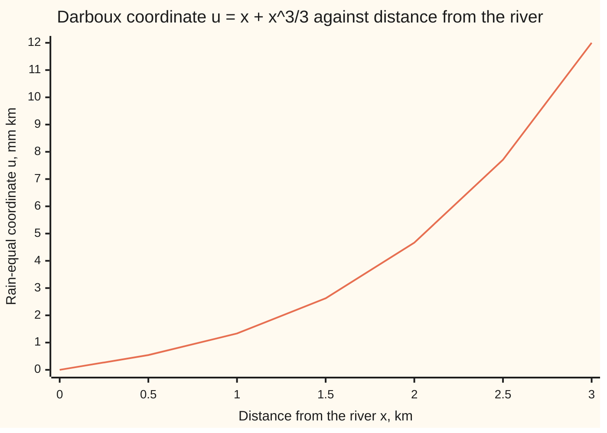

# Darboux's theorem: every symplectic form looks the same up close

[Syllabus](../../../SYLLABUS.md) → [Differential geometry and Lie groups](../README.md) → [Differential Forms](../README.md#s04) → Darboux's theorem

---

## General Overview

After a storm, rain lies on a valley floor beside a river. Measure $`x`$ in km out from the river and $`y`$ in km along it. The rain is 1 mm deep at the river and deepens away from it: $`1 + x^2`$ mm at $`x`$ km out. That is 2 mm at 1 km and 10 mm at the valley side, 3 km out.

A flood team wants a grid in which every square cell holds the same rain. The plain km grid fails. One km along the river, the strip from the river to 1 km out holds 1.333333 mm km² (one mm km² is 1,000 m³ of water). The next strip out holds 3.333333 mm km², and the one after that 7.333333.

The fix is to measure across the valley in a new unit, $`u = x + x^3/3`$, and keep $`v = y`$. The first strip then runs from $`u`$ = 0 to 1.333333, the second from 1.333333 to 4.666667, the third from 4.666667 to 12. Each strip's width in $`u`$ is exactly its rain. In the $`(u, v)`$ grid every unit square holds 1 mm km², and the first one reaches out to 0.817732 km.

The rain is a **two-form** (a quantity built to be added up over areas, [Differential form](01-forms-and-the-wedge-product.md)): $`\omega = (1 + x^2)\,dx \wedge dy`$. The new coordinates turn it into $`du \wedge dv`$, the plainest two-form there is. **Darboux's theorem** (the one in geometry, not [Darboux's theorem](../../06-Calculus%20and%20analysis/03-What%20Derivatives%20Tell%20You/09-darboux-theorem-for-derivatives.md) on derivatives) says this always works for a **symplectic form** (a two-form that is closed and never degenerate, [Symplectic form](10-symplectic-form-and-hamiltonian-flow.md)). Near any point, some coordinates make it $`dq_1 \wedge dp_1 + \dots + dq_n \wedge dp_n`$: $`n`$ pairs of a position $`q_i`$ and a momentum $`p_i`$.

In the plane every rain map with no dry spot is symplectic, so the rain is a fair first case. From four dimensions up, Darboux coordinates also make it easy to test which surfaces are special: the **Lagrangian** ones, on which the form is zero.

**Near any point, every symplectic form becomes the standard $`dq \wedge dp`$ in suitable coordinates; Moser's trick proves it by sliding the form along a straight path to the standard one and following a flow that undoes each small change, which works because the form is closed and never degenerate.**

**What kind of fact this is:** a theorem, Darboux's, proved on this card in Why it works by Moser's trick; the Poincaré lemma, and solutions of an equation whose rate changes with time, are quoted from their cards. It is local: the coordinates exist near each point, not on the whole space. "Lagrangian" is a definition, and the test for graphs is proved here. Weinstein's neighbourhood theorem is stated with a source, not proved.

### The picture: the rain-equal coordinate across the valley



The line is $`u`$, the rain caught between the river and $`x`$, per km along the river. It steepens because the rain deepens: its slope at $`x`$ is the depth $`1 + x^2`$ mm.

---

## The formula

Notation first. A **symplectic manifold** $`(M, \omega)`$ is a space $`M`$ of even dimension $`2n`$ with a two-form $`\omega`$ that is:

- **closed**: $`d\omega = 0`$, where $`d`$ is the exterior derivative ([Closed and exact forms](04-closed-and-exact-forms-and-the-poincare-lemma.md));
- **nondegenerate**: no nonzero arrow $`\xi`$ has $`\omega(\xi, \eta) = 0`$ for every arrow $`\eta`$ (Greek xi and eta: arrows, not the rain's $`u`$, $`v`$).

Darboux's theorem. For every point $`m`$ of $`M`$ there are coordinates $`(q_1, \dots, q_n, p_1, \dots, p_n)`$ on some neighbourhood $`U`$ of $`m`$ in which

```math
\omega = dq_1 \wedge dp_1 + dq_2 \wedge dp_2 + \dots + dq_n \wedge dp_n \quad \text{on } U
```

**Read it aloud:** near any point, the form is the sum of the signed areas of the shadows on the $`n`$ position–momentum planes, exactly as for the two swings of [Symplectic form](10-symplectic-form-and-hamiltonian-flow.md).

Such coordinates are **Darboux coordinates**. For the rain, $`n = 1`$, $`q_1 = u`$ and $`p_1 = v`$.

Moser's trick, the engine of the proof. Join the standard form $`\omega_0`$ to the given form $`\omega_1`$ by a straight path. Write their difference as $`d\alpha`$. Solve one linear equation for a vector field $`X_t`$, and follow its flow $`\varphi_t`$ for time 1:

```math
\omega_t = \omega_0 + t\,(\omega_1 - \omega_0), \qquad \omega_1 - \omega_0 = d\alpha, \qquad \iota_{X_t}\,\omega_t = -\alpha \quad\Longrightarrow\quad \varphi_1^{*}\,\omega_1 = \omega_0
```

**Read it aloud:** slide from the standard form to the given one; at each moment find the field whose arrows, fed into the current form, give minus alpha; the flow of that field for time one pulls the given form back to the standard one.

Here $`\iota_X`$ feeds the arrow $`X`$ into the first slot of a form, and $`\varphi^{*}`$ is the [Pullback](02-pullback-and-change-of-variables.md). Because $`X_t`$ changes with $`t`$, $`\varphi_t`$ means: start every point at path time 0, move it by $`dz/dt = X_t(z)`$, and read where it is at path time $`t`$. This is not the one-field flow of [Vector field and its flow](../03-Manifolds/07-vector-fields-and-flows.md), and in general $`\varphi_s \circ \varphi_t \neq \varphi_{s+t}`$. For the rain:

```math
\omega_t = (1 + t x^2)\,dx \wedge dy, \qquad \alpha = \tfrac{x^3}{3}\,dy, \qquad X_t = -\frac{x^3}{3\,(1 + t x^2)}\,\partial_x
```

The Lagrangian test. A submanifold $`L`$ (a smooth surface sitting inside $`M`$) is **Lagrangian** when it has dimension $`n`$, half of $`M`$'s, and $`\omega(\xi, \eta) = 0`$ for every two arrows $`\xi`$, $`\eta`$ tangent to it. For the graph of a one-form $`\beta = \beta_1\,dq_1 + \dots + \beta_n\,dq_n`$, the surface $`p = \beta(q)`$ traced by $`s_\beta(q) = (q, \beta(q))`$:

```math
s_\beta^{*}\,\omega = -\,d\beta, \qquad\text{so}\qquad \text{the graph is Lagrangian} \iff d\beta = 0
```

**Read it aloud:** the form, pulled back to the graph, is minus the exterior derivative of beta; so the graph is Lagrangian exactly when beta is closed.

For $`\beta = dS`$, the slopes of one function $`S`$, this is $`-d(dS) = 0`$: every graph $`p = \mathrm{grad}\, S`$ is Lagrangian.

| Symbol | Plain meaning | In our example | Push it up and the answer… |
| --- | --- | --- | --- |
| $`x`$, $`y`$ | km out from the river, km along it | the valley floor, 0 to 3 km out | — |
| $`u`$, $`v`$ | Darboux coordinates: rain-equal distance out, distance along | $`u = x + x^3/3`$ = 1.333333 at 1 km | deeper rain, faster-growing $`u`$ |
| $`q_i`$, $`p_i`$, $`n`$; $`Q_i`$, $`P_i`$ | Darboux coordinates in general (positions, momenta); half the dimension; Step 1's new coordinates | $`n`$ = 1 for the valley, 2 for $`\mathbb{R}^4`$; $`P_1 = p_1 + 2q_2`$ | — |
| $`M`$, $`m`$, $`U`$; $`\xi`$, $`\eta`$ | the space, the chosen point, a neighbourhood of it; two arrows (tangent vectors) at a point | the plane; the river bank $`x = 0`$; $`\partial_{q_1}`$, $`\partial_{p_1}`$ | — |
| $`\omega_0`$, $`\omega_1`$ | standard form; the given form | $`dx \wedge dy`$; $`(1 + x^2)\,dx \wedge dy`$, mm km² | — |
| $`\omega_t`$, $`t`$ | the straight path between them; path time, 0 to 1 | $`(1 + t x^2)\,dx \wedge dy`$ | — |
| $`\alpha`$ | a one-form with $`d\alpha = \omega_1 - \omega_0`$ | $`(x^3/3)\,dy`$ | — |
| $`X_t`$, $`\varphi_t`$, $`z`$, $`a`$ | Moser's field at path time $`t`$; its flow, solved from path time 0; a point, moving in the flow; a point's $`x`$ before the flow | $`\varphi_1`$ sends $`a`$ = 1.333333 to 1.000000 | — |
| $`d`$, $`\iota_X`$, $`\varphi^{*}`$, $`\mathcal{L}_X`$; $`\psi_h`$, $`g`$ | exterior derivative; feed $`X`$ in first; pullback; rate of change riding the flow; in the fold, a short step along $`X_s`$; the pulled-back form on two arrows | — | — |
| $`L`$, $`\beta`$, $`s_\beta`$, $`S`$, $`\lambda`$, $`Q`$ | a submanifold; a one-form; its graph map; a function; $`p_1\,dq_1 + p_2\,dq_2`$; a space of positions | $`S = q_1^2 q_2`$, $`p`$ = (4, 1) at $`q`$ = (1, 2) | — |
| $`b`$ | strength of a magnetic term $`b\,dq_1 \wedge dq_2`$ | 2 | Darboux shift $`P_1 = p_1 + b\,q_2`$ grows |
| $`e_i`$, $`f_i`$, $`r`$; $`\mathrm{Pf}`$, $`a_{ij}`$ | a symplectic basis; an arrow not yet paired; the Pfaffian, a number whose square is the determinant; the form on axes $`i`$ and $`j`$ | $`e_2`$ = (0, 1, −2, 0); Pf = −1 | — |

### When it holds

- **The form is closed.** Then $`\omega_1 - \omega_0`$ is $`d\alpha`$ near the point. Add $`q_1\,dq_2 \wedge dp_1`$ to $`dq \wedge dp`$ and $`d\omega \neq 0`$: the form sends 1.000000 through the boundary of a unit cube in the $`(q_1, q_2, p_1)`$ directions, where $`dq \wedge dp`$ sends 0. No coordinates can fix that.
- **The form is nondegenerate at the point.** Then every form on the path stays nondegenerate nearby. The form $`x\,dx \wedge dy`$ vanishes on the river line; its candidate coordinate $`u = x^2/2`$ gives 0.125000 at both $`x = -0.5`$ and $`x = 0.5`$, so it is no coordinate there. No chart helps: the pullback of 0 is 0, so the form is zero there in every chart, while $`dq \wedge dp`$ is never zero.
- **Only near the point.** The theorem is local, and global facts limit a chart's reach. A sphere minus one point is one Darboux chart, by an equal-area map projection, but onto a disc of the sphere's own area, never the whole plane: Darboux charts keep area.
- **The form is smooth.** Then $`X_t`$ is smooth and its flow exists near the point.

---

## Why it works

### Step 0: do not hunt for the coordinates; slide the form and follow the slide

Finding coordinates directly means solving nonlinear equations. Moser's idea avoids that. Slide from the standard form to the given one along a straight path. At each moment, ask which motion of the points carries the form along exactly that small change.

Two facts make the question answerable. The change $`\omega_1 - \omega_0`$ is closed, so it is $`d\alpha`$ for some $`\alpha`$. The form at each moment is nondegenerate, so the equation $`\iota_X \omega_t = -\alpha`$ has exactly one solution $`X`$. Follow that motion for time 1, and it carries one form onto the other.

### Step 1: at the point itself, linear algebra does it

At the point $`m`$, $`\omega`$ is an alternating bilinear form on the arrows there ([Bilinear forms](../../03-Algebra/07-Eigenvalues%20and%20Symmetric%20Matrices/12-bilinear-forms-and-sylvesters-law.md)). That card proves that such a form regrids into blocks of signed area. The **symplectic Gram–Schmidt** procedure builds the grid:

1. Take the first remaining arrow as $`e_1`$.
2. Take the last remaining arrow $`f`$ it sees, $`\omega(e_1, f) \neq 0`$, and scale it so $`\omega(e_1, f_1) = 1`$. Other choices give other valid grids.
3. Remove from every other arrow $`r`$ its part along the pair: $`r \to r - \omega(r, f_1)\,e_1 + \omega(r, e_1)\,f_1`$.
4. Repeat with what is left.

Nondegeneracy guarantees step 2 always finds a partner. The result has $`\omega(e_i, f_j) = 1`$ when $`i = j`$ and every other pairing 0.

A worked case: a charged particle moving in a plane under a magnetic field. With ordinary momentum, its form picks up a magnetic term, $`\omega = dq_1 \wedge dp_1 + dq_2 \wedge dp_2 + b\,dq_1 \wedge dq_2`$ with $`b`$ = 2. Its **Pfaffian** is a number built from the form's coefficients whose square is the determinant, so it is zero exactly when the form is degenerate. In the order $`(q_1, q_2, p_1, p_2)`$, with $`a_{ij}`$ the form on axes $`i`$ and $`j`$, $`\mathrm{Pf} = a_{12}a_{34} - a_{13}a_{24} + a_{14}a_{23} = 2 \times 0 - 1 \times 1 + 0 \times 0 = -1`$. It is not 0, so the form is nondegenerate. The arrow $`e_1 = \partial_{q_1}`$ sees $`\partial_{q_2}`$ and $`\partial_{p_1}`$; taking the last, Gram–Schmidt returns $`e_1`$ = (1, 0, 0, 0), $`e_2`$ = (0, 1, −2, 0), $`f_1`$ = (0, 0, 1, 0), $`f_2`$ = (0, 0, 0, 1).

Read as coordinates: the point $`z = Q_1 e_1 + Q_2 e_2 + P_1 f_1 + P_2 f_2`$ has $`p_1 = P_1 - 2Q_2`$ and its other coordinates unchanged, so $`P_1 = p_1 + 2 q_2`$ and $`Q_1`$, $`Q_2`$, $`P_2`$ are $`q_1`$, $`q_2`$, $`p_2`$. By hand: $`dq_1 \wedge d(p_1 + 2q_2) = dq_1 \wedge dp_1 + 2\,dq_1 \wedge dq_2`$. Both grids match $`dq \wedge dp`$ to 0.000000; leaving the grid unchanged misses by 2.000000.

This form is the same at every point, so Step 1 alone finishes it. For a form that varies, Step 1 makes it agree with $`\omega_0`$ at $`m`$ only. Steps 2 to 5 spread that agreement to a neighbourhood.

### Step 2: the difference is exact near the point

Both forms are closed, so their difference is closed. On a ball around $`m`$, the Poincaré lemma writes it as $`d\alpha`$ ([Closed and exact forms](04-closed-and-exact-forms-and-the-poincare-lemma.md)). Its radial formula gives an $`\alpha`$ that is zero at $`m`$.

For the rain, $`\omega_1 - \omega_0 = x^2\,dx \wedge dy`$. One choice is $`\alpha = (x^3/3)\,dy`$: indeed $`d\big((x^3/3)\,dy\big) = x^2\,dx \wedge dy`$. It is zero all along the river, $`x = 0`$.

### Step 3: every form on the path stays nondegenerate near the point

After Step 1, $`\omega_0`$ and $`\omega_1`$ agree at $`m`$, so $`\omega_t = \omega_0`$ at $`m`$ for every $`t`$. Nondegeneracy means the Pfaffian is not zero, and the Pfaffian depends continuously on the point and on $`t`$. It is nonzero at $`m`$ for all $`t`$ in $`[0, 1]`$, a closed and bounded range, so it stays nonzero on a whole neighbourhood for all $`t`$ at once.

For the rain, $`\omega_t = (1 + t x^2)\,dx \wedge dy`$, and $`1 + t x^2 \ge 1`$ everywhere. The whole plane works.

### Step 4: solve Moser's equation, a linear equation at each point

Because $`\omega_t`$ is nondegenerate, $`\iota_X \omega_t = -\alpha`$ has exactly one solution $`X_t`$, found by linear algebra point by point. For the rain:

```math
\iota_X\big((1 + t x^2)\,dx \wedge dy\big) = (1 + t x^2)\,(X^x\,dy - X^y\,dx) = -\tfrac{x^3}{3}\,dy
```

**Read it aloud:** feeding the arrow into the current form gives its across part times dy minus its along part times dx, scaled by the depth; this must equal minus alpha.

Match the $`dx`$ and $`dy`$ parts: $`X^y = 0`$ and $`X^x = -x^3/(3(1 + t x^2))`$. The field points toward the river and is zero on it. In general $`X_t`$ is zero at $`m`$, because $`\alpha`$ is, so $`m`$ never moves. The rate changes with $`t`$, but [The Picard-Lindelof theorem](../../08-Differential%20equations%20and%20dynamics/02-Existence%2C%20Uniqueness%20and%20Sensitivity/02-lipschitz-and-the-picard-lindelof-theorem.md) still gives one solution from each start. By [Gronwall's inequality](../../08-Differential%20equations%20and%20dynamics/02-Existence%2C%20Uniqueness%20and%20Sensitivity/04-gronwall-and-continuous-dependence.md), starts near $`m`$ stay near $`m`$, so their solutions last to $`t = 1`$.

### Step 5: the flow carries the path back to the start

Ride the flow and watch the pulled-back form $`\varphi_t^{*}\omega_t`$. It changes for two reasons: the points move, and the form itself changes with $`t`$. Cartan's formula, $`\mathcal{L}_X = d\,\iota_X + \iota_X\,d`$ on forms (quoted on [Symplectic form](10-symplectic-form-and-hamiltonian-flow.md)), handles the first:

```math
\frac{d}{dt}\,\varphi_t^{*}\omega_t = \varphi_t^{*}\Big(\mathcal{L}_{X_t}\omega_t + \frac{d\omega_t}{dt}\Big) = \varphi_t^{*}\big(d\,\iota_{X_t}\omega_t + \iota_{X_t}\,d\omega_t + d\alpha\big) = \varphi_t^{*}\big(-d\alpha + 0 + d\alpha\big) = 0
```

**Read it aloud:** the rate of change of the pulled-back form is the flow's part plus the path's part; the flow's part is minus d alpha, by Moser's equation and because the form is closed; the path's part is plus d alpha; they cancel.

So $`\varphi_1^{*}\omega_1 = \varphi_0^{*}\omega_0 = \omega_0`$. Read through $`\varphi_1`$, the given form is the standard one. The Darboux coordinates are the standard ones carried by $`\varphi_1^{-1}`$, after Step 1's linear change.

<details>
<summary>Detailed proof: why the rate of change has exactly those two parts</summary>

Fix a point and two arrows $`\xi`$, $`\eta`$ there. Let $`g(s, t) = (\varphi_s^{*}\omega_t)(\xi, \eta)`$, a number depending on the flow time $`s`$ and the path time $`t`$. The quantity we follow is $`g(t, t)`$. By the chain rule,

$`\displaystyle \frac{d}{dt}\,g(t, t) = \frac{\partial g}{\partial s}(t, t) + \frac{\partial g}{\partial t}(t, t).`$

The second part is $`\varphi_t^{*}(d\omega_t/dt)`$, because pullback by a fixed map is linear. For the first, the flow of a time-dependent field obeys $`\varphi_{s+h} = \psi_h \circ \varphi_s`$ to first order in $`h`$, where $`\psi_h`$ moves along $`X_s`$ for time $`h`$. So

$`\displaystyle \frac{\partial}{\partial s}\,\varphi_s^{*}\omega = \varphi_s^{*}\Big(\lim_{h \to 0} \frac{\psi_h^{*}\omega - \omega}{h}\Big) = \varphi_s^{*}\,\mathcal{L}_{X_s}\omega,`$

which is the definition of the Lie derivative $`\mathcal{L}_X`$ of a form. Adding the parts gives the first equality of Step 5. Cartan's formula and $`d\omega_t = 0`$ give the rest. On a compact, connected $`M`$ the same argument, with $`\alpha`$ defined on all of $`M`$, is Moser's 1965 theorem: two volume forms with the same total volume are carried onto each other.

</details>

### Step 6: the valley, traced through the flow

For the rain the flow can be followed by hand. Along the flow, $`x + t x^3/3`$ never changes:

```math
\frac{d}{dt}\Big(x + \frac{t x^3}{3}\Big) = X^x\,(1 + t x^2) + \frac{x^3}{3} = -\frac{x^3}{3} + \frac{x^3}{3} = 0
```

At $`t = 0`$ it is the start point $`a`$, a value of $`x`$; at $`t = 1`$ it is $`x + x^3/3`$. So $`\varphi_1`$ sends $`a`$ to the $`x`$ with $`x + x^3/3 = a`$. The flow is the inverse of $`u`$, and $`u = x + x^3/3`$ is the Darboux coordinate.

In the code, RK4 (the classical fourth-order Runge–Kutta step) from $`a`$ = 1.333333 lands at 1.000000, with error 7.3e-09 at 40 steps and 4.5e-10 at 80; Cardano's formula (the closed-form root of a cubic) and Newton's method agree. Halfway, at $`t`$ = 0.5, the point is at 1.107148, and $`x + t x^3/3`$ is still 1.333333.

The pullback is right too: $`(1 + x^2)\,dx/da = 2 \times 0.5 = 1`$, so $`\varphi_1^{*}\omega_1 = 1\,da \wedge dy`$. From $`a`$ = 4.666667 the flow is steeper. RK4 lands at 1.999985 with 80 steps (error 1.5e-05; 2.2e-04 with 40), and Cardano gives 2.000000.

### Step 7: Lagrangian submanifolds, and the test for graphs

In Darboux coordinates on $`\mathbb{R}^4`$, $`\omega = dq_1 \wedge dp_1 + dq_2 \wedge dp_2`$. On the swings of [Symplectic form](10-symplectic-form-and-hamiltonian-flow.md), $`q`$ are the two angles and $`p`$ the two momenta.

- **The plane of the $`q_1`$ and $`q_2`$ axes** (both seats at rest, any angles): $`\omega(\partial_{q_1}, \partial_{q_2})`$ = 0.000000. It is Lagrangian.
- **The plane of $`q_1`$ and $`p_1`$** (swing 2 still, swing 1 anything): $`\omega(\partial_{q_1}, \partial_{p_1})`$ = 1.000000. It is not.

For a graph $`p = \beta(q)`$, substitute $`p_i = \beta_i(q)`$, differentials included:

```math
s_\beta^{*}\,\omega = \sum_i dq_i \wedge d\beta_i = -\sum_i d\beta_i \wedge dq_i = -\,d\beta
```

**Read it aloud:** on the graph each dp becomes d of beta's component; swapping the wedge's order costs a minus sign, and what is left is minus d beta.

For $`S = q_1^2 q_2`$, $`p = \mathrm{grad}\, S = (2 q_1 q_2,\ q_1^2)`$, which is (4, 1) at $`q`$ = (1, 2). Then $`dq_1 \wedge (2q_2\,dq_1 + 2q_1\,dq_2) + dq_2 \wedge 2q_1\,dq_1 = 2q_1\,dq_1 \wedge dq_2 - 2q_1\,dq_1 \wedge dq_2 = 0`$. The graph is Lagrangian; the code finds $`|\omega|`$ = 0.0e+00 at three points. For $`\beta = q_1\,dq_2`$, $`d\beta = dq_1 \wedge dq_2`$, and $`\omega`$ on the graph is −1.000000 at every point. Not Lagrangian.

A second road needs no tangent arrows. The one-form $`\lambda = p_1\,dq_1 + p_2\,dq_2`$ has $`d\lambda = -\omega`$. By [Stokes on manifolds](06-stokes-theorem-on-manifolds.md), its integral round a loop on a surface is minus $`\omega`$ summed over the patch inside. Round the square $`1 \le q_1, q_2 \le 2`$ carried onto each graph:

- on $`p = \mathrm{grad}\, S`$, $`\oint \lambda = \oint dS`$ = 0.000000;
- on $`p = (0, q_1)`$, $`\oint \lambda`$ = 1.000000, minus the −1 per unit area;
- round the unit square in the $`(q_1, p_1)`$ plane, $`\oint \lambda`$ = −1.000000, minus its $`\omega`$ = 1.

The $`q`$-plane, $`p = 0`$, is the graph of $`\beta = 0`$. In the cotangent bundle $`T^{*}Q`$ of a space of positions $`Q`$ (all pairs of a position in $`Q`$ and a covector there) it is called the **zero section**. **Weinstein's neighbourhood theorem** (stated, not proved; Weinstein 1971) says every compact Lagrangian $`L`$ looks like this. Some neighbourhood of $`L`$ matches a neighbourhood of the zero section in $`T^{*}L`$, with $`\omega`$ matching $`dq \wedge dp`$. Nearby Lagrangians that are graphs over $`L`$ are then exactly the graphs of closed one-forms on $`L`$.

---

## Worked numbers, by hand

| Step | Arithmetic | Value |
| --- | --- | --- |
| rain at 1 km, 2 km, 3 km | 1 + 1², 1 + 2², 1 + 3² | 2, 5, 10 mm |
| Darboux coordinate at 1 km | 1 + 1³/3 | $`u`$ = 1.333333 |
| check $`du = (1 + x^2)\,dx`$ at 1 km | slope of $`x + x^3/3`$: 1 + 1² | 2.000000 |
| rain in the strip 1 to 2 km out | (2 + 8/3) − (1 + 1/3) | 3.333333 mm km² |
| kept quantity at the end | $`x + x^3/3`$ = 4/3 | $`x`$ = 1 |
| graph of grad S at $`q`$ = (1, 2) | (2 × 1 × 2, 1²) | $`p`$ = (4, 1), $`\omega`$ = 0 |
| pullback check | (1 + 1²) × 0.5 | **1: the flow sends 1.333333 to 1.000000 and turns the rain into $`1\,da \wedge dy`$** |

Measured in $`u = x + x^3/3`$ across and km along, the valley's rain is one mm km² per unit square, exactly what Moser's flow builds.

### What breaks if you drop a piece

| Mistake | Comes out at | What went wrong |
| --- | --- | --- |
| A form that vanishes: $`x\,dx \wedge dy`$ | $`u = x^2/2`$ is 0.125000 at both $`x = -0.5`$ and 0.5 | Zero on the river line in every chart, so no Darboux chart there |
| A form that is not closed: add $`q_1\,dq_2 \wedge dp_1`$ | 1.000000 through the unit cube's boundary, against 0.000000 for $`dq \wedge dp`$ | $`d\omega \neq 0`$; coordinates cannot change that |
| Skip Step 1: path from $`dq \wedge dp`$ to $`dq_1 \wedge dp_1 - dq_2 \wedge dp_2`$ | $`\omega_t`$ degenerate at $`t`$ = 0.500000 | The ends' Pfaffians have opposite signs, so the path must cross a degenerate form; Step 1 makes the ends agree at $`m`$ |
| Graph of a one-form that is not closed, $`\beta = q_1\,dq_2`$ | $`\omega`$ = −1.000000 on it; loop of $`p\,dq`$ = 1.000000 | $`d\beta \neq 0`$, so not Lagrangian |

The code prints all four.

---

## Code, from first principles, and it actually runs

Nothing is imported but `math`. The code takes five independent roads. The Darboux coordinate's slope by finite differences is checked against the rain depth, and each strip's rain by the midpoint rule against its $`u`$-width, at two cell counts. Moser's flow, stepped by RK4 at two step counts, is checked against Cardano's formula and Newton's method, and its pullback by finite differences. Symplectic Gram–Schmidt is checked against the shift found by hand. Each Lagrangian test is done both by $`\omega`$ on tangent arrows and by the loop integral of $`p\,dq`$.

### Python

```python
# Darboux's theorem and Moser's trick -- the check behind the card.  Standard library only.
# Part 1, the plane: rain lies 1 + x^2 mm deep at x km from a river, the form w1 = (1 + x^2) dx^dy.
# Darboux coordinates u = x + x^3/3, v = y.  Roads: du/dx by finite differences against 1 + x^2;
# rain in a strip by the midpoint rule against the strip's u-width; Moser's flow, stepped by RK4,
# against Cardano's formula and Newton's method for x + x^3/3 = u.  Part 2: a constant form on R^4
# brought to dq^dp by symplectic Gram-Schmidt, against the shift P1 = p1 + b q2 found by hand.
# Part 3: Lagrangian tests, by w on tangent pairs and by the loop integral of p dq.  Part 4: breaks.
import math
def f6(x): return f"{x + 0.0:.6f}"
def u_of(x, k=2): return x + x ** (k + 1) / (k + 1)
def cardano(u):                              # the real root of x^3 + 3x - 3u = 0
    r = math.sqrt(9 * u * u / 4 + 1)
    return math.cbrt(1.5 * u + r) - math.cbrt(r - 1.5 * u)
def newton(u):
    x = u
    for _ in range(60): x -= (u_of(x) - u) / (1 + x * x)
    return x
def X(t, x, k=2, s=1.0):                     # Moser's field: iota_X w_t = -s alpha, alpha = x^(k+1)/(k+1) dy
    return -s * x ** (k + 1) / ((k + 1) * (1 + t * x ** k))
def moser(a, n, T=1.0, k=2, s=1.0):          # RK4 on dx/dt = X(t, x) from x = a, t = 0 to T
    x, h = a, T / n
    for j in range(n):
        t = j * h
        k1 = X(t, x, k, s); k2 = X(t + h / 2, x + h / 2 * k1, k, s)
        k3 = X(t + h / 2, x + h / 2 * k2, k, s); k4 = X(t + h, x + h * k3, k, s)
        x += h / 6 * (k1 + 2 * k2 + 2 * k3 + k4)
    return x
print("chart, u = x + x^3/3 at x = 0, 0.5, ..., 3 [" + ", ".join(f"{u_of(i / 2):.4f}" for i in range(7)) + "]")
for x in (0.0, 1.0, 2.0, 3.0):
    d = (u_of(x + 1e-5) - u_of(x - 1e-5)) / 2e-5
    print(f"x = {x:.0f} km: rain 1 + x^2 = {f6(1 + x * x)} mm, du/dx by differences {f6(d)}")
    assert abs(d - (1 + x * x)) < 1e-8
for a, b in ((0, 1), (1, 2), (2, 3)):
    mids = [abs(sum(1 + (a + (i + 0.5) / n) ** 2 for i in range(n)) / n - (u_of(b) - u_of(a))) for n in (10, 100)]
    print(f"strip {a}-{b} km out, 1 km along: rain {f6(u_of(b) - u_of(a))} mm km^2 = u-width;"
          f" midpoint error {mids[0]:.1e} (10 cells), {mids[1]:.1e} (100)")
    assert mids[1] < mids[0] / 50 and mids[1] < 1e-4
print("one unit square in (u, v) reaches out to x =", f6(cardano(1.0)), "km; check u(x) =", f6(u_of(cardano(1.0))))
for x in (1.0, 2.0):
    a = u_of(x)
    e1, e2 = abs(moser(a, 40) - x), abs(moser(a, 80) - x)
    print(f"Moser flow from a = {f6(a)}: lands at {f6(moser(a, 80))}; Cardano {f6(cardano(a))}, Newton {f6(newton(a))};"
          f" RK4 error {e1:.1e} (40 steps), {e2:.1e} (80)")
    assert abs(cardano(a) - x) < 1e-12 and abs(newton(a) - x) < 1e-12 and e2 < e1 / 8 and e2 < 1e-4
xm = moser(4 / 3, 200, 0.5)
print("halfway, t = 0.5: x =", f6(xm), "and x + t x^3/3 =", f6(xm + 0.5 * xm ** 3 / 3), "(kept)")
assert abs(xm + 0.5 * xm ** 3 / 3 - 4 / 3) < 1e-10
dxda = (moser(4 / 3 + 1e-5, 200) - moser(4 / 3 - 1e-5, 200)) / 2e-5
print("pullback at a = 4/3: (1 + x^2) dx/da =", f6(2), "x", f6(dxda), "=", f6((1 + moser(4 / 3, 200) ** 2) * dxda), "(w0 = 1 da^dy)")
assert abs((1 + moser(4 / 3, 200) ** 2) * dxda - 1) < 1e-7
def wA(A, u, v): return sum(u[i] * A[i][j] * v[j] for i in range(4) for j in range(4))
def form(entries):                           # antisymmetric 4x4 matrix in the order (q1, q2, p1, p2)
    A = [[0.0] * 4 for _ in range(4)]
    for (i, j), c in entries.items(): A[i][j], A[j][i] = c, -c
    return A
def pf(A): return A[0][1] * A[2][3] - A[0][2] * A[1][3] + A[0][3] * A[1][2]
def gram_schmidt(A):                         # symplectic Gram-Schmidt: returns e1, e2, f1, f2
    rest, es, fs = [[float(i == j) for i in range(4)] for j in range(4)], [], []
    while rest:                              # pair the first arrow with the last one it sees
        e = rest.pop(0)
        f = rest.pop(max(i for i, r in enumerate(rest) if abs(wA(A, e, r)) > 1e-12))
        f = [c / wA(A, e, f) for c in f]
        es.append(e); fs.append(f)
        rest = [[r[i] - wA(A, r, f) * e[i] + wA(A, r, e) * f[i] for i in range(4)] for r in rest]
    return es + fs
def dev(A, P):                               # largest gap between P^T A P and the standard matrix J
    J = form({(0, 2): 1.0, (1, 3): 1.0})
    return max(abs(wA(A, P[i], P[j]) - J[i][j]) for i in range(4) for j in range(4))
B = 2.0
A = form({(0, 2): 1.0, (1, 3): 1.0, (0, 1): B})  # dq1^dp1 + dq2^dp2 + b dq1^dq2
P = gram_schmidt(A)
def vec(v): return "(" + ", ".join(f"{c + 0.0:g}" for c in v) + ")"
print("magnetic form, b = 2: Pfaffian", f6(pf(A)), "| Gram-Schmidt e1, e2, f1, f2 =", ", ".join(vec(v) for v in P))
hand = [[1, 0, 0, 0], [0, 1, -B, 0], [0, 0, 1, 0], [0, 0, 0, 1]]   # z for unit steps of Q1, Q2, P1 = p1 + b q2, P2
ident = [[float(i == j) for i in range(4)] for j in range(4)]
print("largest gap from dq^dp: Gram-Schmidt", f6(dev(A, P)), "| shift P1 = p1 + 2 q2", f6(dev(A, hand)), "| no change", f6(dev(A, ident)))
assert dev(A, P) < 1e-12 and dev(A, hand) < 1e-12 and abs(dev(A, ident) - B) < 1e-12 and P[1] == [0, 1, -B, 0]
W = form({(0, 2): 1.0, (1, 3): 1.0})
E = ident
print("plane of q1, q2: w =", f6(wA(W, E[0], E[1])), "| plane of q1, p1: w =", f6(wA(W, E[0], E[2])))
def graph(beta):                             # the surface q -> (q1, q2, beta1(q), beta2(q))
    return lambda q1, q2: [q1, q2] + list(beta(q1, q2))
def on(g, pts):                              # w on the surface's tangent pair, by central differences
    out = []
    for q1, q2 in pts:
        t1 = [(a - b) / 2e-5 for a, b in zip(g(q1 + 1e-5, q2), g(q1 - 1e-5, q2))]
        t2 = [(a - b) / 2e-5 for a, b in zip(g(q1, q2 + 1e-5), g(q1, q2 - 1e-5))]
        out.append(wA(W, t1, t2))
    return out
def worst(g, pts): return max(abs(w) for w in on(g, pts))
def loop(g, n=400):                          # p dq round the surface g's square 1 <= s, t <= 2, anticlockwise
    c = [(1 + i / n, 1.0) for i in range(n)] + [(2.0, 1 + i / n) for i in range(n)]
    c += [(2 - i / n, 2.0) for i in range(n)] + [(1.0, 2 - i / n) for i in range(n)]
    tot = 0.0
    for (a1, a2), (b1, b2) in zip(c, c[1:] + c[:1]):
        m, ga, gb = g((a1 + b1) / 2, (a2 + b2) / 2), g(a1, a2), g(b1, b2)
        tot += m[2] * (gb[0] - ga[0]) + m[3] * (gb[1] - ga[1])
    return tot
pts = [(1.0, 2.0), (0.5, -1.0), (2.0, 3.0)]
gS, gB = graph(lambda a, b: (2 * a * b, a * a)), graph(lambda a, b: (0.0, a))
print("graph p = grad S, S = q1^2 q2: at q = (1, 2), p =", vec(gS(1.0, 2.0)[2:]), "| largest |w|", f"{worst(gS, pts):.1e}", "| loop of p dq", f6(abs(loop(gS))))
print("graph p = (0, q1), from beta = q1 dq2: w =", ", ".join(f6(w) for w in on(gB, pts)), "| loop of p dq", f6(loop(gB)))
sq = loop(lambda s, t: [s, 0.0, t, 0.0])    # the (q1, p1) plane: the unit square 1 <= q1, p1 <= 2
print("plane of q1, p1, unit square anticlockwise: loop of p dq", f6(sq), "= minus w on it")
assert worst(gS, pts) < 1e-8 and abs(loop(gS)) < 1e-9 and abs(loop(gB) - 1) < 1e-9 and max(abs(w + 1) for w in on(gB, pts)) < 1e-8
assert abs(sq + wA(W, E[0], E[2])) < 1e-12
assert wA(W, E[0], E[1]) == 0.0
print("break, w = x dx^dy: u = x^2/2 gives", f6(0.5 ** 2 / 2), "at x = -0.5 and", f6((-0.5) ** 2 / 2), "at x = 0.5")
def flux(Af, n=10):                          # w over the boundary of the unit cube in (q1, q2, p1)
    tot = 0.0
    for k in range(3):
        a, b = (k + 1) % 3, (k + 2) % 3
        for c, sgn in ((1.0, 1), (0.0, -1)):
            for i in range(n):
                for j in range(n):
                    z = [0.0] * 4; z[k], z[a], z[b] = c, (i + 0.5) / n, (j + 0.5) / n
                    ta, tb = [float(m == a) for m in range(4)], [float(m == b) for m in range(4)]
                    tot += sgn * wA(Af(z), ta, tb) / n / n
    return tot
bad = lambda z: form({(0, 2): 1.0, (1, 3): 1.0, (1, 2): z[0]})   # adds q1 dq2^dp1
print("break, w + q1 dq2^dp1: Pfaffian", f6(pf(bad([0.5] * 4))), "; w through the cube's boundary", f6(flux(bad)), "against", f6(flux(lambda z: W)), "for dq^dp")
assert abs(flux(bad) - 1) < 1e-12 and abs(flux(lambda z: W)) < 1e-12
lo, hi = 0.0, 1.0                            # straight path from dq^dp to dq1^dp1 - dq2^dp2: Pfaffian = 0 where?
for _ in range(60):
    mid = (lo + hi) / 2
    if pf(form({(0, 2): 1.0, (1, 3): 1 - 2 * lo})) * pf(form({(0, 2): 1.0, (1, 3): 1 - 2 * mid})) <= 0: hi = mid
    else: lo = mid
print("break, path without the linear step: w_t degenerate at t =", f6(lo))
assert abs(lo - 0.5) < 1e-9
xw = moser(4 / 3, 200, s=-1.0)
print("break, sign of alpha flipped: flow lands at", f6(xw), "where u =", f6(u_of(xw)), "not 4/3")
print("try: rain 1 + x^4, flow from 1.2 lands at", f6(moser(1.2, 200, k=4)), "| RK4 5 steps error", f"{abs(moser(4 / 3, 5) - 1):.1e}")
A5 = form({(0, 2): 1.0, (1, 3): 1.0, (0, 1): 5.0})
print("try: b = 5, e2 =", vec(gram_schmidt(A5)[1]), "gap", f6(dev(A5, gram_schmidt(A5))),
      "| S = q1^3 + q2^2, largest |w|", f"{worst(graph(lambda a, b: (3 * a * a, 2 * b)), pts):.1e}")
assert abs(moser(1.2, 200, k=4) - 1) < 1e-9 and abs(u_of(xw) - 4 / 3) > 0.5
print("ALL CHECKS PASS")
```

**Ran 2026-11-24 on macOS, Python 3.14.10, standard library only. All checks passed. Output, pasted from the run:**

```
chart, u = x + x^3/3 at x = 0, 0.5, ..., 3 [0.0000, 0.5417, 1.3333, 2.6250, 4.6667, 7.7083, 12.0000]
x = 0 km: rain 1 + x^2 = 1.000000 mm, du/dx by differences 1.000000
x = 1 km: rain 1 + x^2 = 2.000000 mm, du/dx by differences 2.000000
x = 2 km: rain 1 + x^2 = 5.000000 mm, du/dx by differences 5.000000
x = 3 km: rain 1 + x^2 = 10.000000 mm, du/dx by differences 10.000000
strip 0-1 km out, 1 km along: rain 1.333333 mm km^2 = u-width; midpoint error 8.3e-04 (10 cells), 8.3e-06 (100)
strip 1-2 km out, 1 km along: rain 3.333333 mm km^2 = u-width; midpoint error 8.3e-04 (10 cells), 8.3e-06 (100)
strip 2-3 km out, 1 km along: rain 7.333333 mm km^2 = u-width; midpoint error 8.3e-04 (10 cells), 8.3e-06 (100)
one unit square in (u, v) reaches out to x = 0.817732 km; check u(x) = 1.000000
Moser flow from a = 1.333333: lands at 1.000000; Cardano 1.000000, Newton 1.000000; RK4 error 7.3e-09 (40 steps), 4.5e-10 (80)
Moser flow from a = 4.666667: lands at 1.999985; Cardano 2.000000, Newton 2.000000; RK4 error 2.2e-04 (40 steps), 1.5e-05 (80)
halfway, t = 0.5: x = 1.107148 and x + t x^3/3 = 1.333333 (kept)
pullback at a = 4/3: (1 + x^2) dx/da = 2.000000 x 0.500000 = 1.000000 (w0 = 1 da^dy)
magnetic form, b = 2: Pfaffian -1.000000 | Gram-Schmidt e1, e2, f1, f2 = (1, 0, 0, 0), (0, 1, -2, 0), (0, 0, 1, 0), (0, 0, 0, 1)
largest gap from dq^dp: Gram-Schmidt 0.000000 | shift P1 = p1 + 2 q2 0.000000 | no change 2.000000
plane of q1, q2: w = 0.000000 | plane of q1, p1: w = 1.000000
graph p = grad S, S = q1^2 q2: at q = (1, 2), p = (4, 1) | largest |w| 0.0e+00 | loop of p dq 0.000000
graph p = (0, q1), from beta = q1 dq2: w = -1.000000, -1.000000, -1.000000 | loop of p dq 1.000000
plane of q1, p1, unit square anticlockwise: loop of p dq -1.000000 = minus w on it
break, w = x dx^dy: u = x^2/2 gives 0.125000 at x = -0.5 and 0.125000 at x = 0.5
break, w + q1 dq2^dp1: Pfaffian -1.000000 ; w through the cube's boundary 1.000000 against 0.000000 for dq^dp
break, path without the linear step: w_t degenerate at t = 0.500000
break, sign of alpha flipped: flow lands at 2.005871 where u = 4.696091 not 4/3
try: rain 1 + x^4, flow from 1.2 lands at 1.000000 | RK4 5 steps error 3.1e-05
try: b = 5, e2 = (0, 1, -5, 0) gap 0.000000 | S = q1^3 + q2^2, largest |w| 0.0e+00
ALL CHECKS PASS
```

### Rust

```rust
// Darboux's theorem and Moser's trick -- the check behind the card.  std only.
// Part 1, the plane: rain lies 1 + x^2 mm deep at x km from a river, the form w1 = (1 + x^2) dx^dy.
// Darboux coordinates u = x + x^3/3, v = y.  Roads: du/dx by finite differences against 1 + x^2;
// rain in a strip by the midpoint rule against the strip's u-width; Moser's flow, stepped by RK4,
// against Cardano's formula and Newton's method for x + x^3/3 = u.  Part 2: a constant form on R^4
// brought to dq^dp by symplectic Gram-Schmidt, against the shift P1 = p1 + b q2 found by hand.
// Part 3: Lagrangian tests, by w on tangent pairs and by the loop integral of p dq.  Part 4: breaks.
type M4 = [[f64; 4]; 4];
fn f6(x: f64) -> String { format!("{:.6}", x + 0.0) }
fn sci(x: f64) -> String { // Python's .1e: two-digit exponent with its sign
    let s = format!("{:.1e}", x);
    let (m, e) = s.split_once('e').unwrap();
    let n: i32 = e.parse().unwrap();
    format!("{}e{}{:02}", m, if n < 0 { '-' } else { '+' }, n.abs())
}
fn u_of(x: f64, k: i32) -> f64 { x + x.powf((k + 1) as f64) / (k + 1) as f64 }
fn cardano(u: f64) -> f64 { // the real root of x^3 + 3x - 3u = 0
    let r = (9.0 * u * u / 4.0 + 1.0).sqrt();
    (1.5 * u + r).cbrt() - (r - 1.5 * u).cbrt()
}
fn newton(u: f64) -> f64 { (0..60).fold(u, |x, _| x - (u_of(x, 2) - u) / (1.0 + x * x)) }
fn xf(t: f64, x: f64, k: i32, s: f64) -> f64 { // Moser's field: iota_X w_t = -s alpha, alpha = x^(k+1)/(k+1) dy
    -s * x.powf((k + 1) as f64) / ((k + 1) as f64 * (1.0 + t * x.powf(k as f64)))
}
fn moser(a: f64, n: usize, tt: f64, k: i32, s: f64) -> f64 { // RK4 on dx/dt = X(t, x) from x = a, t = 0 to T
    let (mut x, h) = (a, tt / n as f64);
    for j in 0..n {
        let t = j as f64 * h;
        let k1 = xf(t, x, k, s); let k2 = xf(t + h / 2.0, x + h / 2.0 * k1, k, s);
        let k3 = xf(t + h / 2.0, x + h / 2.0 * k2, k, s); let k4 = xf(t + h, x + h * k3, k, s);
        x += h / 6.0 * (k1 + 2.0 * k2 + 2.0 * k3 + k4);
    }
    x
}
fn w_a(a: &M4, u: &[f64], v: &[f64]) -> f64 { (0..16).fold(0.0, |s, m| s + u[m / 4] * a[m / 4][m % 4] * v[m % 4]) }
fn form(entries: &[((usize, usize), f64)]) -> M4 { // antisymmetric 4x4 matrix in the order (q1, q2, p1, p2)
    let mut a = [[0.0; 4]; 4];
    for &((i, j), c) in entries { a[i][j] = c; a[j][i] = -c; }
    a
}
fn pf(a: &M4) -> f64 { a[0][1] * a[2][3] - a[0][2] * a[1][3] + a[0][3] * a[1][2] }
fn axis(i: usize) -> Vec<f64> { (0..4).map(|m| if m == i { 1.0 } else { 0.0 }).collect() }
fn gram_schmidt(a: &M4) -> Vec<Vec<f64>> { // symplectic Gram-Schmidt: returns e1, e2, f1, f2
    let (mut rest, mut es, mut fs): (Vec<Vec<f64>>, Vec<Vec<f64>>, Vec<Vec<f64>>) = ((0..4).map(axis).collect(), vec![], vec![]);
    while !rest.is_empty() { // pair the first arrow with the last one it sees
        let e = rest.remove(0);
        let k = (0..rest.len()).filter(|&i| w_a(a, &e, &rest[i]).abs() > 1e-12).max().unwrap();
        let f0 = rest.remove(k);
        let f: Vec<f64> = f0.iter().map(|c| c / w_a(a, &e, &f0)).collect();
        rest = rest.iter().map(|r| { let (x, y) = (w_a(a, r, &f), w_a(a, r, &e)); (0..4).map(|i| r[i] - x * e[i] + y * f[i]).collect() }).collect();
        es.push(e); fs.push(f);
    }
    es.extend(fs);
    es
}
fn dev(a: &M4, p: &[Vec<f64>]) -> f64 { // largest gap between P^T A P and the standard matrix J
    let j = form(&[((0, 2), 1.0), ((1, 3), 1.0)]);
    (0..16).fold(0.0, |m: f64, k| m.max((w_a(a, &p[k / 4], &p[k % 4]) - j[k / 4][k % 4]).abs()))
}
fn vec_s(v: &[f64]) -> String { format!("({})", v.iter().map(|c| format!("{}", c + 0.0)).collect::<Vec<_>>().join(", ")) }
fn on(w: &M4, g: &dyn Fn(f64, f64) -> [f64; 4], pts: &[(f64, f64)]) -> Vec<f64> { // w on the tangent pair, by central differences
    pts.iter().map(|&(q1, q2)| {
        let (a, b, c, d) = (g(q1 + 1e-5, q2), g(q1 - 1e-5, q2), g(q1, q2 + 1e-5), g(q1, q2 - 1e-5));
        let t1: Vec<f64> = (0..4).map(|i| (a[i] - b[i]) / 2e-5).collect();
        let t2: Vec<f64> = (0..4).map(|i| (c[i] - d[i]) / 2e-5).collect();
        w_a(w, &t1, &t2)
    }).collect()
}
fn worst(w: &M4, g: &dyn Fn(f64, f64) -> [f64; 4], pts: &[(f64, f64)]) -> f64 { on(w, g, pts).iter().fold(0.0, |m, x| m.max(x.abs())) }
fn lp(g: &dyn Fn(f64, f64) -> [f64; 4]) -> f64 { // p dq round the surface g's square 1 <= s, t <= 2, anticlockwise
    let (n, nf) = (400, 400.0);
    let mut c: Vec<(f64, f64)> = (0..n).map(|i| (1.0 + i as f64 / nf, 1.0)).collect();
    c.extend((0..n).map(|i| (2.0, 1.0 + i as f64 / nf)));
    c.extend((0..n).map(|i| (2.0 - i as f64 / nf, 2.0)));
    c.extend((0..n).map(|i| (1.0, 2.0 - i as f64 / nf)));
    (0..c.len()).fold(0.0, |tot, i| {
        let ((a1, a2), (b1, b2)) = (c[i], c[(i + 1) % c.len()]);
        let (m, ga, gb) = (g((a1 + b1) / 2.0, (a2 + b2) / 2.0), g(a1, a2), g(b1, b2));
        tot + m[2] * (gb[0] - ga[0]) + m[3] * (gb[1] - ga[1])
    })
}
fn flux(af: &dyn Fn(&[f64]) -> M4) -> f64 { // w over the boundary of the unit cube in (q1, q2, p1)
    let (n, mut tot) = (10, 0.0);
    for k in 0..3 {
        let (a, b) = ((k + 1) % 3, (k + 2) % 3);
        for &(c, sgn) in &[(1.0, 1.0), (0.0, -1.0)] {
            for m in 0..n * n {
                let mut z = [0.0; 4];
                z[k] = c; z[a] = ((m / n) as f64 + 0.5) / n as f64; z[b] = ((m % n) as f64 + 0.5) / n as f64;
                tot += sgn * w_a(&af(&z), &axis(a), &axis(b)) / n as f64 / n as f64;
            }
        }
    }
    tot
}
fn main() {
    let ch: Vec<String> = (0..7).map(|i| format!("{:.4}", u_of(i as f64 / 2.0, 2))).collect();
    println!("chart, u = x + x^3/3 at x = 0, 0.5, ..., 3 [{}]", ch.join(", "));
    for &x in &[0.0f64, 1.0, 2.0, 3.0] {
        let d = (u_of(x + 1e-5, 2) - u_of(x - 1e-5, 2)) / 2e-5;
        println!("x = {:.0} km: rain 1 + x^2 = {} mm, du/dx by differences {}", x, f6(1.0 + x * x), f6(d));
        assert!((d - (1.0 + x * x)).abs() < 1e-8);
    }
    for &(a, b) in &[(0, 1), (1, 2), (2, 3)] {
        let (af, bf) = (a as f64, b as f64);
        let mids: Vec<f64> = [10usize, 100].iter().map(|&n| ((0..n).map(|i| 1.0 + (af + (i as f64 + 0.5) / n as f64).powf(2.0)).sum::<f64>() / n as f64 - (u_of(bf, 2) - u_of(af, 2))).abs()).collect();
        println!("strip {}-{} km out, 1 km along: rain {} mm km^2 = u-width; midpoint error {} (10 cells), {} (100)", a, b, f6(u_of(bf, 2) - u_of(af, 2)), sci(mids[0]), sci(mids[1]));
        assert!(mids[1] < mids[0] / 50.0 && mids[1] < 1e-4);
    }
    println!("one unit square in (u, v) reaches out to x = {} km; check u(x) = {}", f6(cardano(1.0)), f6(u_of(cardano(1.0), 2)));
    for &x in &[1.0f64, 2.0] {
        let a = u_of(x, 2);
        let (e1, e2) = ((moser(a, 40, 1.0, 2, 1.0) - x).abs(), (moser(a, 80, 1.0, 2, 1.0) - x).abs());
        println!("Moser flow from a = {}: lands at {}; Cardano {}, Newton {}; RK4 error {} (40 steps), {} (80)", f6(a), f6(moser(a, 80, 1.0, 2, 1.0)), f6(cardano(a)), f6(newton(a)), sci(e1), sci(e2));
        assert!((cardano(a) - x).abs() < 1e-12 && (newton(a) - x).abs() < 1e-12 && e2 < e1 / 8.0 && e2 < 1e-4);
    }
    let xm = moser(4.0 / 3.0, 200, 0.5, 2, 1.0);
    println!("halfway, t = 0.5: x = {} and x + t x^3/3 = {} (kept)", f6(xm), f6(xm + 0.5 * xm.powf(3.0) / 3.0));
    assert!((xm + 0.5 * xm.powf(3.0) / 3.0 - 4.0 / 3.0).abs() < 1e-10);
    let dxda = (moser(4.0 / 3.0 + 1e-5, 200, 1.0, 2, 1.0) - moser(4.0 / 3.0 - 1e-5, 200, 1.0, 2, 1.0)) / 2e-5;
    let pb = (1.0 + moser(4.0 / 3.0, 200, 1.0, 2, 1.0).powf(2.0)) * dxda;
    println!("pullback at a = 4/3: (1 + x^2) dx/da = {} x {} = {} (w0 = 1 da^dy)", f6(2.0), f6(dxda), f6(pb));
    assert!((pb - 1.0).abs() < 1e-7);
    let bm = 2.0;
    let a = form(&[((0, 2), 1.0), ((1, 3), 1.0), ((0, 1), bm)]); // dq1^dp1 + dq2^dp2 + b dq1^dq2
    let p = gram_schmidt(&a);
    println!("magnetic form, b = 2: Pfaffian {} | Gram-Schmidt e1, e2, f1, f2 = {}", f6(pf(&a)), p.iter().map(|v| vec_s(v)).collect::<Vec<_>>().join(", "));
    let hand = vec![vec![1.0, 0.0, 0.0, 0.0], vec![0.0, 1.0, -bm, 0.0], vec![0.0, 0.0, 1.0, 0.0], vec![0.0, 0.0, 0.0, 1.0]];
    let ident: Vec<Vec<f64>> = (0..4).map(axis).collect();
    println!("largest gap from dq^dp: Gram-Schmidt {} | shift P1 = p1 + 2 q2 {} | no change {}", f6(dev(&a, &p)), f6(dev(&a, &hand)), f6(dev(&a, &ident)));
    assert!(dev(&a, &p) < 1e-12 && dev(&a, &hand) < 1e-12 && (dev(&a, &ident) - bm).abs() < 1e-12 && p[1] == vec![0.0, 1.0, -bm, 0.0]);
    let w = form(&[((0, 2), 1.0), ((1, 3), 1.0)]);
    let (w12, w13) = (w_a(&w, &ident[0], &ident[1]), w_a(&w, &ident[0], &ident[2]));
    println!("plane of q1, q2: w = {} | plane of q1, p1: w = {}", f6(w12), f6(w13));
    let pts = [(1.0, 2.0), (0.5, -1.0), (2.0, 3.0)];
    let gs = |a: f64, b: f64| [a, b, 2.0 * a * b, a * a];
    let gb = |a: f64, b: f64| [a, b, 0.0, a];
    let s12 = gs(1.0, 2.0);
    println!("graph p = grad S, S = q1^2 q2: at q = (1, 2), p = {} | largest |w| {} | loop of p dq {}", vec_s(&s12[2..]), sci(worst(&w, &gs, &pts)), f6(lp(&gs).abs()));
    let ob = on(&w, &gb, &pts);
    println!("graph p = (0, q1), from beta = q1 dq2: w = {} | loop of p dq {}", ob.iter().map(|v| f6(*v)).collect::<Vec<_>>().join(", "), f6(lp(&gb)));
    let sq = lp(&|s: f64, t: f64| [s, 0.0, t, 0.0]); // the (q1, p1) plane: the unit square 1 <= q1, p1 <= 2
    println!("plane of q1, p1, unit square anticlockwise: loop of p dq {} = minus w on it", f6(sq));
    assert!(worst(&w, &gs, &pts) < 1e-8 && lp(&gs).abs() < 1e-9 && (lp(&gb) - 1.0).abs() < 1e-9 && ob.iter().all(|v| (v + 1.0).abs() < 1e-8));
    assert!((sq + w13).abs() < 1e-12);
    assert!(w12 == 0.0);
    println!("break, w = x dx^dy: u = x^2/2 gives {} at x = -0.5 and {} at x = 0.5", f6(0.5f64.powf(2.0) / 2.0), f6((-0.5f64).powf(2.0) / 2.0));
    let bad = |z: &[f64]| form(&[((0, 2), 1.0), ((1, 3), 1.0), ((1, 2), z[0])]); // adds q1 dq2^dp1
    let std_w = |_z: &[f64]| form(&[((0, 2), 1.0), ((1, 3), 1.0)]);
    println!("break, w + q1 dq2^dp1: Pfaffian {} ; w through the cube's boundary {} against {} for dq^dp", f6(pf(&bad(&[0.5; 4]))), f6(flux(&bad)), f6(flux(&std_w)));
    assert!((flux(&bad) - 1.0).abs() < 1e-12 && flux(&std_w).abs() < 1e-12);
    let (mut lo, mut hi) = (0.0f64, 1.0f64); // straight path from dq^dp to dq1^dp1 - dq2^dp2: Pfaffian = 0 where?
    for _ in 0..60 {
        let mid = (lo + hi) / 2.0;
        if pf(&form(&[((0, 2), 1.0), ((1, 3), 1.0 - 2.0 * lo)])) * pf(&form(&[((0, 2), 1.0), ((1, 3), 1.0 - 2.0 * mid)])) <= 0.0 { hi = mid; } else { lo = mid; }
    }
    println!("break, path without the linear step: w_t degenerate at t = {}", f6(lo));
    assert!((lo - 0.5).abs() < 1e-9);
    let xw = moser(4.0 / 3.0, 200, 1.0, 2, -1.0);
    println!("break, sign of alpha flipped: flow lands at {} where u = {} not 4/3", f6(xw), f6(u_of(xw, 2)));
    println!("try: rain 1 + x^4, flow from 1.2 lands at {} | RK4 5 steps error {}", f6(moser(1.2, 200, 1.0, 4, 1.0)), sci((moser(4.0 / 3.0, 5, 1.0, 2, 1.0) - 1.0).abs()));
    let a5 = form(&[((0, 2), 1.0), ((1, 3), 1.0), ((0, 1), 5.0)]);
    let g5 = |a: f64, b: f64| [a, b, 3.0 * a * a, 2.0 * b];
    println!("try: b = 5, e2 = {} gap {} | S = q1^3 + q2^2, largest |w| {}", vec_s(&gram_schmidt(&a5)[1]), f6(dev(&a5, &gram_schmidt(&a5))), sci(worst(&w, &g5, &pts)));
    assert!((moser(1.2, 200, 1.0, 4, 1.0) - 1.0).abs() < 1e-9 && (u_of(xw, 2) - 4.0 / 3.0).abs() > 0.5);
    println!("ALL CHECKS PASS");
}
```

**Ran 2026-11-24 on macOS, rustc 1.98.1, no crates. All checks passed. Output, pasted from the run:**

```
chart, u = x + x^3/3 at x = 0, 0.5, ..., 3 [0.0000, 0.5417, 1.3333, 2.6250, 4.6667, 7.7083, 12.0000]
x = 0 km: rain 1 + x^2 = 1.000000 mm, du/dx by differences 1.000000
x = 1 km: rain 1 + x^2 = 2.000000 mm, du/dx by differences 2.000000
x = 2 km: rain 1 + x^2 = 5.000000 mm, du/dx by differences 5.000000
x = 3 km: rain 1 + x^2 = 10.000000 mm, du/dx by differences 10.000000
strip 0-1 km out, 1 km along: rain 1.333333 mm km^2 = u-width; midpoint error 8.3e-04 (10 cells), 8.3e-06 (100)
strip 1-2 km out, 1 km along: rain 3.333333 mm km^2 = u-width; midpoint error 8.3e-04 (10 cells), 8.3e-06 (100)
strip 2-3 km out, 1 km along: rain 7.333333 mm km^2 = u-width; midpoint error 8.3e-04 (10 cells), 8.3e-06 (100)
one unit square in (u, v) reaches out to x = 0.817732 km; check u(x) = 1.000000
Moser flow from a = 1.333333: lands at 1.000000; Cardano 1.000000, Newton 1.000000; RK4 error 7.3e-09 (40 steps), 4.5e-10 (80)
Moser flow from a = 4.666667: lands at 1.999985; Cardano 2.000000, Newton 2.000000; RK4 error 2.2e-04 (40 steps), 1.5e-05 (80)
halfway, t = 0.5: x = 1.107148 and x + t x^3/3 = 1.333333 (kept)
pullback at a = 4/3: (1 + x^2) dx/da = 2.000000 x 0.500000 = 1.000000 (w0 = 1 da^dy)
magnetic form, b = 2: Pfaffian -1.000000 | Gram-Schmidt e1, e2, f1, f2 = (1, 0, 0, 0), (0, 1, -2, 0), (0, 0, 1, 0), (0, 0, 0, 1)
largest gap from dq^dp: Gram-Schmidt 0.000000 | shift P1 = p1 + 2 q2 0.000000 | no change 2.000000
plane of q1, q2: w = 0.000000 | plane of q1, p1: w = 1.000000
graph p = grad S, S = q1^2 q2: at q = (1, 2), p = (4, 1) | largest |w| 0.0e+00 | loop of p dq 0.000000
graph p = (0, q1), from beta = q1 dq2: w = -1.000000, -1.000000, -1.000000 | loop of p dq 1.000000
plane of q1, p1, unit square anticlockwise: loop of p dq -1.000000 = minus w on it
break, w = x dx^dy: u = x^2/2 gives 0.125000 at x = -0.5 and 0.125000 at x = 0.5
break, w + q1 dq2^dp1: Pfaffian -1.000000 ; w through the cube's boundary 1.000000 against 0.000000 for dq^dp
break, path without the linear step: w_t degenerate at t = 0.500000
break, sign of alpha flipped: flow lands at 2.005871 where u = 4.696091 not 4/3
try: rain 1 + x^4, flow from 1.2 lands at 1.000000 | RK4 5 steps error 3.1e-05
try: b = 5, e2 = (0, 1, -5, 0) gap 0.000000 | S = q1^3 + q2^2, largest |w| 0.0e+00
ALL CHECKS PASS
```

### Lean

Lean proves the graph test in every dimension, and the rain's Darboux coordinates and flow, but not Darboux's general theorem.

- Take a one-form $`\beta`$ on $`\mathbb{R}^n`$ whose coefficients have derivatives. Then $`\omega`$ is zero on every two arrows tangent to the graph $`p = \beta(q)`$ exactly when $`d\beta = 0`$ everywhere.
- The coordinates $`u = x + x^3/3`$, $`v = y`$ never give two points the same values. They pull $`du \wedge dv`$ back to $`(1 + x^2)\,dx \wedge dy`$ at every point.
- Moser's field $`X_t`$ for the rain solves $`\iota_X \omega_t = -\alpha`$ for every $`t \ge 0`$.
- Take any solution of $`dx/dt = X_t(x)`$ from path time 0 to 1, started at $`a`$. Then it lands at the $`x`$ with $`u(x) = a`$, so $`\varphi_1`$ undoes $`u`$.
- The valley's numbers hold exactly: rain 2, 5 and 10 mm at 1, 2 and 3 km, and the pullback check 2 × 0.5 = 1.
- Also $`u(1) = 4/3`$ and $`u(2) = 14/3`$, so the strip 1 to 2 km out holds 10/3 mm km².
- The magnetic form with $`b`$ = 2 has Pfaffian −1, so it is nondegenerate.
- In $`\mathbb{R}^4`$, the plane of $`q_1`$ and $`q_2`$ has $`\omega = 0`$; the plane of $`q_1`$ and $`p_1`$ has $`\omega = 1`$.
- Take $`S = q_1^2 q_2`$ at $`q`$ = (1, 2). Then $`p = \mathrm{grad}\, S`$ = (4, 1), and the tangent arrows (1, 0, 4, 2) and (0, 1, 2, 0) give $`\omega = 0`$.
- Take $`\beta = q_1\,dq_2`$. Then the graph's tangent arrows (1, 0, 0, 1) and (0, 1, 0, 0) give $`\omega = -1`$.

Gram–Schmidt, the RK4 landings, the strips' midpoint sums, the loop integrals and the cube's flux are left to the Python and Rust checks.

```lean
-- Darboux's theorem: the file proves that a graph p = β(q) is Lagrangian exactly when the one-form β is closed, that u = x + x³/3 turns the rain form (1 + x²) dx ∧ dy into du ∧ dv, and that Moser's flow for the rain undoes u.
import Mathlib.Analysis.Calculus.DifferentialForm.Basic
import Mathlib.Analysis.Calculus.Deriv.Basic
import Mathlib.Analysis.Calculus.FDeriv.Prod
import Mathlib.Analysis.Calculus.FDeriv.ContinuousAlternatingMap
import Mathlib.Analysis.Calculus.Deriv.Pow
import Mathlib.Analysis.Calculus.Deriv.Mul
import Mathlib.Analysis.Calculus.MeanValue
import Mathlib.LinearAlgebra.Matrix.Notation
import Mathlib.Algebra.BigOperators.Fin
import Mathlib.Tactic.NormNum
import Mathlib.Tactic.FinCases

open Matrix

noncomputable section

/-! ### The graph test for Lagrangian submanifolds -/

/-- The standard symplectic form `ω = dq₁ ∧ dp₁ + ⋯ + dqₙ ∧ dpₙ` on two arrows of position–momentum
space `ℝⁿ × ℝⁿ`: `ω(ξ, η) = Σᵢ (ξ.qᵢ η.pᵢ - ξ.pᵢ η.qᵢ)`. -/
def omegaStd {n : ℕ} (ξ η : (Fin n → ℝ) × (Fin n → ℝ)) : ℝ :=
  ∑ i, (ξ.1 i * η.2 i - ξ.2 i * η.1 i)

/-- The graph map `s_β(q) = (q, β(q))` of a one-form `β = β₁ dq₁ + ⋯ + βₙ dqₙ` on `ℝⁿ`:
its momentum `pᵢ` is `βᵢ(q) = β(q)(∂_{qᵢ})`. -/
def graphMap {n : ℕ} (β : (Fin n → ℝ) → (Fin n → ℝ) [⋀^Fin 1]→L[ℝ] ℝ) (q : Fin n → ℝ) :
    (Fin n → ℝ) × (Fin n → ℝ) :=
  (q, fun i => β q ![Pi.single i 1])

theorem oneForm_sum {n : ℕ} (f : (Fin n → ℝ) [⋀^Fin 1]→L[ℝ] ℝ) (v : Fin n → ℝ) :
    ∑ i, v i * f ![Pi.single i 1] = f ![v] := by
  classical
  let L : (Fin n → ℝ) →ₗ[ℝ] ℝ := f.toMultilinearMap.toLinearMap (fun _ => 0) 0
  have hL : ∀ x, L x = f ![x] := by
    intro x
    have hu : Function.update (fun _ => (0 : Fin n → ℝ)) (0 : Fin 1) x = ![x] := by
      funext j; fin_cases j; simp
    simp only [L, MultilinearMap.toLinearMap_apply, hu]
    rfl
  rw [← hL, LinearMap.pi_apply_eq_sum_univ L v]
  refine Finset.sum_congr rfl fun i _ => ?_
  rw [← hL, smul_eq_mul]
  congr 2
  ext j
  simp [Pi.single_apply, eq_comm]

theorem graphMap_fderiv {n : ℕ}
    (β : (Fin n → ℝ) → (Fin n → ℝ) [⋀^Fin 1]→L[ℝ] ℝ) (hβ : Differentiable ℝ β) (q v : Fin n → ℝ) :
    fderiv ℝ (graphMap β) q v = (v, fun i => fderiv ℝ β q v ![Pi.single i 1]) := by
  have h : HasFDerivAt (graphMap β)
      ((ContinuousLinearMap.id ℝ _).prod
        (ContinuousLinearMap.pi fun i =>
          (ContinuousAlternatingMap.apply ℝ (Fin n → ℝ) ℝ ![Pi.single i 1]).comp
            (fderiv ℝ β q))) q := by
    apply (hasFDerivAt_id q).prodMk
    rw [hasFDerivAt_pi]
    intro i
    exact (ContinuousAlternatingMap.apply ℝ (Fin n → ℝ) ℝ ![Pi.single i 1]).hasFDerivAt.comp q
      (hβ q).hasFDerivAt
  rw [h.fderiv]
  rfl

theorem extDeriv_two {n : ℕ}
    (β : (Fin n → ℝ) → (Fin n → ℝ) [⋀^Fin 1]→L[ℝ] ℝ) (q v w : Fin n → ℝ) :
    extDeriv β q ![v, w] = fderiv ℝ β q v ![w] - fderiv ℝ β q w ![v] := by
  rw [extDeriv, ContinuousAlternatingMap.alternatizeUncurryFin_apply, Fin.sum_univ_two]
  have hr : Fin.removeNth 1 ![v, w] = ![v] := by
    funext j; fin_cases j; rfl
  simp [hr, sub_eq_add_neg]

/-- The graph test, `s_β^* ω = -dβ`: the graph `p = β(q)` of a smooth one-form `β` is Lagrangian
(`ω` is zero on every two arrows tangent to it; the graph already has dimension `n`, half of `2n`)
exactly when `β` is closed, `dβ = 0`. -/
theorem graph_lagrangian_iff_closed {n : ℕ}
    (β : (Fin n → ℝ) → (Fin n → ℝ) [⋀^Fin 1]→L[ℝ] ℝ) (hβ : Differentiable ℝ β) :
    (∀ q v w, omegaStd (fderiv ℝ (graphMap β) q v) (fderiv ℝ (graphMap β) q w) = 0) ↔
      ∀ q, extDeriv β q = 0 := by
  have key : ∀ q v w, omegaStd (fderiv ℝ (graphMap β) q v) (fderiv ℝ (graphMap β) q w) =
      - extDeriv β q ![v, w] := by
    intro q v w
    rw [graphMap_fderiv β hβ, graphMap_fderiv β hβ, extDeriv_two, omegaStd]
    simp only [Finset.sum_sub_distrib]
    rw [oneForm_sum]
    simp only [mul_comm _ (w _)]
    rw [oneForm_sum]
    ring
  constructor
  · intro h q
    ext m
    have hm : m = ![m 0, m 1] := by
      ext j; fin_cases j <;> rfl
    rw [hm]
    have := key q (m 0) (m 1)
    rw [h] at this
    simp
    linarith
  · intro h q v w
    rw [key, h]
    simp

/-! ### The rain: a Darboux chart for `(1 + x²) dx ∧ dy` -/

/-- The rain-equal coordinate across the valley, `u = x + x³/3`, with `x` in km from the river. -/
def u (x : ℝ) : ℝ := x + x ^ 3 / 3

/-- The chart `(x, y) ↦ (u, v) = (x + x³/3, y)`. -/
def darbouxChart (z : ℝ × ℝ) : ℝ × ℝ := (u z.1, z.2)

/-- A two-form `dx ∧ dy` on two arrows of the plane: their signed area. -/
def area2 (ξ η : ℝ × ℝ) : ℝ := ξ.1 * η.2 - ξ.2 * η.1

theorem u_hasDerivAt (x : ℝ) : HasDerivAt u (1 + x ^ 2) x := by
  have h := ((hasDerivAt_id x).add ((hasDerivAt_pow 3 x).div_const 3))
  convert h using 1
  · funext y; simp [u]
  · norm_num

theorem u_strictMono : StrictMono u := by
  intro a b hab
  simp only [u]
  nlinarith [sq_nonneg (a - b), sq_nonneg (a + b), sq_nonneg a, sq_nonneg b]

theorem darbouxChart_fderiv (z ξ : ℝ × ℝ) :
    fderiv ℝ darbouxChart z ξ = ((1 + z.1 ^ 2) * ξ.1, ξ.2) := by
  have h : HasFDerivAt darbouxChart
      (((ContinuousLinearMap.smulRight (1 : ℝ →L[ℝ] ℝ) (1 + z.1 ^ 2)).comp
        (ContinuousLinearMap.fst ℝ ℝ ℝ)).prod (ContinuousLinearMap.snd ℝ ℝ ℝ)) z := by
    apply HasFDerivAt.prodMk
    · exact (u_hasDerivAt z.1).hasFDerivAt.comp z hasFDerivAt_fst
    · exact hasFDerivAt_snd
  rw [h.fderiv]
  simp [mul_comm]

/-- `u = x + x³/3`, `v = y` is a chart on the whole plane (one-to-one), and it pulls `du ∧ dv`
back to the rain form `(1 + x²) dx ∧ dy` on every two arrows at every point, because
`du = (1 + x²) dx`. -/
theorem rain_darboux_chart :
    Function.Injective darbouxChart ∧
      ∀ z ξ η : ℝ × ℝ,
        area2 (fderiv ℝ darbouxChart z ξ) (fderiv ℝ darbouxChart z η) = (1 + z.1 ^ 2) * area2 ξ η := by
  refine ⟨?_, ?_⟩
  · intro a b hab
    simp only [darbouxChart, Prod.mk.injEq] at hab
    exact Prod.ext (u_strictMono.injective hab.1) hab.2
  · intro z ξ η
    rw [darbouxChart_fderiv, darbouxChart_fderiv, area2, area2]
    ring

/-- Moser's field for the rain at path time `t`: `X_t = -x³ / (3 (1 + t x²)) ∂ₓ`. -/
def moserField (t x : ℝ) : ℝ := -(x ^ 3 / (3 * (1 + t * x ^ 2)))

/-- Moser's trick for the rain. The field solves Moser's equation `ι_X ω_t = -α` for
`ω_t = (1 + t x²) dx ∧ dy` and `α = (x³/3) dy` (its `dy` part reads `(1 + t x²) Xˣ = -x³/3`), and any
solution of `dx/dt = X_t(x)` on path times `0` to `1` lands at the point with `u(x(1)) = x(0)`:
the flow `φ₁` undoes the Darboux coordinate `u`. -/
theorem moser_flow_lands :
    (∀ t x : ℝ, 0 ≤ t → (1 + t * x ^ 2) * moserField t x = -(x ^ 3 / 3)) ∧
      ∀ x : ℝ → ℝ, (∀ t ∈ Set.Icc (0 : ℝ) 1, HasDerivAt x (moserField t (x t)) t) →
        u (x 1) = x 0 := by
  have hm : ∀ t x : ℝ, 0 ≤ t → (1 + t * x ^ 2) * moserField t x = -(x ^ 3 / 3) := by
    intro t x ht
    have hpos : 0 < 1 + t * x ^ 2 := by positivity
    unfold moserField
    field_simp
  refine ⟨hm, ?_⟩
  intro x hx
  let F : ℝ → ℝ := fun t => x t + t * x t ^ 3 / 3
  have hF : ∀ t ∈ Set.Icc (0 : ℝ) 1, HasDerivAt F 0 t := by
    intro t ht
    have h1 := hx t ht
    have h2 := h1.add (((hasDerivAt_id t).mul (h1.pow 3)).div_const 3)
    refine h2.congr_deriv ?_
    have := hm t (x t) ht.1
    simp only [id, Nat.cast_ofNat, Nat.reduceSub, Pi.pow_apply]
    linear_combination this
  have hc : ContinuousOn F (Set.Icc 0 1) := fun t ht => (hF t ht).continuousAt.continuousWithinAt
  have := constant_of_has_deriv_right_zero hc
    (fun t ht => (hF t (Set.Ico_subset_Icc_self ht)).hasDerivWithinAt) 1 (by simp)
  simp only [F] at this
  simp only [u]
  linarith

/-! ### The card's worked whole-number examples -/

/-- The magnetic form `dq₁∧dp₁ + dq₂∧dp₂ + b dq₁∧dq₂`, order `(q₁, q₂, p₁, p₂)`. -/
def magnetic (b : ℝ) : Matrix (Fin 4) (Fin 4) ℝ :=
  !![0, b, 1, 0; -b, 0, 0, 1; -1, 0, 0, 0; 0, -1, 0, 0]

/-- The Pfaffian of a 4 × 4 antisymmetric matrix, `a₁₂a₃₄ - a₁₃a₂₄ + a₁₄a₂₃`. -/
def pf (A : Matrix (Fin 4) (Fin 4) ℝ) : ℝ := A 0 1 * A 2 3 - A 0 2 * A 1 3 + A 0 3 * A 1 2

-- rain depth 2, 5 and 10 mm at 1, 2 and 3 km
example : ((1 : ℝ) + 1 ^ 2, (1 : ℝ) + 2 ^ 2, (1 : ℝ) + 3 ^ 2) = (2, 5, 10) := by norm_num
-- Darboux coordinate u(1) = 4/3, u(2) = 14/3; rain in the strip 1 to 2 km out is 10/3
example : u 1 = 4 / 3 ∧ u 2 = 14 / 3 := by norm_num [u]
example : u 2 - u 1 = 10 / 3 := by norm_num [u]
-- the pullback check (1 + 1²) × 1/2 = 1
example : ((1 : ℝ) + 1 ^ 2) * (1 / 2) = 1 := by norm_num
-- the magnetic form with b = 2 has Pfaffian -1, so it is nondegenerate
example : pf (magnetic 2) = -1 := by norm_num [pf, magnetic]
-- plane of q₁, q₂: ω = 0 (Lagrangian); plane of q₁, p₁: ω = 1 (not)
example : omegaStd ((![1, 0] : Fin 2 → ℝ), ![0, 0]) (![0, 1], ![0, 0]) = 0 := by
  norm_num [omegaStd, Fin.sum_univ_two]
example : omegaStd ((![1, 0] : Fin 2 → ℝ), ![0, 0]) (![0, 0], ![1, 0]) = 1 := by
  norm_num [omegaStd, Fin.sum_univ_two]
-- S = q₁² q₂: p = grad S = (2 q₁ q₂, q₁²) = (4, 1) at q = (1, 2)
example : ((2 : ℝ) * 1 * 2, (1 : ℝ) ^ 2) = (4, 1) := by norm_num
-- on that graph at q = (1, 2), the tangent arrows (1, 0, 4, 2) and (0, 1, 2, 0) give ω = 0
example : omegaStd ((![1, 0] : Fin 2 → ℝ), ![4, 2]) (![0, 1], ![2, 0]) = 0 := by
  norm_num [omegaStd, Fin.sum_univ_two]
-- β = q₁ dq₂, graph p = (0, q₁): tangent arrows (1, 0, 0, 1) and (0, 1, 0, 0) give ω = -1
example : omegaStd ((![1, 0] : Fin 2 → ℝ), ![0, 1]) (![0, 1], ![0, 0]) = -1 := by
  norm_num [omegaStd, Fin.sum_univ_two]

#print axioms oneForm_sum
#print axioms graphMap_fderiv
#print axioms extDeriv_two
#print axioms u_hasDerivAt
#print axioms u_strictMono
#print axioms darbouxChart_fderiv
#print axioms graph_lagrangian_iff_closed
#print axioms rain_darboux_chart
#print axioms moser_flow_lands
```

**Checked 2026-11-24 on macOS, Lean 4.36.0-rc2, Mathlib v4.36.0-rc2. Every proof is complete and uses only Lean's standard axioms. Output, pasted from the run:**

```
'oneForm_sum' depends on axioms: [propext, Classical.choice, Quot.sound]
'graphMap_fderiv' depends on axioms: [propext, Classical.choice, Quot.sound]
'extDeriv_two' depends on axioms: [propext, Classical.choice, Quot.sound]
'u_hasDerivAt' depends on axioms: [propext, Classical.choice, Quot.sound]
'u_strictMono' depends on axioms: [propext, Classical.choice, Quot.sound]
'darbouxChart_fderiv' depends on axioms: [propext, Classical.choice, Quot.sound]
'graph_lagrangian_iff_closed' depends on axioms: [propext, Classical.choice, Quot.sound]
'rain_darboux_chart' depends on axioms: [propext, Classical.choice, Quot.sound]
'moser_flow_lands' depends on axioms: [propext, Classical.choice, Quot.sound]
```

> [!TIP]
> **Try changing**
> - Guess first: make the rain $`1 + x^4`$ mm and start the flow at 1.2, as the try line's `moser(1.2, 200, k=4)` does. Where does it land? Answer: at 1.000000, because the Darboux coordinate is now $`u = x + x^5/5`$, which is 1.2 at 1 km.
> - Guess first: give RK4 only 5 steps from $`a`$ = 4/3, `moser(4 / 3, 5)`. Answer: it still lands within 3.1e-05 of 1, because the field is gentle this close to the river.
> - Guess first: raise the magnetic term to $`b`$ = 5 (the form `A5`). Answer: Gram–Schmidt returns $`e_2`$ = (0, 1, −5, 0), so $`P_1 = p_1 + 5 q_2`$, and the gap from $`dq \wedge dp`$ is 0.000000.
> - Guess first: use $`S = q_1^3 + q_2^2`$ instead, so $`p = (3q_1^2,\ 2q_2)`$. Answer: largest $`|\omega|`$ on the graph is 0.0e+00. Every graph of a gradient is Lagrangian.

---

## The usual mistake

> [!warning]
> **Reading "every symplectic form looks the same" as "every symplectic manifold is the same".** Darboux's theorem is local. It says a symplectic form has no shape at a point: nothing like curvature, which no coordinates can remove from a curved surface. Global differences survive. A sphere's area form needs at least two charts, and its total area and its class in [de Rham cohomology](08-de-rham-cohomology.md) are unchanged by any change of coordinates.
>
> - **The wrong sign in Moser's equation.** Solve $`\iota_X \omega_t = +\alpha`$ and the flow runs away from the river. From 1.333333 it lands at 2.005871, where $`u`$ = 4.696091, not 4/3.
> - **Skipping the linear step.** Joining $`dq \wedge dp`$ to $`dq_1 \wedge dp_1 - dq_2 \wedge dp_2`$ by a straight line passes through a degenerate form at $`t`$ = 0.500000. Moser's equation has no solution there.
> - **Taking any graph $`p = \beta(q)`$ as Lagrangian.** Only closed $`\beta`$ give one. For $`\beta = q_1\,dq_2`$, $`\omega`$ on the graph is −1.000000.

---

## Where you meet it in real life

- **Charged particles in magnetic fields.** In plasma physics and accelerator design, the ordinary momentum puts a magnetic term into $`\omega`$, as in Step 1. The Darboux coordinates are the canonical momenta, $`p`$ shifted by the field's vector potential.
- **Ray optics.** The rays leaving a wavefront form a Lagrangian surface $`p = \mathrm{grad}\, S`$, with $`S`$ the optical path length. Where that surface folds over and stops being a graph, rays bunch into a caustic: the bright curve of light inside a coffee cup.
- **Density-equalizing maps.** A cartogram redraws a map so that each region's area matches its population. Diffusion cartograms move every point along a flow built from the density, the same idea as Moser's flow for area forms.

> **Say it back**
> A symplectic form is a closed two-form that never degenerates. Darboux's theorem says that near any point some coordinates make it $`dq_1 \wedge dp_1 + \dots + dq_n \wedge dp_n`$. Moser's proof fixes the form at the point by linear algebra, slides along the straight path to the given form, and solves $`\iota_X \omega_t = -\alpha`$ for the flow that undoes each change. For rain $`1 + x^2`$ mm deep, the Darboux coordinate is $`u = x + x^3/3`$, and the flow sends 1.333333 back to 1.000000. A Lagrangian surface has half the dimension and zero form on it; a graph $`p = \beta(q)`$ is one exactly when $`\beta`$ is closed, so every $`p = \mathrm{grad}\, S`$ is.

---

## What this builds on

- [Symplectic form](10-symplectic-form-and-hamiltonian-flow.md): the form $`\omega = dq \wedge dp`$, the interior product $`\iota_X`$ and Cartan's formula. It states Darboux's theorem without proof; this card proves it.
- [Closed and exact forms](04-closed-and-exact-forms-and-the-poincare-lemma.md): the Poincaré lemma, which writes the closed difference $`\omega_1 - \omega_0`$ as $`d\alpha`$ with $`\alpha`$ zero at the centre.
- [Vector field and its flow](../03-Manifolds/07-vector-fields-and-flows.md): flows of fields that do not change with time; Moser's flow is the time-dependent kind, solved from path time 0.
- [The Picard-Lindelof theorem](../../08-Differential%20equations%20and%20dynamics/02-Existence%2C%20Uniqueness%20and%20Sensitivity/02-lipschitz-and-the-picard-lindelof-theorem.md): one solution from each start when the rate changes with time.
- [Gronwall's inequality](../../08-Differential%20equations%20and%20dynamics/02-Existence%2C%20Uniqueness%20and%20Sensitivity/04-gronwall-and-continuous-dependence.md): starts near a point where the field is zero stay near it, so the flow lasts to $`t = 1`$.
- [Pullback](02-pullback-and-change-of-variables.md): what $`\varphi_1^{*}\omega_1 = \omega_0`$ means, and the substitution behind the graph test.
- [Bilinear forms](../../03-Algebra/07-Eigenvalues%20and%20Symmetric%20Matrices/12-bilinear-forms-and-sylvesters-law.md): an alternating form regrids into blocks of signed area, the linear Darboux step.

## Where this goes next

- [Moment maps](../06-Lie%20Groups/12-moment-maps-and-symplectic-reduction.md): a group acting on a symplectic manifold, a conserved quantity for each symmetry, and the smaller symplectic space left after fixing it. It builds on [Noether](../06-Lie%20Groups/08-noethers-theorem.md).
- Contact geometry and the non-squeezing theorem (planned): odd-dimensional cousins of Darboux coordinates, and the global rigidity that Darboux's local flexibility hides.

The question this card leaves open: locally every symplectic form is the same, so what global invariants tell two symplectic manifolds apart, beyond total volume and the de Rham class of $`\omega`$?

---

## Sources

Verified 2026-11-24: every link below resolves to the publisher's page.

- Moser, Jürgen. "On the volume elements on a manifold." *Transactions of the American Mathematical Society* 120 (1965), 286–294. [doi:10.1090/S0002-9947-1965-0182927-5](https://doi.org/10.1090/S0002-9947-1965-0182927-5). The path-and-flow argument, first for volume forms.
- Weinstein, Alan. "Symplectic manifolds and their Lagrangian submanifolds." *Advances in Mathematics* 6 (1971), 329–346. [doi:10.1016/0001-8708(71)90020-X](https://doi.org/10.1016/0001-8708(71)90020-X). Moser's trick for symplectic forms, and the Lagrangian neighbourhood theorem.
- da Silva, Ana Cannas. *Lectures on Symplectic Geometry*. Lecture Notes in Mathematics 1764, Springer, 2008. [doi:10.1007/978-3-540-45330-7](https://doi.org/10.1007/978-3-540-45330-7). Lagrangian submanifolds, Moser's theorems and the Darboux theorem, with proofs.
- McDuff, Dusa, and Dietmar Salamon. *Introduction to Symplectic Topology*, 3rd ed. Oxford University Press, 2017. [doi:10.1093/oso/9780198794899.001.0001](https://doi.org/10.1093/oso/9780198794899.001.0001). Chapter 3: symplectic manifolds, Moser isotopy and Darboux's theorem.
- Arnold, V. I. *Mathematical Methods of Classical Mechanics*, 2nd ed. Springer, 1989. [doi:10.1007/978-1-4757-2063-1](https://doi.org/10.1007/978-1-4757-2063-1). Section 43: Darboux's theorem in mechanics.
