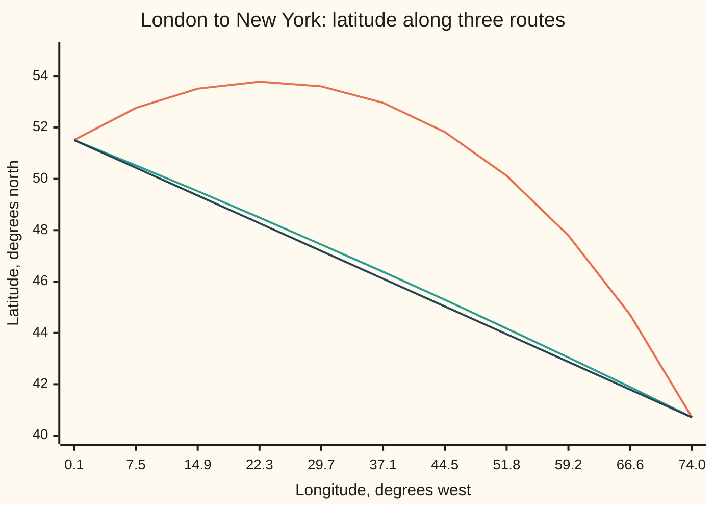

# Riemannian metric: lengths and angles at every point

[Syllabus](../../../SYLLABUS.md) → [Differential geometry and Lie groups](../README.md) → [Riemannian Geometry](../README.md#s05) → Riemannian metric

---

## General Overview

A flight from London to New York runs west and a little south across the Atlantic. How far is that? A map's latitude-longitude grid cannot say on its own. Near London one degree of longitude is 69.21 km of ground; near New York it is 84.28 km; near the pole it shrinks toward nothing. One degree of latitude is 111.19 km everywhere.

So a map needs a rule at every point: how many kilometres a small step in each grid direction is worth, and at what angle the grid lines cross. That rule is a **Riemannian metric**. With it, the length of any route is the sum of its small steps, and the distance between two places is the length of the shortest route.

For London and New York, adding up the steps of the best route gives 5570.22 km. It is the great circle already found by the spherical law of cosines on [Triangles on a sphere](../../05-Geometry%20and%20trig/06-Beyond%20Euclid/01-triangles-on-a-sphere.md). Here it comes out of the metric instead, and the metric also shows why it is the shortest: a straight line on the latitude-longitude map is 5812.43 km, and a route on one fixed compass heading is 5794.12 km.

**A Riemannian metric is a rule, at every point, for the length of a small step and the angle between two directions; adding up steps gives the length of a path, and the shortest path gives the distance.**

**What kind of fact this is:** the metric, path length and distance are definitions. That the great-circle arc is the shortest path on a round sphere is a theorem, proved on this card in Why it works. The Earth as a sphere of radius 6371 km is a model, good to a fraction of a percent.

### The picture: three routes on the latitude-longitude map



The top line is the great circle, 5570.22 km. The middle line is the rhumb line, one fixed compass heading, 5794.12 km. The bottom line is straight on this map, 5812.43 km. The shortest route bows north, up to 53.78° N near 23.07° W, because there a degree of longitude costs less ground.

---

## The formula

Notation first, in words. A **chart** labels points with numbers, written $`x = (x^1, x^2)`$; the raised 1 and 2 are labels, not powers. On the globe the chart is $`(\varphi, \theta)`$. Here $`\varphi`$ (phi) is the angle down from the North Pole, 90° minus the latitude, and $`\theta`$ (theta) is the longitude east. Both are in radians in formulas: 1° is $`\pi/180`$ radians.

A **velocity** at a point is a direction and speed of travel, written in the chart as its two rates of change. The metric $`g`$ takes two velocities $`u`$ and $`v`$ at the same point and returns one number, $`g(u, v)`$. In a chart it is a symmetric 2 × 2 table of numbers $`g_{ij}`$, which can change from point to point:

```math
g(u, v) = g_{ij}\, u^i v^j = g_{11} u^1 v^1 + g_{12}\,(u^1 v^2 + u^2 v^1) + g_{22} u^2 v^2
```

**Read it aloud:** the metric multiplies the two velocities' components in every pairing, weights each pairing by its table entry, and adds. A repeated index, once raised and once lowered, means "add over every value", as on [Covectors and tensor fields](../03-Manifolds/05-covectors-and-tensor-fields.md).

For the round globe of radius $`R`$:

```math
ds^2 = R^2\, d\varphi^2 + R^2 \sin^2\!\varphi\; d\theta^2
```

**Read it aloud:** a small step's length squared is the radius squared times the north-south step squared, plus the radius times the sine of phi, all squared, times the east-west step squared.

The length of a path $`\gamma`$ (gamma), run from time $`a`$ to time $`b`$ with velocity $`\dot\gamma`$:

```math
L(\gamma) = \int_a^b \sqrt{g\big(\dot\gamma(t), \dot\gamma(t)\big)}\; dt
```

**Read it aloud:** at each moment, the metric turns the velocity into a speed; adding speed times time along the whole path gives its length.

The distance between two points $`p`$ and $`q`$, and the angle $`\alpha`$ (alpha) between two velocities:

```math
d(p, q) = \inf_{\gamma \text{ from } p \text{ to } q} L(\gamma), \qquad \cos\alpha = \frac{g(u, v)}{\sqrt{g(u, u)\, g(v, v)}}
```

**Read it aloud:** distance is the greatest lower bound, the infimum, of the lengths of all paths joining the two points; the cosine of an angle is the metric of the two directions over the product of their lengths.

| Symbol | Plain meaning | In our example | Push it up and the answer… |
| --- | --- | --- | --- |
| $`R`$ | the globe's radius | 6371 km | every length grows in step |
| $`\varphi`$, $`\theta`$, $`x^i`$ | angle down from the North Pole; longitude east, in radians; chart coordinates in general | London 38.4926°, −0.1278°; New York 49.2872°, −74.0060°; $`x^1 = \varphi`$, $`x^2 = \theta`$ | — |
| $`r`$, $`r_\varphi`$, $`r_\theta`$ | the point in space, km; its rates of change along each chart direction | $`r_\varphi \cdot r_\varphi`$ = 40589641.0 at London | — |
| $`g_{ij}`$ | the metric's table at one point, in one chart, in km² per radian² | London: $`g_{11}`$ = 40589641.0, $`g_{12}`$ = 0, $`g_{22}`$ = 15724371.4 | steps of that grid direction cost more |
| $`g(u, v)`$, $`u`$, $`v`$ | the metric applied to two velocities $`u`$ and $`v`$ | positive whenever $`u = v \neq 0`$ | — |
| $`ds`$, $`d\varphi`$, $`d\theta`$ | a small step's length; its two chart steps | 1° of longitude at London: 69.21 km | — |
| $`\gamma`$, $`\dot\gamma`$, $`t`$, $`a`$, $`b`$, $`s`$ | a path; its chart velocity; time; start and end times; a second clock for the same path | the London–New York routes | — |
| $`L(\gamma)`$ | the length of a path | 5570.22, 5794.12, 5812.43 km | — |
| $`d(p, q)`$, $`p`$, $`q`$ | the distance between points $`p`$ and $`q`$: the shortest length | 5570.22 km | — |
| $`c`$ | the central angle: the angle at the Earth's centre between the two places | 0.874309 rad | the distance grows, $`d = R\,c`$ |
| $`\alpha`$ | the angle between two velocities, measured by the metric | 30.29° between the great circle and the rhumb line leaving London | — |
| $`x`$, $`y`$; $`\tilde x`$, $`J`$ | Mercator's chart: $`x = \theta`$ (here one coordinate, not the whole chart) and height $`y = \mathrm{asinh}(\tan(\text{latitude}))`$; any second chart, and the Jacobian table of rates between two charts | London: $`g_{11} = g_{22}`$ = 15724371.4 | $`y`$ grows without limit toward the pole |

Three new pieces of notation: $`g(u, v)`$ for the metric, $`L(\gamma)`$ for length, $`d(p, q)`$ for distance. Later cards on this wing use them freely.

### When it holds

- **The table must be positive definite.** Every nonzero velocity must get a positive $`g(v, v)`$ ([Quadratic forms](../../03-Algebra/07-Eigenvalues%20and%20Symmetric%20Matrices/05-quadratic-forms-and-positive-definite.md)). Allow zero or negative values and lengths can vanish or turn imaginary; spacetime in relativity is that case, and its metric is not Riemannian.
- **The table must vary smoothly.** A metric that jumps from point to point gives lengths, but no derivatives, and so no [Levi-Civita connection](02-levi-civita-connection-and-christoffel-symbols.md) or curvature.
- **Radians, not degrees.** The formula $`ds^2`$ above assumes radians. Degrees inflate the London–New York distance to 319150 km.
- **The chart must cover the path.** The $`(\varphi, \theta)`$ chart breaks at the poles, where every $`\theta`$ names one point and $`g_{22} = 0`$. A route over the pole needs a second chart.
- **Distance needs a shortest path, or a limit of shorter ones.** The infimum always exists. Whether some path attains it is a global question, answered by [Hopf-Rinow](10-hopf-rinow-and-completeness.md).

---

## Why it works

### Step 0: Pythagoras in the small

Zoom in on London until the globe looks flat. A step of $`d\varphi`$ moves $`R\,d\varphi`$ kilometres south. A step of $`d\theta`$ moves along a circle of latitude, whose radius is $`R \sin\varphi`$, so it covers $`R \sin\varphi\, d\theta`$ kilometres east. The two moves are at right angles, so Pythagoras gives $`ds^2`$.

That is the whole idea. At each point the curved surface is flat to first order (its error shrinks faster than the step), and the metric is the flat ruler there, written in the chart's units. It is a positive definite quadratic form in the step, one form per point.

### Step 1: the metric is dot products of the chart's step arrows

Place the globe in space: the point $`(\varphi, \theta)`$ sits at

```math
r(\varphi, \theta) = R\,(\sin\varphi \cos\theta,\ \sin\varphi \sin\theta,\ \cos\varphi)
```

A small chart step moves that point by $`r_\varphi\, d\varphi + r_\theta\, d\theta`$, where $`r_\varphi`$ and $`r_\theta`$ are the rates of change of $`r`$ along each coordinate. The squared length of that move is a dot product, so

```math
g_{ij} = r_i \cdot r_j
```

At London the code finds $`r_\varphi \cdot r_\varphi`$ = 40589641.0 = $`R^2`$, $`r_\varphi \cdot r_\theta`$ = 0 and $`r_\theta \cdot r_\theta`$ = 15724371.4 = $`R^2 \sin^2\varphi`$. On a surface in space these three numbers are the first fundamental form, called E, F and G on [First fundamental form](../02-Surfaces/02-first-fundamental-form.md).

A metric need not come from a surrounding space. Bernhard Riemann's point in 1854 was that the table $`g_{ij}`$ alone is enough to do geometry. John Nash proved in 1956 that every Riemannian metric can be produced as dot products inside some flat space of high enough dimension. This card states that theorem without proof (Sources).

### Step 2: length is the sum of the small steps

Cut the path into many short steps. Each step's length is $`\sqrt{g(\text{step}, \text{step})}`$, by Step 0. Add them, and shrink the steps: the sum becomes the integral $`L(\gamma)`$.

The answer does not depend on how fast the path is run. The code runs the great circle at even speed and again with time squared, so it starts slow and ends fast. Both give 5570.2223 km.

<details>
<summary>Detailed proof: the length ignores the speed</summary>

Run the same path at a new pace, $`\tilde\gamma(s) = \gamma(t(s))`$, with $`t(s)`$ increasing. The chain rule gives $`\dot{\tilde\gamma}(s) = \dot\gamma(t)\, t'(s)`$. The metric is quadratic, so $`g(\dot{\tilde\gamma}, \dot{\tilde\gamma}) = t'(s)^2\, g(\dot\gamma, \dot\gamma)`$. Take the square root and integrate over $`s`$:

$`\displaystyle \int \sqrt{g(\dot{\tilde\gamma}, \dot{\tilde\gamma})}\, ds = \int \sqrt{g(\dot\gamma, \dot\gamma)}\; t'(s)\, ds = \int \sqrt{g(\dot\gamma, \dot\gamma)}\, dt`$

The last step is the substitution rule for integrals.

</details>

### Step 3: the chart does not matter

Mercator's map uses $`x = \theta`$ (here $`x`$ is one coordinate, not the whole chart) and a height $`y = \mathrm{asinh}(\tan(\text{latitude}))`$. In that chart the metric is $`R^2 \cos^2(\text{latitude})\,(dx^2 + dy^2)`$. At London its table is $`g_{11} = g_{22}`$ = 15724371.4, not 40589641.0 and 15724371.4 as before.

The components changed. The length did not: the great circle measures 5570.2222 km in Mercator's chart and 5570.2223 km in $`(\varphi, \theta)`$, the last digit being step error. Components belong to the chart; the length belongs to the globe.

<details>
<summary>Detailed proof: a change of chart cancels out</summary>

Let new coordinates $`\tilde x`$ be functions of old ones $`x`$, with Jacobian matrix $`J_{ij} = \partial x^i / \partial \tilde x^j`$, the table of rates of change. A velocity changes as $`u = J \tilde u`$. For the metric to give the same number for the same physical step, its table must change as

$`\displaystyle \tilde g = J^{T} g\, J`$

Then $`\tilde u^{T} \tilde g\, \tilde v = (J \tilde u)^{T} g\, (J \tilde v) = u^{T} g\, v`$. Every speed, and so every length and angle, is the same in both charts. Here $`J`$ is the Jacobian of wing 06, not a Jacobi field.

</details>

### Step 4: the great circle is the shortest path

Turn the globe so London sits at the North Pole. Turning is a rotation in space, which keeps every dot product, so by Step 1 it keeps the metric and every length. New York now sits at $`\varphi = c`$, the central angle, 0.874309 rad.

Any path from the pole to New York has speed squared $`R^2 \dot\varphi^2 + R^2 \sin^2\!\varphi\, \dot\theta^2 \ge R^2 \dot\varphi^2`$. So its length is at least $`R \int \lvert\dot\varphi\rvert\, dt \ge R\,c`$. Equality needs $`\dot\theta = 0`$ throughout and $`\varphi`$ only increasing: the path runs straight down one meridian, which is a great circle. So

```math
d(\text{London}, \text{New York}) = R\,c = 6371 \times 0.874309 = 5570.22 \text{ km}
```

The code tests this by bending the great circle. Pushed 0.01 rad (63.71 km) north at mid-route it grows to 5571.74 km; pushed south, 5571.75 km. Pushed 0.02 rad, 5576.25 and 5576.37 km. Every bend adds length, and the rhumb line and the map-straight line are longer still.

This is a global claim about the round sphere: it compares every path, not only nearby ones. It also needs $`c < \pi`$: past the point opposite London, the great circle stops being shortest. [Geodesic and exponential map](04-geodesics-and-the-exponential-map.md) treats straight paths in general.

### Step 5: angles come from the same table

The metric measures angles as well as lengths, through $`\cos\alpha = g(u, v) / \sqrt{g(u, u)\, g(v, v)}`$. Positive definiteness keeps that ratio between −1 and 1 (the Cauchy–Schwarz inequality), so the angle always exists.

Leaving London, the great circle heads 288.33° clockwise from north. The rhumb line heads 258.04°. The metric puts 30.29° between them. Spherical trigonometry gives the same great-circle heading, and Mercator's map, which keeps angles, gives the same rhumb heading.

---

## Worked numbers, by hand

| Step | Arithmetic | Value |
| --- | --- | --- |
| London's $`\varphi`$ | 90 − 51.5074 | 38.4926° |
| New York's $`\varphi`$ | 90 − 40.7128 | 49.2872° |
| $`g_{11}`$ at London | 6371² | 40589641.0 km² |
| $`g_{22}`$ at London | (6371 × sin 38.4926°)² | 15724371.4 km² |
| 1° of longitude at London | 6371 × sin 38.4926° × π/180 | 69.21 km |
| 1° of longitude at New York | 6371 × sin 49.2872° × π/180 | 84.28 km |
| central angle | inverse cosine of the dot product of the two unit arrows | 0.874309 rad |
| distance | 6371 × 0.874309 | **5570.22 km** |
| the metric, added over 2000 steps | sum of $`\sqrt{g(\text{step}, \text{step})}`$ | 5570.2223 km |
| rhumb line, same metric | 2000 steps | 5794.12 km |
| straight on the map, same metric | 2000 steps | 5812.43 km |

The shortest way from London to New York is 5570.22 km. Holding one compass heading, 5794.12 km, or flying straight on the map, 5812.43 km, costs more.

The stepped sums carry error. With 20 steps the great circle is off by 0.7438 km; with 200 steps, by 0.007441 km. Ten times the steps gives a hundredth of the error, as expected when each step is measured at its midpoint.

### What breaks if you drop a piece

| Mistake | Comes out at | What went wrong |
| --- | --- | --- |
| Read the map as flat: $`g_{22} = R^2`$ | 8302.11 km | A degree of longitude is not 111.19 km off the equator |
| Latitude where $`\varphi`$ belongs: the great circle measured with $`g_{22} = R^2 \cos^2\!\varphi`$ | 6717.54 km | Circles of latitude shrink toward the pole, not the equator |
| Angles in degrees | 319150 km | The metric's $`R^2`$ is per radian squared |
| The same great circle the long way round | 34459.95 km | Past the opposite point a great circle is no longer shortest |

The code prints all four.

---

## Code, from first principles, and it actually runs

The code measures London to New York on a sphere of radius 6371 km. It gets the great-circle length by four roads: the closed form $`R\,c`$; the metric added up in the $`(\varphi, \theta)`$ chart; the metric added up in Mercator's chart; and straight chords through space, which never use the metric. A fifth run uses uneven speed. The rhumb line's metric sum is checked against its closed form from Mercator's chart, and the map-straight line's against chords. Headings come from the metric and from spherical trigonometry or Mercator's slope, and the metric's angle between the two routes must equal the gap between their headings. The route's highest point comes in closed form from the great circle's axis and is checked against the stepped route.

### Python

```python
# Riemannian metric -- the check behind the card.  Standard library only.
# The globe is a sphere of radius 6371 km.  Chart one is (phi, theta): phi is the
# angle down from the North Pole, theta the longitude east, both in radians.
# Chart two is Mercator's (x, y).  Routes from London to New York are measured by
# adding up the metric, then checked against closed forms and 3D chords.
from math import sin, cos, tan, acos, atan, atan2, asinh, sinh, cosh, sqrt, radians, degrees, pi
R = 6371.0
LON = (radians(90 - 51.5074), radians(-0.1278))         # London (phi, theta)
NYC = (radians(90 - 40.7128), radians(-74.0060))        # New York (phi, theta)

def g_globe(p):        # metric components (g11, g12, g22) in the (phi, theta) chart
    return R * R, 0.0, (R * sin(p[0])) ** 2
def g_mercator(p):     # metric components in Mercator's chart (x, y)
    f = (R / cosh(p[1])) ** 2
    return f, 0.0, f
def to_mercator(p): return (p[1], asinh(1 / tan(p[0])))    # x = theta, y = asinh(tan latitude)
def from_mercator(m): return (pi / 2 - atan(sinh(m[1])), m[0])
def dot(u, v): return sum(a * b for a, b in zip(u, v))
def arrow(p):          # chart point -> point in space, km
    return [R * sin(p[0]) * cos(p[1]), R * sin(p[0]) * sin(p[1]), R * cos(p[0])]
def frame(p):          # r_phi and r_theta: the chart's two step directions in space
    return ([R * cos(p[0]) * cos(p[1]), R * cos(p[0]) * sin(p[1]), -R * sin(p[0])],
            [-R * sin(p[0]) * sin(p[1]), R * sin(p[0]) * cos(p[1]), 0.0])
def g_of(g, p, u, v):  # the metric eats two chart velocities and returns one number
    g11, g12, g22 = g(p)
    return g11 * u[0] * v[0] + g12 * (u[0] * v[1] + u[1] * v[0]) + g22 * u[1] * v[1]

def metric_length(pts, g):     # road one: add sqrt(g(step, step)) at each step's midpoint
    total = 0.0
    for a, b in zip(pts, pts[1:]):
        step = (b[0] - a[0], b[1] - a[1])
        total += sqrt(g_of(g, ((a[0] + b[0]) / 2, (a[1] + b[1]) / 2), step, step))
    return total
def chord_length(pts):         # road two: straight chords in space through the same points
    return sum(sqrt(dot(*[[x - y for x, y in zip(arrow(a), arrow(b))]] * 2)) for a, b in zip(pts, pts[1:]))
A3, B3 = [x / R for x in arrow(LON)], [x / R for x in arrow(NYC)]
c = acos(dot(A3, B3))                                  # central angle, from one dot product
def great_circle(n, warp=lambda t: t):                 # n steps along the great circle
    pts = []
    for k in range(n + 1):
        t = warp(k / n)
        u = [(sin((1 - t) * c) * a + sin(t * c) * b) / sin(c) for a, b in zip(A3, B3)]
        pts.append((acos(u[2]), atan2(u[1], u[0])))
    return pts
def straight(a, b, n): return [tuple(x + k / n * (y - x) for x, y in zip(a, b)) for k in range(n + 1)]
def rhumb(n): return [from_mercator(m) for m in straight(to_mercator(LON), to_mercator(NYC), n)]

N, d = 2000, R * c
gc = great_circle(N)
roads = [metric_length(gc, g_globe), metric_length([to_mercator(p) for p in gc], g_mercator),
         chord_length(gc), metric_length(great_circle(N, lambda t: t * t), g_globe)]
errs = [abs(metric_length(great_circle(n), g_globe) - d) for n in (20, 200)]
rp, rt = frame(LON)
print(f"London phi = {degrees(LON[0]):.4f} deg, New York phi = {degrees(NYC[0]):.4f} deg; R = {R:.0f} km")
print(f"r_phi.r_phi = {dot(rp, rp):.1f}, r_phi.r_theta = {abs(dot(rp, rt)):.1f}, r_theta.r_theta = {dot(rt, rt):.1f} km^2")
print("g at London, chart (phi, theta): g11 = {:.1f}, g12 = {:.1f}, g22 = {:.1f}".format(*g_globe(LON)))
print("g at London, Mercator chart:     g11 = {:.1f}, g12 = {:.1f}, g22 = {:.1f}".format(*g_mercator(to_mercator(LON))))
for name, p in (("London", LON), ("New York", NYC)):
    print(f"1 deg of longitude at {name}: {R * sin(p[0]) * pi / 180:.2f} km; 1 deg of latitude: {R * pi / 180:.2f} km")
print(f"great circle, closed form R x c: c = {c:.6f} rad, d = {d:.2f} km")
print(f"great circle, metric in (phi, theta), {N} steps: {roads[0]:.4f} km")
print(f"great circle, metric in Mercator, {N} steps: {roads[1]:.4f} km")
print(f"great circle, 3D chords, {N} steps: {roads[2]:.4f} km")
print(f"great circle, uneven speed t^2, {N} steps: {roads[3]:.4f} km")
print(f"stepping error: 20 steps {errs[0]:.4f} km, 200 steps {errs[1]:.6f} km")
cs = straight(LON, NYC, N)
ls, lsc = metric_length(cs, g_globe), chord_length(cs)
m0, m1 = to_mercator(LON), to_mercator(NYC)
k_slope = (m1[0] - m0[0]) / (m1[1] - m0[1])
lr, lrc = metric_length(rhumb(N), g_globe), R * abs(NYC[0] - LON[0]) * sqrt(1 + k_slope ** 2)
print(f"straight in the (phi, theta) chart: metric {ls:.2f} km, chords {lsc:.2f} km")
print(f"rhumb line (one heading): metric {lr:.2f} km, closed form {lrc:.2f} km")
for eps in (-0.02, -0.01, 0.01, 0.02):
    bent = [(p[0] + eps * sin(pi * k / N), p[1]) for k, p in enumerate(gc)]
    print(f"great circle pushed {'south' if eps > 0 else 'north'} {abs(eps):.2f} rad ({R * abs(eps):.2f} km) "
          f"mid-route: {metric_length(bent, g_globe):.2f} km")
nv = [A3[1] * B3[2] - A3[2] * B3[1], A3[2] * B3[0] - A3[0] * B3[2], A3[0] * B3[1] - A3[1] * B3[0]]
top = (pi / 2 - acos(abs(nv[2]) / sqrt(dot(nv, nv))), atan2(-nv[2] * nv[1], -nv[2] * nv[0]))  # vertex, closed form
print(f"great circle peaks at {90 - degrees(top[0]):.2f} deg N, {-degrees(top[1]):.2f} deg W")
def heading(p, v):     # compass heading of chart velocity v: g against north and east unit arrows
    g11, g12, g22 = g_globe(p)
    return degrees(atan2(sqrt(g22) * v[1], -sqrt(g11) * v[0])) % 360
t3 = [b - dot(A3, B3) * a for a, b in zip(A3, B3)]     # great circle's direction leaving London
v_gc = (dot(t3, rp) / dot(rp, rp), dot(t3, rt) / dot(rt, rt))
v_rh = (-(m1[1] - m0[1]) / cosh(m0[1]), m1[0] - m0[0])  # rhumb's direction, moved back from Mercator
la1, la2, dl = pi / 2 - LON[0], pi / 2 - NYC[0], NYC[1] - LON[1]
h_trig = degrees(atan2(sin(dl) * cos(la2), cos(la1) * sin(la2) - sin(la1) * cos(la2) * cos(dl))) % 360
h_merc = degrees(atan2(m1[0] - m0[0], m1[1] - m0[1])) % 360
cosang = g_of(g_globe, LON, v_gc, v_rh) / sqrt(g_of(g_globe, LON, v_gc, v_gc) * g_of(g_globe, LON, v_rh, v_rh))
print(f"heading leaving London, great circle: metric {heading(LON, v_gc):.4f} deg, spherical trig {h_trig:.4f} deg")
print(f"heading leaving London, rhumb line: metric {heading(LON, v_rh):.4f} deg, Mercator slope {h_merc:.4f} deg")
print(f"angle between the two at London: metric {degrees(acos(cosang)):.4f} deg, "
      f"heading difference {heading(LON, v_gc) - heading(LON, v_rh):.4f} deg")
lons = [LON[1] + k / 10 * dl for k in range(11)]
fmt = lambda xs: ", ".join(f"{x:.2f}" for x in xs)
print("chart, longitude W:", ", ".join(f"{-degrees(x):.1f}" for x in lons))
print("chart, great circle latitude:", fmt(degrees(atan(-(nv[0] * cos(x) + nv[1] * sin(x)) / nv[2])) for x in lons))
print("chart, rhumb latitude:", fmt(degrees(atan(sinh(m0[1] + (x - LON[1]) / dl * (m1[1] - m0[1])))) for x in lons))
print("chart, straight-in-chart latitude:", fmt(90 - degrees(LON[0] + k / 10 * (NYC[0] - LON[0])) for k in range(11)))
flat = R * sqrt((NYC[0] - LON[0]) ** 2 + dl ** 2)
mixed = metric_length(gc, lambda p: (R * R, 0.0, (R * cos(p[0])) ** 2))
print(f"mistake, chart read as flat (g22 = R^2): {flat:.2f} km")
print(f"mistake, great circle measured with g22 = R^2 cos^2 phi: {mixed:.2f} km")
print(f"mistake, angles in degrees: {R * degrees(c):.0f} km")
print(f"mistake, the same great circle the long way round: {2 * pi * R - d:.2f} km")
assert all(abs(x - d) < 1e-3 for x in roads)                       # four roads, one length
assert abs(dot(rp, rp) - g_globe(LON)[0]) < 1e-6 and abs(dot(rt, rt) - g_globe(LON)[2]) < 1e-6
assert abs(lr - lrc) < 1e-3 and abs(ls - lsc) < 1e-2                # metric against closed form and chords
assert abs(heading(LON, v_gc) - h_trig) < 1e-9 and abs(heading(LON, v_rh) - h_merc) < 1e-9
assert d < lr < ls and errs[1] < errs[0] / 50                       # shortest; error falls as step^2
assert abs(degrees(acos(cosang)) - (heading(LON, v_gc) - heading(LON, v_rh))) < 1e-9   # angle = heading gap
assert abs(top[0] - min(gc)[0]) < 1e-6 and abs(top[1] - min(gc)[1]) < 1e-3   # vertex against the sampled route
print("ALL CHECKS PASS")
```

**Ran 2026-11-19 on macOS, Python 3.14.10, standard library only. All checks passed. Output, pasted from the run:**

```
London phi = 38.4926 deg, New York phi = 49.2872 deg; R = 6371 km
r_phi.r_phi = 40589641.0, r_phi.r_theta = 0.0, r_theta.r_theta = 15724371.4 km^2
g at London, chart (phi, theta): g11 = 40589641.0, g12 = 0.0, g22 = 15724371.4
g at London, Mercator chart:     g11 = 15724371.4, g12 = 0.0, g22 = 15724371.4
1 deg of longitude at London: 69.21 km; 1 deg of latitude: 111.19 km
1 deg of longitude at New York: 84.28 km; 1 deg of latitude: 111.19 km
great circle, closed form R x c: c = 0.874309 rad, d = 5570.22 km
great circle, metric in (phi, theta), 2000 steps: 5570.2223 km
great circle, metric in Mercator, 2000 steps: 5570.2222 km
great circle, 3D chords, 2000 steps: 5570.2221 km
great circle, uneven speed t^2, 2000 steps: 5570.2223 km
stepping error: 20 steps 0.7438 km, 200 steps 0.007441 km
straight in the (phi, theta) chart: metric 5812.43 km, chords 5812.43 km
rhumb line (one heading): metric 5794.12 km, closed form 5794.12 km
great circle pushed north 0.02 rad (127.42 km) mid-route: 5576.25 km
great circle pushed north 0.01 rad (63.71 km) mid-route: 5571.74 km
great circle pushed south 0.01 rad (63.71 km) mid-route: 5571.75 km
great circle pushed south 0.02 rad (127.42 km) mid-route: 5576.37 km
great circle peaks at 53.78 deg N, 23.07 deg W
heading leaving London, great circle: metric 288.3297 deg, spherical trig 288.3297 deg
heading leaving London, rhumb line: metric 258.0441 deg, Mercator slope 258.0441 deg
angle between the two at London: metric 30.2856 deg, heading difference 30.2856 deg
chart, longitude W: 0.1, 7.5, 14.9, 22.3, 29.7, 37.1, 44.5, 51.8, 59.2, 66.6, 74.0
chart, great circle latitude: 51.51, 52.76, 53.51, 53.78, 53.60, 52.96, 51.82, 50.12, 47.79, 44.70, 40.71
chart, rhumb latitude: 51.51, 50.52, 49.52, 48.49, 47.44, 46.38, 45.29, 44.17, 43.04, 41.89, 40.71
chart, straight-in-chart latitude: 51.51, 50.43, 49.35, 48.27, 47.19, 46.11, 45.03, 43.95, 42.87, 41.79, 40.71
mistake, chart read as flat (g22 = R^2): 8302.11 km
mistake, great circle measured with g22 = R^2 cos^2 phi: 6717.54 km
mistake, angles in degrees: 319150 km
mistake, the same great circle the long way round: 34459.95 km
ALL CHECKS PASS
```

### Rust

Same numbers, same labels, built with `rustc --edition 2021 -O`.

```rust
// Riemannian metric -- the same check as the Python, in Rust.  No crates.
// The globe is a sphere of radius 6371 km.  Chart one is (phi, theta): phi is the
// angle down from the North Pole, theta the longitude east, both in radians.
// Chart two is Mercator's (x, y).  Routes from London to New York are measured by
// adding up the metric, then checked against closed forms and 3D chords.
use std::f64::consts::PI;
const R: f64 = 6371.0;
type P = (f64, f64);
type G = (f64, f64, f64);

fn g_globe(p: P) -> G { (R * R, 0.0, (R * p.0.sin()).powi(2)) }     // (g11, g12, g22), chart (phi, theta)
fn g_mercator(p: P) -> G { let f = (R / p.1.cosh()).powi(2); (f, 0.0, f) }
fn g_mixed(p: P) -> G { (R * R, 0.0, (R * p.0.cos()).powi(2)) }     // the latitude mistake
fn to_mercator(p: P) -> P { (p.1, (1.0 / p.0.tan()).asinh()) }       // x = theta, y = asinh(tan latitude)
fn from_mercator(m: P) -> P { (PI / 2.0 - m.1.sinh().atan(), m.0) }
fn dot(u: &[f64; 3], v: &[f64; 3]) -> f64 { u[0] * v[0] + u[1] * v[1] + u[2] * v[2] }
fn arrow(p: P) -> [f64; 3] {                                          // chart point -> point in space, km
    [R * p.0.sin() * p.1.cos(), R * p.0.sin() * p.1.sin(), R * p.0.cos()]
}
fn frame(p: P) -> ([f64; 3], [f64; 3]) {                              // r_phi and r_theta
    ([R * p.0.cos() * p.1.cos(), R * p.0.cos() * p.1.sin(), -R * p.0.sin()],
     [-R * p.0.sin() * p.1.sin(), R * p.0.sin() * p.1.cos(), 0.0])
}
fn g_of(g: fn(P) -> G, p: P, u: P, v: P) -> f64 {                    // the metric eats two velocities
    let (g11, g12, g22) = g(p);
    g11 * u.0 * v.0 + g12 * (u.0 * v.1 + u.1 * v.0) + g22 * u.1 * v.1
}
fn metric_length(pts: &[P], g: fn(P) -> G) -> f64 {                 // road one: sqrt(g(step, step)) at midpoints
    pts.windows(2).map(|w| {
        let step = (w[1].0 - w[0].0, w[1].1 - w[0].1);
        g_of(g, ((w[0].0 + w[1].0) / 2.0, (w[0].1 + w[1].1) / 2.0), step, step).sqrt()
    }).sum()
}
fn chord_length(pts: &[P]) -> f64 {                                   // road two: chords in space
    pts.windows(2).map(|w| {
        let (a, b) = (arrow(w[0]), arrow(w[1]));
        let e = [b[0] - a[0], b[1] - a[1], b[2] - a[2]];
        dot(&e, &e).sqrt()
    }).sum()
}
fn great_circle(a3: &[f64; 3], b3: &[f64; 3], c: f64, n: usize, warp: fn(f64) -> f64) -> Vec<P> {
    (0..=n).map(|k| {
        let t = warp(k as f64 / n as f64);
        let u: Vec<f64> = (0..3).map(|i| (((1.0 - t) * c).sin() * a3[i] + (t * c).sin() * b3[i]) / c.sin()).collect();
        (u[2].acos(), u[1].atan2(u[0]))
    }).collect()
}
fn straight(a: P, b: P, n: usize) -> Vec<P> {
    (0..=n).map(|k| { let s = k as f64 / n as f64; (a.0 + s * (b.0 - a.0), a.1 + s * (b.1 - a.1)) }).collect()
}
fn heading(p: P, v: P) -> f64 {                                       // compass heading from the metric
    let (g11, _, g22) = g_globe(p);
    (g22.sqrt() * v.1).atan2(-g11.sqrt() * v.0).to_degrees().rem_euclid(360.0)
}
fn fmt(xs: &[f64]) -> String { xs.iter().map(|x| format!("{:.2}", x)).collect::<Vec<_>>().join(", ") }

fn main() {
    let lon: P = ((90.0f64 - 51.5074).to_radians(), (-0.1278f64).to_radians());
    let nyc: P = ((90.0f64 - 40.7128).to_radians(), (-74.0060f64).to_radians());
    let s = |v: [f64; 3]| [v[0] / R, v[1] / R, v[2] / R];
    let (a3, b3) = (s(arrow(lon)), s(arrow(nyc)));
    let c = dot(&a3, &b3).acos();
    let n = 2000;
    let d = R * c;
    let gc = great_circle(&a3, &b3, c, n, |t| t);
    let merc: Vec<P> = gc.iter().map(|&p| to_mercator(p)).collect();
    let roads = [metric_length(&gc, g_globe), metric_length(&merc, g_mercator), chord_length(&gc),
                 metric_length(&great_circle(&a3, &b3, c, n, |t| t * t), g_globe)];
    let errs: Vec<f64> = [20, 200].iter().map(|&m| (metric_length(&great_circle(&a3, &b3, c, m, |t| t), g_globe) - d).abs()).collect();
    let (rp, rt) = frame(lon);
    println!("London phi = {:.4} deg, New York phi = {:.4} deg; R = {:.0} km", lon.0.to_degrees(), nyc.0.to_degrees(), R);
    println!("r_phi.r_phi = {:.1}, r_phi.r_theta = {:.1}, r_theta.r_theta = {:.1} km^2", dot(&rp, &rp), dot(&rp, &rt).abs(), dot(&rt, &rt));
    let (g1, g2) = (g_globe(lon), g_mercator(to_mercator(lon)));
    println!("g at London, chart (phi, theta): g11 = {:.1}, g12 = {:.1}, g22 = {:.1}", g1.0, g1.1, g1.2);
    println!("g at London, Mercator chart:     g11 = {:.1}, g12 = {:.1}, g22 = {:.1}", g2.0, g2.1, g2.2);
    for (name, p) in [("London", lon), ("New York", nyc)] {
        println!("1 deg of longitude at {}: {:.2} km; 1 deg of latitude: {:.2} km", name, R * p.0.sin() * PI / 180.0, R * PI / 180.0);
    }
    println!("great circle, closed form R x c: c = {:.6} rad, d = {:.2} km", c, d);
    println!("great circle, metric in (phi, theta), {} steps: {:.4} km", n, roads[0]);
    println!("great circle, metric in Mercator, {} steps: {:.4} km", n, roads[1]);
    println!("great circle, 3D chords, {} steps: {:.4} km", n, roads[2]);
    println!("great circle, uneven speed t^2, {} steps: {:.4} km", n, roads[3]);
    println!("stepping error: 20 steps {:.4} km, 200 steps {:.6} km", errs[0], errs[1]);
    let cs = straight(lon, nyc, n);
    let (ls, lsc) = (metric_length(&cs, g_globe), chord_length(&cs));
    let (m0, m1) = (to_mercator(lon), to_mercator(nyc));
    let k_slope = (m1.0 - m0.0) / (m1.1 - m0.1);
    let rh: Vec<P> = straight(m0, m1, n).into_iter().map(from_mercator).collect();
    let (lr, lrc) = (metric_length(&rh, g_globe), R * (nyc.0 - lon.0).abs() * (1.0 + k_slope * k_slope).sqrt());
    println!("straight in the (phi, theta) chart: metric {:.2} km, chords {:.2} km", ls, lsc);
    println!("rhumb line (one heading): metric {:.2} km, closed form {:.2} km", lr, lrc);
    for eps in [-0.02f64, -0.01, 0.01, 0.02] {
        let bent: Vec<P> = gc.iter().enumerate().map(|(k, p)| (p.0 + eps * (PI * k as f64 / n as f64).sin(), p.1)).collect();
        println!("great circle pushed {} {:.2} rad ({:.2} km) mid-route: {:.2} km",
                 if eps > 0.0 { "south" } else { "north" }, eps.abs(), R * eps.abs(), metric_length(&bent, g_globe));
    }
    let nv = [a3[1] * b3[2] - a3[2] * b3[1], a3[2] * b3[0] - a3[0] * b3[2], a3[0] * b3[1] - a3[1] * b3[0]];
    let top = (PI / 2.0 - (nv[2].abs() / dot(&nv, &nv).sqrt()).acos(), (-nv[2] * nv[1]).atan2(-nv[2] * nv[0])); // vertex, closed form
    let low = gc.iter().fold(gc[0], |m, &p| if p.0 < m.0 { p } else { m }); // sampled route's highest point
    println!("great circle peaks at {:.2} deg N, {:.2} deg W", 90.0 - top.0.to_degrees(), -top.1.to_degrees());
    let ab = dot(&a3, &b3);
    let t3 = [b3[0] - ab * a3[0], b3[1] - ab * a3[1], b3[2] - ab * a3[2]];
    let v_gc = (dot(&t3, &rp) / dot(&rp, &rp), dot(&t3, &rt) / dot(&rt, &rt));
    let v_rh = (-(m1.1 - m0.1) / m0.1.cosh(), m1.0 - m0.0);
    let (la1, la2, dl) = (PI / 2.0 - lon.0, PI / 2.0 - nyc.0, nyc.1 - lon.1);
    let h_trig = (dl.sin() * la2.cos()).atan2(la1.cos() * la2.sin() - la1.sin() * la2.cos() * dl.cos()).to_degrees().rem_euclid(360.0);
    let h_merc = (m1.0 - m0.0).atan2(m1.1 - m0.1).to_degrees().rem_euclid(360.0);
    let cosang = g_of(g_globe, lon, v_gc, v_rh) / (g_of(g_globe, lon, v_gc, v_gc) * g_of(g_globe, lon, v_rh, v_rh)).sqrt();
    let (hg, hr) = (heading(lon, v_gc), heading(lon, v_rh));
    println!("heading leaving London, great circle: metric {:.4} deg, spherical trig {:.4} deg", hg, h_trig);
    println!("heading leaving London, rhumb line: metric {:.4} deg, Mercator slope {:.4} deg", hr, h_merc);
    println!("angle between the two at London: metric {:.4} deg, heading difference {:.4} deg", cosang.acos().to_degrees(), hg - hr);
    let lons: Vec<f64> = (0..11).map(|k| lon.1 + k as f64 / 10.0 * dl).collect();
    println!("chart, longitude W: {}", lons.iter().map(|x| format!("{:.1}", -x.to_degrees())).collect::<Vec<_>>().join(", "));
    let gcl: Vec<f64> = lons.iter().map(|&x| (-(nv[0] * x.cos() + nv[1] * x.sin()) / nv[2]).atan().to_degrees()).collect();
    let rhl: Vec<f64> = lons.iter().map(|&x| (m0.1 + (x - lon.1) / dl * (m1.1 - m0.1)).sinh().atan().to_degrees()).collect();
    let stl: Vec<f64> = (0..11).map(|k| 90.0 - (lon.0 + k as f64 / 10.0 * (nyc.0 - lon.0)).to_degrees()).collect();
    println!("chart, great circle latitude: {}", fmt(&gcl));
    println!("chart, rhumb latitude: {}", fmt(&rhl));
    println!("chart, straight-in-chart latitude: {}", fmt(&stl));
    let flat = R * ((nyc.0 - lon.0).powi(2) + dl * dl).sqrt();
    println!("mistake, chart read as flat (g22 = R^2): {:.2} km", flat);
    println!("mistake, great circle measured with g22 = R^2 cos^2 phi: {:.2} km", metric_length(&gc, g_mixed));
    println!("mistake, angles in degrees: {:.0} km", R * c.to_degrees());
    println!("mistake, the same great circle the long way round: {:.2} km", 2.0 * PI * R - d);
    assert!(roads.iter().all(|x| (x - d).abs() < 1e-3));                       // four roads, one length
    assert!((dot(&rp, &rp) - g1.0).abs() < 1e-6 && (dot(&rt, &rt) - g1.2).abs() < 1e-6);
    assert!((lr - lrc).abs() < 1e-3 && (ls - lsc).abs() < 1e-2);                // closed form and chords
    assert!((hg - h_trig).abs() < 1e-9 && (hr - h_merc).abs() < 1e-9);
    assert!(d < lr && lr < ls && errs[1] < errs[0] / 50.0);                     // shortest; error falls as step^2
    assert!((cosang.acos().to_degrees() - (hg - hr)).abs() < 1e-9);             // angle = heading gap
    assert!((top.0 - low.0).abs() < 1e-6 && (top.1 - low.1).abs() < 1e-3);      // vertex against the sampled route
    println!("ALL CHECKS PASS");
}
```

**Ran 2026-11-19 on macOS, rustc 1.98.1, no crates. All checks passed. Output, pasted from the run:**

```
London phi = 38.4926 deg, New York phi = 49.2872 deg; R = 6371 km
r_phi.r_phi = 40589641.0, r_phi.r_theta = 0.0, r_theta.r_theta = 15724371.4 km^2
g at London, chart (phi, theta): g11 = 40589641.0, g12 = 0.0, g22 = 15724371.4
g at London, Mercator chart:     g11 = 15724371.4, g12 = 0.0, g22 = 15724371.4
1 deg of longitude at London: 69.21 km; 1 deg of latitude: 111.19 km
1 deg of longitude at New York: 84.28 km; 1 deg of latitude: 111.19 km
great circle, closed form R x c: c = 0.874309 rad, d = 5570.22 km
great circle, metric in (phi, theta), 2000 steps: 5570.2223 km
great circle, metric in Mercator, 2000 steps: 5570.2222 km
great circle, 3D chords, 2000 steps: 5570.2221 km
great circle, uneven speed t^2, 2000 steps: 5570.2223 km
stepping error: 20 steps 0.7438 km, 200 steps 0.007441 km
straight in the (phi, theta) chart: metric 5812.43 km, chords 5812.43 km
rhumb line (one heading): metric 5794.12 km, closed form 5794.12 km
great circle pushed north 0.02 rad (127.42 km) mid-route: 5576.25 km
great circle pushed north 0.01 rad (63.71 km) mid-route: 5571.74 km
great circle pushed south 0.01 rad (63.71 km) mid-route: 5571.75 km
great circle pushed south 0.02 rad (127.42 km) mid-route: 5576.37 km
great circle peaks at 53.78 deg N, 23.07 deg W
heading leaving London, great circle: metric 288.3297 deg, spherical trig 288.3297 deg
heading leaving London, rhumb line: metric 258.0441 deg, Mercator slope 258.0441 deg
angle between the two at London: metric 30.2856 deg, heading difference 30.2856 deg
chart, longitude W: 0.1, 7.5, 14.9, 22.3, 29.7, 37.1, 44.5, 51.8, 59.2, 66.6, 74.0
chart, great circle latitude: 51.51, 52.76, 53.51, 53.78, 53.60, 52.96, 51.82, 50.12, 47.79, 44.70, 40.71
chart, rhumb latitude: 51.51, 50.52, 49.52, 48.49, 47.44, 46.38, 45.29, 44.17, 43.04, 41.89, 40.71
chart, straight-in-chart latitude: 51.51, 50.43, 49.35, 48.27, 47.19, 46.11, 45.03, 43.95, 42.87, 41.79, 40.71
mistake, chart read as flat (g22 = R^2): 8302.11 km
mistake, great circle measured with g22 = R^2 cos^2 phi: 6717.54 km
mistake, angles in degrees: 319150 km
mistake, the same great circle the long way round: 34459.95 km
ALL CHECKS PASS
```

The two outputs match line for line.

### Lean

Lean proves the great-circle distance on a globe of any radius, the globe's metric in the chart, and the rule for changing charts.

- Take two places $`p`$ and $`q`$ on a globe of radius $`R`$, at central angle $`c`$. Then no smooth path between them on the globe is shorter than $`R\,c`$, and the great-circle arc has exactly that length. So $`d(p, q) = R\,c`$.
- Suppose a path moves through the $`(\varphi, \theta)`$ chart at rates $`\dot\varphi`$ and $`\dot\theta`$. Then its speed squared in space is $`R^2 \dot\varphi^2 + R^2 \sin^2\!\varphi\, \dot\theta^2`$, the metric's $`ds^2`$.
- Take a change of chart with Jacobian table $`J`$, and set $`\tilde g = J^{T} g\, J`$. Then $`(J \tilde u)^{T} g\, (J \tilde v) = \tilde u^{T} \tilde g\, \tilde v`$ for any velocities $`\tilde u`$, $`\tilde v`$.
- Take $`R`$ = 6371 km. Then London's $`g_{11} = R^2`$ is exactly 40589641.

The 5570.22 km figure, the other routes, the headings, the Mercator chart and the stepping errors are left to the Python and Rust checks.

```lean
-- Riemannian metric: on the round globe of radius R the shortest path between two places has length R times their central angle, the metric in the chart (φ, θ) is ds² = R² dφ² + R² sin²φ dθ², and a change of chart changes the table g to Jᵀ g J without changing any length.
import Mathlib.Analysis.InnerProductSpace.PiL2
import Mathlib.Analysis.SpecialFunctions.Trigonometric.Deriv
import Mathlib.Analysis.Calculus.ContDiff.Defs
import Mathlib.Geometry.Euclidean.Angle.Unoriented.Basic
import Mathlib.MeasureTheory.Integral.IntervalIntegral.Basic
import Mathlib.Data.Matrix.Mul
import Mathlib.Geometry.Euclidean.Angle.Unoriented.TriangleInequality
import Mathlib.Analysis.SpecialFunctions.Trigonometric.Bounds
import Mathlib.MeasureTheory.Integral.IntervalIntegral.FundThmCalculus
import Mathlib.Analysis.Calculus.MeanValue
import Mathlib.Analysis.Calculus.Deriv.Slope
import Mathlib.Analysis.Calculus.Deriv.Prod

open Matrix

/-- Chord against angle: on a sphere of radius `R`, two points at angle `θ` have chord at least
`R θ (1 - θ²/24)`. -/
theorem angle_mul_le_chord (R : ℝ) (hR : 0 < R) (x y : EuclideanSpace ℝ (Fin 3))
    (hx : ‖x‖ = R) (hy : ‖y‖ = R) :
    InnerProductGeometry.angle x y * (1 - InnerProductGeometry.angle x y ^ 2 / 24) ≤
      ‖x - y‖ / R := by
  set θ := InnerProductGeometry.angle x y with hθ
  have h0 : 0 ≤ θ := InnerProductGeometry.angle_nonneg x y
  have hpi : θ ≤ Real.pi := InnerProductGeometry.angle_le_pi x y
  have hin : inner ℝ x y = Real.cos θ * (R * R) := by
    rw [← InnerProductGeometry.cos_angle_mul_norm_mul_norm, hx, hy]
  have hcos : Real.cos θ = 1 - 2 * Real.sin (θ / 2) ^ 2 := by
    have := Real.cos_two_mul (θ / 2)
    have h2 := Real.sin_sq_add_cos_sq (θ / 2)
    rw [show 2 * (θ / 2) = θ by ring] at this
    linarith
  have hs0 : 0 ≤ Real.sin (θ / 2) :=
    Real.sin_nonneg_of_nonneg_of_le_pi (by linarith) (by linarith)
  have hchord : ‖x - y‖ = 2 * R * Real.sin (θ / 2) := by
    have hsq : ‖x - y‖ ^ 2 = (2 * R * Real.sin (θ / 2)) ^ 2 := by
      rw [norm_sub_sq_real, hin, hx, hy, hcos]; ring
    exact (pow_left_inj₀ (norm_nonneg _) (by positivity) two_ne_zero).mp hsq
  rw [hchord, show 2 * R * Real.sin (θ / 2) / R = 2 * Real.sin (θ / 2) by field_simp]
  rcases h0.eq_or_lt with h | h
  · rw [← h]; simp
  · have := Real.sin_gt_sub_cube (x := θ / 2) (by linarith)
    nlinarith

open Filter Topology in
/-- The lower bound: a `C¹` path on the sphere of radius `R` starting at `p` has length at least
`R` times the angle from `p` to its end. -/
theorem radius_mul_angle_le_length (R : ℝ) (hR : 0 < R) (p : EuclideanSpace ℝ (Fin 3))
    (γ : ℝ → EuclideanSpace ℝ (Fin 3)) (hγ : ContDiff ℝ 1 γ) (h0 : γ 0 = p)
    (hS : ∀ t ∈ Set.Icc (0 : ℝ) 1, ‖γ t‖ = R) :
    R * InnerProductGeometry.angle p (γ 1) ≤ ∫ t in (0 : ℝ)..1, ‖deriv γ t‖ := by
  have hd : Differentiable ℝ γ := hγ.differentiable one_ne_zero
  have hcd : Continuous (deriv γ) := (contDiff_one_iff_deriv.mp hγ).2
  have hc : Continuous γ := hd.continuous
  have hne : ∀ t ∈ Set.Icc (0 : ℝ) 1, γ t ≠ 0 := by
    intro t ht h; have := hS t ht; rw [h, norm_zero] at this; linarith
  have hp : p ≠ 0 := h0 ▸ hne 0 ⟨le_rfl, zero_le_one⟩
  set f : ℝ → ℝ := fun t => InnerProductGeometry.angle p (γ t) with hf
  set B : ℝ → ℝ := fun t => (∫ s in (0 : ℝ)..t, ‖deriv γ s‖) / R with hB
  have hcn : Continuous fun s => ‖deriv γ s‖ := hcd.norm
  have hBd : ∀ x, HasDerivAt B (‖deriv γ x‖ / R) x := fun x =>
    ((hcn.integral_hasStrictDerivAt 0 x).hasDerivAt).div_const R
  have key : ∀ ⦃x⦄, x ∈ Set.Icc (0 : ℝ) 1 → f x ≤ B x := by
    refine image_le_of_liminf_slope_right_le_deriv_boundary (B' := fun x => ‖deriv γ x‖ / R)
      ?_ ?_ ?_ ?_ ?_
    · intro t ht
      have : ContinuousAt (fun t => InnerProductGeometry.angle p (γ t)) t :=
        ContinuousAt.comp (g := fun y : EuclideanSpace ℝ (Fin 3) × EuclideanSpace ℝ (Fin 3) =>
            InnerProductGeometry.angle y.1 y.2) (f := fun t => (p, γ t))
          (InnerProductGeometry.continuousAt_angle (x := (p, γ t)) hp (hne t ht))
          (continuousAt_const.prodMk hc.continuousAt)
      exact this.continuousWithinAt
    · simp [hf, hB, h0, InnerProductGeometry.angle_self hp]
    · intro t _; exact (hBd t).continuousAt.continuousWithinAt
    · intro t _; exact (hBd t).hasDerivWithinAt
    · intro x hx r hr
      apply Eventually.frequently
      have hxS : ‖γ x‖ = R := hS x (Set.Ico_subset_Icc_self hx)
      have hx0 : γ x ≠ 0 := hne x (Set.Ico_subset_Icc_self hx)
      -- slope of γ tends to γ'(x)
      have hsl : Tendsto (fun z => ‖slope γ x z‖ / R) (𝓝[>] x) (𝓝 (‖deriv γ x‖ / R)) :=
        ((((hd x).hasDerivAt.tendsto_slope).mono_left
          (nhdsWithin_mono _ (fun z hz => Set.mem_compl_singleton_iff.mpr (ne_of_gt hz)))).norm).div_const R
      -- the angle from γ x to γ z tends to 0
      have hang : Tendsto (fun z => InnerProductGeometry.angle (γ x) (γ z)) (𝓝[>] x) (𝓝 0) := by
        have : ContinuousAt (fun z => InnerProductGeometry.angle (γ x) (γ z)) x :=
          ContinuousAt.comp (g := fun y : EuclideanSpace ℝ (Fin 3) × EuclideanSpace ℝ (Fin 3) =>
            InnerProductGeometry.angle y.1 y.2) (f := fun z => (γ x, γ z))
          (InnerProductGeometry.continuousAt_angle (x := (γ x, γ x)) hx0 hx0)
          (continuousAt_const.prodMk hc.continuousAt)
        have := this.tendsto
        rw [InnerProductGeometry.angle_self hx0] at this
        exact this.mono_left nhdsWithin_le_nhds
      have hfac : Tendsto (fun z => 1 - InnerProductGeometry.angle (γ x) (γ z) ^ 2 / 24)
          (𝓝[>] x) (𝓝 1) := by
        have := ((hang.pow 2).div_const 24).const_sub 1
        simpa using this
      have hQ : Tendsto (fun z => ‖slope γ x z‖ / R /
          (1 - InnerProductGeometry.angle (γ x) (γ z) ^ 2 / 24)) (𝓝[>] x)
          (𝓝 (‖deriv γ x‖ / R)) := by
        have := hsl.div hfac one_ne_zero
        rw [div_one] at this
        exact this
      have e1 : ∀ᶠ z in 𝓝[>] x, ‖slope γ x z‖ / R /
          (1 - InnerProductGeometry.angle (γ x) (γ z) ^ 2 / 24) < r :=
        hQ.eventually (gt_mem_nhds hr)
      have e2 : ∀ᶠ z in 𝓝[>] x, 1 / 2 < 1 - InnerProductGeometry.angle (γ x) (γ z) ^ 2 / 24 :=
        hfac.eventually (lt_mem_nhds (by norm_num))
      have e3 : ∀ᶠ z in 𝓝[>] x, z ∈ Set.Ioo x 1 := Ioo_mem_nhdsGT hx.2
      filter_upwards [e1, e2, e3] with z hz1 hz2 hz3
      have hzS : ‖γ z‖ = R := hS z ⟨by linarith [hx.1, hz3.1], hz3.2.le⟩
      have hzx : 0 < z - x := sub_pos.mpr hz3.1
      set θ := InnerProductGeometry.angle (γ x) (γ z)
      have htri : f z - f x ≤ θ := by
        have := InnerProductGeometry.angle_le_angle_add_angle p (γ x) (γ z)
        simp only [hf]; linarith
      have hch := angle_mul_le_chord R hR (γ x) (γ z) hxS hzS
      have hnorm : ‖slope γ x z‖ = ‖γ z - γ x‖ / (z - x) := by
        rw [slope_def_module, norm_smul, norm_inv, Real.norm_of_nonneg hzx.le, div_eq_inv_mul]
      rw [hnorm] at hz1
      rw [slope_def_field]
      have hpos : 0 < 1 - θ ^ 2 / 24 := by linarith
      have hθle : θ ≤ ‖γ x - γ z‖ / R / (1 - θ ^ 2 / 24) := by
        rw [le_div_iff₀ hpos]; exact hch
      rw [norm_sub_rev] at hθle
      calc (f z - f x) / (z - x) ≤ θ / (z - x) := div_le_div_of_nonneg_right htri hzx.le
        _ ≤ (‖γ z - γ x‖ / R / (1 - θ ^ 2 / 24)) / (z - x) :=
            div_le_div_of_nonneg_right hθle hzx.le
        _ = ‖γ z - γ x‖ / (z - x) / R / (1 - θ ^ 2 / 24) := by ring
        _ < r := hz1
  have := key (x := 1) ⟨zero_le_one, le_rfl⟩
  simp only [hf, hB] at this
  rw [le_div_iff₀ hR] at this
  linarith

/-- A vector of length `R` at right angles to a given nonzero vector of space. -/
theorem exists_orthogonal_of_norm (R : ℝ) (hR : 0 < R) (p : EuclideanSpace ℝ (Fin 3))
    (hp : p ≠ 0) : ∃ e : EuclideanSpace ℝ (Fin 3), inner ℝ p e = 0 ∧ ‖e‖ = R := by
  have : Fact (Module.finrank ℝ (EuclideanSpace ℝ (Fin 3)) = 2 + 1) :=
    ⟨finrank_euclideanSpace_fin⟩
  have hfr := Submodule.finrank_orthogonal_span_singleton (𝕜 := ℝ) (n := 2) hp
  have hne : (ℝ ∙ p)ᗮ ≠ ⊥ := by
    intro h; rw [h, finrank_bot] at hfr; norm_num at hfr
  obtain ⟨w, hw, hw0⟩ := Submodule.exists_mem_ne_zero_of_ne_bot hne
  have hwi : inner ℝ p w = 0 := Submodule.mem_orthogonal_singleton_iff_inner_right.mp hw
  refine ⟨(R / ‖w‖) • w, ?_, ?_⟩
  · rw [inner_smul_right, hwi, mul_zero]
  · rw [norm_smul, Real.norm_of_nonneg (by positivity), div_mul_cancel₀ _ (norm_ne_zero_iff.mpr hw0)]

/-- The great-circle arc: a `C¹` path on the sphere of radius `R` from `p` to `q` of length
`R` times the angle between them. -/
theorem exists_arc (R : ℝ) (hR : 0 < R) (p q : EuclideanSpace ℝ (Fin 3)) (hp : ‖p‖ = R)
    (hq : ‖q‖ = R) :
    ∃ γ : ℝ → EuclideanSpace ℝ (Fin 3), ContDiff ℝ 1 γ ∧ γ 0 = p ∧ γ 1 = q ∧
        (∀ t ∈ Set.Icc (0 : ℝ) 1, ‖γ t‖ = R) ∧
        R * InnerProductGeometry.angle p q = ∫ t in (0 : ℝ)..1, ‖deriv γ t‖ := by
  set θ := InnerProductGeometry.angle p q with hθ
  have hp0 : p ≠ 0 := by intro h; rw [h, norm_zero] at hp; linarith
  have hin : inner ℝ p q = Real.cos θ * (R * R) := by
    rw [← InnerProductGeometry.cos_angle_mul_norm_mul_norm, hp, hq]
  have hsq : ‖q - Real.cos θ • p‖ ^ 2 = R ^ 2 * Real.sin θ ^ 2 := by
    rw [norm_sub_sq_real, inner_smul_right, real_inner_comm, hin, norm_smul, hq, hp,
      Real.norm_eq_abs, mul_pow, sq_abs]
    have := Real.sin_sq_add_cos_sq θ
    linear_combination (-R ^ 2) * this
  obtain ⟨e, hpe, he, hqe⟩ : ∃ e : EuclideanSpace ℝ (Fin 3), inner ℝ p e = 0 ∧ ‖e‖ = R ∧
      q = Real.cos θ • p + Real.sin θ • e := by
    by_cases hs : Real.sin θ = 0
    · obtain ⟨e, h1, h2⟩ := exists_orthogonal_of_norm R hR p hp0
      refine ⟨e, h1, h2, ?_⟩
      rw [hs, zero_smul, add_zero]
      rw [hs] at hsq
      have : ‖q - Real.cos θ • p‖ = 0 := by
        have h' : ‖q - Real.cos θ • p‖ ^ 2 = 0 := by rw [hsq]; ring
        exact pow_eq_zero_iff (two_ne_zero) |>.mp h'
      exact sub_eq_zero.mp (norm_eq_zero.mp this)
    · refine ⟨(Real.sin θ)⁻¹ • (q - Real.cos θ • p), ?_, ?_, ?_⟩
      · rw [inner_smul_right, inner_sub_right, inner_smul_right, hin,
          real_inner_self_eq_norm_sq, hp]
        ring
      · have h1 : ‖(Real.sin θ)⁻¹ • (q - Real.cos θ • p)‖ ^ 2 = R ^ 2 := by
          rw [norm_smul, mul_pow, hsq, norm_inv, Real.norm_eq_abs, inv_pow, sq_abs]
          field_simp
        exact (pow_left_inj₀ (norm_nonneg _) hR.le two_ne_zero).mp h1
      · rw [smul_smul, mul_inv_cancel₀ hs, one_smul]; abel
  have hθ0 : 0 ≤ θ := InnerProductGeometry.angle_nonneg p q
  set γ : ℝ → EuclideanSpace ℝ (Fin 3) :=
    fun t => Real.cos (t * θ) • p + Real.sin (t * θ) • e with hγ
  have hder : ∀ t, HasDerivAt γ ((-Real.sin (t * θ) * θ) • p + (Real.cos (t * θ) * θ) • e) t := by
    intro t
    have h1 : HasDerivAt (fun t : ℝ => t * θ) θ t := by
      simpa using (hasDerivAt_id t).mul_const θ
    exact (h1.cos.smul_const p).add (h1.sin.smul_const e) |>.congr_deriv (by ring_nf)
  have hnorm : ∀ a b : ℝ, ‖a • p + b • e‖ ^ 2 = R ^ 2 * (a ^ 2 + b ^ 2) := by
    intro a b
    rw [norm_add_sq_real, inner_smul_left, inner_smul_right, hpe, norm_smul, norm_smul, hp, he,
      Real.norm_eq_abs, Real.norm_eq_abs, mul_pow, mul_pow, sq_abs, sq_abs]
    simp; ring
  have hspeed : ∀ t, ‖deriv γ t‖ = R * θ := by
    intro t
    rw [(hder t).deriv]
    have h := hnorm (-Real.sin (t * θ) * θ) (Real.cos (t * θ) * θ)
    have h2 : ‖(-Real.sin (t * θ) * θ) • p + (Real.cos (t * θ) * θ) • e‖ ^ 2 = (R * θ) ^ 2 := by
      rw [h]
      have := Real.sin_sq_add_cos_sq (t * θ)
      linear_combination (R ^ 2 * θ ^ 2) * this
    exact (pow_left_inj₀ (norm_nonneg _) (by positivity) two_ne_zero).mp h2
  refine ⟨γ, ?_, ?_, ?_, ?_, ?_⟩
  · simp only [hγ]; fun_prop
  · simp [hγ]
  · simp [hγ, hqe]
  · intro t _
    have h := hnorm (Real.cos (t * θ)) (Real.sin (t * θ))
    have h2 : ‖γ t‖ ^ 2 = R ^ 2 := by
      simp only [hγ]; rw [h, Real.cos_sq_add_sin_sq, mul_one]
    exact (pow_left_inj₀ (norm_nonneg _) hR.le two_ne_zero).mp h2
  · simp only [hspeed]
    simp

/-- The point of the globe of radius `R` at angle `φ` down from the North Pole and longitude
`θ` east, in kilometres in space: `r(φ, θ) = R (sin φ cos θ, sin φ sin θ, cos φ)`. -/
noncomputable def globePoint (R φ θ : ℝ) : EuclideanSpace ℝ (Fin 3) :=
  !₂[R * Real.sin φ * Real.cos θ, R * Real.sin φ * Real.sin θ, R * Real.cos φ]

/-- The great-circle distance. On the round globe of radius `R > 0`, take two places `p` and
`q` (points of space at distance `R` from the centre). Among all `C¹` paths `γ` from `p` to `q`
that stay on the globe, run over the times `0 ≤ t ≤ 1`, the length `∫ ‖γ'(t)‖ dt` is never less
than `R c`, where `c` is the central angle between `p` and `q`, and some path (the great-circle
arc) has length exactly `R c`. So the distance `d(p, q)` is `R c`. -/
theorem sphere_distance_eq_radius_mul_central_angle (R : ℝ) (hR : 0 < R)
    (p q : EuclideanSpace ℝ (Fin 3)) (hp : ‖p‖ = R) (hq : ‖q‖ = R) :
    IsLeast
      {L : ℝ | ∃ γ : ℝ → EuclideanSpace ℝ (Fin 3), ContDiff ℝ 1 γ ∧ γ 0 = p ∧ γ 1 = q ∧
        (∀ t ∈ Set.Icc (0 : ℝ) 1, ‖γ t‖ = R) ∧ L = ∫ t in (0 : ℝ)..1, ‖deriv γ t‖}
      (R * InnerProductGeometry.angle p q) := by
  refine ⟨exists_arc R hR p q hp hq, ?_⟩
  rintro L ⟨γ, hγ, h0, h1, hS, rfl⟩
  have := radius_mul_angle_le_length R hR p γ hγ h0 hS
  rwa [h1] at this

/-- The globe's metric in the chart `(φ, θ)`: a path that moves through the chart as
`(φ(t), θ(t))` moves through space at speed squared `R² φ'² + R² sin² φ θ'²`. This is
`ds² = R² dφ² + R² sin²φ dθ²`, the metric table `g₁₁ = R²`, `g₁₂ = 0`, `g₂₂ = R² sin² φ`
got as dot products of the chart's step arrows. -/
theorem globe_speed_sq_eq_metric (R : ℝ) (φ θ : ℝ → ℝ) (t : ℝ)
    (hφ : DifferentiableAt ℝ φ t) (hθ : DifferentiableAt ℝ θ t) :
    ‖deriv (fun s => globePoint R (φ s) (θ s)) t‖ ^ 2 =
      R ^ 2 * deriv φ t ^ 2 + R ^ 2 * Real.sin (φ t) ^ 2 * deriv θ t ^ 2 := by
  have h1 := hφ.hasDerivAt
  have h2 := hθ.hasDerivAt
  set a := deriv φ t
  set b := deriv θ t
  have hc : HasDerivAt (fun s => (![R * Real.sin (φ s) * Real.cos (θ s),
      R * Real.sin (φ s) * Real.sin (θ s), R * Real.cos (φ s)] : Fin 3 → ℝ))
      ![R * (Real.cos (φ t) * a) * Real.cos (θ t) + R * Real.sin (φ t) * (-Real.sin (θ t) * b),
        R * (Real.cos (φ t) * a) * Real.sin (θ t) + R * Real.sin (φ t) * (Real.cos (θ t) * b),
        R * (-Real.sin (φ t) * a)] t := by
    rw [hasDerivAt_pi]
    intro i
    fin_cases i
    · exact ((h1.sin.const_mul R).mul h2.cos)
    · exact ((h1.sin.const_mul R).mul h2.sin)
    · exact (h1.cos.const_mul R)
  have hd := (EuclideanSpace.equiv (Fin 3) ℝ).symm.hasFDerivAt.comp_hasDerivAt t hc
  have : (fun s => globePoint R (φ s) (θ s)) =
      (EuclideanSpace.equiv (Fin 3) ℝ).symm ∘ (fun s => (![R * Real.sin (φ s) * Real.cos (θ s),
      R * Real.sin (φ s) * Real.sin (θ s), R * Real.cos (φ s)] : Fin 3 → ℝ)) := by
    funext s; rfl
  rw [this, hd.deriv, EuclideanSpace.real_norm_sq_eq]
  simp [Fin.sum_univ_three, EuclideanSpace.equiv]
  have e1 := Real.sin_sq_add_cos_sq (φ t)
  have e2 := Real.sin_sq_add_cos_sq (θ t)
  linear_combination (R^2 * a^2 * Real.cos (φ t)^2 + R ^ 2 * Real.sin (φ t) ^ 2 * b ^ 2) * e2 + R^2*a^2 * e1

/-- The chart does not matter. If a change of chart has Jacobian table `J`, so that velocities
change as `u = J ũ`, and the metric's table changes as `g̃ = Jᵀ g J`, then the metric gives the
same number `g(u, v) = ũᵀ g̃ ṽ` for the same two steps in either chart. -/
theorem metric_unchanged_by_change_of_chart {n : ℕ} (g J : Matrix (Fin n) (Fin n) ℝ)
    (u' v' : Fin n → ℝ) :
    (J *ᵥ u') ⬝ᵥ (g *ᵥ (J *ᵥ v')) = u' ⬝ᵥ ((Jᵀ * g * J) *ᵥ v') := by
  rw [← mulVec_mulVec, ← mulVec_mulVec, dotProduct_mulVec u' Jᵀ, vecMul_transpose]

/-- `g₁₁` at London: `6371² = 40589641` km² per radian². -/
example : (6371 : ℕ) ^ 2 = 40589641 := by norm_num

#print axioms angle_mul_le_chord
#print axioms radius_mul_angle_le_length
#print axioms exists_orthogonal_of_norm
#print axioms exists_arc
#print axioms sphere_distance_eq_radius_mul_central_angle
#print axioms globe_speed_sq_eq_metric
#print axioms metric_unchanged_by_change_of_chart
```

**Checked 2026-11-19 on macOS, Lean 4.36.0-rc2, Mathlib v4.36.0-rc2. Every proof is complete and uses only Lean's standard axioms. Output, pasted from the run:**

```
'angle_mul_le_chord' depends on axioms: [propext, Classical.choice, Quot.sound]
'radius_mul_angle_le_length' depends on axioms: [propext, Classical.choice, Quot.sound]
'exists_orthogonal_of_norm' depends on axioms: [propext, Classical.choice, Quot.sound]
'exists_arc' depends on axioms: [propext, Classical.choice, Quot.sound]
'sphere_distance_eq_radius_mul_central_angle' depends on axioms: [propext, Classical.choice, Quot.sound]
'globe_speed_sq_eq_metric' depends on axioms: [propext, Classical.choice, Quot.sound]
'metric_unchanged_by_change_of_chart' depends on axioms: [propext, Classical.choice, Quot.sound]
```

> [!TIP]
> **Try changing**
> Guess first, then run it.
> - **Fly on the Moon.** Set `R = 1737.4`, the Moon's radius in km. Guess first: does the shortest route change shape? It does not; every length scales by 1737.4/6371. The great circle is 1519.02 km and the rhumb line 1580.08 km, and all checks pass.
> - **Fewer steps.** Change `N, d = 2000, R * c` to `N, d = 20, R * c`. Guess first: which road suffers? All four stepped roads drift, to 5570.9660, 5570.8103, 5569.7787 and 5571.6007 km, and the first assert stops the program.
> - **Bend harder.** Change the pushes to `(-0.1, 0.1)`. Guess first: does five times the push add five times the length? It adds far more: 637.10 km north gives 5714.02 km and south 5728.51 km, since the extra length grows with the push squared. All checks pass.

---

## The usual mistake

> [!warning]
> **Treating the map's grid as if it were distance.** A straight line on the latitude-longitude map looks shortest, but the map stretches the east-west direction more and more toward the poles. That line is 5812.43 km; the great circle, which looks curved on the map, is 5570.22 km.
>
> - **Dropping the $`\sin^2\!\varphi`$.** A flat reading of the grid gives 8302.11 km, longer than any real route.
> - **Latitude in place of $`\varphi`$.** Using the cosine where the sine belongs makes the great circle measure 6717.54 km.
> - **Degrees in the metric.** The great circle becomes 319150 km.
> - **Calling the components a property of the globe.** At London $`g_{11}`$ is 40589641.0 in one chart and 15724371.4 in Mercator's. Only lengths and angles are the globe's.

---

## Where you meet it in real life

- **Flight planning.** Long-haul routes start from the great circle the metric picks out, then shift for the day's winds. London to New York bows north to 53.78° N.
- **Surveying and satellite navigation.** The Earth is closer to a flattened sphere, an ellipsoid. Its metric gives distances that surveyors and GPS software compute to high accuracy (Karney, in Sources).
- **Physics.** Relativity measures spacetime with a metric that is not positive definite, so time intervals and lengths behave differently. The Riemannian case on this card is its space-only part.
- **Statistics and machine learning.** Fisher information (wing 09) is a metric on a family of probability models: the [Fisher metric](../07-Geometric%20Analysis%20and%20Physics/09-information-geometry-and-the-fisher-metric.md). [Riemannian gradient descent](../07-Geometric%20Analysis%20and%20Physics/05-optimisation-on-manifolds.md) uses a metric to decide which step is steepest.

> **Say it back**
> A Riemannian metric is a positive definite table at every point that turns a small step into a length and two directions into an angle. The length of a path is the sum of its steps' lengths, and it does not depend on the speed or the chart. Distance is the length of the shortest path. On the globe, $`ds^2 = R^2 d\varphi^2 + R^2 \sin^2\varphi\, d\theta^2`$, and the shortest London–New York route is the 5570.22 km great circle. The rhumb line is 5794.12 km.

---

## What this builds on

- [Quadratic forms](../../03-Algebra/07-Eigenvalues%20and%20Symmetric%20Matrices/05-quadratic-forms-and-positive-definite.md): the metric at one point is a positive definite quadratic form, and that is what makes lengths positive.
- [Three geometries](../../05-Geometry%20and%20trig/06-Beyond%20Euclid/02-spherical-and-hyperbolic-geometry.md): the Poincaré disc's ruler is a metric in disguise; this card makes the idea general.
- [Triangles on a sphere](../../05-Geometry%20and%20trig/06-Beyond%20Euclid/01-triangles-on-a-sphere.md): the 5570.22 km distance by the spherical law of cosines, recovered here from the metric.

## Where this goes next

- [Levi-Civita connection](02-levi-civita-connection-and-christoffel-symbols.md): the one rule for differentiating velocities that a metric forces.
- [Volume form and Laplace-Beltrami](08-volume-form-and-the-laplace-beltrami-operator.md): the metric's table measures areas and volumes, and gives the curved-space Laplacian.
- [Killing field](../06-Lie%20Groups/07-killing-fields-and-symmetries-of-a-metric.md): motions, such as turning the globe in Step 4, that leave a metric unchanged.
- [Riemannian gradient descent](../07-Geometric%20Analysis%20and%20Physics/05-optimisation-on-manifolds.md): optimisation where the metric defines the steepest step.

The metric gives lengths of paths, but not yet a way to find the shortest one from the inside, without trying every path: that needs a derivative of velocity, which the Levi-Civita connection supplies.

---

## Sources

Verified 2026-11-19: every link below resolves to the publisher's page.

- Riemann, Bernhard. "On the Hypotheses Which Lie at the Bases of Geometry," translated by W. K. Clifford. *Nature* 8 (1873), 14–17. [doi:10.1038/008014a0](https://doi.org/10.1038/008014a0). The 1854 lecture that defines geometry from a length rule at each point.
- Lee, John M. *Introduction to Riemannian Manifolds*, 2nd ed. Springer, Graduate Texts in Mathematics, 2018. [doi:10.1007/978-3-319-91755-9](https://doi.org/10.1007/978-3-319-91755-9). Metrics, pullbacks, length and the distance function.
- Nash, John. "The Imbedding Problem for Riemannian Manifolds." *Annals of Mathematics* 63 (1956), 20–63. [doi:10.2307/1969989](https://doi.org/10.2307/1969989). Every Riemannian metric comes from dot products in some flat space.
- Karney, Charles F. F. "Algorithms for geodesics." *Journal of Geodesy* 87 (2013), 43–55. [doi:10.1007/s00190-012-0578-z](https://doi.org/10.1007/s00190-012-0578-z). Shortest paths and distances on the Earth's ellipsoid.
