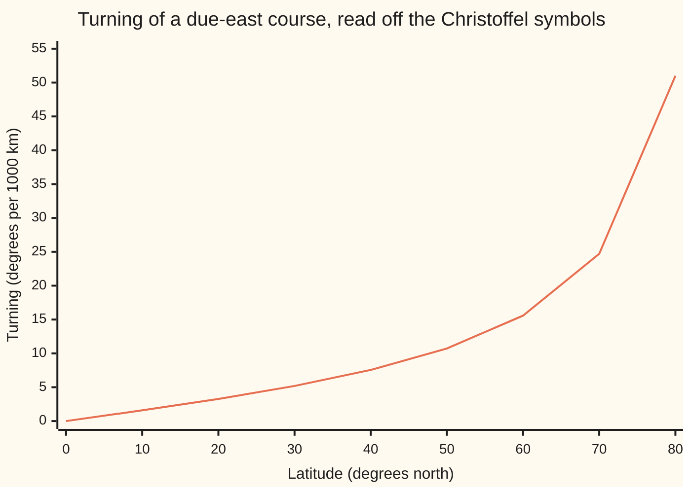

# Levi-Civita connection: the one derivative rule a metric forces

[Syllabus](../../../SYLLABUS.md) → [Differential geometry and Lie groups](../README.md) → [Riemannian Geometry](../README.md#s05) → Levi-Civita connection

---

## General Overview

A plane leaves London, at latitude 51.5074° north, and holds a heading of due east. It stays on London's line of latitude, a circle round the North Pole. Is that course straight? From the cockpit, the compass never moves. Yet the circle bends toward the pole, and a pilot flying truly straight would drift south of it.

To say how much it bends, the pilot has to differentiate an arrow: the direction of travel, "due east". On a flat map that is easy: subtract two arrows and divide. On the globe the arrows at two places sit in two different tangent planes (the flat plane touching the globe at each point), so there is nothing to subtract. A rule is needed that says how an arrow changes from place to place. That rule is a **connection**, written ∇ and read "nabla" or "del".

Many rules are possible. But the globe already carries a metric, its rule for lengths and angles ([Riemannian metric](01-riemannian-metrics.md)). Ask the rule to respect the metric and to add no twist, and only one rule is left: the **Levi-Civita connection**. In coordinates it is a short table of numbers, the **Christoffel symbols** Γ, read "gamma". They come straight from the metric's partial derivatives.

For the globe at London the table has two numbers that matter: −0.487156 and 1.257506. From them, the due-east course turns 11.31° away from straight for every 1000 km flown.

**A metric fixes exactly one way to differentiate arrows that keeps lengths and adds no twist, and in coordinates that rule is the Christoffel symbols, built from the first partial derivatives of the metric.**

**What kind of fact this is:** a theorem, often called the fundamental theorem of Riemannian geometry, proved on this card in Why it works. The connection exists everywhere on the manifold; its symbols are local, chart by chart.

### The picture: how hard due east turns



The one line is the turning away from straight for a plane holding due east, on a globe of radius 6371 km. The equator is straight: 0.00. London, between 50° and 60°, turns 11.31°. Near the pole the course is a tight circle.

---

## The formula

Notation first, in words. The globe is a sphere of radius $`R`$ = 6371 km, a model said once. A point has polar angle $`\varphi`$ (phi), measured down from the North Pole, and longitude $`\theta`$ (theta), measured east. These are the chart $`x = (x^1, x^2) = (\varphi, \theta)`$; the upper indices are labels, not powers. At London $`\varphi`$ = 90° − 51.5074° = 38.4926°, which is 0.671823 radians.

The **grid arrows** $`\partial_\varphi`$ and $`\partial_\theta`$ are the velocities of moving along one coordinate with the other frozen. $`\partial_\varphi`$ points south; $`\partial_\theta`$ points east. The metric's components are their dot products, $`g_{ij} = g(\partial_i, \partial_j)`$, and a repeated upper-lower index pair is summed. On the globe:

```math
g_{\varphi\varphi} = R^2, \qquad g_{\varphi\theta} = 0, \qquad g_{\theta\theta} = R^2 \sin^2\varphi
```

A **connection** $`\nabla`$ takes a direction $`X`$ and an arrow field $`Y`$ and returns $`\nabla_X Y`$, the rate at which $`Y`$ changes as you move along $`X`$. In a chart it needs one table: how each grid arrow changes along each other one.

```math
\nabla_{\partial_i} \partial_j = \Gamma^k_{ij}\, \partial_k, \qquad \nabla_X Y = X^i \left( \partial_i Y^k + \Gamma^k_{ij} Y^j \right) \partial_k
```

**Read it aloud:** the change in an arrow is the change in its components, plus the change in the grid arrows it is built from; the Christoffel symbols carry the second part.

The **inverse metric** $`g^{kl}`$ undoes $`g_{ij}`$ as a matrix. Two names come with it. **Flat**, $`\flat`$, turns an arrow into a covector (a linear rule that turns an arrow into a number) by the metric: $`X^\flat = g(X, \cdot)`$, components $`X_i = g_{ij} X^j`$. **Sharp**, $`\sharp`$, goes back: components $`g^{kl} X_l`$. The theorem's formula:

```math
\Gamma^k_{ij} = \tfrac{1}{2}\, g^{kl} \left( \partial_i g_{jl} + \partial_j g_{il} - \partial_l g_{ij} \right)
```

**Read it aloud:** add the rates at which the metric changes along the first two directions, subtract the rate along the third, halve, and raise the free index with the inverse metric.

On the globe only one metric derivative is not zero: $`\partial_\varphi g_{\theta\theta} = 2R^2 \sin\varphi \cos\varphi`$. So

```math
\Gamma^\varphi_{\theta\theta} = -\sin\varphi\cos\varphi = -0.487156, \qquad \Gamma^\theta_{\varphi\theta} = \Gamma^\theta_{\theta\varphi} = \cot\varphi = 1.257506
```

and the other four symbols are 0. The radius $`R`$ cancels.

| Symbol | Plain meaning | In our example | Push it up and the answer… |
| --- | --- | --- | --- |
| $`R`$ | radius of the model Earth, km | 6371 km | Γ unchanged; the turning per km falls |
| $`\varphi`$, $`\theta`$ | polar angle from the North Pole; longitude east, radians | 0.671823 rad at London; 0 | as $`\varphi`$ grows toward the equator, the turning falls to 0 |
| $`x^i`$, $`\partial_i`$ | chart coordinates, indices $`i, j, k, l`$ running over them; the grid arrow along each | $`(\varphi, \theta)`$; south and east | — |
| $`g_{ij}`$ | the metric: dot products of grid arrows, km² | 40589641 and 15724371 | lengths grow |
| $`g^{kl}`$, $`\flat`$, $`\sharp`$ | inverse metric; arrow to covector and back | $`1/R^2`$ and $`1/(R^2\sin^2\varphi)`$ | — |
| $`X`$, $`Y`$, $`Z`$, $`[X, Y]`$, $`Xf`$ | arrow fields; their Lie bracket, the failure of their flows to commute; the rate of a function $`f`$ along $`X`$ | east and south fields; $`[\partial_\varphi, \partial_\theta] = 0`$ | — |
| $`\nabla_X Y`$ | the connection: rate of change of $`Y`$ along $`X`$ | $`\nabla_{\partial_\theta}\partial_\theta = -0.487156\,\partial_\varphi`$ | — |
| $`\Gamma^k_{ij}`$, $`\Gamma_{lij}`$ | Christoffel symbols; the same with the free index lowered by $`\flat`$ | −0.487156 and 1.257506 | the grid arrows change faster |
| $`e`$ | unit arrow along the course, due east | $`\partial_\theta / (R \sin\varphi)`$ | — |
| $`\kappa_g`$ | geodesic curvature: how fast the course turns away from straight, per km | 0.00019738 per km | the course is less straight |
| $`x`$, $`y`$ | Mercator chart: longitude, and map height $`\mathrm{asinh}(\tan(\text{latitude}))`$ | 0 and 1.052273 | — |
| $`\mathbf{r}`$, $`\mathbf{r}_i`$, $`\mathbf{r}_{ij}`$, $`\mathbf{n}`$ | the globe placed in space, km; its first and second partial derivatives; the unit normal | $`\mathbf{r}_\varphi`$ has length 6371 km | — |

### When it holds

- **The metric is smooth and invertible in the chart.** At the pole $`g_{\theta\theta} = 0`$, the determinant of $`g`$ is 0.0 and $`g^{kl}`$ does not exist. The symbols blow up: $`\Gamma^\theta_{\varphi\theta}`$ is 57.29 at 1.0° from the pole and 572.96 at 0.1°. The sphere is smooth there; the chart failed.
- **The rule keeps lengths (metric compatibility).** Drop it and any symmetric table works, so nothing is forced. The arrows would also change length as they are carried, which no navigator accepts.
- **The rule adds no twist (torsion-free).** Drop it and the formula's three-term trick no longer closes: many length-keeping rules exist, with different "straight" paths.
- **Γ belongs to the chart, not the shape.** At London $`\Gamma^\varphi_{\varphi\varphi}`$ = 0 in one chart and the matching Mercator symbol is −0.782689. A number about the globe, such as $`\kappa_g`$, must come out the same in both.
- **Positive lengths are not needed.** The proof uses only that $`g`$ is symmetric and invertible, so the same formula serves spacetime, with signature (−, +, +, +).

---

## Why it works

### Step 0: count the unknowns, count the demands

In two dimensions a symmetric table $`\Gamma^k_{ij} = \Gamma^k_{ji}`$ has 2 × 3 = 6 unknowns: two values of $`k`$, three unordered pairs $`ij`$. Keeping lengths gives one equation for each rate $`\partial_k g_{ij}`$: again 2 × 3 = 6. Six equations, six unknowns, and they solve in one way. In $`n`$ dimensions both counts are $`n \cdot n(n+1)/2`$. That match is why a metric forces its connection.

### Step 1: what a connection must do

A connection obeys the rules any derivative obeys. It is linear in both slots, and it obeys the product rule $`\nabla_X (fY) = (Xf)\, Y + f\, \nabla_X Y`$, where $`Xf`$ is the rate of the function $`f`$ along $`X`$. Write $`Y = Y^j \partial_j`$ and apply the product rule: the components change by $`\partial_i Y^j`$, and each grid arrow changes by $`\nabla_{\partial_i}\partial_j`$. Naming that last change $`\Gamma^k_{ij}\partial_k`$ gives the coordinate formula above.

### Step 2: the two demands, in coordinates

**Keeping lengths** says the rate of a dot product is the dot product of rates:

```math
X\big(g(Y, Z)\big) = g(\nabla_X Y, Z) + g(Y, \nabla_X Z)
```

For grid arrows this reads $`\partial_k g_{ij} = \Gamma_{jki} + \Gamma_{ikj}`$, where $`\Gamma_{lij} = g_{lk}\Gamma^k_{ij}`$ is the symbol with its free index lowered.

**No twist** says $`\nabla_X Y - \nabla_Y X = [X, Y]`$. Grid arrows have $`[\partial_i, \partial_j] = 0`$, because mixed partials agree ([Partial derivatives](../../06-Calculus%20and%20analysis/07-Several%20Variables/01-partial-derivatives.md)). So $`\Gamma^k_{ij} = \Gamma^k_{ji}`$: the table is symmetric.

### Step 3: add two, subtract one

Write the length rule three times, rotating the indices. Add the first two, subtract the third. Symmetry cancels four of the six terms and leaves twice the lowered symbol. Raising the index with $`g^{kl}`$, the $`\sharp`$ step, gives the formula. Every step was forced, so the answer is unique; and the formula's table does satisfy both demands, so it exists.

<details>
<summary>Detailed proof: the three-term identity, and why the result is a connection</summary>

Keeping lengths on grid arrows gives, for every $`i, j, l`$:

$`\displaystyle \partial_i g_{jl} = \Gamma_{lij} + \Gamma_{jil}, \qquad \partial_j g_{il} = \Gamma_{lji} + \Gamma_{ijl}, \qquad \partial_l g_{ij} = \Gamma_{jli} + \Gamma_{ilj}`$

Here $`\Gamma_{lij}`$ means $`g(\nabla_{\partial_i}\partial_j, \partial_l)`$, and no twist means $`\Gamma_{lij} = \Gamma_{lji}`$ (symmetric in the last two slots).

Add the first two and subtract the third. By symmetry $`\Gamma_{jil} = \Gamma_{jli}`$ and $`\Gamma_{ijl} = \Gamma_{ilj}`$, so those four cancel, and $`\Gamma_{lij} = \Gamma_{lji}`$ leaves:

$`\displaystyle \partial_i g_{jl} + \partial_j g_{il} - \partial_l g_{ij} = 2\, \Gamma_{lij}`$

Multiply by $`\tfrac12 g^{kl}`$ and sum over $`l`$. Since $`g^{kl} g_{lm}`$ is 1 when $`k = m`$ and 0 otherwise, this gives the formula. So any connection meeting both demands has these symbols: uniqueness.

For existence, define $`\nabla`$ in each chart by the formula. The left side above is symmetric in $`i, j`$, so the table is symmetric: no twist. Adding the identity with $`l`$ and $`j`$ swapped returns $`\partial_i g_{jl}`$, which is keeping lengths. Two charts' tables describe one connection, because each chart's connection is the unique one meeting the two chart-free demands on their overlap.

The same argument without coordinates is the Koszul formula, which writes $`2 g(\nabla_X Y, Z)`$ from rates of $`g`$ and brackets of $`X, Y, Z`$; Lee's text, in Sources, gives it in full.

</details>

### Step 4: the globe, by hand

Only $`g_{\theta\theta} = R^2\sin^2\varphi`$ varies, and only with $`\varphi`$. Its rate is $`2R^2 \sin\varphi\cos\varphi`$ = 39546971 km² per radian at London.

- $`\Gamma^\varphi_{\theta\theta}`$: only the minus term survives: $`\tfrac12 \cdot \tfrac{1}{R^2} \cdot (-2R^2\sin\varphi\cos\varphi) = -\sin\varphi\cos\varphi`$.
- $`\Gamma^\theta_{\varphi\theta}`$: only the first term survives: $`\tfrac12 \cdot \tfrac{1}{R^2\sin^2\varphi} \cdot 2R^2\sin\varphi\cos\varphi = \cot\varphi`$.
- Every other symbol needs a rate of $`g_{\varphi\varphi}`$, or a rate along $`\theta`$, and all of those are 0.

Each has a picture. $`\nabla_{\partial_\varphi}\partial_\theta = \cot\varphi\,\partial_\theta`$: walking south, the east arrow, of length $`R\sin\varphi`$, grows at the relative rate $`\cot\varphi`$. $`\nabla_{\partial_\theta}\partial_\theta = -\sin\varphi\cos\varphi\,\partial_\varphi`$: walking east, the east arrow tilts. The minus sign against the south-pointing $`\partial_\varphi`$ means it tilts north.

### Step 5: the same numbers from outside

Sit the globe in space as $`\mathbf{r}(\varphi, \theta) = R(\sin\varphi\cos\theta, \sin\varphi\sin\theta, \cos\varphi)`$. A second derivative such as $`\mathbf{r}_{\theta\theta}`$ splits into a part along the surface and a part along the normal $`\mathbf{n}`$. The part along the surface is exactly $`\Gamma^k_{ij}\mathbf{r}_k`$: an inhabitant sees only that part.

Dot $`\mathbf{r}_{\theta\theta} = -R\sin\varphi(\cos\theta, \sin\theta, 0)`$ with $`\mathbf{r}_\varphi = R(\cos\varphi\cos\theta, \cos\varphi\sin\theta, -\sin\varphi)`$: the result is $`-R^2\sin\varphi\cos\varphi`$. Divide by $`|\mathbf{r}_\varphi|^2 = R^2`$ and $`-\sin\varphi\cos\varphi`$ is back. This road never uses the metric formula, which is why the code takes it.

### Step 6: the number that belongs to the globe

The unit east arrow is $`e = \partial_\theta / (R\sin\varphi)`$, and its components do not change along the parallel. So

```math
\nabla_e e = \frac{\Gamma^\varphi_{\theta\theta}}{R^2\sin^2\varphi}\,\partial_\varphi = -\frac{\cos\varphi}{R^2\sin\varphi}\,\partial_\varphi, \qquad \kappa_g = \lvert\nabla_e e\rvert = \frac{\cot\varphi}{R}
```

since $`\partial_\varphi`$ has length $`R`$. This is the **geodesic curvature**: the turning a surface-dweller feels, met for surfaces in [Geodesic on a surface](../02-Surfaces/09-geodesics-on-surfaces.md). A straight course has $`\nabla_e e = 0`$.

Now redo it in the Mercator chart, with coordinates $`x`$ (longitude) and $`y`$ (map height); here $`x`$ is one coordinate, not the whole chart. There the metric is $`R^2\,\mathrm{sech}^2 y\,(dx^2 + dy^2)`$, with $`\mathrm{sech}\, y = 1/\cosh y`$, which equals the cosine of the latitude. At London $`y`$ = 1.052273.

The formula gives different symbols: $`\Gamma^x_{xy} = -\tanh y`$, $`\Gamma^y_{xx} = \tanh y`$, $`\Gamma^y_{yy} = -\tanh y`$, each ±0.782689 at London. Yet $`\kappa_g`$ comes out at $`\tanh y / (R\,\mathrm{sech}\, y) = \tan(\text{latitude})/R`$, the same 0.00019738 per km. The symbols changed with the chart; the turning did not.

---

## Worked numbers, by hand

| Step | Arithmetic | Value |
| --- | --- | --- |
| polar angle at London | 90° − 51.5074° | 38.4926° = 0.671823 rad |
| sine and cosine | from a calculator | 0.622414 and 0.782689 |
| metric | $`R^2`$ and $`R^2\sin^2\varphi`$ | 40589641 and 15724371 km² |
| the one nonzero rate | $`2R^2\sin\varphi\cos\varphi`$ | 39546971 km² per radian |
| $`\Gamma^\varphi_{\theta\theta}`$ | −0.622414 × 0.782689 | **−0.487156** |
| $`\Gamma^\theta_{\varphi\theta}`$ | 0.782689 / 0.622414 | **1.257506** |
| geodesic curvature | 1.257506 / 6371 km | 0.00019738 per km |
| turning over 1000 km | 0.19738 rad × 180/π | **11.31°** |

A plane holding due east from London is not flying straight: every 1000 km it has turned 11.31° toward the pole compared with a great-circle course.

### What breaks if you drop a piece

| Mistake | Comes out at | What went wrong |
| --- | --- | --- |
| Differentiate components only, no Γ | 0.00° per 1000 km | The east arrow's components are constant, so the parallel looks straight; the grid arrows themselves turn |
| Drop the ½ | 0.00039476 per km, 22.62° per 1000 km | Twice the symbols, twice the turning |
| Flip the sign of the third term | $`\Gamma^\varphi_{\theta\theta}`$ = +0.487156 | The course seems to bend toward the equator |
| Read components as shape | 0.000000 in one chart, −0.782689 in the other | Γ depends on the chart; only $`\kappa_g`$ is the globe's |
| Use the polar chart at the pole | 57.29 at 1.0°, 572.96 at 0.1°, determinant 0.0 | The chart's metric is not invertible there, a hypothesis of the theorem |

The code prints all five.

---

## Code, from first principles, and it actually runs

The script writes the Christoffel formula once for any two-dimensional metric, with partial derivatives taken numerically by central differences. It reaches the globe's symbols by three roads: the formula, the closed form, and the 3-D road of Step 5. That third road projects numerical second derivatives of the embedding onto the surface and never touches the formula. It then gets the geodesic curvature of London's parallel from two charts, polar and Mercator, plus the 3-D symbols and the closed form $`\cot\varphi / R`$. It also counts Step 0's unknowns and equations, checks that the symbols keep lengths along both grid directions and are symmetric, and prints the five mistakes.

### Python

```python
# Levi-Civita connection -- the check behind the card.  Standard library only.
# The globe is a sphere of radius 6371 km.  Its Christoffel symbols at London
# come by three roads: the metric formula with numerical partials, the closed
# form, and the 3-D surface (tangential part of second derivatives).  Then the
# geometric number, how hard a due-east course bends, comes from two charts.
import math

R, LAT = 6371.0, 51.5074                   # km; London's latitude, degrees north
PHI = math.radians(90.0 - LAT)             # polar angle, measured down from the North Pole
H = 1e-4                                   # step for the numerical partials, radians

def clean(x):                              # no "-0.000000" in either language
    return 0.0 if abs(x) < 5e-10 else x

def polar(p):                              # chart 1: (phi, theta) -> g_ij
    return [[R * R, 0.0], [0.0, (R * math.sin(p[0])) ** 2]]

def mercator(p):                           # chart 2: (x, y) = (longitude, Mercator height)
    s = R / math.cosh(p[1])
    return [[s * s, 0.0], [0.0, s * s]]

def christoffel(metric, p, half=0.5, sign=-1.0):
    g = metric(p)
    det = g[0][0] * g[1][1] - g[0][1] * g[1][0]
    gi = [[g[1][1] / det, -g[0][1] / det], [-g[1][0] / det, g[0][0] / det]]
    dg = []                                # dg[l][i][j] = partial_l of g_ij
    for l in range(2):
        up, dn = list(p), list(p)
        up[l] += H
        dn[l] -= H
        gu, gd = metric(up), metric(dn)
        dg.append([[(gu[i][j] - gd[i][j]) / (2 * H) for j in range(2)] for i in range(2)])
    return [[[clean(sum(half * gi[k][l] * (dg[i][j][l] + dg[j][i][l] + sign * dg[l][i][j])
                        for l in range(2))) for j in range(2)] for i in range(2)] for k in range(2)]

def embed(p):                              # the globe in space, km
    u, v = p
    return [R * math.sin(u) * math.cos(v), R * math.sin(u) * math.sin(v), R * math.cos(u)]

def from_outside(p, h=H):                    # road 3: never touches the metric formula
    def d(f, i):
        def df(q):
            up, dn = list(q), list(q)
            up[i] += h
            dn[i] -= h
            return [(a - b) / (2 * h) for a, b in zip(f(up), f(dn))]
        return df
    r = [d(embed, i)(p) for i in range(2)]
    dot = lambda a, b: sum(x * y for x, y in zip(a, b))
    G = [[dot(r[a], r[b]) for b in range(2)] for a in range(2)]
    det = G[0][0] * G[1][1] - G[0][1] ** 2
    out = [[[0.0, 0.0], [0.0, 0.0]], [[0.0, 0.0], [0.0, 0.0]]]
    for i in range(2):
        for j in range(2):
            rij = d(d(embed, i), j)(p)
            b0, b1 = dot(rij, r[0]), dot(rij, r[1])
            out[0][i][j] = clean((G[1][1] * b0 - G[0][1] * b1) / det)
            out[1][i][j] = clean((G[0][0] * b1 - G[0][1] * b0) / det)
    return out

def bend(metric, gam, p, a):   # geodesic curvature along coordinate a; metric diagonal
    g, b = metric(p), 1 - a
    acc = gam[b][a][a] / g[a][a]           # the only sideways part of grad_e e, e = d_a / |d_a|
    return math.sqrt(g[b][b]) * abs(acc), acc

def deg1000(k):                            # turning, degrees per 1000 km flown
    return math.degrees(k * 1000.0)

names = ["phi", "theta"]
gp = christoffel(polar, [PHI, 0.0])
ge = from_outside([PHI, 0.0])
s, c = math.sin(PHI), math.cos(PHI)
closed = [[[0.0, 0.0], [0.0, -s * c]], [[0.0, c / s], [c / s, 0.0]]]
Y = math.asinh(math.tan(math.radians(LAT)))
gm = christoffel(mercator, [0.0, Y])
print(f"London: latitude {LAT:.4f} N, polar angle phi = {90 - LAT:.4f} deg = {PHI:.6f} rad")
print(f"sin phi = {s:.6f}, cos phi = {c:.6f}")
print(f"metric: g_phiphi = {R * R:.0f} km^2, g_thetatheta = {(R * s) ** 2:.0f} km^2")
print(f"partial_phi g_thetatheta = 2 R^2 sin cos = {2 * R * R * s * c:.0f} km^2")
print("Gamma^k_ij, chart (phi, theta): formula | from 3-D | closed form")
worst = 0.0
for k in range(2):
    for i in range(2):
        for j in range(i, 2):
            a, b, e = gp[k][i][j], ge[k][i][j], closed[k][i][j]
            worst = max(worst, abs(a - e), abs(b - e))
            print(f"  Gamma^{names[k]}_{names[i]}{names[j]} = {a:+.6f} | {b:+.6f} | {e:+.6f}")
n = 2
unknowns = sum(1 for k in range(n) for i in range(n) for j in range(n) if i <= j)    # Gamma^k_ij = Gamma^k_ji
equations = sum(1 for l in range(n) for i in range(n) for j in range(n) if i <= j)   # one per rate d_l g_ij
print(f"unknowns after symmetry {unknowns}, equations from keeping lengths {equations}")

def nudged(k, by):                         # the metric one small step along coordinate k
    q = [PHI, 0.0]
    q[k] += by
    return polar(q)

comp = max(abs((nudged(k, H)[i][j] - nudged(k, -H)[i][j]) / (2 * H)      # d_k g_ij, both directions
               - sum(gp[l][k][i] * polar([PHI, 0.0])[l][j] + gp[l][k][j] * polar([PHI, 0.0])[i][l]
                     for l in range(2))) / (R * R) for k in range(2) for i in range(2) for j in range(2))
mn = ["x", "y"]
print(f"Mercator chart at London: y = {Y:.6f}, tanh y = {math.tanh(Y):.6f}")
for k, i, j in [(0, 0, 1), (1, 0, 0), (1, 1, 1), (0, 0, 0)]:
    print(f"  Gamma^{mn[k]}_{mn[i]}{mn[j]} = {gm[k][i][j]:+.6f}")
kp, ap = bend(polar, gp, [PHI, 0.0], 1)
km, am = bend(mercator, gm, [0.0, Y], 0)
kx, _ = bend(polar, ge, [PHI, 0.0], 1)
kc = c / (s * R)
print(f"due-east course at London bends toward the pole: {'yes' if ap < 0 and am > 0 else 'no'}")
print(f"geodesic curvature, per km: polar chart {kp:.8f} | Mercator {km:.8f} | 3-D {kx:.8f} | cot(phi)/R {kc:.8f}")
print(f"turning over 1000 km: {kp * 1000:.5f} rad = {deg1000(kp):.2f} deg")
print("latitude, deg | turning, deg per 1000 km")
for lat in range(0, 90, 10):
    p = math.radians(90 - lat)
    print(f"  {lat:2d} | {deg1000(bend(polar, christoffel(polar, [p, 0.0]), [p, 0.0], 1)[0]):.2f}")
plain = bend(polar, [[[0.0] * 2] * 2] * 2, [PHI, 0.0], 1)[0]
k2 = bend(polar, christoffel(polar, [PHI, 0.0], half=1.0), [PHI, 0.0], 1)
k3 = christoffel(polar, [PHI, 0.0], sign=1.0)
print(f"mistake 1, plain partials, no Gamma: {deg1000(plain):.2f} deg per 1000 km, a straight parallel")
print(f"mistake 2, the 1/2 dropped: {k2[0]:.8f} per km, {deg1000(k2[0]):.2f} deg per 1000 km")
print(f"mistake 3, last sign flipped: Gamma^phi_thetatheta = {k3[0][1][1]:+.6f}, course bends toward the equator")
print(f"mistake 4, components read as shape: Gamma^phi_phiphi = {gp[0][0][0]:+.6f} but Gamma^y_yy = {gm[1][1][1]:+.6f}")
for d in (1.0, 0.1):
    print(f"mistake 5, near the pole: polar angle {d:.1f} deg, Gamma^theta_phitheta = {christoffel(polar, [math.radians(d), 0.0])[1][0][1]:.2f}")
print(f"  at the pole det g = {clean(polar([0.0, 0.0])[0][0] * polar([0.0, 0.0])[1][1]):.1f}: g^ij does not exist")
assert worst < 1e-7                                   # formula and 3-D agree with the closed form
assert abs(kp - kc) < 1e-10                          # polar chart against cot(phi)/R
assert abs(km - kc) < 1e-10                          # Mercator chart: same bending
assert abs(kx - kc) < 1e-10                          # 3-D road: same bending
assert comp < 1e-8                                   # the symbols keep lengths
assert all(gp[k][0][1] == gp[k][1][0] for k in range(2))   # no twist: symmetric
assert abs(k2[0] - 2 * kc) < 1e-10                   # dropping the 1/2 doubles it
assert k3[0][1][1] > 0                               # the flipped sign points it south
print("ALL CHECKS PASS")
```

**Ran 2026-11-19 on macOS, Python 3.14.10, standard library only. All checks passed. Output, pasted from the run:**

```
London: latitude 51.5074 N, polar angle phi = 38.4926 deg = 0.671823 rad
sin phi = 0.622414, cos phi = 0.782689
metric: g_phiphi = 40589641 km^2, g_thetatheta = 15724371 km^2
partial_phi g_thetatheta = 2 R^2 sin cos = 39546971 km^2
Gamma^k_ij, chart (phi, theta): formula | from 3-D | closed form
  Gamma^phi_phiphi = +0.000000 | +0.000000 | +0.000000
  Gamma^phi_phitheta = +0.000000 | +0.000000 | +0.000000
  Gamma^phi_thetatheta = -0.487156 | -0.487156 | -0.487156
  Gamma^theta_phiphi = +0.000000 | +0.000000 | +0.000000
  Gamma^theta_phitheta = +1.257506 | +1.257506 | +1.257506
  Gamma^theta_thetatheta = +0.000000 | +0.000000 | +0.000000
unknowns after symmetry 6, equations from keeping lengths 6
Mercator chart at London: y = 1.052273, tanh y = 0.782689
  Gamma^x_xy = -0.782689
  Gamma^y_xx = +0.782689
  Gamma^y_yy = -0.782689
  Gamma^x_xx = +0.000000
due-east course at London bends toward the pole: yes
geodesic curvature, per km: polar chart 0.00019738 | Mercator 0.00019738 | 3-D 0.00019738 | cot(phi)/R 0.00019738
turning over 1000 km: 0.19738 rad = 11.31 deg
latitude, deg | turning, deg per 1000 km
   0 | 0.00
  10 | 1.59
  20 | 3.27
  30 | 5.19
  40 | 7.55
  50 | 10.72
  60 | 15.58
  70 | 24.71
  80 | 51.00
mistake 1, plain partials, no Gamma: 0.00 deg per 1000 km, a straight parallel
mistake 2, the 1/2 dropped: 0.00039476 per km, 22.62 deg per 1000 km
mistake 3, last sign flipped: Gamma^phi_thetatheta = +0.487156, course bends toward the equator
mistake 4, components read as shape: Gamma^phi_phiphi = +0.000000 but Gamma^y_yy = -0.782689
mistake 5, near the pole: polar angle 1.0 deg, Gamma^theta_phitheta = 57.29
mistake 5, near the pole: polar angle 0.1 deg, Gamma^theta_phitheta = 572.96
  at the pole det g = 0.0: g^ij does not exist
ALL CHECKS PASS
```

### Rust

Same numbers, same labels, built with `rustc --edition 2021 -O`.

```rust
// Levi-Civita connection -- the same check as the Python, in Rust.  No crates.
// The globe is a sphere of radius 6371 km.  Its Christoffel symbols at London
// come by three roads: the metric formula with numerical partials, the closed
// form, and the 3-D surface (tangential part of second derivatives).  Then the
// geometric number, how hard a due-east course bends, comes from two charts.
const R: f64 = 6371.0;                     // km
const LAT: f64 = 51.5074;                  // London's latitude, degrees north
const H: f64 = 1e-4;                       // step for the numerical partials, radians
type M2 = [[f64; 2]; 2];
type Gam = [[[f64; 2]; 2]; 2];

fn clean(x: f64) -> f64 { if x.abs() < 5e-10 { 0.0 } else { x } }

fn polar(p: [f64; 2]) -> M2 {              // chart 1: (phi, theta) -> g_ij
    [[R * R, 0.0], [0.0, (R * p[0].sin()).powi(2)]]
}

fn mercator(p: [f64; 2]) -> M2 {           // chart 2: (x, y) = (longitude, Mercator height)
    let s = R / p[1].cosh();
    [[s * s, 0.0], [0.0, s * s]]
}

fn christoffel(metric: fn([f64; 2]) -> M2, p: [f64; 2], half: f64, sign: f64) -> Gam {
    let g = metric(p);
    let det = g[0][0] * g[1][1] - g[0][1] * g[1][0];
    let gi = [[g[1][1] / det, -g[0][1] / det], [-g[1][0] / det, g[0][0] / det]];
    let mut dg = [[[0.0; 2]; 2]; 2];       // dg[l][i][j] = partial_l of g_ij
    for l in 0..2 {
        let (mut up, mut dn) = (p, p);
        up[l] += H;
        dn[l] -= H;
        let (gu, gd) = (metric(up), metric(dn));
        for i in 0..2 { for j in 0..2 { dg[l][i][j] = (gu[i][j] - gd[i][j]) / (2.0 * H) } }
    }
    let mut out = [[[0.0; 2]; 2]; 2];
    for k in 0..2 { for i in 0..2 { for j in 0..2 {
        let mut t = 0.0;
        for l in 0..2 { t += half * gi[k][l] * (dg[i][j][l] + dg[j][i][l] + sign * dg[l][i][j]) }
        out[k][i][j] = clean(t);
    } } }
    out
}

fn embed(p: [f64; 2]) -> [f64; 3] {        // the globe in space, km
    [R * p[0].sin() * p[1].cos(), R * p[0].sin() * p[1].sin(), R * p[0].cos()]
}

fn d1(p: [f64; 2], i: usize) -> [f64; 3] {
    let (mut up, mut dn) = (p, p);
    up[i] += H;
    dn[i] -= H;
    let (a, b) = (embed(up), embed(dn));
    [0, 1, 2].map(|m| (a[m] - b[m]) / (2.0 * H))
}

fn d2(p: [f64; 2], i: usize, j: usize) -> [f64; 3] {
    let (mut up, mut dn) = (p, p);
    up[i] += H;
    dn[i] -= H;
    let (a, b) = (d1(up, j), d1(dn, j));
    [0, 1, 2].map(|m| (a[m] - b[m]) / (2.0 * H))
}

fn dot(a: [f64; 3], b: [f64; 3]) -> f64 { a[0] * b[0] + a[1] * b[1] + a[2] * b[2] }

fn from_outside(p: [f64; 2]) -> Gam {      // road 3: never touches the metric formula
    let r = [d1(p, 0), d1(p, 1)];
    let gg = [[dot(r[0], r[0]), dot(r[0], r[1])], [dot(r[1], r[0]), dot(r[1], r[1])]];
    let det = gg[0][0] * gg[1][1] - gg[0][1] * gg[0][1];
    let mut out = [[[0.0; 2]; 2]; 2];
    for i in 0..2 { for j in 0..2 {
        let rij = d2(p, i, j);
        let (b0, b1) = (dot(rij, r[0]), dot(rij, r[1]));
        out[0][i][j] = clean((gg[1][1] * b0 - gg[0][1] * b1) / det);
        out[1][i][j] = clean((gg[0][0] * b1 - gg[0][1] * b0) / det);
    } }
    out
}

fn bend(metric: fn([f64; 2]) -> M2, gam: &Gam, p: [f64; 2], a: usize) -> (f64, f64) {
    let (g, b) = (metric(p), 1 - a);       // geodesic curvature along coordinate a; metric diagonal
    let acc = gam[b][a][a] / g[a][a];      // the only sideways part of grad_e e, e = d_a / |d_a|
    (g[b][b].sqrt() * acc.abs(), acc)
}

fn deg1000(k: f64) -> f64 { (k * 1000.0).to_degrees() }   // turning, degrees per 1000 km flown

fn main() {
    let names = ["phi", "theta"];
    let phi = (90.0 - LAT).to_radians();   // polar angle, measured down from the North Pole
    let gp = christoffel(polar, [phi, 0.0], 0.5, -1.0);
    let ge = from_outside([phi, 0.0]);
    let (s, c) = (phi.sin(), phi.cos());
    let closed: Gam = [[[0.0, 0.0], [0.0, -s * c]], [[0.0, c / s], [c / s, 0.0]]];
    let y = LAT.to_radians().tan().asinh();
    let gm = christoffel(mercator, [0.0, y], 0.5, -1.0);
    println!("London: latitude {:.4} N, polar angle phi = {:.4} deg = {:.6} rad", LAT, 90.0 - LAT, phi);
    println!("sin phi = {:.6}, cos phi = {:.6}", s, c);
    println!("metric: g_phiphi = {:.0} km^2, g_thetatheta = {:.0} km^2", R * R, (R * s).powi(2));
    println!("partial_phi g_thetatheta = 2 R^2 sin cos = {:.0} km^2", 2.0 * R * R * s * c);
    println!("Gamma^k_ij, chart (phi, theta): formula | from 3-D | closed form");
    let mut worst: f64 = 0.0;
    for k in 0..2 { for i in 0..2 { for j in i..2 {
        let (a, b, e) = (gp[k][i][j], ge[k][i][j], closed[k][i][j]);
        worst = worst.max((a - e).abs()).max((b - e).abs());
        println!("  Gamma^{}_{}{} = {:+.6} | {:+.6} | {:+.6}", names[k], names[i], names[j], a, b, e);
    } } }
    let (n, mut unknowns, mut equations) = (2, 0, 0);
    for _k in 0..n { for i in 0..n { for j in 0..n { if i <= j { unknowns += 1 } } } }    // Gamma^k_ij = Gamma^k_ji
    for _l in 0..n { for i in 0..n { for j in 0..n { if i <= j { equations += 1 } } } }   // one per rate d_l g_ij
    println!("unknowns after symmetry {}, equations from keeping lengths {}", unknowns, equations);
    let g0 = polar([phi, 0.0]);
    let mut comp: f64 = 0.0;
    for k in 0..2 {                                                // d_k g_ij against the symbols, both directions
        let (mut up, mut dn) = ([phi, 0.0], [phi, 0.0]);
        up[k] += H;
        dn[k] -= H;
        let (gu, gd) = (polar(up), polar(dn));
        for i in 0..2 { for j in 0..2 {
            let mut rhs = 0.0;
            for l in 0..2 { rhs += gp[l][k][i] * g0[l][j] + gp[l][k][j] * g0[i][l] }
            comp = comp.max(((gu[i][j] - gd[i][j]) / (2.0 * H) - rhs).abs() / (R * R));
        } }
    }
    let mn = ["x", "y"];
    println!("Mercator chart at London: y = {:.6}, tanh y = {:.6}", y, y.tanh());
    for (k, i, j) in [(0, 0, 1), (1, 0, 0), (1, 1, 1), (0, 0, 0)] {
        println!("  Gamma^{}_{}{} = {:+.6}", mn[k], mn[i], mn[j], gm[k][i][j]);
    }
    let (kp, ap) = bend(polar, &gp, [phi, 0.0], 1);
    let (km, am) = bend(mercator, &gm, [0.0, y], 0);
    let (kx, _) = bend(polar, &ge, [phi, 0.0], 1);
    let kc = c / (s * R);
    println!("due-east course at London bends toward the pole: {}", if ap < 0.0 && am > 0.0 { "yes" } else { "no" });
    println!("geodesic curvature, per km: polar chart {:.8} | Mercator {:.8} | 3-D {:.8} | cot(phi)/R {:.8}", kp, km, kx, kc);
    println!("turning over 1000 km: {:.5} rad = {:.2} deg", kp * 1000.0, deg1000(kp));
    println!("latitude, deg | turning, deg per 1000 km");
    for lat in (0..90).step_by(10) {
        let p = (90.0 - lat as f64).to_radians();
        println!("  {:2} | {:.2}", lat, deg1000(bend(polar, &christoffel(polar, [p, 0.0], 0.5, -1.0), [p, 0.0], 1).0));
    }
    let plain = bend(polar, &[[[0.0; 2]; 2]; 2], [phi, 0.0], 1).0;
    let k2 = bend(polar, &christoffel(polar, [phi, 0.0], 1.0, -1.0), [phi, 0.0], 1);
    let k3 = christoffel(polar, [phi, 0.0], 0.5, 1.0);
    println!("mistake 1, plain partials, no Gamma: {:.2} deg per 1000 km, a straight parallel", deg1000(plain));
    println!("mistake 2, the 1/2 dropped: {:.8} per km, {:.2} deg per 1000 km", k2.0, deg1000(k2.0));
    println!("mistake 3, last sign flipped: Gamma^phi_thetatheta = {:+.6}, course bends toward the equator", k3[0][1][1]);
    println!("mistake 4, components read as shape: Gamma^phi_phiphi = {:+.6} but Gamma^y_yy = {:+.6}", gp[0][0][0], gm[1][1][1]);
    for d in [1.0_f64, 0.1] {
        println!("mistake 5, near the pole: polar angle {:.1} deg, Gamma^theta_phitheta = {:.2}", d,
                 christoffel(polar, [d.to_radians(), 0.0], 0.5, -1.0)[1][0][1]);
    }
    let pole = polar([0.0, 0.0]);
    println!("  at the pole det g = {:.1}: g^ij does not exist", clean(pole[0][0] * pole[1][1]));
    assert!(worst < 1e-7);                                         // formula and 3-D agree with the closed form
    assert!((kp - kc).abs() < 1e-10);                              // polar chart against cot(phi)/R
    assert!((km - kc).abs() < 1e-10);                              // Mercator chart: same bending
    assert!((kx - kc).abs() < 1e-10);                              // 3-D road: same bending
    assert!(comp < 1e-8);                                          // the symbols keep lengths
    assert!((0..2).all(|k| gp[k][0][1] == gp[k][1][0]));           // no twist: symmetric
    assert!((k2.0 - 2.0 * kc).abs() < 1e-10);                      // dropping the 1/2 doubles it
    assert!(k3[0][1][1] > 0.0);                                    // the flipped sign points it south
    println!("ALL CHECKS PASS");
}
```

**Ran 2026-11-19 on macOS, rustc 1.98.1, no crates. All checks passed. Output, pasted from the run:**

```
London: latitude 51.5074 N, polar angle phi = 38.4926 deg = 0.671823 rad
sin phi = 0.622414, cos phi = 0.782689
metric: g_phiphi = 40589641 km^2, g_thetatheta = 15724371 km^2
partial_phi g_thetatheta = 2 R^2 sin cos = 39546971 km^2
Gamma^k_ij, chart (phi, theta): formula | from 3-D | closed form
  Gamma^phi_phiphi = +0.000000 | +0.000000 | +0.000000
  Gamma^phi_phitheta = +0.000000 | +0.000000 | +0.000000
  Gamma^phi_thetatheta = -0.487156 | -0.487156 | -0.487156
  Gamma^theta_phiphi = +0.000000 | +0.000000 | +0.000000
  Gamma^theta_phitheta = +1.257506 | +1.257506 | +1.257506
  Gamma^theta_thetatheta = +0.000000 | +0.000000 | +0.000000
unknowns after symmetry 6, equations from keeping lengths 6
Mercator chart at London: y = 1.052273, tanh y = 0.782689
  Gamma^x_xy = -0.782689
  Gamma^y_xx = +0.782689
  Gamma^y_yy = -0.782689
  Gamma^x_xx = +0.000000
due-east course at London bends toward the pole: yes
geodesic curvature, per km: polar chart 0.00019738 | Mercator 0.00019738 | 3-D 0.00019738 | cot(phi)/R 0.00019738
turning over 1000 km: 0.19738 rad = 11.31 deg
latitude, deg | turning, deg per 1000 km
   0 | 0.00
  10 | 1.59
  20 | 3.27
  30 | 5.19
  40 | 7.55
  50 | 10.72
  60 | 15.58
  70 | 24.71
  80 | 51.00
mistake 1, plain partials, no Gamma: 0.00 deg per 1000 km, a straight parallel
mistake 2, the 1/2 dropped: 0.00039476 per km, 22.62 deg per 1000 km
mistake 3, last sign flipped: Gamma^phi_thetatheta = +0.487156, course bends toward the equator
mistake 4, components read as shape: Gamma^phi_phiphi = +0.000000 but Gamma^y_yy = -0.782689
mistake 5, near the pole: polar angle 1.0 deg, Gamma^theta_phitheta = 57.29
mistake 5, near the pole: polar angle 0.1 deg, Gamma^theta_phitheta = 572.96
  at the pole det g = 0.0: g^ij does not exist
ALL CHECKS PASS
```

The two outputs match line for line.

### Lean

Lean proves the theorem in charts of any dimension and on any smooth manifold, and the globe's symbols off the poles.

- Take a metric $`g_{ij}`$ that is smooth, symmetric and invertible throughout a region of a chart, in any dimension. Then a table $`\Gamma^k_{ij}`$ adds no twist and keeps lengths there exactly when it is the formula's table.
- Take any smooth manifold with a smooth metric. Then a connection that keeps lengths and adds no twist exists, and any two agree on differentiable arrow fields.
- Take the globe of any radius $`R > 0`$, off both poles, so $`0 < \varphi < \pi`$. Then the formula gives $`\Gamma^\varphi_{\theta\theta} = -\sin\varphi\cos\varphi`$ and $`\Gamma^\theta_{\varphi\theta} = \cot\varphi`$. The table is symmetric, and the other four symbols are 0, as in Step 4.
- In two dimensions a symmetric table has 6 unknowns, Step 0's count of 2 × 3.

London's numbers, the Mercator chart, the 11.31° turning and the five mistakes are left to the Python and Rust checks.

```lean
-- Levi-Civita connection: a smooth, symmetric, invertible metric forces exactly one connection that keeps lengths and adds no twist, whose Christoffel symbols are ½ g^kl (∂_i g_jl + ∂_j g_il − ∂_l g_ij), and on the globe these are −sin φ cos φ and cot φ.
import Mathlib.Analysis.Calculus.FDeriv.Basic
import Mathlib.Analysis.Calculus.ContDiff.Defs
import Mathlib.Analysis.SpecialFunctions.Trigonometric.Basic
import Mathlib.Analysis.SpecialFunctions.Trigonometric.Deriv
import Mathlib.LinearAlgebra.Matrix.NonsingularInverse
import Mathlib.LinearAlgebra.Matrix.Symmetric
import Mathlib.Geometry.Manifold.VectorBundle.CovariantDerivative.LeviCivita

open Real Set Bundle
open scoped ContDiff Manifold

/-! A chart is a point `x : Fin n → ℝ`; the coordinate `x i` is `x^i` (an upper index is a
label, not a power). The metric is a matrix of functions, `g x i j = g_ij` at the point `x`.
A table `Γ x k i j` stands for `Γ^k_ij` at `x`, so that `∇_{∂_i} ∂_j = Γ^k_ij ∂_k`. -/

/-- `∂_i f`: the rate of change of `f` along the chart direction `i`. -/
noncomputable def pd {n : ℕ} (i : Fin n) (f : (Fin n → ℝ) → ℝ) (x : Fin n → ℝ) : ℝ :=
  fderiv ℝ f x (Pi.single i 1)

/-- The card's formula: `Γ^k_ij = ½ g^kl (∂_i g_jl + ∂_j g_il − ∂_l g_ij)`, summed over `l`,
where `g^kl` is the inverse matrix of `g_ij`. -/
noncomputable def christoffel {n : ℕ} (g : (Fin n → ℝ) → Matrix (Fin n) (Fin n) ℝ)
    (x : Fin n → ℝ) (k i j : Fin n) : ℝ :=
  (1 / 2) * ∑ l : Fin n, (g x)⁻¹ k l *
    (pd i (fun y => g y j l) x + pd j (fun y => g y i l) x - pd l (fun y => g y i j) x)

/-- Contracting with the inverse matrix and then the matrix gives back the vector. -/
theorem lc_inv_contract {n : ℕ} (G : Matrix (Fin n) (Fin n) ℝ) (hG : G.IsSymm)
    (hdet : IsUnit G.det) (v : Fin n → ℝ) (j : Fin n) :
    ∑ l : Fin n, (∑ m : Fin n, G⁻¹ l m * v m) * G l j = v j := by
  have h1 : G⁻¹ * G = 1 := Matrix.nonsing_inv_mul G hdet
  have hs : (G⁻¹).transpose = G⁻¹ := by rw [Matrix.transpose_nonsing_inv, hG.eq]
  calc ∑ l : Fin n, (∑ m : Fin n, G⁻¹ l m * v m) * G l j
      = ∑ m : Fin n, v m * ∑ l : Fin n, G⁻¹ m l * G l j := by
        simp_rw [Finset.sum_mul, Finset.mul_sum]
        rw [Finset.sum_comm]
        refine Finset.sum_congr rfl fun m _ => Finset.sum_congr rfl fun l _ => ?_
        have : G⁻¹ l m = G⁻¹ m l := by
          simpa using congrFun (congrFun hs m) l
        rw [this]; ring
    _ = ∑ m : Fin n, v m * (1 : Matrix (Fin n) (Fin n) ℝ) m j := by
        refine Finset.sum_congr rfl fun m _ => ?_
        rw [← h1, Matrix.mul_apply]
    _ = v j := by simp [Matrix.one_apply]

theorem lc_inv_contract' {n : ℕ} (G : Matrix (Fin n) (Fin n) ℝ) (hG : G.IsSymm)
    (hdet : IsUnit G.det) (v : Fin n → ℝ) (j : Fin n) :
    ∑ l : Fin n, G j l * (∑ m : Fin n, G⁻¹ l m * v m) = v j := by
  rw [← lc_inv_contract G hG hdet v j]
  refine Finset.sum_congr rfl fun l _ => ?_
  rw [mul_comm, hG.apply l j]

/-- `∑_l g^kl (∑_m Γ^m g_ml) = Γ^k`. -/
theorem lc_inv_lower {n : ℕ} (G : Matrix (Fin n) (Fin n) ℝ) (hG : G.IsSymm)
    (hdet : IsUnit G.det) (w : Fin n → ℝ) (k : Fin n) :
    ∑ l : Fin n, G⁻¹ k l * (∑ m : Fin n, w m * G m l) = w k := by
  have h1 : G⁻¹ * G = 1 := Matrix.nonsing_inv_mul G hdet
  calc ∑ l : Fin n, G⁻¹ k l * (∑ m : Fin n, w m * G m l)
      = ∑ m : Fin n, w m * ∑ l : Fin n, G⁻¹ k l * G l m := by
        simp_rw [Finset.mul_sum]
        rw [Finset.sum_comm]
        refine Finset.sum_congr rfl fun m _ => Finset.sum_congr rfl fun l _ => ?_
        rw [hG.apply m l]; ring
    _ = ∑ m : Fin n, w m * (1 : Matrix (Fin n) (Fin n) ℝ) k m := by
        refine Finset.sum_congr rfl fun m _ => ?_
        rw [← h1, Matrix.mul_apply]
    _ = w k := by simp [Matrix.one_apply]

/-- The pointwise algebra behind the chart theorem. -/
theorem lc_pointwise {n : ℕ} (G : Matrix (Fin n) (Fin n) ℝ) (hG : G.IsSymm)
    (hdet : IsUnit G.det) (D : Fin n → Fin n → Fin n → ℝ)
    (hD : ∀ k i j, D k i j = D k j i) (Γ : Fin n → Fin n → Fin n → ℝ) :
    ((∀ k i j, Γ k i j = Γ k j i) ∧
      (∀ k i j, D k i j = ∑ l : Fin n, (Γ l k i * G l j + Γ l k j * G i l))) ↔
      ∀ k i j, Γ k i j = (1 / 2) * ∑ l : Fin n, G⁻¹ k l * (D i j l + D j i l - D l i j) := by
  constructor
  · rintro ⟨hs, hc⟩ k i j
    have key : ∀ l, D i j l + D j i l - D l i j = 2 * ∑ m : Fin n, Γ m i j * G m l := by
      intro l
      rw [hc i j l, hc j i l, hc l i j, Finset.mul_sum, ← Finset.sum_add_distrib,
        ← Finset.sum_sub_distrib]
      refine Finset.sum_congr rfl fun m _ => ?_
      rw [hs m j i, hs m l i, hs m l j, hG.apply m j]
      ring
    simp_rw [key]
    rw [← lc_inv_lower G hG hdet (fun m => Γ m i j) k, Finset.mul_sum]
    refine Finset.sum_congr rfl fun l _ => ?_
    ring
  · intro hΓ
    refine ⟨fun k i j => ?_, fun k i j => ?_⟩
    · rw [hΓ, hΓ]
      congr 1
      refine Finset.sum_congr rfl fun l _ => ?_
      rw [hD l i j]
      ring
    · simp_rw [hΓ]
      have e1 := lc_inv_contract G hG hdet (fun m => D k i m + D i k m - D m k i) j
      have e2 := lc_inv_contract' G hG hdet (fun m => D k j m + D j k m - D m k j) i
      have e1' : ∑ l : Fin n, (1 / 2 * ∑ m : Fin n, G⁻¹ l m * (D k i m + D i k m - D m k i))
          * G l j = (1 / 2) * (D k i j + D i k j - D j k i) := by
        rw [← e1, Finset.mul_sum]
        refine Finset.sum_congr rfl fun l _ => ?_
        ring
      have e2' : ∑ l : Fin n, (1 / 2 * ∑ m : Fin n, G⁻¹ l m * (D k j m + D j k m - D m k j))
          * G i l = (1 / 2) * (D k j i + D j k i - D i k j) := by
        rw [← e2, Finset.mul_sum]
        refine Finset.sum_congr rfl fun l _ => ?_
        ring
      rw [Finset.sum_add_distrib, e1', e2', hD k j i]
      ring

theorem lc_pd_symm {n : ℕ} (U : Set (Fin n → ℝ)) (hU : IsOpen U)
    (g : (Fin n → ℝ) → Matrix (Fin n) (Fin n) ℝ) (hsymm : ∀ x ∈ U, (g x).IsSymm)
    (x : Fin n → ℝ) (hx : x ∈ U) (k i j : Fin n) :
    pd k (fun y => g y i j) x = pd k (fun y => g y j i) x := by
  have h : (fun y => g y i j) =ᶠ[nhds x] (fun y => g y j i) := by
    filter_upwards [hU.mem_nhds hx] with y hy
    exact (hsymm y hy).apply j i
  unfold pd
  rw [h.fderiv_eq]

#print axioms lc_inv_contract
#print axioms lc_inv_contract'
#print axioms lc_inv_lower
#print axioms lc_pointwise
#print axioms lc_pd_symm

/-- The fundamental theorem of Riemannian geometry, in a chart. Let the metric `g_ij` be smooth,
symmetric and invertible on an open chart domain `U` (positive lengths are not needed). A table
`Γ^k_ij` adds no twist (`Γ^k_ij = Γ^k_ji`) and keeps lengths
(`∂_k g_ij = Γ^l_ki g_lj + Γ^l_kj g_il`) at every point of `U` if and only if it is the
Christoffel formula there. So the formula's table meets both demands, and it is the only one. -/
theorem christoffel_formula_is_the_unique_symmetric_metric_table {n : ℕ}
    (U : Set (Fin n → ℝ)) (hU : IsOpen U)
    (g : (Fin n → ℝ) → Matrix (Fin n) (Fin n) ℝ)
    (hsmooth : ∀ i j, ContDiffOn ℝ ∞ (fun x => g x i j) U)
    (hsymm : ∀ x ∈ U, (g x).IsSymm)
    (hinv : ∀ x ∈ U, IsUnit (g x).det)
    (Γ : (Fin n → ℝ) → Fin n → Fin n → Fin n → ℝ) :
    ((∀ x ∈ U, ∀ k i j, Γ x k i j = Γ x k j i) ∧
      (∀ x ∈ U, ∀ k i j, pd k (fun y => g y i j) x =
        ∑ l : Fin n, (Γ x l k i * g x l j + Γ x l k j * g x i l))) ↔
      ∀ x ∈ U, ∀ k i j, Γ x k i j = christoffel g x k i j := by
  have P := fun x (hx : x ∈ U) => lc_pointwise (g x) (hsymm x hx) (hinv x hx)
    (fun k i j => pd k (fun y => g y i j) x) (lc_pd_symm U hU g hsymm x hx) (Γ x)
  constructor
  · rintro ⟨hs, hc⟩ x hx
    exact (P x hx).mp ⟨hs x hx, hc x hx⟩
  · intro h
    exact ⟨fun x hx => ((P x hx).mpr (h x hx)).1, fun x hx => ((P x hx).mpr (h x hx)).2⟩

/-- The fundamental theorem of Riemannian geometry, chart-free. On a smooth Riemannian manifold
`M` with a smooth metric, there is a connection on the tangent bundle that keeps lengths and adds
no twist (a Levi-Civita connection), and any two such connections agree on every differentiable
vector field. -/
theorem levi_civita_connection_exists_unique
    {E : Type*} [NormedAddCommGroup E] [NormedSpace ℝ E] [FiniteDimensional ℝ E]
    {H : Type*} [TopologicalSpace H] (I : ModelWithCorners ℝ E H)
    {M : Type*} [TopologicalSpace M] [ChartedSpace H M] [IsManifold I ∞ M]
    [RiemannianBundle (fun (x : M) ↦ TangentSpace I x)]
    [IsContMDiffRiemannianBundle I ∞ E (fun (x : M) ↦ TangentSpace I x)] :
    (∃ cov : CovariantDerivative I E (TangentSpace I : M → Type _),
        cov.IsLeviCivitaConnection) ∧
      ∀ cov cov' : CovariantDerivative I E (TangentSpace I : M → Type _),
        cov.IsLeviCivitaConnection → cov'.IsLeviCivitaConnection →
        ∀ (Y : Π x : M, TangentSpace I x) (x : M), MDiffAt (T% Y) x →
          ∀ X₀ : TangentSpace I x, cov Y x X₀ = cov' Y x X₀ := by
  refine ⟨⟨_, CovariantDerivative.isLeviCivitaConnection_leviCivitaConnection I⟩, ?_⟩
  intro cov cov' h h' Y x hY X₀
  exact h.uniqueness I h' hY X₀

/-- The globe of radius `R` in the chart `(φ, θ)`, index `0` for `φ` (down from the North Pole)
and `1` for `θ` (longitude east): `g_φφ = R²`, `g_φθ = 0`, `g_θθ = R² sin² φ`. -/
noncomputable def globeMetric (R : ℝ) (x : Fin 2 → ℝ) : Matrix (Fin 2) (Fin 2) ℝ :=
  !![R ^ 2, 0; 0, R ^ 2 * sin (x 0) ^ 2]

/-- The globe's Christoffel symbols: `Γ^φ_θθ = −sin φ cos φ`, `Γ^θ_φθ = Γ^θ_θφ = cot φ`, and the
other five are `0`. -/
noncomputable def globeSymbols (x : Fin 2 → ℝ) : Fin 2 → Fin 2 → Fin 2 → ℝ :=
  ![![![0, 0], ![0, -(sin (x 0) * cos (x 0))]],
    ![![0, cos (x 0) / sin (x 0)], ![cos (x 0) / sin (x 0), 0]]]

theorem lc_pd_const {n : ℕ} (i : Fin n) (c : ℝ) (x : Fin n → ℝ) :
    pd i (fun _ => c) x = 0 := by
  simp [pd]

theorem lc_pd_globe (R : ℝ) (i : Fin 2) (x : Fin 2 → ℝ) :
    pd i (fun y => R ^ 2 * sin (y 0) ^ 2) x =
      (Pi.single i (1 : ℝ) : Fin 2 → ℝ) 0 * (R ^ 2 * (2 * sin (x 0) * cos (x 0))) := by
  have h := ((HasFDerivAt.sin (hasFDerivAt_apply (𝕜 := ℝ) (0 : Fin 2) x)).pow 2).const_mul (R ^ 2)
  unfold pd
  rw [h.fderiv]
  simp
  ring

theorem lc_globe_entry_00 (R : ℝ) (y : Fin 2 → ℝ) : globeMetric R y 0 0 = R ^ 2 := by
  simp [globeMetric]
theorem lc_globe_entry_01 (R : ℝ) (y : Fin 2 → ℝ) : globeMetric R y 0 1 = 0 := by
  simp [globeMetric]
theorem lc_globe_entry_10 (R : ℝ) (y : Fin 2 → ℝ) : globeMetric R y 1 0 = 0 := by
  simp [globeMetric]
theorem lc_globe_entry_11 (R : ℝ) (y : Fin 2 → ℝ) :
    globeMetric R y 1 1 = R ^ 2 * sin (y 0) ^ 2 := by
  simp [globeMetric]

theorem lc_globe_inv (R : ℝ) (hR : 0 < R) (x : Fin 2 → ℝ) (hs : sin (x 0) ≠ 0) :
    (globeMetric R x)⁻¹ = !![1 / R ^ 2, 0; 0, 1 / (R ^ 2 * sin (x 0) ^ 2)] := by
  apply Matrix.inv_eq_left_inv
  have hR2 : R ^ 2 ≠ 0 := by positivity
  ext i j
  fin_cases i <;> fin_cases j <;> simp [globeMetric, Matrix.mul_apply, Fin.sum_univ_two] <;>
    field_simp

#print axioms lc_pd_const
#print axioms lc_pd_globe
#print axioms lc_globe_entry_00
#print axioms lc_globe_entry_01
#print axioms lc_globe_entry_10
#print axioms lc_globe_entry_11
#print axioms lc_globe_inv

/-- On a globe of radius `R > 0`, away from the poles (`0 < φ < π`), the Christoffel formula
applied to the globe's metric gives `Γ^φ_θθ = −sin φ cos φ`, `Γ^θ_φθ = cot φ`, and `0` for the
rest. -/
theorem christoffel_symbols_of_globe (R : ℝ) (hR : 0 < R) (x : Fin 2 → ℝ)
    (hx : x 0 ∈ Ioo 0 π) (k i j : Fin 2) :
    christoffel (globeMetric R) x k i j = globeSymbols x k i j := by
  have hs : sin (x 0) ≠ 0 := (sin_pos_of_pos_of_lt_pi hx.1 hx.2).ne'
  have hR2 : R ^ 2 ≠ 0 := by positivity
  unfold christoffel
  rw [lc_globe_inv R hR x hs]
  fin_cases k <;> fin_cases i <;> fin_cases j <;>
    simp [Fin.sum_univ_two, globeSymbols, lc_globe_entry_00, lc_globe_entry_01,
      lc_globe_entry_10, lc_globe_entry_11, lc_pd_const, lc_pd_globe] <;>
    field_simp

/-! Worked counts from the card, checked exactly. -/

/-- Step 0 in two dimensions: a symmetric table `Γ^k_ij = Γ^k_ji` has 6 unknowns,
two values of `k` times three unordered pairs `ij`. -/
example : (Finset.univ.filter (fun t : Fin 2 × Fin 2 × Fin 2 => t.2.1 ≤ t.2.2)).card = 6 := by
  decide

/-- Step 0: both counts are `n · n(n+1)/2`, which is `2 × 3 = 6` when `n = 2`. -/
example : 2 * (2 * (2 + 1) / 2) = 6 := by norm_num

#print axioms christoffel_formula_is_the_unique_symmetric_metric_table
#print axioms levi_civita_connection_exists_unique
#print axioms christoffel_symbols_of_globe
```

**Checked 2026-11-19 on macOS, Lean 4.36.0-rc2, Mathlib v4.36.0-rc2. Every proof is complete and uses only Lean's standard axioms. Output, pasted from the run:**

```
'lc_inv_contract' depends on axioms: [propext, Classical.choice, Quot.sound]
'lc_inv_contract'' depends on axioms: [propext, Classical.choice, Quot.sound]
'lc_inv_lower' depends on axioms: [propext, Classical.choice, Quot.sound]
'lc_pointwise' depends on axioms: [propext, Classical.choice, Quot.sound]
'lc_pd_symm' depends on axioms: [propext, Classical.choice, Quot.sound]
'lc_pd_const' depends on axioms: [propext, Classical.choice, Quot.sound]
'lc_pd_globe' depends on axioms: [propext, Classical.choice, Quot.sound]
'lc_globe_entry_00' depends on axioms: [propext, Classical.choice, Quot.sound]
'lc_globe_entry_01' depends on axioms: [propext, Classical.choice, Quot.sound]
'lc_globe_entry_10' depends on axioms: [propext, Classical.choice, Quot.sound]
'lc_globe_entry_11' depends on axioms: [propext, Classical.choice, Quot.sound]
'lc_globe_inv' depends on axioms: [propext, Classical.choice, Quot.sound]
'christoffel_formula_is_the_unique_symmetric_metric_table' depends on axioms: [propext, Classical.choice, Quot.sound]
'levi_civita_connection_exists_unique' depends on axioms: [propext, Classical.choice, Quot.sound]
'christoffel_symbols_of_globe' depends on axioms: [propext, Classical.choice, Quot.sound]
```

> [!TIP]
> **Try changing**
> Guess first, then run it.
> - **The Moon.** Set `R` to `1737.4`. Guess first: do the symbols change? They do not: −0.487156 and 1.257506 again, since $`R`$ cancels. The turning grows to 41.47° per 1000 km.
> - **Further north.** Set `LAT` to `64.1466`, about Reykjavik. Guess first: the symbols become −0.392425 and 2.063689, and the turning 18.56° per 1000 km.
> - **The equator.** Set `LAT` to `0.0`. Guess first: every symbol is 0 and the turning is 0.00°. The last assert stops the run, because flipping a sign on 0 changes nothing.
> - **Drop the half.** Change `half=0.5` to `half=1.0` in the definition of `christoffel`. The first assert stops the run.

---

## The usual mistake

> [!warning]
> **Reading the Christoffel symbols as curvature.** They are not a property of the shape. At London the globe has $`\Gamma^\varphi_{\varphi\varphi}`$ = 0 in the polar chart and $`\Gamma^y_{yy}`$ = −0.782689 in the Mercator chart. A flat sheet in polar coordinates has nonzero symbols too, though it is not curved at all. Curvature is what is left when the symbols cannot be removed by any chart change: the [Riemann curvature tensor](06-riemann-curvature-tensor.md).
>
> - **Plain partial derivatives of components.** They say due east from London is straight: 0.00° per 1000 km, not 11.31°.
> - **Losing the ½.** The turning doubles, to 22.62° per 1000 km.
> - **A sign slip in the third term.** $`\Gamma^\varphi_{\theta\theta}`$ comes out +0.487156 and the course seems to curve toward the equator.
> - **Trusting the chart at the pole.** $`\Gamma^\theta_{\varphi\theta}`$ is 572.96 at 0.1° from the pole: a coordinate failure, not a spike in the globe.

---

## Where you meet it in real life

- **Flight planning.** A constant-heading course, called a rhumb line, is not straight on the globe; its turning is $`\kappa_g`$. Due east from London turns 11.31° per 1000 km, one reason long routes follow great circles instead.
- **Inertial navigation.** Systems that integrate velocity in latitude and longitude carry extra terms, such as east speed squared times the tangent of latitude over the radius. Those are Christoffel terms of the Earth's metric.
- **Weather and climate models.** The momentum equations on a latitude-longitude grid carry "metric terms" with the tangent of latitude. They are the same symbols, and the trouble with them near the poles is the chart failure above.
- **General relativity.** In the geodesic equation of a spacetime metric, the Christoffel term plays the part of the gravitational pull; see [Einstein equations](../07-Geometric%20Analysis%20and%20Physics/02-einstein-equations-in-outline.md).
- **Optimisation on curved sets.** Second-order methods on curved sets need a way to differentiate a gradient field; the [Riemannian Hessian](../07-Geometric%20Analysis%20and%20Physics/06-riemannian-hessian-and-trust-regions.md) uses this connection.

> **Say it back**
> On a curved space, arrows at different points cannot be subtracted, so a derivative of arrows needs a rule. Ask the rule to keep lengths and add no twist, and the metric leaves exactly one: the Levi-Civita connection. In coordinates it is the Christoffel symbols, one half the inverse metric times three rates of the metric. On the globe they are −0.487156 and 1.257506 at London, and they show a due-east course turning 11.31° per 1000 km. The symbols change with the chart; the turning they predict does not.

---

## What this builds on

- [Riemannian metric](01-riemannian-metrics.md): the metric $`g_{ij}`$ of the globe, $`R^2\,d\varphi^2 + R^2\sin^2\varphi\,d\theta^2`$, whose rates build every symbol.
- [Partial derivatives](../../06-Calculus%20and%20analysis/07-Several%20Variables/01-partial-derivatives.md): the rates $`\partial_k g_{ij}`$, and mixed partials agreeing, which makes grid arrows commute and the table symmetric.

## Where this goes next

- [Parallel transport](03-parallel-transport-and-holonomy.md): carry an arrow along a path with $`\nabla`$ held at zero, and measure the turn it brings back round a loop.
- [Geodesic and exponential map](04-geodesics-and-the-exponential-map.md): the courses with $`\nabla_e e = 0`$, the truly straight ones.
- [Riemann curvature tensor](06-riemann-curvature-tensor.md): the failure of two connection derivatives to commute, which no chart can remove.

The connection says how arrows change, point by point; what happens to an arrow carried all the way round a closed flight is the question this card leaves open.

---

## Sources

Verified 2026-11-19: every link below resolves to the publisher's page.

- Christoffel, E. B. "Ueber die Transformation der homogenen Differentialausdrücke zweiten Grades." *Journal für die reine und angewandte Mathematik* 70 (1869). [doi:10.1515/crll.1869.70.46](https://doi.org/10.1515/crll.1869.70.46). Where the symbols first appear, as the terms a quadratic form gains under a change of variables.
- Levi-Civita, T. "Nozione di parallelismo in una varietà qualunque e conseguente specificazione geometrica della curvatura riemanniana." *Rendiconti del Circolo Matematico di Palermo* 42 (1916). [doi:10.1007/BF03014898](https://doi.org/10.1007/BF03014898). Gives the symbols their geometric meaning, through parallel arrows.
- Lee, John M. *Introduction to Riemannian Manifolds*, 2nd ed. Springer, Graduate Texts in Mathematics 176, 2018. [doi:10.1007/978-3-319-91755-9](https://doi.org/10.1007/978-3-319-91755-9). The fundamental theorem, the Koszul formula, and the coordinate formula.
- do Carmo, Manfredo P. *Differential Geometry of Curves and Surfaces*, revised 2nd ed. Dover, 2016. [Publisher page](https://store.doverpublications.com/products/9780486806990). Christoffel symbols of a surface as the tangential part of second derivatives, and geodesic curvature.
