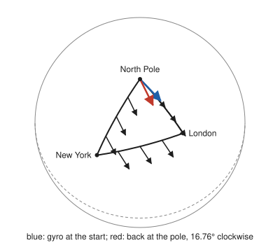

# Parallel transport: carry a vector without turning it

[Syllabus](../../../SYLLABUS.md) → [Differential geometry and Lie groups](../README.md) → [Riemannian Geometry](../README.md#s05) → Parallel transport

---

## General Overview

A plane leaves the North Pole with a gyroscope on board. The gyroscope's spin axis is held level by its mount, and nothing twists it about the vertical. At take-off the axis points straight along the route, toward London.

The plane flies three great-circle legs (a **great circle** is a circle round the globe's centre, the shortest route between two places): North Pole to London, 4280.18 km; London to New York, 5570.22 km; New York back to the pole, 5480.49 km. The gyroscope never turns. Yet back at the pole its axis points **16.76° clockwise** of where it started.

Nothing went wrong with the gyroscope. The turn belongs to the curved ground under the route. [Triangles on a sphere](../../05-Geometry%20and%20trig/06-Beyond%20Euclid/01-triangles-on-a-sphere.md) found the same 16.76° another way: the triangle's corner angles add to 196.76°, and the extra 16.76° measures the area it encloses.

Carrying an arrow along a path on a curved surface while keeping it level and never twisting it is called **parallel transport**. The angle it comes back turned by, after a closed loop, is the loop's **holonomy**.

**Parallel transport moves an arrow along a path, changing it only by the push that keeps it in the surface; round a closed loop on a sphere the arrow comes back turned by the enclosed area over the radius squared, which for a great-circle triangle is its angle excess.**

**What kind of fact this is:** a definition (parallel transport) and a theorem: on a sphere, the holonomy of a great-circle triangle equals its angle excess, proved on this card in Why it works. For a loop of any shape the area rule rests on [Gauss-Bonnet](../02-Surfaces/10-gauss-bonnet-theorem.md), and is checked here on London's parallel. The Earth as a sphere of radius 6371 km is a model, good to a fraction of a percent, and the Earth's own spin, which adds a separate drift, is left out.

### The picture: the gyroscope round the triangle

<p align="center"></p>

To scale, in orthographic projection (a view from far away, looking straight down on the triangle's middle): the Earth's 6371 km radius is 150 units. The blue arrow is the gyroscope at take-off. The red arrow is the gyroscope back at the pole. The black arrows show it along the way. The dashed curve is the equator.

---

## The formula

Notation first, in words. The route is a curve $`\gamma(t)`$ on the globe, a point for each time $`t`$, with velocity $`\dot\gamma`$. The gyroscope's axis is an arrow $`V(t)`$ that lies flat in the ground's tangent plane (the flat plane touching the globe at $`\gamma(t)`$).

The **covariant derivative along the curve**, written $`DV/dt`$, is the part of the ordinary rate of change $`dV/dt`$ that lies in the tangent plane. The rest points straight up or down, and is just the push needed to keep the arrow level as the ground curves away.

Parallel transport is the rule that this tangent part is zero:

```math
\frac{DV}{dt} = \Big(\frac{dV}{dt}\Big)_{\mathrm{tangent}} = 0
```

**Read it aloud:** the arrow changes only as much as it must to stay in the surface; within the surface it does not change at all.

In a chart (a set of coordinates $`x^1, x^2`$ on a patch of the globe, such as latitude and longitude), the same rule reads, summing over each repeated upper and lower index:

```math
\frac{dV^k}{dt} + \Gamma^k_{ij}\,\dot x^i\,V^j = 0
```

**Read it aloud:** the chart components of the arrow change only by the correction the Christoffel symbols demand, for the direction the route is moving in.

Round the closed triangle, the arrow comes back turned by the holonomy angle $`\psi`$:

```math
\psi = \pm\left(\alpha_P + \alpha_L + \alpha_Y - \pi\right) = \pm K\,\mathcal{A} = \pm\frac{\mathcal{A}}{R^2}
```

**Read it aloud:** the size of the turn is the corner angles' overshoot of π radians, which is the curvature times the area, which is the area over the radius squared; its sign is the loop's direction.

Take + when the loop runs anticlockwise seen from outside, with the enclosed region on its left, and − when it runs clockwise. Pole, London, New York runs clockwise, so here $`\psi`$ is minus the excess: −16.761115°.

The map that takes an arrow at the start of a route to the arrow at its end is the **transport map** $`P_\gamma`$. Round a closed loop, $`P_\gamma`$ is a rotation of the tangent plane by $`\psi`$.

| Symbol | Plain meaning | In our example | Push it up and the answer… |
| --- | --- | --- | --- |
| $`R`$ | the Earth's radius | 6371 km | same area turns the arrow less |
| $`\gamma(t)`$, $`\dot\gamma`$ | the route, and its velocity | pole, London, New York, pole | — |
| $`V(t)`$ | the gyroscope's arrow, lying in the tangent plane | starts pointing toward London | — |
| $`dV/dt`$, $`DV/dt`$ | the arrow's full rate of change; its tangent part | $`DV/dt = 0`$ all the way | — |
| $`P_\gamma`$ | the transport map: start arrow in, end arrow out | a 16.76° clockwise turn | — |
| $`x^i`$, $`V^k`$ | chart coordinates, such as $`\varphi`$ (angle down from the pole) and $`\theta`$ (longitude east), and the arrow's components in that chart | upper indices are labels, not powers | — |
| $`\Gamma^k_{ij}`$ | Christoffel symbols: the chart's correction terms | −0.487156 and 1.257506 at London in latitude-longitude | — |
| $`n`$ | a great circle's axis: the unit arrow through the globe's centre at right angles to the circle's plane | one per leg | — |
| $`\alpha_P`$, $`\alpha_L`$, $`\alpha_Y`$ | corner angles at the pole, London and New York | 73.88°, 71.67°, 51.21° | the turn grows with each |
| $`\psi`$ | the holonomy angle, anticlockwise positive seen from outside | −16.761115° = 16.76° clockwise | — |
| $`\mathcal{A}`$ | the area the loop encloses | 11873957 km² | the turn grows in step |
| $`K`$ | Gaussian curvature, $`1/R^2`$ on a sphere | 2.463683e-08 per km² | the turn grows in step |
| $`h`$ | step size in the stepped solution, radians of arc | the leg's angle over 100, then over 200 | the stepped answer drifts further |

Wing 05's card used $`E`$ for the excess and $`K`$ for area; on this wing $`K`$ is Gaussian curvature, so the area is $`\mathcal{A}`$.

### When it holds

- **The arrow stays in the surface.** Hold it fixed in space instead and it tilts 38.49° off level by London; it is no longer a direction anyone on the ground can use.
- **The sides are great circles** for the excess form. On a bending route the arrow's angle to the route changes along the way, so counting corner turns alone misses part of the turn. The turn is still curvature added up over the enclosed area, $`\psi = \pm\iint K\,dA`$ with the same sign rule ([Gauss-Bonnet](../02-Surfaces/10-gauss-bonnet-theorem.md)). Round London's parallel it is 78.2321°, not the 0° that counting corners gives.
- **The loop bounds a region and is flown once.** Flown the other way, the sign flips: +16.761115°. On a sphere a loop bounds two regions; the other one gives the same turn, counted the other way round.
- **One surface with one metric.** The Levi-Civita connection fixes the transport ([Levi-Civita connection](02-levi-civita-connection-and-christoffel-symbols.md)); a different rule for "not turning" would give a different answer.
- **Radians in the formula.** Degrees appear only in prose.

---

## Why it works

### Step 0: the idea

The gyroscope can only feel turning within the ground's tangent plane. The vertical push that keeps it level is supplied by the mount and is not a turn. So parallel transport keeps the tangent part of the change at zero and lets the vertical part be whatever the curving ground needs.

On a flat field the vertical part is never needed, so the arrow keeps one direction for ever. On a sphere the tangent planes themselves tilt from place to place. The arrow is carried from one plane to the next without twisting, and there is no single "same direction" to compare it with until the loop closes.

### Step 1: on a great circle, transport is a rotation of the globe

Spin the globe about the axis $`n`$ of a great circle (the line through the centre at right angles to the circle's plane). The circle slides along itself. Carry the arrow with the spin.

The arrow then changes at the rate $`n \times V`$ times the spin rate. Split $`V`$ into a part along the route and a part across it. The across part is along $`n`$, and $`n \times n = 0`$. The along part, crossed with $`n`$, points at the globe's centre: straight down. So $`dV/dt`$ is all vertical, and $`DV/dt = 0`$.

That gives the first road to the answer, exactly: three rotations, one per leg. It also shows that **on a great-circle leg the arrow keeps a fixed angle with the route**, because the spin carries both together.

<details>
<summary>Detailed proof: the spin's rate of change is vertical</summary>

Use a sphere of radius 1. Let the leg start at $`a`$ and head along $`b`$, with $`a`$ and $`b`$ unit and at right angles. With $`t`$ the angle travelled, the leg is $`\gamma(t) = a\cos t + b\sin t`$, and its axis is $`n = a \times b`$.

At any point the route direction is $`\dot\gamma = b\cos t - a\sin t`$, and the three arrows $`\gamma`$, $`\dot\gamma`$, $`n`$ are at right angles. Write $`V = u\,\dot\gamma + w\,n`$ with fixed $`u`$ and $`w`$.

The spin about $`n`$ at unit rate gives $`dV/dt = n \times V = u\,(n \times \dot\gamma) = -u\,\gamma`$, because $`n \times \dot\gamma = -\gamma`$ for this right-handed triple.

$`\displaystyle \frac{dV}{dt} = -u\,\gamma, \qquad \Big(\frac{dV}{dt}\Big)_{\mathrm{tangent}} = 0.`$

The change points along $`\gamma`$, which is the vertical. Its tangent part is zero, so the rotated arrow is parallel transported, and since the solution of the transport equation is unique, it is the parallel transport.

</details>

### Step 2: the route turns at the corners, the gyroscope does not

Track the gyroscope's angle measured from the route. On each leg that angle stays fixed (Step 1). At each corner the route turns right; the gyroscope does not, so measured from the new route it has slipped left by the same amount.

| Where | Route heading in → out | Route turns right by | Gyroscope heading |
| --- | --- | --- | --- |
| London | 180.00° → 288.33° | 108.33° | 180.00° |
| New York | 231.21° → 0.00° | 128.79° | 122.88° |
| North Pole | — | 106.12° | 16.76° clockwise of the start |

Headings are clockwise from north. At New York the gyroscope sits 108.33° left of the arriving route, as it did on leaving London: the angle held along the leg.

The route turns right by 343.24° in all and ends pointing exactly along leg one again. On a flat map the three turns of a triangle add to a full 360°. Here they fall 16.76° short.

Measured from the route, the gyroscope has slipped 343.24° anticlockwise. That is a full turn less 16.76°, so it sits 16.76° clockwise of where it started.

### Step 3: the shortfall is the excess, and the excess is the area

Each right turn is 180° minus a corner angle. So the three turns fall short of 360° by exactly the corner angles' overshoot of 180°:

```math
360^\circ - \sum (180^\circ - \alpha) = \sum \alpha - 180^\circ = 196.76^\circ - 180^\circ = 16.76^\circ
```

[Triangles on a sphere](../../05-Geometry%20and%20trig/06-Beyond%20Euclid/01-triangles-on-a-sphere.md) proves that this excess, in radians, is the area over $`R^2`$; its three-right-angle octant is the check. So the size of the turn is $`\mathcal{A}/R^2 = K\mathcal{A}`$: 0.292537 rad, the same number as the area 11873957 km² times $`K = 1/R^2`$. The loop runs clockwise, so by the sign rule of The formula $`\psi`$ = −16.761115°.

The result is global: it needs the whole loop and the whole region inside it. Each small piece of the region contributes its curvature times its area, and the turn adds them up.

### Step 4: the same rule in a chart

The [Levi-Civita connection](02-levi-civita-connection-and-christoffel-symbols.md) card turns "tangent part of the change" into coordinates. On a sphere with $`\varphi`$ the angle down from the pole and $`\theta`$ the longitude east, the nonzero symbols are $`\Gamma^\varphi_{\theta\theta} = -\sin\varphi\cos\varphi`$ and $`\Gamma^\theta_{\varphi\theta} = \Gamma^\theta_{\theta\varphi} = \cot\varphi`$. The chart form of the formula becomes two equations for $`V^\varphi`$ and $`V^\theta`$.

Latitude and longitude fail at the pole, and this route starts and ends there. So the third road uses the same grid turned so that its pole sits on the equator at 90° E, in the Indian Ocean. The route then stays between 90.00° and 136.77° from that chart's pole, far from where the chart fails.

At London the two charts give quite different Christoffel symbols: −0.487156 and 1.257506 in latitude-longitude, 0.001388 and −0.001388 in the turned chart. They are the chart's bookkeeping, not a property of the globe. The holonomy, solved in the turned chart, is −16.761115°: the same as the rotations.

### Step 5: off a great circle

On London's parallel (the circle of latitude 51.5074° N), the route bends. The arrow keeps no fixed angle with it.

Flown once eastward, the arrow comes back turned 78.2321° anticlockwise. That is $`360^\circ(1 - \cos\varphi)`$, with $`\varphi`$ London's angle down from the pole: the polar cap's area 55421425 km² over $`R^2`$. The rule "turn equals curvature times area" still holds; the rule "fixed angle to the route" does not.

---

## Worked numbers, by hand

| Step | Arithmetic | Value |
| --- | --- | --- |
| corner angles, from [Triangles on a sphere](../../05-Geometry%20and%20trig/06-Beyond%20Euclid/01-triangles-on-a-sphere.md) | pole, London, New York | 73.88°, 71.67°, 51.21° |
| angle sum | 73.88 + 71.67 + 51.21 | 196.76° |
| excess | 196.76 − 180 | 16.76° = 0.292537 rad |
| area | $`6371^2`$ × 0.292537 | 11873957 km² |
| curvature | 1 / $`6371^2`$ | 2.463683e-08 per km² |
| curvature × area | 2.463683e-08 × 11873957 | 0.292537 rad |
| route's right turns | 108.33 + 128.79 + 106.12 | 343.24° |
| shortfall from a full turn | 360 − 343.24 | 16.76° |
| **holonomy** | loop runs clockwise, so the turn is clockwise | **16.76° clockwise (−16.761115°)** |

The gyroscope comes home turned 16.76° clockwise, with no torque ever applied: the globe's curvature over 11873957 km² did it.

### What breaks if you drop a piece

| Mistake | Comes out at | What went wrong |
| --- | --- | --- |
| Hold the arrow fixed in space, not level | +0.000000°, but tilted 38.49° off level at London | Setting the full $`dV/dt`$ to zero, not its tangent part, lets the arrow leave the surface |
| Use "fixed angle to the route" on London's parallel | 0.0000° (right: 78.2321°) | That rule needs great-circle sides; on a bending route the arrow's angle to the route changes along the way |
| Euler steps, 10 per leg | −17.0172°, arrow length 1.0376 (right: −16.761115°, length 1) | Steps too coarse: each straight step tips the arrow a little out of the tangent plane and lengthens it, and the errors add |

---

## Code, from first principles, and it actually runs

The code flies the gyroscope round the triangle on a sphere of radius 1 and measures the turn by four independent roads. Road 1 rotates the arrow about each leg's axis (Step 1). Road 2 takes Euler steps at two step sizes along the transport equation $`dV/dt = -(V \cdot \dot\gamma)\,\gamma`$, where $`t`$ is the angle travelled along the leg. Road 3 solves the Christoffel equations in the turned chart with RK4 (the fourth-order Runge–Kutta step, [Runge-Kutta four](../../08-Differential%20equations%20and%20dynamics/05-Numerical%20Evolution/04-runge-kutta-four.md)). Road 4 measures the corner angles from tangent directions and takes the excess. It then works London's parallel, the wrong roads, the figure's coordinates and the real-life rates.

### Python

```python
# Parallel transport and holonomy -- the check behind the card.  Standard library only.
# A level gyroscope flown North Pole -> London -> New York -> North Pole on great circles,
# Earth a sphere of radius 6371 km.  Four roads to the angle it comes back turned by.
from math import sin, cos, acos, atan2, sqrt, radians, degrees, pi
R = 6371.0
def dot(u, v): return u[0]*v[0] + u[1]*v[1] + u[2]*v[2]
def cross(u, v): return [u[1]*v[2] - u[2]*v[1], u[2]*v[0] - u[0]*v[2], u[0]*v[1] - u[1]*v[0]]
def add(u, v, k=1.0): return [x + k * y for x, y in zip(u, v)]
def unit(u): return [x / sqrt(dot(u, u)) for x in u]
def point(lat, lon):
    la, lo = radians(lat), radians(lon)
    return [cos(la) * cos(lo), cos(la) * sin(lo), sin(la)]
def toward(a, b): return unit(add(b, a, -dot(a, b)))      # direction leaving a for b
def turned(u, v, n): return atan2(dot(cross(u, v), n), dot(u, v))   # anticlockwise about n
def heading(p, v):                                        # clockwise from north, degrees
    north = unit(add([0.0, 0.0, 1.0], p, -p[2])); east = cross(north, p)
    return degrees(atan2(dot(v, east), dot(v, north))) % 360
def path(a, t, s): return add([x * cos(s) for x in a], t, sin(s)), add([-x * sin(s) for x in a], t, cos(s))
def rk4(f, s, w, h):
    k1 = f(s, w); k2 = f(s + h/2, add(w, k1, h/2)); k3 = f(s + h/2, add(w, k2, h/2)); k4 = f(s + h, add(w, k3, h))
    return [w[i] + h / 6 * (k1[i] + 2*k2[i] + 2*k3[i] + k4[i]) for i in range(len(w))]
def rotate(v, n, t):                                      # Rodrigues: turn v by t about unit axis n
    return add(add([x * cos(t) for x in v], cross(n, v), sin(t)), n, dot(n, v) * (1 - cos(t)))
P, L, Y = [0.0, 0.0, 1.0], point(51.5074, -0.1278), point(40.7128, -74.0060)
legs = [(P, L), (L, Y), (Y, P)]
V0 = toward(P, L)                                         # gyro starts pointing along leg one

# Road 1: on a great circle the transport is the rotation that slides the circle along itself
def by_rotations(legs):
    V, story = V0, []
    for a, b in legs:
        V = rotate(V, unit(cross(a, b)), acos(dot(a, b))); story.append((b, V))
    return V, story
V, story = by_rotations(legs)
psi_rot = turned(V0, V, P)

# Road 2: Euler steps of V' = -(V . p') p along each leg, at two step counts
def euler(n):
    V = V0
    for a, b in legs:
        t, c = toward(a, b), acos(dot(a, b)); h = c / n
        for k in range(n):
            p, dp = path(a, t, k * h); V = add(V, p, -h * dot(V, dp))
    return turned(V0, unit(add(V, P, -V[2])), P), sqrt(dot(V, V))
e100, e200, e10 = euler(100), euler(200), euler(10)

# Road 3: Christoffel symbols in a chart whose pole sits at 0 N, 90 E, away from the route
F1, F2, F3 = [0.0, 0.0, 1.0], [1.0, 0.0, 0.0], [0.0, 1.0, 0.0]    # chart axes; pole is F3
def frame(p):                                             # chart angles and basis vectors d_phi, d_theta
    ph, th = acos(dot(p, F3)), atan2(dot(p, F2), dot(p, F1))
    dph = add(add([x * cos(ph) * cos(th) for x in F1], F2, cos(ph) * sin(th)), F3, -sin(ph))
    dth = add([x * -sin(ph) * sin(th) for x in F1], F2, sin(ph) * cos(th))
    return ph, dph, dth
def rhs(a, t):                                            # dV^k/ds = -Gamma^k_ij x'^i V^j
    def f(s, w):
        p, dp = path(a, t, s); ph, dph, dth = frame(p); dphi, dthe = dot(dp, dph), dot(dp, dth) / sin(ph) ** 2
        return [sin(ph) * cos(ph) * dthe * w[1], -cos(ph) / sin(ph) * (dphi * w[1] + dthe * w[0])]
    return f
ph, dph, dth = frame(P)
w, polar = [dot(V0, dph), dot(V0, dth) / sin(ph) ** 2], []
for a, b in legs:
    t, n = toward(a, b), 200; h = acos(dot(a, b)) / n
    for k in range(n):
        w = rk4(rhs(a, t), k * h, w, h); polar.append(frame(path(a, t, k * h)[0])[0])
lo, hi = min(polar), max(polar); ph, dph, dth = frame(P)
psi_chart = turned(V0, add([x * w[0] for x in dph], dth, w[1]), P)

# Road 4: the angle excess, from corner angles measured by tangent directions
def corner(p, q, r): return acos(dot(toward(p, q), toward(p, r)))
angles = [corner(P, L, Y), corner(L, Y, P), corner(Y, P, L)]
excess = sum(angles) - pi

print(f"corner angles: pole {degrees(angles[0]):.2f}, London {degrees(angles[1]):.2f}, New York {degrees(angles[2]):.2f} deg")
print(f"angle sum {degrees(sum(angles)):.2f} deg; excess {degrees(excess):.2f} deg = {excess:.6f} rad")
print(f"area R^2 x excess {R * R * excess:.0f} km^2; K = 1/R^2 = {1 / R**2:.6e} per km^2")
turns = [180 - degrees(x) for x in angles[1:] + angles[:1]]
print(f"route's right turns at London, New York, pole: {turns[0]:.2f}, {turns[1]:.2f}, {turns[2]:.2f}; total {sum(turns):.2f} deg")
print(f"leg lengths: {R * acos(dot(P, L)):.2f}, {R * acos(dot(L, Y)):.2f}, {R * acos(dot(Y, P)):.2f} km")
print("story: place, route heading in -> out, gyro heading (clockwise from north, deg)")
for (a, b), (q, Vq), nxt in zip(legs, story, legs[1:]):
    hin, hout = heading(q, toward(q, a)) - 180, heading(q, toward(q, nxt[1]))
    print(f"  {'London' if q is L else 'New York':9s} in {hin % 360:7.2f} -> out {hout:7.2f}  gyro {heading(q, Vq):7.2f}")
print(f"1 rotations, closed form      {degrees(psi_rot):+.6f} deg")
print(f"2 Euler, 100 steps per leg    {degrees(e100[0]):+.6f} deg, length {e100[1]:.6f}")
print(f"  Euler, 200 steps per leg    {degrees(e200[0]):+.6f} deg, length {e200[1]:.6f}")
print(f"  errors {degrees(e100[0] - psi_rot):+.6f} and {degrees(e200[0] - psi_rot):+.6f} deg")
print(f"3 Christoffel chart, RK4      {degrees(psi_chart):+.6f} deg (chart polar angle {degrees(lo):.2f} to {degrees(hi):.2f})")
print(f"4 minus the angle excess      {-degrees(excess):+.6f} deg (minus: the loop runs clockwise)")
phL = radians(90 - 51.5074)
print(f"Gamma at London, latitude-longitude chart: {-sin(phL) * cos(phL):.6f}, {cos(phL) / sin(phL):.6f}")
pL, dpL, dtL = frame(L)
print(f"Gamma at London, tilted chart:             {-sin(pL) * cos(pL):.6f}, {cos(pL) / sin(pL):.6f}")

# What breaks: (a) arrow held fixed in space; (b) London's parallel, not a great circle
tilt = 90 - degrees(acos(abs(dot(V0, L))))
print(f"wrong: arrow fixed in space   {degrees(turned(V0, unit(add(V0, P, -V0[2])), P)):+.6f} deg, tilted {tilt:.2f} deg off level at London")
def round_parallel(rate):                                 # (south, east) parts turning at rate per radian flown
    u, n = [1.0, 0.0], 3600; h = 2 * pi / n
    for k in range(n): u = rk4(lambda s, u: [rate * u[1], -rate * u[0]], k * h, u, h)
    return degrees(atan2(u[1], u[0])) % 360
psi_lat, psi_fixed = round_parallel(cos(phL)), round_parallel(0.0)   # the chart's equations; fixed angle to the route
print(f"London's parallel eastward: RK4 {psi_lat:.4f} deg; 360(1 - cos phi) {360 * (1 - cos(phL)):.4f}; "
      f"fixed-angle-to-route rule {psi_fixed:.4f}")
print(f"cap area 2 pi R^2 (1 - cos phi) {2 * pi * R * R * (1 - cos(phL)):.0f} km^2")
print(f"wrong: Euler, 10 steps per leg {degrees(e10[0]):+.4f} deg, length {e10[1]:.4f}")
print(f"try: loop flown backwards     {degrees(turned(V0, by_rotations([(P, Y), (Y, L), (L, P)])[0], P)):+.6f} deg")
print(f"try: octant, 3 right angles   {degrees(sum([pi / 2] * 3) - pi):.2f} deg, area {pi * R * R / 2:.0f} km^2")
print(f"real: Foucault at Paris (48.8462 N), 360 sin(lat) = {360 * sin(radians(48.8462)):.2f} deg per sidereal day")
print(f"real: heading gyro, 900 km/h east at London: {degrees(900 / R * cos(phL) / sin(phL)):.2f} deg per hour")
# figure: orthographic view from above the triangle's middle, 150 units = 6371 km
D = unit(add(add(P, L), Y)); up = unit(add(P, D, -D[2])); right = cross(up, D)
xy = lambda p: f"{200 + 150 * dot(p, right):.1f},{175 - 150 * dot(p, up):.1f}"
print(f"figure, pole {xy(P)}, London {xy(L)}, New York {xy(Y)}, arrow start {xy(add(P, V0, 0.3))}, "
      f"arrow end {xy(add(P, V, 0.3))}")
assert abs(psi_rot + excess) < 1e-12                      # holonomy = minus excess (clockwise loop)
assert abs(psi_chart - psi_rot) < 1e-8                    # chart road agrees with closed form
assert abs(e200[0] - psi_rot) < 0.6 * abs(e100[0] - psi_rot) and abs(e200[0] - psi_rot) < 2e-3
assert abs(psi_lat - 360 * (1 - cos(phL))) < 1e-6         # non-geodesic loop: cap area, not 0
assert abs(abs(R * R * excess) - 11873957) < 1            # matches the spherical-triangle card
print("ALL CHECKS PASS")
```

**Ran 2026-11-19 on macOS, Python 3.14.10, standard library only. All checks passed. Output, pasted from the run:**

```
corner angles: pole 73.88, London 71.67, New York 51.21 deg
angle sum 196.76 deg; excess 16.76 deg = 0.292537 rad
area R^2 x excess 11873957 km^2; K = 1/R^2 = 2.463683e-08 per km^2
route's right turns at London, New York, pole: 108.33, 128.79, 106.12; total 343.24 deg
leg lengths: 4280.18, 5570.22, 5480.49 km
story: place, route heading in -> out, gyro heading (clockwise from north, deg)
  London    in  180.00 -> out  288.33  gyro  180.00
  New York  in  231.21 -> out    0.00  gyro  122.88
1 rotations, closed form      -16.761115 deg
2 Euler, 100 steps per leg    -16.791843 deg, length 1.003730
  Euler, 200 steps per leg    -16.776617 deg, length 1.001864
  errors -0.030728 and -0.015502 deg
3 Christoffel chart, RK4      -16.761115 deg (chart polar angle 90.00 to 136.77)
4 minus the angle excess      -16.761115 deg (minus: the loop runs clockwise)
Gamma at London, latitude-longitude chart: -0.487156, 1.257506
Gamma at London, tilted chart:             0.001388, -0.001388
wrong: arrow fixed in space   +0.000000 deg, tilted 38.49 deg off level at London
London's parallel eastward: RK4 78.2321 deg; 360(1 - cos phi) 78.2321; fixed-angle-to-route rule 0.0000
cap area 2 pi R^2 (1 - cos phi) 55421425 km^2
wrong: Euler, 10 steps per leg -17.0172 deg, length 1.0376
try: loop flown backwards     +16.761115 deg
try: octant, 3 right angles   90.00 deg, area 63758059 km^2
real: Foucault at Paris (48.8462 N), 360 sin(lat) = 271.06 deg per sidereal day
real: heading gyro, 900 km/h east at London: 10.18 deg per hour
figure, pole 200.0,113.0, London 261.5,190.4, New York 138.5,221.6, arrow start 229.6,143.8, arrow end 218.6,150.3
ALL CHECKS PASS
```

### Rust

```rust
// Parallel transport and holonomy -- the check behind the card.  std only, no crates.
// A level gyroscope flown North Pole -> London -> New York -> North Pole on great circles,
// Earth a sphere of radius 6371 km.  Four roads to the angle it comes back turned by.
use std::f64::consts::PI;
type V3 = [f64; 3];
const R: f64 = 6371.0;
fn dot(u: V3, v: V3) -> f64 { u[0] * v[0] + u[1] * v[1] + u[2] * v[2] }
fn cross(u: V3, v: V3) -> V3 { [u[1] * v[2] - u[2] * v[1], u[2] * v[0] - u[0] * v[2], u[0] * v[1] - u[1] * v[0]] }
fn add(u: V3, v: V3, k: f64) -> V3 { [u[0] + k * v[0], u[1] + k * v[1], u[2] + k * v[2]] }
fn scale(u: V3, k: f64) -> V3 { [k * u[0], k * u[1], k * u[2]] }
fn unit(u: V3) -> V3 { scale(u, 1.0 / dot(u, u).sqrt()) }
fn point(lat: f64, lon: f64) -> V3 {
    let (la, lo) = (lat.to_radians(), lon.to_radians());
    [la.cos() * lo.cos(), la.cos() * lo.sin(), la.sin()]
}
fn toward(a: V3, b: V3) -> V3 { unit(add(b, a, -dot(a, b))) } // direction leaving a for b
fn turned(u: V3, v: V3, n: V3) -> f64 { dot(cross(u, v), n).atan2(dot(u, v)) } // anticlockwise about n
fn heading(p: V3, v: V3) -> f64 { // clockwise from north, degrees
    let north = unit(add([0.0, 0.0, 1.0], p, -p[2]));
    let east = cross(north, p);
    dot(v, east).atan2(dot(v, north)).to_degrees().rem_euclid(360.0)
}
fn path(a: V3, t: V3, s: f64) -> (V3, V3) { (add(scale(a, s.cos()), t, s.sin()), add(scale(a, -s.sin()), t, s.cos())) }
fn rk4(f: &dyn Fn(f64, [f64; 2]) -> [f64; 2], s: f64, w: [f64; 2], h: f64) -> [f64; 2] {
    let ad = |w: [f64; 2], k: [f64; 2], c: f64| [w[0] + c * k[0], w[1] + c * k[1]];
    let k1 = f(s, w);
    let k2 = f(s + h / 2.0, ad(w, k1, h / 2.0));
    let k3 = f(s + h / 2.0, ad(w, k2, h / 2.0));
    let k4 = f(s + h, ad(w, k3, h));
    [0, 1].map(|i| w[i] + h / 6.0 * (k1[i] + 2.0 * k2[i] + 2.0 * k3[i] + k4[i]))
}
fn rotate(v: V3, n: V3, t: f64) -> V3 { // Rodrigues: turn v by t about unit axis n
    add(add(scale(v, t.cos()), cross(n, v), t.sin()), n, dot(n, v) * (1.0 - t.cos()))
}
// Road 1: on a great circle the transport is the rotation that slides the circle along itself
fn by_rotations(v0: V3, legs: &[(V3, V3)]) -> (V3, Vec<(V3, V3)>) {
    let (mut v, mut story) = (v0, Vec::new());
    for &(a, b) in legs { v = rotate(v, unit(cross(a, b)), dot(a, b).acos()); story.push((b, v)); }
    (v, story)
}
// Road 2: Euler steps of V' = -(V . p') p along each leg
fn euler(v0: V3, legs: &[(V3, V3)], p0: V3, n: usize) -> (f64, f64) {
    let mut v = v0;
    for &(a, b) in legs {
        let (t, h) = (toward(a, b), dot(a, b).acos() / n as f64);
        for k in 0..n { let (p, dp) = path(a, t, k as f64 * h); v = add(v, p, -h * dot(v, dp)); }
    }
    (turned(v0, unit(add(v, p0, -v[2])), p0), dot(v, v).sqrt())
}
// Road 3: Christoffel symbols in a chart whose pole sits at 0 N, 90 E, away from the route
const F1: V3 = [0.0, 0.0, 1.0];
const F2: V3 = [1.0, 0.0, 0.0];
const F3: V3 = [0.0, 1.0, 0.0];
fn frame(p: V3) -> (f64, V3, V3) { // chart polar angle and basis vectors d_phi, d_theta
    let (ph, th) = (dot(p, F3).acos(), dot(p, F2).atan2(dot(p, F1)));
    let dph = add(add(scale(F1, ph.cos() * th.cos()), F2, ph.cos() * th.sin()), F3, -ph.sin());
    let dth = add(scale(F1, -ph.sin() * th.sin()), F2, ph.sin() * th.cos());
    (ph, dph, dth)
}
fn corner(p: V3, q: V3, r: V3) -> f64 { dot(toward(p, q), toward(p, r)).acos() }
fn main() {
    let (p0, l, y) = ([0.0, 0.0, 1.0], point(51.5074, -0.1278), point(40.7128, -74.0060));
    let legs = [(p0, l), (l, y), (y, p0)];
    let v0 = toward(p0, l); // gyro starts pointing along leg one
    let (v, story) = by_rotations(v0, &legs);
    let psi_rot = turned(v0, v, p0);
    let (e100, e200, e10) = (euler(v0, &legs, p0, 100), euler(v0, &legs, p0, 200), euler(v0, &legs, p0, 10));
    let (ph, dph, dth) = frame(p0);
    let mut w = [dot(v0, dph), dot(v0, dth) / ph.sin().powi(2)];
    let (mut lo, mut hi) = (9.0f64, 0.0f64);
    for &(a, b) in &legs {
        let (t, n) = (toward(a, b), 200);
        let h = dot(a, b).acos() / n as f64;
        let f = |s: f64, w: [f64; 2]| { // dV^k/ds = -Gamma^k_ij x'^i V^j
            let (p, dp) = path(a, t, s);
            let (ph, dph, dth) = frame(p);
            let (dphi, dthe) = (dot(dp, dph), dot(dp, dth) / ph.sin().powi(2));
            [ph.sin() * ph.cos() * dthe * w[1], -ph.cos() / ph.sin() * (dphi * w[1] + dthe * w[0])]
        };
        for k in 0..n {
            w = rk4(&f, k as f64 * h, w, h);
            let q = frame(path(a, t, k as f64 * h).0).0;
            lo = lo.min(q); hi = hi.max(q);
        }
    }
    let (_, dph, dth) = frame(p0);
    let psi_chart = turned(v0, add(scale(dph, w[0]), dth, w[1]), p0);
    // Road 4: the angle excess, from corner angles measured by tangent directions
    let ang = [corner(p0, l, y), corner(l, y, p0), corner(y, p0, l)];
    let excess = ang[0] + ang[1] + ang[2] - PI;
    let d = |x: f64| x.to_degrees();
    println!("corner angles: pole {:.2}, London {:.2}, New York {:.2} deg", d(ang[0]), d(ang[1]), d(ang[2]));
    println!("angle sum {:.2} deg; excess {:.2} deg = {:.6} rad", d(excess + PI), d(excess), excess);
    let kk = format!("{:.6e}", 1.0 / (R * R)).replace("e-", "e-0");
    println!("area R^2 x excess {:.0} km^2; K = 1/R^2 = {} per km^2", R * R * excess, kk);
    let turns = [180.0 - d(ang[1]), 180.0 - d(ang[2]), 180.0 - d(ang[0])];
    println!("route's right turns at London, New York, pole: {:.2}, {:.2}, {:.2}; total {:.2} deg", turns[0], turns[1], turns[2], turns[0] + turns[1] + turns[2]);
    println!("leg lengths: {:.2}, {:.2}, {:.2} km", R * dot(p0, l).acos(), R * dot(l, y).acos(), R * dot(y, p0).acos());
    println!("story: place, route heading in -> out, gyro heading (clockwise from north, deg)");
    for i in 0..2 {
        let (q, vq) = story[i];
        let (hin, hout) = (heading(q, toward(q, legs[i].0)) - 180.0, heading(q, toward(q, legs[i + 1].1)));
        let name = if i == 0 { "London" } else { "New York" };
        println!("  {:9} in {:7.2} -> out {:7.2}  gyro {:7.2}", name, hin.rem_euclid(360.0), hout, heading(q, vq));
    }
    println!("1 rotations, closed form      {:+.6} deg", d(psi_rot));
    println!("2 Euler, 100 steps per leg    {:+.6} deg, length {:.6}", d(e100.0), e100.1);
    println!("  Euler, 200 steps per leg    {:+.6} deg, length {:.6}", d(e200.0), e200.1);
    println!("  errors {:+.6} and {:+.6} deg", d(e100.0 - psi_rot), d(e200.0 - psi_rot));
    println!("3 Christoffel chart, RK4      {:+.6} deg (chart polar angle {:.2} to {:.2})", d(psi_chart), d(lo), d(hi));
    println!("4 minus the angle excess      {:+.6} deg (minus: the loop runs clockwise)", -d(excess));
    let phl = (90.0f64 - 51.5074).to_radians();
    println!("Gamma at London, latitude-longitude chart: {:.6}, {:.6}", -phl.sin() * phl.cos(), phl.cos() / phl.sin());
    let pl = frame(l).0;
    println!("Gamma at London, tilted chart:             {:.6}, {:.6}", -pl.sin() * pl.cos(), pl.cos() / pl.sin());
    // What breaks: (a) arrow held fixed in space; (b) London's parallel, not a great circle
    let tilt = 90.0 - d(dot(v0, l).abs().acos());
    println!("wrong: arrow fixed in space   {:+.6} deg, tilted {:.2} deg off level at London",
             d(turned(v0, unit(add(v0, p0, -v0[2])), p0)), tilt);
    let round_parallel = |rate: f64| -> f64 { // (south, east) parts turning at rate per radian flown
        let (mut u, n) = ([1.0, 0.0], 3600);
        let h = 2.0 * PI / n as f64;
        for k in 0..n { u = rk4(&|_s, u: [f64; 2]| [rate * u[1], -rate * u[0]], k as f64 * h, u, h); }
        d(u[1].atan2(u[0])).rem_euclid(360.0)
    };
    let (psi_lat, psi_fixed) = (round_parallel(phl.cos()), round_parallel(0.0)); // the chart's equations; fixed angle to the route
    println!("London's parallel eastward: RK4 {:.4} deg; 360(1 - cos phi) {:.4}; fixed-angle-to-route rule {:.4}",
             psi_lat, 360.0 * (1.0 - phl.cos()), psi_fixed);
    println!("cap area 2 pi R^2 (1 - cos phi) {:.0} km^2", 2.0 * PI * R * R * (1.0 - phl.cos()));
    println!("wrong: Euler, 10 steps per leg {:+.4} deg, length {:.4}", d(e10.0), e10.1);
    let back = by_rotations(v0, &[(p0, y), (y, l), (l, p0)]).0;
    println!("try: loop flown backwards     {:+.6} deg", d(turned(v0, back, p0)));
    println!("try: octant, 3 right angles   {:.2} deg, area {:.0} km^2", d(3.0 * PI / 2.0 - PI), PI * R * R / 2.0);
    println!("real: Foucault at Paris (48.8462 N), 360 sin(lat) = {:.2} deg per sidereal day", 360.0 * 48.8462f64.to_radians().sin());
    println!("real: heading gyro, 900 km/h east at London: {:.2} deg per hour", d(900.0 / R * phl.cos() / phl.sin()));
    // figure: orthographic view from above the triangle's middle, 150 units = 6371 km
    let dd = unit(add(add(p0, l, 1.0), y, 1.0));
    let up = unit(add(p0, dd, -dd[2]));
    let right = cross(up, dd);
    let xy = |p: V3| format!("{:.1},{:.1}", 200.0 + 150.0 * dot(p, right), 175.0 - 150.0 * dot(p, up));
    println!("figure, pole {}, London {}, New York {}, arrow start {}, arrow end {}",
             xy(p0), xy(l), xy(y), xy(add(p0, v0, 0.3)), xy(add(p0, v, 0.3)));
    assert!((psi_rot + excess).abs() < 1e-12); // holonomy = minus excess (clockwise loop)
    assert!((psi_chart - psi_rot).abs() < 1e-8); // chart road agrees with closed form
    assert!((e200.0 - psi_rot).abs() < 0.6 * (e100.0 - psi_rot).abs() && (e200.0 - psi_rot).abs() < 2e-3);
    assert!((psi_lat - 360.0 * (1.0 - phl.cos())).abs() < 1e-6); // non-geodesic loop: cap area, not 0
    assert!(((R * R * excess).abs() - 11873957.0).abs() < 1.0); // matches the spherical-triangle card
    println!("ALL CHECKS PASS");
}
```

**Ran 2026-11-19 on macOS, rustc 1.98.1, no crates. All checks passed. Output, pasted from the run:**

```
corner angles: pole 73.88, London 71.67, New York 51.21 deg
angle sum 196.76 deg; excess 16.76 deg = 0.292537 rad
area R^2 x excess 11873957 km^2; K = 1/R^2 = 2.463683e-08 per km^2
route's right turns at London, New York, pole: 108.33, 128.79, 106.12; total 343.24 deg
leg lengths: 4280.18, 5570.22, 5480.49 km
story: place, route heading in -> out, gyro heading (clockwise from north, deg)
  London    in  180.00 -> out  288.33  gyro  180.00
  New York  in  231.21 -> out    0.00  gyro  122.88
1 rotations, closed form      -16.761115 deg
2 Euler, 100 steps per leg    -16.791843 deg, length 1.003730
  Euler, 200 steps per leg    -16.776617 deg, length 1.001864
  errors -0.030728 and -0.015502 deg
3 Christoffel chart, RK4      -16.761115 deg (chart polar angle 90.00 to 136.77)
4 minus the angle excess      -16.761115 deg (minus: the loop runs clockwise)
Gamma at London, latitude-longitude chart: -0.487156, 1.257506
Gamma at London, tilted chart:             0.001388, -0.001388
wrong: arrow fixed in space   +0.000000 deg, tilted 38.49 deg off level at London
London's parallel eastward: RK4 78.2321 deg; 360(1 - cos phi) 78.2321; fixed-angle-to-route rule 0.0000
cap area 2 pi R^2 (1 - cos phi) 55421425 km^2
wrong: Euler, 10 steps per leg -17.0172 deg, length 1.0376
try: loop flown backwards     +16.761115 deg
try: octant, 3 right angles   90.00 deg, area 63758059 km^2
real: Foucault at Paris (48.8462 N), 360 sin(lat) = 271.06 deg per sidereal day
real: heading gyro, 900 km/h east at London: 10.18 deg per hour
figure, pole 200.0,113.0, London 261.5,190.4, New York 138.5,221.6, arrow start 229.6,143.8, arrow end 218.6,150.3
ALL CHECKS PASS
```

The four roads agree. Rotations, chart and excess match to every printed digit. Euler is off by −0.030728° at 100 steps per leg and −0.015502° at 200: half the step, about half the error, as [Euler's method](../../08-Differential%20equations%20and%20dynamics/05-Numerical%20Evolution/01-eulers-method.md) predicts.

### Lean

Lean proves Step 1's rotation, the triangle rule and Step 5's parallel, on a globe of any radius, and checks the worked numbers.

- Take a short great-circle leg between two points of the globe that are neither equal nor opposite. Then the transported arrow, after angle $`t`$ along the leg, is the start arrow spun by $`t`$ about the leg's axis $`n`$.
- Take three corners not on one great circle, joined by short great-circle legs, with the arrow carried round once. Then it comes back turned by the angle excess: anticlockwise seen from outside if the loop runs anticlockwise, clockwise if it runs clockwise.
- Take any circle of latitude at angle $`\varphi`$ down from the pole, flown once eastward. Then the arrow comes back turned anticlockwise by $`2\pi(1 - \cos\varphi)`$, the polar cap's area over $`R^2`$, not 0.
- The worked sums hold: corner angles 196.76°, excess 16.76°, right turns 343.24°, and the octant's excess 90°.

The numbers measured on the real route, the chart road and the Euler steps are left to the Python and Rust checks.

```lean
-- Parallel transport: carrying a level arrow round a great-circle triangle on a sphere turns it by the triangle's angle excess, anticlockwise or clockwise as the loop runs, and round a circle of latitude it turns it by the polar cap's area over the radius squared.
import Mathlib.Geometry.Euclidean.Angle.Unoriented.CrossProduct
import Mathlib.Analysis.Calculus.Deriv.Basic
import Mathlib.Analysis.SpecialFunctions.Trigonometric.Basic
import Mathlib.Tactic.NormNum
import Mathlib.Analysis.InnerProductSpace.Calculus
import Mathlib.Analysis.Calculus.MeanValue
import Mathlib.Analysis.SpecialFunctions.Trigonometric.Deriv
import Mathlib.Tactic.Module

open InnerProductGeometry Set
open scoped RealInnerProductSpace Real Matrix

/-- Space: arrows from the globe's centre, the origin, in three dimensions. -/
local notation "E3" => EuclideanSpace ℝ (Fin 3)

/-- The cross product of two arrows in three-dimensional Euclidean space, Mathlib's `⨯₃`. -/
noncomputable def cross (u v : E3) : E3 :=
  WithLp.toLp 2 (WithLp.ofLp u ⨯₃ WithLp.ofLp v)

/-- The direction in which the great-circle arc from `P` to `Q` leaves `P`: the part of `Q` at
right angles to `P`. -/
noncomputable def arcDir (P Q : E3) : E3 := Q - (⟪P, Q⟫ / ⟪P, P⟫) • P

/-- The great-circle leg from `P` towards `Q` on the sphere of radius `‖P‖`, with `t` the angle
travelled in radians. It starts at `P` and reaches `Q` at `t = angle P Q`. -/
noncomputable def greatArc (P Q : E3) (t : ℝ) : E3 :=
  Real.cos t • P + Real.sin t • ((‖P‖ / ‖arcDir P Q‖) • arcDir P Q)

/-- The corner angle at `P` of the spherical triangle `P Q S`: the angle between the directions in
which the great-circle arcs to `Q` and to `S` leave `P`. -/
noncomputable def cornerAngle (P Q S : E3) : ℝ := angle (arcDir P Q) (arcDir P S)

/-- The angle excess of the spherical triangle `A B C`: how far its corner angles overshoot `π`. -/
noncomputable def angleExcess (A B C : E3) : ℝ :=
  cornerAngle A B C + cornerAngle B C A + cornerAngle C A B - π

/-- Parallel transport on a sphere centred at the origin. The arrow `V t` lies in the tangent
plane at the route's point `γ t` (at right angles to `γ t`), and its rate of change has no tangent
part: the derivative `V'` is a multiple of `γ t`, the vertical, so it equals its own projection
onto `γ t`. This is the Levi-Civita transport of the sphere's metric, written from outside. -/
def IsParallelAlong (γ V : ℝ → E3) (a b : ℝ) : Prop :=
  ∀ t ∈ Icc a b, ⟪V t, γ t⟫ = 0 ∧
    ∃ V' : E3, HasDerivWithinAt V V' (Icc a b) t ∧ V' = (⟪V', γ t⟫ / ⟪γ t, γ t⟫) • γ t

/-- The arrow `v`, tangent at the point `p` of the sphere, turned by the angle `ψ` within the
tangent plane, anticlockwise seen from outside the sphere (about the outward axis `p / ‖p‖`). -/
noncomputable def turnTangent (p v : E3) (ψ : ℝ) : E3 :=
  Real.cos ψ • v + Real.sin ψ • (‖p‖⁻¹ • cross p v)

/-- Rodrigues' formula: the arrow `v` turned by the angle `t` about the unit axis `n`,
anticlockwise seen from the tip of `n`. -/
noncomputable def rotateAbout (n v : E3) (t : ℝ) : E3 :=
  Real.cos t • v + Real.sin t • cross n v + (⟪n, v⟫ * (1 - Real.cos t)) • n

/-! ## Helper lemmas -/

lemma inner_e3 (x y : E3) : ⟪x, y⟫ = x 0 * y 0 + x 1 * y 1 + x 2 * y 2 := by
  simp [EuclideanSpace.inner_eq_star_dotProduct, dotProduct, Fin.sum_univ_three]
  ring

lemma cross_coord0 (u v : E3) : cross u v 0 = u 1 * v 2 - u 2 * v 1 := by simp [cross, cross_apply]
lemma cross_coord1 (u v : E3) : cross u v 1 = u 2 * v 0 - u 0 * v 2 := by simp [cross, cross_apply]
lemma cross_coord2 (u v : E3) : cross u v 2 = u 0 * v 1 - u 1 * v 0 := by simp [cross, cross_apply]

lemma decomp3 (a b c w : E3) :
    ⟪a, cross b c⟫ • w = ⟪w, cross b c⟫ • a + ⟪w, cross c a⟫ • b + ⟪w, cross a b⟫ • c := by
  ext i; fin_cases i <;> simp [inner_e3, cross_coord0, cross_coord1, cross_coord2] <;> ring

lemma inner_cross_left_self (a b : E3) : ⟪a, cross a b⟫ = 0 := by
  simp only [inner_e3, cross_coord0, cross_coord1, cross_coord2]; ring

lemma inner_cross_right_self (a b : E3) : ⟪b, cross a b⟫ = 0 := by
  simp only [inner_e3, cross_coord0, cross_coord1, cross_coord2]; ring

lemma triple_cyclic (a b c : E3) : ⟪a, cross b c⟫ = ⟪b, cross c a⟫ := by
  simp only [inner_e3, cross_coord0, cross_coord1, cross_coord2]; ring

lemma cross_swap (a b : E3) : cross a b = -cross b a := by
  ext i; fin_cases i <;> simp [cross_coord0, cross_coord1, cross_coord2] <;> ring

lemma cross_smul_right' (k : ℝ) (a b : E3) : cross a (k • b) = k • cross a b := by
  ext i; fin_cases i <;> simp [cross_coord0, cross_coord1, cross_coord2] <;> ring

lemma cross_neg_right' (a b : E3) : cross a (-b) = -cross a b := by
  ext i; fin_cases i <;> simp [cross_coord0, cross_coord1, cross_coord2] <;> ring

lemma lagrange (a b c d : E3) : ⟪cross a b, cross c d⟫ = ⟪a, c⟫ * ⟪b, d⟫ - ⟪a, d⟫ * ⟪b, c⟫ := by
  simp only [inner_e3, cross_coord0, cross_coord1, cross_coord2]; ring

lemma bac_cab (a b c : E3) : cross a (cross b c) = ⟪a, c⟫ • b - ⟪a, b⟫ • c := by
  ext i; fin_cases i <;> simp [inner_e3, cross_coord0, cross_coord1, cross_coord2] <;> ring

lemma triple_sq (a b c : E3) : ⟪a, cross b c⟫ ^ 2 =
    ⟪a, a⟫ * ⟪b, b⟫ * ⟪c, c⟫ + 2 * ⟪a, b⟫ * ⟪b, c⟫ * ⟪c, a⟫
      - ⟪a, a⟫ * ⟪b, c⟫ ^ 2 - ⟪b, b⟫ * ⟪c, a⟫ ^ 2 - ⟪c, c⟫ * ⟪a, b⟫ ^ 2 := by
  simp only [inner_e3, cross_coord0, cross_coord1, cross_coord2]; ring

/-- The quarter turn in the tangent plane at `X`. -/
noncomputable def qturn (X w : E3) : E3 := ‖X‖⁻¹ • cross X w

lemma inner_self_e3 (X : E3) : ⟪X, X⟫ = ‖X‖ ^ 2 := real_inner_self_eq_norm_sq X

lemma tangent_decomp (X h w : E3) (hX : X ≠ 0) (hh : ⟪h, h⟫ = 1) (hXh : ⟪X, h⟫ = 0)
    (hw : ⟪w, X⟫ = 0) : w = ⟪w, h⟫ • h + ⟪w, qturn X h⟫ • qturn X h := by
  have e1 : cross h (cross X h) = X := by
    rw [bac_cab, hh, real_inner_comm, hXh]; simp
  have e2 : cross (cross X h) X = ‖X‖ ^ 2 • h := by
    rw [cross_swap, bac_cab, hXh, inner_self_e3]; simp
  have key := decomp3 X h (cross X h) w
  rw [e1, e2, inner_self_e3, hw, inner_smul_right] at key
  have hn : ‖X‖ ≠ 0 := norm_ne_zero_iff.mpr hX
  have hn2 : ‖X‖ ^ 2 ≠ 0 := pow_ne_zero 2 hn
  apply smul_right_injective E3 hn2
  simp only [qturn, inner_smul_right, smul_add, smul_smul]
  rw [key]
  simp only [zero_smul, zero_add]
  have h1 : ‖X‖ ^ 2 * (‖X‖⁻¹ * ⟪w, cross X h⟫ * ‖X‖⁻¹) = ⟪w, cross X h⟫ := by field_simp
  rw [h1]

lemma qturn_inner_base (X a : E3) : ⟪qturn X a, X⟫ = 0 := by
  rw [qturn, real_inner_smul_left, real_inner_comm, inner_cross_left_self, mul_zero]

lemma qturn_inner_self (X a : E3) : ⟪qturn X a, a⟫ = 0 := by
  rw [qturn, real_inner_smul_left, real_inner_comm, inner_cross_right_self, mul_zero]

lemma qturn_inner_eq (X a b : E3) : ⟪qturn X a, b⟫ = ⟪X, cross a b⟫ / ‖X‖ := by
  rw [qturn, real_inner_smul_left, real_inner_comm, triple_cyclic b X a]
  field_simp

lemma qturn_inner_anti (X a b : E3) : ⟪qturn X a, b⟫ = -⟪a, qturn X b⟫ := by
  rw [real_inner_comm (qturn X b) a, qturn_inner_eq, qturn_inner_eq, cross_swap b a, inner_neg_right, neg_div,
    neg_neg]

lemma qturn_neg (X a : E3) : qturn X (-a) = -qturn X a := by
  rw [qturn, qturn, cross_neg_right', smul_neg]

lemma qturn_qturn_inner (X a b : E3) (hX : X ≠ 0) (ha : ⟪X, a⟫ = 0) :
    ⟪qturn X a, qturn X b⟫ = ⟪a, b⟫ := by
  rw [qturn, qturn, real_inner_smul_left, real_inner_smul_right, lagrange, real_inner_comm X a, ha,
    inner_self_e3]
  have hn : ‖X‖ ≠ 0 := norm_ne_zero_iff.mpr hX
  field_simp
  ring

lemma tangent_ext (X h w₁ w₂ : E3) (hX : X ≠ 0) (hh : ⟪h, h⟫ = 1) (hXh : ⟪X, h⟫ = 0)
    (hw₁ : ⟪w₁, X⟫ = 0) (hw₂ : ⟪w₂, X⟫ = 0) (e₁ : ⟪w₁, h⟫ = ⟪w₂, h⟫)
    (e₂ : ⟪w₁, qturn X h⟫ = ⟪w₂, qturn X h⟫) : w₁ = w₂ := by
  rw [tangent_decomp X h w₁ hX hh hXh hw₁, tangent_decomp X h w₂ hX hh hXh hw₂, e₁, e₂]

lemma parallel_unique (γ V W : ℝ → E3) (T : ℝ) (hV : IsParallelAlong γ V 0 T)
    (hW : ∀ t ∈ Icc 0 T, ⟪W t, γ t⟫ = 0 ∧ ∃ k : ℝ, HasDerivWithinAt W (k • γ t) (Icc 0 T) t)
    (h0 : V 0 = W 0) : ∀ t ∈ Icc 0 T, V t = W t := by
  have hd : ∀ t ∈ Icc 0 T,
      HasDerivWithinAt (fun s => ⟪V s - W s, V s - W s⟫) ((fun _ => (0 : ℝ)) t) (Icc 0 T) t := by
    intro t ht
    obtain ⟨hVt, V', hV', hV'eq⟩ := hV t ht
    obtain ⟨hWt, k, hW'⟩ := hW t ht
    have hD := hV'.sub hW'
    have := hD.inner ℝ hD
    convert this using 1
    rw [hV'eq]
    have hVt' : ⟪γ t, V t⟫ = 0 := by rw [real_inner_comm]; exact hVt
    have hWt' : ⟪γ t, W t⟫ = 0 := by rw [real_inner_comm]; exact hWt
    simp only [Pi.sub_apply, inner_sub_left, inner_sub_right, real_inner_smul_left,
      real_inner_smul_right, real_inner_comm (γ t), hVt', hWt']
    ring
  intro t ht
  have := norm_image_sub_le_of_norm_deriv_le_segment' (C := 0) hd (fun _ _ => by simp) t ht
  simp only [h0, sub_self, inner_zero_left, zero_mul, norm_le_zero_iff, sub_zero] at this
  rw [inner_self_eq_zero, sub_eq_zero] at this
  exact this

/-- The unit arrow along `u`. -/
noncomputable def unitv (u : E3) : E3 := ‖u‖⁻¹ • u

lemma arcDir_base_ne (P Q : E3) (hQ : ‖Q‖ = ‖P‖) (hu : arcDir P Q ≠ 0) : P ≠ 0 := by
  rintro rfl
  apply hu
  have : Q = 0 := by simpa using hQ
  simp [arcDir, this]

lemma inner_arcDir (P Q : E3) (hP : P ≠ 0) : ⟪P, arcDir P Q⟫ = 0 := by
  have : ⟪P, P⟫ ≠ 0 := by rw [inner_self_e3]; exact pow_ne_zero 2 (norm_ne_zero_iff.mpr hP)
  rw [arcDir, inner_sub_right, real_inner_smul_right]
  field_simp
  ring

lemma unitv_inner_self (u : E3) (hu : u ≠ 0) : ⟪unitv u, unitv u⟫ = 1 := by
  rw [unitv, real_inner_smul_left, real_inner_smul_right, inner_self_e3]
  have : ‖u‖ ≠ 0 := norm_ne_zero_iff.mpr hu
  field_simp

lemma leg_formula (P Q : E3) (hQ : ‖Q‖ = ‖P‖) (hu : arcDir P Q ≠ 0) (V : ℝ → E3)
    (hV : IsParallelAlong (greatArc P Q) V 0 (angle P Q)) :
    ∀ t ∈ Icc 0 (angle P Q),
      V t = ⟪V 0, qturn P (unitv (arcDir P Q))⟫ • qturn P (unitv (arcDir P Q)) +
        ⟪V 0, unitv (arcDir P Q)⟫ •
          (Real.cos t • unitv (arcDir P Q) - Real.sin t • (‖P‖⁻¹ • P)) := by
  have hP := arcDir_base_ne P Q hQ hu
  have hR : ‖P‖ ≠ 0 := norm_ne_zero_iff.mpr hP
  set u := arcDir P Q with hu_def
  set f := unitv u with hf_def
  set n := qturn P f with hn_def
  have hPu : ⟪P, u⟫ = 0 := inner_arcDir P Q hP
  have hff : ⟪f, f⟫ = 1 := unitv_inner_self u hu
  have hPf : ⟪P, f⟫ = 0 := by rw [hf_def, unitv, inner_smul_right, hPu, mul_zero]
  have hfP : ⟪f, P⟫ = 0 := by rw [real_inner_comm]; exact hPf
  have hnP : ⟪n, P⟫ = 0 := qturn_inner_base P f
  have hnf : ⟪n, f⟫ = 0 := qturn_inner_self P f
  have hPP : ⟪P, P⟫ = ‖P‖ ^ 2 := inner_self_e3 P
  have hγ : ∀ t, greatArc P Q t = Real.cos t • P + Real.sin t • (‖P‖ • f) := by
    intro t
    simp only [greatArc, hf_def, unitv, smul_smul, div_eq_mul_inv]
    rfl
  have hv0 : ⟪V 0, P⟫ = 0 := by
    have := (hV 0 ⟨le_refl _, angle_nonneg _ _⟩).1
    simpa [hγ] using this
  apply parallel_unique _ V _ _ hV
  · intro t _
    constructor
    · rw [hγ]
      simp only [inner_add_left, inner_add_right, inner_sub_left, real_inner_smul_left,
        real_inner_smul_right, hnP, hnf, hfP, hPf, hff, hPP]
      field_simp
      ring
    · refine ⟨-(⟪V 0, f⟫ / ‖P‖), ?_⟩
      have hd : HasDerivAt (fun t => ⟪V 0, n⟫ • n +
          ⟪V 0, f⟫ • (Real.cos t • f - Real.sin t • (‖P‖⁻¹ • P)))
          (⟪V 0, f⟫ • (-Real.sin t • f - Real.cos t • (‖P‖⁻¹ • P))) t := by
        have h1 := ((Real.hasDerivAt_cos t).smul_const f).sub
          ((Real.hasDerivAt_sin t).smul_const (‖P‖⁻¹ • P))
        have h2 := (hasDerivAt_const t (⟪V 0, n⟫ • n)).add (h1.const_smul (⟪V 0, f⟫))
        rw [zero_add] at h2
        exact h2
      convert hd.hasDerivWithinAt using 1
      rw [hγ]
      ext i
      simp only [PiLp.smul_apply, PiLp.add_apply, PiLp.sub_apply, smul_eq_mul]
      field_simp
      ring
  · simp only [Real.cos_zero, Real.sin_zero, one_smul, zero_smul, sub_zero]
    rw [add_comm]
    exact tangent_decomp P f (V 0) hP hff hPf hv0

lemma cross_smul_left' (k : ℝ) (a b : E3) : cross (k • a) b = k • cross a b := by
  ext i; fin_cases i <;> simp [cross_coord0, cross_coord1, cross_coord2] <;> ring

lemma cross_add_right' (a b c : E3) : cross a (b + c) = cross a b + cross a c := by
  ext i; fin_cases i <;> simp [cross_coord0, cross_coord1, cross_coord2] <;> ring

lemma cross_self' (a : E3) : cross a a = 0 := by
  ext i; fin_cases i <;> simp [cross_coord0, cross_coord1, cross_coord2] <;> ring

lemma rotateAbout_eq (P f : E3) (hP : P ≠ 0) (hff : ⟪f, f⟫ = 1) (hPf : ⟪P, f⟫ = 0) (v : E3)
    (hv : ⟪v, P⟫ = 0) (t : ℝ) :
    rotateAbout (qturn P f) v t = ⟪v, qturn P f⟫ • qturn P f +
        ⟪v, f⟫ • (Real.cos t • f - Real.sin t • (‖P‖⁻¹ • P)) := by
  set n := qturn P f with hn_def
  have hnf : ⟪n, f⟫ = 0 := qturn_inner_self P f
  have hnn : ⟪n, n⟫ = 1 := by rw [hn_def, qturn_qturn_inner P f f hP hPf, hff]
  have hcross : cross n f = -(‖P‖⁻¹ • P) := by
    rw [hn_def, qturn, cross_smul_left', cross_swap, bac_cab, hff, real_inner_comm, hPf]
    simp
  have key : ∀ a b : ℝ, rotateAbout n (a • f + b • n) t =
      b • n + a • (Real.cos t • f - Real.sin t • (‖P‖⁻¹ • P)) := by
    intro a b
    rw [rotateAbout, cross_add_right', cross_smul_right', cross_smul_right', cross_self', hcross,
      inner_add_right, real_inner_smul_right, real_inner_smul_right, hnf, hnn]
    module
  conv_lhs => rw [tangent_decomp P f v hP hff hPf hv]
  exact key _ _

lemma pair_arcDir_ne (P Q : E3) (hPQ : LinearIndependent ℝ ![P, Q]) : arcDir P Q ≠ 0 := by
  intro h
  rw [LinearIndependent.pair_iff] at hPQ
  have := hPQ (-(⟪P, Q⟫ / ⟪P, P⟫)) 1 (by rw [arcDir] at h; rw [← h]; module)
  exact one_ne_zero this.2


lemma arcDir_norm_sq (P Q : E3) (hQ : ‖Q‖ = ‖P‖) (hP : P ≠ 0) :
    ‖arcDir P Q‖ ^ 2 = ‖P‖ ^ 2 - ⟪P, Q⟫ ^ 2 / ‖P‖ ^ 2 := by
  have hR : ‖P‖ ≠ 0 := norm_ne_zero_iff.mpr hP
  rw [← inner_self_e3, arcDir, inner_sub_left, inner_sub_right, inner_sub_right,
    real_inner_smul_left, real_inner_smul_right, real_inner_smul_left, real_inner_smul_right,
    inner_self_e3, inner_self_e3, hQ, real_inner_comm P Q]
  field_simp
  ring

lemma leg_end (P Q : E3) (hQ : ‖Q‖ = ‖P‖) (hu : arcDir P Q ≠ 0) (V : ℝ → E3)
    (hV : IsParallelAlong (greatArc P Q) V 0 (angle P Q)) :
    V (angle P Q) = ⟪V 0, unitv (arcDir P Q)⟫ • (-unitv (arcDir Q P)) +
      ⟪V 0, qturn P (unitv (arcDir P Q))⟫ • qturn Q (-unitv (arcDir Q P)) := by
  have hP := arcDir_base_ne P Q hQ hu
  have hR : ‖P‖ ≠ 0 := norm_ne_zero_iff.mpr hP
  have hRpos : 0 < ‖P‖ := norm_pos_iff.mpr hP
  have hx : ‖arcDir P Q‖ ≠ 0 := norm_ne_zero_iff.mpr hu
  have hxpos : 0 < ‖arcDir P Q‖ := norm_pos_iff.mpr hu
  have hx2 := arcDir_norm_sq P Q hQ hP
  have hQ0 : Q ≠ 0 := by rw [← norm_ne_zero_iff, hQ]; exact hR
  have hx'2 := arcDir_norm_sq Q P (hQ.symm) hQ0
  rw [hQ, real_inner_comm] at hx'2
  have hx' : ‖arcDir Q P‖ = ‖arcDir P Q‖ := by
    have := hx'2.trans hx2.symm
    exact (pow_left_inj₀ (norm_nonneg _) (norm_nonneg _) two_ne_zero).mp this
  have hcos : Real.cos (angle P Q) = ⟪P, Q⟫ / (‖P‖ * ‖P‖) := by rw [cos_angle, hQ]
  have hsin : Real.sin (angle P Q) = ‖arcDir P Q‖ / ‖P‖ := by
    have h1 := sin_angle_nonneg P Q
    have h2 : Real.sin (angle P Q) ^ 2 = (‖arcDir P Q‖ / ‖P‖) ^ 2 := by
      rw [Real.sin_sq, hcos, div_pow (‖arcDir P Q‖), hx2]
      field_simp
    exact (pow_left_inj₀ h1 (by positivity) two_ne_zero).mp h2
  have hθ : angle P Q ∈ Icc 0 (angle P Q) := ⟨angle_nonneg _ _, le_refl _⟩
  rw [leg_formula P Q hQ hu V hV _ hθ, add_comm]
  have hue : arcDir P Q = Q - (⟪P, Q⟫ / ‖P‖ ^ 2) • P := by rw [arcDir, inner_self_e3]
  have hu'e : arcDir Q P = P - (⟪P, Q⟫ / ‖P‖ ^ 2) • Q := by
    rw [arcDir, inner_self_e3, hQ, real_inner_comm]
  set x := ‖arcDir P Q‖ with hx_def
  have h1 : Real.cos (angle P Q) • unitv (arcDir P Q) - Real.sin (angle P Q) • (‖P‖⁻¹ • P) =
      -unitv (arcDir Q P) := by
    rw [hcos, hsin, unitv, unitv, hx', ← hx_def, hue, hu'e]
    ext i
    simp only [PiLp.smul_apply, PiLp.sub_apply, PiLp.neg_apply, smul_eq_mul]
    field_simp
    have hx2' : ‖P‖ ^ 2 * x ^ 2 = ‖P‖ ^ 4 - ⟪P, Q⟫ ^ 2 := by rw [hx2]; field_simp
    linear_combination (-P i) * hx2'
  have h2 : qturn Q (-unitv (arcDir Q P)) = qturn P (unitv (arcDir P Q)) := by
    rw [qturn, qturn, unitv, unitv, hx', ← hx_def, hQ, hue, hu'e]
    ext i; fin_cases i <;>
      simp only [PiLp.smul_apply, PiLp.neg_apply, smul_eq_mul, cross_coord0, cross_coord1,
        cross_coord2, PiLp.sub_apply, Fin.zero_eta, Fin.mk_one, Fin.reduceFinMk] <;> ring
  rw [h1, h2]

lemma vertex_change (X f g : E3) (hX : X ≠ 0) (hXg : ⟪X, g⟫ = 0) (a b : ℝ) :
    ⟪a • (-g) + b • qturn X (-g), f⟫ = -⟪f, g⟫ * a + ⟪X, cross f g⟫ / ‖X‖ * b ∧
    ⟪a • (-g) + b • qturn X (-g), qturn X f⟫ = -(⟪X, cross f g⟫ / ‖X‖) * a - ⟪f, g⟫ * b := by
  have e1 : ⟪qturn X (-g), f⟫ = ⟪X, cross f g⟫ / ‖X‖ := by
    rw [qturn_neg, inner_neg_left, qturn_inner_eq, cross_swap g f, inner_neg_right, neg_div,
      neg_neg]
  have e2 : ⟪-g, qturn X f⟫ = -(⟪X, cross f g⟫ / ‖X‖) := by
    rw [inner_neg_left, real_inner_comm, qturn_inner_eq]
  have e3 : ⟪qturn X (-g), qturn X f⟫ = -⟪f, g⟫ := by
    rw [qturn_neg, inner_neg_left, qturn_qturn_inner X g f hX hXg, real_inner_comm]
  constructor
  · rw [inner_add_left, real_inner_smul_left, real_inner_smul_left, e1, inner_neg_left,
      real_inner_comm]
    ring
  · rw [inner_add_left, real_inner_smul_left, real_inner_smul_left, e2, e3]
    ring

lemma triple_arcDir (X Y Z : E3) : ⟪X, cross (arcDir X Y) (arcDir X Z)⟫ = ⟪X, cross Y Z⟫ := by
  simp only [arcDir, inner_e3, cross_coord0, cross_coord1, cross_coord2, PiLp.sub_apply,
    PiLp.smul_apply, smul_eq_mul]
  ring

lemma arcDir_zero_triple (X Y Z : E3) (h : arcDir X Y = 0) :
    ⟪X, cross Y Z⟫ = 0 ∧ ⟪X, cross Z Y⟫ = 0 := by
  rw [arcDir, sub_eq_zero] at h
  constructor
  · rw [h, cross_smul_left', real_inner_smul_right, inner_cross_left_self, mul_zero]
  · rw [h, cross_smul_right', real_inner_smul_right, cross_swap, inner_neg_right,
      inner_cross_left_self, neg_zero, mul_zero]

lemma sign_sin (S D k θ : ℝ) (hk : 0 < k) (hD : D ≠ 0) (hS : S = D / k)
    (hsq : S ^ 2 = Real.sin θ ^ 2) (hθ : 0 ≤ Real.sin θ) :
    S = (if 0 < D then 1 else -1) * Real.sin θ := by
  split_ifs with h
  · have : 0 ≤ S := by rw [hS]; positivity
    rw [one_mul]; exact (pow_left_inj₀ this hθ two_ne_zero).mp hsq
  · have hD' : D < 0 := lt_of_le_of_ne (not_lt.mp h) hD
    have : 0 ≤ -S := by rw [hS, ← neg_div]; exact div_nonneg (by linarith) hk.le
    have := (pow_left_inj₀ this hθ two_ne_zero).mp (by rw [neg_sq]; exact hsq)
    linarith

lemma corner_facts (X Y Z : E3) (hu : arcDir X Y ≠ 0) (hw : arcDir X Z ≠ 0)
    (hD : ⟪X, cross Y Z⟫ ≠ 0) (hX : X ≠ 0) :
    ⟪unitv (arcDir X Y), unitv (arcDir X Z)⟫ = Real.cos (cornerAngle X Y Z) ∧
    ⟪X, cross (unitv (arcDir X Y)) (unitv (arcDir X Z))⟫ / ‖X‖ =
      (if 0 < ⟪X, cross Y Z⟫ then 1 else -1) * Real.sin (cornerAngle X Y Z) := by
  have hR : 0 < ‖X‖ := norm_pos_iff.mpr hX
  have hx : 0 < ‖arcDir X Y‖ := norm_pos_iff.mpr hu
  have hz : 0 < ‖arcDir X Z‖ := norm_pos_iff.mpr hw
  have hC : ⟪unitv (arcDir X Y), unitv (arcDir X Z)⟫ = Real.cos (cornerAngle X Y Z) := by
    rw [cornerAngle, cos_angle, unitv, unitv, real_inner_smul_left, real_inner_smul_right]
    field_simp
  refine ⟨hC, ?_⟩
  have hXf : ⟪X, unitv (arcDir X Y)⟫ = 0 := by
    rw [unitv, inner_smul_right, inner_arcDir X Y hX, mul_zero]
  have hXg : ⟪X, unitv (arcDir X Z)⟫ = 0 := by
    rw [unitv, inner_smul_right, inner_arcDir X Z hX, mul_zero]
  apply sign_sin _ _ (‖X‖ * ‖arcDir X Y‖ * ‖arcDir X Z‖) _ (by positivity) hD
  · rw [unitv, unitv, cross_smul_left', cross_smul_right', real_inner_smul_right,
      real_inner_smul_right, triple_arcDir]
    field_simp
  · rw [div_pow, triple_sq, hXf, real_inner_comm X (unitv (arcDir X Z)), hXg, unitv_inner_self _ hu, unitv_inner_self _ hw, hC,
      Real.sin_sq, inner_self_e3]
    field_simp
    ring
  · exact sin_angle_nonneg _ _

lemma holonomy_scalar (s α β γ a0 b0 a1 b1 a2 b2 : ℝ) (hs : s = 1 ∨ s = -1)
    (h1 : a1 = -Real.cos β * a0 + s * Real.sin β * b0)
    (h1' : b1 = -(s * Real.sin β) * a0 - Real.cos β * b0)
    (h2 : a2 = -Real.cos γ * a1 + s * Real.sin γ * b1)
    (h2' : b2 = -(s * Real.sin γ) * a1 - Real.cos γ * b1) :
    -Real.cos α * a2 + s * Real.sin α * b2 =
        Real.cos (s * (α + β + γ - π)) * a0 - Real.sin (s * (α + β + γ - π)) * b0 ∧
    -(s * Real.sin α) * a2 - Real.cos α * b2 =
        Real.sin (s * (α + β + γ - π)) * a0 + Real.cos (s * (α + β + γ - π)) * b0 := by
  subst h1 h1' h2 h2'
  rcases hs with rfl | rfl
  · simp only [one_mul, Real.cos_sub_pi, Real.sin_sub_pi, Real.cos_add, Real.sin_add]
    constructor <;> ring
  · simp only [neg_one_mul, Real.cos_neg, Real.sin_neg, Real.cos_sub_pi, Real.sin_sub_pi,
      Real.cos_add, Real.sin_add]
    constructor <;> ring


lemma hasDerivAt_vec3 {f₀ f₁ f₂ : ℝ → ℝ} {d₀ d₁ d₂ t : ℝ} (h₀ : HasDerivAt f₀ d₀ t)
    (h₁ : HasDerivAt f₁ d₁ t) (h₂ : HasDerivAt f₂ d₂ t) :
    HasDerivAt (fun t => !₂[f₀ t, f₁ t, f₂ t]) !₂[d₀, d₁, d₂] t := by
  have hf : (fun t => !₂[f₀ t, f₁ t, f₂ t]) = fun t =>
      f₀ t • !₂[(1 : ℝ), 0, 0] + f₁ t • !₂[(0 : ℝ), 1, 0] + f₂ t • !₂[(0 : ℝ), 0, 1] := by
    funext s; ext i; fin_cases i <;> simp
  rw [hf]
  have := ((h₀.smul_const !₂[(1 : ℝ), 0, 0]).add (h₁.smul_const !₂[(0 : ℝ), 1, 0])).add
    (h₂.smul_const !₂[(0 : ℝ), 0, 1])
  convert this using 1
  ext i; fin_cases i <;> simp

lemma hasDerivAt_cos_mul (c t : ℝ) :
    HasDerivAt (fun t => Real.cos (c * t)) (-Real.sin (c * t) * c) t := by
  have := ((hasDerivAt_id t).const_mul c).cos
  simpa using this

lemma hasDerivAt_sin_mul (c t : ℝ) :
    HasDerivAt (fun t => Real.sin (c * t)) (Real.cos (c * t) * c) t := by
  have := ((hasDerivAt_id t).const_mul c).sin
  simpa using this

#print axioms inner_e3
#print axioms cross_coord0
#print axioms cross_coord1
#print axioms cross_coord2
#print axioms decomp3
#print axioms inner_cross_left_self
#print axioms inner_cross_right_self
#print axioms triple_cyclic
#print axioms cross_swap
#print axioms cross_smul_right'
#print axioms cross_neg_right'
#print axioms lagrange
#print axioms bac_cab
#print axioms triple_sq
#print axioms inner_self_e3
#print axioms tangent_decomp
#print axioms qturn_inner_base
#print axioms qturn_inner_self
#print axioms qturn_inner_eq
#print axioms qturn_inner_anti
#print axioms qturn_neg
#print axioms qturn_qturn_inner
#print axioms tangent_ext
#print axioms parallel_unique
#print axioms arcDir_base_ne
#print axioms inner_arcDir
#print axioms unitv_inner_self
#print axioms leg_formula
#print axioms cross_smul_left'
#print axioms cross_add_right'
#print axioms cross_self'
#print axioms rotateAbout_eq
#print axioms pair_arcDir_ne
#print axioms arcDir_norm_sq
#print axioms leg_end
#print axioms vertex_change
#print axioms triple_arcDir
#print axioms arcDir_zero_triple
#print axioms sign_sin
#print axioms corner_facts
#print axioms holonomy_scalar
#print axioms hasDerivAt_vec3
#print axioms hasDerivAt_cos_mul
#print axioms hasDerivAt_sin_mul

/-- **Holonomy of a great-circle triangle is its angle excess.** Carry an arrow level and
untwisted (parallel transport) from `A` to `B` to `C` and back to `A` along the three short
great-circle legs of a triangle on a sphere centred at the origin. If the three corners do not lie
on one great circle, so the loop bounds a region, the arrow comes back turned by the triangle's
angle excess: anticlockwise seen from outside when the loop runs anticlockwise (the triple product
`⟪A, B × C⟫` is positive), clockwise when it runs clockwise. -/
theorem holonomy_of_great_circle_triangle_eq_angle_excess (A B C : E3)
    (hB : ‖B‖ = ‖A‖) (hC : ‖C‖ = ‖A‖) (hABC : ⟪A, cross B C⟫ ≠ 0)
    (V₁ V₂ V₃ : ℝ → E3)
    (h₁ : IsParallelAlong (greatArc A B) V₁ 0 (angle A B))
    (h₂ : IsParallelAlong (greatArc B C) V₂ 0 (angle B C))
    (h₃ : IsParallelAlong (greatArc C A) V₃ 0 (angle C A))
    (h₁₂ : V₂ 0 = V₁ (angle A B)) (h₂₃ : V₃ 0 = V₂ (angle B C)) :
    V₃ (angle C A) =
      turnTangent A (V₁ 0)
        ((if 0 < ⟪A, cross B C⟫ then 1 else -1) * angleExcess A B C) := by
  set D := ⟪A, cross B C⟫ with hD_def
  have hDB : ⟪B, cross C A⟫ = D := (triple_cyclic A B C).symm
  have hDC : ⟪C, cross A B⟫ = D := by rw [← triple_cyclic B C A]; exact hDB
  -- the arcs are proper
  have hAB : arcDir A B ≠ 0 := fun h => hABC (arcDir_zero_triple A B C h).1
  have hAC : arcDir A C ≠ 0 := fun h => by
    have := (arcDir_zero_triple A C B h).2; exact hABC this
  have hBC : arcDir B C ≠ 0 := fun h => by
    have := (arcDir_zero_triple B C A h).1; rw [hDB] at this; exact hABC this
  have hBA : arcDir B A ≠ 0 := fun h => by
    have := (arcDir_zero_triple B A C h).2; rw [hDB] at this; exact hABC this
  have hCA : arcDir C A ≠ 0 := fun h => by
    have := (arcDir_zero_triple C A B h).1; rw [hDC] at this; exact hABC this
  have hCB : arcDir C B ≠ 0 := fun h => by
    have := (arcDir_zero_triple C B A h).2; rw [hDC] at this; exact hABC this
  have hA0 := arcDir_base_ne A B hB hAB
  have hB0 := arcDir_base_ne B C (hC.trans hB.symm) hBC
  have hC0 := arcDir_base_ne C A hC.symm hCA
  -- the three legs
  have e₁ := leg_end A B hB hAB V₁ h₁
  have e₂ := leg_end B C (hC.trans hB.symm) hBC V₂ h₂
  have e₃ := leg_end C A hC.symm hCA V₃ h₃
  -- the three corners
  obtain ⟨cA, sA⟩ := corner_facts A B C hAB hAC hABC hA0
  obtain ⟨cB, sB⟩ := corner_facts B C A hBC hBA (by rw [hDB]; exact hABC) hB0
  obtain ⟨cC, sC⟩ := corner_facts C A B hCA hCB (by rw [hDC]; exact hABC) hC0
  rw [hDB] at sB
  rw [hDC] at sC
  set s : ℝ := if 0 < D then 1 else -1 with hs_def
  have hs : s = 1 ∨ s = -1 := by rw [hs_def]; split_ifs <;> simp
  have hXg : ∀ X Y : E3, X ≠ 0 → ⟪X, unitv (arcDir X Y)⟫ = 0 := fun X Y hX => by
    rw [unitv, inner_smul_right, inner_arcDir X Y hX, mul_zero]
  have hv0 : ⟪V₁ 0, A⟫ = 0 := by
    have := (h₁ 0 ⟨le_refl _, angle_nonneg _ _⟩).1
    simpa [greatArc] using this
  -- coordinates after each corner
  obtain ⟨vB1, vB2⟩ := vertex_change B (unitv (arcDir B C)) (unitv (arcDir B A)) hB0
    (hXg B A hB0) (⟪V₁ 0, unitv (arcDir A B)⟫) (⟪V₁ 0, qturn A (unitv (arcDir A B))⟫)
  obtain ⟨vC1, vC2⟩ := vertex_change C (unitv (arcDir C A)) (unitv (arcDir C B)) hC0
    (hXg C B hC0) (⟪V₂ 0, unitv (arcDir B C)⟫) (⟪V₂ 0, qturn B (unitv (arcDir B C))⟫)
  obtain ⟨vA1, vA2⟩ := vertex_change A (unitv (arcDir A B)) (unitv (arcDir A C)) hA0
    (hXg A C hA0) (⟪V₃ 0, unitv (arcDir C A)⟫) (⟪V₃ 0, qturn C (unitv (arcDir C A))⟫)
  rw [cB, sB, ← e₁, ← h₁₂] at vB1 vB2
  rw [cC, sC, ← e₂, ← h₂₃] at vC1 vC2
  rw [cA, sA, ← e₃] at vA1 vA2
  obtain ⟨k1, k2⟩ := holonomy_scalar s (cornerAngle A B C) (cornerAngle B C A)
    (cornerAngle C A B) _ _ _ _ _ _ hs vB1 vB2 vC1 vC2
  rw [← vA1] at k1
  rw [← vA2] at k2
  have hT : ∀ v ψ, turnTangent A v ψ = Real.cos ψ • v + Real.sin ψ • qturn A v :=
    fun _ _ => rfl
  have hfA : ⟪unitv (arcDir A B), unitv (arcDir A B)⟫ = 1 := unitv_inner_self _ hAB
  rw [hT, angleExcess]
  apply tangent_ext A (unitv (arcDir A B)) _ _ hA0 hfA (hXg A B hA0)
  · rw [e₃, inner_add_left, real_inner_smul_left, real_inner_smul_left, inner_neg_left,
      real_inner_comm A, hXg A C hA0, qturn_inner_base]
    ring
  · rw [inner_add_left, real_inner_smul_left, real_inner_smul_left, hv0, qturn_inner_base]
    ring
  · rw [k1, inner_add_left, real_inner_smul_left, real_inner_smul_left, qturn_inner_anti]
    ring
  · rw [k2, inner_add_left, real_inner_smul_left, real_inner_smul_left,
      qturn_qturn_inner A _ _ hA0 (by rw [real_inner_comm]; exact hv0)]
    ring

/-- **On a great circle, parallel transport is a rotation of the globe.** Along the great-circle
leg from `P` to `Q` (two points of a sphere centred at the origin, neither a multiple of the
other), the transported arrow at angle `t` along the leg is the starting arrow turned by `t`
about the leg's unit axis, the one at right angles to the circle's plane. So the arrow keeps a
fixed angle with the route. -/
theorem parallel_transport_on_great_circle_is_rotation (P Q : E3)
    (hQ : ‖Q‖ = ‖P‖) (hPQ : LinearIndependent ℝ ![P, Q])
    (V : ℝ → E3) (hV : IsParallelAlong (greatArc P Q) V 0 (angle P Q)) :
    ∀ t ∈ Icc 0 (angle P Q),
      V t = rotateAbout ((‖P‖ * ‖arcDir P Q‖)⁻¹ • cross P (arcDir P Q)) (V 0) t := by
  have hu := pair_arcDir_ne P Q hPQ
  have hP := arcDir_base_ne P Q hQ hu
  intro t ht
  have hN : (‖P‖ * ‖arcDir P Q‖)⁻¹ • cross P (arcDir P Q) = qturn P (unitv (arcDir P Q)) := by
    rw [qturn, unitv, cross_smul_right', smul_smul, mul_inv]
  have hv0 : ⟪V 0, P⟫ = 0 := by
    have := (hV 0 ⟨le_refl _, angle_nonneg _ _⟩).1
    simpa [greatArc] using this
  have hPf : ⟪P, unitv (arcDir P Q)⟫ = 0 := by
    rw [unitv, inner_smul_right, inner_arcDir P Q hP, mul_zero]
  rw [hN, rotateAbout_eq P _ hP (unitv_inner_self _ hu) hPf (V 0) hv0 t]
  exact leg_formula P Q hQ hu V hV t ht

/-- **Round a circle of latitude, the turn is the cap's area over the radius squared.** Fly the
parallel at angle `φ` down from the pole, on the sphere of radius `R`, once eastward. The
transported arrow comes back turned anticlockwise (seen from outside) by `2π (1 - cos φ)`, the
area `2π R² (1 - cos φ)` of the polar cap it encloses divided by `R²`, not the `0` that counting
corner turns would give. -/
theorem holonomy_round_circle_of_latitude (R φ : ℝ) (hR : 0 < R) (hφ₀ : 0 < φ) (hφ₁ : φ < π)
    (V : ℝ → E3)
    (hV : IsParallelAlong
      (fun t => !₂[R * Real.sin φ * Real.cos t, R * Real.sin φ * Real.sin t, R * Real.cos φ])
      V 0 (2 * π)) :
    V (2 * π) =
      turnTangent !₂[R * Real.sin φ, 0, R * Real.cos φ] (V 0) (2 * π * (1 - Real.cos φ)) := by
  have _ := hφ₀; have _ := hφ₁
  set sφ := Real.sin φ with hsφ
  set cφ := Real.cos φ with hcφ
  have hpy : sφ ^ 2 + cφ ^ 2 = 1 := Real.sin_sq_add_cos_sq φ
  have hv : sφ * V 0 0 + cφ * V 0 2 = 0 := by
    have := (hV 0 ⟨le_refl _, by positivity⟩).1
    simp only [inner_e3, Real.cos_zero, Real.sin_zero] at this
    have h' : R * (sφ * V 0 0 + cφ * V 0 2) = 0 := by
      simp at this; linear_combination this
    rcases mul_eq_zero.mp h' with h | h
    · exact absurd h hR.ne'
    · exact h
  set p₀ := cφ * V 0 0 - sφ * V 0 2 with hp₀
  set q₀ := V 0 1 with hq₀
  -- the turning coordinates
  let p : ℝ → ℝ := fun t => p₀ * Real.cos (cφ * t) + q₀ * Real.sin (cφ * t)
  let q : ℝ → ℝ := fun t => -p₀ * Real.sin (cφ * t) + q₀ * Real.cos (cφ * t)
  let W : ℝ → E3 := fun t => !₂[p t * cφ * Real.cos t - q t * Real.sin t,
    p t * cφ * Real.sin t + q t * Real.cos t, -(p t * sφ)]
  have key := parallel_unique _ V W (2 * π) hV ?_ ?_ (2 * π) ⟨by positivity, le_refl _⟩
  · rw [key]
    have hn : ‖!₂[R * sφ, 0, R * cφ]‖ = R := by
      rw [EuclideanSpace.norm_eq, Fin.sum_univ_three]
      simp only [Real.norm_eq_abs, sq_abs]
      simp
      rw [show (R * sφ) ^ 2 + (R * cφ) ^ 2 = R ^ 2 by linear_combination R ^ 2 * hpy]
      exact Real.sqrt_sq hR.le
    have hψ : 2 * π * (1 - cφ) = 2 * π - cφ * (2 * π) := by ring
    rw [turnTangent, hn, hψ, Real.cos_two_pi_sub, Real.sin_two_pi_sub]
    ext i; fin_cases i
    · simp [W, p, q, cross_coord0]
      field_simp
      linear_combination (Real.cos (cφ * 2 * π) * cφ) * hp₀ + (-Real.cos (cφ * 2 * π) * sφ) * hv +
        (Real.cos (cφ * 2 * π) * V 0 0) * hpy + (cφ * Real.sin (cφ * 2 * π)) * hq₀
    · simp [W, p, q, cross_coord1]
      field_simp
      linear_combination (-Real.sin (cφ * 2 * π)) * hp₀ + Real.cos (cφ * 2 * π) * hq₀
    · simp [W, p, q, cross_coord2]
      field_simp
      linear_combination (-Real.cos (cφ * 2 * π) * sφ) * hp₀ + (-Real.cos (cφ * 2 * π) * cφ) * hv +
        (Real.cos (cφ * 2 * π) * V 0 2) * hpy + (-sφ * Real.sin (cφ * 2 * π)) * hq₀
  · intro t _
    constructor
    · simp only [inner_e3, W, p, q]
      simp
      linear_combination (R * sφ * (p₀ * Real.cos (cφ * t) + q₀ * Real.sin (cφ * t)) * cφ) *
        Real.sin_sq_add_cos_sq t
    · refine ⟨-((-p₀ * Real.sin (cφ * t) + q₀ * Real.cos (cφ * t)) * sφ) / R, ?_⟩
      have hp := ((hasDerivAt_cos_mul cφ t).const_mul p₀).add
        ((hasDerivAt_sin_mul cφ t).const_mul q₀)
      have hq := ((hasDerivAt_sin_mul cφ t).const_mul (-p₀)).add
        ((hasDerivAt_cos_mul cφ t).const_mul q₀)
      have F₀ := ((hp.mul_const cφ).mul (Real.hasDerivAt_cos t)).sub (hq.mul (Real.hasDerivAt_sin t))
      have F₁ := ((hp.mul_const cφ).mul (Real.hasDerivAt_sin t)).add (hq.mul (Real.hasDerivAt_cos t))
      have F₂ := (hp.mul_const sφ).neg
      have hd := hasDerivAt_vec3 F₀ F₁ F₂
      convert hd.hasDerivWithinAt using 1
      ext i; fin_cases i
      · simp
        field_simp
        linear_combination (-(-(p₀ * Real.sin (cφ * t)) + q₀ * Real.cos (cφ * t)) * Real.cos t) * hpy
      · simp
        field_simp
        linear_combination (-(-(p₀ * Real.sin (cφ * t)) + q₀ * Real.cos (cφ * t)) * Real.sin t) * hpy
      · simp
        field_simp
  · ext i; fin_cases i
    · simp [W, p, q]
      linear_combination (-cφ) * hp₀ + sφ * hv - V 0 0 * hpy
    · simp [W, p, q]
      linear_combination (-1 : ℝ) * hq₀
    · simp [W, p, q]
      linear_combination sφ * hp₀ + cφ * hv - V 0 2 * hpy

/- The card's worked numbers, in hundredths of a degree. -/
-- corner angles at the pole, London and New York: 73.88 + 71.67 + 51.21 = 196.76 degrees
example : (7388 + 7167 + 5121 : ℤ) = 19676 := by norm_num
-- the excess: 196.76 - 180 = 16.76 degrees
example : (19676 - 18000 : ℤ) = 1676 := by norm_num
-- each right turn of the route is 180 degrees minus a corner angle
example : (18000 - 7167 : ℤ) = 10833 ∧ (18000 - 5121 : ℤ) = 12879 ∧ (18000 - 7388 : ℤ) = 10612 := by
  norm_num
-- the route's right turns: 108.33 + 128.79 + 106.12 = 343.24, short of a full turn by 16.76
example : (10833 + 12879 + 10612 : ℤ) = 34324 ∧ (36000 - 34324 : ℤ) = 1676 := by norm_num
-- the octant: three right angles overshoot 180 degrees by 90
example : (9000 + 9000 + 9000 - 18000 : ℤ) = 9000 := by norm_num

#print axioms holonomy_of_great_circle_triangle_eq_angle_excess
#print axioms parallel_transport_on_great_circle_is_rotation
#print axioms holonomy_round_circle_of_latitude
```

**Checked 2026-11-19 on macOS, Lean 4.36.0-rc2, Mathlib v4.36.0-rc2. Every proof is complete and uses only Lean's standard axioms. Output, pasted from the run:**

```
'inner_e3' depends on axioms: [propext, Classical.choice, Quot.sound]
'cross_coord0' depends on axioms: [propext, Classical.choice, Quot.sound]
'cross_coord1' depends on axioms: [propext, Classical.choice, Quot.sound]
'cross_coord2' depends on axioms: [propext, Classical.choice, Quot.sound]
'decomp3' depends on axioms: [propext, Classical.choice, Quot.sound]
'inner_cross_left_self' depends on axioms: [propext, Classical.choice, Quot.sound]
'inner_cross_right_self' depends on axioms: [propext, Classical.choice, Quot.sound]
'triple_cyclic' depends on axioms: [propext, Classical.choice, Quot.sound]
'cross_swap' depends on axioms: [propext, Classical.choice, Quot.sound]
'cross_smul_right'' depends on axioms: [propext, Classical.choice, Quot.sound]
'cross_neg_right'' depends on axioms: [propext, Classical.choice, Quot.sound]
'lagrange' depends on axioms: [propext, Classical.choice, Quot.sound]
'bac_cab' depends on axioms: [propext, Classical.choice, Quot.sound]
'triple_sq' depends on axioms: [propext, Classical.choice, Quot.sound]
'inner_self_e3' depends on axioms: [propext, Classical.choice, Quot.sound]
'tangent_decomp' depends on axioms: [propext, Classical.choice, Quot.sound]
'qturn_inner_base' depends on axioms: [propext, Classical.choice, Quot.sound]
'qturn_inner_self' depends on axioms: [propext, Classical.choice, Quot.sound]
'qturn_inner_eq' depends on axioms: [propext, Classical.choice, Quot.sound]
'qturn_inner_anti' depends on axioms: [propext, Classical.choice, Quot.sound]
'qturn_neg' depends on axioms: [propext, Classical.choice, Quot.sound]
'qturn_qturn_inner' depends on axioms: [propext, Classical.choice, Quot.sound]
'tangent_ext' depends on axioms: [propext, Classical.choice, Quot.sound]
'parallel_unique' depends on axioms: [propext, Classical.choice, Quot.sound]
'arcDir_base_ne' depends on axioms: [propext, Classical.choice, Quot.sound]
'inner_arcDir' depends on axioms: [propext, Classical.choice, Quot.sound]
'unitv_inner_self' depends on axioms: [propext, Classical.choice, Quot.sound]
'leg_formula' depends on axioms: [propext, Classical.choice, Quot.sound]
'cross_smul_left'' depends on axioms: [propext, Classical.choice, Quot.sound]
'cross_add_right'' depends on axioms: [propext, Classical.choice, Quot.sound]
'cross_self'' depends on axioms: [propext, Classical.choice, Quot.sound]
'rotateAbout_eq' depends on axioms: [propext, Classical.choice, Quot.sound]
'pair_arcDir_ne' depends on axioms: [propext, Classical.choice, Quot.sound]
'arcDir_norm_sq' depends on axioms: [propext, Classical.choice, Quot.sound]
'leg_end' depends on axioms: [propext, Classical.choice, Quot.sound]
'vertex_change' depends on axioms: [propext, Classical.choice, Quot.sound]
'triple_arcDir' depends on axioms: [propext, Classical.choice, Quot.sound]
'arcDir_zero_triple' depends on axioms: [propext, Classical.choice, Quot.sound]
'sign_sin' depends on axioms: [propext, Classical.choice, Quot.sound]
'corner_facts' depends on axioms: [propext, Classical.choice, Quot.sound]
'holonomy_scalar' depends on axioms: [propext, Classical.choice, Quot.sound]
'hasDerivAt_vec3' depends on axioms: [propext, Classical.choice, Quot.sound]
'hasDerivAt_cos_mul' depends on axioms: [propext, Classical.choice, Quot.sound]
'hasDerivAt_sin_mul' depends on axioms: [propext, Classical.choice, Quot.sound]
'holonomy_of_great_circle_triangle_eq_angle_excess' depends on axioms: [propext, Classical.choice, Quot.sound]
'parallel_transport_on_great_circle_is_rotation' depends on axioms: [propext, Classical.choice, Quot.sound]
'holonomy_round_circle_of_latitude' depends on axioms: [propext, Classical.choice, Quot.sound]
```

> [!TIP]
> **Try changing**
> - Guess first: swap New York for Moscow. Which way does the gyroscope turn now? The setting is `point(40.7128, -74.0060)` in the line starting `P, L, Y =`; change it to `point(55.7558, 37.6173)`. Answer: +6.944970°, anticlockwise, for an excess of 6.94° and an area of 4919976 km². The loop now runs east from London, anticlockwise, so the sign flips, and the first assert, written for a clockwise loop, stops the run.
> - Guess first: how few RK4 steps per leg can road 3 take? The setting is the `200` in the line starting `t, n = toward(a, b)`; change it to `5`. Answer: −16.761412°, 0.000297° off the rotations, and the chart-road assert stops the run.
> - Guess first: fly the parallel at 60° N instead of London's. The setting is `phL = radians(90 - 51.5074)`; change it to `phL = radians(90 - 60.0)`. Answer: 48.2309°, the cap's area 34167841 km² over $`R^2`$, and all checks pass.

---

## The usual mistake

> [!warning]
> **Thinking the gyroscope turned.** It never did: at every moment its tangent change was zero. The 16.76° belongs to the loop on the curved surface. Ask the same question on a flat field and every loop gives 0°.
>
> Smaller traps:
> - **Comparing chart components.** Christoffel symbols at London are −0.487156 and 1.257506 in one chart and 0.001388 and −0.001388 in another. Only the angle, −16.761115° in both, is geometric.
> - **Keeping the arrow fixed in space.** That gives 0° and a gyroscope tilted 38.49° off level at London. Transport keeps the arrow in the surface.
> - **Using the great-circle rule on a curving route.** "Fixed angle to the route" gives 0° round London's parallel; the true turn is 78.2321°.
> - **Trusting raw Euler steps.** With 10 steps per leg the arrow grows to length 1.0376 and the turn reads −17.0172°.

---

## Where you meet it in real life

- **An aircraft's heading indicator.** Its gyroscope is held level and is carried, not turned, so it drifts against true north as the meridians close in. At 900 km/h east at London's latitude the drift is 10.18° per hour, and pilots reset it against the compass.
- **The Foucault pendulum.** Its swing plane is carried round a circle of latitude once a sidereal day (one turn of the Earth against the stars). Measured against local north, Step 5's turn of $`360^\circ(1 - \cos\varphi)`$ anticlockwise is the same as $`360^\circ\cos\varphi`$ clockwise, and $`\cos\varphi`$ is the sine of the latitude: 271.06° per sidereal day at Paris, 48.8462° N.
- **Inertial navigation.** Gyroscopes and accelerometers in aircraft and submarines must remove this transport turn from their readings to know where north is.
- **Geometric phase in physics.** A quantum system slowly carried round a loop of settings picks up an extra phase equal to an enclosed area, Berry's phase: parallel transport in another setting.
- **General relativity.** A gyroscope in orbit is parallel transported through curved spacetime, and its axis drifts by a holonomy angle.

> **Say it back**
> Parallel transport carries an arrow along a path, changing it only as much as needed to stay in the surface.
> On a great circle that is a rotation of the globe, so the arrow keeps a fixed angle with the route.
> At the corners the route turns and the arrow does not, so round a triangle the arrow comes back turned by how far the route's turns fall short of 360°.
> That shortfall is the angle excess, which is the area over the radius squared: 16.76° clockwise for the pole, London and New York.
> Christoffel symbols change with the chart; the angle does not.

---

## What this builds on

- [Levi-Civita connection](02-levi-civita-connection-and-christoffel-symbols.md): the derivative rule $`\nabla`$ a metric forces, and the Christoffel symbols $`\Gamma^k_{ij}`$ that write it in a chart; this card follows it along one curve.
- [Euler's method](../../08-Differential%20equations%20and%20dynamics/05-Numerical%20Evolution/01-eulers-method.md): stepping along the current rate, with error in proportion to the step; road 2 is Euler on the transport equation.
- [Triangles on a sphere](../../05-Geometry%20and%20trig/06-Beyond%20Euclid/01-triangles-on-a-sphere.md): the corner angles, the 16.76° excess and the proof that the excess is the area over $`R^2`$.

---

## Where this goes next

- [Geodesic and exponential map](04-geodesics-and-the-exponential-map.md): a geodesic is a curve whose own velocity is parallel transported along it, the straightest path on the surface.
- [Riemann curvature tensor](06-riemann-curvature-tensor.md): shrink the loop to a tiny parallelogram and the holonomy per unit area becomes the curvature tensor $`\mathrm{Rm}`$.

The model spaces card, [Sphere, plane and hyperbolic space](05-model-spaces-of-constant-curvature.md), checks the same excess-equals-curvature-times-area rule where $`K`$ is zero or negative.

On a surface the holonomy is one angle; in three or more dimensions an arrow can turn in many planes at once, so what single object records how every small loop turns it?

---

## Sources

Verified 2026-11-19: every link below resolves to the publisher's page.

- Levi-Civita, Tullio. "Nozione di parallelismo in una varietà qualunque e conseguente specificazione geometrica della curvatura riemanniana." *Rendiconti del Circolo Matematico di Palermo* 42 (1916): 173–204. [doi:10.1007/BF03014898](https://doi.org/10.1007/BF03014898). The original definition of parallel transport on a curved space.
- Lee, John M. *Introduction to Riemannian Manifolds*, 2nd ed. Graduate Texts in Mathematics 176. Springer, 2018. [doi:10.1007/978-3-319-91755-9](https://doi.org/10.1007/978-3-319-91755-9). The covariant derivative along a curve, the transport equation in a chart, and holonomy.
- Hart, John B., Raymond E. Miller, and Robert L. Mills. "A simple geometric model for visualizing the motion of a Foucault pendulum." *American Journal of Physics* 55, no. 1 (1987): 67–70. [doi:10.1119/1.14972](https://doi.org/10.1119/1.14972). The Foucault pendulum as parallel transport round a circle of latitude.
- Berry, Michael V. "Quantal phase factors accompanying adiabatic changes." *Proceedings of the Royal Society of London A* 392 (1984): 45–57. [doi:10.1098/rspa.1984.0023](https://doi.org/10.1098/rspa.1984.0023). Geometric phase: holonomy in quantum mechanics.
