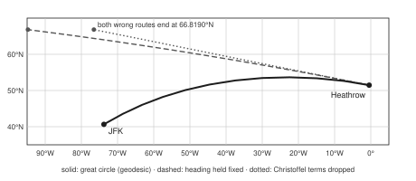

# Geodesic and exponential map: shoot a straight line from a point in a direction

[Syllabus](../../../SYLLABUS.md) → [Differential geometry and Lie groups](../README.md) → [Riemannian Geometry](../README.md#s05) → Geodesic and exponential map

---

## General Overview

A flight leaves London Heathrow (51.4700° N, 0.4543° W) for New York JFK (40.6413° N, 73.7781° W). New York is south of London. Yet the first heading is 287.94°, a little north of due west. The route heads north to 53.6564° N over the Atlantic, then curves down and arrives on heading 231.353°, south-west.

That route is a great circle, the straightest line the globe allows. It only looks bent because the map is flat. On any curved surface, such a curve is a **geodesic**: a curve that never turns sideways within the surface.

- **Shoot.** From a start point, a heading and a distance, find where the geodesic lands. This is the **exponential map**, $`\exp_p`$. From Heathrow, 287.94° for 5,540.011 km lands on JFK.
- **Aim.** From a start point and a target, find that heading and distance. This is the **logarithm map**, $`\log_p`$, the inverse of the shot.

These are the airports. [Riemannian metric](01-riemannian-metrics.md) used the city centres, 23.0 km from Heathrow and 20.8 km from JFK; between those, $`\log_p`$ gives that card's 5570.22 km at heading 288.33°.

**A geodesic is a curve with no sideways acceleration; the exponential map shoots one from a point along a direction for a given distance, and the logarithm map turns a target back into that direction and distance.**

**What kind of fact this is:** a definition and a method. The globe's geodesic equation, its closed-form solution and the highest-latitude law are theorems proved in Why it works. That one geodesic leaves each point in each direction is a theorem about differential equations, stated, not proved. Shortness is local: it holds only up to the far side of the Earth.

The Earth here is a sphere of radius 6,371 km, a model. The real Earth is slightly flattened, so survey software uses an ellipsoid.

### The picture: one heading, three ways to fly it

<p align="center"></p>

Scale: 4 drawing units per degree both ways; a point sits at $`x = 30 + 4(\text{lon} + 95)`$ across and $`y = 20 + 4(70 - \text{lat})`$ down, west longitudes negative. All three routes leave Heathrow on heading 287.94° and run 5,540.011 km. Only the solid one, the geodesic, reaches JFK. It looks curved only because the map is a chart.

---

## The formula

Three reminders from earlier cards:

- A **chart** gives each point coordinates $`x^k`$ (the upper index is a label, not a power). On the globe: $`\varphi`$, the angle down from the North Pole ($`\varphi = 90° - \text{latitude}`$), and $`\theta`$, longitude east.
- The **metric** measures length: $`ds^2 = R^2\,(d\varphi^2 + \sin^2\!\varphi\; d\theta^2)`$ on the globe ([Riemannian metric](01-riemannian-metrics.md)).
- The **Christoffel symbols** $`\Gamma^k_{ij}`$ say how the chart's grid turns from point to point; a repeated upper and lower index is summed ([Levi-Civita connection](02-levi-civita-connection-and-christoffel-symbols.md)).

A prime means a rate per kilometre flown: $`\varphi' = d\varphi/ds`$, where $`s`$ is the arc length (the distance flown so far). A geodesic $`\gamma(s)`$ solves the **geodesic equation**:

```math
\frac{d^2 x^k}{ds^2} + \Gamma^k_{ij}\,\frac{dx^i}{ds}\,\frac{dx^j}{ds} = 0
```

**Read it aloud:** the curve's acceleration in the chart is exactly what the turning grid forces on it, and nothing more, so it never turns within the surface.

On the globe the two equations are

```math
\varphi'' = \sin\varphi\cos\varphi\,(\theta')^2, \qquad \theta'' = -2\,\frac{\cos\varphi}{\sin\varphi}\,\varphi'\,\theta'
```

Write $`\gamma_v(t)`$ for the geodesic that leaves $`p`$ with velocity $`v`$, at time $`t`$. It runs at constant speed $`|v|`$, so by time $`t`$ it has flown $`t\,|v|`$ km, and it solves the same equation with $`t`$ in place of $`s`$. The **exponential map** runs it for one unit of time:

```math
\exp_p(v) = \gamma_v(1)
```

So $`v`$'s length is the distance and its direction the heading. On a sphere, with points as arrows from the Earth's centre in kilometres:

```math
\exp_p(v) = \cos\!\left(\frac{|v|}{R}\right) p \;+\; R\,\sin\!\left(\frac{|v|}{R}\right) \frac{v}{|v|}
```

The **logarithm map** undoes it. Here $`p \cdot q`$ is the dot product of the two arrows:

```math
\log_p(q) = d\,\frac{w}{|w|}, \qquad w = q - \frac{p\cdot q}{R^2}\,p, \qquad d = R\,\arccos\frac{p\cdot q}{R^2}
```

In words: $`w`$, the part of the arrow to $`q`$ lying flat along the ground at $`p`$, points the way to go. The angle between the arrows, times $`R`$, is how far.

| Symbol | Plain meaning | In our example | Push it up and the answer… |
| --- | --- | --- | --- |
| $`p,\ q`$ | start and end points, as arrows from the Earth's centre | Heathrow, 51.4700° N, 0.4543° W; JFK, 40.6413° N, 73.7781° W | — |
| $`v`$ | **tangent vector** at $`p`$: an arrow flat along the ground, giving direction and distance | 1,706.7 km north, −5,270.6 km east | a longer $`v`$ lands further along the same great circle |
| $`d = \lvert v \rvert`$ | distance flown, the length of $`v`$ | 5,540.011 km | past 20,015.1 km the route is no longer the shortest |
| $`\alpha`$ | **heading**, clockwise from north | 287.9432° (5.025557 rad) | turns the whole route; 270° lands at 30.3111° N |
| $`s`$ | arc length: km flown so far | 0 to 5,540.011 km | — |
| $`\gamma_v(t)`$ | the geodesic leaving $`p`$ with velocity $`v`$, at time $`t`$; it has flown $`t\,\lvert v \rvert`$ km | $`\gamma_v(1)`$ = JFK; waypoints in the table below | — |
| $`x^k`$; $`\varphi,\ \theta`$ | chart coordinates; on the globe, angle down from the North Pole and longitude east | Heathrow: $`\varphi`$ = 90° − 51.4700°, $`\theta`$ = −0.4543° | — |
| $`R`$ | the globe's radius | 6,371 km | every distance scales with it |
| $`\Gamma^\varphi_{\theta\theta},\ \Gamma^\theta_{\varphi\theta}`$ | Christoffel symbols of the chart: $`-\sin\varphi\cos\varphi`$ and $`\cos\varphi/\sin\varphi`$ | −0.4873 and 1.2558 at Heathrow | a property of the chart, not of the globe |
| $`\exp_p`$ | **exponential map**: shoot from $`p`$ along $`v`$ | $`\exp_p(v)`$ = JFK | — |
| $`\log_p`$ | **logarithm map**: target back to $`v`$ | $`\log_p(\text{JFK})`$ = 5,540.011 km at 287.94° | undoes $`\exp_p`$ only for distances under 20,015.1 km |
| $`w`$ | the flat-along-the-ground part of $`q`$ at $`p`$ | points along heading 287.94° | — |

### When it holds

- **The metric is smooth.** At a cone's tip there is no single straight way on, so the shot is undefined there.
- **The chart covers the route.** At the poles $`\sin\varphi = 0`$ and the $`\theta''`$ equation divides by zero. The globe is fine; the chart is not, so a polar flight needs another chart or the closed form.
- **The space has no holes or edges (it is complete).** Then every shot can fly any distance. On a plane with a point removed, a shot aimed at the hole stops there ([Hopf-Rinow](10-hopf-rinow-and-completeness.md) gives the global statement).
- **The target is nearer than the far side.** $`\log_p`$ inverts $`\exp_p`$ only under $`\pi R`$ = 20,015.1 km. At that distance six headings shot by RK4 all land on 51.4700° S, 179.5457° E; at 25,000 km $`\log_p`$ reports the short way back, 15,030.2 km at 107.94°.

---

## Why it works

### Step 0: straight means no sideways push

Drive over a hill with the steering wheel locked straight. The car accelerates as the road bends, but only up and down, never left or right.

That is a geodesic: all of its acceleration is perpendicular to the surface. Put another way, its velocity is carried along by parallel transport, the rule that moves an arrow without turning it ([Parallel transport](03-parallel-transport-and-holonomy.md)). Written with that card's covariant derivative $`D/ds`$, the rate of change seen from inside the surface:

```math
\frac{D\gamma'}{ds} = 0
```

### Step 1: in a chart, the grid's turning adds the Γ terms

In a chart, a velocity is a list of numbers $`dx^k/ds`$. Its rate of change has two parts: the numbers change, and the grid under them turns, which the Christoffel symbols count. So Step 0 reads

```math
\frac{D\gamma'}{ds} = \left(\frac{d^2 x^k}{ds^2} + \Gamma^k_{ij}\,\frac{dx^i}{ds}\,\frac{dx^j}{ds}\right)\partial_k = 0
```

Here $`\partial_k`$ is the chart's $`k`$-th grid direction. That is the geodesic equation, one equation for each $`k`$.

### Step 2: on the globe, Euler-Lagrange produces the equations

The globe's equations need no table of $`\Gamma`$. Take the **energy** of a route: half the squared speed, added up along it. For a route at speed $`\varphi', \theta'`$ the integrand is

```math
L = \tfrac12 R^2\left((\varphi')^2 + \sin^2\!\varphi\,(\theta')^2\right)
```

Here $`L`$ is the Lagrangian of wing 08, not the length $`L(\gamma)`$ of [Riemannian metric](01-riemannian-metrics.md). A geodesic is a route whose energy does not change, to first order, under any small nudge with the ends held fixed. That demand is the Euler-Lagrange equation ([The Euler-Lagrange equation](../../08-Differential%20equations%20and%20dynamics/12-Calculus%20of%20Variations%20and%20Optimal%20Control/01-functionals-and-the-euler-lagrange-equation.md)), once for $`\varphi`$ and once for $`\theta`$. It returns the two equations of The formula, the pair that [Geodesic on a surface](../02-Surfaces/09-geodesics-on-surfaces.md) found for surfaces of revolution, together with Clairaut's relation of Step 3. Reading off the coefficients gives $`\Gamma^\varphi_{\theta\theta} = -\sin\varphi\cos\varphi`$ and $`\Gamma^\theta_{\varphi\theta} = \Gamma^\theta_{\theta\varphi} = \cos\varphi/\sin\varphi`$. At Heathrow they are −0.4873 and 1.2558.

Energy, not length, because energy also forces a constant speed; the paths are the same (see the fold). The check confirms the speed stays at 1 km per km.

<details>
<summary>Detailed proof: the two Euler-Lagrange equations</summary>

The Euler-Lagrange equation for a coordinate $`x`$ reads: the rate of change of $`\partial L/\partial x'`$ equals $`\partial L/\partial x`$.

For $`\varphi`$: $`\partial L/\partial \varphi' = R^2\varphi'`$ and $`\partial L/\partial \varphi = R^2\sin\varphi\cos\varphi\,(\theta')^2`$. So

$`\displaystyle R^2\,\varphi'' = R^2 \sin\varphi\cos\varphi\,(\theta')^2 .`$

For $`\theta`$: $`L`$ does not contain $`\theta`$ itself, so $`\partial L/\partial\theta = 0`$, and $`\partial L/\partial \theta' = R^2\sin^2\!\varphi\,\theta'`$. So

$`\displaystyle \frac{d}{ds}\left(R^2 \sin^2\!\varphi\;\theta'\right) = R^2\left(2\sin\varphi\cos\varphi\,\varphi'\theta' + \sin^2\!\varphi\,\theta''\right) = 0 .`$

Divide by $`R^2\sin^2\!\varphi`$:

$`\displaystyle \theta'' = -2\,\frac{\cos\varphi}{\sin\varphi}\,\varphi'\theta' .`$

Compare with the geodesic equation. The $`\varphi`$ equation has $`-\Gamma^\varphi_{\theta\theta}(\theta')^2`$ on the right, so $`\Gamma^\varphi_{\theta\theta} = -\sin\varphi\cos\varphi`$. The $`\theta`$ equation has $`-2\,\Gamma^\theta_{\varphi\theta}\varphi'\theta'`$, the 2 because the pair $`(\varphi, \theta)`$ and $`(\theta, \varphi)`$ both appear in the sum. So $`\Gamma^\theta_{\varphi\theta} = \cos\varphi/\sin\varphi`$. Every other symbol is zero.

Energy against length: by the Cauchy-Schwarz inequality, for a route of length $`\ell`$ flown in unit time, the energy is at least $`\ell^2/2`$, with equality exactly at constant speed. So a route that makes energy stationary is a length-stationary route flown at constant speed.

</details>

### Step 3: a conserved quantity predicts the highest point

The $`\theta`$ equation says $`R^2\sin^2\!\varphi\,\theta'`$ never changes. At unit speed, the eastward part of the velocity is $`R\sin\varphi\,\theta' = \sin\alpha`$, where $`\alpha`$ is the heading. So $`R^2\sin^2\!\varphi\,\theta' = R\sin\varphi\,\sin\alpha`$. Divide by $`R`$, and the conserved number is

```math
\sin\varphi \,\sin\alpha = \cos(\text{latitude})\,\sin(\text{heading}) = \text{constant}
```

This is **Clairaut's relation**. For our flight it is $`0.622924 \times (-0.951362) = -0.592627`$, and the check prints −0.592626816 at all seven waypoints.

It predicts the top of the route. There the plane flies due west, so $`\sin\alpha = -1`$ and $`\cos(\text{latitude}) = 0.592627`$: 53.6564° N. A kilometre-by-kilometre scan finds the same 53.6564° N, 1,533 km out of Heathrow.

### Step 4: one geodesic per direction, so the shot is a map

The geodesic equation is a second-order differential equation, so a start point and a start velocity give exactly one solution, at least for a while (the existence and uniqueness theorem, used without proof).

Fly the same direction twice as fast and you cover the same route in half the time: $`\gamma_{cv}(t) = \gamma_v(ct)`$ for any number $`c`$. So the point reached after one unit of time depends only on $`v`$: that is $`\exp_p(v)`$. It wraps the flat **tangent plane** at $`p`$ (all arrows along the ground there, written $`T_pM`$) onto the surface.

Run backwards, $`\log_p`$ flattens the surface around $`p`$ into **normal coordinates**: a flat map where every geodesic from $`p`$ is a straight line through the centre, at its true length. In Heathrow's, JFK sits 1,706.7 km north and −5,270.6 km east. The **Gauss lemma**, stated here and proved in the first book in Sources, adds that circles of equal distance around $`p`$ cross those lines at right angles.

### Step 5: on the sphere, the shot is a great circle

The plane through the Earth's centre, the start point $`p`$ and the direction $`v`$ cuts the globe in a great circle. The closed form walks round that circle at 1 km per km. Three facts prove it is the geodesic, and the fold gives each.

1. It stays on the globe: its distance from the centre is always $`R`$.
2. It starts at $`p`$ moving along $`v`$.
3. Its acceleration points straight at the Earth's centre, so it has no sideways part.

<details>
<summary>Detailed proof: the great circle has no sideways acceleration</summary>

Write $`u = v/|v|`$, a unit arrow along the ground at $`p`$, so $`p \cdot u = 0`$ and $`|p| = R`$. The route is

$`\displaystyle \gamma(s) = \cos(s/R)\,p + R\sin(s/R)\,u .`$

Length: $`|\gamma|^2 = \cos^2(s/R)\,R^2 + R^2\sin^2(s/R) = R^2`$, because the cross term has $`p\cdot u = 0`$.

Start: $`\gamma(0) = p`$, and $`\gamma'(s) = -\sin(s/R)\,p/R + \cos(s/R)\,u`$, so $`\gamma'(0) = u`$. Its length is 1 at every $`s`$, by the same cross-term argument.

Acceleration: $`\gamma''(s) = -\cos(s/R)\,p/R^2 - \sin(s/R)\,u/R = -\gamma(s)/R^2`$. It points from the route to the centre, which is the sphere's normal direction. So its part along the ground is zero, and Step 0's condition holds.

Inverse: $`\gamma(s) \cdot p = R^2\cos(s/R)`$, so $`s = R\arccos(p\cdot q/R^2)`$ recovers the distance for $`s < \pi R`$. Removing the $`p`$ part of $`q`$ leaves $`R\sin(s/R)\,u`$, a positive multiple of $`u`$, so it recovers the direction. That is $`\log_p`$.

</details>

### Step 6: shortest only up to the far side

A geodesic makes length stationary, not necessarily smallest. Every geodesic from Heathrow of length $`\pi R`$ = 20,015.1 km ends at the antipode (the point straight through the Earth). Beyond it, the other way round is shorter: a 25,000 km shot lands where $`\log_p`$ says "15,030.2 km at 107.94°", which is $`2\pi R - 25{,}000`$. So $`\exp_p`$ is one-to-one only on the disc of radius 20,015.1 km, and $`\log_p`$ is its inverse only there. Why nearby geodesics refocus at the antipode is the subject of [Jacobi field](09-jacobi-fields-and-comparison-theorems.md).

---

## Worked numbers, by hand

Aim at JFK from Heathrow, then shoot back.

| Step | Arithmetic | Value |
| --- | --- | --- |
| 1. Cosine of the angle between the two arrows | $`p \cdot q / R^2`$ | 0.645157 |
| 2. The angle itself | $`\arccos(0.645157)`$ | 0.869567 rad |
| 3. Distance | $`6371 \times 0.869567`$ | 5,540.011 km |
| 4. Heading of $`w`$ | angle of $`w`$ clockwise from north | 287.9432° = 5.025557 rad |
| 5. Tangent vector $`v`$ | $`5540.011 \times (\cos\alpha, \sin\alpha)`$ | 1,706.7 km north, −5,270.6 km east |
| 6. Shoot back, closed form | $`\cos(0.869567)\,p + R\sin(0.869567)\,v/\lvert v \rvert`$ | 40.6413° N, 73.7781° W |
| 7. Clairaut's constant | $`\cos 51.47° \times \sin 287.94° = 0.622924 \times (-0.951362)`$ | −0.592627 |
| 8. Highest latitude | $`\arccos(0.592627)`$ | 53.6564° N |
| 9. Heading on arrival | from the stepped route | 231.353° |
| **10. RK4, 16 steps of 346.3 km, against the closed form** | **gap between landing points** | **4.66 m** |

The aim and the shot agree. Solving the chart's equations in 16 steps lands 4.66 m from the closed form after a 5,540 km flight.

The route, every 1,000 km, from the stepped equation:

| Flown, km | Latitude, longitude | Heading | $`\cos(\text{lat})\sin(\text{heading})`$ |
| ---: | --- | ---: | ---: |
| 0 | 51.4700° N, 0.4543° W | 287.943° | −0.592626816 |
| 1,000 | 53.3852° N, 14.8928° W | 276.475° | −0.592626816 |
| 2,000 | 53.4474° N, 30.0102° W | 264.311° | −0.592626816 |
| 3,000 | 51.6475° N, 44.5280° W | 252.762° | −0.592626816 |
| 4,000 | 48.2299° N, 57.4791° W | 242.828° | −0.592626816 |
| 5,000 | 43.5591° N, 68.5431° W | 234.865° | −0.592626816 |
| 5,540.0 | 40.6413° N, 73.7781° W | 231.353° | −0.592626816 |

The heading swings from 287.943° to 231.353° while the route never turns. The last column, Clairaut's constant, does not move.

### What breaks if you drop a piece

Same start, same heading 287.94°, same 5,540.011 km, unless the row says otherwise. Misses are measured along the globe.

| Mistake | Comes out at | What went wrong |
| --- | --- | --- |
| Hold the heading at 287.94° all the way | 66.8190° N, 94.7685° W: 3,185 km from JFK | A constant heading is a rhumb line, which turns relative to the globe. A straight route's heading must change. |
| Drop the Christoffel terms | 66.8190° N, 76.5458° W: 2,916 km from JFK | Straight in the chart is not straight on the globe; the chart's grid turns under the plane. |
| Euler steps instead of RK4, 16 steps | 199.7 km from JFK | One slope per step: error shrinks only in proportion to the step. |
| Fly 25,000 km, then ask $`\log_p`$ where you are | 15,030.2 km at 107.94° | Past the antipode the shot is no longer the shortest way; $`\log_p`$ reports the short way back. |

---

## Code, from first principles, and it actually runs

The script takes three independent roads. Road 1 steps the chart's geodesic equation with its own RK4 loop at 8, 16 and 32 steps. Road 2 is the closed form in 3D arrows, with no chart. Road 3 is Clairaut's constant at every waypoint, and its highest latitude against a kilometre-by-kilometre scan. It also checks that $`\exp_p`$ undoes $`\log_p`$, that the speed stays 1, that RK4 at six headings reaches the antipode, that the city-centre route matches [Riemannian metric](01-riemannian-metrics.md), and every row of What breaks, with misses measured along the globe.

### Python

```python
# Geodesic and exponential map -- the check behind the card.  Python standard library only.
# The globe is a sphere of radius R = 6371 km.  Chart: phi = angle down from the North Pole,
# theta = longitude east.  Heading = clockwise from north.  Routes run at unit speed, s in km.
from math import sin, cos, tan, acos, asin, atan2, sqrt, radians, degrees, pi, log
R = 6371.0
def chart(lat, lon): return radians(90 - lat), radians(lon)
def latlon(ph, th): return 90 - degrees(ph), (degrees(th) + 540) % 360 - 180
def xyz(ph, th): return (R * sin(ph) * cos(th), R * sin(ph) * sin(th), R * cos(ph))
def north_east(ph, th): return (-cos(ph) * cos(th), -cos(ph) * sin(th), sin(ph)), (-sin(th), cos(th), 0.0)
def dot(a, b): return a[0] * b[0] + a[1] * b[1] + a[2] * b[2]
def gap(p1, p2):                # km along the globe, from the straight chord between the two points
    u, v = xyz(*p1), xyz(*p2); w = [x - y for x, y in zip(u, v)]; return 2 * R * asin(min(1.0, sqrt(dot(w, w)) / (2 * R)))

def exp_map(p, head, s):        # road 2: closed form, a great circle in 3D, no chart used
    P = xyz(*p); N, E = north_east(*p)
    q = [cos(s / R) * a + R * sin(s / R) * (cos(head) * n + sin(head) * e) for a, n, e in zip(P, N, E)]
    return acos(max(-1.0, min(1.0, q[2] / R))), atan2(q[1], q[0])

def log_map(p, q):              # inverse: distance and starting heading from p to q
    P, Q = xyz(*p), xyz(*q); N, E = north_east(*p)
    c = dot(P, Q) / R / R; w = [b - c * a for a, b in zip(P, Q)]
    return R * acos(max(-1.0, min(1.0, c))), atan2(dot(w, E), dot(w, N)) % (2 * pi)

def rk4(f, y, h, n, euler=False):
    for _ in range(n):
        k1 = f(y)
        if euler: y = [a + h * b for a, b in zip(y, k1)]; continue
        k2 = f([a + h / 2 * b for a, b in zip(y, k1)]); k3 = f([a + h / 2 * b for a, b in zip(y, k2)])
        k4 = f([a + h * b for a, b in zip(y, k3)])
        y = [a + h / 6 * (b + 2 * c + 2 * d + e) for a, b, c, d, e in zip(y, k1, k2, k3, k4)]
    return y

# road 1: the geodesic equation in the chart, state (phi, theta, phi', theta')
def geodesic(y): return [y[2], y[3], sin(y[0]) * cos(y[0]) * y[3] * y[3], -2 * y[2] * y[3] / tan(y[0])]
def no_gamma(y): return [y[2], y[3], 0.0, 0.0]                        # mistake: Christoffel symbols dropped
def launch(p, head): return [p[0], p[1], -cos(head) / R, sin(head) / (R * sin(p[0]))]
def shoot(p, head, s, n, f=geodesic, euler=False): return rk4(f, launch(p, head), s / n, n, euler)
def heading(y): return atan2(R * sin(y[0]) * y[3], -R * y[2]) % (2 * pi)
def fmt(p): la, lo = latlon(*p); return f"{abs(la):.4f} {'N' if la >= 0 else 'S'}, {abs(lo):.4f} {'E' if lo >= 0 else 'W'}"

LHR, JFK = chart(51.4700, -0.4543), chart(40.6413, -73.7781)
d, a = log_map(LHR, JFK)
print(f"log_p(JFK) from Heathrow: distance {d:.3f} km, heading {degrees(a):.4f} deg ({a:.6f} rad)")
print(f"as a vector in the tangent plane: {d * cos(a):.1f} km north, {d * sin(a):.1f} km east")
c = dot(xyz(*LHR), xyz(*JFK)) / R / R
print(f"by hand: p.q/R^2 = {c:.6f}, d/R = {d / R:.6f} rad, cos(51.47 deg) = {cos(radians(51.47)):.6f}, sin(heading) = {sin(a):.6f}")
q = exp_map(LHR, a, d)
print(f"exp_p back along that vector lands at {fmt(q)}, {gap(q, JFK) * 1e6:.3f} mm from JFK")
assert gap(q, JFK) < 1e-6                                                  # exp undoes log
LON, NYC = chart(51.5074, -0.1278), chart(40.7128, -74.0060)             # city centres of the metric card
dc, ac = log_map(LON, NYC)
print(f"city centres: {dc:.2f} km at heading {degrees(ac):.2f}; Heathrow is {gap(LHR, LON):.1f} km from central London, "
      f"JFK {gap(JFK, NYC):.1f} km from central New York")
assert abs(dc - 5570.22) < 0.01                                           # the metric card's distance
print(f"Christoffel symbols at Heathrow: Gamma^phi_theta,theta = {-sin(LHR[0]) * cos(LHR[0]):.4f}, "
      f"Gamma^theta_phi,theta = {1 / tan(LHR[0]):.4f}; 0.1 deg from the pole {1 / tan(radians(0.1)):.2f}")
miss = {}
for n in (8, 16, 32):
    y = shoot(LHR, a, d, n); miss[n] = gap(y[:2], q)
    print(f"RK4 in the chart, {n:2d} steps of {d / n:6.1f} km: lands {fmt(y[:2])}, {miss[n] * 1000:7.2f} m from closed form")
print(f"miss ratio per halving: {miss[8] / miss[16]:.2f} {miss[16] / miss[32]:.2f}")
assert 12 < miss[8] / miss[16] < 20 and 12 < miss[16] / miss[32] < 20 and miss[32] < 0.001
print("waypoints:   s km | latitude, longitude | heading deg | cos(lat) sin(heading)")
clair = cos(radians(51.47)) * sin(a)
for k in range(7):
    s = min(1000.0 * k, d); y = shoot(LHR, a, s, max(1, round(s / 10)))
    print(f"waypoint {s:8.1f} | {fmt(y[:2])} | {degrees(heading(y)):8.3f} | {sin(y[0]) * sin(heading(y)):.9f}")
    assert gap(y[:2], exp_map(LHR, a, s)) < 1e-4 and abs(sin(y[0]) * sin(heading(y)) - clair) < 1e-9
    assert abs(R * R * (y[2] * y[2] + sin(y[0]) * y[3] * sin(y[0]) * y[3]) - 1) < 1e-9  # speed stays 1 km per km
top = max(range(0, round(d) + 1), key=lambda s: latlon(*exp_map(LHR, a, s))[0])
print(f"northernmost point: Clairaut predicts {degrees(acos(abs(clair))):.4f} N; "
      f"scan of the route finds {latlon(*exp_map(LHR, a, top))[0]:.4f} N at s = {top} km")
assert abs(degrees(acos(abs(clair))) - latlon(*exp_map(LHR, a, top))[0]) < 1e-3
# what breaks
def rhumb(y): return [-cos(a) / R, sin(a) / (R * sin(y[0]))]               # mistake: heading held fixed
rh = rk4(rhumb, list(LHR), d / 1000, 1000)
ng = shoot(LHR, a, d, 1000, no_gamma); eu = shoot(LHR, a, d, 16, euler=True)
print(f"mistake, hold heading {degrees(a):.2f} all the way: lands {fmt(rh)}, {gap(rh, JFK):.0f} km from JFK")
print(f"mistake, drop the Christoffel terms: lands {fmt(ng[:2])}, {gap(ng[:2], JFK):.0f} km from JFK")
print(f"mistake, Euler steps instead of RK4, 16 steps: lands {gap(eu[:2], JFK):.1f} km from JFK")
wd = exp_map(LHR, degrees(a), d)                                         # mistake: heading in degrees
print(f"mistake, heading fed to sin and cos in degrees: lands {fmt(wd)}, {gap(wd, JFK):.1f} km from JFK")
far = exp_map(LHR, a, 25000.0); d2, a2 = log_map(LHR, far)
print(f"mistake, fly 25000 km on: log_p says {d2:.1f} km at heading {degrees(a2):.2f} (2 pi R - 25000 = {2 * pi * R - 25000:.1f})")
assert abs(d2 - (2 * pi * R - 25000)) < 1e-6 and min(gap(rh, JFK), gap(ng[:2], JFK)) > 2000 and gap(eu[:2], JFK) > 10
assert abs(gap(rh, JFK) - log_map(JFK, rh)[0]) < 1e-6                     # misses measured along the globe
anti = (pi - LHR[0], LHR[1] + pi)
spread = max(gap(shoot(LHR, radians(h), pi * R, 400)[:2], anti) for h in range(30, 360, 60))   # RK4, off the poles
print(f"pi R = {pi * R:.1f} km: RK4 in the chart, 6 headings, all land on {fmt(anti)}, widest gap {spread * 1000:.2f} m")
assert spread < 1e-3
lat1, lat2, dlon = radians(51.47), radians(40.6413), radians(-73.7781 + 0.4543)
dpsi = log(tan(pi / 4 + lat2 / 2) / tan(pi / 4 + lat1 / 2)); hr = atan2(dlon, dpsi)
rd = R * (lat2 - lat1) / cos(hr)
print(f"constant-heading route that does reach JFK: heading {degrees(hr) % 360:.2f}, {rd:.1f} km, {rd - d:.1f} km longer")
# try changing
w = exp_map(LHR, radians(270), d); eq = shoot(chart(0, 0), pi / 2, d, 32)
print(f"try: due west 270 deg for {d:.0f} km lands {fmt(w)}; on the equator heading 90 lands {fmt(eq[:2])}")
print(f"try: 4 RK4 steps miss by {gap(shoot(LHR, a, d, 4)[:2], q) * 1000:.1f} m")
X = lambda p: 30 + 4 * (latlon(*p)[1] + 95); Y = lambda p: 20 + 4 * (70 - latlon(*p)[0])
pts = lambda f: " ".join(f"{X(p):.1f},{Y(p):.1f}" for p in f)
ss = [min(500.0 * k, d) for k in range(13)]
print("figure, great circle:", pts([exp_map(LHR, a, s) for s in ss]))
print("figure, fixed heading:", pts([rk4(rhumb, list(LHR), s / 100, 100) for s in ss]))
print("figure, chart-straight:", pts([shoot(LHR, a, s, 100, no_gamma)[:2] for s in ss]))
print("ALL CHECKS PASS")
```

**Ran 2026-11-19 on macOS, Python 3.14.10, standard library only. All checks passed. Output, pasted from the run:**

```
log_p(JFK) from Heathrow: distance 5540.011 km, heading 287.9432 deg (5.025557 rad)
as a vector in the tangent plane: 1706.7 km north, -5270.6 km east
by hand: p.q/R^2 = 0.645157, d/R = 0.869567 rad, cos(51.47 deg) = 0.622924, sin(heading) = -0.951362
exp_p back along that vector lands at 40.6413 N, 73.7781 W, 0.000 mm from JFK
city centres: 5570.22 km at heading 288.33; Heathrow is 23.0 km from central London, JFK 20.8 km from central New York
Christoffel symbols at Heathrow: Gamma^phi_theta,theta = -0.4873, Gamma^theta_phi,theta = 1.2558; 0.1 deg from the pole 572.96
RK4 in the chart,  8 steps of  692.5 km: lands 40.6419 N, 73.7780 W,   69.34 m from closed form
RK4 in the chart, 16 steps of  346.3 km: lands 40.6413 N, 73.7781 W,    4.66 m from closed form
RK4 in the chart, 32 steps of  173.1 km: lands 40.6413 N, 73.7781 W,    0.30 m from closed form
miss ratio per halving: 14.87 15.45
waypoints:   s km | latitude, longitude | heading deg | cos(lat) sin(heading)
waypoint      0.0 | 51.4700 N, 0.4543 W |  287.943 | -0.592626816
waypoint   1000.0 | 53.3852 N, 14.8928 W |  276.475 | -0.592626816
waypoint   2000.0 | 53.4474 N, 30.0102 W |  264.311 | -0.592626816
waypoint   3000.0 | 51.6475 N, 44.5280 W |  252.762 | -0.592626816
waypoint   4000.0 | 48.2299 N, 57.4791 W |  242.828 | -0.592626816
waypoint   5000.0 | 43.5591 N, 68.5431 W |  234.865 | -0.592626816
waypoint   5540.0 | 40.6413 N, 73.7781 W |  231.353 | -0.592626816
northernmost point: Clairaut predicts 53.6564 N; scan of the route finds 53.6564 N at s = 1533 km
mistake, hold heading 287.94 all the way: lands 66.8190 N, 94.7685 W, 3185 km from JFK
mistake, drop the Christoffel terms: lands 66.8190 N, 76.5458 W, 2916 km from JFK
mistake, Euler steps instead of RK4, 16 steps: lands 199.7 km from JFK
mistake, heading fed to sin and cos in degrees: lands 46.6872 N, 80.2158 W, 848.0 km from JFK
mistake, fly 25000 km on: log_p says 15030.2 km at heading 107.94 (2 pi R - 25000 = 15030.2)
pi R = 20015.1 km: RK4 in the chart, 6 headings, all land on 51.4700 S, 179.5457 E, widest gap 0.01 m
constant-heading route that does reach JFK: heading 257.93, 5758.6 km, 218.6 km longer
try: due west 270 deg for 5540 km lands 30.3111 N, 62.7103 W; on the equator heading 90 lands 0.0000 N, 49.8225 E
try: 4 RK4 steps miss by 941.2 m
figure, great circle: 408.2,94.1 379.9,89.4 350.4,86.5 320.2,85.4 290.0,86.2 260.3,88.9 231.9,93.4 205.1,99.5 180.1,107.1 157.0,115.9 135.8,125.8 116.4,136.5 114.9,137.4
figure, fixed heading: 408.2,94.1 380.3,88.6 351.5,83.0 321.7,77.5 290.8,72.0 258.8,66.4 225.5,60.9 190.8,55.3 154.5,49.8 116.5,44.2 76.5,38.7 34.4,33.2 30.9,32.7
figure, chart-straight: 408.2,94.1 380.7,88.6 353.2,83.0 325.8,77.5 298.3,72.0 270.8,66.4 243.4,60.9 215.9,55.3 188.4,49.8 161.0,44.2 133.5,38.7 106.0,33.2 103.8,32.7
ALL CHECKS PASS
```

### Rust

```rust
// Geodesic and exponential map -- the check behind the card.  Rust std only, no crates.
// The globe is a sphere of radius R = 6371 km.  Chart: phi = angle down from the North Pole,
// theta = longitude east.  Heading = clockwise from north.  Routes run at unit speed, s in km.
use std::f64::consts::PI;
const R: f64 = 6371.0;
type P = (f64, f64);
fn chart(lat: f64, lon: f64) -> P { ((90.0 - lat).to_radians(), lon.to_radians()) }
fn latlon(p: P) -> P { (90.0 - p.0.to_degrees(), (p.1.to_degrees() + 540.0).rem_euclid(360.0) - 180.0) }
fn xyz(p: P) -> [f64; 3] { [R * p.0.sin() * p.1.cos(), R * p.0.sin() * p.1.sin(), R * p.0.cos()] }
fn north_east(p: P) -> ([f64; 3], [f64; 3]) {
    ([-p.0.cos() * p.1.cos(), -p.0.cos() * p.1.sin(), p.0.sin()], [-p.1.sin(), p.1.cos(), 0.0])
}
fn dot(a: &[f64; 3], b: &[f64; 3]) -> f64 { a[0] * b[0] + a[1] * b[1] + a[2] * b[2] }
fn gap(p1: P, p2: P) -> f64 { // km along the globe, from the straight chord between the two points
    let (u, v) = (xyz(p1), xyz(p2));
    let w = [u[0] - v[0], u[1] - v[1], u[2] - v[2]];
    2.0 * R * (dot(&w, &w).sqrt() / (2.0 * R)).min(1.0).asin()
}
// road 2: closed form, a great circle in 3D, no chart used
fn exp_map(p: P, head: f64, s: f64) -> P {
    let (a, (n, e)) = (xyz(p), north_east(p));
    let q: Vec<f64> = (0..3).map(|i| (s / R).cos() * a[i] + R * (s / R).sin() * (head.cos() * n[i] + head.sin() * e[i])).collect();
    ((q[2] / R).min(1.0).max(-1.0).acos(), q[1].atan2(q[0]))
}
// inverse: distance and starting heading from p to q
fn log_map(p: P, q: P) -> (f64, f64) {
    let (a, b, (n, e)) = (xyz(p), xyz(q), north_east(p));
    let c = dot(&a, &b) / R / R;
    let w = [b[0] - c * a[0], b[1] - c * a[1], b[2] - c * a[2]];
    (R * c.min(1.0).max(-1.0).acos(), dot(&w, &e).atan2(dot(&w, &n)).rem_euclid(2.0 * PI))
}
fn add(y: &[f64], h: f64, k: &[f64]) -> Vec<f64> { y.iter().zip(k).map(|(a, b)| a + h * b).collect() }
fn rk4(f: &dyn Fn(&[f64]) -> Vec<f64>, mut y: Vec<f64>, h: f64, n: usize, euler: bool) -> Vec<f64> {
    for _ in 0..n {
        let k1 = f(&y);
        if euler { y = add(&y, h, &k1); continue; }
        let k2 = f(&add(&y, h / 2.0, &k1));
        let k3 = f(&add(&y, h / 2.0, &k2));
        let k4 = f(&add(&y, h, &k3));
        y = (0..y.len()).map(|i| y[i] + h / 6.0 * (k1[i] + 2.0 * k2[i] + 2.0 * k3[i] + k4[i])).collect();
    }
    y
}
// road 1: the geodesic equation in the chart, state (phi, theta, phi', theta')
fn geodesic(y: &[f64]) -> Vec<f64> { vec![y[2], y[3], y[0].sin() * y[0].cos() * y[3] * y[3], -2.0 * y[2] * y[3] / y[0].tan()] }
fn no_gamma(y: &[f64]) -> Vec<f64> { vec![y[2], y[3], 0.0, 0.0] } // mistake: Christoffel symbols dropped
fn launch(p: P, head: f64) -> Vec<f64> { vec![p.0, p.1, -head.cos() / R, head.sin() / (R * p.0.sin())] }
fn shoot(p: P, head: f64, s: f64, n: usize, f: &dyn Fn(&[f64]) -> Vec<f64>, euler: bool) -> Vec<f64> {
    rk4(f, launch(p, head), s / n as f64, n, euler)
}
fn heading(y: &[f64]) -> f64 { (R * y[0].sin() * y[3]).atan2(-R * y[2]).rem_euclid(2.0 * PI) }
fn fmt(p: P) -> String {
    let (la, lo) = latlon(p);
    format!("{:.4} {}, {:.4} {}", la.abs(), if la >= 0.0 { "N" } else { "S" }, lo.abs(), if lo >= 0.0 { "E" } else { "W" })
}
fn pt(y: &[f64]) -> P { (y[0], y[1]) }

fn main() {
    let (lhr, jfk) = (chart(51.4700, -0.4543), chart(40.6413, -73.7781));
    let (d, a) = log_map(lhr, jfk);
    println!("log_p(JFK) from Heathrow: distance {:.3} km, heading {:.4} deg ({:.6} rad)", d, a.to_degrees(), a);
    println!("as a vector in the tangent plane: {:.1} km north, {:.1} km east", d * a.cos(), d * a.sin());
    let c = dot(&xyz(lhr), &xyz(jfk)) / R / R;
    println!("by hand: p.q/R^2 = {:.6}, d/R = {:.6} rad, cos(51.47 deg) = {:.6}, sin(heading) = {:.6}", c, d / R, 51.47f64.to_radians().cos(), a.sin());
    let q = exp_map(lhr, a, d);
    println!("exp_p back along that vector lands at {}, {:.3} mm from JFK", fmt(q), gap(q, jfk) * 1e6);
    assert!(gap(q, jfk) < 1e-6); // exp undoes log
    let (lon, nyc) = (chart(51.5074, -0.1278), chart(40.7128, -74.0060)); // city centres of the metric card
    let (dc, ac) = log_map(lon, nyc);
    println!("city centres: {:.2} km at heading {:.2}; Heathrow is {:.1} km from central London, JFK {:.1} km from central New York",
             dc, ac.to_degrees(), gap(lhr, lon), gap(jfk, nyc));
    assert!((dc - 5570.22).abs() < 0.01); // the metric card's distance
    println!("Christoffel symbols at Heathrow: Gamma^phi_theta,theta = {:.4}, Gamma^theta_phi,theta = {:.4}; 0.1 deg from the pole {:.2}",
             -lhr.0.sin() * lhr.0.cos(), 1.0 / lhr.0.tan(), 1.0 / 0.1f64.to_radians().tan());
    let mut miss = [0.0; 3];
    for (i, n) in [8usize, 16, 32].iter().enumerate() {
        let y = shoot(lhr, a, d, *n, &geodesic, false);
        miss[i] = gap(pt(&y), q);
        println!("RK4 in the chart, {:2} steps of {:6.1} km: lands {}, {:7.2} m from closed form", n, d / *n as f64, fmt(pt(&y)), miss[i] * 1000.0);
    }
    println!("miss ratio per halving: {:.2} {:.2}", miss[0] / miss[1], miss[1] / miss[2]);
    assert!(12.0 < miss[0] / miss[1] && miss[0] / miss[1] < 20.0 && 12.0 < miss[1] / miss[2] && miss[1] / miss[2] < 20.0 && miss[2] < 0.001);
    println!("waypoints:   s km | latitude, longitude | heading deg | cos(lat) sin(heading)");
    let clair = 51.47f64.to_radians().cos() * a.sin();
    for k in 0..7 {
        let s = (1000.0 * k as f64).min(d);
        let y = shoot(lhr, a, s, ((s / 10.0).round() as usize).max(1), &geodesic, false);
        let c = y[0].sin() * heading(&y).sin();
        println!("waypoint {:8.1} | {} | {:8.3} | {:.9}", s, fmt(pt(&y)), heading(&y).to_degrees(), c);
        assert!(gap(pt(&y), exp_map(lhr, a, s)) < 1e-4 && (c - clair).abs() < 1e-9);
        assert!((R * R * (y[2] * y[2] + y[0].sin() * y[3] * y[0].sin() * y[3]) - 1.0).abs() < 1e-9); // speed stays 1 km per km
    }
    let mut top = 0;
    for s in 0..=(d.round() as i64) {
        if latlon(exp_map(lhr, a, s as f64)).0 > latlon(exp_map(lhr, a, top as f64)).0 { top = s; }
    }
    let toplat = latlon(exp_map(lhr, a, top as f64)).0;
    println!("northernmost point: Clairaut predicts {:.4} N; scan of the route finds {:.4} N at s = {} km", clair.abs().acos().to_degrees(), toplat, top);
    assert!((clair.abs().acos().to_degrees() - toplat).abs() < 1e-3);
    // what breaks
    let rhumb = move |y: &[f64]| -> Vec<f64> { vec![-a.cos() / R, a.sin() / (R * y[0].sin())] }; // mistake: heading held fixed
    let rh = pt(&rk4(&rhumb, vec![lhr.0, lhr.1], d / 1000.0, 1000, false));
    let ng = pt(&shoot(lhr, a, d, 1000, &no_gamma, false));
    let eu = pt(&shoot(lhr, a, d, 16, &geodesic, true));
    println!("mistake, hold heading {:.2} all the way: lands {}, {:.0} km from JFK", a.to_degrees(), fmt(rh), gap(rh, jfk));
    println!("mistake, drop the Christoffel terms: lands {}, {:.0} km from JFK", fmt(ng), gap(ng, jfk));
    println!("mistake, Euler steps instead of RK4, 16 steps: lands {:.1} km from JFK", gap(eu, jfk));
    let wd = exp_map(lhr, a.to_degrees(), d); // mistake: heading in degrees
    println!("mistake, heading fed to sin and cos in degrees: lands {}, {:.1} km from JFK", fmt(wd), gap(wd, jfk));
    let (d2, a2) = log_map(lhr, exp_map(lhr, a, 25000.0));
    println!("mistake, fly 25000 km on: log_p says {:.1} km at heading {:.2} (2 pi R - 25000 = {:.1})", d2, a2.to_degrees(), 2.0 * PI * R - 25000.0);
    assert!((d2 - (2.0 * PI * R - 25000.0)).abs() < 1e-6 && gap(rh, jfk).min(gap(ng, jfk)) > 2000.0 && gap(eu, jfk) > 10.0);
    assert!((gap(rh, jfk) - log_map(jfk, rh).0).abs() < 1e-6); // misses measured along the globe
    let anti = (PI - lhr.0, lhr.1 + PI);
    let spread = (0..6).map(|i| gap(pt(&shoot(lhr, (30.0 + 60.0 * i as f64).to_radians(), PI * R, 400, &geodesic, false)), anti))
        .fold(0.0, f64::max); // RK4, off the poles
    println!("pi R = {:.1} km: RK4 in the chart, 6 headings, all land on {}, widest gap {:.2} m", PI * R, fmt(anti), spread * 1000.0);
    assert!(spread < 1e-3);
    let (lat1, lat2, dlon) = (51.47f64.to_radians(), 40.6413f64.to_radians(), (-73.7781f64 + 0.4543).to_radians());
    let dpsi = ((PI / 4.0 + lat2 / 2.0).tan() / (PI / 4.0 + lat1 / 2.0).tan()).ln();
    let hr = dlon.atan2(dpsi);
    let rd = R * (lat2 - lat1) / hr.cos();
    println!("constant-heading route that does reach JFK: heading {:.2}, {:.1} km, {:.1} km longer", hr.to_degrees().rem_euclid(360.0), rd, rd - d);
    // try changing
    let w = exp_map(lhr, 270f64.to_radians(), d);
    let eq = pt(&shoot(chart(0.0, 0.0), PI / 2.0, d, 32, &geodesic, false));
    println!("try: due west 270 deg for {:.0} km lands {}; on the equator heading 90 lands {}", d, fmt(w), fmt(eq));
    println!("try: 4 RK4 steps miss by {:.1} m", gap(pt(&shoot(lhr, a, d, 4, &geodesic, false)), q) * 1000.0);
    let pts = |v: Vec<P>| -> String {
        v.iter().map(|p| { let (la, lo) = latlon(*p); format!("{:.1},{:.1}", 30.0 + 4.0 * (lo + 95.0), 20.0 + 4.0 * (70.0 - la)) }).collect::<Vec<_>>().join(" ")
    };
    let ss: Vec<f64> = (0..13).map(|k| (500.0 * k as f64).min(d)).collect();
    println!("figure, great circle: {}", pts(ss.iter().map(|s| exp_map(lhr, a, *s)).collect()));
    println!("figure, fixed heading: {}", pts(ss.iter().map(|s| pt(&rk4(&rhumb, vec![lhr.0, lhr.1], s / 100.0, 100, false))).collect()));
    println!("figure, chart-straight: {}", pts(ss.iter().map(|s| pt(&shoot(lhr, a, *s, 100, &no_gamma, false))).collect()));
    println!("ALL CHECKS PASS");
}
```

**Ran 2026-11-19 on macOS, rustc 1.98.1, no crates. All checks passed. Output, pasted from the run:**

```
log_p(JFK) from Heathrow: distance 5540.011 km, heading 287.9432 deg (5.025557 rad)
as a vector in the tangent plane: 1706.7 km north, -5270.6 km east
by hand: p.q/R^2 = 0.645157, d/R = 0.869567 rad, cos(51.47 deg) = 0.622924, sin(heading) = -0.951362
exp_p back along that vector lands at 40.6413 N, 73.7781 W, 0.000 mm from JFK
city centres: 5570.22 km at heading 288.33; Heathrow is 23.0 km from central London, JFK 20.8 km from central New York
Christoffel symbols at Heathrow: Gamma^phi_theta,theta = -0.4873, Gamma^theta_phi,theta = 1.2558; 0.1 deg from the pole 572.96
RK4 in the chart,  8 steps of  692.5 km: lands 40.6419 N, 73.7780 W,   69.34 m from closed form
RK4 in the chart, 16 steps of  346.3 km: lands 40.6413 N, 73.7781 W,    4.66 m from closed form
RK4 in the chart, 32 steps of  173.1 km: lands 40.6413 N, 73.7781 W,    0.30 m from closed form
miss ratio per halving: 14.87 15.45
waypoints:   s km | latitude, longitude | heading deg | cos(lat) sin(heading)
waypoint      0.0 | 51.4700 N, 0.4543 W |  287.943 | -0.592626816
waypoint   1000.0 | 53.3852 N, 14.8928 W |  276.475 | -0.592626816
waypoint   2000.0 | 53.4474 N, 30.0102 W |  264.311 | -0.592626816
waypoint   3000.0 | 51.6475 N, 44.5280 W |  252.762 | -0.592626816
waypoint   4000.0 | 48.2299 N, 57.4791 W |  242.828 | -0.592626816
waypoint   5000.0 | 43.5591 N, 68.5431 W |  234.865 | -0.592626816
waypoint   5540.0 | 40.6413 N, 73.7781 W |  231.353 | -0.592626816
northernmost point: Clairaut predicts 53.6564 N; scan of the route finds 53.6564 N at s = 1533 km
mistake, hold heading 287.94 all the way: lands 66.8190 N, 94.7685 W, 3185 km from JFK
mistake, drop the Christoffel terms: lands 66.8190 N, 76.5458 W, 2916 km from JFK
mistake, Euler steps instead of RK4, 16 steps: lands 199.7 km from JFK
mistake, heading fed to sin and cos in degrees: lands 46.6872 N, 80.2158 W, 848.0 km from JFK
mistake, fly 25000 km on: log_p says 15030.2 km at heading 107.94 (2 pi R - 25000 = 15030.2)
pi R = 20015.1 km: RK4 in the chart, 6 headings, all land on 51.4700 S, 179.5457 E, widest gap 0.01 m
constant-heading route that does reach JFK: heading 257.93, 5758.6 km, 218.6 km longer
try: due west 270 deg for 5540 km lands 30.3111 N, 62.7103 W; on the equator heading 90 lands 0.0000 N, 49.8225 E
try: 4 RK4 steps miss by 941.2 m
figure, great circle: 408.2,94.1 379.9,89.4 350.4,86.5 320.2,85.4 290.0,86.2 260.3,88.9 231.9,93.4 205.1,99.5 180.1,107.1 157.0,115.9 135.8,125.8 116.4,136.5 114.9,137.4
figure, fixed heading: 408.2,94.1 380.3,88.6 351.5,83.0 321.7,77.5 290.8,72.0 258.8,66.4 225.5,60.9 190.8,55.3 154.5,49.8 116.5,44.2 76.5,38.7 34.4,33.2 30.9,32.7
figure, chart-straight: 408.2,94.1 380.7,88.6 353.2,83.0 325.8,77.5 298.3,72.0 270.8,66.4 243.4,60.9 215.9,55.3 188.4,49.8 161.0,44.2 133.5,38.7 106.0,33.2 103.8,32.7
ALL CHECKS PASS
```

The RK4 miss shrinks by 14.87 and then 15.45 per halving of the step, heading for 16: fourth-order, as RK4 should be. The `figure,` lines are the drawing coordinates of the picture above.

### Lean

Lean proves Step 5's great-circle facts, the inverse under $`\pi R`$, and Step 3's Clairaut relation, for every radius, start and heading.

- Take $`|p| = R`$ and a unit arrow $`u`$ along the ground at $`p`$, with $`\gamma(s) = \exp_p(s\,u)`$. Then $`\gamma`$ stays on the globe, starts at $`p`$ along $`u`$, and keeps speed 1.
- Take the same route $`\gamma`$. Then its acceleration is $`-\gamma(s)/R^2`$ at every $`s`$, pointing at the centre, so it has no part along the ground.
- Take an arrow $`v`$ along the ground at $`p`$, shorter than $`\pi R`$. Then $`\log_p(\exp_p(v)) = v`$: aiming undoes shooting.
- Take a route whose $`\theta`$ solves the $`\theta''`$ equation, with $`\sin\varphi \neq 0`$ all along. Then $`R^2\sin^2\!\varphi\,\theta'`$ never changes: Clairaut's relation.

Every number, from the Heathrow to JFK aim to the RK4 misses and the mistakes table, is left to the Python and Rust checks.

```lean
-- Geodesic and exponential map: on a sphere of radius R the exponential map shoots along a great circle that stays on the sphere at unit speed with no sideways acceleration, the logarithm map undoes it for distances under π R, and the chart's θ equation conserves Clairaut's quantity.
import Mathlib.Analysis.InnerProductSpace.Basic
import Mathlib.Analysis.Calculus.Deriv.Basic
import Mathlib.Analysis.SpecialFunctions.Trigonometric.Deriv
import Mathlib.Analysis.SpecialFunctions.Trigonometric.Inverse

open Real

variable {E : Type*} [NormedAddCommGroup E] [InnerProductSpace ℝ E]

/-- The card's exponential map on the sphere of radius `R` centred at the origin:
`exp_p(v) = cos(|v|/R) p + R sin(|v|/R) v/|v|`. -/
noncomputable def sphereExp (R : ℝ) (p v : E) : E :=
  Real.cos (‖v‖ / R) • p + (R * Real.sin (‖v‖ / R) / ‖v‖) • v

/-- The card's logarithm map on the sphere of radius `R`:
`log_p(q) = d w/|w|`, with `w = q - (p·q/R²) p` and `d = R arccos(p·q/R²)`. -/
noncomputable def sphereLog (R : ℝ) (p q : E) : E :=
  (R * Real.arccos (inner ℝ p q / R ^ 2) / ‖q - (inner ℝ p q / R ^ 2) • p‖) •
    (q - (inner ℝ p q / R ^ 2) • p)

theorem sphereExp_smul_unit (R : ℝ) (p u : E) (hu : ‖u‖ = 1) (s : ℝ) :
    sphereExp R p (s • u) = Real.cos (s / R) • p + (R * Real.sin (s / R)) • u := by
  unfold sphereExp
  rw [norm_smul, hu, mul_one, Real.norm_eq_abs, smul_smul]
  rcases le_or_gt 0 s with hs | hs
  · rw [abs_of_nonneg hs]
    rcases hs.eq_or_lt with h0 | hpos
    · subst h0; simp
    · congr 2; field_simp
  · rw [abs_of_neg hs, neg_div, Real.cos_neg, Real.sin_neg]
    congr 2; field_simp
    rw [mul_comm R s, mul_assoc, mul_div_cancel_left₀ _ hs.ne]

#print axioms sphereExp_smul_unit

theorem sphere_inner_combo (R a b : ℝ) (p u : E) (hp : ‖p‖ = R)
    (hu : ‖u‖ = 1) (hpu : inner ℝ p u = 0) :
    ‖a • p + b • u‖ ^ 2 = a ^ 2 * R ^ 2 + b ^ 2 := by
  have hup : inner ℝ u p = 0 := by rw [real_inner_comm]; exact hpu
  rw [← real_inner_self_eq_norm_sq]
  simp only [inner_add_left, inner_add_right, real_inner_smul_left, real_inner_smul_right,
    real_inner_self_eq_norm_sq, hpu, hup, norm_smul, mul_pow, Real.norm_eq_abs, sq_abs]
  rw [hp, hu]
  ring

#print axioms sphere_inner_combo

omit [InnerProductSpace ℝ E] in
theorem norm_eq_of_sq_eq {x : E} {r : ℝ} (hr : 0 ≤ r) (h : ‖x‖ ^ 2 = r ^ 2) : ‖x‖ = r := by
  exact (pow_left_inj₀ (norm_nonneg _) hr two_ne_zero).1 h

#print axioms norm_eq_of_sq_eq

/-- Shooting from a point `p` on the sphere of radius `R` along a unit arrow `u` flat along the
ground at `p` traces a geodesic: the route `s ↦ exp_p(s u)` stays on the sphere, starts at `p`
moving along `u`, runs at speed 1, and its acceleration is `-γ(s)/R²`, pointing at the centre,
so it has no part along the ground. -/
theorem sphere_exp_ray_is_geodesic (R : ℝ) (hR : 0 < R) (p u : E) (hp : ‖p‖ = R)
    (hu : ‖u‖ = 1) (hpu : inner ℝ p u = 0) :
    let γ : ℝ → E := fun s => sphereExp R p (s • u)
    (∀ s, ‖γ s‖ = R) ∧ γ 0 = p ∧ deriv γ 0 = u ∧ (∀ s, ‖deriv γ s‖ = 1) ∧
      (∀ s, deriv (deriv γ) s = -(R ^ 2)⁻¹ • γ s) ∧
      (∀ s w, inner ℝ (γ s) w = 0 → inner ℝ (deriv (deriv γ) s) w = 0) := by
  intro γ
  have hR0 : R ≠ 0 := hR.ne'
  have hγ : γ = fun s => Real.cos (s / R) • p + (R * Real.sin (s / R)) • u := by
    funext s; exact sphereExp_smul_unit R p u hu s
  have hd1 : ∀ s, HasDerivAt γ ((-(Real.sin (s / R) / R)) • p + Real.cos (s / R) • u) s := by
    intro s
    rw [hγ]
    have h1 : HasDerivAt (fun s : ℝ => s / R) (1 / R) s := (hasDerivAt_id s).div_const R
    have hc := (h1.cos).smul_const p
    have hs := ((h1.sin).const_mul R).smul_const u
    convert hc.add hs using 2
    · simp [div_eq_mul_inv]
    · simp; field_simp
  have hD1 : deriv γ = fun s => (-(Real.sin (s / R) / R)) • p + Real.cos (s / R) • u := by
    funext s; exact (hd1 s).deriv
  have hd2 : ∀ s, HasDerivAt (deriv γ) (-(R ^ 2)⁻¹ • γ s) s := by
    intro s
    rw [hD1, hγ]
    have h1 : HasDerivAt (fun s : ℝ => s / R) (1 / R) s := (hasDerivAt_id s).div_const R
    have hc := (((h1.sin).div_const R).neg).smul_const p
    have hs := (h1.cos).smul_const u
    convert hc.add hs using 1
    simp only [smul_add, smul_smul]
    congr 1
    · congr 1; field_simp
    · congr 1; field_simp
  have hD2 : ∀ s, deriv (deriv γ) s = -(R ^ 2)⁻¹ • γ s := fun s => (hd2 s).deriv
  refine ⟨?_, ?_, ?_, ?_, hD2, ?_⟩
  · intro s
    rw [hγ]
    apply norm_eq_of_sq_eq hR.le
    rw [sphere_inner_combo R _ _ p u hp hu hpu]
    have := Real.sin_sq_add_cos_sq (s / R)
    linear_combination (R ^ 2) * this
  · rw [hγ]; simp
  · rw [hD1]; simp
  · intro s
    rw [hD1]
    apply norm_eq_of_sq_eq zero_le_one
    rw [sphere_inner_combo R _ _ p u hp hu hpu]
    have := Real.sin_sq_add_cos_sq (s / R)
    field_simp
    linear_combination this
  · intro s w hw
    rw [hD2, real_inner_smul_left, hw, mul_zero]

/-- The logarithm map undoes the exponential map for every arrow `v` flat along the ground at `p`
that is shorter than half way round, `|v| < π R`. -/
theorem sphere_log_exp_of_lt_pi_mul (R : ℝ) (hR : 0 < R) (p v : E) (hp : ‖p‖ = R)
    (hpv : inner ℝ p v = 0) (hv : ‖v‖ < π * R) :
    sphereLog R p (sphereExp R p v) = v := by
  have hR0 : R ≠ 0 := hR.ne'
  set t := ‖v‖ / R with ht
  have ht0 : 0 ≤ t := div_nonneg (norm_nonneg _) hR.le
  have htpi : t < π := by rw [ht, div_lt_iff₀ hR]; exact hv
  have hinner : inner ℝ p (sphereExp R p v) / R ^ 2 = Real.cos t := by
    unfold sphereExp
    rw [inner_add_right, real_inner_smul_right, real_inner_smul_right, hpv,
      real_inner_self_eq_norm_sq, hp]
    field_simp
    ring
  unfold sphereLog
  rw [hinner, Real.arccos_cos ht0 htpi.le]
  have hw : sphereExp R p v - Real.cos t • p = (R * Real.sin t / ‖v‖) • v := by
    unfold sphereExp; rw [← ht]; abel
  rw [hw]
  rcases (norm_nonneg v).eq_or_lt with h0 | hpos
  · have hv0 : v = 0 := norm_eq_zero.1 h0.symm
    subst hv0; simp
  · have htpos : 0 < t := div_pos hpos hR
    have hsin : 0 < Real.sin t := Real.sin_pos_of_pos_of_lt_pi htpos htpi
    rw [norm_smul, Real.norm_eq_abs, abs_of_pos (by positivity), smul_smul]
    have : R * t / (R * Real.sin t / ‖v‖ * ‖v‖) * (R * Real.sin t / ‖v‖) = 1 := by
      rw [ht] at hsin ⊢; field_simp [hsin.ne']
    rw [this, one_smul]

/-- Clairaut's relation: wherever the chart covers the route (`sin φ ≠ 0`), a solution of the
globe's θ equation `θ'' = -2 (cos φ / sin φ) φ' θ'` keeps `R² sin² φ θ'` constant. -/
theorem clairaut_quantity_conserved (R : ℝ) (φ θ : ℝ → ℝ) (hφ : Differentiable ℝ φ)
    (hθ' : Differentiable ℝ (deriv θ))
    (hchart : ∀ s, Real.sin (φ s) ≠ 0)
    (heq : ∀ s, deriv (deriv θ) s =
      -2 * (Real.cos (φ s) / Real.sin (φ s)) * deriv φ s * deriv θ s) :
    ∀ s t, R ^ 2 * Real.sin (φ s) ^ 2 * deriv θ s = R ^ 2 * Real.sin (φ t) ^ 2 * deriv θ t := by
  let f : ℝ → ℝ := fun s => R ^ 2 * Real.sin (φ s) ^ 2 * deriv θ s
  have hf : ∀ s, HasDerivAt f 0 s := by
    intro s
    have h1 := ((((hφ s).hasDerivAt.sin).pow 2).const_mul (R ^ 2)).mul (hθ' s).hasDerivAt
    convert h1 using 1
    rw [heq s]
    simp only [Pi.pow_apply]
    have := hchart s
    field_simp
    ring
  have hdiff : Differentiable ℝ f := fun s => (hf s).differentiableAt
  intro s t
  exact is_const_of_deriv_eq_zero hdiff (fun s => (hf s).deriv) s t

#print axioms sphere_exp_ray_is_geodesic
#print axioms sphere_log_exp_of_lt_pi_mul
#print axioms clairaut_quantity_conserved
```

**Checked 2026-11-19 on macOS, Lean 4.36.0-rc2, Mathlib v4.36.0-rc2. Every proof is complete and uses only Lean's standard axioms. Output, pasted from the run:**

```
'sphereExp_smul_unit' depends on axioms: [propext, Classical.choice, Quot.sound]
'sphere_inner_combo' depends on axioms: [propext, Classical.choice, Quot.sound]
'norm_eq_of_sq_eq' depends on axioms: [propext, Classical.choice, Quot.sound]
'sphere_exp_ray_is_geodesic' depends on axioms: [propext, Classical.choice, Quot.sound]
'sphere_log_exp_of_lt_pi_mul' depends on axioms: [propext, Classical.choice, Quot.sound]
'clairaut_quantity_conserved' depends on axioms: [propext, Classical.choice, Quot.sound]
```

> [!TIP]
> **Try changing**
> - **Start due west.** Guess first: does a route that leaves Heathrow due west stay on 51.47° N? The setting is `radians(270)` in the line starting `w = exp_map`. Answer: it lands at 30.3111° N, 62.7103° W. Away from the equator, the great circle that starts due west bends south.
> - **Start on the equator.** Guess first: does a route that leaves 0° N, 0° E heading east stay on the equator? The setting is `chart(0, 0)` with `pi / 2` in the same line. Answer: it lands at 0.0000° N, 49.8225° E. The equator is a geodesic.
> - **Cut the steps.** Guess first: how far off is RK4 with only 4 steps? The setting is the `4` in the line starting `print(f"try: 4 RK4`. Answer: 941.2 m, against 4.66 m for 16 steps.
> - **Fewer steps half way round.** Guess first: does RK4 still find the antipode with 50 steps instead of 400? The setting is the `400` in the line starting `spread =`. Answer: the widest gap grows from 0.01 m to 46.55 m, and the assert stops the run.

---

## The usual mistake

> [!warning]
> **Thinking a straight route keeps a constant compass heading.** It does not. A constant heading is a rhumb line: it crosses every meridian at the same angle, so it turns relative to the globe. Hold 287.94° from Heathrow for 5,540.011 km and you end up at 66.8190° N, 94.7685° W, 3,185 km from JFK. The constant-heading route that does reach JFK uses 257.93° and is 5,758.6 km long, 218.6 km longer than the great circle.
>
> Three smaller traps:
> - **Treating Γ as a fact about the globe.** At Heathrow the symbols are −0.4873 and 1.2558. Another chart gives other numbers, and 0.1° from the pole $`\Gamma^\theta_{\varphi\theta}`$ is 572.96, though the globe there is as smooth as at Heathrow. Landing points are geometry; Γ is bookkeeping.
> - **Calling every geodesic the shortest path.** A 25,000 km shot is 15,030.2 km from home the short way.
> - **Feeding degrees to sine and cosine.** Heading 287.9432 used as if it were radians lands at 46.6872° N, 80.2158° W, 848.0 km from JFK; it must enter as 5.025557 rad. Likewise $`\varphi = 90° - \text{latitude}`$, not the latitude.

---

## Where you meet it in real life

- **Airline routes.** Planners start from the great circle, then adjust for winds and airspace. So London–New York flights pass far north of the straight line on a flat map.
- **Ships.** "Great-circle sailing" splits the great circle into short legs of constant compass heading.
- **Surveying and GPS.** Distance and direction between two places is $`\log_p`$; a point from a start, direction and distance is $`\exp_p`$. On the flattened Earth, Vincenty's and Karney's algorithms do both.
- **Statistics on curved sets.** To average directions or orientations, take $`\log_p`$ of each into one tangent plane, average there, and map back with $`\exp_p`$; [Frechet mean](../07-Geometric%20Analysis%20and%20Physics/08-frechet-means-and-statistics-on-curved-data.md) builds the average this way.
- **Physics.** In general relativity a freely falling object follows a geodesic of spacetime.

> **Say it back**
> A geodesic is a curve that never turns within its surface. In a chart that is the geodesic equation; on the globe it comes from Euler-Lagrange applied to energy. The exponential map shoots a geodesic along a tangent vector; the logarithm map turns a target back into direction and distance. From Heathrow, 287.94° for 5,540.011 km lands on JFK, by RK4 and by the great-circle formula alike. Its heading changes as it flies, and it is shortest only until the antipode, 20,015.1 km out.

---

## What this builds on

- [Parallel transport](03-parallel-transport-and-holonomy.md): moving an arrow along a curve without turning it. A geodesic carries its own velocity this way.
- [Runge-Kutta four](../../08-Differential%20equations%20and%20dynamics/05-Numerical%20Evolution/04-runge-kutta-four.md): the four-slope stepper that solves the geodesic equation here, its error falling about sixteen-fold per halving.
- [The Euler-Lagrange equation](../../08-Differential%20equations%20and%20dynamics/12-Calculus%20of%20Variations%20and%20Optimal%20Control/01-functionals-and-the-euler-lagrange-equation.md): the test a best curve passes, which turns the globe's energy into its geodesic equations.

## Where this goes next

- [Sphere, plane and hyperbolic space](05-model-spaces-of-constant-curvature.md): the three spaces of constant curvature, where geodesics refocus, stay parallel or spread apart.
- [Jacobi field](09-jacobi-fields-and-comparison-theorems.md): how nearby geodesics spread, and why all geodesics from Heathrow meet again at the antipode.
- [Riemannian gradient descent](../07-Geometric%20Analysis%20and%20Physics/05-optimisation-on-manifolds.md): optimisation on a curved set, stepping with $`\exp_p`$ or a cheaper stand-in.

The question this card leaves open: how does curvature control how fast neighbouring geodesics separate, and so how far from $`p`$ the logarithm map still works?

---

## Sources

Verified 2026-11-19: every link below resolves to the publisher's page.

- Lee, John M. *Introduction to Riemannian Manifolds*, 2nd ed. Graduate Texts in Mathematics 176. Springer, 2018. [doi:10.1007/978-3-319-91755-9](https://doi.org/10.1007/978-3-319-91755-9). Geodesics, the exponential map, normal coordinates and the Gauss lemma, with full proofs.
- Karney, Charles F. F. "Algorithms for geodesics." *Journal of Geodesy* 87, no. 1 (2013): 43–55. [doi:10.1007/s00190-012-0578-z](https://doi.org/10.1007/s00190-012-0578-z). The direct and inverse problems, $`\exp_p`$ and $`\log_p`$, solved accurately on the Earth's ellipsoid.
- Vincenty, T. "Direct and inverse solutions of geodesics on the ellipsoid with application of nested equations." *Survey Review* 23, no. 176 (1975): 88–93. [doi:10.1179/sre.1975.23.176.88](https://doi.org/10.1179/sre.1975.23.176.88). The long-standard surveying method for the same two problems.
- Pennec, Xavier. "Intrinsic statistics on Riemannian manifolds: basic tools for geometric measurements." *Journal of Mathematical Imaging and Vision* 25, no. 1 (2006): 127–154. [doi:10.1007/s10851-006-6228-4](https://doi.org/10.1007/s10851-006-6228-4). Means and spreads of data on curved sets, computed with $`\exp_p`$ and $`\log_p`$.
