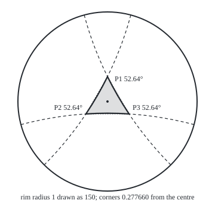

# Sphere, plane and hyperbolic space: the three reference geometries

[Syllabus](../../../SYLLABUS.md) → [Differential geometry and Lie groups](../README.md) → [Riemannian Geometry](../README.md#s05) → Sphere, plane and hyperbolic space

---

## General Overview

A desk globe stands beside a crocheted ruffle. The globe models the Earth as a sphere of radius 6371 km. The ruffle is crocheted in rows 1 cm tall, with one extra stitch after every five, so each row holds 1.2 times the stitches of the row before. That much extra edge cannot lie flat, so the ruffle waves.

Pull a thread tight between three points on each surface, so that every side is as short as the surface allows. Make each side one "radius" of its surface long: 6371 km on the globe, 5.48 cm on the ruffle (Step 2 derives this from the 1.2 growth per row), and any fixed length on flat paper.

| Surface | Side | Each corner | Angle sum |
| --- | --- | --- | --- |
| Globe | 6371 km | 69.47° | 208.40° |
| Flat paper | any | 60° | 180° |
| Ruffle | 5.48 cm | 52.64° | 157.93° |

[Three geometries](../../05-Geometry%20and%20trig/06-Beyond%20Euclid/02-spherical-and-hyperbolic-geometry.md) already showed this pattern, gave the disc map's length rule 2/(1 − r²), and drew its straight lines as arcs that meet the rim square. This card proves three things that card left open:

- Each of the three surfaces has the same curvature at every point: +1, 0 or −1 in units of its radius.
- The arcs in the disc map really are the shortest paths.
- A triangle's angle excess (its angle sum minus 180°) equals its curvature times its area.

**Three surfaces bend by the same amount at every point, +1, 0 or −1 in units of their radius, and that one number fixes their straight lines and makes every triangle's angle excess equal its curvature times its area.**

**What kind of fact this is:** theorems, proved on this card in Why it works. The curvature values are computed. The straight lines are derived. "Excess equals curvature times area" is the triangle case of the Gauss-Bonnet theorem, proved here for these three surfaces. The hyperbolic law of cosines in Step 5 is stated with a source, and checked in code. The Earth as a sphere and the ruffle as a hyperbolic surface are models: good fits, not exact descriptions.

### The picture: a triangle drawn in the disc

<p align="center"></p>

This is the ruffle's triangle drawn on the Poincaré disc, the standard flat map of the hyperbolic plane. To scale: rim radius 1 drawn as 150 units, centre (180, 170), corners at (180.0, 128.4), (143.9, 190.8) and (216.1, 190.8). Each side is part of a circle of drawn radius 562.2 (true value 3.748077). Dashed, each side runs on to the rim and meets it square. The dotted straight chords are not straight in the disc.

---

## The formula

Notation first, in words. A chart point is $`(x, y)`$, and $`r`$ is its drawn distance from the chart's centre, so $`r^2 = x^2 + y^2`$. $`R`$ is the surface's **radius**: the length unit in which its curvature is +1, 0 or −1. The **length factor** $`\lambda`$ (lambda) converts a short drawn step $`\lvert dx\rvert`$ into its true length $`ds`$ ([Riemannian metric](01-riemannian-metrics.md)). $`K`$ is the **Gaussian curvature**: positive on a dome, negative on a saddle, measured in 1/length². (Wing 05 used $`K`$ for a triangle's area; here area is written Area.) One rule, with one switch $`k`$, gives all three surfaces:

```math
ds = \lambda\,\lvert dx\rvert, \qquad \lambda = \frac{2R}{1 + k\,r^2}, \qquad K = \frac{k}{R^2}
```

**Read it aloud:** a short drawn step counts two R over one plus k r-squared times its drawn length, and the surface then has curvature k over R squared at every point.

- $`k = +1`$: the sphere of radius $`R`$, drawn by stereographic projection: light from the south pole throws the sphere onto the plane, with the equator at $`r = 1`$.
- $`k = 0`$: the flat plane, with every drawn length multiplied by $`2R`$.
- $`k = -1`$: the **hyperbolic plane**, written $`\mathbb{H}^2`$, drawn as the Poincaré disc $`r < 1`$.

$`K`$ depends only on lengths, so it can be computed from $`\lambda`$ alone:

```math
K = -\frac{1}{\lambda^2}\left(\frac{\partial^2}{\partial x^2} + \frac{\partial^2}{\partial y^2}\right)\ln\lambda
```

**Read it aloud:** curvature is minus the bend of the log of the length factor, divided by the length factor squared.

A second chart says the same thing. Stand at any point and use **polar coordinates**: true distance $`\rho`$ (rho) along a straight line from the point, and angle $`\theta`$ around it. Then a circle of true radius $`\rho`$ has rim $`2\pi f(\rho)`$:

```math
ds^2 = d\rho^2 + f(\rho)^2\,d\theta^2, \qquad K = -\frac{f''(\rho)}{f(\rho)}, \qquad f = R\sin\frac{\rho}{R},\ \ \rho,\ \ R\sinh\frac{\rho}{R}
```

**Read it aloud:** the curvature is minus the second derivative of the rim function over the rim function, and the rim function is a sine, a straight line or a hyperbolic sine.

Two results follow. To **draw a straight line** of the disc through points $`P`$ and $`Q`$, mirror $`P`$ in the rim to $`P^* = P/r^2`$, where $`r`$ is the drawn distance of $`P`$, then draw the circle through $`P`$, $`Q`$ and $`P^*`$. If $`P`$ is the centre, the line is a diameter. And for a triangle with straight sides and corner angles $`A`$, $`B`$, $`C`$ in radians:

```math
A + B + C - \pi = K \times \mathrm{Area}
```

**Read it aloud:** the angle sum minus a half-turn equals the curvature times the area enclosed.

| Symbol | Plain meaning | In our example | Push it up and the answer… |
| --- | --- | --- | --- |
| $`R`$ | the surface's radius: the length that makes the curvature 1 | 6371 km globe; 5.4848 cm ruffle | the same triangle shape covers more area |
| $`k`$, $`\mathbb{H}^2`$ | which surface: +1 sphere, 0 plane, −1 the hyperbolic plane | −1 for the ruffle | — |
| $`x`$, $`y`$, $`r`$, $`O`$ | chart coordinates; drawn distance from the chart's centre $`O`$ | corners at $`r = 0.277660`$ | in the disc, true lengths blow up as $`r`$ nears 1 |
| $`\lambda`$, $`ds`$ | length factor: true length per drawn length; true length of a short step | $`2R/(1 - r^2)`$ on the ruffle's disc | — |
| $`K`$ | Gaussian curvature, per length squared | +2.4637 × 10⁻⁸ per km² globe; −0.033241 per cm² ruffle | the excess per unit area grows |
| $`\rho`$, $`\theta`$, $`f(\rho)`$ | true distance from a chosen point; angle around it; rim function, so a circle of true radius $`\rho`$ has rim $`2\pi f`$ | corners 0.570290 radii from the triangle's centre; $`f = \sinh`$ on the ruffle | rims grow faster, curvature goes negative |
| $`P`$, $`Q`$, $`P^*`$; $`c`$, $`b`$, $`D`$ | two points to join; $`P`$ mirrored in the rim; the circle through them: centre, radius, centre's distance from $`O`$ | $`P^* = (0, 3.601526)`$; $`b = 3.748077`$, $`D = 3.879186`$ | — |
| $`z`$, $`w`$, $`p`$ | disc points as complex numbers; the sliding map sends $`z`$ to $`w`$ and $`p`$ to the centre | $`p = P_1`$ | — |
| $`A`$, $`B`$, $`C`$; $`a`$; Area | a triangle's corner angles; a side, in units of $`R`$; the true area enclosed | 52.64° each on the ruffle; $`a = 1`$; 0.385199 R², which is 11.59 cm² | — |
| $`u`$, $`E`$, $`F`$, $`G`$ | in Step 1: $`u = \ln\lambda`$; coefficients of $`ds^2`$ | $`E = G = \lambda^2`$, $`F = 0`$ | — |
| $`\psi`$, $`s`$ | in Step 4: the angle between a side and the outward ray $`\partial_\rho`$; arc length along the side | — | — |

### When it holds

- **The sides are geodesics**, the surface's straight lines ([Geodesic and exponential map](04-geodesics-and-the-exponential-map.md)). Draw the disc triangle with straight chords instead and the angle sum is exactly 180°, yet the chord triangle still encloses true area 0.416795: the rule fails because the chords are not straight in the disc.
- **The curvature is the same everywhere.** On an egg or a real ruffle with uneven stitches, the excess equals the total curvature summed over the triangle, not one $`K`$ times the area.
- **The triangle fits inside one polar chart around a corner.** On the sphere, every side must be shorter than half a great circle. This is a local result; the sphere as a whole needs the global Gauss-Bonnet theorem.
- **Matching units.** $`K`$ is per length squared and the area is in length squared, so their product is an angle in radians. Degrees, or a missing $`R^2`$, give nonsense.

---

## Why it works

### Step 0: curvature is read from lengths, and these lengths look the same everywhere

Gauss proved that curvature can be computed from the length rule alone, without looking at the surface from outside. That is the [Theorema Egregium](../02-Surfaces/08-theorema-egregium.md), on the surfaces shelf of this wing. So the length rule $`\lambda`$ decides everything.

Each of the three rules also looks the same from every point. On the sphere, rotations move any point to any other and keep all lengths. On the disc, special maps do the same job (Step 3). So the curvature at one point is the curvature at all points. Step 1 computes it, Step 2 confirms it in a second chart, and Step 4 turns it into a statement about triangles.

### Step 1: the curvature in the drawn chart is exactly k

Write $`u = \ln\lambda = \ln 2R - \ln(1 + k r^2)`$. Differentiate twice in $`x`$:

```math
\frac{\partial u}{\partial x} = \frac{-2kx}{1 + kr^2}, \qquad \frac{\partial^2 u}{\partial x^2} = \frac{-2k}{1 + kr^2} + \frac{4k^2x^2}{(1 + kr^2)^2}
```

Add the same for $`y`$. The two $`x^2`$ and $`y^2`$ terms combine to $`4k^2r^2`$:

```math
\frac{\partial^2 u}{\partial x^2} + \frac{\partial^2 u}{\partial y^2} = \frac{-4k(1 + kr^2) + 4k^2r^2}{(1 + kr^2)^2} = \frac{-4k}{(1 + kr^2)^2}
```

Divide by $`\lambda^2 = 4R^2/(1 + kr^2)^2`$ and change the sign. Every $`r`$ cancels, and $`K = k/R^2`$ at every point of the chart.

For the globe that is $`+1/6371^2 = 2.4637 \times 10^{-8}`$ per km². The code checks $`k`$ by finite differences at three points of each chart. On the disc the error is 0.000143168 at step 0.01 and 0.000001431 at step 0.001: a hundred times smaller when the step is ten times smaller.

<details>
<summary>Where the curvature formula comes from</summary>

A length rule $`ds = \lambda\lvert dx\rvert`$ has first fundamental form $`E = G = \lambda^2`$ and $`F = 0`$ (the coefficients in $`ds^2 = E\,dx^2 + 2F\,dx\,dy + G\,dy^2`$; not wing 05's edges and faces). With $`F = 0`$, the Theorema Egregium formula for $`K`$ reads:

$`\displaystyle K = -\frac{1}{2\sqrt{EG}}\left(\frac{\partial}{\partial y}\frac{\partial E/\partial y}{\sqrt{EG}} + \frac{\partial}{\partial x}\frac{\partial G/\partial x}{\sqrt{EG}}\right).`$

With $`E = G = \lambda^2`$, each inner fraction is twice a derivative of $`\ln\lambda`$, for example $`(\partial E/\partial y)/\lambda^2 = 2\,\partial(\ln\lambda)/\partial y`$. That gives the formula on the card. With $`E = 1`$ and $`G = f^2`$ in polar coordinates, the inner fraction is $`2f'`$, and $`K = -f''/f`$.

The log comes from dividing by $`\lambda`$ inside the bracket. Leave it out and the disc's centre comes out at −2.000002, not −1.

</details>

### Step 2: the same number in polar coordinates

Stand at any point and measure true distance $`\rho`$ and angle $`\theta`$. The rim of a circle of true radius $`\rho`$ is $`2\pi f(\rho)`$. For $`E = 1`$, $`F = 0`$, $`G = f^2`$ the same formula gives $`K = -f''/f`$ (see the fold above):

- **Sphere** (with $`R = 1`$): $`f = \sin\rho`$ and $`\sin'' = -\sin`$, so $`K = +1`$.
- **Plane:** $`f = \rho`$ and $`f'' = 0`$, so $`K = 0`$.
- **Hyperbolic plane:** $`f = \sinh\rho`$ and $`\sinh'' = \sinh`$, so $`K = -1`$.

The two charts describe one surface. In the disc, the point at true distance $`\rho`$ is drawn at $`r = \tanh(\rho/2)`$, and its drawn circle's true rim is $`2\pi r\lambda = 2\pi\sinh\rho`$ ([Three geometries](../../05-Geometry%20and%20trig/06-Beyond%20Euclid/02-spherical-and-hyperbolic-geometry.md), Step 3). The code prints $`-f''/f`$ at $`\rho = 0.5`$ and 1.0: +1, 0 and −1 to six decimals, matching Step 1.

**The ruffle's radius.** Far out, $`\sinh`$ grows like $`e^{\rho/R}/2`$, so each extra 1 cm of radius multiplies the rim by $`e^{1/R}`$. The ruffle multiplies by 1.2 per 1 cm row, so $`R = 1/\ln 1.2 = 5.4848`$ cm and $`K = -0.033241`$ per cm². The model's ratio per row is 1.2706 at 5 cm out and 1.2002 at 20 cm out. So the ruffle matches the hyperbolic plane well away from its starting ring.

### Step 3: the disc's straight lines are diameters and arcs that meet the rim square

**Diameters first.** Take a path from the centre to a point at drawn distance $`r`$. Any sideways wiggle adds length, and $`\lambda`$ depends only on $`r`$. So no path is shorter than the true length along the radius. Diameters are geodesics.

**Then move the disc.** Treat a point as a complex number $`z`$ ([Complex numbers](../../07-Complex%20analysis/01-Complex%20Numbers%20and%20the%20Plane/01-complex-numbers.md)), with $`\bar p`$ the conjugate of $`p`$. For a fixed disc point $`p`$, the map below slides $`p`$ to the centre:

```math
z \mapsto \frac{z - p}{1 - \bar p z}
```

It keeps every true length (proof in the fold), keeps angles, maps the rim to itself, and sends circles and lines to circles and lines ([Mobius transformations](../../07-Complex%20analysis/07-Conformal%20Maps%20and%20Harmonic%20Functions/02-mobius-transformations-and-the-point-at-infinity.md)). So it sends the geodesic through $`p`$ and any other point to a diameter. Run it backwards: every geodesic is the image of a diameter, a circle or line that meets the rim square.

**The drawing recipe.** A circle with centre $`c`$ and radius $`b`$ meets the unit rim square exactly when $`\lvert c\rvert^2 = 1 + b^2`$, by Pythagoras at the crossing point. Then any line from the disc's centre $`O`$ cuts the circle at two points whose distances from $`O`$ multiply to $`\lvert c\rvert^2 - b^2 = 1`$. So if $`P`$ is on the circle, so is $`P^* = P/r^2`$. Three points fix a circle: $`P`$, $`Q`$ and $`P^*`$.

<details>
<summary>Detailed proof: the sliding map keeps true lengths</summary>

Write $`w = (z - p)/(1 - \bar p z)`$ with $`\lvert p\rvert < 1`$. Differentiate:

$`\displaystyle \frac{dw}{dz} = \frac{(1 - \bar p z) + \bar p (z - p)}{(1 - \bar p z)^2} = \frac{1 - \lvert p\rvert^2}{(1 - \bar p z)^2}.`$

Expand $`\lvert 1 - \bar p z\rvert^2 - \lvert z - p\rvert^2`$. The cross terms cancel and leave $`(1 - \lvert p\rvert^2)(1 - \lvert z\rvert^2)`$, so:

$`\displaystyle 1 - \lvert w\rvert^2 = \frac{(1 - \lvert p\rvert^2)(1 - \lvert z\rvert^2)}{\lvert 1 - \bar p z\rvert^2}.`$

Divide the first line's size by the second line:

$`\displaystyle \frac{2\lvert dw\rvert}{1 - \lvert w\rvert^2} = \frac{2\lvert dz\rvert}{1 - \lvert z\rvert^2}.`$

That is the disc's length rule, unchanged. A map that keeps the length rule keeps every path's length, so it sends shortest paths to shortest paths.

</details>

### Step 4: the angle excess is the curvature inside the triangle

Put corner $`A`$ at the centre of polar coordinates. Let the opposite side run from corner $`B`$, on the ray $`\theta = 0`$, to corner $`C`$, on the ray $`\theta = A`$. Along that side, let $`\psi`$ (psi) be the angle between the outward direction $`\partial_\rho`$ and the side's direction.

1. **The side turns at a fixed rate.** The length rule does not involve $`\theta`$, so the Euler-Lagrange equation for $`\theta`$ ([The Euler-Lagrange equation](../../08-Differential%20equations%20and%20dynamics/12-Calculus%20of%20Variations%20and%20Optimal%20Control/01-functionals-and-the-euler-lagrange-equation.md)) keeps $`f(\rho)\sin\psi`$ constant along a geodesic (Clairaut's relation). Differentiating gives $`d\psi/d\theta = -f'(\rho)`$. On flat paper $`f' = 1`$: a straight line's angle to the radius drops exactly as fast as $`\theta`$ grows.
2. **Integrate the curvature.** Area in polar coordinates is $`f\,d\rho\,d\theta`$. Since $`K f = -f''`$, the curvature summed along one ray from the corner to the side is $`f'(0) - f'(\rho) = 1 - f'(\rho)`$.
3. **Add up the rays.** Summing over $`\theta`$ from 0 to $`A`$ gives $`A + \psi(A) - \psi(0)`$. The other two corners are $`B = \pi - \psi(0)`$ and $`C = \psi(A)`$, so the total is $`A + B + C - \pi`$.

When $`K`$ is constant, the summed curvature is $`K \times \mathrm{Area}`$. On the sphere $`K > 0`$, so angles overshoot. On the disc $`K < 0`$, so they fall short. On the plane they add to exactly $`\pi`$.

<details>
<summary>Detailed proof: excess equals summed curvature</summary>

Use unit-speed arc length $`s`$ along the side. Unit speed means $`\rho' = \cos\psi`$ and $`f\theta' = \sin\psi`$. The length rule has no $`\theta`$ in it, so the Euler-Lagrange equation for $`\theta`$ conserves $`f^2\theta' = f\sin\psi`$. Differentiate in $`s`$:

$`\displaystyle f'\rho'\sin\psi + f\cos\psi\,\psi' = 0 \quad\Rightarrow\quad \psi' = -\frac{f'\sin\psi}{f} = -f'\theta',`$

so $`d\psi/d\theta = -f'(\rho)`$. The side meets each ray once, so it is a graph $`\rho = \rho(\theta)`$. Then:

$`\displaystyle \iint K\,f\,d\rho\,d\theta = \int_0^{A}\!\int_0^{\rho(\theta)} (-f'')\,d\rho\,d\theta = \int_0^{A} \big(1 - f'(\rho(\theta))\big)\,d\theta = A + \psi(A) - \psi(0).`$

This uses $`f(0) = 0`$ and $`f'(0) = 1`$: circles about the corner start like flat ones. At the far end of the ray $`\theta = 0`$, the corner $`B`$ lies between the inward ray and the side, so $`B = \pi - \psi(0)`$. At the ray $`\theta = A`$, the corner $`C`$ lies between the inward ray and the side run backwards, so $`C = \psi(A)`$. Substituting, the summed curvature is $`A + B + C - \pi`$.

</details>

### Step 5: the three triangles side by side

For a triangle with three equal sides $`a`$ (in units of $`R`$), the laws of cosines give the corner angle directly:

- **Sphere** ([Triangles on a sphere](../../05-Geometry%20and%20trig/06-Beyond%20Euclid/01-triangles-on-a-sphere.md)): $`\cos a = \cos^2 a + \sin^2 a\cos A`$, so $`\cos A = \cos a/(1 + \cos a)`$.
- **Plane:** $`\cos A = 1/2`$, so $`A = 60^\circ`$.
- **Hyperbolic plane:** $`\cosh a = \cosh^2 a - \sinh^2 a\cos A`$, so $`\cos A = \cosh a/(1 + \cosh a)`$. This hyperbolic law of cosines is stated here and proved on [Hyperbolic trigonometry](../../05-Geometry%20and%20trig/06-Beyond%20Euclid/10-hyperbolic-trigonometry.md). The code confirms it by measuring the drawn angle between two arcs, since the disc keeps angles true.

---

## Worked numbers, by hand

Take side $`a = 1`$ (one radius). The disc triangle has its centre at the disc's centre and corners at 90°, 210° and 330°.

| Step | Arithmetic | Value |
| --- | --- | --- |
| corner's true distance from the centre | $`\sinh^2\rho = (\cosh 1 - 1)/1.5 = 0.543081/1.5 = 0.362054`$ | $`\rho = 0.570290`$ |
| drawn corner $`P_1`$ | $`r = \tanh(\rho/2)`$ | $`(0, 0.277660)`$ |
| mirror point $`P_1^*`$ | $`1/0.277660`$ | $`(0, 3.601526)`$ |
| side $`P_1P_2`$: circle centre's distance $`D`$ from $`O`$ | centre at 150°, so its height $`D \sin 150^\circ = D/2`$ is midway between $`P_1`$ and $`P_1^*`$: $`D = 0.277660 + 3.601526`$ | 3.879186 |
| its radius | $`\sqrt{3.879186^2 - 1}`$ | 3.748077 |
| disc corner | $`\cos A = 1.543081/2.543081 = 0.606776`$ | 52.64° |
| disc shortfall | $`180 - 3 \times 52.643240 = 22.070279`$, in radians | 0.385199 |
| disc area, grid of 600 × 600 cells | sum of $`\lambda^2`$ over cells inside | 0.385227 |
| ruffle triangle | $`0.385199 \times 5.4848^2 = 0.385199 \times 30.08`$ | **11.59 cm²** |
| sphere corner | $`\cos A = 0.540302/1.540302 = 0.350777`$ | 69.47° |
| sphere excess | $`3 \times 69.465165 - 180 = 28.395496`$, in radians | 0.495595 |
| globe triangle | $`0.495595 \times 6371^2`$ | **20116019 km²** |
| London, New York, North Pole | excess 16.76° = 0.292537 rad, times $`6371^2`$ | 11873957 km² |

The ruffle's triangle falls 22.07° short of 180°, and that shortfall measures 11.59 cm² of crochet. The globe's same-shaped triangle overshoots by 28.40°, which measures 20116019 km².

The middle of the disc table is the drawing recipe. Mirror the corner in the rim, then draw the circle through the corner, its neighbour and the mirror point. The code reaches the same circle by solving through the three points: centre (−3.359474, 1.939593), radius 3.748077.

### What breaks if you drop a piece

| Mistake | Comes out at | What went wrong |
| --- | --- | --- |
| Sides drawn as straight chords | angle sum 180°, true area 0.416795 | The chords are not disc geodesics, so the rule does not apply |
| Area summed with $`\lambda`$, not $`\lambda^2`$ | 0.188983, then 0.188978 on grids 300 and 600, not 0.385199 | Area scales by length factor squared |
| $`\ln`$ left out of the curvature formula | −2.000002 at the centre, not −1 | The first-derivative terms are missing |
| Ruffle area without $`R^2`$ | 0.39 cm², not 11.59 | The shortfall is in units of $`R^2`$ |

---

## Code, from first principles, and it actually runs

The code builds the one length rule for $`k = +1, 0, -1`$ and walks four roads. First, it computes curvature in two charts: finite differences of $`\ln\lambda`$, and $`-f''/f`$ in polar coordinates, each at two step sizes. Second, it finds one side of the disc triangle four ways: the mirror-and-circle recipe, the by-hand formula, RK4 ([Runge-Kutta four](../../08-Differential%20equations%20and%20dynamics/05-Numerical%20Evolution/04-runge-kutta-four.md)) on the geodesic equation at 8 and 64 steps, and the sliding map, which must send the arc onto a diameter. Third, it measures the side's true length, along the arc and along the chord. Fourth, it compares each triangle's angle excess with its area, summed on grids of two sizes that never use the angles. A second disc triangle, right-angled at $`O`$ with corners $`(0.5, 0)`$ and $`(0, 0.5)`$, tests the rule on a shape that is not equilateral.

### Python

```python
# Sphere, plane and hyperbolic space -- the check behind the card.  Standard library only.
# One length rule, ds = 2|dx| / (1 + k r^2), with k = +1, 0, -1: sphere, plane, Poincare disc.
# Roads: curvature in two charts; a disc side drawn by mirror-and-circle, by a formula, by RK4
# and by a Moebius move; angle excess against area summed on a grid.
from math import sqrt, log, sin, cos, acos, atan2, pi, sinh, cosh, asinh, tanh
DEG = 180 / pi
def lam(k, x, y): return 2 / (1 + k * (x * x + y * y))      # the length factor of the chart
def K_disc(k, x, y, h):                                      # K = -(Laplacian of ln lam) / lam^2
    L = lambda u, v: log(lam(k, u, v))
    lap = (L(x + h, y) + L(x - h, y) + L(x, y + h) + L(x, y - h) - 4 * L(x, y)) / (h * h)
    return -lap / lam(k, x, y) ** 2
def K_polar(f, r, h): return -(f(r + h) - 2 * f(r) + f(r - h)) / (h * h) / f(r)   # K = -f''/f
def sub(p, q): return (p[0] - q[0], p[1] - q[1])
def dot(p, q): return p[0] * q[0] + p[1] * q[1]
def circle3(p, q, s):                                        # circle through three points, two linear equations
    a1, b1 = 2 * (q[0] - p[0]), 2 * (q[1] - p[1]); c1 = dot(q, q) - dot(p, p)
    a2, b2 = 2 * (s[0] - p[0]), 2 * (s[1] - p[1]); c2 = dot(s, s) - dot(p, p)
    det = a1 * b2 - a2 * b1; c = ((c1 * b2 - c2 * b1) / det, (a1 * c2 - a2 * c1) / det)
    return c, sqrt(dot(sub(p, c), sub(p, c)))
def tangent(c, p, q):                                        # direction leaving p along the circle centred c, toward q
    t = (-(p[1] - c[1]), p[0] - c[0]); n = sqrt(dot(t, t))
    return (t[0] / n, t[1] / n) if dot(t, sub(q, p)) > 0 else (-t[0] / n, -t[1] / n)
def angle(u, v): return acos(max(-1.0, min(1.0, dot(u, v) / sqrt(dot(u, u) * dot(v, v))))) * DEG
def rk4(p, v, n):                                            # geodesic equation of the disc, true length 1
    def acc(s):
        g = 2 / (1 - s[0] ** 2 - s[1] ** 2); gx, gy = g * s[0], g * s[1]; w = gx * s[2] + gy * s[3]; vv = s[2] ** 2 + s[3] ** 2
        return (s[2], s[3], -2 * w * s[2] + vv * gx, -2 * w * s[3] + vv * gy)
    s, dt = (p[0], p[1], v[0], v[1]), 1 / n
    for _ in range(n):
        k1 = acc(s); k2 = acc([s[i] + dt / 2 * k1[i] for i in range(4)])
        k3 = acc([s[i] + dt / 2 * k2[i] for i in range(4)]); k4 = acc([s[i] + dt * k3[i] for i in range(4)])
        s = tuple(s[i] + dt / 6 * (k1[i] + 2 * k2[i] + 2 * k3[i] + k4[i]) for i in range(4))
    return s
def side_of(a, b, p): return (b[0] - a[0]) * (p[1] - a[1]) - (b[1] - a[1]) * (p[0] - a[0])
def disc_area(V, circles, n, factor):                        # sum factor over grid cells inside the curved triangle
    xs, ys = [v[0] for v in V], [v[1] for v in V]; x0, y0 = min(xs), min(ys); hx, hy = (max(xs) - x0) / n, (max(ys) - y0) / n
    o = side_of(V[0], V[1], V[2]); tot = 0.0
    for i in range(n):
        x = x0 + (i + 0.5) * hx
        for j in range(n):
            y = y0 + (j + 0.5) * hy
            if all(side_of(V[m], V[(m + 1) % 3], (x, y)) * o > 0 for m in range(3)) and all((x - c[0]) ** 2 + (y - c[1]) ** 2 > r * r for c, r in circles):
                tot += factor(x * x + y * y)
    return tot * hx * hy
def unit(colat, lon): return (sin(colat) * cos(lon), sin(colat) * sin(lon), cos(colat))
def det3(a, b, c): return a[0] * (b[1] * c[2] - b[2] * c[1]) - a[1] * (b[0] * c[2] - b[2] * c[0]) + a[2] * (b[0] * c[1] - b[1] * c[0])
def sphere_angles(V):                                        # corner angles from tangent arrows, in degrees
    def tan_(p, q): d = sum(a * b for a, b in zip(p, q)); return [b - d * a for a, b in zip(p, q)]
    def ang3(u, v): return acos(sum(a * b for a, b in zip(u, v)) / sqrt(sum(a * a for a in u) * sum(b * b for b in v))) * DEG
    return [ang3(tan_(V[i], V[(i + 1) % 3]), tan_(V[i], V[(i + 2) % 3])) for i in range(3)]
def sphere_area(V, top, lo, hi, n):                          # unit sphere: sum sin(colat) over cells inside
    o = det3(V[0], V[1], V[2]); hp, ht = top / n, (hi - lo) / n; tot = 0.0
    for i in range(n):
        ph = (i + 0.5) * hp; w = sin(ph)
        for j in range(n):
            p = unit(ph, lo + (j + 0.5) * ht)
            if all(det3(V[m], V[(m + 1) % 3], p) * o > 0 for m in range(3)): tot += w
    return tot * hp * ht
def f(xs, d=6): return ", ".join(f"{(0.0 if abs(x) < 5e-7 else x):.{d}f}" for x in xs)
# 1. curvature of the one length rule, chart one (the disc picture) and chart two (polar)
pts = [(0.0, 0.0), (0.3, 0.4), (-0.5, 0.1)]
for k, name, fn in [(1, "sphere, k = +1", sin), (0, "plane, k = 0", lambda r: r), (-1, "disc, k = -1", sinh)]:
    a, b = [K_disc(k, x, y, 1e-3) for x, y in pts], [K_disc(k, x, y, 1e-2) for x, y in pts]
    print(f"K, {name}: chart one at 3 points {f(a)} | error h=0.01 {max(abs(u - k) for u in b):.9f}, h=0.001 {max(abs(u - k) for u in a):.9f}")
    print(f"  chart two, -f''/f at r = 0.5, 1.0: {f([K_polar(fn, r, 1e-3) for r in (0.5, 1.0)])}")
    assert all(abs(u - k) < 1e-5 for u in a) and abs(K_polar(fn, 0.7, 1e-3) - k) < 1e-5   # two charts, one number
Rkm = 6371.0; Rcm = 1 / log(1.2)                           # globe; ruffle with 1 cm rows, one extra stitch in 5
print(f"globe K = 1/R^2 = {1e8 / Rkm ** 2:.4f} x 10^-8 per km^2 | ruffle R = 1 / ln 1.2 = {Rcm:.4f} cm, K = {-1 / Rcm ** 2:.6f} per cm^2")
print(f"ruffle rim growth per 1 cm row: at 5 cm out {sinh(6 / Rcm) / sinh(5 / Rcm):.4f}, at 20 cm out {sinh(21 / Rcm) / sinh(20 / Rcm):.4f}")
# 2. draw the equilateral disc triangle with true sides 1
rc = asinh(sqrt((cosh(1) - 1) / 1.5)); r0 = tanh(rc / 2)
P = [(r0 * cos(t), r0 * sin(t)) for t in (pi / 2, pi / 2 + 2 * pi / 3, pi / 2 + 4 * pi / 3)]
D = r0 + 1 / r0; kr = sqrt(D * D - 1)
star = (P[0][0] / r0 ** 2, P[0][1] / r0 ** 2)
cen, rad = circle3(P[0], P[1], star)
print(f"disc triangle: corners at true {rc:.6f}, drawn r0 = {r0:.6f}; P1* = ({star[0]:.6f}, {star[1]:.6f})")
print(f"side P1P2: mirror circle centre ({cen[0]:.6f}, {cen[1]:.6f}) radius {rad:.6f} | formula D = {D:.6f}, radius {kr:.6f}, D^2 - radius^2 = {D * D - kr * kr:.6f}")
assert abs(sqrt(dot(cen, cen)) - D) < 1e-9 and abs(rad - kr) < 1e-9                  # mirror road = formula road
C = [(D * cos(t), D * sin(t)) for t in (pi / 2 + pi / 3, pi / 2 + pi, pi / 2 + 5 * pi / 3)]
t01, t02 = tangent(C[0], P[0], P[1]), tangent(C[2], P[0], P[2])
A_arc, A_law = angle(t01, t02), acos(cosh(1) / (cosh(1) + 1)) * DEG
A_sph = acos(cos(1) / (1 + cos(1))) * DEG
print(f"corner angle: disc arcs {A_arc:.6f}, hyperbolic cosine law {A_law:.6f} | sphere {A_sph:.6f} | plane 60")
print(f"angle sums: sphere {3 * A_sph:.6f}, plane 180, disc {3 * A_law:.6f}")
print(f"by hand: cosh 1 = {cosh(1):.6f}, cos 1 = {cos(1):.6f}; cos A disc {cosh(1) / (cosh(1) + 1):.6f}, sphere {cos(1) / (1 + cos(1)):.6f}; sinh^2 of corner distance {(cosh(1) - 1) / 1.5:.6f}")
assert abs(A_arc - A_law) < 1e-9                                                    # drawn angle = law of cosines
# 3. the arc is the geodesic: shoot it, and move it to a diameter
for n in (8, 64):
    v = ((1 - r0 * r0) / 2 * t01[0], (1 - r0 * r0) / 2 * t01[1]); s = rk4(P[0], v, n)
    print(f"RK4, {n} steps, true length 1 from P1: lands {sqrt((s[0] - P[1][0]) ** 2 + (s[1] - P[1][1]) ** 2):.9f} from P2, off the arc by {abs(sqrt((s[0] - C[0][0]) ** 2 + (s[1] - C[0][1]) ** 2) - kr):.9f}")
assert sqrt((s[0] - P[1][0]) ** 2 + (s[1] - P[1][1]) ** 2) < 1e-6                 # stepped geodesic hits P2
def mob(z, a):                                               # (z - a) / (1 - conj(a) z), a disc isometry
    nr, ni = z[0] - a[0], z[1] - a[1]; dr, di = 1 - (a[0] * z[0] + a[1] * z[1]), -(a[0] * z[1] - a[1] * z[0])
    m = dr * dr + di * di; return ((nr * dr + ni * di) / m, (ni * dr - nr * di) / m)
th0, th1 = atan2(P[0][1] - C[0][1], P[0][0] - C[0][0]), atan2(P[1][1] - C[0][1], P[1][0] - C[0][0])
arc = [(C[0][0] + kr * cos(th0 + (th1 - th0) * i / 1000), C[0][1] + kr * sin(th0 + (th1 - th0) * i / 1000)) for i in range(1001)]
img = [mob(z, P[0]) for z in arc[1:]]; d0 = atan2(img[-1][1], img[-1][0])
print(f"Moebius move P1 -> 0: arc lands on the line at {d0 * DEG:.6f} deg, widest miss {max(abs(atan2(w[1], w[0]) - d0) for w in img) * DEG:.9f} deg")
assert max(abs(atan2(w[1], w[0]) - d0) for w in img) < 1e-9                       # image is a diameter
def true_len(path): return sum(lam(-1, (p[0] + q[0]) / 2, (p[1] + q[1]) / 2) * sqrt(dot(sub(q, p), sub(q, p))) for p, q in zip(path, path[1:]))
chord = [(P[0][0] + (P[1][0] - P[0][0]) * i / 1000, P[0][1] + (P[1][1] - P[0][1]) * i / 1000) for i in range(1001)]
print(f"true length P1 to P2: along the arc {true_len(arc):.6f}, along the drawn chord {true_len(chord):.6f}")
assert abs(true_len(arc) - 1) < 1e-5 and true_len(chord) > true_len(arc)           # arc is the shorter, length 1
# 4. angle excess against area, by grid sums that never use the angles
hyp = lambda q: 4 / (1 - q) ** 2
short = (180 - 3 * A_law) / DEG
grid = [disc_area(P, [(c, kr) for c in C], n, hyp) for n in (300, 600)]
print(f"disc triangle: shortfall {180 - 3 * A_law:.6f} deg = {short:.6f} rad | area on grids 300, 600: {f(grid)}")
OAB = [(0.0, 0.0), (0.5, 0.0), (0.0, 0.5)]; OAB_c = [((1.25, 1.25), sqrt(1.25 ** 2 * 2 - 1))]
osum = 90 + 2 * angle(tangent(OAB_c[0][0], OAB[1], OAB[2]), (-1.0, 0.0))   # right angle at O, two drawn corners
g2 = [disc_area(OAB, OAB_c, n, hyp) for n in (300, 600)]
print(f"disc triangle O, A, B: shortfall {180 - osum:.6f} deg = {(180 - osum) / DEG:.6f} rad | area on grids 300, 600: {f(g2)}")
assert abs(grid[1] - short) < 1e-3 and abs(g2[1] - (180 - osum) / DEG) < 1e-3   # shortfall = area
SV = [(0.0, 0.0, 1.0), unit(1, 0), unit(1, A_sph / DEG)]
sg = [sphere_area(SV, 1.0, 0.0, A_sph / DEG, n) for n in (300, 600)]
print(f"sphere triangle: excess {3 * A_sph - 180:.6f} deg = {(3 * A_sph - 180) / DEG:.6f} rad | area on grids 300, 600: {f(sg)}")
LV = [unit((90 - 51.5074) / DEG, -0.1278 / DEG), unit((90 - 40.7128) / DEG, -74.0060 / DEG), (0.0, 0.0, 1.0)]
La = sphere_angles(LV); Lg = sphere_area(LV, 0.9, -74.0060 / DEG, -0.1278 / DEG, 600); E = (sum(La) - 180) / DEG
print(f"London, New York, pole: angles {f(La, 2)}, excess {sum(La) - 180:.2f} deg = {E:.6f} rad, area R^2 x excess {Rkm ** 2 * E:.0f} km^2, grid {Rkm ** 2 * Lg:.0f} km^2")
assert abs(sg[1] - (3 * A_sph - 180) / DEG) < 1e-3 and abs(Lg - E) < 1e-3          # excess = area, sphere
print(f"same triangles, real sizes: globe side {Rkm:.0f} km, area {Rkm ** 2 * (3 * A_sph - 180) / DEG:.0f} km^2 | ruffle side {Rcm:.2f} cm, R^2 = {Rcm ** 2:.2f} cm^2, area {Rcm ** 2 * short:.2f} cm^2")
# 5. mistakes
flat = disc_area(P, [], 600, hyp)
print(f"mistake, chord sides: angle sum 180, yet true area {flat:.6f} | lam not squared: area on grids 300, 600: {f([disc_area(P, [(c, kr) for c in C], n, lambda q: 2 / (1 - q)) for n in (300, 600)])}")
lap0 = (4 * lam(-1, 1e-3, 0) - 4 * lam(-1, 0, 0)) / 1e-6
print(f"mistake, ln left out: -lap(lam)/lam^2 at the centre {-lap0 / lam(-1, 0, 0) ** 2:.6f} | ruffle area without R^2: {short:.2f} cm^2 not {Rcm ** 2 * short:.2f}")
def scr(p): return f"({180 + 150 * p[0]:.1f}, {170 - 150 * p[1]:.1f})"
def rim(c, r):                                               # where a circle centre c, radius r, crosses the rim
    cc = dot(c, c); m = (1 + cc - r * r) / 2; w = sqrt(cc - m * m); return [((m * c[0] + s * c[1] * w) / cc, (m * c[1] - s * c[0] * w) / cc) for s in (-1, 1)]
print("figure, rim radius 150 at (180, 170); corners", " ".join(scr(p) for p in P), f"arc radius {150 * kr:.1f}; rim ends", " ".join(scr(q) for c in C for q in rim(c, kr)))
print("ALL CHECKS PASS")
```

**Ran 2026-11-19 on macOS, Python 3.14.10, standard library only. All checks passed. Output, pasted from the run:**

```
K, sphere, k = +1: chart one at 3 points 0.999999, 1.000000, 1.000000 | error h=0.01 0.000049997, h=0.001 0.000000500
  chart two, -f''/f at r = 0.5, 1.0: 1.000000, 1.000000
K, plane, k = 0: chart one at 3 points 0.000000, 0.000000, 0.000000 | error h=0.01 0.000000000, h=0.001 0.000000000
  chart two, -f''/f at r = 0.5, 1.0: 0.000000, 0.000000
K, disc, k = -1: chart one at 3 points -1.000001, -1.000001, -1.000001 | error h=0.01 0.000143168, h=0.001 0.000001431
  chart two, -f''/f at r = 0.5, 1.0: -1.000000, -1.000000
globe K = 1/R^2 = 2.4637 x 10^-8 per km^2 | ruffle R = 1 / ln 1.2 = 5.4848 cm, K = -0.033241 per cm^2
ruffle rim growth per 1 cm row: at 5 cm out 1.2706, at 20 cm out 1.2002
disc triangle: corners at true 0.570290, drawn r0 = 0.277660; P1* = (0.000000, 3.601526)
side P1P2: mirror circle centre (-3.359474, 1.939593) radius 3.748077 | formula D = 3.879186, radius 3.748077, D^2 - radius^2 = 1.000000
corner angle: disc arcs 52.643240, hyperbolic cosine law 52.643240 | sphere 69.465165 | plane 60
angle sums: sphere 208.395496, plane 180, disc 157.929721
by hand: cosh 1 = 1.543081, cos 1 = 0.540302; cos A disc 0.606776, sphere 0.350777; sinh^2 of corner distance 0.362054
RK4, 8 steps, true length 1 from P1: lands 0.000000250 from P2, off the arc by 0.000000032
RK4, 64 steps, true length 1 from P1: lands 0.000000000 from P2, off the arc by 0.000000000
Moebius move P1 -> 0: arc lands on the line at -116.321620 deg, widest miss 0.000000000 deg
true length P1 to P2: along the arc 1.000000, along the drawn chord 1.000732
disc triangle: shortfall 22.070279 deg = 0.385199 rad | area on grids 300, 600: 0.385240, 0.385227
disc triangle O, A, B: shortfall 28.072487 deg = 0.489957 rad | area on grids 300, 600: 0.490146, 0.490007
sphere triangle: excess 28.395496 deg = 0.495595 rad | area on grids 300, 600: 0.495498, 0.495638
London, New York, pole: angles 71.67, 51.21, 73.88, excess 16.76 deg = 0.292537 rad, area R^2 x excess 11873957 km^2, grid 11873678 km^2
same triangles, real sizes: globe side 6371 km, area 20116019 km^2 | ruffle side 5.48 cm, R^2 = 30.08 cm^2, area 11.59 cm^2
mistake, chord sides: angle sum 180, yet true area 0.416795 | lam not squared: area on grids 300, 600: 0.188983, 0.188978
mistake, ln left out: -lap(lam)/lam^2 at the centre -2.000002 | ruffle area without R^2: 0.39 cm^2 not 11.59
figure, rim radius 150 at (180, 170); corners (180.0, 128.4) (143.9, 190.8) (216.1, 190.8) arc radius 562.2; rim ends (74.0, 276.2) (219.0, 25.2) (324.9, 208.7) (35.1, 208.7) (141.0, 25.2) (286.0, 276.2)
ALL CHECKS PASS
```

### Rust

```rust
// Sphere, plane and hyperbolic space -- the check behind the card.  std only, no crates.
// One length rule, ds = 2|dx| / (1 + k r^2), with k = +1, 0, -1: sphere, plane, Poincare disc.
// Roads: curvature in two charts; a disc side drawn by mirror-and-circle, by a formula, by RK4
// and by a Moebius move; angle excess against area summed on a grid.
use std::f64::consts::PI;
type V2 = (f64, f64);
type V3 = (f64, f64, f64);
const DEG: f64 = 180.0 / PI;
fn lam(k: f64, x: f64, y: f64) -> f64 { 2.0 / (1.0 + k * (x * x + y * y)) }
fn k_disc(k: f64, x: f64, y: f64, h: f64) -> f64 { // K = -(Laplacian of ln lam) / lam^2
    let l = |u: f64, v: f64| lam(k, u, v).ln();
    let lap = (l(x + h, y) + l(x - h, y) + l(x, y + h) + l(x, y - h) - 4.0 * l(x, y)) / (h * h);
    -lap / lam(k, x, y).powi(2)
}
fn k_polar(f: &dyn Fn(f64) -> f64, r: f64, h: f64) -> f64 { -(f(r + h) - 2.0 * f(r) + f(r - h)) / (h * h) / f(r) }
fn sub(p: V2, q: V2) -> V2 { (p.0 - q.0, p.1 - q.1) }
fn dot(p: V2, q: V2) -> f64 { p.0 * q.0 + p.1 * q.1 }
fn circle3(p: V2, q: V2, s: V2) -> (V2, f64) { // circle through three points, two linear equations
    let ((a1, b1, c1), (a2, b2, c2)) = ((2.0 * (q.0 - p.0), 2.0 * (q.1 - p.1), dot(q, q) - dot(p, p)), (2.0 * (s.0 - p.0), 2.0 * (s.1 - p.1), dot(s, s) - dot(p, p)));
    let det = a1 * b2 - a2 * b1; let c = ((c1 * b2 - c2 * b1) / det, (a1 * c2 - a2 * c1) / det);
    (c, dot(sub(p, c), sub(p, c)).sqrt())
}
fn tangent(c: V2, p: V2, q: V2) -> V2 { // direction leaving p along the circle centred c, toward q
    let (t, n) = ((-(p.1 - c.1), p.0 - c.0), dist(p, c));
    if dot(t, sub(q, p)) > 0.0 { (t.0 / n, t.1 / n) } else { (-t.0 / n, -t.1 / n) }
}
fn angle(u: V2, v: V2) -> f64 { (dot(u, v) / (dot(u, u) * dot(v, v)).sqrt()).max(-1.0).min(1.0).acos() * DEG }
fn acc(s: [f64; 4]) -> [f64; 4] { // geodesic equation of the disc
    let g = 2.0 / (1.0 - s[0].powi(2) - s[1].powi(2));
    let (gx, gy, vv) = (g * s[0], g * s[1], s[2].powi(2) + s[3].powi(2));
    let w = gx * s[2] + gy * s[3];
    [s[2], s[3], -2.0 * w * s[2] + vv * gx, -2.0 * w * s[3] + vv * gy]
}
fn rk4(p: V2, v: V2, n: usize) -> [f64; 4] { // true length 1
    let (mut s, dt) = ([p.0, p.1, v.0, v.1], 1.0 / n as f64);
    for _ in 0..n {
        let k1 = acc(s);
        let k2 = acc(std::array::from_fn(|i| s[i] + dt / 2.0 * k1[i]));
        let k3 = acc(std::array::from_fn(|i| s[i] + dt / 2.0 * k2[i]));
        let k4 = acc(std::array::from_fn(|i| s[i] + dt * k3[i]));
        s = std::array::from_fn(|i| s[i] + dt / 6.0 * (k1[i] + 2.0 * k2[i] + 2.0 * k3[i] + k4[i]));
    }
    s
}
fn side_of(a: V2, b: V2, p: V2) -> f64 { (b.0 - a.0) * (p.1 - a.1) - (b.1 - a.1) * (p.0 - a.0) }
fn disc_area(v: &[V2], circles: &[(V2, f64)], n: usize, factor: &dyn Fn(f64) -> f64) -> f64 {
    let (xs, ys): (Vec<f64>, Vec<f64>) = v.iter().cloned().unzip();
    let (x0, y0) = (xs.iter().cloned().fold(f64::INFINITY, f64::min), ys.iter().cloned().fold(f64::INFINITY, f64::min));
    let hx = (xs.iter().cloned().fold(f64::NEG_INFINITY, f64::max) - x0) / n as f64;
    let hy = (ys.iter().cloned().fold(f64::NEG_INFINITY, f64::max) - y0) / n as f64;
    let (o, mut tot) = (side_of(v[0], v[1], v[2]), 0.0);
    for i in 0..n {
        let x = x0 + (i as f64 + 0.5) * hx;
        for j in 0..n {
            let y = y0 + (j as f64 + 0.5) * hy;
            if (0..3).all(|m| side_of(v[m], v[(m + 1) % 3], (x, y)) * o > 0.0) && circles.iter().all(|&(c, r)| (x - c.0).powi(2) + (y - c.1).powi(2) > r * r) { tot += factor(x * x + y * y); }
        }
    }
    tot * hx * hy
}
fn unit(colat: f64, lon: f64) -> V3 { (colat.sin() * lon.cos(), colat.sin() * lon.sin(), colat.cos()) }
fn det3(a: V3, b: V3, c: V3) -> f64 { a.0 * (b.1 * c.2 - b.2 * c.1) - a.1 * (b.0 * c.2 - b.2 * c.0) + a.2 * (b.0 * c.1 - b.1 * c.0) }
fn d3(a: V3, b: V3) -> f64 { a.0 * b.0 + a.1 * b.1 + a.2 * b.2 }
fn sphere_angles(v: &[V3; 3]) -> Vec<f64> { // corner angles from tangent arrows, in degrees
    let tan_ = |p: V3, q: V3| { let d = d3(p, q); (q.0 - d * p.0, q.1 - d * p.1, q.2 - d * p.2) };
    (0..3).map(|i| { let (u, w) = (tan_(v[i], v[(i + 1) % 3]), tan_(v[i], v[(i + 2) % 3])); (d3(u, w) / (d3(u, u) * d3(w, w)).sqrt()).acos() * DEG }).collect()
}
fn sphere_area(v: &[V3; 3], top: f64, lo: f64, hi: f64, n: usize) -> f64 { // unit sphere: sum sin(colat) over cells inside
    let (o, hp, ht, mut tot) = (det3(v[0], v[1], v[2]), top / n as f64, (hi - lo) / n as f64, 0.0);
    for i in 0..n {
        let (ph, w) = ((i as f64 + 0.5) * hp, ((i as f64 + 0.5) * hp).sin());
        for j in 0..n {
            let p = unit(ph, lo + (j as f64 + 0.5) * ht);
            if (0..3).all(|m| det3(v[m], v[(m + 1) % 3], p) * o > 0.0) { tot += w; }
        }
    }
    tot * hp * ht
}
fn f(xs: &[f64], d: usize) -> String { xs.iter().map(|&x| format!("{:.*}", d, if x.abs() < 5e-7 { 0.0 } else { x })).collect::<Vec<_>>().join(", ") }
fn mob(z: V2, a: V2) -> V2 { // (z - a) / (1 - conj(a) z), a disc isometry
    let (nr, ni, dr, di) = (z.0 - a.0, z.1 - a.1, 1.0 - (a.0 * z.0 + a.1 * z.1), -(a.0 * z.1 - a.1 * z.0));
    let m = dr * dr + di * di;
    ((nr * dr + ni * di) / m, (ni * dr - nr * di) / m)
}
fn true_len(path: &[V2]) -> f64 { path.windows(2).map(|w| lam(-1.0, (w[0].0 + w[1].0) / 2.0, (w[0].1 + w[1].1) / 2.0) * dot(sub(w[1], w[0]), sub(w[1], w[0])).sqrt()).sum() }
fn dist(p: (f64, f64), q: V2) -> f64 { ((p.0 - q.0).powi(2) + (p.1 - q.1).powi(2)).sqrt() }
fn main() {
    // 1. curvature of the one length rule, chart one (the disc picture) and chart two (polar)
    let (pts, lin) = ([(0.0, 0.0), (0.3, 0.4), (-0.5, 0.1)], |r: f64| r); // lin: the plane's f(r) = r
    let charts: [(f64, &str, &dyn Fn(f64) -> f64); 3] = [(1.0, "sphere, k = +1", &f64::sin), (0.0, "plane, k = 0", &lin), (-1.0, "disc, k = -1", &f64::sinh)];
    for (k, name, fun) in charts {
        let a: Vec<f64> = pts.iter().map(|&(x, y)| k_disc(k, x, y, 1e-3)).collect();
        let b: Vec<f64> = pts.iter().map(|&(x, y)| k_disc(k, x, y, 1e-2)).collect();
        let err = |v: &Vec<f64>| v.iter().map(|u| (u - k).abs()).fold(0.0, f64::max);
        println!("K, {}: chart one at 3 points {} | error h=0.01 {:.9}, h=0.001 {:.9}", name, f(&a, 6), err(&b), err(&a));
        println!("  chart two, -f''/f at r = 0.5, 1.0: {}", f(&[k_polar(fun, 0.5, 1e-3), k_polar(fun, 1.0, 1e-3)], 6));
        assert!(a.iter().all(|u| (u - k).abs() < 1e-5) && (k_polar(fun, 0.7, 1e-3) - k).abs() < 1e-5); // two charts, one number
    }
    let (rkm, rcm) = (6371.0_f64, 1.0 / 1.2_f64.ln()); // globe; ruffle with 1 cm rows, one extra stitch in 5
    println!("globe K = 1/R^2 = {:.4} x 10^-8 per km^2 | ruffle R = 1 / ln 1.2 = {:.4} cm, K = {:.6} per cm^2", 1e8 / rkm.powi(2), rcm, -1.0 / rcm.powi(2));
    println!("ruffle rim growth per 1 cm row: at 5 cm out {:.4}, at 20 cm out {:.4}", (6.0 / rcm).sinh() / (5.0 / rcm).sinh(), (21.0 / rcm).sinh() / (20.0 / rcm).sinh());
    // 2. draw the equilateral disc triangle with true sides 1
    let rc = ((1.0_f64.cosh() - 1.0) / 1.5).sqrt().asinh();
    let (r0, dd) = ((rc / 2.0).tanh(), (rc / 2.0).tanh() + 1.0 / (rc / 2.0).tanh());
    let p: Vec<V2> = [PI / 2.0, PI / 2.0 + 2.0 * PI / 3.0, PI / 2.0 + 4.0 * PI / 3.0].iter().map(|t| (r0 * t.cos(), r0 * t.sin())).collect();
    let (kr, star) = ((dd * dd - 1.0).sqrt(), (p[0].0 / r0.powi(2), p[0].1 / r0.powi(2)));
    let (cen, rad) = circle3(p[0], p[1], star);
    println!("disc triangle: corners at true {:.6}, drawn r0 = {:.6}; P1* = ({:.6}, {:.6})", rc, r0, star.0, star.1);
    println!("side P1P2: mirror circle centre ({:.6}, {:.6}) radius {:.6} | formula D = {:.6}, radius {:.6}, D^2 - radius^2 = {:.6}", cen.0, cen.1, rad, dd, kr, dd * dd - kr * kr);
    assert!((dot(cen, cen).sqrt() - dd).abs() < 1e-9 && (rad - kr).abs() < 1e-9); // mirror road = formula road
    let c: Vec<V2> = [PI / 2.0 + PI / 3.0, PI / 2.0 + PI, PI / 2.0 + 5.0 * PI / 3.0].iter().map(|t| (dd * t.cos(), dd * t.sin())).collect();
    let (t01, t02) = (tangent(c[0], p[0], p[1]), tangent(c[2], p[0], p[2]));
    let (a_arc, a_law) = (angle(t01, t02), (1.0_f64.cosh() / (1.0_f64.cosh() + 1.0)).acos() * DEG); // drawn; cosine law
    let a_sph = (1.0_f64.cos() / (1.0 + 1.0_f64.cos())).acos() * DEG;
    println!("corner angle: disc arcs {:.6}, hyperbolic cosine law {:.6} | sphere {:.6} | plane 60", a_arc, a_law, a_sph);
    println!("angle sums: sphere {:.6}, plane 180, disc {:.6}", 3.0 * a_sph, 3.0 * a_law);
    println!("by hand: cosh 1 = {:.6}, cos 1 = {:.6}; cos A disc {:.6}, sphere {:.6}; sinh^2 of corner distance {:.6}", 1.0_f64.cosh(), 1.0_f64.cos(), 1.0_f64.cosh() / (1.0_f64.cosh() + 1.0), 1.0_f64.cos() / (1.0 + 1.0_f64.cos()), (1.0_f64.cosh() - 1.0) / 1.5);
    assert!((a_arc - a_law).abs() < 1e-9); // drawn angle = law of cosines
    // 3. the arc is the geodesic: shoot it, and move it to a diameter
    let mut s = [0.0; 4];
    for n in [8, 64] {
        let v = ((1.0 - r0 * r0) / 2.0 * t01.0, (1.0 - r0 * r0) / 2.0 * t01.1);
        s = rk4(p[0], v, n);
        println!("RK4, {} steps, true length 1 from P1: lands {:.9} from P2, off the arc by {:.9}", n, dist((s[0], s[1]), p[1]), (dist((s[0], s[1]), c[0]) - kr).abs());
    }
    assert!(dist((s[0], s[1]), p[1]) < 1e-6); // stepped geodesic hits P2
    let (th0, th1) = ((p[0].1 - c[0].1).atan2(p[0].0 - c[0].0), (p[1].1 - c[0].1).atan2(p[1].0 - c[0].0));
    let arc: Vec<V2> = (0..=1000).map(|i| (c[0].0 + kr * (th0 + (th1 - th0) * i as f64 / 1000.0).cos(), c[0].1 + kr * (th0 + (th1 - th0) * i as f64 / 1000.0).sin())).collect();
    let img: Vec<V2> = arc[1..].iter().map(|&z| mob(z, p[0])).collect();
    let d0 = img[999].1.atan2(img[999].0);
    let miss = img.iter().map(|w| (w.1.atan2(w.0) - d0).abs()).fold(0.0, f64::max);
    println!("Moebius move P1 -> 0: arc lands on the line at {:.6} deg, widest miss {:.9} deg", d0 * DEG, miss * DEG);
    assert!(miss < 1e-9); // image is a diameter
    let chord: Vec<V2> = (0..=1000).map(|i| (p[0].0 + (p[1].0 - p[0].0) * i as f64 / 1000.0, p[0].1 + (p[1].1 - p[0].1) * i as f64 / 1000.0)).collect();
    println!("true length P1 to P2: along the arc {:.6}, along the drawn chord {:.6}", true_len(&arc), true_len(&chord));
    assert!((true_len(&arc) - 1.0).abs() < 1e-5 && true_len(&chord) > true_len(&arc)); // arc is the shorter, length 1
    // 4. angle excess against area, by grid sums that never use the angles
    let (hyp, short) = (|q: f64| 4.0 / (1.0 - q).powi(2), (180.0 - 3.0 * a_law) / DEG);
    let circ: Vec<(V2, f64)> = c.iter().map(|&q| (q, kr)).collect();
    let grid: Vec<f64> = [300, 600].iter().map(|&n| disc_area(&p, &circ, n, &hyp)).collect();
    println!("disc triangle: shortfall {:.6} deg = {:.6} rad | area on grids 300, 600: {}", 180.0 - 3.0 * a_law, short, f(&grid, 6));
    let (oab, oab_c): ([V2; 3], [(V2, f64); 1]) = ([(0.0, 0.0), (0.5, 0.0), (0.0, 0.5)], [((1.25, 1.25), (1.25_f64.powi(2) * 2.0 - 1.0).sqrt())]);
    let osum = 90.0 + 2.0 * angle(tangent(oab_c[0].0, oab[1], oab[2]), (-1.0, 0.0)); // right angle at O, two drawn corners
    let g2: Vec<f64> = [300, 600].iter().map(|&n| disc_area(&oab, &oab_c, n, &hyp)).collect();
    println!("disc triangle O, A, B: shortfall {:.6} deg = {:.6} rad | area on grids 300, 600: {}", 180.0 - osum, (180.0 - osum) / DEG, f(&g2, 6));
    assert!((grid[1] - short).abs() < 1e-3 && (g2[1] - (180.0 - osum) / DEG).abs() < 1e-3); // shortfall = area
    let sv = [(0.0, 0.0, 1.0), unit(1.0, 0.0), unit(1.0, a_sph / DEG)]; // pole and two points 1 rad down
    let sg: Vec<f64> = [300, 600].iter().map(|&n| sphere_area(&sv, 1.0, 0.0, a_sph / DEG, n)).collect();
    println!("sphere triangle: excess {:.6} deg = {:.6} rad | area on grids 300, 600: {}", 3.0 * a_sph - 180.0, (3.0 * a_sph - 180.0) / DEG, f(&sg, 6));
    let lv = [unit((90.0 - 51.5074) / DEG, -0.1278 / DEG), unit((90.0 - 40.7128) / DEG, -74.0060 / DEG), (0.0, 0.0, 1.0)];
    let (la, lg) = (sphere_angles(&lv), sphere_area(&lv, 0.9, -74.0060 / DEG, -0.1278 / DEG, 600));
    let e = (la.iter().sum::<f64>() - 180.0) / DEG; // excess, in radians
    println!("London, New York, pole: angles {}, excess {:.2} deg = {:.6} rad, area R^2 x excess {:.0} km^2, grid {:.0} km^2", f(&la, 2), e * DEG, e, rkm.powi(2) * e, rkm.powi(2) * lg);
    assert!((sg[1] - (3.0 * a_sph - 180.0) / DEG).abs() < 1e-3 && (lg - e).abs() < 1e-3); // excess = area, sphere
    println!("same triangles, real sizes: globe side {:.0} km, area {:.0} km^2 | ruffle side {:.2} cm, R^2 = {:.2} cm^2, area {:.2} cm^2", rkm, rkm.powi(2) * (3.0 * a_sph - 180.0) / DEG, rcm, rcm.powi(2), rcm.powi(2) * short);
    // 5. mistakes
    let flat = disc_area(&p, &[], 600, &hyp); // straight chords, no arcs cut away
    println!("mistake, chord sides: angle sum 180, yet true area {:.6} | lam not squared: area on grids 300, 600: {}", flat, f(&[300, 600].map(|n| disc_area(&p, &circ, n, &|q: f64| 2.0 / (1.0 - q))), 6));
    let lap0 = (4.0 * lam(-1.0, 1e-3, 0.0) - 4.0 * lam(-1.0, 0.0, 0.0)) / 1e-6;
    println!("mistake, ln left out: -lap(lam)/lam^2 at the centre {:.6} | ruffle area without R^2: {:.2} cm^2 not {:.2}", -lap0 / lam(-1.0, 0.0, 0.0).powi(2), short, rcm.powi(2) * short);
    let scr = |q: V2| format!("({:.1}, {:.1})", 180.0 + 150.0 * q.0, 170.0 - 150.0 * q.1);
    let rim = |cc: V2, r: f64| -> Vec<V2> { // where a circle centre cc, radius r, crosses the rim
        let (c2, m) = (dot(cc, cc), (1.0 + dot(cc, cc) - r * r) / 2.0);
        let w = (c2 - m * m).sqrt();
        [-1.0, 1.0].iter().map(|s| ((m * cc.0 + s * cc.1 * w) / c2, (m * cc.1 - s * cc.0 * w) / c2)).collect()
    };
    let (corners, ends): (Vec<String>, Vec<String>) = (p.iter().map(|&q| scr(q)).collect(), c.iter().flat_map(|&q| rim(q, kr)).map(|q| scr(q)).collect());
    println!("figure, rim radius 150 at (180, 170); corners {} arc radius {:.1}; rim ends {}", corners.join(" "), 150.0 * kr, ends.join(" "));
    println!("ALL CHECKS PASS");
}
```

**Ran 2026-11-19 on macOS, rustc 1.98.1, no crates. All checks passed. Output, pasted from the run:**

```
K, sphere, k = +1: chart one at 3 points 0.999999, 1.000000, 1.000000 | error h=0.01 0.000049997, h=0.001 0.000000500
  chart two, -f''/f at r = 0.5, 1.0: 1.000000, 1.000000
K, plane, k = 0: chart one at 3 points 0.000000, 0.000000, 0.000000 | error h=0.01 0.000000000, h=0.001 0.000000000
  chart two, -f''/f at r = 0.5, 1.0: 0.000000, 0.000000
K, disc, k = -1: chart one at 3 points -1.000001, -1.000001, -1.000001 | error h=0.01 0.000143168, h=0.001 0.000001431
  chart two, -f''/f at r = 0.5, 1.0: -1.000000, -1.000000
globe K = 1/R^2 = 2.4637 x 10^-8 per km^2 | ruffle R = 1 / ln 1.2 = 5.4848 cm, K = -0.033241 per cm^2
ruffle rim growth per 1 cm row: at 5 cm out 1.2706, at 20 cm out 1.2002
disc triangle: corners at true 0.570290, drawn r0 = 0.277660; P1* = (0.000000, 3.601526)
side P1P2: mirror circle centre (-3.359474, 1.939593) radius 3.748077 | formula D = 3.879186, radius 3.748077, D^2 - radius^2 = 1.000000
corner angle: disc arcs 52.643240, hyperbolic cosine law 52.643240 | sphere 69.465165 | plane 60
angle sums: sphere 208.395496, plane 180, disc 157.929721
by hand: cosh 1 = 1.543081, cos 1 = 0.540302; cos A disc 0.606776, sphere 0.350777; sinh^2 of corner distance 0.362054
RK4, 8 steps, true length 1 from P1: lands 0.000000250 from P2, off the arc by 0.000000032
RK4, 64 steps, true length 1 from P1: lands 0.000000000 from P2, off the arc by 0.000000000
Moebius move P1 -> 0: arc lands on the line at -116.321620 deg, widest miss 0.000000000 deg
true length P1 to P2: along the arc 1.000000, along the drawn chord 1.000732
disc triangle: shortfall 22.070279 deg = 0.385199 rad | area on grids 300, 600: 0.385240, 0.385227
disc triangle O, A, B: shortfall 28.072487 deg = 0.489957 rad | area on grids 300, 600: 0.490146, 0.490007
sphere triangle: excess 28.395496 deg = 0.495595 rad | area on grids 300, 600: 0.495498, 0.495638
London, New York, pole: angles 71.67, 51.21, 73.88, excess 16.76 deg = 0.292537 rad, area R^2 x excess 11873957 km^2, grid 11873678 km^2
same triangles, real sizes: globe side 6371 km, area 20116019 km^2 | ruffle side 5.48 cm, R^2 = 30.08 cm^2, area 11.59 cm^2
mistake, chord sides: angle sum 180, yet true area 0.416795 | lam not squared: area on grids 300, 600: 0.188983, 0.188978
mistake, ln left out: -lap(lam)/lam^2 at the centre -2.000002 | ruffle area without R^2: 0.39 cm^2 not 11.59
figure, rim radius 150 at (180, 170); corners (180.0, 128.4) (143.9, 190.8) (216.1, 190.8) arc radius 562.2; rim ends (74.0, 276.2) (219.0, 25.2) (324.9, 208.7) (35.1, 208.7) (141.0, 25.2) (286.0, 276.2)
ALL CHECKS PASS
```

### Lean

Lean proves the curvatures of Steps 1 and 2 and the sliding-map fold of Step 3, for every radius and every point.

- Take $`R > 0`$, any $`k`$, and a chart point with $`1 + k\,r^2 > 0`$. Then the length factor $`\lambda = 2R/(1 + k\,r^2)`$ gives $`K = k/R^2`$ there.
- Take $`0 < \rho`$, and also $`\rho < \pi R`$ on the sphere. Then the sphere, plane and hyperbolic rim functions give $`-f''/f = +1/R^2`$, $`0`$ and $`-1/R^2`$.
- Take disc points $`p`$ and $`z`$, and the sliding map $`w = (z - p)/(1 - \bar p z)`$. Then $`w`$ sends $`p`$ to the centre and keeps $`z`$ inside the disc.
- Take the same map. Then $`2|dw/dz|/(1 - |w|^2) = 2/(1 - |z|^2)`$, so the disc's length rule is unchanged.

Step 3's arcs, Step 4's excess rule, Step 5's law of cosines and every printed number are left to the Python and Rust checks.

```lean
-- Sphere, plane and hyperbolic space: the length rule ds = 2R |dx| / (1 + k r^2) has curvature k / R^2 at every point, the polar charts sin, line and sinh give curvature +1/R^2, 0 and -1/R^2, and the disc's sliding map keeps the disc's length rule.
import Mathlib.Analysis.SpecialFunctions.Log.Deriv
import Mathlib.Analysis.SpecialFunctions.Trigonometric.Deriv
import Mathlib.Analysis.SpecialFunctions.Trigonometric.DerivHyp
import Mathlib.Analysis.Calculus.Deriv.Inv
import Mathlib.Analysis.Complex.Basic

open Complex

/-- Helper: the second derivative of `ln (2R / (1 + k (s² + c)))` in `s`. -/
theorem log_lam_second_deriv (R k c x : ℝ) (hR : 0 < R) (hx : 0 < 1 + k * (x ^ 2 + c)) :
    deriv (fun a => deriv (fun s => Real.log (2 * R / (1 + k * (s ^ 2 + c)))) a) x
      = (-2 * k * (1 + k * (x ^ 2 + c)) + 4 * k ^ 2 * x ^ 2) / (1 + k * (x ^ 2 + c)) ^ 2 := by
  have hopen : IsOpen {a : ℝ | 0 < 1 + k * (a ^ 2 + c)} :=
    isOpen_lt continuous_const (by fun_prop)
  have hev : (fun a => deriv (fun s => Real.log (2 * R / (1 + k * (s ^ 2 + c)))) a)
      =ᶠ[nhds x] fun a => -(2 * k) * a / (1 + k * (a ^ 2 + c)) := by
    filter_upwards [hopen.mem_nhds hx] with a ha
    have ha' : (1 + k * (a ^ 2 + c)) ≠ 0 := ne_of_gt ha
    have hD : HasDerivAt (fun s : ℝ => 1 + k * (s ^ 2 + c)) (k * (2 * a)) a := by
      have := ((hasDerivAt_pow 2 a).add_const c).const_mul k |>.const_add 1
      simpa using this
    have hL : HasDerivAt (fun s : ℝ => 2 * R / (1 + k * (s ^ 2 + c)))
        (-(2 * R) * (k * (2 * a)) / (1 + k * (a ^ 2 + c)) ^ 2) a := by
      have := (hasDerivAt_const a (2 * R)).div hD ha'
      convert this using 1; ring
    have hne : 2 * R / (1 + k * (a ^ 2 + c)) ≠ 0 := div_ne_zero (by positivity) ha'
    rw [(hL.log hne).deriv]
    field_simp
  rw [hev.deriv_eq]
  have hx' : (1 + k * (x ^ 2 + c)) ≠ 0 := ne_of_gt hx
  have hD : HasDerivAt (fun s : ℝ => 1 + k * (s ^ 2 + c)) (k * (2 * x)) x := by
    have := ((hasDerivAt_pow 2 x).add_const c).const_mul k |>.const_add 1
    simpa using this
  have hN : HasDerivAt (fun s : ℝ => -(2 * k) * s) (-(2 * k)) x := by
    simpa using ((hasDerivAt_id' x).const_mul (-(2 * k)))
  refine (hN.div hD hx').deriv.trans ?_
  field_simp
  ring

#print axioms log_lam_second_deriv

/-- Helper: `|1 - p̄ z|² - |z - p|² = (1 - |z|²)(1 - |p|²)`. -/
theorem disc_norm_identity (p z : ℂ) :
    ‖1 - (starRingEnd ℂ) p * z‖ ^ 2 - ‖z - p‖ ^ 2 = (1 - ‖z‖ ^ 2) * (1 - ‖p‖ ^ 2) := by
  simp only [Complex.sq_norm, Complex.normSq_apply]
  simp
  ring

#print axioms disc_norm_identity

/-- The one length rule `ds = λ |dx|` with `λ = 2R / (1 + k r²)`, where `r² = x² + y²`, has
Gaussian curvature `K = -(∂²/∂x² + ∂²/∂y²) ln λ / λ²` equal to `k / R²` at every point of the
chart (every point where `1 + k r² > 0`). With `k = +1, 0, -1` this is the sphere, the plane and
the Poincaré disc, of curvature `+1/R²`, `0` and `-1/R²`. -/
theorem curvature_of_length_rule_eq_k_div_R_sq (R k x y : ℝ) (hR : 0 < R)
    (hxy : 0 < 1 + k * (x ^ 2 + y ^ 2)) :
    let lam : ℝ → ℝ → ℝ := fun a b => 2 * R / (1 + k * (a ^ 2 + b ^ 2));
    -(deriv (fun a => deriv (fun s => Real.log (lam s y)) a) x
        + deriv (fun b => deriv (fun t => Real.log (lam x t)) b) y) / lam x y ^ 2
      = k / R ^ 2 := by
  intro lam
  have h1 := log_lam_second_deriv R k (y ^ 2) x hR hxy
  have h2 := log_lam_second_deriv R k (x ^ 2) y hR (by linarith [show x ^ 2 + y ^ 2 = y ^ 2 + x ^ 2 by ring])
  have e2 : (fun b => deriv (fun t => Real.log (lam x t)) b)
      = fun a => deriv (fun s => Real.log (2 * R / (1 + k * (s ^ 2 + x ^ 2)))) a := by
    funext b; congr 1; funext t; simp only [lam]; ring_nf
  simp only [lam] at e2 ⊢
  rw [e2, h1, h2]
  have hD : (1 + k * (x ^ 2 + y ^ 2)) ≠ 0 := ne_of_gt hxy
  have hD' : (1 + k * (y ^ 2 + x ^ 2)) = 1 + k * (x ^ 2 + y ^ 2) := by ring
  rw [hD']
  field_simp
  ring

/-- The same curvatures in polar coordinates `ds² = dρ² + f(ρ)² dθ²`, where `K = -f''(ρ)/f(ρ)`:
the sphere's rim function `f = R sin(ρ/R)` gives `+1/R²` (for `0 < ρ < πR`), the plane's `f = ρ`
gives `0`, and the hyperbolic plane's `f = R sinh(ρ/R)` gives `-1/R²` (for `0 < ρ`). -/
theorem polar_chart_curvature (R ρ : ℝ) (hR : 0 < R) (hρ : 0 < ρ) :
    (ρ < Real.pi * R →
      -deriv (deriv fun t => R * Real.sin (t / R)) ρ / (R * Real.sin (ρ / R)) = 1 / R ^ 2) ∧
    -deriv (deriv fun t : ℝ => t) ρ / ρ = 0 ∧
    -deriv (deriv fun t => R * Real.sinh (t / R)) ρ / (R * Real.sinh (ρ / R)) = -1 / R ^ 2 := by
  have hR' : R ≠ 0 := ne_of_gt hR
  refine ⟨fun hlt => ?_, ?_, ?_⟩
  · have e1 : deriv (fun t => R * Real.sin (t / R)) = fun t => Real.cos (t / R) := by
      funext t
      have := (((hasDerivAt_id' t).div_const R).sin).const_mul R
      rw [this.deriv]; field_simp
    have e2 : HasDerivAt (fun t => Real.cos (t / R)) (-Real.sin (ρ / R) * (1 / R)) ρ := by
      have := ((hasDerivAt_id' ρ).div_const R).cos
      simpa using this
    have hs : 0 < Real.sin (ρ / R) := by
      apply Real.sin_pos_of_pos_of_lt_pi (div_pos hρ hR)
      rw [div_lt_iff₀ hR]; exact hlt
    rw [e1, e2.deriv]
    field_simp
  · simp
  · have e1 : deriv (fun t => R * Real.sinh (t / R)) = fun t => Real.cosh (t / R) := by
      funext t
      have := (((hasDerivAt_id' t).div_const R).sinh).const_mul R
      rw [this.deriv]; field_simp
    have e2 : HasDerivAt (fun t => Real.cosh (t / R)) (Real.sinh (ρ / R) * (1 / R)) ρ := by
      have := ((hasDerivAt_id' ρ).div_const R).cosh
      simpa using this
    have hs : 0 < Real.sinh (ρ / R) := Real.sinh_pos_iff.mpr (div_pos hρ hR)
    rw [e1, e2.deriv]
    field_simp

/-- The sliding map `w(z) = (z - p) / (1 - p̄ z)` of the disc, for a disc point `p`, sends `p` to
the centre, keeps disc points in the disc, and keeps the disc's length rule:
`2 |w'(z)| / (1 - |w|²) = 2 / (1 - |z|²)`, so it keeps every true length. -/
theorem disc_slide_keeps_length_rule (p z : ℂ) (hp : ‖p‖ < 1) (hz : ‖z‖ < 1) :
    let w : ℂ → ℂ := fun u => (u - p) / (1 - (starRingEnd ℂ) p * u)
    w p = 0 ∧ ‖w z‖ < 1 ∧
      2 * ‖deriv w z‖ / (1 - ‖w z‖ ^ 2) = 2 / (1 - ‖z‖ ^ 2) := by
  intro w
  have hid := disc_norm_identity p z
  have hp0 := norm_nonneg p
  have hz0 := norm_nonneg z
  have hP : 0 < 1 - ‖p‖ ^ 2 := by nlinarith
  have hZ : 0 < 1 - ‖z‖ ^ 2 := by nlinarith
  have hg : (1 - (starRingEnd ℂ) p * z) ≠ 0 := by
    intro h
    have h1 : (starRingEnd ℂ) p * z = 1 := by linear_combination -h
    have h2 : ‖(starRingEnd ℂ) p * z‖ < 1 := by
      rw [norm_mul, Complex.norm_conj]
      nlinarith
    rw [h1, norm_one] at h2; exact lt_irrefl _ h2
  have hN : 0 < ‖1 - (starRingEnd ℂ) p * z‖ := norm_pos_iff.mpr hg
  have hwz : ‖w z‖ = ‖z - p‖ / ‖1 - (starRingEnd ℂ) p * z‖ := by
    simp only [w, norm_div]
  have hlt : ‖z - p‖ ^ 2 < ‖1 - (starRingEnd ℂ) p * z‖ ^ 2 := by nlinarith [mul_pos hZ hP]
  have hlt' : ‖z - p‖ < ‖1 - (starRingEnd ℂ) p * z‖ :=
    lt_of_pow_lt_pow_left₀ 2 (norm_nonneg _) hlt
  have hder : HasDerivAt w ((1 * (1 - (starRingEnd ℂ) p * z) - (z - p) * (-(starRingEnd ℂ) p))
      / (1 - (starRingEnd ℂ) p * z) ^ 2) z := by
    have hf : HasDerivAt (fun u : ℂ => u - p) 1 z := (hasDerivAt_id z).sub_const p
    have hg' : HasDerivAt (fun u : ℂ => 1 - (starRingEnd ℂ) p * u) (-(starRingEnd ℂ) p) z := by
      simpa using ((hasDerivAt_id z).const_mul ((starRingEnd ℂ) p)).const_sub 1
    exact hf.div hg' hg
  have hnum : (1 * (1 - (starRingEnd ℂ) p * z) - (z - p) * (-(starRingEnd ℂ) p))
      = ((1 - ‖p‖ ^ 2 : ℝ) : ℂ) := by
    have : (starRingEnd ℂ) p * p = ((‖p‖ ^ 2 : ℝ) : ℂ) := by
      rw [Complex.sq_norm, Complex.normSq_eq_conj_mul_self]
    push_cast at this ⊢
    linear_combination (-1 : ℂ) * this
  have hdn : ‖deriv w z‖ = (1 - ‖p‖ ^ 2) / ‖1 - (starRingEnd ℂ) p * z‖ ^ 2 := by
    rw [hder.deriv, hnum, norm_div, norm_pow, Complex.norm_real, Real.norm_eq_abs,
      abs_of_pos hP]
  refine ⟨by simp [w], ?_, ?_⟩
  · rw [hwz, div_lt_one hN]; exact hlt'
  · rw [hdn, hwz]
    have hden : 1 - (‖z - p‖ / ‖1 - (starRingEnd ℂ) p * z‖) ^ 2
        = (1 - ‖z‖ ^ 2) * (1 - ‖p‖ ^ 2) / ‖1 - (starRingEnd ℂ) p * z‖ ^ 2 := by
      have hN2 : ‖1 - (starRingEnd ℂ) p * z‖ ^ 2 ≠ 0 := by positivity
      rw [← hid, div_pow, sub_div, div_self hN2]
    rw [hden]
    field_simp

#print axioms curvature_of_length_rule_eq_k_div_R_sq
#print axioms polar_chart_curvature
#print axioms disc_slide_keeps_length_rule
```

**Checked 2026-11-19 on macOS, Lean 4.36.0-rc2, Mathlib v4.36.0-rc2. Every proof is complete and uses only Lean's standard axioms. Output, pasted from the run:**

```
'log_lam_second_deriv' depends on axioms: [propext, Classical.choice, Quot.sound]
'disc_norm_identity' depends on axioms: [propext, Classical.choice, Quot.sound]
'curvature_of_length_rule_eq_k_div_R_sq' depends on axioms: [propext, Classical.choice, Quot.sound]
'polar_chart_curvature' depends on axioms: [propext, Classical.choice, Quot.sound]
'disc_slide_keeps_length_rule' depends on axioms: [propext, Classical.choice, Quot.sound]
```

> [!TIP]
> **Try changing**
> - Guess first: does a looser ruffle, with one extra stitch in 10, hold a bigger or smaller triangle? Change `log(1.2)` to `log(1.1)`. The radius grows to 10.4921 cm, the curvature shrinks to −0.009084 per cm², and the same-shaped triangle covers 42.40 cm².
> - Guess first: how far off is RK4 with only 2 steps? Change `(8, 64)` to `(2, 64)`. It lands 0.000063423 from $`P_2`$, still close, because the geodesic is a gentle arc.
> - Guess first: do coarse grids still find the area? Change every `(300, 600)` to `(50, 100)`. The disc area comes out at 0.383535, then 0.384464, the finer one within 0.001 of the shortfall; the error roughly halves each time the grid doubles.
> - Guess first: what if the sides are chords? In the line `grid = ...`, replace `[(c, kr) for c in C]` with `[]`. The area becomes 0.416795, and the excess-equals-area assert stops the run.

---

## The usual mistake

> [!warning]
> **Judging curvature by how bent a surface looks.** The ruffle waves wildly and a rolled-up sheet looks curved, yet the ruffle has the same $`K`$ at every point and the rolled sheet has $`K = 0`$. Curvature here is read from lengths inside the surface, by an ant with a ruler. It is not read from the shape seen from outside.
>
> - **Straight on the drawing is not straight on the surface.** The disc triangle with chord sides adds to exactly 180°, yet encloses true area 0.416795. Its sides are not geodesics.
> - **Forgetting to square the length factor.** Area grows by $`\lambda^2`$. With $`\lambda`$ alone, the disc triangle's area comes out at 0.188983 and 0.188978 on the two grids, under half of 0.385199.
> - **Dropping the log.** $`-(\partial_x^2 + \partial_y^2)\lambda/\lambda^2`$ gives −2.000002 at the disc's centre and varies from point to point.
> - **Mixing units.** The shortfall 0.385199 is in units of $`R^2`$. Read it as cm² and the ruffle triangle shrinks from 11.59 cm² to 0.39 cm².

---

## Where you meet it in real life

- **Flight routes.** London, New York and the North Pole form a great-circle triangle with excess 16.76°, or 0.292537 rad. Times $`6371^2`$, that is 11873957 km², which the code also gets by summing grid cells: 11873678 km².
- **Polar maps.** The $`k = +1`$ chart is the polar stereographic projection, used for maps of the Arctic and Antarctic because it keeps angles true.
- **Crochet and frilly growth.** Crocheted hyperbolic planes are used to teach this geometry by touch. Lettuce leaves and sea-slug fringes ruffle for the same reason: their edges grow faster than a flat sheet allows.
- **Carried arrows.** An arrow carried without turning around a triangle comes back turned by the excess: 16.76° around the London triangle ([Parallel transport](03-parallel-transport-and-holonomy.md)).
- **Escher's disc prints.** The Circle Limit woodcuts are drawn on this disc ([Three geometries](../../05-Geometry%20and%20trig/06-Beyond%20Euclid/02-spherical-and-hyperbolic-geometry.md)). The recipe tests their arcs: the white arcs of Circle Limit III do not meet the rim square (that card gives the angle and its source), so they are curves at a fixed distance from a geodesic, not geodesics.

> **Say it back**
> One length rule, $`2R/(1 + kr^2)`$, draws the sphere, the plane and the hyperbolic plane, and its curvature is $`k/R^2`$ at every point. In the disc, straight lines are diameters and circles that meet the rim square, drawn through a point, a second point and the first point's mirror in the rim. Along any straight-sided triangle the angle excess equals the curvature summed inside. With constant curvature, that is curvature times area. A one-radius triangle has angles adding to 208.40° on the globe, 180° on paper and 157.93° on the ruffle.

---

## What this builds on

- [Geodesic and exponential map](04-geodesics-and-the-exponential-map.md): what a geodesic is, and the equation the code's RK4 steps.
- [Three geometries](../../05-Geometry%20and%20trig/06-Beyond%20Euclid/02-spherical-and-hyperbolic-geometry.md): the disc, its length rule, its arcs and the angle sums, all stated there and proved here.
- [Triangles on a sphere](../../05-Geometry%20and%20trig/06-Beyond%20Euclid/01-triangles-on-a-sphere.md): the sphere's law of cosines and Girard's excess-equals-area, which Step 4 generalizes.

## Where this goes next

- [Riemann curvature tensor](06-riemann-curvature-tensor.md): curvature in any dimension; these three are the spaces where every sectional curvature (written sec) is the same constant.
- [Ricci and scalar curvature](07-ricci-and-scalar-curvature.md): how volumes grow compared with these three yardsticks.
- [Jacobi field](09-jacobi-fields-and-comparison-theorems.md): the rim function $`f`$ as the spread of nearby geodesics, and comparison theorems that measure every space against these three.
- [Hopf-Rinow](10-hopf-rinow-and-completeness.md): why the disc, though drawn bounded, is complete: its rim is infinitely far away.

This card measured each surface near one point; which closed surfaces and spaces can be built by gluing pieces of these three geometries is a global question it leaves open.

---

## Sources

Verified 2026-11-19: every link below resolves to the publisher's page.

- Henderson, David W., and Daina Taimina. "Crocheting the hyperbolic plane." *The Mathematical Intelligencer* 23, no. 2 (2001): 17–28. [doi:10.1007/BF03026623](https://doi.org/10.1007/BF03026623). The crocheted ruffle, built by a fixed ratio of increases per row.
- Lee, John M. *Introduction to Riemannian Manifolds*, 2nd ed. Springer, 2018. [doi:10.1007/978-3-319-91755-9](https://doi.org/10.1007/978-3-319-91755-9). The model spaces of constant curvature, their charts, and the Gauss-Bonnet formula for triangles.
- Anderson, James W. *Hyperbolic Geometry*, 2nd ed. Springer, 2005. [doi:10.1007/1-84628-220-9](https://doi.org/10.1007/1-84628-220-9). Disc geodesics, the sliding maps as isometries, and the hyperbolic law of cosines.
- do Carmo, Manfredo P. *Riemannian Geometry*. Birkhäuser, 1992. [doi:10.1007/978-1-4757-2201-7](https://doi.org/10.1007/978-1-4757-2201-7). Spaces of constant curvature, and Clairaut-type conserved quantities from symmetry.
- Milnor, John W. "Hyperbolic geometry: the first 150 years." *Bulletin of the American Mathematical Society* 6, no. 1 (1982): 9–24. [doi:10.1090/S0273-0979-1982-14958-8](https://doi.org/10.1090/S0273-0979-1982-14958-8). The history from Gauss and Bolyai to Beltrami's and Poincaré's models.
