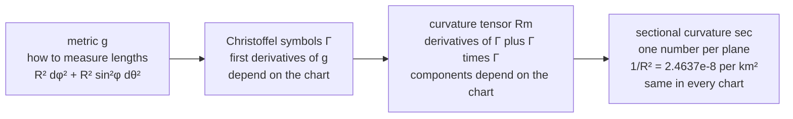

# Riemann curvature tensor: what is left when two derivatives fail to swap

[Syllabus](../../../SYLLABUS.md) → [Differential geometry and Lie groups](../README.md) → [Riemannian Geometry](../README.md#s05) → Riemann curvature tensor

---

## General Overview

Draw a circle on the ground around London, every point 500 km from the city along the Earth's surface. On a flat chart, that circle measures $`2\pi \times 500 = 3141.593`$ km. On the globe it measures 3138.369 km. It is short by 3.224 km.

No flat chart can fix that. A flat chart that keeps the radius right gets the circumference wrong, and a chart that keeps the circumference right gets the radius wrong. The shortfall is a fact about the globe, not about any map of it.

The **Riemann curvature tensor** is the tool that measures this shortfall at a single point, using only measurements made inside the surface. It is built from one experiment: carry a vector a little way north and then a little way east, then carry it east first and then north. On a flat sheet the two results agree. On the globe they differ, and the difference is curvature.

From the tensor comes one number for each plane of directions at a point, the **sectional curvature**. At London, and at every point on the globe, it is $`1/R^2`$, where $`R = 6371`$ km is the Earth's radius: $`2.4637 \times 10^{-8}`$ per km². This card computes the tensor of the sphere and reads that number off it.

**The curvature tensor records how much two covariant derivatives fail to commute, and on a surface it reduces to one number per point: the sectional curvature, which is $`1/R^2`$ everywhere on a globe of radius $`R`$.**

**What kind of fact this is:** a definition, with three theorems proved on this card in Why it works: the leftover depends only on the vectors at the point, sec depends only on the plane, and the sphere's sectional curvature is $`1/R^2`$. The four symmetries of Step 3, which the second proof uses, are stated with a source, not proved here. The Earth as a sphere of radius 6371 km is a model, said once here.



Each arrow is one step on this card. Only the last box is a property of the globe itself.

---

## The formula

```math
\mathrm{Rm}(X,Y)Z = \nabla_X \nabla_Y Z - \nabla_Y \nabla_X Z - \nabla_{[X,Y]} Z, \qquad \mathrm{sec}(X,Y) = \frac{g\big(\mathrm{Rm}(X,Y)Y,\, X\big)}{g(X,X)\,g(Y,Y) - g(X,Y)^2}
```

**Read it aloud:** "Differentiate Z along Y then along X, subtract the other order, and remove the part caused by the two directions not closing up. Then measure the result against the plane of X and Y, and divide by that plane's area squared."

The first formula defines the tensor. The second extracts the sectional curvature of the plane spanned by $`X`$ and $`Y`$. In a chart with coordinates $`x^1, x^2`$, the components are

```math
\mathrm{Rm}^a{}_{bcd} = \partial_c \Gamma^a_{db} - \partial_d \Gamma^a_{cb} + \Gamma^a_{ce}\Gamma^e_{db} - \Gamma^a_{de}\Gamma^e_{cb}
```

with $`\mathrm{Rm}(\partial_c, \partial_d)\partial_b = \mathrm{Rm}^a{}_{bcd}\,\partial_a`$. A repeated upper and lower index, like $`e`$ here, is summed over 1 and 2.

| Symbol | Plain meaning | In our example | Push it up and the answer… |
| --- | --- | --- | --- |
| $`R`$ | the globe's radius (the curvature tensor is always written $`\mathrm{Rm}`$) | 6371 km | sec falls as $`1/R^2`$ |
| $`x^1, x^2`$; $`\varphi`$, $`\theta`$ | chart coordinates (the upper indices are labels, not powers); on the globe, polar angle measured down from the North Pole, and longitude east; on the flat control, $`\theta`$ is the angle around the centre | London: 38.4926°, −0.1278° | sec does not move; the components do |
| $`g_{ij}`$, $`ds^2`$, $`\det g`$ | the metric: the dot product of the chart's direction vectors $`\partial_i`$ and $`\partial_j`$; $`ds^2`$ is the same rule written as a squared step length; $`\det g`$ is the squared area of the little coordinate parallelogram | $`g_{\varphi\varphi} = R^2`$, $`g_{\theta\theta} = R^2 \sin^2\varphi`$ | sec does not move: it is divided out |
| $`\Gamma^a_{bc}`$ | Christoffel symbols: how the chart's direction vectors turn as you move ([Levi-Civita connection](02-levi-civita-connection-and-christoffel-symbols.md)) | $`\Gamma^\varphi_{\theta\theta} = -0.487156`$ | nothing by itself: a flat chart can have large $`\Gamma`$ |
| $`\nabla_X Z`$, $`[X,Y]`$ | covariant derivative: the rate of change of the field $`Z`$ along $`X`$, measured inside the surface; Lie bracket: how far "flow along X, then Y" misses the other order | moving a south-pointing arrow east; $`[\partial_\varphi, \partial_\theta] = 0`$ | — |
| $`X, Y, Z, W`$, $`f`$ | tangent vectors, or fields of them, at the point; $`f`$ is a function, a number that varies from place to place | $`\partial_\varphi`$ (south), $`\partial_\theta`$ (east) | — |
| $`\mathrm{Rm}(X,Y)Z`$, $`\mathrm{Rm}^a{}_{bcd}`$ | the curvature map: the leftover vector when the two orders of differentiation disagree; its components in a chart, with indices $`a, b, c, d, e`$ each 1 or 2 | $`\mathrm{Rm}^\varphi{}_{\theta\varphi\theta} = \sin^2\varphi = 0.387399`$ | larger leftover, more curvature; the components depend on the chart |
| $`\mathrm{Rm}(X,Y,Z,W)`$ | the same tensor with its output turned into a number: $`g(\mathrm{Rm}(X,Y)Z, W)`$; $`\mathrm{Rm}_{1221}`$ puts the chart directions 1, 2, 2, 1 in the slots | $`\mathrm{Rm}_{1221} = 1.5724 \times 10^{7}`$ km² | depends on the chart |
| $`\mathrm{sec}(X,Y)`$, $`K`$ | sectional curvature of the plane spanned by $`X`$ and $`Y`$, in 1/km²; on a surface it equals the Gaussian curvature $`K`$ | $`2.4637 \times 10^{-8}`$ per km² | more bending, shorter circles |
| $`u, v, \lambda`$ | a second chart, stereographic: the globe projected flat from the South Pole, and its scale factor | London at $`u = 2224.386`$ km, $`\lambda = 1.782689`$ | — |
| $`r`$, $`C(r)`$ | a distance from a centre measured along the surface, and the circumference of the circle at that distance | 500 km, 3138.369 km | the shortfall against $`2\pi r`$ grows as $`r^3`$ |
| $`n`$, $`D`$ | the dimension of the space; the determinant of a change of basis inside one plane | $`n = 2`$ | $`n = 4`$ gives 20 components |

Sign convention: with these definitions the round sphere has $`\mathrm{sec} = +1/R^2`$. Some books swap the order inside $`\mathrm{Rm}(X,Y)`$; their sphere comes out with the same sec only if their sec formula swaps too.

### When it holds

- **The metric is twice differentiable.** The tensor uses second derivatives of $`g`$. At the tip of a paper cone the metric has a corner, and all the cone's curvature sits at one point where $`\mathrm{Rm}`$ is undefined.
- **The connection is the Levi-Civita one.** Another connection gives another $`\mathrm{Rm}`$, and the symmetries that make sec well defined can fail.
- **$`X`$ and $`Y`$ span a real plane.** If $`Y`$ is a multiple of $`X`$, the denominator is zero and sec is undefined; the code prints the zero for $`X = Y = \partial_\varphi`$.
- **The answer is local.** Sec at a point says nothing about the global shape. A cylinder has $`\mathrm{Rm} = 0`$ everywhere, like a plane, yet it closes up on itself.
- **The chart is regular at the point.** At the North Pole the $`(\varphi, \theta)`$ chart breaks down: $`g_{\theta\theta} = 0`$. Sec is still $`1/R^2`$ there; it must be computed in another chart, such as the stereographic one.

---

## Why it works

### Step 0: on a flat sheet, derivatives swap; curvature is the failure to swap

Take a field of arrows on a flat sheet of paper. In ordinary $`x, y`$ coordinates, its rate of change "first along $`y`$, then along $`x`$" equals "first along $`x`$, then along $`y`$". Second derivatives commute.

On the globe, the covariant derivative $`\nabla`$ (the derivative that stays inside the surface, from the [Levi-Civita connection](02-levi-civita-connection-and-christoffel-symbols.md)) also carries the arrows' changing frame. Going south then east turns that frame differently from going east then south. So the two orders give different results, and the difference is $`\mathrm{Rm}(X,Y)Z`$.

The third term, $`\nabla_{[X,Y]}Z`$, removes a fake difference. If the flows of $`X`$ and $`Y`$ do not close into a parallelogram, the two paths end at different points. That gap is not curvature. For chart directions the gap is zero.

The same idea appears for matrices: one product minus the product in the other order measures how much the order matters ([Matrix multiplication](../../03-Algebra/04-Matrices/03-matrix-multiplication.md)). Here the two steps are differentiations.

### Step 1: write the leftover in a chart

Apply the definition to chart directions $`\partial_c`$, $`\partial_d`$ and $`\partial_b`$. Each $`\nabla`$ step produces a $`\Gamma`$ term. Subtracting the two orders leaves the component formula above: two derivative-of-$`\Gamma`$ terms and two $`\Gamma \times \Gamma`$ terms.

<details>
<summary>Detailed proof: the component formula from the definition</summary>

By the definition of the Christoffel symbols, $`\nabla_{\partial_d}\partial_b = \Gamma^e_{db}\,\partial_e`$. Differentiate once more along $`\partial_c`$ with the product rule:

$`\displaystyle \nabla_{\partial_c}\nabla_{\partial_d}\partial_b = (\partial_c \Gamma^a_{db})\,\partial_a + \Gamma^e_{db}\,\Gamma^a_{ce}\,\partial_a`$

Swap $`c`$ and $`d`$ and subtract. Chart directions commute, so $`[\partial_c, \partial_d] = 0`$ and the third term of the definition is zero:

$`\displaystyle \mathrm{Rm}(\partial_c,\partial_d)\partial_b = \big(\partial_c \Gamma^a_{db} - \partial_d \Gamma^a_{cb} + \Gamma^a_{ce}\Gamma^e_{db} - \Gamma^a_{de}\Gamma^e_{cb}\big)\,\partial_a`$

The bracket is $`\mathrm{Rm}^a{}_{bcd}`$.

</details>

### Step 2: the leftover depends only on the vectors at the point

Derivatives usually need a whole field, not one vector. The leftover does not. If $`Z`$ is multiplied by a function $`f`$ (a number that varies from place to place), every derivative of $`f`$ cancels, and $`\mathrm{Rm}(X,Y)(fZ) = f\,\mathrm{Rm}(X,Y)Z`$. The same holds for $`X`$ and $`Y`$.

So $`\mathrm{Rm}`$ at a point is a linear machine: it eats three vectors at that point and returns a fourth. That is what "tensor" means ([Covectors and tensor fields](../03-Manifolds/05-covectors-and-tensor-fields.md) defines the word). A property of the shape needs exactly this: no dependence on how the fields were extended.

<details>
<summary>Detailed proof: multiplying Z by a function changes nothing but a factor</summary>

Write $`Xf`$ for the rate of change of $`f`$ along $`X`$. The product rule gives $`\nabla_Y(fZ) = (Yf)Z + f\nabla_Y Z`$. Apply $`\nabla_X`$:

$`\displaystyle \nabla_X\nabla_Y(fZ) = (XYf)Z + (Yf)\nabla_X Z + (Xf)\nabla_Y Z + f\,\nabla_X\nabla_Y Z`$

Swap $`X`$ and $`Y`$ and subtract. The two middle terms cancel in pairs. What remains is $`(XYf - YXf)Z + f(\nabla_X\nabla_Y - \nabla_Y\nabla_X)Z`$.

The bracket term gives $`\nabla_{[X,Y]}(fZ) = ([X,Y]f)Z + f\nabla_{[X,Y]}Z`$. Since $`[X,Y]f = XYf - YXf`$ by the definition of the bracket, the first parts cancel. Only $`f\,\mathrm{Rm}(X,Y)Z`$ is left.

</details>

### Step 3: symmetries leave one number per plane, and only one on a surface

Turn the output into a number with the metric: $`\mathrm{Rm}(X,Y,Z,W) = g(\mathrm{Rm}(X,Y)Z, W)`$. For the Levi-Civita connection this has four symmetries:

- it changes sign when $`X`$ and $`Y`$ swap;
- it changes sign when $`Z`$ and $`W`$ swap;
- it is unchanged when the pair $`(X,Y)`$ swaps with the pair $`(Z,W)`$;
- the first Bianchi identity: $`\mathrm{Rm}(X,Y)Z + \mathrm{Rm}(Y,Z)X + \mathrm{Rm}(Z,X)Y = 0`$.

These four are stated here, not proved; Lee (Sources) proves them from the definition.

The first two symmetries mean $`\mathrm{Rm}`$ only sees two planes: the one spanned by $`X, Y`$ and the one spanned by $`Z, W`$. A surface has one plane at each point, so $`\mathrm{Rm}`$ is a single number there. In dimension $`n`$ it has $`n^2(n^2-1)/12`$ independent components: 1, 6 and 20 for $`n`$ = 2, 3, 4. The code counts them a second way.

Sectional curvature divides $`\mathrm{Rm}(X,Y,Y,X)`$ by the squared area of the parallelogram on $`X`$ and $`Y`$. Replace $`X, Y`$ by any other basis of the same plane: the top and the bottom both scale by the same factor, the squared determinant of the change. So sec belongs to the plane, not to the vectors chosen in it.

<details>
<summary>Detailed proof: sec depends only on the plane</summary>

Let $`X'`$ and $`Y'`$ be another basis of the same plane, each a combination of $`X`$ and $`Y`$, and let $`D`$ be the determinant of the change. Expand $`\mathrm{Rm}(X',Y',Y',X')`$. Every term with the same vector twice in the first pair, or twice in the second pair, is zero by the first two symmetries. The surviving terms collect to

$`\displaystyle \mathrm{Rm}(X',Y',Y',X') = D^2\,\mathrm{Rm}(X,Y,Y,X)`$

The squared area obeys the same rule, from the 2-by-2 determinant: $`g(X',X')g(Y',Y') - g(X',Y')^2 = D^2\big(g(X,X)g(Y,Y) - g(X,Y)^2\big)`$. The factor cancels in the ratio.

</details>

### Step 4: the sphere, by hand

The globe's metric in the $`(\varphi, \theta)`$ chart is $`ds^2 = R^2\,d\varphi^2 + R^2 \sin^2\varphi\,d\theta^2`$ ([Riemannian metric](01-riemannian-metrics.md)). Its only nonzero Christoffel symbols, from the [Levi-Civita connection](02-levi-civita-connection-and-christoffel-symbols.md), are

```math
\Gamma^\varphi_{\theta\theta} = -\sin\varphi\cos\varphi, \qquad \Gamma^\theta_{\varphi\theta} = \Gamma^\theta_{\theta\varphi} = \frac{\cos\varphi}{\sin\varphi}
```

Put $`a = \varphi`$, $`b = \theta`$, $`c = \varphi`$, $`d = \theta`$ in the component formula. The term $`\partial_\theta \Gamma^\varphi_{\varphi\theta}`$ is zero, and so is every $`\Gamma^\varphi_{\varphi e}`$. Two terms survive:

```math
\mathrm{Rm}^\varphi{}_{\theta\varphi\theta} = \partial_\varphi(-\sin\varphi\cos\varphi) - \Gamma^\varphi_{\theta\theta}\,\Gamma^\theta_{\varphi\theta} = (\sin^2\varphi - \cos^2\varphi) + \cos^2\varphi = \sin^2\varphi
```

Lower the index with $`g_{\varphi\varphi} = R^2`$: $`\mathrm{Rm}_{1221} = \mathrm{Rm}(\partial_\varphi,\partial_\theta,\partial_\theta,\partial_\varphi) = R^2\sin^2\varphi`$. Divide by $`\det g = R^4 \sin^2\varphi`$:

```math
\mathrm{sec} = \frac{R^2 \sin^2\varphi}{R^4 \sin^2\varphi} = \frac{1}{R^2}
```

The $`\sin^2\varphi`$ cancels. The answer is the same at every point and in every direction: the globe is a space of constant curvature ([Sphere, plane and hyperbolic space](05-model-spaces-of-constant-curvature.md)).

On a surface, sec is the Gaussian curvature $`K`$ of [Principal, mean and Gaussian curvature](../02-Surfaces/05-principal-mean-and-gaussian-curvature.md). Here it came from the metric alone, as [Theorema Egregium](../02-Surfaces/08-theorema-egregium.md) promises.

### Step 5: what the number does: loops and circles

Sec has two visible effects, and the code measures both.

1. **A carried vector turns.** Round a small loop, a parallel-transported vector comes back turned by sec times the enclosed area ([Parallel transport](03-parallel-transport-and-holonomy.md) works the London latitude circle: 78.2321°). The tensor is that turn per unit area, in the limit of a tiny loop.
2. **Circles come up short.** A circle of ground radius $`r`$ on the globe has circumference $`C(r) = 2\pi R \sin(r/R)`$, because it is a circle of latitude around its own centre. Using $`\sin x \approx x - x^3/6`$ gives $`2\pi r - C(r) \approx \frac{\pi}{3}\,\mathrm{sec}\; r^3`$. So $`3(2\pi r - C)/(\pi r^3)`$ estimates sec from two tape measurements.

---

## Worked numbers, by hand

London: $`\varphi = 90° - 51.5074° = 38.4926°`$, $`R = 6371`$ km.

| Step | Arithmetic | Value |
| --- | --- | --- |
| $`\sin\varphi`$, $`\cos\varphi`$ | at 38.4926° | 0.622414, 0.782689 |
| $`\Gamma^\varphi_{\theta\theta}`$ | $`-0.622414 \times 0.782689`$ | −0.487156 |
| $`\Gamma^\theta_{\varphi\theta}`$ | $`0.782689 / 0.622414`$ | 1.257506 |
| $`\partial_\varphi \Gamma^\varphi_{\theta\theta}`$ | $`-(\cos^2\varphi - \sin^2\varphi)`$ | −0.225203 |
| $`\Gamma \times \Gamma`$ term | $`-(-0.487156)(1.257506)`$ | 0.612601 |
| $`\mathrm{Rm}^\varphi{}_{\theta\varphi\theta}`$ | $`-0.225203 + 0.612601`$ | 0.387399 $`= \sin^2\varphi`$ |
| $`\mathrm{Rm}_{1221}`$ | $`6371^2 \times 0.387399`$ | $`1.5724 \times 10^{7}`$ km² |
| $`\det g`$ | $`6371^4 \times 0.387399`$ | $`6.3825 \times 10^{14}`$ km⁴ |
| **sec** | $`1.5724 \times 10^{7} / 6.3825 \times 10^{14}`$ | **$`2.4637 \times 10^{-8}`$ per km²** |

That is $`1/6371^2`$ per km², or $`2.4637 \times 10^{-14}`$ per m². In practice: a triangle of geodesics (shortest-path lines on the surface) enclosing 1,000,000 km² has angles that add up to 1.412° more than 180°. This is the same angle excess as in [Triangles on a sphere](../../05-Geometry%20and%20trig/06-Beyond%20Euclid/01-triangles-on-a-sphere.md).

### What breaks if you drop a piece

| Mistake | Comes out at | What went wrong |
| --- | --- | --- |
| Read curvature off $`\Gamma`$: flat plane in polar coordinates at $`r = 1000`$ km | $`\Gamma^r_{\theta\theta} = -1000`$ km, yet sec = 0 | $`\Gamma`$ describes the chart's curving grid lines, not the surface |
| Drop the $`\Gamma \times \Gamma`$ term | $`-1.4322 \times 10^{-8}`$ per km² | wrong sign, and it changes with latitude, which a sphere cannot do |
| Leave the index up: divide $`\mathrm{Rm}^\varphi{}_{\theta\varphi\theta}`$ by $`\det g`$ | $`6.0697 \times 10^{-16}`$ per km⁴ | wrong unit: one factor of $`g`$ is missing |
| Report a component, not sec | $`1.5724 \times 10^{7}`$ km² in one chart, $`2.4882 \times 10^{-7}`$ per km² in another | components change with the chart; only the ratio is geometric |
| Take $`X = Y = \partial_\varphi`$ | denominator 0.0, sec undefined | two parallel vectors span no plane |

---

## Code, from first principles, and it actually runs

The code computes the sectional curvature at London by five independent roads. Road 1 is the closed form above. Roads 2 and 3 build the whole tensor from the metric alone, by finite differences (derivatives estimated from nearby values), in two different charts, each at two step sizes. Road 4 carries a vector around London's latitude circle with RK4 ([Runge-Kutta four](../../08-Differential%20equations%20and%20dynamics/05-Numerical%20Evolution/04-runge-kutta-four.md), the fourth-order stepper) and divides the turn by the area. Road 5 measures the shortfall of a circle's circumference against a flat chart. A control runs the same machine on a flat plane in polar coordinates, and the component count is checked two ways.

### Python

```python
# Riemann curvature tensor of the globe: the check behind the card. Standard library only.
# Five roads to one number, the sectional curvature at London: a closed form by hand,
# a finite-difference tensor in two different charts, a vector carried round London's
# latitude circle, and the shortfall of a circle's circumference against a flat chart.
import math

R = 6371.0                       # Earth's radius in km (the globe is modelled as a sphere)
LAT, LON = 51.5074, -0.1278      # London, degrees north and east
PHI, TH = math.radians(90 - LAT), math.radians(LON)   # polar angle from the North Pole, longitude

def sci(x, d=4):                 # scientific text, the same as Rust's {:.4e}
    m, e = f"{x:.{d}e}".split("e")
    return f"{m}e{int(e)}"

def fx(x, d):                    # fixed text with no negative zero
    s = f"{x:.{d}f}"
    return s[1:] if s.startswith("-") and float(s) == 0 else s

def shift(x, k, s):
    return [x[i] + (s if i == k else 0.0) for i in range(2)]

def christoffel(metric, x, h):   # G[a][b][c] = Gamma^a_bc, from the metric alone
    g = metric(x); det = g[0][0] * g[1][1] - g[0][1] * g[1][0]
    gi = [[g[1][1] / det, -g[0][1] / det], [-g[1][0] / det, g[0][0] / det]]
    gp = [metric(shift(x, k, h)) for k in range(2)]; gm = [metric(shift(x, k, -h)) for k in range(2)]
    dg = [[[(gp[k][i][j] - gm[k][i][j]) / (2 * h) for j in range(2)] for i in range(2)] for k in range(2)]
    return [[[0.5 * sum(gi[a][l] * (dg[b][c][l] + dg[c][b][l] - dg[l][b][c]) for l in range(2))
              for c in range(2)] for b in range(2)] for a in range(2)]

def curvature(metric, x, h):     # returns (Rm(d1,d2,d2,d1), sectional curvature)
    G = christoffel(metric, x, h)
    Gp = [christoffel(metric, shift(x, k, h), h) for k in range(2)]
    Gm = [christoffel(metric, shift(x, k, -h), h) for k in range(2)]
    dG = [[[[(Gp[k][a][b][c] - Gm[k][a][b][c]) / (2 * h) for c in range(2)] for b in range(2)]
           for a in range(2)] for k in range(2)]
    def Rup(a, b, c, d):         # R^a_bcd = d_c G^a_db - d_d G^a_cb + G^a_ce G^e_db - G^a_de G^e_cb
        return (dG[c][a][d][b] - dG[d][a][c][b]
                + sum(G[a][c][e] * G[e][d][b] - G[a][d][e] * G[e][c][b] for e in range(2)))
    g = metric(x)
    rm = sum(g[0][e] * Rup(e, 1, 0, 1) for e in range(2))
    return rm, rm / (g[0][0] * g[1][1] - g[0][1] ** 2)

sphere = lambda x: [[R * R, 0.0], [0.0, (R * math.sin(x[0])) ** 2]]     # chart A: (phi, theta)
def stereo(x):                                                          # chart B: (u, v) in km
    lam = 2 * R * R / (R * R + x[0] ** 2 + x[1] ** 2)
    return [[lam * lam, 0.0], [0.0, lam * lam]]
polar = lambda x: [[1.0, 0.0], [0.0, x[0] ** 2]]                        # flat chart: (r, theta)

K = 1 / R ** 2
print(f"model: R = {R:.1f} km; London phi = {math.degrees(PHI):.4f} deg, theta = {math.degrees(TH):.4f} deg")
print(f"target 1/R^2 = {sci(K)} per km^2 = {sci(K * 1e-6)} per m^2")

# road 1: closed form, by hand
s, c = math.sin(PHI), math.cos(PHI)
G_tt, G_pt = -s * c, c / s       # Gamma^phi_thth, Gamma^th_phith
dG, quad = -(c * c - s * s), -G_tt * G_pt   # d/dphi of Gamma^phi_thth; minus Gamma^phi_thth Gamma^th_phith
Rup = dG + quad
Rm_A = R * R * Rup; det_A = R ** 4 * s * s
print(f"road 1 by hand: sin phi = {s:.6f}, cos phi = {c:.6f}")
print(f"  Gamma^phi_thth = {G_tt:.6f}, Gamma^th_phith = {G_pt:.6f}")
print(f"  d_phi Gamma = {dG:.6f}, Gamma*Gamma term = {quad:.6f}, Rm^phi_thphth = {Rup:.6f}")
print(f"  Rm_1221 = {sci(Rm_A)} km^2, det g = {sci(det_A)} km^4, sec = {sci(Rm_A / det_A)}")
assert abs(Rup - s * s) < 1e-12
assert abs(Rm_A / det_A - K) < 1e-12 * K

# roads 2 and 3: the tensor from the metric alone, by finite differences, in two charts
rho = R * math.tan(PHI / 2)
ptB = [rho * math.cos(TH), rho * math.sin(TH)]
print(f"chart B point: u = {ptB[0]:.3f} km, v = {ptB[1]:.3f} km")
errs = {}
for name, metric, pt, hs in [("A (phi,theta)", sphere, [PHI, TH], (2e-3, 1e-3)),
                             ("B stereographic", stereo, ptB, (10.0, 5.0))]:
    for h in hs:
        rm, k = curvature(metric, pt, h)
        errs[(name, h)] = abs(k - K) / K
        print(f"road chart {name}, step {h:g}: Rm_1221 = {sci(rm)}, sec*R^2 = {k * R * R:.6f}, rel err {sci(errs[(name, h)], 1)}")
        assert errs[(name, h)] < 1e-5
    ratio = errs[(name, hs[0])] / errs[(name, hs[1])]
    print(f"  halving the step cuts the error by {ratio:.1f}")
    assert 3.0 < ratio < 5.0
rm_B, _ = curvature(stereo, ptB, 5.0)
lam = 2 * R * R / (R * R + rho * rho)
print(f"  chart B by hand: lambda = {lam:.6f}, Rm_1221 = lambda^4/R^2 = {sci(lam ** 4 * K)} per km^2")
assert abs(rm_B - lam ** 4 * K) < 1e-5 * lam ** 4 * K
assert abs(rm_B - Rm_A) > 1e6

# road 4: carry a vector round London's latitude circle (RK4), compare with K times cap area
def carry(n):
    a, b = 1.0, 0.0               # components along unit south, unit east
    f = lambda a, b: (c * b, -c * a)
    for _ in range(n):
        dt = 2 * math.pi / n
        k1 = f(a, b); k2 = f(a + dt / 2 * k1[0], b + dt / 2 * k1[1])
        k3 = f(a + dt / 2 * k2[0], b + dt / 2 * k2[1]); k4 = f(a + dt * k3[0], b + dt * k3[1])
        a += dt / 6 * (k1[0] + 2 * k2[0] + 2 * k3[0] + k4[0]); b += dt / 6 * (k1[1] + 2 * k2[1] + 2 * k3[1] + k4[1])
    return math.atan2(b, a)
area = 2 * math.pi * R * R * (1 - c)
print(f"road 4: cap north of London = {sci(area)} km^2, sec * area = {math.degrees(area * K):.4f} deg")
for n in (24, 48):
    ang = carry(n)
    print(f"  carried with {n} steps: turned {math.degrees(ang):.4f} deg, angle/area = {sci(ang / area)}")
    assert abs(ang - area * K) < 1e-4
paris = 1 - math.cos(math.radians(90 - 48.846))
print(f"  Foucault, Paris: swing plane turns {360 * (1 - paris):.1f} deg per sidereal day, holonomy {360 * paris:.1f} deg")

# road 5: a circle of ground radius r round London, globe against flat chart
for r in (500.0, 250.0):
    C = 2 * math.pi * R * math.sin(r / R)
    est = 3 * (2 * math.pi * r - C) / (math.pi * r ** 3)
    print(f"road 5: r = {r:.0f} km: flat 2 pi r = {2 * math.pi * r:.3f}, globe = {C:.3f}, short by {2 * math.pi * r - C:.3f} km, sec est = {sci(est)}")
    assert abs(est - K) < 1e-3 * K

# the flat chart: Christoffel symbols are not zero, the curvature is
G = christoffel(polar, [1000.0, 0.3], 1.0)
rm_P, k_P = curvature(polar, [1000.0, 0.3], 1.0)
print(f"flat polar chart at r = 1000 km: Gamma^r_thth = {G[0][1][1]:.3f} km, Gamma^th_rth = {G[1][0][1]:.6f} per km, sec*R^2 = {fx(k_P * R * R, 6)}")
assert abs(G[0][1][1] + 1000) < 1e-6
assert abs(k_P) < 1e-6 * K

# how many independent numbers the tensor holds: formula against a count of pairs
for n in (2, 3, 4):
    N = n * (n - 1) // 2; f, cnt = n * n * (n * n - 1) // 12, N * (N + 1) // 2 - n * (n - 1) * (n - 2) * (n - 3) // 24
    print(f"dimension {n}: n^2(n^2-1)/12 = {f}, plane pairs minus Bianchi = {cnt}")
    assert f == cnt

# what breaks
print(f"break: drop the Gamma*Gamma term: sec = {sci(dG * R * R / det_A)} per km^2")
print(f"break: leave the index up: Rm^phi_thphth / det g = {sci(Rup / det_A)} per km^4")
print(f"break: report the component, not sec: {sci(Rm_A)} km^2")
print(f"break: other sign convention for Rm: sec = {sci(-K)} per km^2")
den = (R * R) * (R * R) - (R * R) ** 2      # X = Y = d_phi: |X|^2 |Y|^2 - g(X,Y)^2
print(f"break: X = Y, a plane of zero area: denominator = {den:.1f}, sec undefined")

# try changing
print(f"try: Moon R = 1737.4 km: sec = {sci(1 / 1737.4 ** 2)} per km^2")
s1 = math.sin(math.radians(1.0))
print(f"try: phi = 1 deg: Rm_1221 = {R * R * s1 * s1:.1f} km^2, sec = {sci(R * R * s1 * s1 / (R ** 4 * s1 * s1))}")
print(f"try: triangle of area 1,000,000 km^2: angle excess = {math.degrees(1e6 * K):.3f} deg")
print(f"survey triangle, 100 km sides: area {math.sqrt(3) / 4 * 1e4:.0f} km^2, sec * area = {math.degrees(math.sqrt(3) / 4 * 1e4 * K) * 3600:.1f} arcsec, law of cosines: {math.degrees(3 * math.acos(math.cos(100 / R) / (1 + math.cos(100 / R))) - math.pi) * 3600:.1f} arcsec")
print("ALL CHECKS PASS")
```

**Ran 2026-11-19 on macOS, Python 3.14.10, standard library only. All checks passed. Output, pasted from the run:**

```
model: R = 6371.0 km; London phi = 38.4926 deg, theta = -0.1278 deg
target 1/R^2 = 2.4637e-8 per km^2 = 2.4637e-14 per m^2
road 1 by hand: sin phi = 0.622414, cos phi = 0.782689
  Gamma^phi_thth = -0.487156, Gamma^th_phith = 1.257506
  d_phi Gamma = -0.225203, Gamma*Gamma term = 0.612601, Rm^phi_thphth = 0.387399
  Rm_1221 = 1.5724e7 km^2, det g = 6.3825e14 km^4, sec = 2.4637e-8
chart B point: u = 2224.386 km, v = -4.962 km
road chart A (phi,theta), step 0.002: Rm_1221 = 1.5724e7, sec*R^2 = 0.999995, rel err 5.3e-6
road chart A (phi,theta), step 0.001: Rm_1221 = 1.5724e7, sec*R^2 = 0.999999, rel err 1.3e-6
  halving the step cuts the error by 4.0
road chart B stereographic, step 10: Rm_1221 = 2.4882e-7, sec*R^2 = 0.999995, rel err 4.8e-6
road chart B stereographic, step 5: Rm_1221 = 2.4882e-7, sec*R^2 = 0.999999, rel err 1.2e-6
  halving the step cuts the error by 4.0
  chart B by hand: lambda = 1.782689, Rm_1221 = lambda^4/R^2 = 2.4882e-7 per km^2
road 4: cap north of London = 5.5421e7 km^2, sec * area = 78.2321 deg
  carried with 24 steps: turned 78.2362 deg, angle/area = 2.4638e-8
  carried with 48 steps: turned 78.2324 deg, angle/area = 2.4637e-8
  Foucault, Paris: swing plane turns 271.1 deg per sidereal day, holonomy 88.9 deg
road 5: r = 500 km: flat 2 pi r = 3141.593, globe = 3138.369, short by 3.224 km, sec est = 2.4629e-8
road 5: r = 250 km: flat 2 pi r = 1570.796, globe = 1570.393, short by 0.403 km, sec est = 2.4635e-8
flat polar chart at r = 1000 km: Gamma^r_thth = -1000.000 km, Gamma^th_rth = 0.001000 per km, sec*R^2 = 0.000000
dimension 2: n^2(n^2-1)/12 = 1, plane pairs minus Bianchi = 1
dimension 3: n^2(n^2-1)/12 = 6, plane pairs minus Bianchi = 6
dimension 4: n^2(n^2-1)/12 = 20, plane pairs minus Bianchi = 20
break: drop the Gamma*Gamma term: sec = -1.4322e-8 per km^2
break: leave the index up: Rm^phi_thphth / det g = 6.0697e-16 per km^4
break: report the component, not sec: 1.5724e7 km^2
break: other sign convention for Rm: sec = -2.4637e-8 per km^2
break: X = Y, a plane of zero area: denominator = 0.0, sec undefined
try: Moon R = 1737.4 km: sec = 3.3128e-7 per km^2
try: phi = 1 deg: Rm_1221 = 12363.1 km^2, sec = 2.4637e-8
try: triangle of area 1,000,000 km^2: angle excess = 1.412 deg
survey triangle, 100 km sides: area 4330 km^2, sec * area = 22.0 arcsec, law of cosines: 22.0 arcsec
ALL CHECKS PASS
```

### Rust

```rust
// Riemann curvature tensor of the globe: the check behind the card. Rust std only.
// Five roads to one number, the sectional curvature at London: a closed form by hand,
// a finite-difference tensor in two different charts, a vector carried round London's
// latitude circle, and the shortfall of a circle's circumference against a flat chart.
use std::f64::consts::PI;

const R: f64 = 6371.0; // Earth's radius in km (the globe is modelled as a sphere)
type M = [[f64; 2]; 2];
type G3 = [[[f64; 2]; 2]; 2];

fn sci(x: f64, d: usize) -> String { format!("{:.*e}", d, x) }
fn fx(x: f64, d: usize) -> String {
    let s = format!("{:.*}", d, x);
    if s.starts_with('-') && s[1..].parse::<f64>().unwrap() == 0.0 { s[1..].to_string() } else { s }
}
fn shift(x: [f64; 2], k: usize, s: f64) -> [f64; 2] { let mut y = x; y[k] += s; y }

fn christoffel(metric: &dyn Fn([f64; 2]) -> M, x: [f64; 2], h: f64) -> G3 {
    let g = metric(x);
    let det = g[0][0] * g[1][1] - g[0][1] * g[1][0];
    let gi = [[g[1][1] / det, -g[0][1] / det], [-g[1][0] / det, g[0][0] / det]];
    let (gp, gm) = ([metric(shift(x, 0, h)), metric(shift(x, 1, h))], [metric(shift(x, 0, -h)), metric(shift(x, 1, -h))]);
    let mut dg = [[[0.0; 2]; 2]; 2];
    for k in 0..2 { for i in 0..2 { for j in 0..2 { dg[k][i][j] = (gp[k][i][j] - gm[k][i][j]) / (2.0 * h); } } }
    let mut out = [[[0.0; 2]; 2]; 2];
    for a in 0..2 { for b in 0..2 { for c in 0..2 {
        let mut s = 0.0;
        for l in 0..2 { s += gi[a][l] * (dg[b][c][l] + dg[c][b][l] - dg[l][b][c]); }
        out[a][b][c] = 0.5 * s;
    } } }
    out
}

// returns (Rm(d1,d2,d2,d1), sectional curvature)
fn curvature(metric: &dyn Fn([f64; 2]) -> M, x: [f64; 2], h: f64) -> (f64, f64) {
    let g3 = christoffel(metric, x, h);
    let gp = [christoffel(metric, shift(x, 0, h), h), christoffel(metric, shift(x, 1, h), h)];
    let gm = [christoffel(metric, shift(x, 0, -h), h), christoffel(metric, shift(x, 1, -h), h)];
    let mut dg = [[[[0.0; 2]; 2]; 2]; 2];
    for k in 0..2 { for a in 0..2 { for b in 0..2 { for c in 0..2 {
        dg[k][a][b][c] = (gp[k][a][b][c] - gm[k][a][b][c]) / (2.0 * h);
    } } } }
    // R^a_bcd = d_c G^a_db - d_d G^a_cb + G^a_ce G^e_db - G^a_de G^e_cb
    let rup = |a: usize, b: usize, c: usize, d: usize| {
        let mut s = 0.0;
        for e in 0..2 { s += g3[a][c][e] * g3[e][d][b] - g3[a][d][e] * g3[e][c][b]; }
        dg[c][a][d][b] - dg[d][a][c][b] + s
    };
    let g = metric(x);
    let mut rm = 0.0;
    for e in 0..2 { rm += g[0][e] * rup(e, 1, 0, 1); }
    (rm, rm / (g[0][0] * g[1][1] - g[0][1] * g[0][1]))
}

fn sphere(x: [f64; 2]) -> M { let r = R * x[0].sin(); [[R * R, 0.0], [0.0, r * r]] } // chart A: (phi, theta)
fn stereo(x: [f64; 2]) -> M { // chart B: (u, v) in km
    let lam = 2.0 * R * R / (R * R + x[0] * x[0] + x[1] * x[1]);
    [[lam * lam, 0.0], [0.0, lam * lam]]
}
fn polar(x: [f64; 2]) -> M { [[1.0, 0.0], [0.0, x[0] * x[0]]] } // flat chart: (r, theta)

fn main() {
    let (lat, lon) = (51.5074f64, -0.1278f64); // London, degrees north and east
    let (phi, th) = ((90.0 - lat).to_radians(), lon.to_radians());
    let k = 1.0 / (R * R);
    let (r2, r4) = (R * R, R * R * R * R);
    println!("model: R = {:.1} km; London phi = {:.4} deg, theta = {:.4} deg", R, phi.to_degrees(), th.to_degrees());
    println!("target 1/R^2 = {} per km^2 = {} per m^2", sci(k, 4), sci(k * 1e-6, 4));

    // road 1: closed form, by hand
    let (s, c) = (phi.sin(), phi.cos());
    let (g_tt, g_pt) = (-s * c, c / s);
    let (dgam, quad) = (-(c * c - s * s), -g_tt * g_pt);
    let rup = dgam + quad;
    let (rm_a, det_a) = (r2 * rup, r4 * s * s);
    println!("road 1 by hand: sin phi = {:.6}, cos phi = {:.6}", s, c);
    println!("  Gamma^phi_thth = {:.6}, Gamma^th_phith = {:.6}", g_tt, g_pt);
    println!("  d_phi Gamma = {:.6}, Gamma*Gamma term = {:.6}, Rm^phi_thphth = {:.6}", dgam, quad, rup);
    println!("  Rm_1221 = {} km^2, det g = {} km^4, sec = {}", sci(rm_a, 4), sci(det_a, 4), sci(rm_a / det_a, 4));
    assert!((rup - s * s).abs() < 1e-12);
    assert!((rm_a / det_a - k).abs() < 1e-12 * k);

    // roads 2 and 3: the tensor from the metric alone, by finite differences, in two charts
    let rho = R * (phi / 2.0).tan();
    let pt_b = [rho * th.cos(), rho * th.sin()];
    println!("chart B point: u = {:.3} km, v = {:.3} km", pt_b[0], pt_b[1]);
    let charts: [(&str, &dyn Fn([f64; 2]) -> M, [f64; 2], [(f64, &str); 2]); 2] = [
        ("A (phi,theta)", &sphere, [phi, th], [(2e-3, "0.002"), (1e-3, "0.001")]),
        ("B stereographic", &stereo, pt_b, [(10.0, "10"), (5.0, "5")]),
    ];
    for (name, metric, pt, hs) in charts.iter() {
        let mut errs = [0.0; 2];
        for (i, (h, hl)) in hs.iter().enumerate() {
            let (rm, kk) = curvature(*metric, *pt, *h);
            errs[i] = (kk - k).abs() / k;
            println!("road chart {}, step {}: Rm_1221 = {}, sec*R^2 = {:.6}, rel err {}", name, hl, sci(rm, 4), kk * R * R, sci(errs[i], 1));
            assert!(errs[i] < 1e-5);
        }
        let ratio = errs[0] / errs[1];
        println!("  halving the step cuts the error by {:.1}", ratio);
        assert!(3.0 < ratio && ratio < 5.0);
    }
    let (rm_b, _) = curvature(&stereo, pt_b, 5.0);
    let lam = 2.0 * R * R / (R * R + rho * rho);
    let l4 = lam * lam * lam * lam;
    println!("  chart B by hand: lambda = {:.6}, Rm_1221 = lambda^4/R^2 = {} per km^2", lam, sci(l4 * k, 4));
    assert!((rm_b - l4 * k).abs() < 1e-5 * l4 * k);
    assert!((rm_b - rm_a).abs() > 1e6);

    // road 4: carry a vector round London's latitude circle (RK4), compare with K times cap area
    let carry = |n: usize| {
        let (mut a, mut b) = (1.0f64, 0.0f64); // components along unit south, unit east
        let f = |a: f64, b: f64| (c * b, -c * a);
        for _ in 0..n {
            let dt = 2.0 * PI / n as f64;
            let k1 = f(a, b); let k2 = f(a + dt / 2.0 * k1.0, b + dt / 2.0 * k1.1);
            let k3 = f(a + dt / 2.0 * k2.0, b + dt / 2.0 * k2.1);
            let k4 = f(a + dt * k3.0, b + dt * k3.1);
            a += dt / 6.0 * (k1.0 + 2.0 * k2.0 + 2.0 * k3.0 + k4.0);
            b += dt / 6.0 * (k1.1 + 2.0 * k2.1 + 2.0 * k3.1 + k4.1);
        }
        b.atan2(a)
    };
    let area = 2.0 * PI * R * R * (1.0 - c);
    println!("road 4: cap north of London = {} km^2, sec * area = {:.4} deg", sci(area, 4), (area * k).to_degrees());
    for n in [24usize, 48] {
        let ang = carry(n);
        println!("  carried with {} steps: turned {:.4} deg, angle/area = {}", n, ang.to_degrees(), sci(ang / area, 4));
        assert!((ang - area * k).abs() < 1e-4);
    }
    let paris = 1.0 - (90.0f64 - 48.846).to_radians().cos();
    println!("  Foucault, Paris: swing plane turns {:.1} deg per sidereal day, holonomy {:.1} deg", 360.0 * (1.0 - paris), 360.0 * paris);

    // road 5: a circle of ground radius r round London, globe against flat chart
    for r in [500.0f64, 250.0] {
        let circ = 2.0 * PI * R * (r / R).sin();
        let est = 3.0 * (2.0 * PI * r - circ) / (PI * (r * r * r));
        println!("road 5: r = {:.0} km: flat 2 pi r = {:.3}, globe = {:.3}, short by {:.3} km, sec est = {}", r, 2.0 * PI * r, circ, 2.0 * PI * r - circ, sci(est, 4));
        assert!((est - k).abs() < 1e-3 * k);
    }

    // the flat chart: Christoffel symbols are not zero, the curvature is
    let (gpol, (_, k_p)) = (christoffel(&polar, [1000.0, 0.3], 1.0), curvature(&polar, [1000.0, 0.3], 1.0));
    println!("flat polar chart at r = 1000 km: Gamma^r_thth = {:.3} km, Gamma^th_rth = {:.6} per km, sec*R^2 = {}", gpol[0][1][1], gpol[1][0][1], fx(k_p * R * R, 6));
    assert!((gpol[0][1][1] + 1000.0).abs() < 1e-6);
    assert!(k_p.abs() < 1e-6 * k);

    // how many independent numbers the tensor holds: formula against a count of pairs
    for n in [2usize, 3, 4] {
        let nn = n * (n - 1) / 2; let (f, cnt) = (n * n * (n * n - 1) / 12, nn * (nn + 1) / 2 - n * (n - 1) * (n - 2) * (n - 3) / 24);
        println!("dimension {}: n^2(n^2-1)/12 = {}, plane pairs minus Bianchi = {}", n, f, cnt);
        assert_eq!(f, cnt);
    }

    // what breaks
    println!("break: drop the Gamma*Gamma term: sec = {} per km^2", sci(dgam * R * R / det_a, 4));
    println!("break: leave the index up: Rm^phi_thphth / det g = {} per km^4", sci(rup / det_a, 4));
    println!("break: report the component, not sec: {} km^2", sci(rm_a, 4));
    println!("break: other sign convention for Rm: sec = {} per km^2", sci(-k, 4));
    let den = (R * R) * (R * R) - (R * R) * (R * R); // X = Y = d_phi: |X|^2 |Y|^2 - g(X,Y)^2
    println!("break: X = Y, a plane of zero area: denominator = {:.1}, sec undefined", den);

    // try changing
    println!("try: Moon R = 1737.4 km: sec = {} per km^2", sci(1.0 / (1737.4f64 * 1737.4), 4));
    let s1 = 1.0f64.to_radians().sin();
    println!("try: phi = 1 deg: Rm_1221 = {:.1} km^2, sec = {}", R * R * s1 * s1, sci(R * R * s1 * s1 / (r4 * s1 * s1), 4));
    println!("try: triangle of area 1,000,000 km^2: angle excess = {:.3} deg", (1e6 * k).to_degrees());
    println!("survey triangle, 100 km sides: area {:.0} km^2, sec * area = {:.1} arcsec, law of cosines: {:.1} arcsec", 3f64.sqrt() / 4.0 * 1e4, (3f64.sqrt() / 4.0 * 1e4 * k).to_degrees() * 3600.0, (3.0 * ((100.0 / R).cos() / (1.0 + (100.0 / R).cos())).acos() - PI).to_degrees() * 3600.0);
    println!("ALL CHECKS PASS");
}
```

**Ran 2026-11-19 on macOS, rustc 1.98.1, no crates. All checks passed. Output, pasted from the run:**

```
model: R = 6371.0 km; London phi = 38.4926 deg, theta = -0.1278 deg
target 1/R^2 = 2.4637e-8 per km^2 = 2.4637e-14 per m^2
road 1 by hand: sin phi = 0.622414, cos phi = 0.782689
  Gamma^phi_thth = -0.487156, Gamma^th_phith = 1.257506
  d_phi Gamma = -0.225203, Gamma*Gamma term = 0.612601, Rm^phi_thphth = 0.387399
  Rm_1221 = 1.5724e7 km^2, det g = 6.3825e14 km^4, sec = 2.4637e-8
chart B point: u = 2224.386 km, v = -4.962 km
road chart A (phi,theta), step 0.002: Rm_1221 = 1.5724e7, sec*R^2 = 0.999995, rel err 5.3e-6
road chart A (phi,theta), step 0.001: Rm_1221 = 1.5724e7, sec*R^2 = 0.999999, rel err 1.3e-6
  halving the step cuts the error by 4.0
road chart B stereographic, step 10: Rm_1221 = 2.4882e-7, sec*R^2 = 0.999995, rel err 4.8e-6
road chart B stereographic, step 5: Rm_1221 = 2.4882e-7, sec*R^2 = 0.999999, rel err 1.2e-6
  halving the step cuts the error by 4.0
  chart B by hand: lambda = 1.782689, Rm_1221 = lambda^4/R^2 = 2.4882e-7 per km^2
road 4: cap north of London = 5.5421e7 km^2, sec * area = 78.2321 deg
  carried with 24 steps: turned 78.2362 deg, angle/area = 2.4638e-8
  carried with 48 steps: turned 78.2324 deg, angle/area = 2.4637e-8
  Foucault, Paris: swing plane turns 271.1 deg per sidereal day, holonomy 88.9 deg
road 5: r = 500 km: flat 2 pi r = 3141.593, globe = 3138.369, short by 3.224 km, sec est = 2.4629e-8
road 5: r = 250 km: flat 2 pi r = 1570.796, globe = 1570.393, short by 0.403 km, sec est = 2.4635e-8
flat polar chart at r = 1000 km: Gamma^r_thth = -1000.000 km, Gamma^th_rth = 0.001000 per km, sec*R^2 = 0.000000
dimension 2: n^2(n^2-1)/12 = 1, plane pairs minus Bianchi = 1
dimension 3: n^2(n^2-1)/12 = 6, plane pairs minus Bianchi = 6
dimension 4: n^2(n^2-1)/12 = 20, plane pairs minus Bianchi = 20
break: drop the Gamma*Gamma term: sec = -1.4322e-8 per km^2
break: leave the index up: Rm^phi_thphth / det g = 6.0697e-16 per km^4
break: report the component, not sec: 1.5724e7 km^2
break: other sign convention for Rm: sec = -2.4637e-8 per km^2
break: X = Y, a plane of zero area: denominator = 0.0, sec undefined
try: Moon R = 1737.4 km: sec = 3.3128e-7 per km^2
try: phi = 1 deg: Rm_1221 = 12363.1 km^2, sec = 2.4637e-8
try: triangle of area 1,000,000 km^2: angle excess = 1.412 deg
survey triangle, 100 km sides: area 4330 km^2, sec * area = 22.0 arcsec, law of cosines: 22.0 arcsec
ALL CHECKS PASS
```

What the output shows:

- **Two charts, one number.** The component $`\mathrm{Rm}_{1221}`$ is $`1.5724 \times 10^{7}`$ km² in chart A and $`2.4882 \times 10^{-7}`$ per km² in chart B. Both give sec × R² = 0.999999 at the smaller step.
- **Stepped values are approximate.** Halving the step cuts the error by 4.0, to 1.3e-6 and 1.2e-6.
- **The other roads agree.** The carried vector turns 78.2324° against 78.2321° predicted; the 250 km circle gives $`2.4635 \times 10^{-8}`$. The flat control gives 0.000000.

### Lean

Lean builds $`\Gamma`$, $`\mathrm{Rm}`$ and sec from the metric by the card's formulas, then proves the results below.

- Take the globe of radius $`R > 0`$, a point with $`\sin\varphi \neq 0`$, and $`X`$, $`Y`$ spanning a real plane. Then $`\mathrm{sec}(X,Y) = 1/R^2`$.
- Suppose the metric is symmetric, $`\mathrm{Rm}`$ changes sign when its last two slots swap, and $`X'`$, $`Y'`$ are another basis of the same plane. Then $`\mathrm{sec}(X',Y') = \mathrm{sec}(X,Y)`$.
- Take the flat plane in polar coordinates, at a point with $`r > 0`$. Then $`\Gamma^r_{\theta\theta} = -r`$, yet every component of $`\mathrm{Rm}`$ is 0.
- Take $`n`$ = 2, 3 and 4. Then $`n^2(n^2-1)/12`$ and plane pairs minus Bianchi both give 1, 6 and 20.

The stereographic chart, the stepped values, the carried vector, the circle shortfall and every number for London are left to the Python and Rust checks.

```lean
-- Riemann curvature tensor: in the globe's (polar angle, longitude) chart the curvature tensor built from the metric gives sectional curvature 1/R^2 for every plane, sec depends only on the plane, and a flat chart can have nonzero Christoffel symbols yet zero curvature.
import Mathlib.Analysis.Calculus.LineDeriv.Basic
import Mathlib.Analysis.SpecialFunctions.Trigonometric.Deriv
import Mathlib.LinearAlgebra.Matrix.NonsingularInverse
import Mathlib.LinearAlgebra.Matrix.Symmetric
import Mathlib.LinearAlgebra.LinearIndependent.Defs
import Mathlib.LinearAlgebra.Matrix.Notation

open Matrix

noncomputable section

namespace RiemannCurvature

variable {n : ℕ}

/-- `∂_l f` at the chart point `x`: the rate of change of `f` along the `l`-th chart direction. -/
def coordDeriv (l : Fin n) (f : (Fin n → ℝ) → ℝ) (x : Fin n → ℝ) : ℝ :=
  lineDeriv ℝ f x (Pi.single l 1)

/-- The Christoffel symbols of the Levi-Civita connection of the metric `g` in a chart:
`Γ^k_ij = ½ g^kl (∂_i g_jl + ∂_j g_il − ∂_l g_ij)`, with `g^kl` the inverse matrix of `g_ij`. -/
def christoffel (g : (Fin n → ℝ) → Matrix (Fin n) (Fin n) ℝ) (x : Fin n → ℝ) (k i j : Fin n) : ℝ :=
  (1 / 2) * ∑ l, (g x)⁻¹ k l *
    (coordDeriv i (fun y => g y j l) x + coordDeriv j (fun y => g y i l) x
      - coordDeriv l (fun y => g y i j) x)

/-- The card's component formula
`Rm^a_bcd = ∂_c Γ^a_db − ∂_d Γ^a_cb + Γ^a_ce Γ^e_db − Γ^a_de Γ^e_cb`,
with `Rm(∂_c, ∂_d) ∂_b = Rm^a_bcd ∂_a`. -/
def riemann (g : (Fin n → ℝ) → Matrix (Fin n) (Fin n) ℝ) (x : Fin n → ℝ) (a b c d : Fin n) : ℝ :=
  coordDeriv c (fun y => christoffel g y a d b) x - coordDeriv d (fun y => christoffel g y a c b) x
    + ∑ e, (christoffel g x a c e * christoffel g x e d b
      - christoffel g x a d e * christoffel g x e c b)

/-- `Rm(∂_i, ∂_j, ∂_k, ∂_l) = g(Rm(∂_i, ∂_j) ∂_k, ∂_l)`: the tensor with its output turned into a number. -/
def curvatureForm (g : (Fin n → ℝ) → Matrix (Fin n) (Fin n) ℝ) (x : Fin n → ℝ) (i j k l : Fin n) : ℝ :=
  ∑ a, g x a l * riemann g x a k i j

/-- `Rm(X, Y, Z, W)` for tangent vectors at `x`, given by their chart components. -/
def rmForm (g : (Fin n → ℝ) → Matrix (Fin n) (Fin n) ℝ) (x : Fin n → ℝ) (X Y Z W : Fin n → ℝ) : ℝ :=
  ∑ i, ∑ j, ∑ k, ∑ l, curvatureForm g x i j k l * X i * Y j * Z k * W l

/-- The metric's dot product `g(X, Y)` at `x`. -/
def metricForm (g : (Fin n → ℝ) → Matrix (Fin n) (Fin n) ℝ) (x : Fin n → ℝ) (X Y : Fin n → ℝ) : ℝ :=
  X ⬝ᵥ (g x *ᵥ Y)

/-- `sec(X, Y) = Rm(X, Y, Y, X) / (g(X, X) g(Y, Y) − g(X, Y)²)`. -/
def sectionalCurvature (g : (Fin n → ℝ) → Matrix (Fin n) (Fin n) ℝ) (x : Fin n → ℝ) (X Y : Fin n → ℝ) : ℝ :=
  rmForm g x X Y Y X / (metricForm g x X X * metricForm g x Y Y - metricForm g x X Y ^ 2)

/-- The globe of radius `R` in the chart `(φ, θ) = (x 0, x 1)`: `ds² = R² dφ² + R² sin²φ dθ²`. -/
def sphereMetric (R : ℝ) : (Fin 2 → ℝ) → Matrix (Fin 2) (Fin 2) ℝ :=
  fun x => !![R ^ 2, 0; 0, R ^ 2 * Real.sin (x 0) ^ 2]

/-- The flat plane in polar coordinates `(r, θ) = (x 0, x 1)`: `ds² = dr² + r² dθ²`. -/
def polarMetric : (Fin 2 → ℝ) → Matrix (Fin 2) (Fin 2) ℝ :=
  fun x => !![1, 0; 0, x 0 ^ 2]

lemma inv_two (a b c d : ℝ) : (!![a, b; c, d])⁻¹ = (a*d - b*c)⁻¹ • !![d, -b; -c, a] := by
  rw [inv_def, adjugate_fin_two_of, det_fin_two_of, Ring.inverse_eq_inv']
#print axioms inv_two

lemma cd_zero (x : Fin 2 → ℝ) (h : ℝ → ℝ) :
    coordDeriv 0 (fun y : Fin 2 → ℝ => h (y 0)) x = deriv h (x 0) := by
  unfold coordDeriv lineDeriv
  simp
  exact deriv_comp_const_add (f := h) (a := x 0) (x := 0) |>.trans (by simp)
#print axioms cd_zero

lemma cd_one (x : Fin 2 → ℝ) (h : ℝ → ℝ) :
    coordDeriv 1 (fun y : Fin 2 → ℝ => h (y 0)) x = 0 := by
  unfold coordDeriv lineDeriv
  simp
#print axioms cd_one

lemma cd_const (l : Fin n) (x : Fin n → ℝ) (c : ℝ) : coordDeriv l (fun _ => c) x = 0 := by
  unfold coordDeriv lineDeriv
  simp
#print axioms cd_const

lemma cd_sq0 (x : Fin 2 → ℝ) : coordDeriv 0 (fun y : Fin 2 → ℝ => y 0 ^ 2) x = 2 * x 0 :=
  (cd_zero x (fun t => t ^ 2)).trans (by simp)
#print axioms cd_sq0

lemma cd_sq1 (x : Fin 2 → ℝ) : coordDeriv 1 (fun y : Fin 2 → ℝ => y 0 ^ 2) x = 0 :=
  cd_one x (fun t => t ^ 2)
#print axioms cd_sq1

lemma polar_chr (y : Fin 2 → ℝ) : christoffel polarMetric y =
    fun k i j => ![![![0, 0], ![0, -y 0]], ![![0, (y 0)⁻¹], ![(y 0)⁻¹, 0]]] k i j := by
  funext k i j
  fin_cases k <;> fin_cases i <;> fin_cases j <;>
    simp [christoffel, Fin.sum_univ_two, polarMetric, inv_two, cd_const, cd_sq0, cd_sq1]
  all_goals rcases eq_or_ne (y 0) 0 with h | h <;> [simp [h]; field_simp]
#print axioms polar_chr

lemma cd_neg0 (x : Fin 2 → ℝ) : coordDeriv 0 (fun y : Fin 2 → ℝ => -y 0) x = -1 :=
  (cd_zero x (fun t => -t)).trans (by simp)
#print axioms cd_neg0

lemma cd_neg1 (x : Fin 2 → ℝ) : coordDeriv 1 (fun y : Fin 2 → ℝ => -y 0) x = 0 :=
  cd_one x (fun t => -t)
#print axioms cd_neg1

lemma cd_inv0 (x : Fin 2 → ℝ) : coordDeriv 0 (fun y : Fin 2 → ℝ => (y 0)⁻¹) x = -((x 0) ^ 2)⁻¹ :=
  (cd_zero x (fun t => t⁻¹)).trans (by simp)
#print axioms cd_inv0

lemma cd_inv1 (x : Fin 2 → ℝ) : coordDeriv 1 (fun y : Fin 2 → ℝ => (y 0)⁻¹) x = 0 :=
  cd_one x (fun t => t⁻¹)
#print axioms cd_inv1

lemma polar_riemann (x : Fin 2 → ℝ) (hx : x 0 ≠ 0) (a b c d : Fin 2) :
    riemann polarMetric x a b c d = 0 := by
  fin_cases a <;> fin_cases b <;> fin_cases c <;> fin_cases d <;>
    simp [riemann, Fin.sum_univ_two, polar_chr, cd_const, cd_neg0, cd_neg1, cd_inv0, cd_inv1]
  all_goals field_simp; ring
#print axioms polar_riemann

lemma cd_ssq0 (R : ℝ) (x : Fin 2 → ℝ) : coordDeriv 0 (fun y : Fin 2 → ℝ => R ^ 2 * Real.sin (y 0) ^ 2) x
    = R ^ 2 * (2 * Real.sin (x 0) * Real.cos (x 0)) :=
  (cd_zero x (fun t => R ^ 2 * Real.sin t ^ 2)).trans (by simp)
#print axioms cd_ssq0

lemma cd_ssq1 (R : ℝ) (x : Fin 2 → ℝ) : coordDeriv 1 (fun y : Fin 2 → ℝ => R ^ 2 * Real.sin (y 0) ^ 2) x = 0 :=
  cd_one x (fun t => R ^ 2 * Real.sin t ^ 2)
#print axioms cd_ssq1

lemma sphere_chr (R : ℝ) (hR : R ≠ 0) (y : Fin 2 → ℝ) : christoffel (sphereMetric R) y =
    fun k i j => ![![![0, 0], ![0, -(Real.sin (y 0) * Real.cos (y 0))]],
      ![![0, Real.cos (y 0) / Real.sin (y 0)], ![Real.cos (y 0) / Real.sin (y 0), 0]]] k i j := by
  funext k i j
  fin_cases k <;> fin_cases i <;> fin_cases j <;>
    simp [christoffel, Fin.sum_univ_two, sphereMetric, inv_two, cd_const, cd_ssq0, cd_ssq1]
  all_goals rcases eq_or_ne (Real.sin (y 0)) 0 with h | h <;> [simp [h]; field_simp]
#print axioms sphere_chr

lemma cd_sc0 (x : Fin 2 → ℝ) : coordDeriv 0 (fun y : Fin 2 → ℝ => -(Real.sin (y 0) * Real.cos (y 0))) x
    = -(Real.cos (x 0) ^ 2 - Real.sin (x 0) ^ 2) :=
  (cd_zero x (fun t => -(Real.sin t * Real.cos t))).trans (by simp; ring)
#print axioms cd_sc0

lemma cd_sc1 (x : Fin 2 → ℝ) : coordDeriv 1 (fun y : Fin 2 → ℝ => -(Real.sin (y 0) * Real.cos (y 0))) x = 0 :=
  cd_one x (fun t => -(Real.sin t * Real.cos t))
#print axioms cd_sc1

lemma cd_cot0 (x : Fin 2 → ℝ) (hx : Real.sin (x 0) ≠ 0) :
    coordDeriv 0 (fun y : Fin 2 → ℝ => Real.cos (y 0) / Real.sin (y 0)) x
    = -(1 / Real.sin (x 0) ^ 2) := by
  refine (cd_zero x (fun t => Real.cos t / Real.sin t)).trans ?_
  have h := ((Real.hasDerivAt_cos (x 0)).div (Real.hasDerivAt_sin (x 0)) hx).deriv
  rw [show (fun t => Real.cos t / Real.sin t) = Real.cos / Real.sin from rfl, h]
  field_simp
  rw [← Real.sin_sq_add_cos_sq (x 0)]
  ring
#print axioms cd_cot0

lemma cd_cot1 (x : Fin 2 → ℝ) : coordDeriv 1 (fun y : Fin 2 → ℝ => Real.cos (y 0) / Real.sin (y 0)) x = 0 :=
  cd_one x (fun t => Real.cos t / Real.sin t)
#print axioms cd_cot1

lemma sphere_riemann (R : ℝ) (hR : R ≠ 0) (x : Fin 2 → ℝ) (hx : Real.sin (x 0) ≠ 0) :
    riemann (sphereMetric R) x = fun a b c d =>
      ![![![![0, 0], ![0, 0]], ![![0, Real.sin (x 0) ^ 2], ![-(Real.sin (x 0) ^ 2), 0]]],
        ![![![0, -1], ![1, 0]], ![![0, 0], ![0, 0]]]] a b c d := by
  funext a b c d
  fin_cases a <;> fin_cases b <;> fin_cases c <;> fin_cases d <;>
    simp [riemann, Fin.sum_univ_two, sphere_chr R hR, cd_const, cd_sc0, cd_sc1, cd_cot0 x hx, cd_cot1]
  all_goals field_simp
  all_goals first | ring1 | linear_combination (Real.sin_sq_add_cos_sq (x 0)) |
    linear_combination -(Real.sin_sq_add_cos_sq (x 0))
#print axioms sphere_riemann

lemma pair_det_ne_zero (X Y : Fin 2 → ℝ) (hXY : LinearIndependent ℝ ![X, Y]) :
    X 0 * Y 1 - X 1 * Y 0 ≠ 0 := by
  intro h0
  rw [LinearIndependent.pair_iff] at hXY
  have h1 := hXY (Y 1) (-X 1) (by
    ext i; fin_cases i <;> simp <;> linarith)
  have h2 := hXY (Y 0) (-X 0) (by
    ext i; fin_cases i <;> simp <;> linarith)
  have hX0 : X 0 = 0 := by linarith [h2.2]
  have hX1 : X 1 = 0 := by linarith [h1.2]
  have h3 := hXY 1 0 (by ext i; fin_cases i <;> simp [hX0, hX1])
  exact one_ne_zero h3.1
#print axioms pair_det_ne_zero

lemma riemann_antisymm (g : (Fin n → ℝ) → Matrix (Fin n) (Fin n) ℝ) (x : Fin n → ℝ) (a b c d : Fin n) :
    riemann g x a b c d = -riemann g x a b d c := by
  simp only [riemann, Finset.sum_sub_distrib]
  ring
#print axioms riemann_antisymm

lemma curvatureForm_antisymm (g : (Fin n → ℝ) → Matrix (Fin n) (Fin n) ℝ) (x : Fin n → ℝ)
    (i j k l : Fin n) : curvatureForm g x i j k l = -curvatureForm g x j i k l := by
  simp only [curvatureForm, ← Finset.sum_neg_distrib]
  refine Finset.sum_congr rfl fun a _ => ?_
  rw [riemann_antisymm g x a k i j]
  ring
#print axioms curvatureForm_antisymm

lemma rmForm_swap12 (g : (Fin n → ℝ) → Matrix (Fin n) (Fin n) ℝ) (x : Fin n → ℝ)
    (X Y Z W : Fin n → ℝ) : rmForm g x X Y Z W = -rmForm g x Y X Z W := by
  unfold rmForm
  conv_rhs => rw [Finset.sum_comm]
  simp only [← Finset.sum_neg_distrib]
  refine Finset.sum_congr rfl fun i _ => Finset.sum_congr rfl fun j _ =>
    Finset.sum_congr rfl fun k _ => Finset.sum_congr rfl fun l _ => ?_
  rw [curvatureForm_antisymm g x i j k l]
  ring
#print axioms rmForm_swap12

lemma rmForm_swap34 (g : (Fin n → ℝ) → Matrix (Fin n) (Fin n) ℝ) (x : Fin n → ℝ)
    (hZW : ∀ i j k l, curvatureForm g x i j k l = -curvatureForm g x i j l k)
    (X Y Z W : Fin n → ℝ) : rmForm g x X Y Z W = -rmForm g x X Y W Z := by
  unfold rmForm
  simp only [← Finset.sum_neg_distrib]
  refine Finset.sum_congr rfl fun i _ => Finset.sum_congr rfl fun j _ => ?_
  conv_rhs => rw [Finset.sum_comm]
  refine Finset.sum_congr rfl fun k _ => Finset.sum_congr rfl fun l _ => ?_
  rw [hZW i j k l]
  ring
#print axioms rmForm_swap34

lemma rmForm_lin1 (g : (Fin n → ℝ) → Matrix (Fin n) (Fin n) ℝ) (x : Fin n → ℝ)
    (X Y Q S T : Fin n → ℝ) (a b : ℝ) :
    rmForm g x (a • X + b • Y) Q S T = a * rmForm g x X Q S T + b * rmForm g x Y Q S T := by
  simp only [rmForm, Finset.mul_sum, ← Finset.sum_add_distrib]
  refine Finset.sum_congr rfl fun i _ => Finset.sum_congr rfl fun j _ =>
    Finset.sum_congr rfl fun k _ => Finset.sum_congr rfl fun l _ => ?_
  simp only [Pi.add_apply, Pi.smul_apply, smul_eq_mul]
  ring
#print axioms rmForm_lin1

lemma rmForm_lin2 (g : (Fin n → ℝ) → Matrix (Fin n) (Fin n) ℝ) (x : Fin n → ℝ)
    (X Y P S T : Fin n → ℝ) (a b : ℝ) :
    rmForm g x P (a • X + b • Y) S T = a * rmForm g x P X S T + b * rmForm g x P Y S T := by
  simp only [rmForm, Finset.mul_sum, ← Finset.sum_add_distrib]
  refine Finset.sum_congr rfl fun i _ => Finset.sum_congr rfl fun j _ =>
    Finset.sum_congr rfl fun k _ => Finset.sum_congr rfl fun l _ => ?_
  simp only [Pi.add_apply, Pi.smul_apply, smul_eq_mul]
  ring
#print axioms rmForm_lin2

lemma rmForm_lin3 (g : (Fin n → ℝ) → Matrix (Fin n) (Fin n) ℝ) (x : Fin n → ℝ)
    (X Y P Q T : Fin n → ℝ) (a b : ℝ) :
    rmForm g x P Q (a • X + b • Y) T = a * rmForm g x P Q X T + b * rmForm g x P Q Y T := by
  simp only [rmForm, Finset.mul_sum, ← Finset.sum_add_distrib]
  refine Finset.sum_congr rfl fun i _ => Finset.sum_congr rfl fun j _ =>
    Finset.sum_congr rfl fun k _ => Finset.sum_congr rfl fun l _ => ?_
  simp only [Pi.add_apply, Pi.smul_apply, smul_eq_mul]
  ring
#print axioms rmForm_lin3

lemma rmForm_lin4 (g : (Fin n → ℝ) → Matrix (Fin n) (Fin n) ℝ) (x : Fin n → ℝ)
    (X Y P Q S : Fin n → ℝ) (a b : ℝ) :
    rmForm g x P Q S (a • X + b • Y) = a * rmForm g x P Q S X + b * rmForm g x P Q S Y := by
  simp only [rmForm, Finset.mul_sum, ← Finset.sum_add_distrib]
  refine Finset.sum_congr rfl fun i _ => Finset.sum_congr rfl fun j _ =>
    Finset.sum_congr rfl fun k _ => Finset.sum_congr rfl fun l _ => ?_
  simp only [Pi.add_apply, Pi.smul_apply, smul_eq_mul]
  ring
#print axioms rmForm_lin4

lemma metricForm_lin1 (g : (Fin n → ℝ) → Matrix (Fin n) (Fin n) ℝ) (x : Fin n → ℝ)
    (X Y Z : Fin n → ℝ) (a b : ℝ) :
    metricForm g x (a • X + b • Y) Z = a * metricForm g x X Z + b * metricForm g x Y Z := by
  simp only [metricForm, add_dotProduct, smul_dotProduct, smul_eq_mul]
#print axioms metricForm_lin1

lemma metricForm_lin2 (g : (Fin n → ℝ) → Matrix (Fin n) (Fin n) ℝ) (x : Fin n → ℝ)
    (X Y Z : Fin n → ℝ) (a b : ℝ) :
    metricForm g x Z (a • X + b • Y) = a * metricForm g x Z X + b * metricForm g x Z Y := by
  simp only [metricForm, mulVec_add, mulVec_smul, dotProduct_add, dotProduct_smul, smul_eq_mul]
#print axioms metricForm_lin2

lemma metricForm_symm (g : (Fin n → ℝ) → Matrix (Fin n) (Fin n) ℝ) (x : Fin n → ℝ)
    (hg : (g x).IsSymm) (X Y : Fin n → ℝ) : metricForm g x X Y = metricForm g x Y X := by
  unfold metricForm
  rw [dotProduct_mulVec, ← mulVec_transpose, hg.eq, dotProduct_comm]
#print axioms metricForm_symm

/-- On a globe of radius `R`, at any point where the `(φ, θ)` chart is regular (`sin φ ≠ 0`),
the curvature tensor built from the metric gives sectional curvature `1/R²` for every plane:
any two tangent vectors `X`, `Y` that span a real plane have `sec(X, Y) = 1/R²`. -/
theorem sphere_sectional_curvature_eq_one_div_radius_sq (R : ℝ) (hR : 0 < R)
    (x : Fin 2 → ℝ) (hx : Real.sin (x 0) ≠ 0)
    (X Y : Fin 2 → ℝ) (hXY : LinearIndependent ℝ ![X, Y]) :
    sectionalCurvature (sphereMetric R) x X Y = 1 / R ^ 2 := by
  have hdet := pair_det_ne_zero X Y hXY
  have hnum : rmForm (sphereMetric R) x X Y Y X
      = R ^ 2 * Real.sin (x 0) ^ 2 * (X 0 * Y 1 - X 1 * Y 0) ^ 2 := by
    simp [rmForm, curvatureForm, sphere_riemann R hR.ne' x hx, Fin.sum_univ_two, sphereMetric]
    ring
  have hden : metricForm (sphereMetric R) x X X * metricForm (sphereMetric R) x Y Y
      - metricForm (sphereMetric R) x X Y ^ 2
      = R ^ 4 * Real.sin (x 0) ^ 2 * (X 0 * Y 1 - X 1 * Y 0) ^ 2 := by
    simp [metricForm, dotProduct, mulVec, Fin.sum_univ_two, sphereMetric]
    ring
  rw [sectionalCurvature, hnum, hden]
  have hR' : R ≠ 0 := hR.ne'
  field_simp

/-- Sectional curvature depends only on the plane: if `Rm` changes sign when its last two slots
swap and the metric is symmetric, then replacing `X, Y` by any other basis
`aX + bY, cX + dY` of the same plane (determinant `ad − bc ≠ 0`) leaves sec unchanged. -/
theorem sectional_curvature_depends_only_on_plane
    (g : (Fin n → ℝ) → Matrix (Fin n) (Fin n) ℝ) (x : Fin n → ℝ) (hg : (g x).IsSymm)
    (hZW : ∀ i j k l, curvatureForm g x i j k l = -curvatureForm g x i j l k)
    (X Y : Fin n → ℝ) (a b c d : ℝ) (hD : a * d - b * c ≠ 0) :
    sectionalCurvature g x (a • X + b • Y) (c • X + d • Y) = sectionalCurvature g x X Y := by
  have h12 := rmForm_swap12 g x
  have h34 := rmForm_swap34 g x hZW
  have hXX : ∀ Z W, rmForm g x X X Z W = 0 := fun Z W => by linarith [h12 X X Z W]
  have hYY : ∀ Z W, rmForm g x Y Y Z W = 0 := fun Z W => by linarith [h12 Y Y Z W]
  have hXX' : ∀ P Q, rmForm g x P Q X X = 0 := fun P Q => by linarith [h34 P Q X X]
  have hYY' : ∀ P Q, rmForm g x P Q Y Y = 0 := fun P Q => by linarith [h34 P Q Y Y]
  have hnum : rmForm g x (a • X + b • Y) (c • X + d • Y) (c • X + d • Y) (a • X + b • Y)
      = (a * d - b * c) ^ 2 * rmForm g x X Y Y X := by
    simp only [rmForm_lin1, rmForm_lin2, rmForm_lin3, rmForm_lin4, hXX, hYY, hXX', hYY']
    rw [h12 Y X Y X, h12 Y X X Y, h34 X Y X Y]
    ring
  have hsym := metricForm_symm g x hg Y X
  have hden : metricForm g x (a • X + b • Y) (a • X + b • Y) * metricForm g x (c • X + d • Y) (c • X + d • Y)
      - metricForm g x (a • X + b • Y) (c • X + d • Y) ^ 2
      = (a * d - b * c) ^ 2 * (metricForm g x X X * metricForm g x Y Y - metricForm g x X Y ^ 2) := by
    simp only [metricForm_lin1, metricForm_lin2]
    rw [hsym]
    ring
  rw [sectionalCurvature, sectionalCurvature, hnum, hden]
  exact mul_div_mul_left _ _ (pow_ne_zero 2 hD)

/-- The flat plane in polar coordinates, away from the centre (`r > 0`): the Christoffel symbol
`Γ^r_θθ = −r` is not zero, yet every component of the curvature tensor is zero, so
`Γ` describes the chart's curving grid lines, not the surface. -/
theorem flat_polar_chart_christoffel_nonzero_curvature_zero (x : Fin 2 → ℝ) (hx : 0 < x 0) :
    christoffel polarMetric x 0 1 1 = -(x 0) ∧ ∀ a b c d, riemann polarMetric x a b c d = 0 := by
  refine ⟨by rw [polar_chr]; simp, polar_riemann x hx.ne'⟩

/-! The card's component count, `n²(n² − 1)/12` against "plane pairs minus Bianchi",
`N(N + 1)/2 − n(n − 1)(n − 2)(n − 3)/24` with `N = n(n − 1)/2`, for `n = 2, 3, 4`. -/

example : 2 ^ 2 * (2 ^ 2 - 1) / 12 = 1 ∧
    (2 * 1 / 2) * (2 * 1 / 2 + 1) / 2 - 2 * 1 * 0 * 0 / 24 = 1 := by norm_num

example : 3 ^ 2 * (3 ^ 2 - 1) / 12 = 6 ∧
    (3 * 2 / 2) * (3 * 2 / 2 + 1) / 2 - 3 * 2 * 1 * 0 / 24 = 6 := by norm_num

example : 4 ^ 2 * (4 ^ 2 - 1) / 12 = 20 ∧
    (4 * 3 / 2) * (4 * 3 / 2 + 1) / 2 - 4 * 3 * 2 * 1 / 24 = 20 := by norm_num

#print axioms sphere_sectional_curvature_eq_one_div_radius_sq
#print axioms sectional_curvature_depends_only_on_plane
#print axioms flat_polar_chart_christoffel_nonzero_curvature_zero

end RiemannCurvature

end
```

**Checked 2026-11-19 on macOS, Lean 4.36.0-rc2, Mathlib v4.36.0-rc2. Every proof is complete and uses only Lean's standard axioms. Output, pasted from the run:**

```
'RiemannCurvature.inv_two' depends on axioms: [propext, Classical.choice, Quot.sound]
'RiemannCurvature.cd_zero' depends on axioms: [propext, Classical.choice, Quot.sound]
'RiemannCurvature.cd_one' depends on axioms: [propext, Classical.choice, Quot.sound]
'RiemannCurvature.cd_const' depends on axioms: [propext, Classical.choice, Quot.sound]
'RiemannCurvature.cd_sq0' depends on axioms: [propext, Classical.choice, Quot.sound]
'RiemannCurvature.cd_sq1' depends on axioms: [propext, Classical.choice, Quot.sound]
'RiemannCurvature.polar_chr' depends on axioms: [propext, Classical.choice, Quot.sound]
'RiemannCurvature.cd_neg0' depends on axioms: [propext, Classical.choice, Quot.sound]
'RiemannCurvature.cd_neg1' depends on axioms: [propext, Classical.choice, Quot.sound]
'RiemannCurvature.cd_inv0' depends on axioms: [propext, Classical.choice, Quot.sound]
'RiemannCurvature.cd_inv1' depends on axioms: [propext, Classical.choice, Quot.sound]
'RiemannCurvature.polar_riemann' depends on axioms: [propext, Classical.choice, Quot.sound]
'RiemannCurvature.cd_ssq0' depends on axioms: [propext, Classical.choice, Quot.sound]
'RiemannCurvature.cd_ssq1' depends on axioms: [propext, Classical.choice, Quot.sound]
'RiemannCurvature.sphere_chr' depends on axioms: [propext, Classical.choice, Quot.sound]
'RiemannCurvature.cd_sc0' depends on axioms: [propext, Classical.choice, Quot.sound]
'RiemannCurvature.cd_sc1' depends on axioms: [propext, Classical.choice, Quot.sound]
'RiemannCurvature.cd_cot0' depends on axioms: [propext, Classical.choice, Quot.sound]
'RiemannCurvature.cd_cot1' depends on axioms: [propext, Classical.choice, Quot.sound]
'RiemannCurvature.sphere_riemann' depends on axioms: [propext, Classical.choice, Quot.sound]
'RiemannCurvature.pair_det_ne_zero' depends on axioms: [propext, Classical.choice, Quot.sound]
'RiemannCurvature.riemann_antisymm' depends on axioms: [propext, Classical.choice, Quot.sound]
'RiemannCurvature.curvatureForm_antisymm' depends on axioms: [propext, Classical.choice, Quot.sound]
'RiemannCurvature.rmForm_swap12' depends on axioms: [propext, Classical.choice, Quot.sound]
'RiemannCurvature.rmForm_swap34' depends on axioms: [propext, Classical.choice, Quot.sound]
'RiemannCurvature.rmForm_lin1' depends on axioms: [propext, Classical.choice, Quot.sound]
'RiemannCurvature.rmForm_lin2' depends on axioms: [propext, Classical.choice, Quot.sound]
'RiemannCurvature.rmForm_lin3' depends on axioms: [propext, Classical.choice, Quot.sound]
'RiemannCurvature.rmForm_lin4' depends on axioms: [propext, Classical.choice, Quot.sound]
'RiemannCurvature.metricForm_lin1' depends on axioms: [propext, Classical.choice, Quot.sound]
'RiemannCurvature.metricForm_lin2' depends on axioms: [propext, Classical.choice, Quot.sound]
'RiemannCurvature.metricForm_symm' depends on axioms: [propext, Classical.choice, Quot.sound]
'RiemannCurvature.sphere_sectional_curvature_eq_one_div_radius_sq' depends on axioms: [propext, Classical.choice, Quot.sound]
'RiemannCurvature.sectional_curvature_depends_only_on_plane' depends on axioms: [propext, Classical.choice, Quot.sound]
'RiemannCurvature.flat_polar_chart_christoffel_nonzero_curvature_zero' depends on axioms: [propext, Classical.choice, Quot.sound]
```

> [!TIP]
> **Try changing**
> - Guess first: on the Moon, radius 1737.4 km, is sec larger or smaller? Change `R = 6371.0` to `R = 1737.4`. The target and road 1 lines read $`3.3128 \times 10^{-7}`$ per km², larger than the Earth's $`2.4637 \times 10^{-8}`$: a smaller ball bends more. The run then stops at the stereographic road, whose 10 km step is too coarse for so small a ball: error 6.4e-5.
> - Guess first: near the North Pole, what happens to the component and to sec? Change `LAT, LON = 51.5074, -0.1278` to `LAT, LON = 89.0, -0.1278`, 1° from the pole. Road 1 prints $`\mathrm{Rm}_{1221}`$ = 1.2363e4 km², down from 1.5724e7, but sec stays $`2.4637 \times 10^{-8}`$: the chart squeezes, the globe does not. The run then stops at the assert that expects the two charts' components to differ by more than $`10^6`$.
> - Guess first: if the finite-difference step doubles, by what factor does the error grow? Change `(2e-3, 1e-3)` to `(4e-3, 2e-3)`. At step 0.004 the error is 2.1e-5, about four times the 5.3e-6 at step 0.002, and the assert that the error stays under 1e-5 stops the run.
> - Guess first: with half as many steps, how far off is the carried vector? Change `(24, 48)` to `(12, 24)`. Twelve steps turn it 78.2944°, against 78.2362° at 24 steps, 78.2324° at 48 and 78.2321° predicted, and the road 4 assert stops the run.

---

## The usual mistake

> [!warning]
> **Reading curvature off the Christoffel symbols or off one component.** Both change when the chart changes. A flat plane in polar coordinates has $`\Gamma^r_{\theta\theta} = -1000`$ km at $`r = 1000`$ km, yet it is flat. The globe's component $`\mathrm{Rm}_{1221}`$ is $`1.5724 \times 10^{7}`$ km² in one chart and $`2.4882 \times 10^{-7}`$ per km² in another. Only sec, the component divided by the plane's squared area, is the same in both.
>
> Smaller traps:
> - **Dropping the $`\Gamma \times \Gamma`$ terms.** They look like small corrections, but at London they give $`-1.4322 \times 10^{-8}`$ per km² instead of $`+2.4637 \times 10^{-8}`$.
> - **Mixing sign conventions.** Books differ on the order inside $`\mathrm{Rm}(X,Y)`$ and inside the sec formula. Mix one book's tensor with another's sec and the sphere comes out at $`-2.4637 \times 10^{-8}`$ per km². Check the sign on the sphere, which must be positive.
> - **Forgetting to lower the index.** $`\mathrm{Rm}^\varphi{}_{\theta\varphi\theta}`$ divided by $`\det g`$ gives $`6.0697 \times 10^{-16}`$ per km⁴, a quantity with the wrong unit.
> - **Mixing kilometres and metres.** $`2.4637 \times 10^{-8}`$ per km² is $`2.4637 \times 10^{-14}`$ per m². The curvature carries the square of the length unit.

---

## Where you meet it in real life

- **Map projections.** Every flat map of a large region distorts some distances, because the globe's sec is not zero and a flat chart's is. A 500 km circle round London is 3.224 km shorter than its flat-chart version. Projections choose where to put that error; none removes it.
- **Geodetic surveying.** Survey triangles on the ground have angles that add up to slightly more than 180°. The excess is sec times the area: 22.0 arcseconds for a triangle with 100 km sides, area 4330 km², and the spherical law of cosines gives the same 22.0. Legendre's theorem takes a third of the excess off each angle, so the triangle can be solved as if it were flat.
- **Foucault's pendulum.** In Paris its swing plane turns 271.1° per sidereal day (one turn of the Earth against the stars). The missing 88.9° is sec times the area of the cap north of Paris, worked in [Parallel transport](03-parallel-transport-and-holonomy.md).
- **Gravity.** In general relativity, spacetime has a curvature tensor with 20 independent components. Its pieces describe tidal forces: two nearby falling objects drift together or apart at a rate set by this tensor ([Einstein equations](../07-Geometric%20Analysis%20and%20Physics/02-einstein-equations-in-outline.md)).

> **Say it back**
> The curvature tensor is what remains when two covariant derivatives are taken in opposite orders. It depends only on the vectors at one point, so it is a property of the shape at that point. Dividing one of its components by the squared area of a plane gives the sectional curvature, which does not depend on the chart. On the globe it is $`1/R^2 = 2.4637 \times 10^{-8}`$ per km² everywhere. A carried vector turns by sec times the area it loops around, and circles come up short by about $`\frac{\pi}{3}\,\mathrm{sec}\; r^3`$.

---

## What this builds on

- [Levi-Civita connection](02-levi-civita-connection-and-christoffel-symbols.md): the covariant derivative $`\nabla`$ and the Christoffel symbols, which are the raw material of the component formula.
- [Parallel transport](03-parallel-transport-and-holonomy.md): carrying a vector without turning it, and holonomy, the turn after a loop. This card explains the turn as sec times area.
- [Matrix multiplication](../../03-Algebra/04-Matrices/03-matrix-multiplication.md): order matters when steps are chained, and one product minus the reverse product measures it. The curvature map is that difference for differentiation steps.

Also on this shelf: [Riemannian metric](01-riemannian-metrics.md) supplies $`g`$, and [Sphere, plane and hyperbolic space](05-model-spaces-of-constant-curvature.md) gives the three constant values of sec. [Lie bracket](../03-Manifolds/08-lie-brackets-and-frobenius-theorem.md) defines $`[X,Y]`$, the third term of the formula. [Theorema Egregium](../02-Surfaces/08-theorema-egregium.md) shows the surface case: Gaussian curvature measured from inside.

## Where this goes next

- [Ricci and scalar curvature](07-ricci-and-scalar-curvature.md): averages sec over all planes through a direction, then over all directions, and links the averages to how volumes grow.
- [Jacobi field](09-jacobi-fields-and-comparison-theorems.md): shows sec acting on geodesics. Positive sec makes neighbouring shortest paths focus, as meridians meet at the poles.
- [Einstein equations](../07-Geometric%20Analysis%20and%20Physics/02-einstein-equations-in-outline.md): sets a contraction of this tensor equal to the matter content of spacetime.
- [Gauss, Codazzi and Ricci equations](11-second-fundamental-form-and-gauss-codazzi.md): a submanifold's curvature split into inside and outside.

The question this card leaves open: the tensor holds 20 numbers in four dimensions, so which averages of them matter most, and what do they control?

---

## Sources

Verified 2026-11-19: every link below resolves to the publisher's page.

- Riemann, Bernhard. "On the Hypotheses Which Lie at the Bases of Geometry." Translated by W. K. Clifford. *Nature* 8 (1873): 14–17. [doi:10.1038/008014a0](https://doi.org/10.1038/008014a0). The 1854 lecture that introduced curvature measured from inside a space of any dimension.
- Lee, John M. *Introduction to Riemannian Manifolds*, 2nd ed. Graduate Texts in Mathematics 176. Springer, 2018. [doi:10.1007/978-3-319-91755-9](https://doi.org/10.1007/978-3-319-91755-9). The sign conventions used here, proofs of the tensor's four symmetries, and sectional curvature.
- do Carmo, Manfredo P. *Riemannian Geometry*. Birkhäuser, 1992. [doi:10.1007/978-1-4757-2201-7](https://doi.org/10.1007/978-1-4757-2201-7). The proof that sec depends only on the plane; uses the opposite sign order inside $`\mathrm{Rm}(X,Y)`$.
- Hart, John B., Raymond E. Miller, and Robert L. Mills. "A Simple Geometric Model for Visualizing the Motion of a Foucault Pendulum." *American Journal of Physics* 55, no. 1 (1987): 67–70. [doi:10.1119/1.14972](https://doi.org/10.1119/1.14972). The pendulum's turn as parallel transport round a latitude circle.
