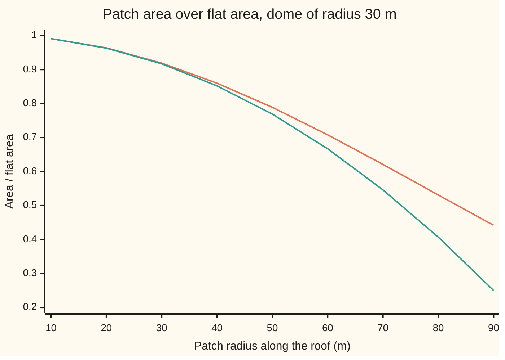

# Ricci and scalar curvature: averaged curvature and how volumes grow

[Syllabus](../../../SYLLABUS.md) → [Differential geometry and Lie groups](../README.md) → [Riemannian Geometry](../README.md#s05) → Ricci and scalar curvature

---

## General Overview

A dome roof is part of a sphere with a radius of curvature of 30 m. A painter stands at the top. She walks 5 m down the roof in every direction, measuring along the surface, and paints everything inside that circle.

On flat ground, a disc of radius 5 m has area $`\pi \times 5^2`$ = 78.5398 m². The painted patch on the dome is 78.3582 m². It is 0.1816 m² smaller. The roof bends back toward its centre, so each ring of the patch is a little shorter than a flat ring of the same radius.

That shortfall is not random. It equals the flat area times one number, the **scalar curvature** $`S`$ (the curvatures of a set of planes at right angles through a point, added up with each plane counted twice, once in each order; on a surface, twice the dome's curvature $`1/R^2`$), times $`r^2/24`$ on a surface. Here $`S`$ = 0.00222222 per square metre, and the formula predicts a shortfall of 0.1818 m². Read backwards, a painter who measures only along the roof finds its radius: 30.0139 m.

In three or more dimensions, curvature has one value for each flat plane through a point. **Ricci curvature** keeps one value for each direction: pair that direction with each other direction of a set at right angles, and add up the curvatures of the planes the pairs span. Scalar curvature sums once more, over a full set of directions at right angles. Divided by the number of terms, these sums are averages, which is why both are called averaged curvature. Ricci curvature controls how a thin cone of shortest paths spreads. Scalar curvature controls the volume of a small ball.

**Ricci curvature adds up the plane curvatures through one direction, scalar curvature adds up Ricci over all directions, and a small ball's volume falls short of the flat value by the fraction $`S\,r^2/(6(n+2))`$.**

**What kind of fact this is:** Ricci and scalar curvature are definitions (traces of the curvature tensor). The volume formula is a theorem, local only, proved in outline in Why it works. The outline takes the Jacobi equation from [Jacobi field](09-jacobi-fields-and-comparison-theorems.md) and the Gauss lemma from [Geodesic and exponential map](04-geodesics-and-the-exponential-map.md); Gray (Sources) gives the full proof.

### The picture: patch area against the flat area

The painter's patch grows outward. The chart shows the patch area divided by the flat area $`\pi r^2`$, for patch radii from 10 m to 90 m on the 30 m dome.



Orange line: the exact patch area over $`\pi r^2`$. Green line: the scalar-curvature prediction $`1 - S r^2/24`$. The two agree for small patches and separate past about 30 m, one dome radius. The formula is a statement about small balls.

---

## The formula

Notation from [Riemann curvature tensor](06-riemann-curvature-tensor.md): $`\mathrm{Rm}^a{}_{bcd}`$ are the components of the curvature tensor Rm in a chart, set by $`\mathrm{Rm}(\partial_c, \partial_d)\partial_b = \mathrm{Rm}^a{}_{bcd}\,\partial_a`$ as on that card. So $`a`$ is the output, $`b`$ the vector acted on, and $`c`$, $`d`$ the two directions of differentiation. $`\sec(u, v)`$ is the sectional curvature (the curvature of the surface swept out by shortest paths in the plane of $`u`$ and $`v`$). The sign is fixed so that a round sphere of radius $`R`$ has $`\sec = +1/R^2`$. A repeated upper and lower index is summed, as on [Covectors and tensor fields](../03-Manifolds/05-covectors-and-tensor-fields.md).

Ricci curvature and scalar curvature are two traces (sums down a diagonal):

```math
\mathrm{Ric}_{jk} = \mathrm{Rm}^{i}{}_{jik}, \qquad S = g^{jk}\,\mathrm{Ric}_{jk}
```

**Read it aloud:** Ricci is the curvature tensor with its upper index summed against its first direction of differentiation, the trace of $`w \mapsto \mathrm{Rm}(w, \partial_k)\partial_j`$; scalar curvature is Ricci summed against the inverse metric.

In an orthonormal frame $`e_1, \dots, e_n`$ (unit vectors at right angles), the same two traces read as averages of plane curvatures:

```math
\mathrm{Ric}(v, v) = \sum_{i} \sec(v, e_i), \qquad S = \sum_{i} \mathrm{Ric}(e_i, e_i) = \sum_{i \ne j} \sec(e_i, e_j)
```

Here $`v`$ is a unit vector and the sum runs over the $`n-1`$ frame vectors at right angles to it. Then the volume of a small geodesic ball (all points within distance $`r`$, measured inside the space):

```math
\mathrm{Vol}\,B_r = \omega_n\,r^n \left(1 - \frac{S}{6(n+2)}\,r^2 + \dots\right)
```

**Read it aloud:** a small ball holds the flat volume, minus a fraction equal to scalar curvature times radius squared over six times (dimension plus two), plus terms in $`r^4`$ and smaller.

On the dome, $`n = 2`$, $`\omega_2 = \pi`$ and $`S = 2/R^2`$, so the area is $`\pi r^2 (1 - r^2/(12R^2))`$ = 78.3580 m², against the exact 78.3582 m².

| Symbol | Plain meaning | In our example | Push it up and the answer… |
| --- | --- | --- | --- |
| $`R`$ | the dome's radius of curvature | 30 m | shortfall shrinks; flat as R grows without end |
| $`r`$ | patch or ball radius, measured inside the space | 5 m | shortfall grows like $`r^4`$ |
| $`n`$ | dimension of the space | 2 on the roof, 3 for the stacked dome | denominator $`6(n+2)`$ grows |
| $`g_{jk}`$, $`g^{jk}`$ | metric components in a chart, and the inverse matrix | $`R^2`$ and $`R^2\sin^2\varphi`$ in the sphere chart | — (chart-dependent) |
| $`\mathrm{Rm}^a{}_{bcd}`$, $`\Gamma^k_{ij}`$ | curvature tensor components ($`a`$ output, $`b`$ vector acted on, $`c`$, $`d`$ directions of differentiation); Christoffel symbols, the connection's chart terms | $`\mathrm{Rm}^\varphi{}_{\theta\varphi\theta} = 0.229849`$ at $`\varphi = 0.5`$ | — (chart-dependent) |
| $`\sec(u, v)`$, $`K`$ | sectional curvature of a plane; Gaussian curvature of a surface | both 0.00111111 1/m² on the dome | patch shrinks more |
| $`\mathrm{Ric}`$ | Ricci curvature: plane curvatures through one direction, added | 0.00111111 1/m² along the dome, 0 along $`t`$ | cone of paths in that direction narrows |
| $`S`$ | scalar curvature: Ricci added over a frame | 0.00222222 1/m² | ball shrinks |
| $`\omega_n`$ | volume of the flat unit ball | $`\pi`$ for n = 2, $`4\pi/3`$ for n = 3 | — |
| $`\mathrm{Vol}\,B_r`$ | volume (area when n = 2) of the ball of radius $`r`$ | 78.3582 m² | — |
| $`v`$, $`e_i`$, $`s`$, $`J_i`$, $`\epsilon`$, $`A`$ | unit direction; frame vectors; distance along a path; spread between paths; small tilt between starting directions; the matrix of curvature terms whose trace is Ricci | $`s`$ from 0 to 5 m | — |
| $`\varphi`$, $`\theta`$, $`x`$, $`y`$, $`t`$ | chart coordinates: angle from the top, longitude, floor-plan metres, height in the stack | point at $`\varphi`$ = 0.5 rad, $`\theta`$ = 0.3 rad | — |

### When it holds

- **The ball is small compared with the curvature radius.** For the whole sphere, $`r = \pi R`$ = 94.25 m, the prediction gives 4954.17 m² against the true 11309.73 m². The dropped $`r^4`$ terms take over.
- **The metric is smooth at the centre.** At the tip of a cone the curvature is concentrated in one point, Rm does not exist there, and the area of a small disc has no $`r^4`$ correction to read.
- **Radius is measured inside the space.** The painter walks 5 m along the roof. A disc cut by a 5 m straight chord through the air is a different set and a different area.
- **One sign convention all the way through.** With the round sphere at $`\sec = +1/R^2`$, a dome loses area. Flip the sign of Rm halfway and the dome gains area, 78.7216 m², close to a saddle's 78.7218 m².
- **The statement is local.** It says nothing about large balls. Global volume bounds need a complete space (every shortest path can be extended without end, as on [Hopf-Rinow](10-hopf-rinow-and-completeness.md)) and a lower bound on Ricci curvature everywhere (the Bishop–Gromov theorem; comparison theorems are on the [Jacobi field](09-jacobi-fields-and-comparison-theorems.md) card).

---

## Why it works

### Step 0: volume is a determinant, and a determinant's first change is a trace

Shoot shortest paths out from the centre in every direction ([Geodesic and exponential map](04-geodesics-and-the-exponential-map.md)). Near the centre they spread as in flat space. Curvature bends neighbouring paths toward each other (positive curvature) or apart (negative). The volume between paths is a determinant of their spreads. For a small change, $`\det(I + A) \approx 1 + \mathrm{tr}\,A`$: a determinant's first change is the trace (sum of the diagonal). So the volume's first correction sees a trace of the curvature tensor. That trace is Ricci curvature.

### Step 1: contract the tensor

Take a unit direction $`v`$ and a frame $`e_i`$ at right angles to it. By definition $`\sec(e_i, v) = \langle \mathrm{Rm}(e_i, v)v, e_i \rangle`$ for a unit pair at right angles. The trace of the map $`w \mapsto \mathrm{Rm}(w, v)v`$ is the sum of its diagonal entries in the frame, and the entry for $`v`$ itself is zero. So

```math
\mathrm{Ric}(v, v) = \sum_{i} \langle \mathrm{Rm}(e_i, v)v, e_i \rangle = \sum_{i} \sec(v, e_i)
```

On a surface there is one plane, so $`\mathrm{Ric} = K g`$ and $`S = 2K`$. The code checks $`\mathrm{Ric}_{xx}`$ = 0.00141376 against $`K g_{xx}`$ = 0.00141376 in the floor-plan chart.

### Step 2: one direction, one thin cone

Follow the path in direction $`v`$ out to distance $`s`$. A neighbouring path that starts in direction $`v + \epsilon e_i`$ sits at a gap of $`\epsilon\,J_i(s)`$, where $`J_i`$ is a Jacobi field (the spread between neighbouring shortest paths, named J as on the Jacobi field card). Curvature changes its length:

```math
\lvert J_i(s) \rvert = s - \frac{s^3}{6}\,\sec(v, e_i) + \dots
```

The cross-section of the thin cone is the determinant of the $`n-1`$ spreads, because the spheres of equal distance cross the paths at right angles: the Gauss lemma, stated on [Geodesic and exponential map](04-geodesics-and-the-exponential-map.md) and not proved here. By Step 0 its first correction is the trace:

```math
dV = s^{n-1}\left(1 - \frac{s^2}{6}\,\mathrm{Ric}(v, v) + \dots\right) ds\, dv
```

<details>
<summary>Detailed proof: the spread of neighbouring paths</summary>

The Jacobi equation, from the [Jacobi field](09-jacobi-fields-and-comparison-theorems.md) card, is $`J'' = -\mathrm{Rm}(J, v)v`$, with primes taken along the path in a parallel frame. Start with $`J(0) = 0`$ and $`J'(0) = e_i`$.

To first order $`J(s) = s\,e_i`$. Put that into the right side: $`J'' \approx -s\,\mathrm{Rm}(e_i, v)v`$. Integrate twice from zero:

$`\displaystyle J_i(s) = s\,e_i - \frac{s^3}{6}\,\mathrm{Rm}(e_i, v)v + \dots`$

The matrix of the $`J_i`$ in the frame is $`s(I - \tfrac{s^2}{6}A)`$, where $`A_{ji} = \langle \mathrm{Rm}(e_i, v)v, e_j \rangle`$. Its determinant is

$`\displaystyle s^{n-1}\left(1 - \frac{s^2}{6}\,\mathrm{tr}\,A + \dots\right) = s^{n-1}\left(1 - \frac{s^2}{6}\,\mathrm{Ric}(v, v) + \dots\right)`$

because $`\det(I + \epsilon A) = 1 + \epsilon\,\mathrm{tr}\,A + \dots`$ and the trace of $`A`$ is Ricci (Step 1).

</details>

### Step 3: average over directions

Add the cones over every direction $`v`$ on the unit sphere of directions, whose total size is $`n\,\omega_n`$. The average of $`v_j v_k`$ over that sphere is $`1/n`$ when $`j = k`$ and 0 otherwise. So the average of $`\mathrm{Ric}(v, v)`$ is $`S/n`$. Then

```math
\mathrm{Vol}\,B_r = n\,\omega_n \int_0^r s^{n-1}\left(1 - \frac{S}{6n}\,s^2\right) ds = \omega_n r^n \left(1 - \frac{S}{6(n+2)}\,r^2\right)
```

The code checks the averaging: over all directions in the stacked dome below, Ric averages to 0.00074074, and $`S/3`$ is 0.00074074.

### Step 4: the dome, exactly

On a sphere of radius $`R`$, every point within distance $`r`$ of the top lies at polar angle up to $`r/R`$. The area is

```math
\mathrm{Vol}\,B_r = 2\pi R^2 \left(1 - \cos\frac{r}{R}\right) = \pi r^2 \left(1 - \frac{r^2}{12R^2} + \frac{r^4}{360R^4} - \dots\right)
```

The second term is $`S r^2/24`$ with $`S = 2/R^2`$, as Step 3 says. The third term is what the prediction misses: 0.000168 m² for the painter's patch.

### Step 5: three dimensions, where direction matters

Stack copies of the dome along a flat extra direction $`t`$ (the product of a sphere and a line). Planes along the dome have $`\sec = 1/R^2`$. Planes that contain $`t`$ have $`\sec = 0`$. So Ricci depends on direction:

| Direction $`v`$ | Planes through it | Ric(v, v), 1/m² |
| --- | --- | ---: |
| along the dome | one curved, one flat | 0.00111111 |
| along $`t`$ | two flat | 0.00000000 |
| tilted 45° between them | a mix | 0.00055556 |

Scalar curvature is still $`2/R^2`$ = 0.00222222 1/m². A ball of radius 5 m holds 522.630 m³, against 523.599 m³ flat. The formula, with $`6(n+2) = 30`$, predicts 522.629 m³.

How much does Ricci miss? In two dimensions Rm has 1 independent component; Ric has room for 3 but equals $`Kg`$, so both carry the same one number. In three, both have 6. In four, Rm has 20 and Ric only 10. The other 10 form the Weyl tensor: curvature that changes a ball's shape without changing its volume to leading order, the $`r^2`$ term. The Weyl part first changes the volume at order $`r^4`$, where Gray's expansion (Sources) has a term in the squared size of the whole of Rm.

---

## Worked numbers, by hand

| Step | Arithmetic | Value |
| --- | --- | --- |
| curvature component at $`\varphi = 0.5`$ rad, from [Riemann curvature tensor](06-riemann-curvature-tensor.md) | $`\mathrm{Rm}^\varphi{}_{\theta\varphi\theta} = \sin^2 0.5`$ | 0.229849 |
| Ricci, $`\theta\theta`$ entry: sum the output against the first direction of differentiation | $`\mathrm{Ric}_{\theta\theta} = \mathrm{Rm}^\varphi{}_{\theta\varphi\theta} + \mathrm{Rm}^\theta{}_{\theta\theta\theta} = 0.229849 + 0`$ | 0.229849 |
| Ricci, $`\varphi\varphi`$ entry, by that card's symmetries | $`\mathrm{Ric}_{\varphi\varphi} = \mathrm{Rm}^\varphi{}_{\varphi\varphi\varphi} + \mathrm{Rm}^\theta{}_{\varphi\theta\varphi} = 0 + g_{\varphi\varphi}\,\mathrm{Rm}^\varphi{}_{\theta\varphi\theta} / g_{\theta\theta} = 900 \times 0.229849 / (900 \times 0.229849)`$ | 1.000000 |
| scalar curvature | $`S = \mathrm{Ric}_{\varphi\varphi}/g_{\varphi\varphi} + \mathrm{Ric}_{\theta\theta}/g_{\theta\theta} = 1/900 + 0.229849/(900 \times 0.229849)`$ | 0.00222222 1/m² |
| Gaussian curvature | $`K = S/2 = 1/R^2 = 1/900`$ | 0.00111111 1/m² |
| fraction missing | $`S r^2/24 = 0.00222222 \times 25/24`$ | 0.00231481 |
| flat area | $`\pi r^2 = \pi \times 25`$ | 78.5398 m² |
| predicted shortfall | $`78.5398 \times 0.00231481`$ | 0.1818 m² |
| prediction | $`78.5398 - 0.1818`$ | 78.3580 m² |
| exact area | $`2\pi \times 900 \times (1 - \cos(1/6))`$ | **78.3582 m²** |

The painted patch is 0.1816 m² smaller than a flat disc. Scalar curvature predicts that shortfall to within 0.000168 m².

### What breaks if you drop a piece

| Mistake | Comes out at | What went wrong |
| --- | --- | --- |
| Use one plane's curvature for the 3D ball (the plane along $`t`$, curvature 0) | 523.599 m³ | ignores the curved planes; the true ball holds 522.630 m³ |
| Divide by 6 instead of $`6(n+2) = 24`$ | 77.8126 m² | uses the one-direction factor from Step 2 without averaging and integrating |
| Take $`S`$ as $`K`$ (sum over $`i<j`$ only, a convention in some books) | 78.4489 m² | half the scalar curvature, so half the shortfall |
| Flip the sign of Rm | 78.7216 m² | the dome now gains area, like a saddle |
| Apply it to the whole sphere, $`r`$ = 94.25 m | 4954.17 m² | not small: the true area is 11309.73 m² |

---

## Code, from first principles, and it actually runs

The code builds Ricci and scalar curvature from a metric and nothing else. It takes the metric's derivatives by small central differences to get the Christoffel symbols $`\Gamma^k_{ij}`$, differentiates those again to get the components $`\mathrm{Rm}^a{}_{bcd}`$, then contracts twice. It takes **three independent roads**. First, scalar curvature in two different charts of the dome: the components of Ric differ, $`S`$ agrees. Second, the patch area three ways: the closed form, a numerical integral of the area density $`\sqrt{\det g}`$ in the floor-plan chart, and the curvature prediction. Third, in the stacked dome, a direction average of Ric against $`S/3`$, and a ball volume added slice by slice against the $`S r^2/30`$ prediction. A saddle chart checks the sign.

### Python

```python
# Ricci and scalar curvature: contract the curvature tensor, then compare a small ball with the flat answer.
from math import sin, cos, cosh, sqrt, pi

R = 30.0   # the dome's radius of curvature, m
r = 5.0    # patch radius, measured along the roof from the top, m

def sphere_chart(p):   # polar angle phi from the top, longitude theta
    return [[R * R, 0.0], [0.0, (R * sin(p[0])) ** 2]]

def graph_chart(p):    # x, y in metres on the floor plan, roof height sqrt(R^2 - x^2 - y^2)
    w = R * R - p[0] ** 2 - p[1] ** 2
    return [[1 + p[0] ** 2 / w, p[0] * p[1] / w], [p[0] * p[1] / w, 1 + p[1] ** 2 / w]]

def saddle_chart(p):   # half-plane chart of the hyperbolic plane, curvature -1/R^2
    return [[R * R / p[1] ** 2, 0.0], [0.0, R * R / p[1] ** 2]]

def stack_chart(p):    # dome directions phi, theta plus one flat direction t (m)
    return [[R * R, 0.0, 0.0], [0.0, (R * sin(p[0])) ** 2, 0.0], [0.0, 0.0, 1.0]]

def inverse(g):        # 2x2 or 3x3 inverse by cofactors
    if len(g) == 2:
        d = g[0][0] * g[1][1] - g[0][1] * g[1][0]
        return [[g[1][1] / d, -g[0][1] / d], [-g[1][0] / d, g[0][0] / d]]
    c = [[g[(j + 1) % 3][(i + 1) % 3] * g[(j + 2) % 3][(i + 2) % 3]
          - g[(j + 1) % 3][(i + 2) % 3] * g[(j + 2) % 3][(i + 1) % 3] for j in range(3)] for i in range(3)]
    d = sum(g[0][k] * c[k][0] for k in range(3))
    return [[c[i][j] / d for j in range(3)] for i in range(3)]

def shift(p, i, s):
    q = list(p); q[i] += s; return q

def christoffel(chart, p, h):  # G[l][j][k] = 1/2 g^lm (d_j g_mk + d_k g_mj - d_m g_jk)
    n = len(p); gi = inverse(chart(p))
    dg = [[[(chart(shift(p, m, h))[i][j] - chart(shift(p, m, -h))[i][j]) / (2 * h)
            for j in range(n)] for i in range(n)] for m in range(n)]
    return [[[0.5 * sum(gi[l][m] * (dg[j][m][k] + dg[k][m][j] - dg[m][j][k]) for m in range(n))
              for k in range(n)] for j in range(n)] for l in range(n)]

def ricci(chart, p, h):  # Rm(l, i, j, k) = Rm^l_kij, component l of Rm(d_i, d_j) d_k; Ric_jk = Rm^i_jik, S = g^jk Ric_jk
    n = len(p); G = christoffel(chart, p, h)
    dG = [[[[(a - b) / (2 * h) for a, b in zip(ra, rb)] for ra, rb in zip(A, B)]
           for A, B in zip(christoffel(chart, shift(p, i, h), h), christoffel(chart, shift(p, i, -h), h))]
          for i in range(n)]
    def Rm(l, i, j, k):
        return (dG[i][l][j][k] - dG[j][l][i][k]
                + sum(G[l][i][m] * G[m][j][k] - G[l][j][m] * G[m][i][k] for m in range(n)))
    Ric = [[sum(Rm(i, i, k, j) for i in range(n)) for k in range(n)] for j in range(n)]
    gi = inverse(chart(p))
    return Ric, sum(gi[j][k] * Ric[j][k] for j in range(n) for k in range(n))

def clean(v):
    return 0.0 if abs(v) < 5e-12 else v

def show(label, v, d=6):
    print(f"{label:<40}{clean(v):>16.{d}f}")

# ---- road 1: contract in two charts of the dome, at a point 15 m from the top ----
phi0, th0 = 0.5, 0.3
x0, y0 = R * sin(phi0) * cos(th0), R * sin(phi0) * sin(th0)
RicA, SA = ricci(sphere_chart, [phi0, th0], 1e-4)
RicB, SB = ricci(graph_chart, [x0, y0], 1e-2)
gB = graph_chart([x0, y0])
show("by hand: Rm^phi_thphth = sin^2 phi", sin(phi0) ** 2); show("sphere chart Ric_phiphi", RicA[0][0])
show("sphere chart Ric_thetatheta", RicA[1][1]); show("sphere chart Ric_phitheta", RicA[0][1])
show("graph chart Ric_xx, 1/m^2", RicB[0][0], 8); show("graph chart Ric_xy, 1/m^2", RicB[0][1], 8)
show("graph chart g_xx * K, 1/m^2", gB[0][0] / R ** 2, 8)
show("S, sphere chart, 1/m^2", SA, 8); show("S, graph chart, 1/m^2", SB, 8)
show("S = 2K = 2/R^2, 1/m^2", 2 / R ** 2, 8)
_, SH = ricci(saddle_chart, [0.0, 40.0], 1e-2)
show("S, saddle (hyperbolic) chart, 1/m^2", SH, 8)

# ---- the dome patch: flat answer, exact area, curvature prediction ----
def cap(s):  # area within distance s of the top, closed form
    return 2 * pi * R * R * (1 - cos(s / R))
def cap_by_chart(s, N=200):  # integrate sqrt(det g) over the graph chart's disc; round, so 2 pi times Simpson in radius
    rho, tot = R * sin(s / R), 0.0
    for i in range(N + 1):
        q = rho * i / N; g = graph_chart([q * cos(0.7), q * sin(0.7)])
        tot += (1 if i in (0, N) else 4 if i % 2 else 2) * sqrt(g[0][0] * g[1][1] - g[0][1] ** 2) * q
    return 2 * pi * rho / N / 3 * tot
flat, exact, chart_area = pi * r * r, cap(r), cap_by_chart(r)
pred = flat * (1 - SB * r * r / 24)
show("fraction missing, S r^2 / 24", 2 / R ** 2 * r * r / 24, 8)
show("flat disc pi r^2, m^2", flat, 4); show("exact cap area, m^2", exact, 4)
show("chart integral area, m^2", chart_area, 4); show("Ricci prediction, m^2", pred, 4)
show("missing area, exact, m^2", flat - exact, 4); show("missing area, predicted, m^2", flat - pred, 4)
show("prediction error, m^2", pred - exact, 6)
Kest = 12 * (flat - exact) / (pi * r ** 4)
show("radius read back from the area, m", 1 / sqrt(Kest), 4)
show("Earth, 1000 km disc, missing km^2", pi * 1000 ** 2 - 2 * pi * 6371 ** 2 * (1 - cos(1000 / 6371)), 1)

# ---- road 2: three dimensions, the dome stacked along a flat direction t ----
Ric3, S3 = ricci(stack_chart, [phi0, th0, 0.0], 1e-4)
def ric_dir(v):
    return sum(Ric3[j][k] * v[j] * v[k] for j in range(3) for k in range(3))
show("3D Ric, along the dome, 1/m^2", ric_dir([1 / R, 0, 0]), 8)
show("3D Ric, along t, 1/m^2", ric_dir([0, 0, 1]), 8)
show("3D Ric, tilted 45 degrees, 1/m^2", ric_dir([1 / (R * sqrt(2)), 0, 1 / sqrt(2)]), 8)
avg = 0.0  # Simpson in z = cos(angle from t) over [-1, 1], 8 midpoints around: exact for this quadratic
for a in range(21):
    z = -1 + a / 10
    for b in range(8):
        v = 2 * pi * (b + 0.5) / 8
        e = [sqrt(1 - z * z) * cos(v), sqrt(1 - z * z) * sin(v), z]   # unit direction, orthonormal frame
        avg += (1 if a in (0, 20) else 4 if a % 2 else 2) / 30 / 2 / 8 * ric_dir([e[0] / R, e[1] / (R * sin(phi0)), e[2]])
show("average Ric over all directions", avg, 8); show("S / 3, 1/m^2", S3 / 3, 8)
def ball3(s, N=400):  # Simpson over t of the dome cap at radius sqrt(s^2 - t^2)
    hh = 2 * s / N
    return hh / 3 * sum(cap(sqrt(max(0.0, s * s - (-s + i * hh) ** 2))) * (1 if i in (0, N) else 4 if i % 2 else 2)
                        for i in range(N + 1))
flat3, ex3 = 4 / 3 * pi * r ** 3, ball3(r)
show("3D flat ball, m^3", flat3, 3); show("3D exact ball, m^3", ex3, 3)
show("3D Ricci prediction, m^3", flat3 * (1 - S3 * r * r / 30), 3)

print("parts of Rm and of Ric, n = 2, 3, 4: " + "  ".join(f"{n * n * (n * n - 1) // 12}/{n * (n + 1) // 2}" for n in (2, 3, 4)))
# ---- what breaks ----
show("wrong: divide by 6, not 24, m^2", flat * (1 - SB * r * r / 6), 4)
show("wrong: S taken as K, m^2", flat * (1 - (SB / 2) * r * r / 24), 4)
show("wrong: sign flipped, m^2", flat * (1 + SB * r * r / 24), 4)
big = pi * R; show("whole sphere, r = pi R, m", big, 2)
show("whole sphere, exact, m^2", cap(big), 2); show("whole sphere, prediction, m^2", pi * big ** 2 * (1 - SB * big ** 2 / 24), 2)
show("try: saddle disc, exact, m^2", 2 * pi * R * R * (cosh(r / R) - 1), 4)
show("try: R = 15 m, exact, m^2", 2 * pi * 225 * (1 - cos(r / 15)), 4)

# ---- chart: area / flat area against patch radius ----
rs = [10.0 * i for i in range(1, 10)]
print("chart r  " + " ".join(f"{s:6.0f}" for s in rs))
print("exact    " + " ".join(f"{cap(s) / (pi * s * s):6.3f}" for s in rs))
print("predict  " + " ".join(f"{1 - SB * s * s / 24:6.3f}" for s in rs))

assert abs(SA - 2 / R ** 2) < 1e-9, "sphere chart S against 2/R^2"
assert abs(SB - SA) < 1e-9, "S agrees in two charts"
assert abs(SH + 2 / R ** 2) < 1e-8, "saddle has S = -2/R^2"
assert abs(chart_area - exact) < 1e-6, "chart integral against closed form"
assert abs((exact - pred) - flat * (r / R) ** 4 / 360) < 1e-6, "prediction misses only the next term"
assert abs(avg - S3 / 3) < 1e-12, "direction average of Ric is S/n"
assert abs(ex3 - flat3 * (1 - S3 * r * r / 30)) < 0.01, "3D ball against S r^2 / 30"
assert abs(RicB[0][0] - gB[0][0] / R ** 2) < 1e-9, "on a surface Ric = K g"
assert abs(RicA[1][1] - sin(phi0) ** 2) < 1e-6, "Ric_thetatheta against the hand contraction"
print("ALL CHECKS PASS")
```

**Ran 2026-11-19 on macOS, Python 3.14.10, standard library only. All checks passed. Output, pasted from the run:**

```
by hand: Rm^phi_thphth = sin^2 phi              0.229849
sphere chart Ric_phiphi                         1.000000
sphere chart Ric_thetatheta                     0.229849
sphere chart Ric_phitheta                       0.000000
graph chart Ric_xx, 1/m^2                     0.00141376
graph chart Ric_xy, 1/m^2                     0.00009362
graph chart g_xx * K, 1/m^2                   0.00141376
S, sphere chart, 1/m^2                        0.00222222
S, graph chart, 1/m^2                         0.00222222
S = 2K = 2/R^2, 1/m^2                         0.00222222
S, saddle (hyperbolic) chart, 1/m^2          -0.00222222
fraction missing, S r^2 / 24                  0.00231481
flat disc pi r^2, m^2                            78.5398
exact cap area, m^2                              78.3582
chart integral area, m^2                         78.3582
Ricci prediction, m^2                            78.3580
missing area, exact, m^2                          0.1816
missing area, predicted, m^2                      0.1818
prediction error, m^2                          -0.000168
radius read back from the area, m                30.0139
Earth, 1000 km disc, missing km^2                 6444.6
3D Ric, along the dome, 1/m^2                 0.00111111
3D Ric, along t, 1/m^2                        0.00000000
3D Ric, tilted 45 degrees, 1/m^2              0.00055556
average Ric over all directions               0.00074074
S / 3, 1/m^2                                  0.00074074
3D flat ball, m^3                                523.599
3D exact ball, m^3                               522.630
3D Ricci prediction, m^3                         522.629
parts of Rm and of Ric, n = 2, 3, 4: 1/3  6/6  20/10
wrong: divide by 6, not 24, m^2                  77.8126
wrong: S taken as K, m^2                         78.4489
wrong: sign flipped, m^2                         78.7216
whole sphere, r = pi R, m                          94.25
whole sphere, exact, m^2                        11309.73
whole sphere, prediction, m^2                    4954.17
try: saddle disc, exact, m^2                     78.7218
try: R = 15 m, exact, m^2                        77.8153
chart r      10     20     30     40     50     60     70     80     90
exact     0.991  0.964  0.919  0.860  0.789  0.708  0.621  0.531  0.442
predict   0.991  0.963  0.917  0.852  0.769  0.667  0.546  0.407  0.250
ALL CHECKS PASS
```

### Rust

```rust
// Ricci and scalar curvature: contract the curvature tensor, then compare a small ball with the flat answer.
use std::f64::consts::PI;

const R: f64 = 30.0; // the dome's radius of curvature, m
const RP: f64 = 5.0; // patch radius, measured along the roof from the top, m
type M = Vec<Vec<f64>>;

fn sphere_chart(p: &[f64]) -> M { // polar angle phi from the top, longitude theta
    vec![vec![R * R, 0.0], vec![0.0, (R * p[0].sin()).powi(2)]]
}
fn graph_chart(p: &[f64]) -> M { // x, y in metres on the floor plan
    let w = R * R - p[0] * p[0] - p[1] * p[1];
    vec![vec![1.0 + p[0] * p[0] / w, p[0] * p[1] / w], vec![p[0] * p[1] / w, 1.0 + p[1] * p[1] / w]]
}
fn saddle_chart(p: &[f64]) -> M { // half-plane chart of the hyperbolic plane, curvature -1/R^2
    let c = R * R / (p[1] * p[1]);
    vec![vec![c, 0.0], vec![0.0, c]]
}
fn stack_chart(p: &[f64]) -> M { // dome directions phi, theta plus one flat direction t (m)
    vec![vec![R * R, 0.0, 0.0], vec![0.0, (R * p[0].sin()).powi(2), 0.0], vec![0.0, 0.0, 1.0]]
}

fn inverse(g: &M) -> M { // 2x2 or 3x3 inverse by cofactors
    if g.len() == 2 {
        let d = g[0][0] * g[1][1] - g[0][1] * g[1][0];
        return vec![vec![g[1][1] / d, -g[0][1] / d], vec![-g[1][0] / d, g[0][0] / d]];
    }
    let c: M = (0..3).map(|i| (0..3).map(|j| g[(j + 1) % 3][(i + 1) % 3] * g[(j + 2) % 3][(i + 2) % 3]
        - g[(j + 1) % 3][(i + 2) % 3] * g[(j + 2) % 3][(i + 1) % 3]).collect()).collect();
    let d = g[0][0] * c[0][0] + g[0][1] * c[1][0] + g[0][2] * c[2][0];
    c.iter().map(|row| row.iter().map(|x| x / d).collect()).collect()
}

fn shift(p: &[f64], i: usize, s: f64) -> Vec<f64> {
    let mut q = p.to_vec(); q[i] += s; q
}

type G3 = Vec<Vec<Vec<f64>>>;
fn christoffel(chart: fn(&[f64]) -> M, p: &[f64], h: f64) -> G3 { // G[l][j][k]
    let n = p.len();
    let gi = inverse(&chart(p));
    let (up, dn): (Vec<M>, Vec<M>) = (0..n).map(|m| (chart(&shift(p, m, h)), chart(&shift(p, m, -h)))).unzip();
    let dg = |m: usize, i: usize, j: usize| (up[m][i][j] - dn[m][i][j]) / (2.0 * h);
    (0..n).map(|l| (0..n).map(|j| (0..n).map(|k| 0.5 * (0..n).map(|m|
        gi[l][m] * (dg(j, m, k) + dg(k, m, j) - dg(m, j, k))).sum::<f64>()).collect()).collect()).collect()
}

fn ricci(chart: fn(&[f64]) -> M, p: &[f64], h: f64) -> (M, f64) { // rm(l, i, j, k) = Rm^l_kij; Ric_jk = Rm^i_jik
    let n = p.len();
    let g = christoffel(chart, p, h);
    let dgam: Vec<G3> = (0..n).map(|i| {
        let (a, b) = (christoffel(chart, &shift(p, i, h), h), christoffel(chart, &shift(p, i, -h), h));
        (0..n).map(|l| (0..n).map(|j| (0..n).map(|k| (a[l][j][k] - b[l][j][k]) / (2.0 * h)).collect()).collect()).collect()
    }).collect();
    let rm = |l: usize, i: usize, j: usize, k: usize| {
        let mut s = dgam[i][l][j][k] - dgam[j][l][i][k];
        for m in 0..n { s += g[l][i][m] * g[m][j][k] - g[l][j][m] * g[m][i][k]; }
        s
    };
    let ric: M = (0..n).map(|j| (0..n).map(|k| (0..n).map(|i| rm(i, i, k, j)).sum()).collect()).collect();
    let gi = inverse(&chart(p));
    let s = (0..n).map(|j| (0..n).map(|k| gi[j][k] * ric[j][k]).sum::<f64>()).sum();
    (ric, s)
}

fn show(label: &str, v: f64, d: usize) {
    let v = if v.abs() < 5e-12 { 0.0 } else { v };
    println!("{:<40}{:>16.*}", label, d, v);
}
fn cap(s: f64) -> f64 { 2.0 * PI * R * R * (1.0 - (s / R).cos()) } // area within distance s of the top
fn simpson_w(i: usize, n: usize) -> f64 { if i == 0 || i == n { 1.0 } else if i % 2 == 1 { 4.0 } else { 2.0 } }
fn cap_by_chart(s: f64, n: usize) -> f64 { // integrate sqrt(det g) over the graph chart's disc
    let (rho, mut tot) = (R * (s / R).sin(), 0.0);
    for i in 0..=n {
        let q = rho * i as f64 / n as f64;
        let g = graph_chart(&[q * (0.7f64).cos(), q * (0.7f64).sin()]);
        tot += simpson_w(i, n) * (g[0][0] * g[1][1] - g[0][1].powi(2)).sqrt() * q;
    }
    2.0 * PI * rho / n as f64 / 3.0 * tot
}
fn ball3(s: f64, n: usize) -> f64 { // Simpson over t of the dome cap at radius sqrt(s^2 - t^2)
    let hh = 2.0 * s / n as f64;
    let tot: f64 = (0..=n).map(|i| {
        let t = -s + i as f64 * hh;
        cap((s * s - t * t).max(0.0).sqrt()) * simpson_w(i, n)
    }).sum();
    hh / 3.0 * tot
}

fn main() {
    let r = RP;
    let (phi0, th0) = (0.5f64, 0.3f64);
    let (x0, y0) = (R * phi0.sin() * th0.cos(), R * phi0.sin() * th0.sin());
    let (ric_a, sa) = ricci(sphere_chart, &[phi0, th0], 1e-4);
    let (ric_b, sb) = ricci(graph_chart, &[x0, y0], 1e-2);
    let gb = graph_chart(&[x0, y0]);
    show("by hand: Rm^phi_thphth = sin^2 phi", phi0.sin().powi(2), 6); show("sphere chart Ric_phiphi", ric_a[0][0], 6);
    show("sphere chart Ric_thetatheta", ric_a[1][1], 6); show("sphere chart Ric_phitheta", ric_a[0][1], 6);
    show("graph chart Ric_xx, 1/m^2", ric_b[0][0], 8); show("graph chart Ric_xy, 1/m^2", ric_b[0][1], 8);
    show("graph chart g_xx * K, 1/m^2", gb[0][0] / R.powi(2), 8);
    show("S, sphere chart, 1/m^2", sa, 8); show("S, graph chart, 1/m^2", sb, 8);
    show("S = 2K = 2/R^2, 1/m^2", 2.0 / R.powi(2), 8);
    let (_, sh) = ricci(saddle_chart, &[0.0, 40.0], 1e-2);
    show("S, saddle (hyperbolic) chart, 1/m^2", sh, 8);

    let (flat, exact, chart_area) = (PI * r * r, cap(r), cap_by_chart(r, 200));
    let pred = flat * (1.0 - sb * r * r / 24.0);
    show("fraction missing, S r^2 / 24", 2.0 / R.powi(2) * r * r / 24.0, 8);
    show("flat disc pi r^2, m^2", flat, 4); show("exact cap area, m^2", exact, 4);
    show("chart integral area, m^2", chart_area, 4); show("Ricci prediction, m^2", pred, 4);
    show("missing area, exact, m^2", flat - exact, 4); show("missing area, predicted, m^2", flat - pred, 4);
    show("prediction error, m^2", pred - exact, 6);
    let kest = 12.0 * (flat - exact) / (PI * r.powi(4));
    show("radius read back from the area, m", 1.0 / kest.sqrt(), 4);
    show("Earth, 1000 km disc, missing km^2", PI * 1000f64.powi(2) - 2.0 * PI * 6371f64.powi(2) * (1.0 - (1000.0f64 / 6371.0).cos()), 1);

    let (ric3, s3) = ricci(stack_chart, &[phi0, th0, 0.0], 1e-4);
    let ric_dir = |v: [f64; 3]| -> f64 {
        let mut s = 0.0;
        for j in 0..3 { for k in 0..3 { s += ric3[j][k] * v[j] * v[k]; } }
        s
    };
    show("3D Ric, along the dome, 1/m^2", ric_dir([1.0 / R, 0.0, 0.0]), 8);
    show("3D Ric, along t, 1/m^2", ric_dir([0.0, 0.0, 1.0]), 8);
    show("3D Ric, tilted 45 degrees, 1/m^2", ric_dir([1.0 / (R * 2f64.sqrt()), 0.0, 1.0 / 2f64.sqrt()]), 8);
    let mut avg = 0.0; // Simpson in z = cos(angle from t), 8 midpoints around
    for a in 0..21 {
        let z = -1.0 + a as f64 / 10.0;
        for b in 0..8 {
            let v = 2.0 * PI * (b as f64 + 0.5) / 8.0;
            let e = [(1.0 - z * z).sqrt() * v.cos(), (1.0 - z * z).sqrt() * v.sin(), z];
            avg += simpson_w(a, 20) / 30.0 / 2.0 / 8.0 * ric_dir([e[0] / R, e[1] / (R * phi0.sin()), e[2]]);
        }
    }
    show("average Ric over all directions", avg, 8); show("S / 3, 1/m^2", s3 / 3.0, 8);
    let (flat3, ex3) = (4.0 / 3.0 * PI * r.powi(3), ball3(r, 400));
    show("3D flat ball, m^3", flat3, 3); show("3D exact ball, m^3", ex3, 3);
    show("3D Ricci prediction, m^3", flat3 * (1.0 - s3 * r * r / 30.0), 3);

    println!("parts of Rm and of Ric, n = 2, 3, 4: {}", [2u32, 3, 4].map(|n| format!("{}/{}", n * n * (n * n - 1) / 12, n * (n + 1) / 2)).join("  "));
    show("wrong: divide by 6, not 24, m^2", flat * (1.0 - sb * r * r / 6.0), 4);
    show("wrong: S taken as K, m^2", flat * (1.0 - (sb / 2.0) * r * r / 24.0), 4);
    show("wrong: sign flipped, m^2", flat * (1.0 + sb * r * r / 24.0), 4);
    let big = PI * R; show("whole sphere, r = pi R, m", big, 2);
    show("whole sphere, exact, m^2", cap(big), 2); show("whole sphere, prediction, m^2", PI * big * big * (1.0 - sb * big * big / 24.0), 2);
    show("try: saddle disc, exact, m^2", 2.0 * PI * R * R * ((r / R).cosh() - 1.0), 4);
    show("try: R = 15 m, exact, m^2", 2.0 * PI * 225.0 * (1.0 - (r / 15.0).cos()), 4);

    let rs: Vec<f64> = (1..10).map(|i| 10.0 * i as f64).collect();
    let row = |f: &dyn Fn(f64) -> f64, d: usize| rs.iter().map(|&s| format!("{:6.*}", d, f(s))).collect::<Vec<_>>().join(" ");
    println!("chart r  {}", row(&|s| s, 0));
    println!("exact    {}", row(&|s| cap(s) / (PI * s * s), 3));
    println!("predict  {}", row(&|s| 1.0 - sb * s * s / 24.0, 3));

    assert!((sa - 2.0 / R.powi(2)).abs() < 1e-9, "sphere chart S against 2/R^2");
    assert!((sb - sa).abs() < 1e-9, "S agrees in two charts");
    assert!((sh + 2.0 / R.powi(2)).abs() < 1e-8, "saddle has S = -2/R^2");
    assert!((chart_area - exact).abs() < 1e-6, "chart integral against closed form");
    assert!(((exact - pred) - flat * (r / R).powi(4) / 360.0).abs() < 1e-6, "prediction misses only the next term");
    assert!((avg - s3 / 3.0).abs() < 1e-12, "direction average of Ric is S/n");
    assert!((ex3 - flat3 * (1.0 - s3 * r * r / 30.0)).abs() < 0.01, "3D ball against S r^2 / 30");
    assert!((ric_b[0][0] - gb[0][0] / R.powi(2)).abs() < 1e-9, "on a surface Ric = K g");
    assert!((ric_a[1][1] - phi0.sin().powi(2)).abs() < 1e-6, "Ric_thetatheta against the hand contraction");
    println!("ALL CHECKS PASS");
}
```

**Ran 2026-11-19 on macOS, rustc 1.98.1, no crates. All checks passed. Output, pasted from the run:**

```
by hand: Rm^phi_thphth = sin^2 phi              0.229849
sphere chart Ric_phiphi                         1.000000
sphere chart Ric_thetatheta                     0.229849
sphere chart Ric_phitheta                       0.000000
graph chart Ric_xx, 1/m^2                     0.00141376
graph chart Ric_xy, 1/m^2                     0.00009362
graph chart g_xx * K, 1/m^2                   0.00141376
S, sphere chart, 1/m^2                        0.00222222
S, graph chart, 1/m^2                         0.00222222
S = 2K = 2/R^2, 1/m^2                         0.00222222
S, saddle (hyperbolic) chart, 1/m^2          -0.00222222
fraction missing, S r^2 / 24                  0.00231481
flat disc pi r^2, m^2                            78.5398
exact cap area, m^2                              78.3582
chart integral area, m^2                         78.3582
Ricci prediction, m^2                            78.3580
missing area, exact, m^2                          0.1816
missing area, predicted, m^2                      0.1818
prediction error, m^2                          -0.000168
radius read back from the area, m                30.0139
Earth, 1000 km disc, missing km^2                 6444.6
3D Ric, along the dome, 1/m^2                 0.00111111
3D Ric, along t, 1/m^2                        0.00000000
3D Ric, tilted 45 degrees, 1/m^2              0.00055556
average Ric over all directions               0.00074074
S / 3, 1/m^2                                  0.00074074
3D flat ball, m^3                                523.599
3D exact ball, m^3                               522.630
3D Ricci prediction, m^3                         522.629
parts of Rm and of Ric, n = 2, 3, 4: 1/3  6/6  20/10
wrong: divide by 6, not 24, m^2                  77.8126
wrong: S taken as K, m^2                         78.4489
wrong: sign flipped, m^2                         78.7216
whole sphere, r = pi R, m                          94.25
whole sphere, exact, m^2                        11309.73
whole sphere, prediction, m^2                    4954.17
try: saddle disc, exact, m^2                     78.7218
try: R = 15 m, exact, m^2                        77.8153
chart r      10     20     30     40     50     60     70     80     90
exact     0.991  0.964  0.919  0.860  0.789  0.708  0.621  0.531  0.442
predict   0.991  0.963  0.917  0.852  0.769  0.667  0.546  0.407  0.250
ALL CHECKS PASS
```

The two charts give different numbers for one tensor: $`\mathrm{Ric}_{\varphi\varphi}`$ = 1.000000 (no units, since $`\varphi`$ is an angle) and $`\mathrm{Ric}_{xx}`$ = 0.00141376 1/m². Off the diagonal, $`\mathrm{Ric}_{\varphi\theta}`$ = 0.000000 but $`\mathrm{Ric}_{xy}`$ = 0.00009362. Components belong to the chart. Scalar curvature, 0.00222222 1/m² in both, belongs to the dome.

### Lean

Lean proves the volume formula for surfaces that look the same in every direction, the dome's exact area, and Step 3's integral.

- Take a surface that looks the same in every direction around its centre, with its metric smooth there. Then a small patch has area $`\pi r^2 (1 - S r^2/24)`$ plus terms in $`r^6`$ and smaller.
- Take a dome of radius $`R > 0`$ and a patch of radius $`r \ge 0`$. Then the patch area, added ring by ring, is $`2\pi R^2 (1 - \cos(r/R))`$.
- Take the same dome and patch. Then the area exceeds the prediction $`\pi r^2 (1 - S r^2/24)`$ by between 0 and $`\pi r^6/(360 R^4)`$.
- Take any dimension $`n \ge 1`$ and any $`\omega_n`$, $`S`$ and $`r`$. Then the Step 3 integral equals $`\omega_n r^n (1 - S r^2/(6(n+2)))`$.
- The hand numbers hold as exact fractions. $`S`$ is 1/450 per square metre, and the roof misses 1/432 of the flat area.

Contracting Rm in a chart, the direction average of Ric, and the stacked dome's ball volume are left to the Python and Rust checks.

```lean
-- Ricci and scalar curvature: on a surface smooth at its centre, a small geodesic disc's area is π r² (1 − S r²/24) up to terms in r⁶, with S = 2K the scalar curvature; on the 30 m dome the error is pinned between 0 and π r⁶/(360 R⁴), and averaging the cone factor over directions gives ω_n r^n (1 − S r²/(6(n+2))) in every dimension.
import Mathlib.Analysis.SpecialFunctions.Integrals.Basic
import Mathlib.Analysis.SpecialFunctions.Trigonometric.Deriv
import Mathlib.Analysis.Calculus.ContDiff.Defs
import Mathlib.Analysis.Calculus.IteratedDeriv.Defs
import Mathlib.Analysis.Asymptotics.Defs
import Mathlib.Tactic.NormNum
import Mathlib.Tactic.Ring
import Mathlib.Analysis.Calculus.MeanValue
import Mathlib.Analysis.Calculus.Deriv.MeanValue
import Mathlib.Analysis.Calculus.Deriv.Shift
import Mathlib.Analysis.Calculus.ContDiff.Deriv
import Mathlib.Analysis.Asymptotics.Lemmas
import Mathlib.MeasureTheory.Integral.IntervalIntegral.FundThmCalculus

open Real Set Filter Asymptotics intervalIntegral
open scoped Topology

/-! A surface is written in geodesic polar coordinates about a centre point: `ρ` is the distance
from the centre measured inside the surface, `θ` the angle around it, and the length rule is
`ds² = dρ² + f(ρ)² dθ²`. The ring at distance `ρ` has length `2π f(ρ)`, so the disc of all points
within distance `r` has area `2π ∫₀ʳ f(ρ) dρ`. The Gaussian curvature at distance `ρ > 0` is
`K(ρ) = -f''(ρ)/f(ρ)`, and on a surface the scalar curvature is `S = 2K`. The metric is smooth at
the centre exactly when `f` extends to a smooth odd function with `f'(0) = 1` (a cone tip has
`f'(0) < 1`). -/

/-- If `g 0 = 0` and `g' = O(x^k)` from the right at `0`, then `g = O(x^(k+1))` there. -/
lemma ricci_bigO_succ_of_deriv (g g' : ℝ → ℝ) (k : ℕ) (hg0 : g 0 = 0)
    (hd : ∀ x, HasDerivAt g (g' x) x) (hb : g' =O[𝓝[≥] 0] (fun x => x ^ k)) :
    g =O[𝓝[≥] 0] (fun x => x ^ (k + 1)) := by
  obtain ⟨C, hC, hCb⟩ := hb.exists_pos
  rw [IsBigOWith_def] at hCb
  obtain ⟨δ, hδ, hsub⟩ := mem_nhdsGE_iff_exists_Ico_subset.mp hCb
  refine IsBigO.of_bound C ?_
  filter_upwards [Ico_mem_nhdsGE hδ] with x hx
  have hx0 : 0 ≤ x := hx.1
  have key := norm_image_sub_le_of_norm_deriv_le_segment' (f := g) (a := 0) (b := x)
    (C := C * x ^ k) (fun y _ => (hd y).hasDerivWithinAt) (fun y hy => by
      have hyδ : y ∈ Ico (0 : ℝ) δ := ⟨hy.1, lt_trans hy.2 hx.2⟩
      have h1 : ‖g' y‖ ≤ C * ‖y ^ k‖ := hsub hyδ
      rw [norm_pow, Real.norm_of_nonneg hy.1] at h1
      calc ‖g' y‖ ≤ C * y ^ k := h1
        _ ≤ C * x ^ k := by
          gcongr
          exacts [hy.1, hy.2.le]) x ⟨hx0, le_rfl⟩
  rw [hg0, sub_zero, sub_zero] at key
  rw [norm_pow, Real.norm_of_nonneg hx0, pow_succ, ← mul_assoc]
  exact key

#print axioms ricci_bigO_succ_of_deriv

/-- If `g 0 = 0` and `0 ≤ g'` on `[0, ∞)`, then `0 ≤ g` on `[0, ∞)`. -/
lemma ricci_nonneg_of_deriv_nonneg (g g' : ℝ → ℝ) (hd : ∀ x, HasDerivAt g (g' x) x)
    (h0 : g 0 = 0) (hpos : ∀ x, 0 ≤ x → 0 ≤ g' x) : ∀ x, 0 ≤ x → 0 ≤ g x := by
  intro x hx
  rcases hx.lt_or_eq with hx | hx
  · obtain ⟨c, hc, hc'⟩ := exists_hasDerivAt_eq_slope g g' hx
      (fun y _ => (hd y).continuousAt.continuousWithinAt) (fun y _ => hd y)
    rw [h0, sub_zero, sub_zero] at hc'
    have := hpos c hc.1.le
    rw [hc', le_div_iff₀ hx] at this
    linarith
  · rw [← hx, h0]

#print axioms ricci_nonneg_of_deriv_nonneg

/-- The derivative of an odd function is even (`deriv` is `0` where it fails to exist). -/
lemma ricci_deriv_even_of_odd (g : ℝ → ℝ) (hodd : ∀ x, g (-x) = -g x) (x : ℝ) :
    deriv g (-x) = deriv g x := by
  have h := congrArg (fun F => deriv F x) (funext hodd)
  simp only [deriv_comp_neg, deriv.fun_neg] at h
  linarith

#print axioms ricci_deriv_even_of_odd

/-- The derivative of an even function is odd. -/
lemma ricci_deriv_odd_of_even (g : ℝ → ℝ) (heven : ∀ x, g (-x) = g x) (x : ℝ) :
    deriv g (-x) = -deriv g x := by
  have h := congrArg (fun F => deriv F x) (funext heven)
  simp only [deriv_comp_neg] at h
  linarith

#print axioms ricci_deriv_odd_of_even

/-- Taylor bounds for cosine on `[0, ∞)`:
`1 - x²/2 + x⁴/24 - x⁶/720 ≤ cos x ≤ 1 - x²/2 + x⁴/24`. -/
lemma ricci_cos_taylor_bounds (x : ℝ) (hx : 0 ≤ x) :
    cos x ≤ 1 - x ^ 2 / 2 + x ^ 4 / 24 ∧
    1 - x ^ 2 / 2 + x ^ 4 / 24 - x ^ 6 / 720 ≤ cos x := by
  have s2 := ricci_nonneg_of_deriv_nonneg (fun x => sin x - x + x ^ 3 / 6)
    (fun x => cos x - 1 + x ^ 2 / 2)
    (fun x => (((hasDerivAt_sin x).sub (hasDerivAt_id' x)).add
      ((hasDerivAt_pow 3 x).div_const 6)).congr_deriv (by norm_num; ring))
    (by simp) (fun x _ => by nlinarith [one_sub_sq_div_two_le_cos (x := x)])
  have c2 := ricci_nonneg_of_deriv_nonneg (fun x => 1 - x ^ 2 / 2 + x ^ 4 / 24 - cos x)
    (fun x => sin x - x + x ^ 3 / 6)
    (fun x => ((((hasDerivAt_pow 2 x).div_const 2).const_sub 1).add
      ((hasDerivAt_pow 4 x).div_const 24) |>.sub (hasDerivAt_cos x)).congr_deriv
      (by norm_num; ring))
    (by simp) s2
  have s3 := ricci_nonneg_of_deriv_nonneg (fun x => x - x ^ 3 / 6 + x ^ 5 / 120 - sin x)
    (fun x => 1 - x ^ 2 / 2 + x ^ 4 / 24 - cos x)
    (fun x => (((hasDerivAt_id' x).sub ((hasDerivAt_pow 3 x).div_const 6)).add
      ((hasDerivAt_pow 5 x).div_const 120) |>.sub (hasDerivAt_sin x)).congr_deriv
      (by norm_num; ring))
    (by simp) c2
  have c3 := ricci_nonneg_of_deriv_nonneg
    (fun x => cos x - (1 - x ^ 2 / 2 + x ^ 4 / 24 - x ^ 6 / 720))
    (fun x => x - x ^ 3 / 6 + x ^ 5 / 120 - sin x)
    (fun x => ((hasDerivAt_cos x).sub (((((hasDerivAt_pow 2 x).div_const 2).const_sub 1).add
      ((hasDerivAt_pow 4 x).div_const 24)).sub ((hasDerivAt_pow 6 x).div_const 720))).congr_deriv
      (by norm_num; ring))
    (by simp) s3
  exact ⟨by linarith [c2 x hx], by linarith [c3 x hx]⟩
#print axioms ricci_cos_taylor_bounds

/-- **A small disc's area falls short by S r²/24 (the volume formula with n = 2).** On a surface
whose metric is smooth at the centre (the rim function `f` is smooth and odd with `f'(0) = 1`),
with Gaussian curvature `K` given by `K(ρ) f(ρ) = -f''(ρ)` away from the centre and continuous up
to it, the geodesic disc of radius `r` has area
`2π ∫₀ʳ f = π r² (1 - S r²/24) + (terms in r⁶ and smaller)` as `r → 0`, where `S = 2 K(0)` is the
scalar curvature at the centre. The statement is local: only small `r ≥ 0` count. -/
theorem geodesic_disc_area_eq_flat_mul_one_sub_scalar_curvature
    (f K : ℝ → ℝ) (hf : ContDiff ℝ ((⊤ : ℕ∞) : WithTop ℕ∞) f) (hodd : ∀ ρ, f (-ρ) = -f ρ) (hf1 : deriv f 0 = 1)
    (hK : ∀ ρ, 0 < ρ → K ρ * f ρ = -deriv (deriv f) ρ)
    (hKc : ContinuousWithinAt K (Ici 0) 0) :
    (fun r : ℝ => 2 * π * (∫ ρ in (0 : ℝ)..r, f ρ) - π * r ^ 2 * (1 - 2 * K 0 * r ^ 2 / 24))
      =O[𝓝[≥] 0] (fun r : ℝ => r ^ 6) := by
  obtain ⟨d0, h1⟩ := contDiff_infty_iff_deriv.mp hf
  obtain ⟨d1, h2⟩ := contDiff_infty_iff_deriv.mp h1
  obtain ⟨d2, h3⟩ := contDiff_infty_iff_deriv.mp h2
  obtain ⟨d3, h4⟩ := contDiff_infty_iff_deriv.mp h3
  obtain ⟨d4, h5⟩ := contDiff_infty_iff_deriv.mp h4
  -- parity of the derivatives at the centre
  have f0 : f 0 = 0 := by have := hodd 0; rw [neg_zero] at this; linarith
  have e1 := ricci_deriv_even_of_odd f hodd
  have o2 := ricci_deriv_odd_of_even _ e1
  have e3 := ricci_deriv_even_of_odd _ o2
  have o4 := ricci_deriv_odd_of_even _ e3
  have f2z : deriv (deriv f) 0 = 0 := by have := o2 0; rw [neg_zero] at this; linarith
  have f4z : deriv (deriv (deriv (deriv f))) 0 = 0 := by
    have := o4 0; rw [neg_zero] at this; linarith
  set a := deriv (deriv (deriv f)) 0 with ha
  -- the curvature at the centre is `-f'''(0)`
  have slope_lim : ∀ g : ℝ → ℝ, g 0 = 0 → DifferentiableAt ℝ g 0 →
      Tendsto (fun x => g x / x) (𝓝[>] 0) (𝓝 (deriv g 0)) := by
    intro g hg0 hgd
    have := hasDerivAt_iff_tendsto_slope.mp hgd.hasDerivAt
    refine (this.mono_left (nhdsWithin_mono _ fun x hx => ne_of_gt hx)).congr' ?_
    filter_upwards with x
    rw [slope_def_field, hg0, sub_zero, sub_zero]
  have lim0 := slope_lim f f0 (d0 0)
  have lim2 := slope_lim _ f2z (d2 0)
  rw [hf1] at lim0
  have limA : Tendsto (fun x => K x * (f x / x)) (𝓝[>] 0) (𝓝 (K 0 * 1)) :=
    Tendsto.mul (hKc.mono Ioi_subset_Ici_self) lim0
  have limB : Tendsto (fun x => K x * (f x / x)) (𝓝[>] 0) (𝓝 (-a)) := by
    refine lim2.neg.congr' ?_
    filter_upwards [self_mem_nhdsWithin] with x hx
    rw [mul_div_assoc', hK x hx, neg_div]
  have hKa : K 0 = -a := by have := tendsto_nhds_unique limA limB; linarith
  -- the chain of estimates
  have b4 : deriv (deriv (deriv (deriv f))) =O[𝓝[≥] 0] (fun x => x ^ (0 + 1)) := by
    refine ricci_bigO_succ_of_deriv _ (deriv (deriv (deriv (deriv (deriv f))))) 0 f4z
      (fun x => (d4 x).hasDerivAt) ?_
    have := ((h5.continuous.tendsto 0).isBigO_one ℝ).mono (nhdsWithin_le_nhds (s := Ici 0))
    simpa only [pow_zero] using this
  have b3 : (fun x => deriv (deriv (deriv f)) x - a) =O[𝓝[≥] 0] (fun x => x ^ (1 + 1)) :=
    ricci_bigO_succ_of_deriv _ _ 1 (by simp [a]) (fun x => (d3 x).hasDerivAt.sub_const a) b4
  have b2 : (fun x => deriv (deriv f) x - a * x) =O[𝓝[≥] 0] (fun x => x ^ (2 + 1)) :=
    ricci_bigO_succ_of_deriv _ _ 2 (by simp [f2z])
      (fun x => ((d2 x).hasDerivAt.sub ((hasDerivAt_id' x).const_mul a)).congr_deriv (by ring)) b3
  have b1 : (fun x => deriv f x - 1 - a / 2 * x ^ 2) =O[𝓝[≥] 0] (fun x => x ^ (3 + 1)) :=
    ricci_bigO_succ_of_deriv _ _ 3 (by simp [hf1])
      (fun x => (((d1 x).hasDerivAt.sub_const 1).sub
        ((hasDerivAt_pow 2 x).const_mul (a / 2))).congr_deriv (by norm_num; ring)) b2
  have b0 : (fun x => f x - x - a / 6 * x ^ 3) =O[𝓝[≥] 0] (fun x => x ^ (4 + 1)) :=
    ricci_bigO_succ_of_deriv _ _ 4 (by simp [f0])
      (fun x => (((d0 x).hasDerivAt.sub (hasDerivAt_id' x)).sub
        ((hasDerivAt_pow 3 x).const_mul (a / 6))).congr_deriv (by norm_num; ring)) b1
  have bT := ricci_bigO_succ_of_deriv
    (fun r : ℝ => 2 * π * (∫ ρ in (0 : ℝ)..r, f ρ) - π * r ^ 2 * (1 - 2 * K 0 * r ^ 2 / 24))
    (fun x => 2 * π * (f x - x - a / 6 * x ^ 3)) 5 (by simp)
    (fun x => ((((d0.continuous.integral_hasStrictDerivAt 0 x).hasDerivAt.const_mul (2 * π))).sub
      (((hasDerivAt_pow 2 x).const_mul π).mul
        ((((hasDerivAt_pow 2 x).const_mul (2 * K 0)).div_const 24).const_sub 1))).congr_deriv
      (by rw [hKa]; norm_num; ring)) (b0.const_mul_left (2 * π))
  simpa using bT

/-- **The dome, exactly.** On a dome that is part of a sphere of radius `R > 0` (scalar curvature
`S = 2/R²`), the patch of all points within distance `r ≥ 0` of the top, measured along the
roof, has area `2π ∫₀ʳ R sin(s/R) ds = 2π R² (1 - cos(r/R))`. That area is at least the
scalar-curvature prediction `π r² (1 - S r²/24)` and exceeds it by at most `π r⁶/(360 R⁴)`, the
next term of the series. -/
theorem dome_patch_area_between_prediction_and_next_term (R r : ℝ) (hR : 0 < R) (hr : 0 ≤ r) :
    2 * π * (∫ s in (0 : ℝ)..r, R * sin (s / R)) = 2 * π * R ^ 2 * (1 - cos (r / R)) ∧
    π * r ^ 2 * (1 - 2 / R ^ 2 * r ^ 2 / 24) ≤ 2 * π * R ^ 2 * (1 - cos (r / R)) ∧
    2 * π * R ^ 2 * (1 - cos (r / R))
      ≤ π * r ^ 2 * (1 - 2 / R ^ 2 * r ^ 2 / 24) + π * r ^ 6 / (360 * R ^ 4) := by
  have hR0 : R ≠ 0 := hR.ne'
  set x := r / R with hxdef
  have hx : 0 ≤ x := div_nonneg hr hR.le
  have hrx : r = R * x := by rw [hxdef]; field_simp
  obtain ⟨hup, hlo⟩ := ricci_cos_taylor_bounds x hx
  have hpred : π * r ^ 2 * (1 - 2 / R ^ 2 * r ^ 2 / 24)
      = 2 * π * R ^ 2 * (x ^ 2 / 2 - x ^ 4 / 24) := by
    rw [hrx]; field_simp
  have hnext : π * r ^ 6 / (360 * R ^ 4) = 2 * π * R ^ 2 * (x ^ 6 / 720) := by
    rw [hrx]; field_simp; ring
  have hc : 0 ≤ 2 * π * R ^ 2 := by positivity
  refine ⟨?_, ?_, ?_⟩
  · rw [intervalIntegral.integral_const_mul, intervalIntegral.integral_comp_div _ hR0,
      integral_sin, zero_div, cos_zero, smul_eq_mul]
    ring
  · rw [hpred]
    exact mul_le_mul_of_nonneg_left (by linarith) hc
  · rw [hpred, hnext, ← mul_add]
    exact mul_le_mul_of_nonneg_left (by linarith) hc

/-- **Averaging the cones over all directions (Step 3).** In dimension `n ≥ 1`, a thin cone of
shortest paths has cross-section `s^(n-1) (1 - s² Ric(v,v)/6)`, and Ric averages to `S/n` over
directions, whose total size is `n ω_n`. Adding the cones out to radius `r` gives
`n ω_n ∫₀ʳ s^(n-1) (1 - S s²/(6n)) ds = ω_n rⁿ (1 - S r²/(6(n+2)))`: the flat volume times one
minus the fraction `S r²/(6(n+2))`. -/
theorem cone_average_integral_eq_ball_volume_formula (n : ℕ) (hn : 1 ≤ n) (ω S r : ℝ) :
    n * ω * (∫ s in (0 : ℝ)..r, s ^ (n - 1) * (1 - S / (6 * n) * s ^ 2))
      = ω * r ^ n * (1 - S / (6 * (n + 2)) * r ^ 2) := by
  obtain ⟨m, rfl⟩ : ∃ m, n = m + 1 := ⟨n - 1, by omega⟩
  have hint : (∫ s in (0 : ℝ)..r, s ^ (m + 1 - 1) * (1 - S / (6 * ((m + 1 : ℕ) : ℝ)) * s ^ 2))
      = (∫ s in (0 : ℝ)..r, s ^ m) - S / (6 * ((m + 1 : ℕ) : ℝ)) * ∫ s in (0 : ℝ)..r, s ^ (m + 2) := by
    rw [← intervalIntegral.integral_const_mul, ← intervalIntegral.integral_sub
      (intervalIntegrable_pow m) ((intervalIntegrable_pow (m + 2)).const_mul _)]
    congr 1
    ext s
    rw [Nat.add_sub_cancel]
    ring
  rw [hint, integral_pow, integral_pow]
  push_cast
  have h1 : (m : ℝ) + 1 ≠ 0 := by positivity
  have h3 : (m : ℝ) + 1 + 2 ≠ 0 := by positivity
  have h2 : (m : ℝ) + 2 + 1 ≠ 0 := by positivity
  field_simp
  ring

-- The dome, R = 30 m: scalar curvature S = 2/R² = 2/900 = 1/450 per m² (0.00222222).
example : (2 : ℚ) / 30 ^ 2 = 1 / 450 := by norm_num
-- Gaussian curvature K = S/2 = 1/900 per m² (0.00111111).
example : (1 : ℚ) / 450 / 2 = 1 / 900 := by norm_num
-- Fraction of the 5 m patch missing: S r²/24 = (1/450)(25)/24 = 1/432 (0.00231481).
example : (1 : ℚ) / 450 * 5 ^ 2 / 24 = 1 / 432 := by norm_num
-- The same fraction from r²/(12 R²) = 25/10800.
example : (5 : ℚ) ^ 2 / (12 * 30 ^ 2) = 1 / 432 := by norm_num
-- The denominator 6(n + 2): 24 on the roof (n = 2), 30 for the stacked dome (n = 3).
example : 6 * (2 + 2) = 24 ∧ 6 * (3 + 2) = 30 := by decide
-- Stacked dome, 5 m ball: fraction missing S r²/30 = (1/450)(25)/30 = 1/540.
example : (1 : ℚ) / 450 * 5 ^ 2 / 30 = 1 / 540 := by norm_num
-- Stacked dome: Ric along the dome 1/900 + 0, along t 0 + 0, and S = 1/900 + 1/900 + 0 = 1/450.
example : (1 : ℚ) / 900 + 0 + (1 / 900 + 0) + (0 + 0) = 1 / 450 := by norm_num
-- Tilted 45 degrees: Ric = (1/2)(1/900) + (1/2)(0) = 1/1800 (0.00055556).
example : (1 : ℚ) / 2 * (1 / 900) + 1 / 2 * 0 = 1 / 1800 := by norm_num
-- Average of Ric over directions is S/3 = (1/450)/3 = 1/1350 (0.00074074).
example : (1 : ℚ) / 450 / 3 = 1 / 1350 := by norm_num
-- Taking S as K halves the shortfall: (1/900) r²/24 is half of (1/450) r²/24.
example : (1 : ℚ) / 900 * 25 / 24 = (1 / 450 * 25 / 24) / 2 := by norm_num
-- Independent parts of Rm, n²(n² − 1)/12, for n = 2, 3, 4: 1, 6, 20.
example : 2 ^ 2 * (2 ^ 2 - 1) / 12 = 1 ∧ 3 ^ 2 * (3 ^ 2 - 1) / 12 = 6 ∧
    4 ^ 2 * (4 ^ 2 - 1) / 12 = 20 := by decide
-- Independent parts of Ric, n(n + 1)/2, for n = 2, 3, 4: 3, 6, 10.
example : 2 * (2 + 1) / 2 = 3 ∧ 3 * (3 + 1) / 2 = 6 ∧ 4 * (4 + 1) / 2 = 10 := by decide
-- In four dimensions the Weyl tensor keeps the other 20 − 10 = 10 parts.
example : 20 - 10 = 10 := by decide

#print axioms geodesic_disc_area_eq_flat_mul_one_sub_scalar_curvature
#print axioms dome_patch_area_between_prediction_and_next_term
#print axioms cone_average_integral_eq_ball_volume_formula
```

**Checked 2026-11-19 on macOS, Lean 4.36.0-rc2, Mathlib v4.36.0-rc2. Every proof is complete and uses only Lean's standard axioms. Output, pasted from the run:**

```
'ricci_bigO_succ_of_deriv' depends on axioms: [propext, Classical.choice, Quot.sound]
'ricci_nonneg_of_deriv_nonneg' depends on axioms: [propext, Classical.choice, Quot.sound]
'ricci_deriv_even_of_odd' depends on axioms: [propext, Classical.choice, Quot.sound]
'ricci_deriv_odd_of_even' depends on axioms: [propext, Classical.choice, Quot.sound]
'ricci_cos_taylor_bounds' depends on axioms: [propext, Classical.choice, Quot.sound]
'geodesic_disc_area_eq_flat_mul_one_sub_scalar_curvature' depends on axioms: [propext, Classical.choice, Quot.sound]
'dome_patch_area_between_prediction_and_next_term' depends on axioms: [propext, Classical.choice, Quot.sound]
'cone_average_integral_eq_ball_volume_formula' depends on axioms: [propext, Classical.choice, Quot.sound]
```

> [!TIP]
> **Try changing**
> - Guess first: does a saddle-shaped space lose or gain area, and does its curvature depend on where the chart looks? Change `[0.0, 40.0]` to `[0.0, 400.0]`, a point ten times higher in the half-plane chart. $`S`$ stays −0.00222222 1/m², and a 5 m disc there holds 78.7218 m², more than the flat 78.5398 m².
> - Guess first: halve the patch radius; how much smaller is the shortfall? Change `r = 5.0` to `r = 2.5`. The missing area falls from 0.1816 m² to 0.0114 m², about sixteen times less, because it grows like $`r^4`$.
> - Guess first: halve the dome's radius; what happens to $`S`$ and to the patch? Change `R = 30.0` to `R = 15.0`. $`S`$ becomes 0.00888889 1/m², four times as large, and the patch drops to 77.8153 m², 0.7245 m² short of flat. The two-chart assert then stops the run: on the smaller dome the floor-plan chart's 1 cm difference step agrees with the sphere chart only to about $`10^{-8}`$.
> - Guess first: move the chart point to $`\varphi`$ = 1.0 rad; which numbers change? Change `phi0, th0 = 0.5, 0.3` to `phi0, th0 = 1.0, 0.3`. $`\mathrm{Ric}_{\theta\theta}`$ becomes 0.708073, which is $`\sin^2 1`$, while $`S`$ stays 0.00222222 1/m² in the sphere chart. The floor-plan chart gives 0.00222224, and the two-chart assert stops the run: the roof is steep there, so the 1 cm step is too coarse.

---

## The usual mistake

> [!warning]
> **Treating Ricci curvature as one number per point.** It is a number for each direction. In the stacked dome it is 0.00111111 1/m² along the dome and 0 along $`t`$. Only scalar curvature, 0.00222222 1/m², is one number per point, and it is all a small ball's volume sees to leading order, the $`r^2`$ term.
>
> Smaller traps:
> - **Halving the scalar curvature.** Some books add $`\sec(e_i, e_j)`$ over $`i<j`$ only, so their $`S`$ is $`K`$ on a surface. Mix conventions and the patch comes out at 78.4489 m².
> - **Mixing sign conventions for Rm.** Books disagree on the order of the slots. Fix the sign by the round sphere, $`\sec = +1/R^2`$. The wrong sign gives 78.7216 m², a dome that gains area.
> - **Reading components as geometry.** $`\mathrm{Ric}_{\varphi\varphi}`$ = 1.000000 and $`\mathrm{Ric}_{xx}`$ = 0.00141376 1/m² describe the same tensor. Only the contracted $`S`$ is comparable between charts.
> - **Using the one-direction factor 1/6 for a whole ball.** It gives 77.8126 m². The ball needs the average over directions and the integral out to $`r`$: $`1/(6(n+2))`$.

---

## Where you meet it in real life

- **General relativity.** Einstein's equation sets $`\mathrm{Ric} - \tfrac{1}{2} S g`$ in proportion to the energy and momentum present. In empty space Ric is 0: a small cloud of dust released at rest starts with no change of volume, to second order in time, while the Weyl part squeezes it in one direction and stretches it in another, the tides.
- **Ricci flow.** The equation $`\partial g/\partial t = -2\,\mathrm{Ric}`$, with $`t`$ here meaning time, shrinks a metric where Ricci curvature is positive and swells it where negative. It was the tool in the proof of the Poincaré conjecture.
- **Flight routes on the globe.** Take the Earth as a sphere of radius 6371 km, a model. Everything within 1000 km of an airport, measured along the surface, covers 6444.6 km² less than the flat formula gives.
- **Comparison theorems.** On a complete space, a lower bound on Ricci curvature everywhere caps the volume of every ball ([Bishop-Gromov](14-bishop-gromov-volume-comparison.md)). A positive lower bound also caps the diameter of the whole space (Bonnet–Myers). Ricci, not full Rm, is enough because, along each path, the growth rate of volume obeys an inequality that involves only Ricci (Petersen, in Sources).

> **Say it back**
> The curvature tensor gives one curvature for each plane through a point. Ricci curvature adds those up over the planes through one direction, and scalar curvature adds Ricci up over a frame. Volume is a determinant, and a determinant's first change is a trace, so a small ball's volume sees only these traces to leading order. A small ball loses the fraction $`S r^2/(6(n+2))`$ of its flat volume. On a 30 m dome a 5 m patch is 78.3582 m², not 78.5398 m², and the shortfall gives the radius back.

---

## What this builds on

- [Riemann curvature tensor](06-riemann-curvature-tensor.md): Rm and sectional curvature, the object this card contracts twice.
- [Triple integrals](../../06-Calculus%20and%20analysis/08-Multiple%20Integrals/02-triple-integrals.md): volume as density times small volume, added up; here the density is $`\sqrt{\det g}`$.
- [Geodesic and exponential map](04-geodesics-and-the-exponential-map.md): shortest paths shot out from a point, which define the ball and its radius.

## Where this goes next

- [Volume form and Laplace-Beltrami](08-volume-form-and-the-laplace-beltrami-operator.md): the density $`\sqrt{\det g}`$ made into a volume form, and the diffusion operator built on it.
- [Ricci flow](../07-Geometric%20Analysis%20and%20Physics/01-ricci-flow-and-the-poincare-proof-in-outline.md): Ricci curvature used as a velocity, smoothing a metric over time.
- [Einstein equations](../07-Geometric%20Analysis%20and%20Physics/02-einstein-equations-in-outline.md): Ricci and scalar curvature set equal to matter and energy.
- [Jacobi field](09-jacobi-fields-and-comparison-theorems.md): the spreading of nearby paths in full, and the global bounds that a Ricci bound buys.
- [Bochner's theorem](13-bochner-technique-and-vanishing-theorems.md): positive Ricci curvature leaves no room for harmonic loops.
- [Bishop-Gromov](14-bishop-gromov-volume-comparison.md): a lower bound on Ricci curvature caps the volume of every ball.
- [Cheeger's inequality](15-cheegers-inequality-and-spectral-geometry.md): a low first note forces a thin neck on a curved space.
- [Lorentzian geometry](../07-Geometric%20Analysis%20and%20Physics/13-lorentzian-geometry-causality-and-singularities.md): light cones, an expanding universe, a spinning black hole, and why singularities are forced.

The question this card leaves open: the leading volume correction sees only the traces, so what does the remaining Weyl part of curvature do, and can it be measured from inside?

---

## Sources

Verified 2026-11-19: every link below resolves to the publisher's page.

- Ricci-Curbastro, Gregorio, and Tullio Levi-Civita. "Méthodes de calcul différentiel absolu et leurs applications." *Mathematische Annalen* 54 (1900): 125–201. [doi:10.1007/BF01454201](https://doi.org/10.1007/BF01454201). The tensor calculus in which contraction, and the Ricci tensor, first appear.
- Gray, Alfred. "The volume of a small geodesic ball of a Riemannian manifold." *Michigan Mathematical Journal* 20, no. 4 (1974): 329–344. [doi:10.1307/mmj/1029001150](https://doi.org/10.1307/mmj/1029001150). The ball-volume expansion with its $`S/(6(n+2))`$ term, and the higher terms.
- Lee, John M. *Introduction to Riemannian Manifolds*, 2nd ed. Springer, 2018. [doi:10.1007/978-3-319-91755-9](https://doi.org/10.1007/978-3-319-91755-9). Definitions of Ric and S, sign conventions, and the Weyl decomposition.
- Petersen, Peter. *Riemannian Geometry*, 3rd ed. Springer, 2016. [doi:10.1007/978-3-319-26654-1](https://doi.org/10.1007/978-3-319-26654-1). Volume comparison under a Ricci lower bound.
- Gallot, Sylvestre, Dominique Hulin, and Jacques Lafontaine. *Riemannian Geometry*, 3rd ed. Springer, 2004. [doi:10.1007/978-3-642-18855-8](https://doi.org/10.1007/978-3-642-18855-8). Volume of small balls via Jacobi fields, the route of Steps 2 and 3.
