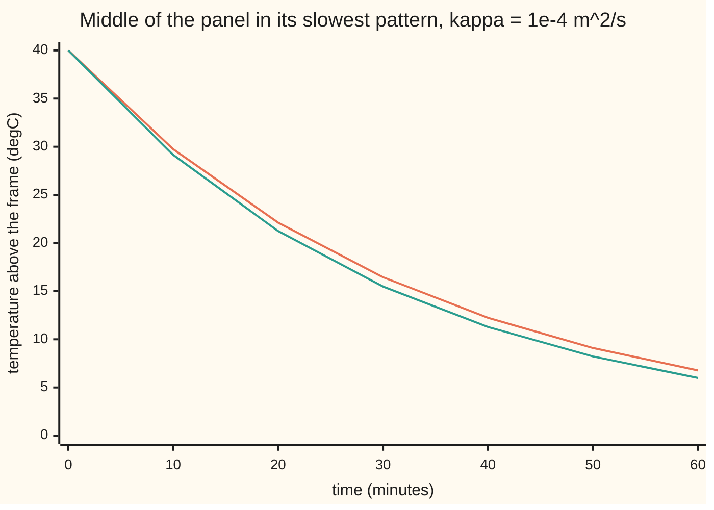

# Volume form and Laplace-Beltrami: integrate and diffuse on a curved space

[Syllabus](../../../SYLLABUS.md) → [Differential geometry and Lie groups](../README.md) → [Riemannian Geometry](../README.md#s05) → Volume form and Laplace-Beltrami

---

## General Overview

An aluminium dome panel is cut from a sphere of radius 1 m. It reaches 60° down from its top point, so its edge is 1.047198 m from the top, measured along the metal. The edge is bolted to a frame held at 0 °C, and every temperature here is counted above the frame. Both faces are insulated, so heat moves only within the sheet. The panel starts warm, 40 °C at the middle, in the smooth hump that fades slowest (its slowest pattern, defined below).

Two questions come up at once. How much metal is in the panel? And how fast does its middle cool? Both need calculus on a curved sheet, and the coordinates on the sheet lie about sizes.

Map the panel by two angles: $`\varphi`$ (phi), down from the top, and $`\theta`$ (theta), round the axis. On that map the panel is a rectangle 1.047198 wide and one full turn, $`2\pi`$, long, with area 6.579736. The real area is 3.141593 m². The map stretches the small circles near the top into full-width rows.

This card builds the two tools that undo the stretch. The **volume form** (written $`dV_g`$; on a surface it is an area) turns a map rectangle into true area. The **Laplace-Beltrami operator** $`\Delta_g`$ is the curved-sheet version of the Laplacian that drives the heat equation. Both are built from the metric $`g`$ alone (the rule for lengths and angles on the sheet), so the answers belong to the panel, not to the map.

The results: the panel holds 3.141593 m² of metal, against 3.445142 m² for a flat disc of the same 1.047198 m reach (a ratio of 0.911891). Its slowest heat pattern has eigenvalue $`\lambda_1 = 4.936042`$ per m², the number that sets how fast it fades. At a diffusivity (heat-spreading speed) of $`10^{-4}`$ m²/s that is a half-life of 23.40 minutes, against 21.91 minutes for the flat disc.

**The metric gives every small coordinate box its true area, $`\sqrt{\det g}`$ times the box; the Laplacian built from that area and the metric gives the same answer in every chart, and on a triangle mesh it becomes the graph Laplacian with cotangent weights, divided by each point's share of area.**

**What kind of fact this is:** $`dV_g`$ and $`\Delta_g`$ are definitions; that they give the same answer in every chart is a theorem, proved on this card in Why it works. The mesh formula is a method: its error shrinks about fourfold each time the mesh is halved here, measured by the checks, not proved on this card. Every result is local to the panel, with its edge held at 0 °C.

### The picture: the dome cools more slowly than a flat disc



Orange: the dome panel, $`\lambda_1 = 4.936042`$ per m². Green: a flat disc with the same 1.047198 m reach from middle to edge, $`\lambda_1 = 5.273633`$ per m². The gap is curvature: the dome's circles grow more slowly than the disc's (edge 5.441398 m against 6.579736 m), leaving less room near the edge, where the pattern is steepest. Step 7 shows why that slows the cooling.

---

## The formula

New notation, in words first. This card introduces the **volume form** $`dV_g`$ and the **Laplace-Beltrami operator** $`\Delta_g`$. From [Riemannian metric](01-riemannian-metrics.md): a chart gives coordinates $`x^1, x^2`$ (upper indices are labels, not powers), and the metric $`g_{ij}`$ is the dot product of the coordinate directions $`\partial_i`$ and $`\partial_j`$. From [Levi-Civita connection](02-levi-civita-connection-and-christoffel-symbols.md): $`g^{ij}`$ is the inverse matrix of $`g_{ij}`$. A repeated upper-lower index pair is summed.

```math
dV_g = \sqrt{\det g}\; dx^1\, dx^2, \qquad \Delta_g f = \frac{1}{\sqrt{\det g}}\; \partial_i\!\Big(\sqrt{\det g}\; g^{ij}\, \partial_j f\Big)
```

**Read it aloud:** a small coordinate box has true size root-det-g times the box. In more dimensions the box gets one more $`dx`$ per coordinate. The Laplacian of $`f`$ is the outflow of $`f`$'s gradient, counted with that same true volume.

On the panel, in the chart $`(\varphi, \theta)`$, the metric is $`g = \mathrm{diag}(R^2,\ R^2 \sin^2\varphi)`$, so $`\sqrt{\det g} = R^2 \sin\varphi`$ and

```math
dA = R^2 \sin\varphi \; d\varphi\, d\theta, \qquad \Delta_g f = \frac{1}{R^2 \sin\varphi}\,\frac{\partial}{\partial\varphi}\Big(\sin\varphi\,\frac{\partial f}{\partial\varphi}\Big) + \frac{1}{R^2\sin^2\varphi}\,\frac{\partial^2 f}{\partial\theta^2}
```

**Read it aloud:** a map box of size $`d\varphi`$ by $`d\theta`$ holds $`R^2 \sin\varphi`$ times as much metal. The Laplacian is a bend along the meridian, a spread term from the widening circles, and a bend round the circle.

This is the angular part of the spherical Laplacian on [The Laplacian in round coordinates, and the modes it splits into](../../19-Partial%20differential%20equations/04-Laplace%2C%20Poisson%20and%20Potentials/07-laplacian-in-polar-and-spherical-coordinates.md), divided by $`R^2`$. That card got it by changing variables in flat space; here it comes from the panel's own metric.

Heat on the panel obeys the heat equation with $`\Delta_g`$ in place of $`\partial^2/\partial x^2`$, with wing 08's sign:

```math
u_t = \kappa\, \Delta_g u, \qquad u = 0 \text{ on the edge}, \qquad -\Delta_g u_1 = \lambda_1 u_1 \ \Rightarrow\ u = 40\, e^{-\kappa \lambda_1 t}\, u_1
```

**Read it aloud:** each point warms at the diffusivity times the curved Laplacian; the slowest pattern $`u_1`$ keeps its shape and fades at the rate $`\kappa \lambda_1`$.

On a triangle mesh the Laplacian at point $`i`$ becomes

```math
(\Delta_g u)_i \approx \frac{1}{A_i} \sum_{j} w_{ij}\, (u_j - u_i), \qquad w_{ij} = \tfrac12\big(\cot\alpha_{ij} + \cot\beta_{ij}\big)
```

**Read it aloud:** the Laplacian at a point is the weighted pull of its neighbours, divided by the point's share of area. Each weight is half the sum of the cotangents (cosine over sine) of the two angles facing that edge.

| Symbol | Plain meaning | In our example | Push it up and the answer… |
| --- | --- | --- | --- |
| $`\varphi`$, $`\theta`$; $`x^i`$; $`y`$, $`J`$ | chart coordinates: angle down from the top, angle round the axis, in rad; a general chart; a second chart and the Jacobian matrix $`\partial x^i/\partial y^k`$ | $`\varphi`$ from 0 to 1.047198 (60°); second chart $`(x, y)`$ | — |
| $`R`$, $`\varphi_0`$, $`a`$ | sphere radius; the panel's angular reach; reach along the metal, $`a = R\varphi_0`$ | 1 m; 1.047198 rad; 1.047198 m | larger $`R`$ at fixed $`a`$: flatter, cools faster |
| $`g_{ij}`$, $`\det g`$, $`s`$, $`\delta_{ij}`$ | metric: dot products of the coordinate directions; its determinant; $`s = \sqrt{\det g}`$; 1 if $`i = j`$, else 0 | $`\mathrm{diag}(1, \sin^2\varphi)`$ m²; $`\sqrt{\det g} = 0.5`$ at 30° | more metal per map box |
| $`g^{ij}`$, $`\mathrm{grad}\, f`$, $`\sharp`$ | inverse of the metric matrix; the gradient arrow $`g^{ij}\partial_j f`$; the slope-to-arrow rule | $`g^{ij} = \mathrm{diag}(1, 1/\sin^2\varphi)`$ | — |
| $`dV_g`$, $`dA`$, $`A`$ | volume form: true size of a small coordinate box; on a surface, area; total area | $`A`$ = 3.141593 m² | — |
| $`\partial_i`$, $`X`$, $`\mathrm{div}\, X`$ | rate along coordinate $`x^i`$, the others held still; an arrow field; its outflow per unit true area | $`\partial z/\partial\varphi = -0.5`$ m at 30° | — |
| $`\Delta_g`$ | Laplace-Beltrami operator: the Laplacian built from $`g`$; not the mass gap $`\Delta`$ | $`\Delta_g z = -1.732051`$ per m at 30° | — |
| $`z`$ | test function: height above the sphere's centre, $`R\cos\varphi`$, in m | 0.866025 m at 30° | — |
| $`u`$, $`t`$, $`\kappa`$, $`u_1`$ | temperature above the frame in °C; time in s; diffusivity in m²/s (here $`\kappa`$ is not curvature); the slowest pattern, 1 at the middle | 40 °C at the start; $`\kappa = 10^{-4}`$ | larger $`\kappa`$: faster cooling |
| $`\lambda_1`$, $`\nu`$, $`P_\nu`$; $`j_{01}`$ | smallest eigenvalue, per m²; the dome's $`\lambda_1 = \nu(\nu+1)/R^2`$, with $`P_\nu`$ the Legendre function; first zero of the Bessel function $`J_0`$, which sets the flat disc's $`(j_{01}/a)^2`$ | 4.936042 dome; 5.273633 flat disc; $`j_{01}`$ = 2.404826 | faster cooling |
| $`w_{ij}`$, $`\alpha_{ij}`$, $`\beta_{ij}`$; $`L`$, $`D`$, $`W`$ | mesh edge weight; the two angles facing edge $`ij`$; the Laplacian matrix, its diagonal, its weights | positive unless the two angles facing the edge add to more than 180° (an obtuse pair); −0.577350 for two 120° angles | stronger pull along that edge |
| $`A_i`$, $`n`$; $`A_T`$, $`h_p`$, $`\theta_r`$ | a point's share of area; rings in the mesh; in the proof, a triangle's area, its hat function at corner $`p`$, its angle at corner $`r`$ | $`n = 8`$: 217 points; $`n = 16`$: 817 | smaller error, about fourfold per doubling of $`n`$ |

### When it holds

- **The chart is regular: $`\det g > 0`$.** At the top point, $`\sin\varphi = 0`$ and the $`(\varphi, \theta)`$ chart breaks: the formula divides by zero. Use another chart there, such as $`(x, y)`$ below. The panel itself has nothing special at the top.
- **The metric is differentiable (smooth here).** $`\Delta_g`$ takes one derivative of $`g`$. At a crease, such as a sharp fold in the sheet, the Laplacian is not defined along the fold.
- **The sheet is thin with insulated faces.** Then heat moves only along the surface. Faces that lose heat to the air add a loss term, and every pattern fades faster.
- **Mesh triangles are not too obtuse.** If the two angles facing an edge add to more than 180°, its weight goes negative: two opposite angles of 120° give $`w = -0.577350`$. Heat then flows from cold to hot along that edge, and the maximum principle of [The heat equation](../../08-Differential%20equations%20and%20dynamics/10-The%20Classical%20PDEs/03-the-heat-equation.md) fails on the mesh.
- **The mesh points lie on the surface and refine evenly.** Here the errors fall from 0.033222 to 0.007832 per m as $`n`$ doubles. A mesh that refines unevenly may stop converging point by point.

---

## Why it works

### Step 0: both tools come from one question, how big is a small box?

A chart cell $`dx^1 \times dx^2`$ sits on the sheet as a tiny parallelogram. Its sides are the coordinate directions $`\partial_1`$ and $`\partial_2`$, scaled by $`dx^1`$ and $`dx^2`$. The metric knows those sides' lengths and angle, so it knows the parallelogram's area. That is the volume form.

Heat flow needs two more things the metric supplies: which way is downhill (the gradient), and how far one metre is in each chart direction. The gradient's outflow through a small box's edge, divided by the box's true area, is the Laplacian. Every piece of it comes from $`g`$.

### Step 1: the area of a small box is $`\sqrt{\det g}`$

A parallelogram's area is the product of its two side lengths times the sine of the angle between them. Square it, and replace the cosine of the angle by the dot product over the lengths. With sides $`\partial_1`$ and $`\partial_2`$:

```math
\text{area}^2 = |\partial_1|^2 |\partial_2|^2 - (\partial_1 \cdot \partial_2)^2 = g_{11}\, g_{22} - g_{12}^2 = \det g
```

The dot products are the metric entries. So a chart cell has area $`\sqrt{\det g}\,dx^1 dx^2`$.

On the panel at $`\varphi = 30°`$: the meridian step $`\partial_\varphi`$ has length $`R`$, and the step round the circle $`\partial_\theta`$ has length $`R\sin\varphi`$, the radius of that circle. They meet at right angles. So $`\sqrt{\det g} = R^2 \sin 30° = 0.5`$ m². A map box there holds 0.5 m² of metal per square radian; at the top it holds none.

Adding up the boxes gives the panel's area:

```math
A = \int_0^{2\pi}\!\!\int_0^{\varphi_0} R^2 \sin\varphi\; d\varphi\, d\theta = 2\pi R^2 (1 - \cos\varphi_0) = 3.141593 \text{ m}^2
```

### Step 2: the answer does not depend on the chart

Change to new coordinates $`y`$. The metric's matrix changes as $`g' = J^{\mathsf T} g J`$, with $`J`$ the Jacobian matrix of $`x`$ with respect to $`y`$ (its entries are $`\partial x^i/\partial y^k`$). So $`\det g' = (\det J)^2 \det g`$. So $`\sqrt{\det g'} = |\det J|\,\sqrt{\det g}`$. The change-of-variables rule for the box is $`dx = |\det J|\, dy`$. So $`\sqrt{\det g'}\,dy = \sqrt{\det g}\,|\det J|\,dy = \sqrt{\det g}\,dx`$: the same true area in both charts.

The check measures the panel in a second chart, $`(x, y)`$: the point above $`(x, y)`$ on the sphere, with height $`z = \sqrt{R^2 - x^2 - y^2}`$. There $`g_{ij} = \delta_{ij} + x_i x_j / z^2`$, with $`\delta_{ij}`$ equal to 1 when $`i = j`$ and 0 otherwise. Summing $`\sqrt{\det g}`$ over 2,000 strips gives 3.141592 m². The $`(\varphi, \theta)`$ chart gives 3.141593 m². The area belongs to the panel.

### Step 3: the gradient needs the inverse metric

The slope of $`f`$ in chart direction $`i`$ is $`\partial_i f`$: a covector, a rule that eats a direction and returns a rate. The gradient is the arrow that reproduces those rates by a dot product. Solving $`g_{ij}\,(\mathrm{grad}\,f)^j = \partial_i f`$ gives

```math
(\mathrm{grad}\, f)^i = g^{ij}\, \partial_j f
```

This is the $`\sharp`$ ("sharp") of [Levi-Civita connection](02-levi-civita-connection-and-christoffel-symbols.md). On the panel, $`g^{\theta\theta} = 1/(R^2\sin^2\varphi)`$: a unit change of $`\theta`$ is a short step near the top, so the same slope in $`\theta`$ there is a steep real slope.

### Step 4: the outflow needs the volume form

The divergence of an arrow field $`X`$ is its outflow per unit true area. Take a chart box. The flow through its two faces of constant $`x^1`$ is $`\sqrt{\det g}\,X^1`$ per unit of $`x^2`$, evaluated at each face. The difference across the box, plus the same for $`x^2`$, is the net outflow. Divide by the box's true area:

```math
\mathrm{div}\, X = \frac{1}{\sqrt{\det g}}\; \partial_i\big(\sqrt{\det g}\; X^i\big)
```

Put $`X = \mathrm{grad}\,f`$ and the Laplace-Beltrami formula comes out: $`\Delta_g f = \mathrm{div}\,\mathrm{grad}\, f`$. Both pieces are chart-free by Steps 2 and 3, so $`\Delta_g f`$ is too.

<details>
<summary>Detailed proof: the divergence formula from forms</summary>

Use the forms of shelf 04: $`d`$ is the exterior derivative, $`\wedge`$ the wedge product, and $`\iota_X`$ inserts the arrow $`X`$ into a form's first slot. Divergence is defined by $`d(\iota_X dV_g) = (\mathrm{div}\,X)\, dV_g`$: the flux form's derivative, per unit volume. By Stokes' theorem, its integral over a region is the flux out through the edge.

In two dimensions, with $`s = \sqrt{\det g}`$, the volume form is $`s\, dx^1 \wedge dx^2`$. Inserting $`X = X^1 \partial_1 + X^2 \partial_2`$ gives

$`\displaystyle \iota_X (s\, dx^1 \wedge dx^2) = s X^1\, dx^2 - s X^2\, dx^1 .`$

Its exterior derivative is

$`\displaystyle d(s X^1)\wedge dx^2 - d(s X^2)\wedge dx^1 = \big(\partial_1 (s X^1) + \partial_2 (s X^2)\big)\, dx^1 \wedge dx^2 .`$

Divide by $`s`$ to read off $`\mathrm{div}\,X = s^{-1}\partial_i(s X^i)`$. Every step is chart-free except the last read-off, and $`dV_g`$ itself is chart-free by Step 2, so $`\mathrm{div}\,X`$ is the same in every chart.

</details>

### Step 5: the panel's Laplacian, one term at a time

In $`(\varphi, \theta)`$, $`g^{ij} = \mathrm{diag}(1/R^2,\ 1/(R^2 \sin^2\varphi))`$ and $`\sqrt{\det g} = R^2 \sin\varphi`$. The formula becomes

```math
\Delta_g f = \frac{1}{R^2}\Big(\frac{\partial^2 f}{\partial \varphi^2} + \cot\varphi\, \frac{\partial f}{\partial\varphi}\Big) + \frac{1}{R^2 \sin^2\varphi}\,\frac{\partial^2 f}{\partial \theta^2}
```

The $`\cot\varphi`$ term is new. It comes from $`\sqrt{\det g}`$ changing along the meridian: the circles widen as $`\varphi`$ grows, so outflow downhill spreads over more metal. A flat-map Laplacian misses it.

Test it on the height $`z = R\cos\varphi`$. Then $`\partial z/\partial\varphi = -R\sin\varphi`$ and $`\partial^2 z/\partial\varphi^2 = -R\cos\varphi`$. The bend term gives $`-\cos\varphi/R`$, and the spread term gives $`\cot\varphi \cdot (-\sin\varphi)/R = -\cos\varphi/R`$. Together:

```math
\Delta_g z = -\frac{2z}{R^2}
```

At 30°: $`-1.732051`$ per m.

The two pushes, side by side:

```
bend along the meridian   ##########            -0.866025 per m
spread of widening circle ##########            -0.866025 per m
both, Delta_g z           ####################  -1.732051 per m
```

A flat-map Laplacian keeps only the first bar.

The check also computes $`\Delta_g z`$ from the general formula in both charts, by finite differences: $`-1.732051`$ in each. So $`z`$ is an eigenfunction (a shape the operator only rescales) with eigenvalue $`2/R^2`$. On a hemisphere, $`z = 0`$ on the edge, so $`z`$ is that panel's slowest pattern and $`\lambda_1 = 2`$ per m² exactly.

### Step 6: the mesh version is the graph Laplacian with cotangent weights

[The graph Laplacian](../../14-Applied%20and%20computational/07-Network%20Science%20and%20Spectral%20Graphs/03-graph-laplacian-and-spectral-clustering.md) builds $`L = D - W`$, degrees minus adjacency, and $`u^{\mathsf T} L u = \sum_{\text{edges}} w_{ij}(u_i - u_j)^2`$. The mesh uses the same matrix with geometric weights $`w_{ij}`$.

Here is why the weights are cotangents. Make $`u`$ linear on each flat triangle. Then the heat energy $`\int |\mathrm{grad}\,u|^2\, dA`$ over one triangle equals $`\tfrac12 \sum \cot(\text{opposite angle}) \times (\text{difference across the edge})^2`$. Summing the triangles gives $`u^{\mathsf T} L u`$ with $`w_{ij} = \tfrac12(\cot\alpha_{ij} + \cot\beta_{ij})`$.

The smooth identity $`\int u\, \Delta_g u\, dA = -\int |\mathrm{grad}\,u|^2\, dA`$ then turns $`L`$ into $`-\Delta_g`$ times area. Give each point $`A_i`$, a third of each triangle around it, and divide: $`(\Delta_g u)_i \approx -(Lu)_i / A_i`$. The heat equation on the mesh is $`A_i\, \dot u_i = -\kappa (Lu)_i`$, and its slowest rate solves $`L u = \lambda A u`$.

<details>
<summary>Detailed proof: one triangle's energy is a sum of cotangents</summary>

Take a flat triangle with corners $`p, q, r`$, area $`A_T`$, and the "hat" function $`h_p`$: linear, 1 at $`p`$, 0 at $`q`$ and $`r`$. Its gradient points from the edge $`qr`$ towards $`p`$, with length one over the height from $`p`$, that is $`|qr| / (2A_T)`$.

Two hat gradients $`\mathrm{grad}\,h_p`$ and $`\mathrm{grad}\,h_q`$ are perpendicular to the edges $`qr`$ and $`pr`$. The angle between them is $`\pi - \theta_r`$, with $`\theta_r`$ the corner angle at $`r`$. So

$`\displaystyle \mathrm{grad}\,h_p \cdot \mathrm{grad}\,h_q = -\frac{|qr|\,|pr| \cos\theta_r}{4A_T^2} = -\frac{\cot\theta_r}{2A_T},`$

using $`2A_T = |qr|\,|pr|\sin\theta_r`$.

A linear $`u`$ is $`u_p h_p + u_q h_q + u_r h_r`$, and $`h_p + h_q + h_r = 1`$, so the three gradients add to zero. Expanding $`|\mathrm{grad}\,u|^2`$ and using that sum to replace the squared terms leaves only the cross terms:

$`\displaystyle \int_T |\mathrm{grad}\,u|^2\, dA = -A_T \sum_{\text{pairs}} (\mathrm{grad}\,h_p \cdot \mathrm{grad}\,h_q)(u_p - u_q)^2 = \frac12 \sum_{\text{pairs}} \cot\theta_r\, (u_p - u_q)^2 .`$

Each interior edge lies in two triangles, with opposite angles $`\alpha`$ and $`\beta`$, which gives its weight $`\tfrac12(\cot\alpha + \cot\beta)`$. This is the formula of Pinkall and Polthier, in the sources.

</details>

### Step 7: why the dome cools more slowly

The slowest pattern's rate is a balance: heat energy $`\int|\mathrm{grad}\,u|^2 dA`$ against stored heat $`\int u^2 dA`$, minimised over all patterns that vanish on the edge. The [Ricci and scalar curvature](07-ricci-and-scalar-curvature.md) card shows that positive curvature makes circles and areas grow more slowly than in the plane. Here the circle at angle $`\varphi`$ from the top has length $`2\pi R\sin\varphi`$, less than the flat $`2\pi R\varphi`$ at the same distance along the metal. So the dome has less room near the edge, where the pattern is steepest and the heat energy sits, but nearly as much in the warm middle, where the stored heat sits. The energy shrinks more than the store, so $`\lambda_1`$ drops from 5.273633 to 4.936042 per m². A shorter edge alone would not do it: a smaller flat disc has a shorter edge and cools faster.

This is Cheng's eigenvalue comparison, stated here without proof (see the sources): where the Ricci curvature is at least that of a model space, here the flat plane, a ball's $`\lambda_1`$ is at most the model ball's of the same radius.

The dome's number comes from Step 5. For a pattern that depends only on $`\varphi`$, $`-\Delta_g u = \lambda u`$ is Legendre's equation. Its solution that stays finite at the top is the Legendre function $`P_\nu(\cos\varphi)`$, with $`\nu(\nu+1) = \lambda R^2`$. The edge condition $`P_\nu(\cos\varphi_0) = 0`$ picks the smallest $`\nu`$. The code sums the series for $`P_\nu`$ and finds that zero by halving an interval.

---

## Worked numbers, by hand

The panel: $`R = 1`$ m, $`\varphi_0 = 60°`$, test point at $`\varphi = 30°`$, $`\kappa = 10^{-4}`$ m²/s.

| Step | Arithmetic | Value |
| --- | --- | --- |
| $`\sqrt{\det g}`$ at 30° | $`R^2 \sin 30°`$ | 0.500000 m² |
| $`1 - \cos\varphi_0`$ | $`1 - \cos 60°`$ | 0.500000 |
| area | $`2\pi R^2 \times 0.5`$ | 3.141593 m² |
| height $`z`$ at 30° | $`R\cos 30°`$ | 0.866025 m |
| slope $`\partial z/\partial\varphi`$ | $`-R\sin 30°`$ | −0.500000 m |
| bend term | $`\partial^2 z/\partial\varphi^2 / R^2 = -0.866025`$ | −0.866025 per m |
| spread term | $`\cot 30° \times (-0.5) / R^2 = 1.732051 \times (-0.5)`$ | −0.866025 per m |
| $`\Delta_g z`$ | $`-0.866025 + (-0.866025)`$ | −1.732051 per m |
| $`\lambda_1`$ | $`\nu(\nu+1)/R^2`$ at the first zero of $`P_\nu(\cos 60°)`$ (code) | 4.936042 per m² |
| $`\kappa \lambda_1`$ | $`10^{-4} \times 4.936042`$ | 0.0004936042 per s |
| half-life | $`\ln 2 / (\kappa\lambda_1) = 0.693147 / 0.0004936042`$ | 1404.26 s |
| **half-life in minutes** | $`1404.26 / 60`$ | **23.40 min** |

So the middle of the panel loses half its excess heat every 23.40 minutes once the slowest pattern is all that is left.

### What breaks if you drop a piece

| Mistake | Comes out at | What went wrong |
| --- | --- | --- |
| Drop $`\sqrt{\det g}`$ from the area | 6.579736 m², not 3.141593 | Counts the map rectangle, not the metal. |
| Flat Laplacian $`(\partial_\varphi^2 + \partial_\theta^2)/R^2`$ on $`z`$ | −0.866025 per m, not −1.732051 | Loses the spread term. In the $`(x, y)`$ chart it gives −2.694301, so it is not a property of the panel. |
| Treat the panel as a flat disc of the same reach | $`\lambda_1 = 5.273633`$, half-life 21.91 min | Ignores curvature: 3.445142 m² of area and a 6.579736 m edge, against 3.141593 and 5.441398. |
| A mesh edge facing two 120° angles | weight −0.577350 | The hypothesis "no obtuse pairs" fails: heat runs from cold to hot along that edge. |

---

## Code, from first principles, and it actually runs

The code builds $`dV_g`$ and $`\Delta_g`$ from the metric in two charts, and a triangle mesh of the panel with cotangent weights. Each number comes by two or more roads. The area and $`\Delta_g z`$ come from the closed form, from each chart and from the mesh at two sizes. The slowest rate $`\lambda_1`$ comes from a Legendre series and from the mesh, by inverse iteration (solving with the matrix again and again, which magnifies the slowest pattern) with a hand-written conjugate-gradient solver (a step-by-step method for symmetric linear systems). Every "what breaks" number is printed too.

### Python

```python
# Volume form and Laplace-Beltrami on a dome panel. Standard library only.
# Roads: closed form, two charts (phi, theta) and (x, y), a triangle mesh with cotangent weights,
# and a Legendre series for the slowest cooling rate. Every number on the card is printed here.
import math
R, P0, KAPPA, T0 = 1.0, math.pi / 3, 1.0e-4, 40.0  # sphere radius m, cap angle, m^2/s, degC
A_GEO = R * P0                                       # distance from top to edge along the panel, m
def f6(x): return f"{x:.6f}"

def lb(metric, f, x, y, h=1e-4):
    # Laplace-Beltrami from the metric: (1/sqrt det g) d_i( sqrt det g  g^ij  d_j f ), by central differences
    def flux(x, y):
        E, F, G = metric(x, y); det = E * G - F * F; s = math.sqrt(det)
        fx = (f(x + h, y) - f(x - h, y)) / (2 * h); fy = (f(x, y + h) - f(x, y - h)) / (2 * h)
        return s * (G * fx - F * fy) / det, s * (-F * fx + E * fy) / det, s
    d1 = (flux(x + h, y)[0] - flux(x - h, y)[0]) / (2 * h); d2 = (flux(x, y + h)[1] - flux(x, y - h)[1]) / (2 * h)
    return (d1 + d2) / flux(x, y)[2]
def flat(f, x, y, h=1e-4):  # the flat-plane Laplacian f_xx + f_yy in the same chart: the mistake
    return (f(x + h, y) + f(x - h, y) + f(x, y + h) + f(x, y - h) - 4 * f(x, y)) / (h * h)
polar = lambda p, t: (R * R, 0.0, (R * math.sin(p)) ** 2)           # chart 1: (phi, theta)
def graph(x, y):                                                       # chart 2: (x, y), z = sqrt(R^2 - x^2 - y^2)
    q = R * R - x * x - y * y; return (1 + x * x / q, x * y / q, 1 + y * y / q)
z_polar = lambda p, t: R * math.cos(p)
z_graph = lambda x, y: math.sqrt(R * R - x * x - y * y)

def mesh(n):  # rings of 1, 6, 12, ... points at equal steps of phi, joined into triangles
    pts, rings, tris = [], [], []
    for k in range(n + 1):
        m = max(1, 6 * k); ph = k * P0 / n; rings.append(list(range(len(pts), len(pts) + m)))
        for j in range(m):
            th = 2 * math.pi * j / m
            pts.append((R * math.sin(ph) * math.cos(th), R * math.sin(ph) * math.sin(th), R * math.cos(ph)))
    for k in range(1, n + 1):
        A, B = rings[k - 1], rings[k]; a, b = len(A), len(B); i = j = 0
        while j < b if k == 1 else (i < a or j < b):
            if k > 1 and i < a and (j == b or (i + 1) * b < (j + 1) * a):
                tris.append((A[i], A[(i + 1) % a], B[j % b])); i += 1
            else:
                tris.append((A[i % a], B[j], B[(j + 1) % b])); j += 1
    return pts, rings, tris
def sub(p, q): return [p[i] - q[i] for i in range(3)]
def dot(p, q): return sum(p[i] * q[i] for i in range(3))
def cross(p, q): return [p[1] * q[2] - p[2] * q[1], p[2] * q[0] - p[0] * q[2], p[0] * q[1] - p[1] * q[0]]
def cot_laplacian(pts, tris):  # edge weight (cot a + cot b)/2; each vertex owns a third of each triangle
    W, M = {}, [0.0] * len(pts)
    for t in tris:
        c = cross(sub(pts[t[1]], pts[t[0]]), sub(pts[t[2]], pts[t[0]])); ar = 0.5 * math.sqrt(dot(c, c))
        for s in range(3):
            p, q, r = t[s], t[(s + 1) % 3], t[(s + 2) % 3]
            u, v = sub(pts[p], pts[r]), sub(pts[q], pts[r]); cr = cross(u, v)
            e = (min(p, q), max(p, q)); W[e] = W.get(e, 0.0) + dot(u, v) / math.sqrt(dot(cr, cr)) / 2
            M[r] += ar / 3
    nb = [[] for _ in pts]
    for (p, q), w in W.items(): nb[p].append((q, w)); nb[q].append((p, w))
    return nb, M
def mesh_lambda(nb, M, inside):  # smallest lambda of L u = lambda M u, edge at 0: inverse iteration + CG
    def L(u): return [sum(w * (u[i] - u[j]) for j, w in nb[i]) if inside[i] else 0.0 for i in range(len(u))]
    u = [1.0 if s else 0.0 for s in inside]
    for _ in range(40):
        b = [M[i] * u[i] if inside[i] else 0.0 for i in range(len(u))]
        x = [0.0] * len(u); r = b[:]; p = r[:]; rr = sum(v * v for v in r)
        for _ in range(2000):
            Ap = L(p); al = rr / sum(p[i] * Ap[i] for i in range(len(p)))
            x = [x[i] + al * p[i] for i in range(len(x))]; r = [r[i] - al * Ap[i] for i in range(len(r))]
            r2 = sum(v * v for v in r)
            if r2 < 1e-26: break
            p = [r[i] + r2 / rr * p[i] for i in range(len(p))]; rr = r2
        s = math.sqrt(sum(M[i] * x[i] * x[i] for i in range(len(x)))); u = [v / s for v in x]
    Lu = L(u); return sum(u[i] * Lu[i] for i in range(len(u)))  # u is M-normalised

def legendre(nu, x):  # P_nu(x) as the series 2F1(-nu, nu+1; 1; (1-x)/2)
    z, term, tot = (1 - x) / 2, 1.0, 1.0
    for k in range(400): term *= (k - nu) * (k + nu + 1) / ((k + 1) ** 2) * z; tot += term
    return tot
def cap_lambda(radius, angle):  # first zero in nu of P_nu(cos angle); lambda = nu(nu+1)/radius^2
    nu = 0.0
    while legendre(nu + 0.05, math.cos(angle)) > 0: nu += 0.05
    lo, hi = nu, nu + 0.05
    for _ in range(60):
        mid = (lo + hi) / 2; lo, hi = (mid, hi) if legendre(mid, math.cos(angle)) > 0 else (lo, mid)
    return lo * (lo + 1) / radius ** 2
def j0(x): return sum((-1) ** k * (x / 2) ** (2 * k) / math.factorial(k) ** 2 for k in range(40))
lo, hi = 2.0, 3.0
for _ in range(60): mid = (lo + hi) / 2; lo, hi = (mid, hi) if j0(mid) > 0 else (lo, mid)
J01 = lo

print("panel: R =", f6(R), "m, cap angle phi0 =", f6(P0), "rad = 60 deg, edge distance a =", f6(A_GEO), "m")
area_exact = 2 * math.pi * R * R * (1 - math.cos(P0)); N = 2000; rho = R * math.sin(P0)
area_polar = sum(2 * math.pi * R * R * math.sin((i + 0.5) * P0 / N) * P0 / N for i in range(N))
area_graph = sum(2 * math.pi * r * R / math.sqrt(R * R - r * r) * rho / N for r in [(i + 0.5) * rho / N for i in range(N)])
print("1 - cos phi0 =", f6(1 - math.cos(P0)), "; area closed form 2 pi R^2 (1 - cos phi0) =", f6(area_exact), "m^2")
print("area chart (phi, theta), sum of sqrt det g =", f6(area_polar))
print("area chart (x, y), sum of sqrt det g =", f6(area_graph))
print("flat disc radius a: area =", f6(math.pi * A_GEO ** 2), "edge =", f6(2 * math.pi * A_GEO), "m; cap edge =", f6(2 * math.pi * rho), "m")
print("sqrt det g at phi = 30 deg, chart (phi, theta) =", f6(math.sqrt(polar(math.pi / 6, 0)[0] * polar(math.pi / 6, 0)[2])))
ex = -2 * math.cos(math.pi / 6) / R; lbp = lb(polar, z_polar, math.pi / 6, 0.0); lbg = lb(graph, z_graph, 0.5, 0.0)
print("at phi = 30 deg: z =", f6(z_polar(math.pi / 6, 0)), "m, z_phi =", f6(-R * math.sin(math.pi / 6)), "m, cot(phi) =", f6(1 / math.tan(math.pi / 6)))
print("Delta_g z exact -2 z / R^2 =", f6(ex), "per m")
print("Delta_g z chart (phi, theta) =", f6(lbp), " chart (x, y) =", f6(lbg))
P, H = math.pi / 6, 1e-4; bend = (z_polar(P + H, 0) - 2 * z_polar(P, 0) + z_polar(P - H, 0)) / (H * H) / R ** 2
spread = (1 / math.tan(P)) * (z_polar(P + H, 0) - z_polar(P - H, 0)) / (2 * H) / R ** 2
print("bend term z_phiphi / R^2 =", f6(bend), " spread term cot(phi) z_phi / R^2 =", f6(spread))
res = {}
for n in (8, 16):
    pts, rings, tris = mesh(n); nb, M = cot_laplacian(pts, tris); v = rings[n // 2][0]
    lz = -sum(w * (pts[v][2] - pts[j][2]) for j, w in nb[v]) / M[v]
    inside = [True] * len(pts)
    for i in rings[n]: inside[i] = False
    res[n] = (sum(M), lz, mesh_lambda(nb, M, inside))
    print(f"mesh n = {n}: {len(pts)} points {len(tris)} triangles; area {f6(res[n][0])} err {f6(area_exact - res[n][0])};",
          f"Delta_g z {f6(lz)} err {f6(lz - ex)}")
lam = cap_lambda(R, P0); lam_flat = (J01 / A_GEO) ** 2
for n in (8, 16): print(f"mesh n = {n}: lambda1 = {f6(res[n][2])} per m^2, err {f6(res[n][2] - lam)}")
print("lambda1 cap, Legendre series =", f6(lam), "per m^2; flat disc (j01/a)^2 =", f6(lam_flat), "with j01 =", f6(J01))
half = lambda l, k=KAPPA: math.log(2) / (k * l) / 60
print("cap / flat disc: area ratio", f6(area_exact / (math.pi * A_GEO ** 2)), "; lambda1 ratio flat / cap", f6(lam_flat / lam))
print("ln 2 =", f6(math.log(2)), "; kappa lambda1 =", f"{KAPPA * lam:.10f}", "per s; half-life", f"{half(lam) * 60:.2f}", "s")
print("half-life of the slowest pattern, kappa = 1e-4 m^2/s: cap", f"{half(lam):.2f}", "min, flat disc", f"{half(lam_flat):.2f}", "min")
print("chart minutes 0..60: cap", " ".join(f"{T0 * math.exp(-KAPPA * lam * 600 * k):.2f}" for k in range(7)))
print("chart minutes 0..60: flat", " ".join(f"{T0 * math.exp(-KAPPA * lam_flat * 600 * k):.2f}" for k in range(7)))
print("break: area with sqrt det g dropped, chart (phi, theta) =", f6(2 * math.pi * R * R * P0), "m^2")
fp, fg = flat(z_polar, math.pi / 6, 0.0) / R ** 2, flat(z_graph, 0.5, 0.0)
print("break: flat Laplacian of z, chart (phi, theta) / R^2 =", f6(fp), " chart (x, y) =", f6(fg))
hgt = math.tan(math.pi / 6)  # edge (-1,0,0)-(1,0,0), apexes (0, +-hgt, 0): both angles facing it are 120 deg
w_obt = dict(cot_laplacian([(-1.0, 0.0, 0.0), (1.0, 0.0, 0.0), (0.0, hgt, 0.0), (0.0, -hgt, 0.0)], [(0, 1, 2), (1, 0, 3)])[0][0])[1]
print("break: edge weight with two 120 deg opposite angles =", f6(w_obt))
lam_h, lam_10 = cap_lambda(R, math.pi / 2), cap_lambda(10.0, A_GEO / 10.0)
print("try: hemisphere lambda1 =", f6(lam_h), "; R = 10 m, same a: lambda1 =", f6(lam_10), "; steel kappa 1.2e-5: half-life", f"{half(lam, 1.2e-5):.2f}", "min")
assert abs(area_polar - area_exact) < 1e-6 and abs(area_graph - area_exact) < 1e-5     # two charts, one area
assert abs(lbp - ex) < 1e-5 and abs(lbg - ex) < 1e-5 and abs(bend + spread - ex) < 1e-5 # two charts, one Delta_g z
assert abs(res[16][1] - ex) < abs(res[8][1] - ex) / 3 < 0.02                           # mesh converges, order 2
assert abs(res[16][0] - area_exact) < abs(res[8][0] - area_exact) / 3
assert abs(res[16][2] - lam) < abs(res[8][2] - lam) / 3 < 0.05                         # mesh lambda -> series lambda
assert abs(lam_h - 2 / R ** 2) < 1e-9 and lam < lam_10 < lam_flat                      # z itself on a hemisphere
assert abs(fp - ex) > 0.5 and abs(fg - fp) > 1 and abs(w_obt + 1 / math.sqrt(3)) < 1e-9  # the mistakes are wrong
print("ALL CHECKS PASS")
```

**Ran 2026-11-19 on macOS, Python 3.14.10, standard library only. All checks passed. Output, pasted from the run:**

```
panel: R = 1.000000 m, cap angle phi0 = 1.047198 rad = 60 deg, edge distance a = 1.047198 m
1 - cos phi0 = 0.500000 ; area closed form 2 pi R^2 (1 - cos phi0) = 3.141593 m^2
area chart (phi, theta), sum of sqrt det g = 3.141593
area chart (x, y), sum of sqrt det g = 3.141592
flat disc radius a: area = 3.445142 edge = 6.579736 m; cap edge = 5.441398 m
sqrt det g at phi = 30 deg, chart (phi, theta) = 0.500000
at phi = 30 deg: z = 0.866025 m, z_phi = -0.500000 m, cot(phi) = 1.732051
Delta_g z exact -2 z / R^2 = -1.732051 per m
Delta_g z chart (phi, theta) = -1.732051  chart (x, y) = -1.732051
bend term z_phiphi / R^2 = -0.866025  spread term cot(phi) z_phi / R^2 = -0.866025
mesh n = 8: 217 points 384 triangles; area 3.125610 err 0.015983; Delta_g z -1.698829 err 0.033222
mesh n = 16: 817 points 1536 triangles; area 3.137576 err 0.004016; Delta_g z -1.724219 err 0.007832
mesh n = 8: lambda1 = 4.911438 per m^2, err -0.024604
mesh n = 16: lambda1 = 4.929160 per m^2, err -0.006882
lambda1 cap, Legendre series = 4.936042 per m^2; flat disc (j01/a)^2 = 5.273633 with j01 = 2.404826
cap / flat disc: area ratio 0.911891 ; lambda1 ratio flat / cap 1.068393
ln 2 = 0.693147 ; kappa lambda1 = 0.0004936042 per s; half-life 1404.26 s
half-life of the slowest pattern, kappa = 1e-4 m^2/s: cap 23.40 min, flat disc 21.91 min
chart minutes 0..60: cap 40.00 29.75 22.12 16.45 12.23 9.10 6.77
chart minutes 0..60: flat 40.00 29.15 21.24 15.48 11.28 8.22 5.99
break: area with sqrt det g dropped, chart (phi, theta) = 6.579736 m^2
break: flat Laplacian of z, chart (phi, theta) / R^2 = -0.866025  chart (x, y) = -2.694301
break: edge weight with two 120 deg opposite angles = -0.577350
try: hemisphere lambda1 = 2.000000 ; R = 10 m, same a: lambda1 = 5.270299 ; steel kappa 1.2e-5: half-life 195.04 min
ALL CHECKS PASS
```

### Rust

```rust
// Volume form and Laplace-Beltrami on a dome panel. std only.
// Roads: closed form, two charts (phi, theta) and (x, y), a triangle mesh with cotangent weights,
// and a Legendre series for the slowest cooling rate. Every number on the card is printed here.
use std::collections::HashMap;
use std::f64::consts::PI;
const R: f64 = 1.0; const P0: f64 = PI / 3.0; const KAPPA: f64 = 1.0e-4; const T0: f64 = 40.0;
const A_GEO: f64 = R * P0; // distance from top to edge along the panel, m
const H: f64 = 1e-4;
fn f6(x: f64) -> String { format!("{:.6}", x) }
type Metric = fn(f64, f64) -> (f64, f64, f64);
type Func = fn(f64, f64) -> f64;

// Laplace-Beltrami from the metric: (1/sqrt det g) d_i( sqrt det g  g^ij  d_j f ), by central differences
fn lb(metric: Metric, f: Func, x: f64, y: f64) -> f64 {
    let flux = |x: f64, y: f64| {
        let (e, ff, g) = metric(x, y); let det = e * g - ff * ff; let s = det.sqrt();
        let fx = (f(x + H, y) - f(x - H, y)) / (2.0 * H); let fy = (f(x, y + H) - f(x, y - H)) / (2.0 * H);
        (s * (g * fx - ff * fy) / det, s * (-ff * fx + e * fy) / det, s)
    };
    let d1 = (flux(x + H, y).0 - flux(x - H, y).0) / (2.0 * H); let d2 = (flux(x, y + H).1 - flux(x, y - H).1) / (2.0 * H);
    (d1 + d2) / flux(x, y).2
}
fn flat(f: Func, x: f64, y: f64) -> f64 { // the flat-plane Laplacian f_xx + f_yy in the same chart: the mistake
    (f(x + H, y) + f(x - H, y) + f(x, y + H) + f(x, y - H) - 4.0 * f(x, y)) / (H * H)
}
fn polar(p: f64, _t: f64) -> (f64, f64, f64) { (R * R, 0.0, (R * p.sin()).powi(2)) } // chart 1: (phi, theta)
fn graph(x: f64, y: f64) -> (f64, f64, f64) { // chart 2: (x, y), z = sqrt(R^2 - x^2 - y^2)
    let q = R * R - x * x - y * y; (1.0 + x * x / q, x * y / q, 1.0 + y * y / q)
}
fn z_polar(p: f64, _t: f64) -> f64 { R * p.cos() }
fn z_graph(x: f64, y: f64) -> f64 { (R * R - x * x - y * y).sqrt() }

type V3 = [f64; 3];
fn mesh(n: usize) -> (Vec<V3>, Vec<Vec<usize>>, Vec<[usize; 3]>) { // rings of 1, 6, 12, ... points
    let (mut pts, mut rings, mut tris) = (Vec::new(), Vec::new(), Vec::new());
    for k in 0..=n {
        let m = std::cmp::max(1, 6 * k); let ph = k as f64 * P0 / n as f64;
        rings.push((pts.len()..pts.len() + m).collect::<Vec<usize>>());
        for j in 0..m {
            let th = 2.0 * PI * j as f64 / m as f64;
            pts.push([R * ph.sin() * th.cos(), R * ph.sin() * th.sin(), R * ph.cos()]);
        }
    }
    for k in 1..=n {
        let (a_, b_) = (&rings[k - 1], &rings[k]); let (a, b) = (a_.len(), b_.len()); let (mut i, mut j) = (0, 0);
        while if k == 1 { j < b } else { i < a || j < b } {
            if k > 1 && i < a && (j == b || (i + 1) * b < (j + 1) * a) {
                tris.push([a_[i], a_[(i + 1) % a], b_[j % b]]); i += 1;
            } else {
                tris.push([a_[i % a], b_[j], b_[(j + 1) % b]]); j += 1;
            }
        }
    }
    (pts, rings, tris)
}
fn sub(p: &V3, q: &V3) -> V3 { [p[0] - q[0], p[1] - q[1], p[2] - q[2]] }
fn dot(p: &V3, q: &V3) -> f64 { p[0] * q[0] + p[1] * q[1] + p[2] * q[2] }
fn cross(p: &V3, q: &V3) -> V3 { [p[1] * q[2] - p[2] * q[1], p[2] * q[0] - p[0] * q[2], p[0] * q[1] - p[1] * q[0]] }
fn cot_laplacian(pts: &[V3], tris: &[[usize; 3]]) -> (Vec<Vec<(usize, f64)>>, Vec<f64>) {
    let mut idx: HashMap<(usize, usize), usize> = HashMap::new(); let mut w: Vec<((usize, usize), f64)> = Vec::new();
    let mut m = vec![0.0; pts.len()];
    for t in tris {
        let c = cross(&sub(&pts[t[1]], &pts[t[0]]), &sub(&pts[t[2]], &pts[t[0]])); let ar = 0.5 * dot(&c, &c).sqrt();
        for s in 0..3 {
            let (p, q, r) = (t[s], t[(s + 1) % 3], t[(s + 2) % 3]);
            let (u, v) = (sub(&pts[p], &pts[r]), sub(&pts[q], &pts[r])); let cr = cross(&u, &v);
            let e = (p.min(q), p.max(q)); let add = dot(&u, &v) / dot(&cr, &cr).sqrt() / 2.0;
            match idx.get(&e) { Some(&ix) => w[ix].1 += add, None => { idx.insert(e, w.len()); w.push((e, 0.0 + add)); } }
            m[r] += ar / 3.0;
        }
    }
    let mut nb = vec![Vec::new(); pts.len()];
    for &((p, q), wt) in &w { nb[p].push((q, wt)); nb[q].push((p, wt)); }
    (nb, m)
}
fn mesh_lambda(nb: &[Vec<(usize, f64)>], m: &[f64], inside: &[bool]) -> f64 { // inverse iteration + CG
    let nn = m.len();
    let l = |u: &[f64]| -> Vec<f64> { (0..nn).map(|i| if inside[i] { nb[i].iter().fold(0.0, |s, &(j, w)| s + w * (u[i] - u[j])) } else { 0.0 }).collect() };
    let mut u: Vec<f64> = inside.iter().map(|&s| if s { 1.0 } else { 0.0 }).collect();
    for _ in 0..40 {
        let b: Vec<f64> = (0..nn).map(|i| if inside[i] { m[i] * u[i] } else { 0.0 }).collect();
        let mut x = vec![0.0; nn]; let mut r = b.clone(); let mut p = r.clone(); let mut rr = r.iter().fold(0.0, |s, v| s + v * v);
        for _ in 0..2000 {
            let ap = l(&p); let al = rr / (0..nn).fold(0.0, |s, i| s + p[i] * ap[i]);
            for i in 0..nn { x[i] += al * p[i]; r[i] -= al * ap[i]; }
            let r2 = r.iter().fold(0.0, |s, v| s + v * v);
            if r2 < 1e-26 { break; }
            for i in 0..nn { p[i] = r[i] + r2 / rr * p[i]; } rr = r2;
        }
        let s = (0..nn).fold(0.0, |s, i| s + m[i] * x[i] * x[i]).sqrt(); u = x.iter().map(|v| v / s).collect();
    }
    let lu = l(&u); (0..nn).fold(0.0, |s, i| s + u[i] * lu[i]) // u is M-normalised
}
fn legendre(nu: f64, x: f64) -> f64 { // P_nu(x) as the series 2F1(-nu, nu+1; 1; (1-x)/2)
    let (z, mut term, mut tot) = ((1.0 - x) / 2.0, 1.0, 1.0);
    for k in 0..400 { let k = k as f64; term *= (k - nu) * (k + nu + 1.0) / ((k + 1.0) * (k + 1.0)) * z; tot += term; }
    tot
}
fn cap_lambda(radius: f64, angle: f64) -> f64 { // first zero in nu of P_nu(cos angle); lambda = nu(nu+1)/radius^2
    let mut nu = 0.0;
    while legendre(nu + 0.05, angle.cos()) > 0.0 { nu += 0.05; }
    let (mut lo, mut hi) = (nu, nu + 0.05);
    for _ in 0..60 { let mid = (lo + hi) / 2.0; if legendre(mid, angle.cos()) > 0.0 { lo = mid } else { hi = mid } }
    lo * (lo + 1.0) / radius.powi(2)
}
fn j0(x: f64) -> f64 {
    let mut s = 0.0; let mut fact = 1.0;
    for k in 0..40 { if k > 0 { fact *= k as f64; } s += (if k % 2 == 0 { 1.0 } else { -1.0 }) * (x / 2.0).powf(2.0 * k as f64) / (fact * fact); }
    s
}
fn main() {
    let (mut lo, mut hi) = (2.0, 3.0);
    for _ in 0..60 { let mid = (lo + hi) / 2.0; if j0(mid) > 0.0 { lo = mid } else { hi = mid } }
    let j01 = lo;
    println!("panel: R = {} m, cap angle phi0 = {} rad = 60 deg, edge distance a = {} m", f6(R), f6(P0), f6(A_GEO));
    let area_exact = 2.0 * PI * R * R * (1.0 - P0.cos()); let nq = 2000; let rho = R * P0.sin();
    let area_polar = (0..nq).fold(0.0, |s, i| s + 2.0 * PI * R * R * ((i as f64 + 0.5) * P0 / nq as f64).sin() * P0 / nq as f64);
    let area_graph = (0..nq).fold(0.0, |s, i| { let r = (i as f64 + 0.5) * rho / nq as f64; s + 2.0 * PI * r * R / (R * R - r * r).sqrt() * rho / nq as f64 });
    println!("1 - cos phi0 = {} ; area closed form 2 pi R^2 (1 - cos phi0) = {} m^2", f6(1.0 - P0.cos()), f6(area_exact));
    println!("area chart (phi, theta), sum of sqrt det g = {}", f6(area_polar));
    println!("area chart (x, y), sum of sqrt det g = {}", f6(area_graph));
    println!("flat disc radius a: area = {} edge = {} m; cap edge = {} m", f6(PI * A_GEO.powi(2)), f6(2.0 * PI * A_GEO), f6(2.0 * PI * rho));
    let g30 = polar(PI / 6.0, 0.0);
    println!("sqrt det g at phi = 30 deg, chart (phi, theta) = {}", f6((g30.0 * g30.2).sqrt()));
    let ex = -2.0 * (PI / 6.0).cos() / R; let lbp = lb(polar, z_polar, PI / 6.0, 0.0); let lbg = lb(graph, z_graph, 0.5, 0.0);
    println!("at phi = 30 deg: z = {} m, z_phi = {} m, cot(phi) = {}", f6(z_polar(PI / 6.0, 0.0)), f6(-R * (PI / 6.0).sin()), f6(1.0 / (PI / 6.0).tan()));
    println!("Delta_g z exact -2 z / R^2 = {} per m", f6(ex));
    println!("Delta_g z chart (phi, theta) = {}  chart (x, y) = {}", f6(lbp), f6(lbg));
    let p = PI / 6.0; let bend = (z_polar(p + H, 0.0) - 2.0 * z_polar(p, 0.0) + z_polar(p - H, 0.0)) / (H * H) / R.powi(2);
    let spread = (1.0 / p.tan()) * (z_polar(p + H, 0.0) - z_polar(p - H, 0.0)) / (2.0 * H) / R.powi(2);
    println!("bend term z_phiphi / R^2 = {}  spread term cot(phi) z_phi / R^2 = {}", f6(bend), f6(spread));
    let mut res: HashMap<usize, (f64, f64, f64)> = HashMap::new();
    for &n in &[8usize, 16] {
        let (pts, rings, tris) = mesh(n); let (nb, m) = cot_laplacian(&pts, &tris); let v = rings[n / 2][0];
        let lz = -nb[v].iter().fold(0.0, |s, &(j, w)| s + w * (pts[v][2] - pts[j][2])) / m[v];
        let mut inside = vec![true; pts.len()];
        for &i in &rings[n] { inside[i] = false; }
        let r = (m.iter().fold(0.0, |s, x| s + x), lz, mesh_lambda(&nb, &m, &inside)); res.insert(n, r);
        println!("mesh n = {}: {} points {} triangles; area {} err {}; Delta_g z {} err {}", n, pts.len(), tris.len(), f6(r.0), f6(area_exact - r.0), f6(lz), f6(lz - ex));
    }
    let lam = cap_lambda(R, P0); let lam_flat = (j01 / A_GEO).powi(2);
    for n in [8usize, 16] { println!("mesh n = {}: lambda1 = {} per m^2, err {}", n, f6(res[&n].2), f6(res[&n].2 - lam)); }
    println!("lambda1 cap, Legendre series = {} per m^2; flat disc (j01/a)^2 = {} with j01 = {}", f6(lam), f6(lam_flat), f6(j01));
    let half = |l: f64, k: f64| 2f64.ln() / (k * l) / 60.0;
    println!("cap / flat disc: area ratio {} ; lambda1 ratio flat / cap {}", f6(area_exact / (PI * A_GEO.powi(2))), f6(lam_flat / lam));
    println!("ln 2 = {} ; kappa lambda1 = {} per s; half-life {:.2} s", f6(2f64.ln()), format!("{:.10}", KAPPA * lam), half(lam, KAPPA) * 60.0);
    println!("half-life of the slowest pattern, kappa = 1e-4 m^2/s: cap {:.2} min, flat disc {:.2} min", half(lam, KAPPA), half(lam_flat, KAPPA));
    let row = |l: f64| (0..7).map(|k| format!("{:.2}", T0 * (-KAPPA * l * 600.0 * k as f64).exp())).collect::<Vec<_>>().join(" ");
    println!("chart minutes 0..60: cap {}", row(lam));
    println!("chart minutes 0..60: flat {}", row(lam_flat));
    println!("break: area with sqrt det g dropped, chart (phi, theta) = {} m^2", f6(2.0 * PI * R * R * P0));
    let (fp, fg) = (flat(z_polar, PI / 6.0, 0.0) / R.powi(2), flat(z_graph, 0.5, 0.0));
    println!("break: flat Laplacian of z, chart (phi, theta) / R^2 = {}  chart (x, y) = {}", f6(fp), f6(fg));
    let hgt = (PI / 6.0).tan(); // edge (-1,0,0)-(1,0,0), apexes (0, +-hgt, 0): both angles facing it are 120 deg
    let w_obt = cot_laplacian(&[[-1.0, 0.0, 0.0], [1.0, 0.0, 0.0], [0.0, hgt, 0.0], [0.0, -hgt, 0.0]], &[[0, 1, 2], [1, 0, 3]]).0[0].iter().find(|e| e.0 == 1).unwrap().1;
    println!("break: edge weight with two 120 deg opposite angles = {}", f6(w_obt));
    let (lam_h, lam_10) = (cap_lambda(R, PI / 2.0), cap_lambda(10.0, A_GEO / 10.0));
    println!("try: hemisphere lambda1 = {} ; R = 10 m, same a: lambda1 = {} ; steel kappa 1.2e-5: half-life {:.2} min", f6(lam_h), f6(lam_10), half(lam, 1.2e-5));
    assert!((area_polar - area_exact).abs() < 1e-6 && (area_graph - area_exact).abs() < 1e-5); // two charts, one area
    assert!((lbp - ex).abs() < 1e-5 && (lbg - ex).abs() < 1e-5 && (bend + spread - ex).abs() < 1e-5);
    let (e8, e16) = ((res[&8].1 - ex).abs(), (res[&16].1 - ex).abs());
    assert!(e16 < e8 / 3.0 && e8 / 3.0 < 0.02); // mesh converges, order 2
    assert!((res[&16].0 - area_exact).abs() < (res[&8].0 - area_exact).abs() / 3.0);
    let (l8, l16) = ((res[&8].2 - lam).abs(), (res[&16].2 - lam).abs());
    assert!(l16 < l8 / 3.0 && l8 / 3.0 < 0.05); // mesh lambda -> series lambda
    assert!((lam_h - 2.0 / R.powi(2)).abs() < 1e-9 && lam < lam_10 && lam_10 < lam_flat);
    assert!((fp - ex).abs() > 0.5 && (fg - fp).abs() > 1.0 && (w_obt + 1.0 / 3f64.sqrt()).abs() < 1e-9); // the mistakes are wrong
    println!("ALL CHECKS PASS");
}
```

**Ran 2026-11-19 on macOS, rustc 1.98.1, no crates. All checks passed. Output, pasted from the run:**

```
panel: R = 1.000000 m, cap angle phi0 = 1.047198 rad = 60 deg, edge distance a = 1.047198 m
1 - cos phi0 = 0.500000 ; area closed form 2 pi R^2 (1 - cos phi0) = 3.141593 m^2
area chart (phi, theta), sum of sqrt det g = 3.141593
area chart (x, y), sum of sqrt det g = 3.141592
flat disc radius a: area = 3.445142 edge = 6.579736 m; cap edge = 5.441398 m
sqrt det g at phi = 30 deg, chart (phi, theta) = 0.500000
at phi = 30 deg: z = 0.866025 m, z_phi = -0.500000 m, cot(phi) = 1.732051
Delta_g z exact -2 z / R^2 = -1.732051 per m
Delta_g z chart (phi, theta) = -1.732051  chart (x, y) = -1.732051
bend term z_phiphi / R^2 = -0.866025  spread term cot(phi) z_phi / R^2 = -0.866025
mesh n = 8: 217 points 384 triangles; area 3.125610 err 0.015983; Delta_g z -1.698829 err 0.033222
mesh n = 16: 817 points 1536 triangles; area 3.137576 err 0.004016; Delta_g z -1.724219 err 0.007832
mesh n = 8: lambda1 = 4.911438 per m^2, err -0.024604
mesh n = 16: lambda1 = 4.929160 per m^2, err -0.006882
lambda1 cap, Legendre series = 4.936042 per m^2; flat disc (j01/a)^2 = 5.273633 with j01 = 2.404826
cap / flat disc: area ratio 0.911891 ; lambda1 ratio flat / cap 1.068393
ln 2 = 0.693147 ; kappa lambda1 = 0.0004936042 per s; half-life 1404.26 s
half-life of the slowest pattern, kappa = 1e-4 m^2/s: cap 23.40 min, flat disc 21.91 min
chart minutes 0..60: cap 40.00 29.75 22.12 16.45 12.23 9.10 6.77
chart minutes 0..60: flat 40.00 29.15 21.24 15.48 11.28 8.22 5.99
break: area with sqrt det g dropped, chart (phi, theta) = 6.579736 m^2
break: flat Laplacian of z, chart (phi, theta) / R^2 = -0.866025  chart (x, y) = -2.694301
break: edge weight with two 120 deg opposite angles = -0.577350
try: hemisphere lambda1 = 2.000000 ; R = 10 m, same a: lambda1 = 5.270299 ; steel kappa 1.2e-5: half-life 195.04 min
ALL CHECKS PASS
```

### Lean

Lean proves three facts for any sphere radius and any change of chart, and checks the mesh counts and the panel's area.

- Suppose a chart has $`\det g > 0`$, and a change of coordinates has Jacobian matrix $`J`$. Then the new chart's $`\sqrt{\det g'}`$ is $`|\det J|`$ times the old one, so the true area is the same.
- Take a cap of a sphere of radius $`R`$, reaching the angle $`\varphi_0`$ down from the top. Then adding up $`R^2 \sin\varphi\, d\varphi\, d\theta`$ gives the area $`2\pi R^2 (1 - \cos\varphi_0)`$.
- Take the height $`z = R\cos\varphi`$ in the chart $`(\varphi, \theta)`$, at a point where $`\det g > 0`$. Then the general formula gives $`\Delta_g z = -2z/R^2`$.
- Take the mesh with $`n = 8`$ rings. Then it has 217 points, and with $`n = 16`$ it has 817.
- Take the panel, with $`R = 1`$ m and $`\varphi_0 = 60°`$. Then its area is exactly $`\pi`$ m².

The second chart's sums, the mesh errors, $`\lambda_1`$, the half-lives and the flat disc are left to the Python and Rust checks.

```lean
-- Volume form and Laplace-Beltrami: the volume form √(det g) gives the same true size in every chart, the dome panel's area is 2πR²(1 − cos φ₀), and the Laplace-Beltrami operator sends the height z = R cos φ to −2z/R².
import Mathlib.LinearAlgebra.Matrix.Determinant.Basic
import Mathlib.Analysis.SpecialFunctions.Sqrt
import Mathlib.Analysis.SpecialFunctions.Trigonometric.Deriv
import Mathlib.Analysis.SpecialFunctions.Integrals.Basic

open Matrix Real

/-- The volume form does not depend on the chart. If a regular chart has metric matrix `g`
(so `det g > 0`) and a change of coordinates has Jacobian matrix `J`, the new chart's metric is
`Jᵀ g J`, and its root-determinant is `|det J|` times the old one. Since the box itself changes
by `|det J|`, the true size `√(det g) dx` of a small coordinate box is the same in both charts. -/
theorem volume_form_sqrt_det_chart_invariant {n : ℕ} (g J : Matrix (Fin n) (Fin n) ℝ)
    (hg : 0 < g.det) :
    Real.sqrt (Jᵀ * g * J).det = |J.det| * Real.sqrt g.det := by
  rw [det_mul, det_mul, det_transpose,
    show J.det * g.det * J.det = J.det ^ 2 * g.det by ring,
    Real.sqrt_mul (sq_nonneg _), Real.sqrt_sq_eq_abs]

/-- The dome panel's area from the volume form `dA = R² sin φ dφ dθ`: a cap of a sphere of
radius `R` reaching the angle `φ₀` down from the top has area `2πR²(1 − cos φ₀)`. -/
theorem cap_area_from_volume_form (R φ₀ : ℝ) :
    (∫ _θ in (0 : ℝ)..(2 * π), ∫ φ in (0 : ℝ)..φ₀, R ^ 2 * Real.sin φ)
      = 2 * π * R ^ 2 * (1 - Real.cos φ₀) := by
  rw [intervalIntegral.integral_const_mul, integral_sin, intervalIntegral.integral_const,
    Real.cos_zero, smul_eq_mul]
  ring

/-- The Laplace-Beltrami operator `Δ_g f = (1/√(det g)) ∂_i(√(det g) g^{ij} ∂_j f)` of the height
`z = R cos φ` on the sphere of radius `R`, in the chart `(φ, θ)` with metric
`g = diag(R², R² sin² φ)`, is `−2z/R²` wherever the chart is regular (`det g > 0`). -/
theorem laplace_beltrami_height_on_sphere (R φ θ : ℝ)
    (hdet : 0 < R ^ 2 * (R ^ 2 * Real.sin φ ^ 2)) :
    let z : ℝ → ℝ → ℝ := fun p _t => R * Real.cos p
    let s : ℝ → ℝ := fun p => Real.sqrt (R ^ 2 * (R ^ 2 * Real.sin p ^ 2))
    (1 / s φ) * (deriv (fun p => s p * (1 / R ^ 2) * deriv (fun q => z q θ) p) φ
        + deriv (fun t => s φ * (1 / (R ^ 2 * Real.sin φ ^ 2)) * deriv (fun t' => z φ t') t) θ)
      = -2 * z φ θ / R ^ 2 := by
  intro z s
  have hz : deriv (fun q => z q θ) = fun p => -(R * Real.sin p) := by
    funext p
    simp only [z]
    rw [deriv_const_mul _ (Real.differentiableAt_cos), Real.deriv_cos]
    ring
  have hz2 : ∀ t, deriv (fun t' => z φ t') t = 0 := fun t => by simp [z]
  simp only [hz, hz2, mul_zero, deriv_const', add_zero]
  have hR : R ≠ 0 := by
    rintro rfl; simp at hdet
  have hsin : Real.sin φ ≠ 0 := by
    rintro h; rw [h] at hdet; simp at hdet
  have hh : HasDerivAt (fun p => R ^ 2 * (R ^ 2 * Real.sin p ^ 2))
      (R ^ 2 * (R ^ 2 * (2 * Real.sin φ * Real.cos φ))) φ := by
    have := ((Real.hasDerivAt_sin φ).pow 2).const_mul (R ^ 2) |>.const_mul (R ^ 2)
    convert this using 1
    push_cast; ring
  have hs : HasDerivAt s (R ^ 2 * (R ^ 2 * (2 * Real.sin φ * Real.cos φ)) /
      (2 * Real.sqrt (R ^ 2 * (R ^ 2 * Real.sin φ ^ 2)))) φ := hh.sqrt hdet.ne'
  have hf : HasDerivAt (fun p => s p * (1 / R ^ 2) * -(R * Real.sin p))
      (R ^ 2 * (R ^ 2 * (2 * Real.sin φ * Real.cos φ)) /
        (2 * Real.sqrt (R ^ 2 * (R ^ 2 * Real.sin φ ^ 2))) * (1 / R ^ 2) * -(R * Real.sin φ)
        + s φ * (1 / R ^ 2) * -(R * Real.cos φ)) φ :=
    (hs.mul_const (1 / R ^ 2)).mul ((Real.hasDerivAt_sin φ).const_mul R).neg
  rw [hf.deriv]
  have hsq : Real.sqrt (R ^ 2 * (R ^ 2 * Real.sin φ ^ 2)) ^ 2 = R ^ 2 * (R ^ 2 * Real.sin φ ^ 2) :=
    Real.sq_sqrt hdet.le
  have hpos : 0 < Real.sqrt (R ^ 2 * (R ^ 2 * Real.sin φ ^ 2)) := Real.sqrt_pos.mpr hdet
  simp only [s, z]
  field_simp
  rw [show R ^ 4 * Real.sin φ ^ 2 = R ^ 2 * (R ^ 2 * Real.sin φ ^ 2) by ring, hsq]
  ring

/-- The mesh with `n = 8` rings (1, 6, 12, ..., 48 points) has 217 points. -/
example : 1 + ∑ k ∈ Finset.range 8, 6 * (k + 1) = 217 := by decide

/-- The mesh with `n = 16` rings has 817 points. -/
example : 1 + ∑ k ∈ Finset.range 16, 6 * (k + 1) = 817 := by decide

/-- At the panel's edge, `φ₀ = 60°`: `1 − cos φ₀ = 1/2`, so the area is `2π · 1² · 1/2 = π`. -/
example : 2 * π * (1 : ℝ) ^ 2 * (1 - Real.cos (π / 3)) = π := by
  rw [Real.cos_pi_div_three]; ring

#print axioms volume_form_sqrt_det_chart_invariant
#print axioms cap_area_from_volume_form
#print axioms laplace_beltrami_height_on_sphere
```

**Checked 2026-11-19 on macOS, Lean 4.36.0-rc2, Mathlib v4.36.0-rc2. Every proof is complete and uses only Lean's standard axioms. Output, pasted from the run:**

```
'volume_form_sqrt_det_chart_invariant' depends on axioms: [propext, Classical.choice, Quot.sound]
'cap_area_from_volume_form' depends on axioms: [propext, Classical.choice, Quot.sound]
'laplace_beltrami_height_on_sphere' depends on axioms: [propext, Classical.choice, Quot.sound]
```

> [!TIP]
> **Try changing**
> - **Make it a hemisphere.** Guess first: faster or slower than 4.936042? The check runs `cap_lambda(R, math.pi / 2)` and prints $`\lambda_1 = 2.000000`$ per m² exactly: the height $`z`$ is zero on the equator, and $`\Delta_g z = -2z/R^2`$.
> - **Flatten the dome, keep the reach.** Guess first: does $`\lambda_1`$ head towards the flat disc's 5.273633? The check runs `cap_lambda(10.0, A_GEO / 10.0)`: sphere radius 10 m, same 1.047198 m reach. It prints 5.270299.
> - **Use steel.** Guess first: steel conducts heat worse than aluminium. The check runs `half(lam, 1.2e-5)`, with $`\kappa = 1.2 \times 10^{-5}`$ m²/s. The half-life grows from 23.40 to 195.04 minutes; the pattern and $`\lambda_1`$ do not change.
> - **Coarsen the mesh.** Guess first: how does the error scale? From $`n = 16`$ to $`n = 8`$ the $`\lambda_1`$ error grows from 0.006882 to 0.024604, more than threefold.

---

## The usual mistake

> [!warning]
> **Using the flat Laplacian in curved coordinates.** $`\partial^2 f/\partial\varphi^2 + \partial^2 f/\partial\theta^2`$ looks like a Laplacian, but it is a property of the map, not of the panel. On the height $`z`$ at 30° it gives −0.866025 per m in one chart and −2.694301 in another; the true value is −1.732051. The metric's $`\sqrt{\det g}`$ and $`g^{ij}`$ are what make the answer chart-free.
>
> Smaller traps:
> - **Integrating over the map.** Without $`\sqrt{\det g}`$ the panel holds 6.579736 m², not 3.141593.
> - **Treating the panel as flat.** A flat disc of the same reach gives $`\lambda_1 = 5.273633`$, a 21.91-minute half-life.
> - **Accepting obtuse triangles.** Two 120° angles facing one edge give a weight of −0.577350.
> - **Trusting one mesh.** At $`n = 8`$, $`\lambda_1 = 4.911438`$ is off by 0.024604. Run two sizes.

---

## Where you meet it in real life

- **Geometry processing.** Software that smooths, edits or flattens 3D scans uses this card's cotangent Laplacian.
- **Shape recognition.** A surface's list of $`\Delta_g`$ eigenvalues survives bending without stretching, so programs use it as a shape fingerprint.
- **Distances on surfaces.** Heat run briefly on a mesh, then followed back along its flow, gives shortest-path distances without searching paths.
- **Weather and climate models.** Diffusion on the globe uses the sphere's $`\Delta_g`$. Its patterns are the spherical harmonics; $`z`$, with eigenvalue $`2/R^2`$, is one of them.
- **Thermal design of shells.** Aircraft skins, tank ends and satellite reflectors are curved sheets; finite-element codes for their heat flow use the mesh form of $`\Delta_g`$.

> **Say it back**
> The metric tells how long and at what angle the chart's directions are, so a small chart box has true area $`\sqrt{\det g}`$ times its map size. That gives the panel's 3.141593 m², the same in every chart. The Laplace-Beltrami operator, the gradient's outflow per unit true area, is built from the same metric, so it too is the same in every chart. On a mesh it becomes the graph Laplacian with cotangent weights, divided by each point's share of area. On the dome the slowest heat pattern fades at 4.936042 per m², a 23.40-minute half-life, slower than a flat disc because curvature leaves less room near the edge, where the pattern is steepest.

---

## What this builds on

- [Riemannian metric](01-riemannian-metrics.md): the metric $`g`$, lengths and angles at every point. This card turns it into area and a Laplacian.
- [Ricci and scalar curvature](07-ricci-and-scalar-curvature.md): positive curvature makes areas grow more slowly. Here that is the area ratio 0.911891 against a flat disc, and the slower cooling.
- [The heat equation](../../08-Differential%20equations%20and%20dynamics/10-The%20Classical%20PDEs/03-the-heat-equation.md): $`u_t = \kappa u_{xx}`$ and its sign. This card swaps $`u_{xx}`$ for $`\Delta_g u`$.
- [Eigenvalue problems](../../08-Differential%20equations%20and%20dynamics/07-Series%20Solutions%20and%20Boundary%20Problems/08-eigenvalues-and-eigenfunctions.md): only special values allow a nonzero pattern. Here the lowest is $`\lambda_1`$, the slowest heat pattern.
- [The Laplacian in round coordinates, and the modes it splits into](../../19-Partial%20differential%20equations/04-Laplace%2C%20Poisson%20and%20Potentials/07-laplacian-in-polar-and-spherical-coordinates.md): the spherical Laplacian by changing variables. Its angular part is this card's $`\Delta_g`$ on the sphere.
- [The graph Laplacian](../../14-Applied%20and%20computational/07-Network%20Science%20and%20Spectral%20Graphs/03-graph-laplacian-and-spectral-clustering.md): $`L = D - W`$ and its eigenvalues. The mesh Laplacian is that matrix with cotangent weights.

Siblings used along the way: [Levi-Civita connection](02-levi-civita-connection-and-christoffel-symbols.md) for $`g^{ij}`$ and $`\sharp`$; [Geodesic and exponential map](04-geodesics-and-the-exponential-map.md), whose polar chart from the top is $`(\varphi, \theta)`$, so $`R\varphi`$ is distance along the metal.

## Where this goes next

- [Jacobi field](09-jacobi-fields-and-comparison-theorems.md): the next card. The circle-length factor $`R\sin\varphi`$ in Step 7 is a Jacobi field's length, and comparison theorems turn "less room" into inequalities.
- [Ricci flow](../07-Geometric%20Analysis%20and%20Physics/01-ricci-flow-and-the-poincare-proof-in-outline.md): the metric itself evolves by $`\partial g/\partial t = -2\,\mathrm{Ric}`$, and the scalar curvature then obeys a heat equation driven by $`\Delta_g`$.
- [Hodge's theorem](12-hodge-laplacian-and-harmonic-forms.md): every cohomology class has exactly one harmonic form.
- [Bochner's theorem](13-bochner-technique-and-vanishing-theorems.md): positive Ricci curvature leaves no room for harmonic loops.
- [Bishop-Gromov](14-bishop-gromov-volume-comparison.md): a lower bound on Ricci curvature caps the volume of every ball.
- [Cheeger's inequality](15-cheegers-inequality-and-spectral-geometry.md): a low first note forces a thin neck on a curved space.

The question this card leaves open: the list of cooling rates $`\lambda_1, \lambda_2, \dots`$ is fixed by the shape, but how much of the shape can the list recover?

---

## Sources

Verified 2026-11-19: every link below resolves to the publisher's page.

- Lee, John M. *Introduction to Riemannian Manifolds*, 2nd ed. Springer, 2018. [doi:10.1007/978-3-319-91755-9](https://doi.org/10.1007/978-3-319-91755-9). The Riemannian volume form, divergence and the Laplacian in coordinates, as in Steps 1 to 4.
- Rosenberg, Steven. *The Laplacian on a Riemannian Manifold*. Cambridge University Press, 1997. [doi:10.1017/CBO9780511623783](https://doi.org/10.1017/CBO9780511623783). The Laplacian, the heat equation on a manifold and its eigenvalues.
- Pinkall, Ulrich, and Konrad Polthier. "Computing Discrete Minimal Surfaces and Their Conjugates." *Experimental Mathematics* 2, no. 1 (1993): 15–36. [doi:10.1080/10586458.1993.10504266](https://doi.org/10.1080/10586458.1993.10504266). The cotangent formula for the energy of a piecewise linear function, Step 6.
- Meyer, Mark, Mathieu Desbrun, Peter Schröder, and Alan H. Barr. "Discrete Differential-Geometry Operators for Triangulated 2-Manifolds." In *Visualization and Mathematics III*, Springer, 2003. [doi:10.1007/978-3-662-05105-4_2](https://doi.org/10.1007/978-3-662-05105-4_2). The mesh Laplacian with each point's share of area, and how obtuse triangles are handled.
- Cheng, Shiu-Yuen. "Eigenvalue Comparison Theorems and Its Geometric Applications." *Mathematische Zeitschrift* 143 (1975): 289–297. [doi:10.1007/BF01214381](https://doi.org/10.1007/BF01214381). The eigenvalue comparison of Step 7.
