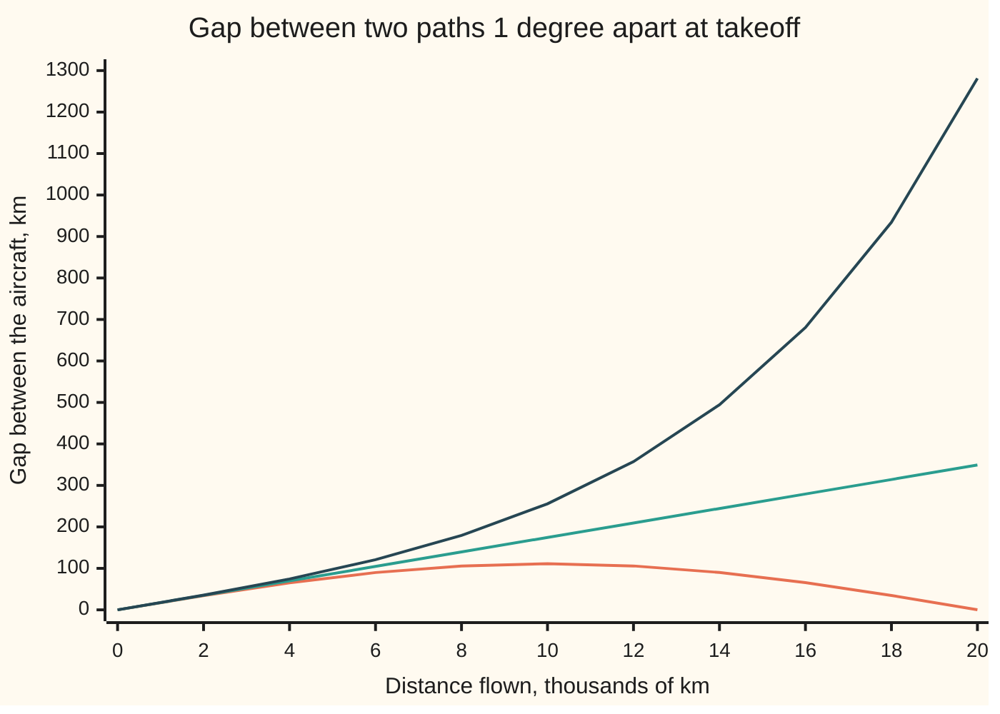

# Jacobi field: curvature seen as nearby paths focusing or spreading

[Syllabus](../../../SYLLABUS.md) → [Differential geometry and Lie groups](../README.md) → [Riemannian Geometry](../README.md#s05) → Jacobi field

---

## General Overview

Two aircraft take off from London Heathrow one after the other. One flies heading 290°, the other 291°: a 1° spread. Neither turns again. Each flies a great circle, the straightest path on the globe (a geodesic, from [Geodesic and exponential map](04-geodesics-and-the-exponential-map.md)).

On a flat map the gap between them would grow in a straight line: 17.453 km after 1,000 km, 87.266 km after 5,000 km. On the globe it is 17.381 km and then 78.580 km. The globe is curved, so the two paths bend towards each other. A quarter of the way round the world the gap tops out at 111.195 km. Halfway round, at the point opposite Heathrow, the two paths meet again.

That gap, as a function of distance flown, is, to first order in the spread, a **Jacobi field**. It solves one short equation, and the equation's only input from the shape is its curvature. Positive curvature makes nearby straightest paths focus. Negative curvature makes them spread. Zero curvature gives the flat map's straight-line growth.

The same equation also gives guarantees. The real Earth is a slightly flattened ball, and its curvature is not the same everywhere. It does lie between two values, and the gap on the real Earth is then trapped between the gaps on two round spheres. For two paths 1° apart run from the North Pole to the equator, that trap is 110.946 km to 111.691 km. The true gap is 111.319 km.

**A Jacobi field measures how far a neighbouring straightest path has drifted; it obeys J'' + curvature × J = 0, so curvature alone decides whether nearby paths focus or spread, and a bound on curvature becomes a bound on the drift.**

**What kind of fact this is:** the Jacobi equation is a theorem, derived on this card in Why it works. The two-sided bound is a theorem: proved here on surfaces, and stated with a named source in higher dimensions. All of it is local: it speaks about one path and the paths near it.

### The picture: one spread, three kinds of curvature



Orange: the globe, a sphere of radius 6,371 km; the paths focus and meet again. Green: a flat plane; the gap grows in a straight line. Dark blue: a saddle-shaped surface with the same size of curvature but negative sign; the paths spread faster and faster. All three agree for the first few hundred kilometres.

---

## The formula

Notation first, in words. The flight path is $`\gamma(s)`$, a geodesic run at unit speed, so $`s`$ is distance flown in km and $`\gamma'`$ is the unit arrow along the path. The **Jacobi field** $`J(s)`$ is an arrow at each point of the path, pointing to where the neighbouring path is, scaled by the spread at takeoff. A prime on $`J`$ is the covariant rate of change $`D/ds`$ along the path ([Parallel transport](03-parallel-transport-and-holonomy.md)): the change an observer on the path sees after allowing for the path's own turning.

```math
J'' + \mathrm{Rm}(J, \gamma')\,\gamma' = 0
```

**Read it aloud:** the acceleration of the gap is set by the curvature tensor acting on the gap and the direction of travel.

Here $`\mathrm{Rm}`$ is the curvature tensor of [Riemann curvature tensor](06-riemann-curvature-tensor.md), with signs fixed so that a round sphere of radius R has sectional curvature $`\sec = +1/R^2`$.

On a surface, the gap that matters points straight across the path, so its whole content is one signed length $`f(s)`$ in km. The equation becomes one ordinary differential equation, with $`K`$ the Gaussian curvature (the product of the surface's two principal curvatures, from shelf 02 of this wing) at the point reached:

```math
f'' + K(s)\, f = 0, \qquad f(0) = 0, \quad f'(0) = \alpha
```

**Read it aloud:** the gap starts at zero, opens at α km per km flown, and curvature pulls it back in proportion to its size.

When the curvature is a constant $`k`$, the solution is $`f = \alpha\,\mathrm{sn}_k(s)`$, with $`\mathrm{sn}_k`$ the gap per radian of spread in the model space of curvature $`k`$ ([Sphere, plane and hyperbolic space](05-model-spaces-of-constant-curvature.md)):

```math
\mathrm{sn}_k(s) = \frac{\sin(\sqrt{k}\, s)}{\sqrt{k}} \ (k > 0), \qquad s \ (k = 0), \qquad \frac{\sinh(\sqrt{-k}\, s)}{\sqrt{-k}} \ (k < 0)
```

**Read it aloud:** on a sphere the gap is a sine wave, on a plane a straight line, on a saddle a hyperbolic sine.

On the globe, $`k = 1/R^2`$ and the gap after 5,000 km is $`0.017453293 \times 6371 \times \sin(5000/6371) = 78.580`$ km.

The **comparison theorem** turns a curvature bound into a gap bound, for a Jacobi field $`J`$ at right angles to the path that starts at 0 with rate α:

```math
k_{\mathrm{lo}} \le \sec \le k_{\mathrm{hi}} \ \Longrightarrow\ \alpha\,\mathrm{sn}_{k_{\mathrm{hi}}}(s) \le \lvert J(s)\rvert \le \alpha\,\mathrm{sn}_{k_{\mathrm{lo}}}(s)
```

**Read it aloud:** more curvature means more focusing, so the most curved model gives the smallest gap and the least curved model gives the largest.

| Symbol | Plain meaning | In our example | Push it up and the answer… |
| --- | --- | --- | --- |
| $`\gamma(s)`$, $`\gamma'`$ | the flight path, a unit-speed geodesic, and its direction | Heathrow, heading 290° | — |
| $`s`$ | distance flown along the path, km | 5,000 km | on the sphere the gap grows, peaks, then shrinks |
| $`\alpha`$ | spread at takeoff, in radians | 1° = 0.017453293 rad | every gap scales with it |
| $`J(s)`$, $`f(s)`$ | Jacobi field: the arrow to the neighbouring path; on a surface, its signed length in km | length 78.580 km at 5,000 km | — |
| $`J'`$, $`J''`$, $`f'`$, $`f''`$ | first and second covariant rates along the path | $`f'(0) = \alpha`$ | — |
| $`\mathrm{Rm}`$ | the curvature tensor | sphere: sec = $`+1/R^2`$ | — |
| $`\sec`$, $`K`$ | sectional curvature; Gaussian curvature on a surface, 1/km² | $`1/6371^2`$ | paths focus sooner |
| $`R`$ | radius of the spherical Earth model | 6,371 km | the meeting point moves further away |
| $`k`$, $`k_{\mathrm{lo}}`$, $`k_{\mathrm{hi}}`$ | constant curvature of a model space; lower and upper bounds on sec | $`1/6399.594^2`$ and $`1/6356.752^2`$ | a higher bound shrinks the guaranteed gap |
| $`\mathrm{sn}_k(s)`$ | the model space's gap per radian of spread, km | globe: $`6371 \sin(s/6371)`$ | — |
| $`a`$, $`b`$ | WGS 84 equator radius and polar semi-axis | 6,378.137 km and 6,356.752 km | — |
| $`d`$ | exact distance between the two aircraft, km | 78.580 km at 5,000 km | — |

A clash, said once: in wing 06, $`J`$ is a Jacobian matrix. Here it is the Jacobi field only.

### When it holds

- **Both paths are geodesics.** An aircraft that corrects its course is steered, not drifting; its gap obeys a forced equation, not this one.
- **The spread is small.** $`J`$ is the first-order gap. At 1° it matches the true distance to 0.001 km. At a 60° spread after 2,000 km it says 2,060.2 km against a true 1,975.2 km.
- **The curvature bound holds along the whole path.** A bound at the start alone proves nothing about the gap 5,000 km later.
- **The lower bound only up to $`\pi/\sqrt{k_{\mathrm{hi}}}`$.** There the most curved model's paths meet again and its gap is zero. Past it, the bound says nothing useful.
- **The upper bound only up to the path's first conjugate point** (defined in Step 5). On the globe that is 20,015.09 km from Heathrow, at the opposite point.

---

## Why it works

### Step 0: differentiate a family of straight paths

Picture a fan of geodesics leaving Heathrow, one per heading, each with zero acceleration. The Jacobi field is the rate the fan changes from one path to the next. On a flat plane, the order of the two rates (along a path, across the fan) does not matter. On a curved surface swapping them costs exactly one curvature term, and that term is the whole equation.

### Step 1: the Jacobi equation

Write the fan as $`\gamma(s, t)`$, with $`t`$ the heading. Then $`\gamma' = \partial\gamma/\partial s`$ and $`J = \partial\gamma/\partial t`$. Every path in the fan has $`D_s \gamma' = 0`$.

The connection has no torsion ([Levi-Civita connection](02-levi-civita-connection-and-christoffel-symbols.md)), so $`D_t \gamma' = D_s J`$. Swapping $`D_s`$ and $`D_t`$ on a vector costs the curvature tensor. Differentiate $`D_s\gamma' = 0`$ across the fan and the Jacobi equation drops out.

<details>
<summary>Detailed proof: the Jacobi equation from a family of geodesics</summary>

Use $`\mathrm{Rm}(X, Y)Z = \nabla_X \nabla_Y Z - \nabla_Y \nabla_X Z - \nabla_{[X, Y]} Z`$. Along a two-parameter map the coordinate fields commute, so for any vector field $`V`$ along it, $`D_t D_s V - D_s D_t V = \mathrm{Rm}(J, \gamma') V`$.

Take $`V = \gamma'`$. The left-hand term $`D_t D_s \gamma'`$ is zero, since every path is a geodesic. Torsion-free gives $`D_t \gamma' = D_s J`$. So

$`\displaystyle 0 = D_s D_s J + \mathrm{Rm}(J, \gamma')\gamma'.`$

With this convention, a unit sphere has $`\mathrm{Rm}(u, v)w = \langle v, w\rangle u - \langle u, w\rangle v`$. For $`J`$ at right angles to a unit $`\gamma'`$ this gives $`\mathrm{Rm}(J, \gamma')\gamma' = J`$, so $`J'' + J = 0`$: the sign that makes a sphere focus.

</details>

The equation is linear and second order. So a Jacobi field is fixed by two pieces of data at the start: its value and its rate. For the fan from Heathrow these are $`J(0) = 0`$ (same runway) and $`\lvert J'(0)\rvert = \alpha`$ (the spread).

### Step 2: on a surface it is one number

The part of $`J`$ along the path only says one aircraft is ahead of the other; it grows in a straight line and carries no curvature. The part across the path is what the flight crews see. On a surface that part is one signed length $`f`$, and the Jacobi equation becomes $`f'' + K f = 0`$.

On the globe $`K = 1/R^2`$. This is the strut equation of [Boundary value problems](../../08-Differential%20equations%20and%20dynamics/07-Series%20Solutions%20and%20Boundary%20Problems/05-two-point-boundary-value-problems.md) with distance measured in units of R. Its solution with $`f(0) = 0`$, $`f'(0) = \alpha`$ is $`f = \alpha R \sin(s/R)`$.

### Step 3: the Jacobi field is the true gap, to first order

Spherical trigonometry gives the exact distance $`d`$ between the two aircraft. They sit at the ends of two sides of length $`s`$, with angle $`\alpha`$ between them:

```math
\sin\frac{d}{2R} = \sin\frac{s}{R}\,\sin\frac{\alpha}{2}
```

**Read it aloud:** half the gap's angle is the sine of the angle flown times the sine of half the spread.

For a small spread, $`\sin(\alpha/2)`$ is about $`\alpha/2`$ and $`d`$ is about $`\alpha R\sin(s/R)`$: the Jacobi field. The error is of third order: expanding both sines gives $`J - d = R\alpha^3 \sin(s/R)\cos^2(s/R)/24`$ plus smaller terms, at most $`R\alpha^3/62`$, below 0.001 km at 1°. The check allows $`R\alpha^3/40`$. The code also finds $`d`$ from the two aircraft's positions as 3D vectors, a road that never mentions curvature. It matches this formula to a billionth of a km, and the Jacobi field to 0.001 km, at every row of the table.

### Step 4: comparison by a crossing argument

Take a surface whose curvature satisfies $`K \le k_{\mathrm{hi}}`$. Put the true gap $`f`$ beside the model gap $`h = \alpha\,\mathrm{sn}_{k_{\mathrm{hi}}}`$. Both start at 0 with rate α.

The model is pulled back harder, so it should fall behind. The tool is the Wronskian $`f' h - f h'`$, a cross-multiplied difference. Its rate is $`(k_{\mathrm{hi}} - K) f h`$, which is never negative while both gaps are positive. It starts at 0, so it stays at or above 0. That says the ratio $`f/h`$ never decreases. The ratio starts at 1, so $`f \ge h`$. The upper bound is the same argument with $`k_{\mathrm{lo}}`$ and the signs reversed.

<details>
<summary>Detailed proof: Sturm comparison on a surface</summary>

Let $`f'' + K f = 0`$ and $`h'' + k h = 0`$, both with value 0 and rate α at $`s = 0`$. Set $`w = f' h - f h'`$. Then

$`\displaystyle w' = f'' h - f h'' = -K f h + k f h = (k - K) f h,`$

and $`w(0) = 0`$.

Lower bound. Take $`k = k_{\mathrm{hi}} \ge K`$. While $`h > 0`$, that is for $`s < \pi/\sqrt{k_{\mathrm{hi}}}`$, suppose $`f`$ is still positive. Then $`w' \ge 0`$, so $`w \ge 0`$, and $`(f/h)' = w/h^2 \ge 0`$. As $`s \to 0`$, $`f/h \to 1`$. So $`f \ge h > 0`$, which also shows $`f`$ cannot reach 0 before $`h`$ does.

Upper bound. Take $`k = k_{\mathrm{lo}} \le K`$. While $`f > 0`$, that is before the first conjugate point, the same steps give $`w \le 0`$, so $`f/h`$ never increases and $`f \le h`$.

</details>

In higher dimensions $`J`$ is an arrow, not a number, and the curvature varies with the plane it is measured in. The same bounds still hold with sectional curvature in place of $`K`$. This is the **Rauch comparison theorem** (Rauch, 1951). Its proof uses the index form, a second-variation integral, and does not fit here; Lee's *Introduction to Riemannian Manifolds* gives it in full.

### Step 5: where paths meet again

A point $`q`$ on the path is **conjugate** to the start $`p`$ when some Jacobi field, not identically zero, vanishes at both. Neighbouring geodesics from $`p`$ refocus at $`q`$.

On the globe, $`\alpha R\sin(s/R) = 0`$ again at $`s = \pi R = 20{,}015.09`$ km, the point opposite Heathrow. Every heading arrives there. This is a two-point boundary value problem with zero at both ends and a nonzero solution: the strut at its buckling length.

Past a conjugate point a geodesic stops being the shortest route. That fact is the heart of the Bonnet–Myers theorem: if the sectional curvature is at least $`k > 0`$ everywhere on a complete space, every geodesic meets a conjugate point by $`\pi/\sqrt{k}`$, so no two points are further apart than that. For the spherical Earth, the bound is exactly half the circumference. Bonnet–Myers is stated here, not proved; Cheeger and Ebin give the proof.

A geodesic can also stop being shortest before any conjugate point, where two routes of equal length tie; [Hopf-Rinow](10-hopf-rinow-and-completeness.md) finds those points. The comparison theorem's range limits are conjugate points too: the crossing argument of Step 4 needs the gaps positive, so it stops where the model's gap or the true gap first returns to zero.

---

## Worked numbers, by hand

| Step | Arithmetic | Value |
| --- | --- | --- |
| spread at takeoff | 1° × π/180 | 0.017453293 rad |
| flat-map gap at 5,000 km | 0.017453293 × 5000 | 87.266 km |
| globe gap at 5,000 km | 0.017453293 × 6371 × sin(5000/6371) | **78.580 km** |
| same, from 3D positions | chord between the aircraft, turned into an arc | 78.580 km |
| same, stepped (RK4, 10 steps) | f'' = −f/6371² from f = 0, f' = α | 78.580104313 km |
| largest gap, a quarter round | 0.017453293 × 6371 × sin(π/2) | 111.195 km |
| conjugate point | π × 6371 | 20,015.09 km, gap 0.000 |
| flattened Earth, pole to equator | gap of two meridians 1° apart: α × a | 111.319 km |
| comparison spheres | radius b = 6,356.752 and radius a²/b = 6,399.594 | 110.946 to 111.691 km |

Two aircraft 1° apart are 78.580 km apart after 5,000 km, not the 87.266 km a flat map suggests, and on the true flattened Earth the gap at the equator is pinned between two sphere answers without solving anything on the ellipsoid.

### What breaks if you drop a piece

| Mistake | Comes out at | What went wrong |
| --- | --- | --- |
| Flat-map gap α s on the globe, a quarter round | 174.665 km, not 111.195 | the comparison with k = 0 is an upper bound when sec > 0, not the answer |
| Sign flipped: f'' − K f = 0 | 255.893 km at the quarter | that is the saddle; the sphere focuses |
| Jacobi gap with a 60° spread, at 2,000 km | 2,060.2 km, true 1,975.2 km | J is first order in the spread |
| Upper bound taken from the more curved sphere (radius b) | "at most" 110.946 km, true 111.319 | the most curved model gives the lower bound |

The code prints all four.

---

## Code, from first principles, and it actually runs

The script computes the gap by three roads on the globe and two on the flattened Earth. On the globe: the closed form $`\alpha R\sin(s/R)`$; Runge-Kutta 4 on $`f'' + K f = 0`$ at two step sizes, whose error falls about 16 times when the step halves ([Runge-Kutta four](../../08-Differential%20equations%20and%20dynamics/05-Numerical%20Evolution/04-runge-kutta-four.md)); and the exact great-circle distance between the two aircraft, built from 3D position vectors, which never mentions curvature and is checked against the spherical-trigonometry formula of Step 3. On the flattened Earth (the WGS 84 ellipsoid), two meridians from the North Pole are both geodesics, and by rotation symmetry their gap at the equator is exactly α × a. Runge-Kutta 4, fed only the varying curvature along the meridian, must reproduce it, and the two comparison spheres must bracket it.

### Python

```python
# Jacobi fields and comparison theorems -- the check behind the card.  Standard
# library only: sin, cos, sinh, asin and sqrt, nothing that knows the answer.
# Two aircraft leave London Heathrow on great circles, headings 290 and 291
# degrees.  Their gap is found three ways: the Jacobi field alpha R sin(s/R),
# Runge-Kutta 4 on f'' + K f = 0, and 3D positions on the sphere.  Then the
# flattened Earth (WGS 84) is trapped between two comparison spheres.
import math

R = 6371.0                                   # km, the spherical Earth model
AL = math.radians(1.0)                       # the 1 degree spread, in radians
A_E, F_E = 6378.137, 1 / 298.257223563       # WGS 84 equator radius, flattening
B_E = A_E * (1 - F_E)                        # polar semi-axis, km

def sn(k, s):                                # model-space gap per radian, curvature k
    if k > 0:
        return math.sin(math.sqrt(k) * s) / math.sqrt(k)
    if k < 0:
        return math.sinh(math.sqrt(-k) * s) / math.sqrt(-k)
    return s

def rk4(speed, curv, u_end, n, sign=1.0):    # f'' + sign K f = 0 in arc length s,
    h, u, f, g, s = u_end / n, 0.0, 0.0, AL, 0.0      # stepped in a parameter u
    def rhs(u, f, g):
        v = speed(u)
        return g * v, -sign * curv(u) * f * v, v
    for _ in range(n):
        k1 = rhs(u, f, g)
        k2 = rhs(u + h / 2, f + h / 2 * k1[0], g + h / 2 * k1[1])
        k3 = rhs(u + h / 2, f + h / 2 * k2[0], g + h / 2 * k2[1])
        k4 = rhs(u + h, f + h * k3[0], g + h * k3[1])
        f += h / 6 * (k1[0] + 2 * k2[0] + 2 * k3[0] + k4[0])
        g += h / 6 * (k1[1] + 2 * k2[1] + 2 * k3[1] + k4[1])
        s += h / 6 * (k1[2] + 2 * k2[2] + 2 * k3[2] + k4[2])
        u += h
    return f, s

def unit(lat, lon):                          # point on the unit sphere, degrees
    la, lo = math.radians(lat), math.radians(lon)
    return [math.cos(la) * math.cos(lo), math.cos(la) * math.sin(lo), math.sin(la)]

E0 = unit(51.47, -0.4543)                    # Heathrow
NO = [-math.sin(math.radians(51.47)) * math.cos(math.radians(-0.4543)),
      -math.sin(math.radians(51.47)) * math.sin(math.radians(-0.4543)),
      math.cos(math.radians(51.47))]         # unit vector due north at Heathrow
EA = [-math.sin(math.radians(-0.4543)), math.cos(math.radians(-0.4543)), 0.0]

def gap3d(s, head_deg, spread):              # great-circle distance between the two aircraft
    pts = []
    for hd in (head_deg, head_deg + math.degrees(spread)):
        t = [math.cos(math.radians(hd)) * n + math.sin(math.radians(hd)) * e for n, e in zip(NO, EA)]
        pts.append([math.cos(s / R) * p + math.sin(s / R) * q for p, q in zip(E0, t)])
    chord = math.sqrt(sum((p - q) ** 2 for p, q in zip(*pts)))
    return 2 * R * math.asin(min(1.0, chord / 2))

K = 1 / R ** 2
QS, HALF = math.pi * R / 2, math.pi * R
print(f"Heathrow 51.47 N 0.4543 W; headings 290 and 291 deg; WGS 84 inverse flattening {1 / F_E:.9f}")
print(f"spread {AL:.9f} rad; sphere R = {R:.1f} km, K = 1/R^2; antipode at pi R = {HALF:.2f} km")
print("    s km | flat a s | a R sin(s/R) |  3D gap | saddle a R sinh(s/R)")
rows = [500.0, 1000.0, 2000.0, 5000.0, QS, 15000.0, HALF]
for s in rows:
    jac, ex = AL * sn(K, s), gap3d(s, 290.0, AL)
    print(f"{s:8.1f} | {AL * s:8.3f} | {jac:12.3f} | {ex:7.3f} | {AL * sn(-K, s):9.3f}")
    trig = 2 * R * math.asin(math.sin(s / R) * math.sin(AL / 2))  # spherical trig
    assert abs(trig - ex) < 1e-9                           # 3D gap = exact formula
    assert abs(jac - ex) <= AL ** 3 * R / 40               # Jacobi = gap to third order
one = lambda u: 1.0
kon = lambda u: K
f5, _ = rk4(one, kon, 5000.0, 5)
f10, _ = rk4(one, kon, 5000.0, 10)
j_5, j_q = AL * sn(K, 5000.0), AL * sn(K, QS)
print(f"RK4 at 5000 km, 5 steps {f5:.9f}, 10 steps {f10:.9f}, closed form {j_5:.9f} km")
print(f"RK4 error ratio 5 -> 10 steps: {(f5 - j_5) / (f10 - j_5):.2f} (fourth order: about 16)")
assert abs(f10 - j_5) < 1e-4 and 12 < (f5 - j_5) / (f10 - j_5) < 20
fpi, _ = rk4(one, kon, HALF, 400)
print(f"conjugate point: RK4 gap at pi R = {fpi:.6f} km, exact 3D gap {gap3d(HALF, 290.0, AL):.6f} km")
assert abs(fpi) < 1e-6
print("chart, s in 1000 km:", " ".join(f"{s // 1000}" for s in range(0, 20001, 2000)))
print("chart, plane:", " ".join(f"{AL * s:.1f}" for s in range(0, 20001, 2000)))
print("chart, sphere:", " ".join(f"{AL * sn(K, s):.1f}" for s in range(0, 20001, 2000)))
print("chart, saddle:", " ".join(f"{AL * sn(-K, s):.1f}" for s in range(0, 20001, 2000)))
# ---- the flattened Earth: meridians from the North Pole, 1 degree of longitude apart ----
W = lambda u: A_E ** 2 * math.cos(u) ** 2 + B_E ** 2 * math.sin(u) ** 2
spd = lambda u: math.sqrt(W(u))                         # ds/du along the meridian
kel = lambda u: B_E ** 2 / W(u) ** 2                    # Gaussian curvature there
r_hi, r_lo = B_E, A_E ** 2 / B_E                        # radii of the comparison spheres
print(f"WGS 84: a = {A_E:.3f} km, b = {B_E:.3f} km; K from 1/{r_lo:.3f}^2 (pole) to 1/{r_hi:.3f}^2 (equator)")
e8, q8 = rk4(spd, kel, math.pi / 2, 8)
e16, q16 = rk4(spd, kel, math.pi / 2, 16)
exact = AL * A_E                                        # symmetry: 1 degree of longitude at the equator
lo, hi = AL * sn(1 / r_hi ** 2, q16), AL * sn(1 / r_lo ** 2, q16)
print(f"pole to equator along a meridian: {q8:.3f} km (8 steps), {q16:.3f} km (16 steps)")
print(f"gap at the equator: RK4 {e8:.6f} (8 steps), {e16:.6f} (16 steps); symmetry alpha a = {exact:.6f} km")
print(f"comparison: {lo:.3f} (sphere radius b) <= {exact:.3f} <= {hi:.3f} (sphere radius a^2/b) km")
print(f"house sphere R = 6371 km at the same distance: {AL * sn(K, q16):.3f} km")
assert abs(e16 - exact) < 1e-4 and abs(e8 - exact) > abs(e16 - exact)
assert lo < exact < hi
# ---- what breaks ----
big = math.radians(60.0)
print(f"mistake 1, flat gap at the quarter: {AL * QS:.3f} km, not {j_q:.3f}")
print(f"mistake 2, sign flipped f'' - K f = 0 at the quarter: {rk4(one, kon, QS, 20, -1.0)[0]:.3f} km")
print(f"mistake 3, spread 60 deg at 2000 km: Jacobi {big * sn(K, 2000.0):.1f} km, exact {gap3d(2000.0, 290.0, big):.1f} km")
print(f"mistake 4, upper bound from the wrong sphere: {lo:.3f} km, but the gap is {exact:.3f}")
print("ALL CHECKS PASS")
```

**Ran 2026-11-19 on macOS, Python 3.14.10, standard library only. All checks passed. Output, pasted from the run:**

```
Heathrow 51.47 N 0.4543 W; headings 290 and 291 deg; WGS 84 inverse flattening 298.257223563
spread 0.017453293 rad; sphere R = 6371.0 km, K = 1/R^2; antipode at pi R = 20015.09 km
    s km | flat a s | a R sin(s/R) |  3D gap | saddle a R sinh(s/R)
   500.0 |    8.727 |        8.718 |   8.718 |     8.736
  1000.0 |   17.453 |       17.382 |  17.381 |    17.525
  2000.0 |   34.907 |       34.336 |  34.336 |    35.483
  5000.0 |   87.266 |       78.580 |  78.580 |    96.505
 10007.5 |  174.665 |      111.195 | 111.195 |   255.893
 15000.0 |  261.799 |       78.766 |  78.766 |   580.274
 20015.1 |  349.329 |        0.000 |   0.000 |  1284.161
RK4 at 5000 km, 5 steps 78.579774826, 10 steps 78.580104313, closed form 78.580125063 km
RK4 error ratio 5 -> 10 steps: 16.88 (fourth order: about 16)
conjugate point: RK4 gap at pi R = 0.000000 km, exact 3D gap 0.000000 km
chart, s in 1000 km: 0 2 4 6 8 10 12 14 16 18 20
chart, plane: 0.0 34.9 69.8 104.7 139.6 174.5 209.4 244.3 279.3 314.2 349.1
chart, sphere: 0.0 34.3 65.3 89.9 105.7 111.2 105.8 90.1 65.5 34.6 0.3
chart, saddle: 0.0 35.5 74.5 120.9 179.3 255.6 357.2 494.3 680.6 934.4 1281.1
WGS 84: a = 6378.137 km, b = 6356.752 km; K from 1/6399.594^2 (pole) to 1/6356.752^2 (equator)
pole to equator along a meridian: 10001.966 km (8 steps), 10001.966 km (16 steps)
gap at the equator: RK4 111.319136 (8 steps), 111.319479 (16 steps); symmetry alpha a = 111.319491 km
comparison: 110.946 (sphere radius b) <= 111.319 <= 111.691 (sphere radius a^2/b) km
house sphere R = 6371 km at the same distance: 111.195 km
mistake 1, flat gap at the quarter: 174.665 km, not 111.195
mistake 2, sign flipped f'' - K f = 0 at the quarter: 255.893 km
mistake 3, spread 60 deg at 2000 km: Jacobi 2060.2 km, exact 1975.2 km
mistake 4, upper bound from the wrong sphere: 110.946 km, but the gap is 111.319
ALL CHECKS PASS
```

### Rust

Same numbers, same labels, built with `rustc --edition 2021 -O`.

```rust
// Jacobi fields and comparison theorems -- the same check as the Python, in
// Rust.  No crates: sin, cos, sinh, asin and sqrt from std, nothing more.
// Two aircraft leave London Heathrow on great circles, headings 290 and 291
// degrees.  Their gap is found three ways: the Jacobi field alpha R sin(s/R),
// Runge-Kutta 4 on f'' + K f = 0, and 3D positions on the sphere.  Then the
// flattened Earth (WGS 84) is trapped between two comparison spheres.
use std::f64::consts::PI;

const R: f64 = 6371.0; // km, the spherical Earth model
const A_E: f64 = 6378.137; // WGS 84 equator radius, km
const F_E: f64 = 1.0 / 298.257223563; // WGS 84 flattening

fn sn(k: f64, s: f64) -> f64 {
    // model-space gap per radian, curvature k
    if k > 0.0 {
        (k.sqrt() * s).sin() / k.sqrt()
    } else if k < 0.0 {
        ((-k).sqrt() * s).sinh() / (-k).sqrt()
    } else {
        s
    }
}

// f'' + sign K f = 0 in arc length s, stepped in a parameter u
fn rk4(al: f64, speed: &dyn Fn(f64) -> f64, curv: &dyn Fn(f64) -> f64, u_end: f64, n: usize, sign: f64) -> (f64, f64) {
    let (h, mut u, mut f, mut g, mut s) = (u_end / n as f64, 0.0, 0.0, al, 0.0);
    let rhs = |u: f64, f: f64, g: f64| -> [f64; 3] {
        let v = speed(u);
        [g * v, -sign * curv(u) * f * v, v]
    };
    for _ in 0..n {
        let k1 = rhs(u, f, g);
        let k2 = rhs(u + h / 2.0, f + h / 2.0 * k1[0], g + h / 2.0 * k1[1]);
        let k3 = rhs(u + h / 2.0, f + h / 2.0 * k2[0], g + h / 2.0 * k2[1]);
        let k4 = rhs(u + h, f + h * k3[0], g + h * k3[1]);
        f += h / 6.0 * (k1[0] + 2.0 * k2[0] + 2.0 * k3[0] + k4[0]);
        g += h / 6.0 * (k1[1] + 2.0 * k2[1] + 2.0 * k3[1] + k4[1]);
        s += h / 6.0 * (k1[2] + 2.0 * k2[2] + 2.0 * k3[2] + k4[2]);
        u += h;
    }
    (f, s)
}

// great-circle distance between the two aircraft, from 3D positions
fn gap3d(s: f64, head_deg: f64, spread: f64) -> f64 {
    let (la, lo) = (51.47f64.to_radians(), (-0.4543f64).to_radians()); // Heathrow
    let e0 = [la.cos() * lo.cos(), la.cos() * lo.sin(), la.sin()];
    let no = [-la.sin() * lo.cos(), -la.sin() * lo.sin(), la.cos()]; // due north
    let ea = [-lo.sin(), lo.cos(), 0.0]; // due east
    let mut pts = [[0.0f64; 3]; 2];
    for (j, hd) in [head_deg, head_deg + spread.to_degrees()].iter().enumerate() {
        let hr = hd.to_radians();
        for i in 0..3 {
            let t = hr.cos() * no[i] + hr.sin() * ea[i];
            pts[j][i] = (s / R).cos() * e0[i] + (s / R).sin() * t;
        }
    }
    let chord = (0..3).map(|i| (pts[0][i] - pts[1][i]).powi(2)).sum::<f64>().sqrt();
    2.0 * R * (chord / 2.0).min(1.0).asin()
}

fn main() {
    let al = 1.0f64.to_radians(); // the 1 degree spread, in radians
    let b_e = A_E * (1.0 - F_E); // polar semi-axis, km
    let k = 1.0 / (R * R);
    let (qs, half) = (PI * R / 2.0, PI * R);
    println!("Heathrow 51.47 N 0.4543 W; headings 290 and 291 deg; WGS 84 inverse flattening {:.9}", 1.0 / F_E);
    println!("spread {:.9} rad; sphere R = {:.1} km, K = 1/R^2; antipode at pi R = {:.2} km", al, R, half);
    println!("    s km | flat a s | a R sin(s/R) |  3D gap | saddle a R sinh(s/R)");
    for &s in [500.0, 1000.0, 2000.0, 5000.0, qs, 15000.0, half].iter() {
        let (jac, ex) = (al * sn(k, s), gap3d(s, 290.0, al));
        println!("{:8.1} | {:8.3} | {:12.3} | {:7.3} | {:9.3}", s, al * s, jac, ex, al * sn(-k, s));
        let trig = 2.0 * R * ((s / R).sin() * (al / 2.0).sin()).asin(); // spherical trig
        assert!((trig - ex).abs() < 1e-9); // 3D gap = exact formula
        assert!((jac - ex).abs() <= al.powi(3) * R / 40.0); // Jacobi = gap to third order
    }
    let one = |_u: f64| 1.0;
    let kon = |_u: f64| k;
    let (f5, _) = rk4(al, &one, &kon, 5000.0, 5, 1.0);
    let (f10, _) = rk4(al, &one, &kon, 5000.0, 10, 1.0);
    let (j_5, j_q) = (al * sn(k, 5000.0), al * sn(k, qs));
    println!("RK4 at 5000 km, 5 steps {:.9}, 10 steps {:.9}, closed form {:.9} km", f5, f10, j_5);
    println!("RK4 error ratio 5 -> 10 steps: {:.2} (fourth order: about 16)", (f5 - j_5) / (f10 - j_5));
    assert!((f10 - j_5).abs() < 1e-4 && 12.0 < (f5 - j_5) / (f10 - j_5) && (f5 - j_5) / (f10 - j_5) < 20.0);
    let (fpi, _) = rk4(al, &one, &kon, half, 400, 1.0);
    println!("conjugate point: RK4 gap at pi R = {:.6} km, exact 3D gap {:.6} km", fpi, gap3d(half, 290.0, al));
    assert!(fpi.abs() < 1e-6);
    let pts: Vec<f64> = (0..=10).map(|i| 2000.0 * i as f64).collect();
    let line = |f: &dyn Fn(f64) -> f64| pts.iter().map(|&s| format!("{:.1}", f(s))).collect::<Vec<_>>().join(" ");
    println!("chart, s in 1000 km: {}", (0..=10).map(|i| (2 * i).to_string()).collect::<Vec<_>>().join(" "));
    println!("chart, plane: {}", line(&|s| al * s));
    println!("chart, sphere: {}", line(&|s| al * sn(k, s)));
    println!("chart, saddle: {}", line(&|s| al * sn(-k, s)));
    // ---- the flattened Earth: meridians from the North Pole, 1 degree of longitude apart ----
    let w = move |u: f64| A_E * A_E * u.cos().powi(2) + b_e * b_e * u.sin().powi(2);
    let spd = move |u: f64| w(u).sqrt(); // ds/du along the meridian
    let kel = move |u: f64| b_e * b_e / w(u).powi(2); // Gaussian curvature there
    let (r_hi, r_lo) = (b_e, A_E * A_E / b_e); // radii of the comparison spheres
    println!("WGS 84: a = {:.3} km, b = {:.3} km; K from 1/{:.3}^2 (pole) to 1/{:.3}^2 (equator)", A_E, b_e, r_lo, r_hi);
    let (e8, q8) = rk4(al, &spd, &kel, PI / 2.0, 8, 1.0);
    let (e16, q16) = rk4(al, &spd, &kel, PI / 2.0, 16, 1.0);
    let exact = al * A_E; // symmetry: 1 degree of longitude at the equator
    let (lo, hi) = (al * sn(1.0 / (r_hi * r_hi), q16), al * sn(1.0 / (r_lo * r_lo), q16));
    println!("pole to equator along a meridian: {:.3} km (8 steps), {:.3} km (16 steps)", q8, q16);
    println!("gap at the equator: RK4 {:.6} (8 steps), {:.6} (16 steps); symmetry alpha a = {:.6} km", e8, e16, exact);
    println!("comparison: {:.3} (sphere radius b) <= {:.3} <= {:.3} (sphere radius a^2/b) km", lo, exact, hi);
    println!("house sphere R = 6371 km at the same distance: {:.3} km", al * sn(k, q16));
    assert!((e16 - exact).abs() < 1e-4 && (e8 - exact).abs() > (e16 - exact).abs());
    assert!(lo < exact && exact < hi);
    // ---- what breaks ----
    let big = 60.0f64.to_radians();
    println!("mistake 1, flat gap at the quarter: {:.3} km, not {:.3}", al * qs, j_q);
    println!("mistake 2, sign flipped f'' - K f = 0 at the quarter: {:.3} km", rk4(al, &one, &kon, qs, 20, -1.0).0);
    println!("mistake 3, spread 60 deg at 2000 km: Jacobi {:.1} km, exact {:.1} km", big * sn(k, 2000.0), gap3d(2000.0, 290.0, big));
    println!("mistake 4, upper bound from the wrong sphere: {:.3} km, but the gap is {:.3}", lo, exact);
    println!("ALL CHECKS PASS");
}
```

**Ran 2026-11-19 on macOS, rustc 1.98.1, no crates. All checks passed. Output, pasted from the run:**

```
Heathrow 51.47 N 0.4543 W; headings 290 and 291 deg; WGS 84 inverse flattening 298.257223563
spread 0.017453293 rad; sphere R = 6371.0 km, K = 1/R^2; antipode at pi R = 20015.09 km
    s km | flat a s | a R sin(s/R) |  3D gap | saddle a R sinh(s/R)
   500.0 |    8.727 |        8.718 |   8.718 |     8.736
  1000.0 |   17.453 |       17.382 |  17.381 |    17.525
  2000.0 |   34.907 |       34.336 |  34.336 |    35.483
  5000.0 |   87.266 |       78.580 |  78.580 |    96.505
 10007.5 |  174.665 |      111.195 | 111.195 |   255.893
 15000.0 |  261.799 |       78.766 |  78.766 |   580.274
 20015.1 |  349.329 |        0.000 |   0.000 |  1284.161
RK4 at 5000 km, 5 steps 78.579774826, 10 steps 78.580104313, closed form 78.580125063 km
RK4 error ratio 5 -> 10 steps: 16.88 (fourth order: about 16)
conjugate point: RK4 gap at pi R = 0.000000 km, exact 3D gap 0.000000 km
chart, s in 1000 km: 0 2 4 6 8 10 12 14 16 18 20
chart, plane: 0.0 34.9 69.8 104.7 139.6 174.5 209.4 244.3 279.3 314.2 349.1
chart, sphere: 0.0 34.3 65.3 89.9 105.7 111.2 105.8 90.1 65.5 34.6 0.3
chart, saddle: 0.0 35.5 74.5 120.9 179.3 255.6 357.2 494.3 680.6 934.4 1281.1
WGS 84: a = 6378.137 km, b = 6356.752 km; K from 1/6399.594^2 (pole) to 1/6356.752^2 (equator)
pole to equator along a meridian: 10001.966 km (8 steps), 10001.966 km (16 steps)
gap at the equator: RK4 111.319136 (8 steps), 111.319479 (16 steps); symmetry alpha a = 111.319491 km
comparison: 110.946 (sphere radius b) <= 111.319 <= 111.691 (sphere radius a^2/b) km
house sphere R = 6371 km at the same distance: 111.195 km
mistake 1, flat gap at the quarter: 174.665 km, not 111.195
mistake 2, sign flipped f'' - K f = 0 at the quarter: 255.893 km
mistake 3, spread 60 deg at 2000 km: Jacobi 2060.2 km, exact 1975.2 km
mistake 4, upper bound from the wrong sphere: 110.946 km, but the gap is 111.319
ALL CHECKS PASS
```

The two outputs match line for line.

### Lean

Lean proves the comparison theorem on surfaces, starting from the equation $`f'' + K f = 0`$, and the globe's Jacobi field.

- Suppose $`f`$ starts at 0 with rate $`\alpha > 0`$, and $`K`$ stays between the two bounds up to $`\pi/\sqrt{k_{\mathrm{hi}}}`$. Then $`\alpha\,\mathrm{sn}_{k_{\mathrm{hi}}} \le f \le \alpha\,\mathrm{sn}_{k_{\mathrm{lo}}}`$ all along that stretch.
- Suppose the same $`f`$ has only $`K \ge k_{\mathrm{lo}}`$, along a stretch ending at or before the first conjugate point. Then $`f \le \alpha\,\mathrm{sn}_{k_{\mathrm{lo}}}`$ there, with no upper limit on $`K`$.
- Take a sphere of radius $`R > 0`$. Then $`f = \alpha R\sin(s/R)`$ solves $`f'' + f/R^2 = 0`$, starting at 0 with rate $`\alpha`$.
- Take $`k = 1/R^2`$. Then $`\mathrm{sn}_k(s) = R\sin(s/R)`$, the globe's model gap.
- Take the same sphere. Then the gap returns to 0 at $`s = \pi R`$, the opposite point.

Heathrow's numbers, the 3D gaps, Runge-Kutta 4, the flattened Earth's bracket and the four mistakes are left to the Python and Rust checks.

```lean
-- Jacobi field: on a surface, a gap f with f'' + K f = 0, f(0) = 0, f'(0) = α is trapped between the constant-curvature model gaps α sn_khi and α sn_klo when klo ≤ K ≤ khi, and on a sphere of radius R the gap α R sin(s/R) returns to zero at π R.
import Mathlib.Analysis.Calculus.Deriv.Basic
import Mathlib.Analysis.SpecialFunctions.Trigonometric.Deriv
import Mathlib.Analysis.SpecialFunctions.Trigonometric.DerivHyp
import Mathlib.Analysis.SpecialFunctions.Sqrt

open Real Set

/-! The path is run at unit speed, so `s` is distance flown. On a surface the Jacobi field across
the path is one signed length `f s`; `f' s` is its rate and `K s` is the Gaussian curvature at the
point reached. The Jacobi equation `f'' + K f = 0` on the stretch `[0, L]` is written as two
derivative statements: `f` has rate `f'`, and `f'` has rate `-(K f)`. -/

/-- The model space's gap per radian of spread, for constant curvature `k`:
`sin(√k s)/√k` when `k > 0`, `s` when `k = 0`, `sinh(√(-k) s)/√(-k)` when `k < 0`. -/
noncomputable def sn (k s : ℝ) : ℝ :=
  if 0 < k then Real.sin (Real.sqrt k * s) / Real.sqrt k
  else if k < 0 then Real.sinh (Real.sqrt (-k) * s) / Real.sqrt (-k)
  else s

/-- The model gap starts at zero. -/
theorem sn_zero (k : ℝ) : sn k 0 = 0 := by
  simp [sn]

/-- The model gap has a rate `c` with `c 0 = 1`, and that rate changes at `-(k sn_k)`. -/
theorem sn_model (k : ℝ) : ∃ c : ℝ → ℝ, c 0 = 1 ∧ (∀ s, HasDerivAt (sn k) (c s) s) ∧
    (∀ s, HasDerivAt c (-(k * sn k s)) s) := by
  by_cases h1 : 0 < k
  · have hr : 0 < Real.sqrt k := Real.sqrt_pos.2 h1
    have hsq : Real.sqrt k * Real.sqrt k = k := Real.mul_self_sqrt h1.le
    have hfun : sn k = fun s => Real.sin (Real.sqrt k * s) / Real.sqrt k := by
      funext s; simp [sn, h1]
    refine ⟨fun s => Real.cos (Real.sqrt k * s), by simp, fun s => ?_, fun s => ?_⟩
    · rw [hfun]
      have := (((hasDerivAt_id' s).const_mul (Real.sqrt k)).sin).div_const (Real.sqrt k)
      convert this using 1
      field_simp
    · have := ((hasDerivAt_id' s).const_mul (Real.sqrt k)).cos
      convert this using 1
      rw [hfun]
      dsimp only
      generalize Real.sqrt k = r at hr hsq ⊢
      subst hsq
      field_simp
  · by_cases h2 : k < 0
    · have hk : 0 < -k := neg_pos.2 h2
      have hr : 0 < Real.sqrt (-k) := Real.sqrt_pos.2 hk
      have hsq : Real.sqrt (-k) * Real.sqrt (-k) = -k := Real.mul_self_sqrt hk.le
      have hfun : sn k = fun s => Real.sinh (Real.sqrt (-k) * s) / Real.sqrt (-k) := by
        funext s; simp [sn, h1, h2]
      refine ⟨fun s => Real.cosh (Real.sqrt (-k) * s), by simp, fun s => ?_, fun s => ?_⟩
      · rw [hfun]
        have := (((hasDerivAt_id' s).const_mul (Real.sqrt (-k))).sinh).div_const (Real.sqrt (-k))
        convert this using 1
        field_simp
      · have := ((hasDerivAt_id' s).const_mul (Real.sqrt (-k))).cosh
        convert this using 1
        rw [hfun]
        dsimp only
        generalize Real.sqrt (-k) = r at hr hsq ⊢
        obtain rfl : k = -(r * r) := by linarith
        field_simp
    · have hk : k = 0 := le_antisymm (not_lt.1 h1) (not_lt.1 h2)
      have hfun : sn k = fun s => s := by
        funext s; simp [sn, h1, h2]
      refine ⟨fun _ => 1, rfl, fun s => ?_, fun s => ?_⟩
      · rw [hfun]; exact hasDerivAt_id' s
      · rw [hk]; simpa using hasDerivAt_const s (1 : ℝ)

/-- The model gap is positive before the model's first return to zero. -/
theorem sn_pos (k s : ℝ) (hs : 0 < s) (hk : 0 < k → s < π / Real.sqrt k) : 0 < sn k s := by
  unfold sn
  split_ifs with h1 h2
  · have hr : 0 < Real.sqrt k := Real.sqrt_pos.2 h1
    apply div_pos _ hr
    apply Real.sin_pos_of_pos_of_lt_pi (mul_pos hr hs)
    have := hk h1
    rw [lt_div_iff₀ hr] at this
    linarith [mul_comm s (Real.sqrt k)]
  · have hr : 0 < Real.sqrt (-k) := Real.sqrt_pos.2 (neg_pos.2 h2)
    exact div_pos (Real.sinh_pos_iff.2 (mul_pos hr hs)) hr
  · exact hs

open Filter Topology in
/-- A function starting at 0 with right rate `α` has `g u / u → α` as `u → 0⁺`. -/
theorem slope_tendsto (g : ℝ → ℝ) (α T : ℝ) (hT : 0 < T)
    (hg : HasDerivWithinAt g α (Icc 0 T) 0) (hg0 : g 0 = 0) :
    Tendsto (fun u => g u / u) (𝓝[>] 0) (𝓝 α) := by
  have h1 : HasDerivWithinAt g α (Ioi 0) 0 :=
    (hg.mono_of_mem_nhdsWithin (Icc_mem_nhdsGE hT)).mono Ioi_subset_Ici_self
  rw [hasDerivWithinAt_iff_tendsto_slope' (by simp)] at h1
  refine h1.congr' ?_
  filter_upwards with u
  simp [slope_def_field, hg0]

open Filter Topology in
/-- Two functions starting at 0 with the same positive rate have ratio tending to 1. -/
theorem ratio_tendsto (p q : ℝ → ℝ) (α T : ℝ) (hα : 0 < α) (hT : 0 < T)
    (hp : HasDerivWithinAt p α (Icc 0 T) 0) (hq : HasDerivWithinAt q α (Icc 0 T) 0)
    (hp0 : p 0 = 0) (hq0 : q 0 = 0) :
    Tendsto (fun u => p u / q u) (𝓝[>] 0) (𝓝 1) := by
  have := (slope_tendsto p α T hT hp hp0).div (slope_tendsto q α T hT hq hq0) hα.ne'
  rw [div_self hα.ne'] at this
  refine this.congr' ?_
  filter_upwards [self_mem_nhdsWithin] with u (hu : 0 < u)
  exact div_div_div_cancel_right₀ hu.ne' _ _

open Filter Topology in
/-- A function starting at 0 with positive right rate is positive just after 0. -/
theorem pos_near_zero (p : ℝ → ℝ) (α T : ℝ) (hα : 0 < α) (hT : 0 < T)
    (hp : HasDerivWithinAt p α (Icc 0 T) 0) (hp0 : p 0 = 0) :
    ∃ δ > 0, ∀ u ∈ Ioo 0 δ, 0 < p u := by
  have h := (slope_tendsto p α T hT hp hp0).eventually (lt_mem_nhds hα)
  have h2 : ∀ᶠ u in 𝓝[>] (0 : ℝ), 0 < p u := by
    filter_upwards [h, self_mem_nhdsWithin] with u hu (hu0 : 0 < u)
    exact (div_pos_iff_of_pos_right hu0).1 hu
  obtain ⟨δ, hδ, hsub⟩ := mem_nhdsGT_iff_exists_Ioo_subset.1 h2
  exact ⟨δ, hδ, fun u hu => hsub hu⟩

/-- The Wronskian `p' q - p q'` of two solutions of `y'' + a y = 0` and `y'' + b y = 0` that
both start at 0 stays nonnegative while `(b - a) p q ≥ 0`. -/
theorem wronskian_nonneg (p p' q q' a b : ℝ → ℝ) (T : ℝ)
    (hp : ∀ t ∈ Icc 0 T, HasDerivWithinAt p (p' t) (Icc 0 T) t)
    (hp' : ∀ t ∈ Icc 0 T, HasDerivWithinAt p' (-(a t * p t)) (Icc 0 T) t)
    (hq : ∀ t ∈ Icc 0 T, HasDerivWithinAt q (q' t) (Icc 0 T) t)
    (hq' : ∀ t ∈ Icc 0 T, HasDerivWithinAt q' (-(b t * q t)) (Icc 0 T) t)
    (hp0 : p 0 = 0) (hq0 : q 0 = 0)
    (hsign : ∀ t ∈ Ioo 0 T, 0 ≤ (b t - a t) * (p t * q t)) :
    ∀ t ∈ Icc 0 T, 0 ≤ p' t * q t - p t * q' t := by
  intro t ht
  have hW : ∀ x ∈ Icc 0 T, HasDerivWithinAt (fun x => p' x * q x - p x * q' x)
      ((b x - a x) * (p x * q x)) (Icc 0 T) x := by
    intro x hx
    have := ((hp' x hx).mul (hq x hx)).sub ((hp x hx).mul (hq' x hx))
    convert this using 1
    ring
  have mono : MonotoneOn (fun x => p' x * q x - p x * q' x) (Icc 0 T) := by
    apply monotoneOn_of_hasDerivWithinAt_nonneg (convex_Icc 0 T)
    · intro x hx; exact (hW x hx).continuousWithinAt
    · rw [interior_Icc]; intro x hx
      exact (hW x (Ioo_subset_Icc_self hx)).mono Ioo_subset_Icc_self
    · rw [interior_Icc]; exact hsign
  have h0 : (0 : ℝ) ∈ Icc 0 T := ⟨le_rfl, ht.1.trans ht.2⟩
  have := mono h0 ht ht.1
  simpa [hp0, hq0] using this

open Filter Topology in
/-- If the Wronskian `p' q - p q'` is nonnegative and `q > 0` on `(0, s)`, then `q s ≤ p s`. -/
theorem ratio_le (p p' q q' : ℝ → ℝ) (α s : ℝ) (hα : 0 < α) (hs : 0 < s)
    (hp : ∀ t ∈ Icc 0 s, HasDerivWithinAt p (p' t) (Icc 0 s) t)
    (hq : ∀ t ∈ Icc 0 s, HasDerivWithinAt q (q' t) (Icc 0 s) t)
    (hp0 : p 0 = 0) (hq0 : q 0 = 0) (hp'0 : p' 0 = α) (hq'0 : q' 0 = α)
    (hqpos : ∀ t ∈ Ioo 0 s, 0 < q t)
    (hW : ∀ t ∈ Ioo 0 s, 0 ≤ p' t * q t - p t * q' t) : q s ≤ p s := by
  have hr : MonotoneOn (fun t => p t / q t) (Ioo 0 s) := by
    apply monotoneOn_of_hasDerivWithinAt_nonneg (convex_Ioo 0 s)
      (f' := fun t => (p' t * q t - p t * q' t) / q t ^ 2)
    · intro t ht
      exact ((hp t (Ioo_subset_Icc_self ht)).continuousWithinAt.mono Ioo_subset_Icc_self).div
        ((hq t (Ioo_subset_Icc_self ht)).continuousWithinAt.mono Ioo_subset_Icc_self)
        (hqpos t ht).ne'
    · rw [interior_Ioo]; intro t ht
      exact ((hp t (Ioo_subset_Icc_self ht)).mono Ioo_subset_Icc_self).div
        ((hq t (Ioo_subset_Icc_self ht)).mono Ioo_subset_Icc_self) (hqpos t ht).ne'
    · rw [interior_Ioo]; intro t ht
      exact div_nonneg (hW t ht) (sq_nonneg _)
  have h0 : (0 : ℝ) ∈ Icc 0 s := ⟨le_rfl, hs.le⟩
  have hlim := ratio_tendsto p q α s hα hs (hp'0 ▸ hp 0 h0) (hq'0 ▸ hq 0 h0) hp0 hq0
  have hge : ∀ t ∈ Ioo 0 s, q t ≤ p t := by
    intro t ht
    have h1 : 1 ≤ p t / q t := by
      apply le_of_tendsto hlim
      filter_upwards [Ioo_mem_nhdsGT ht.1] with u hu
      exact hr ⟨hu.1, hu.2.trans ht.2⟩ ht hu.2.le
    rwa [one_le_div (hqpos t ht)] at h1
  have hcl : s ∈ closure (Ioo 0 s) := by
    rw [closure_Ioo hs.ne]; exact ⟨hs.le, le_rfl⟩
  have hsI : s ∈ Icc 0 s := ⟨hs.le, le_rfl⟩
  exact ContinuousWithinAt.closure_le hcl
    ((hq s hsI).continuousWithinAt.mono Ioo_subset_Icc_self)
    ((hp s hsI).continuousWithinAt.mono Ioo_subset_Icc_self) hge

/-- Sturm comparison. `p'' + a p = 0` and `q'' + b q = 0` on `[0, T]`, both start at 0 with
rate `α > 0`, `a ≤ b`, and `q > 0` on `(0, T)`. Then `q ≤ p` on `[0, T]`. -/
theorem sturm_compare (p p' q q' a b : ℝ → ℝ) (α T : ℝ) (hα : 0 < α)
    (hp : ∀ t ∈ Icc 0 T, HasDerivWithinAt p (p' t) (Icc 0 T) t)
    (hp' : ∀ t ∈ Icc 0 T, HasDerivWithinAt p' (-(a t * p t)) (Icc 0 T) t)
    (hq : ∀ t ∈ Icc 0 T, HasDerivWithinAt q (q' t) (Icc 0 T) t)
    (hq' : ∀ t ∈ Icc 0 T, HasDerivWithinAt q' (-(b t * q t)) (Icc 0 T) t)
    (hp0 : p 0 = 0) (hq0 : q 0 = 0) (hp'0 : p' 0 = α) (hq'0 : q' 0 = α)
    (hab : ∀ t ∈ Icc 0 T, a t ≤ b t) (hqpos : ∀ t ∈ Ioo 0 T, 0 < q t) :
    ∀ t ∈ Icc 0 T, q t ≤ p t := by
  have key : ∀ S, 0 < S → S ≤ T → (∀ t ∈ Ioo 0 S, 0 < p t) → q S ≤ p S := by
    intro S hS hST hpos
    have sub : Icc 0 S ⊆ Icc 0 T := Icc_subset_Icc_right hST
    have r : ∀ {g : ℝ → ℝ} {D : ℝ → ℝ}, (∀ t ∈ Icc 0 T, HasDerivWithinAt g (D t) (Icc 0 T) t) →
        ∀ t ∈ Icc 0 S, HasDerivWithinAt g (D t) (Icc 0 S) t :=
      fun h t ht => (h t (sub ht)).mono sub
    have hqS : ∀ t ∈ Ioo 0 S, 0 < q t := fun t ht => hqpos t ⟨ht.1, ht.2.trans_le hST⟩
    have hW := wronskian_nonneg p p' q q' a b S (r hp) (r hp') (r hq) (r hq') hp0 hq0
      (fun t ht => mul_nonneg (sub_nonneg.2 (hab t (sub (Ioo_subset_Icc_self ht))))
        (mul_nonneg (hpos t ht).le (hqS t ht).le))
    exact ratio_le p p' q q' α S hα hS (r hp) (r hq) hp0 hq0 hp'0 hq'0 hqS
      (fun t ht => hW t (Ioo_subset_Icc_self ht))
  have hppos : ∀ t ∈ Ioo 0 T, 0 < p t := by
    by_contra hcon
    push Not at hcon
    obtain ⟨z, hz, hfz⟩ := hcon
    have hT : 0 < T := hz.1.trans hz.2
    obtain ⟨δ, hδ, hδp⟩ := pos_near_zero p α T hα hT (hp'0 ▸ hp 0 ⟨le_rfl, hT.le⟩) hp0
    set Z : Set ℝ := {t ∈ Ioo 0 T | p t ≤ 0} with hZ
    have hne : Z.Nonempty := ⟨z, hz, hfz⟩
    have hbdd : BddBelow Z := ⟨0, fun t ht => ht.1.1.le⟩
    have hδt1 : δ ≤ sInf Z := le_csInf hne (fun t ht => by
      by_contra h
      push Not at h
      exact absurd ht.2 (not_le.2 (hδp t ⟨ht.1.1, h⟩)))
    have ht1z : sInf Z ≤ z := csInf_le hbdd ⟨hz, hfz⟩
    have ht1 : sInf Z ∈ Ioo 0 T := ⟨hδ.trans_le hδt1, ht1z.trans_lt hz.2⟩
    have hpt1 : p (sInf Z) ≤ 0 := by
      have hc : ContinuousAt p (sInf Z) :=
        (hp _ (Ioo_subset_Icc_self ht1)).continuousWithinAt.continuousAt
          (Icc_mem_nhds ht1.1 ht1.2)
      exact ContinuousWithinAt.closure_le (csInf_mem_closure hne hbdd) hc.continuousWithinAt
        continuousWithinAt_const (fun t ht => ht.2)
    have hpos1 : ∀ t ∈ Ioo 0 (sInf Z), 0 < p t := by
      intro t ht
      by_contra h
      push Not at h
      have : sInf Z ≤ t := csInf_le hbdd ⟨⟨ht.1, ht.2.trans ht1.2⟩, h⟩
      linarith [ht.2]
    have := key (sInf Z) ht1.1 ht1.2.le hpos1
    linarith [hqpos _ ht1]
  intro t ht
  rcases ht.1.eq_or_lt with h | h
  · subst h; rw [hp0, hq0]
  · exact key t h ht.2 (fun u hu => hppos u ⟨hu.1, hu.2.trans_le ht.2⟩)

#print axioms sn_zero
#print axioms sn_model
#print axioms sn_pos
#print axioms slope_tendsto
#print axioms ratio_tendsto
#print axioms pos_near_zero
#print axioms wronskian_nonneg
#print axioms ratio_le
#print axioms sturm_compare

/-- The comparison theorem on a surface. A gap `f` starts at 0 with rate `α > 0` and obeys the
Jacobi equation `f'' + K f = 0` along the whole stretch `[0, L]`, where the curvature stays
between `klo` and `khi`. If the stretch does not pass the point `π/√khi` where the most curved
model's paths meet again, then at every distance `s` along it the gap is trapped between the two
model gaps: `α sn_khi(s) ≤ f(s) ≤ α sn_klo(s)`. -/
theorem jacobi_gap_between_model_gaps (K f f' : ℝ → ℝ) (α klo khi L : ℝ) (hα : 0 < α)
    (hf : ∀ s ∈ Icc 0 L, HasDerivWithinAt f (f' s) (Icc 0 L) s)
    (hf' : ∀ s ∈ Icc 0 L, HasDerivWithinAt f' (-(K s * f s)) (Icc 0 L) s)
    (hf0 : f 0 = 0) (hf'0 : f' 0 = α)
    (hK : ∀ s ∈ Icc 0 L, klo ≤ K s ∧ K s ≤ khi)
    (hL : 0 < khi → L ≤ π / Real.sqrt khi) :
    ∀ s ∈ Icc 0 L, α * sn khi s ≤ f s ∧ f s ≤ α * sn klo s := by
  intro s hs
  obtain ⟨chi, hchi0, hsnhi, hchi⟩ := sn_model khi
  obtain ⟨clo, hclo0, hsnlo, hclo⟩ := sn_model klo
  have hg : ∀ t ∈ Icc 0 L, HasDerivWithinAt (fun t => α * sn khi t) (α * chi t) (Icc 0 L) t :=
    fun t _ => ((hsnhi t).const_mul α).hasDerivWithinAt
  have hg' : ∀ t ∈ Icc 0 L,
      HasDerivWithinAt (fun t => α * chi t) (-(khi * (α * sn khi t))) (Icc 0 L) t := by
    intro t _
    have := ((hchi t).const_mul α).hasDerivWithinAt (s := Icc 0 L)
    convert this using 1; ring
  have hh : ∀ t ∈ Icc 0 L, HasDerivWithinAt (fun t => α * sn klo t) (α * clo t) (Icc 0 L) t :=
    fun t _ => ((hsnlo t).const_mul α).hasDerivWithinAt
  have hh' : ∀ t ∈ Icc 0 L,
      HasDerivWithinAt (fun t => α * clo t) (-(klo * (α * sn klo t))) (Icc 0 L) t := by
    intro t _
    have := ((hclo t).const_mul α).hasDerivWithinAt (s := Icc 0 L)
    convert this using 1; ring
  have lower : ∀ t ∈ Icc 0 L, α * sn khi t ≤ f t :=
    sturm_compare f f' (fun t => α * sn khi t) (fun t => α * chi t) K (fun _ => khi) α L hα
      hf hf' hg hg' hf0 (by simp [sn_zero]) hf'0 (by simp [hchi0])
      (fun t ht => (hK t ht).2)
      (fun t ht => mul_pos hα (sn_pos khi t ht.1 (fun hk => ht.2.trans_le (hL hk))))
  have upper : ∀ t ∈ Icc 0 L, f t ≤ α * sn klo t :=
    sturm_compare (fun t => α * sn klo t) (fun t => α * clo t) f f' (fun _ => klo) K α L hα
      hh hh' hf hf' (by simp [sn_zero]) hf0 (by simp [hclo0]) hf'0
      (fun t ht => (hK t ht).1)
      (fun t ht => lt_of_lt_of_le
        (mul_pos hα (sn_pos khi t ht.1 (fun hk => ht.2.trans_le (hL hk))))
        (lower t (Ioo_subset_Icc_self ht)))
  exact ⟨lower s hs, upper s hs⟩

/-- The upper bound reaches as far as the path's first conjugate point. If the curvature is at
least `klo` along `[0, L]` and the gap `f` stays positive on `(0, L)`, so no conjugate point comes
before `L`, then the gap never exceeds the least curved model's gap: `f(s) ≤ α sn_klo(s)`. -/
theorem jacobi_gap_le_model_gap_before_conjugate (K f f' : ℝ → ℝ) (α klo L : ℝ) (hα : 0 < α)
    (hf : ∀ s ∈ Icc 0 L, HasDerivWithinAt f (f' s) (Icc 0 L) s)
    (hf' : ∀ s ∈ Icc 0 L, HasDerivWithinAt f' (-(K s * f s)) (Icc 0 L) s)
    (hf0 : f 0 = 0) (hf'0 : f' 0 = α)
    (hK : ∀ s ∈ Icc 0 L, klo ≤ K s)
    (hpos : ∀ s ∈ Ioo 0 L, 0 < f s) :
    ∀ s ∈ Icc 0 L, f s ≤ α * sn klo s := by
  obtain ⟨clo, hclo0, hsnlo, hclo⟩ := sn_model klo
  have hh : ∀ t ∈ Icc 0 L, HasDerivWithinAt (fun t => α * sn klo t) (α * clo t) (Icc 0 L) t :=
    fun t _ => ((hsnlo t).const_mul α).hasDerivWithinAt
  have hh' : ∀ t ∈ Icc 0 L,
      HasDerivWithinAt (fun t => α * clo t) (-(klo * (α * sn klo t))) (Icc 0 L) t := by
    intro t _
    have := ((hclo t).const_mul α).hasDerivWithinAt (s := Icc 0 L)
    convert this using 1; ring
  exact sturm_compare (fun t => α * sn klo t) (fun t => α * clo t) f f' (fun _ => klo) K α L hα
    hh hh' hf hf' (by simp [sn_zero]) hf0 (by simp [hclo0]) hf'0 hK hpos

/-- On a sphere of radius `R` (curvature `K = 1/R²`) the model gap is `R sin(s/R)`, and the gap
`f(s) = α R sin(s/R)` solves the Jacobi equation `f'' + f/R² = 0` with `f(0) = 0`, `f'(0) = α`.
It returns to zero at `s = π R`, the opposite point, which is conjugate to the start. -/
theorem sphere_jacobi_field (R α : ℝ) (hR : 0 < R) :
    (∀ s, sn (1 / R ^ 2) s = R * Real.sin (s / R)) ∧
    (∀ s, HasDerivAt (fun t => α * R * Real.sin (t / R)) (α * Real.cos (s / R)) s) ∧
    (∀ s, HasDerivAt (fun t => α * Real.cos (t / R))
      (-((1 / R ^ 2) * (α * R * Real.sin (s / R)))) s) ∧
    α * R * Real.sin (0 / R) = 0 ∧ α * Real.cos (0 / R) = α ∧
    α * R * Real.sin (π * R / R) = 0 := by
  have hR0 : R ≠ 0 := hR.ne'
  refine ⟨fun s => ?_, fun s => ?_, fun s => ?_, by simp, by simp, ?_⟩
  · have hk : (0 : ℝ) < 1 / R ^ 2 := by positivity
    have hsq : Real.sqrt (1 / R ^ 2) = 1 / R := by
      rw [show (1 : ℝ) / R ^ 2 = (1 / R) ^ 2 by ring, Real.sqrt_sq (by positivity)]
    simp only [sn, hk, ite_true, hsq]
    rw [show 1 / R * s = s / R by ring]
    field_simp
  · have := (((hasDerivAt_id' s).div_const R).sin).const_mul (α * R)
    convert this using 1
    field_simp
  · have := (((hasDerivAt_id' s).div_const R).cos).const_mul α
    convert this using 1
    field_simp
  · rw [mul_div_assoc, div_self hR0, mul_one, Real.sin_pi, mul_zero]

#print axioms jacobi_gap_between_model_gaps
#print axioms jacobi_gap_le_model_gap_before_conjugate
#print axioms sphere_jacobi_field
```

**Checked 2026-11-19 on macOS, Lean 4.36.0-rc2, Mathlib v4.36.0-rc2. Every proof is complete and uses only Lean's standard axioms. Output, pasted from the run:**

```
'sn_zero' depends on axioms: [propext, Classical.choice, Quot.sound]
'sn_model' depends on axioms: [propext, Classical.choice, Quot.sound]
'sn_pos' depends on axioms: [propext, Classical.choice, Quot.sound]
'slope_tendsto' depends on axioms: [propext, Classical.choice, Quot.sound]
'ratio_tendsto' depends on axioms: [propext, Classical.choice, Quot.sound]
'pos_near_zero' depends on axioms: [propext, Classical.choice, Quot.sound]
'wronskian_nonneg' depends on axioms: [propext, Classical.choice, Quot.sound]
'ratio_le' depends on axioms: [propext, Classical.choice, Quot.sound]
'sturm_compare' depends on axioms: [propext, Classical.choice, Quot.sound]
'jacobi_gap_between_model_gaps' depends on axioms: [propext, Classical.choice, Quot.sound]
'jacobi_gap_le_model_gap_before_conjugate' depends on axioms: [propext, Classical.choice, Quot.sound]
'sphere_jacobi_field' depends on axioms: [propext, Classical.choice, Quot.sound]
```

> [!TIP]
> **Try changing**
> - **Double the spread.** Guess first: what is the gap after 1,000 km? Set `AL = math.radians(2.0)`. The Jacobi column reads 34.763 km, exactly twice the 1° value before rounding: $`J`$ is linear in the spread. The 3D gap, 34.762 km, falls slightly behind, and the asserts still pass.
> - **Fly a different heading.** Guess first: does the table change? Replace `290.0` with `45.0` in the call inside the table loop. Every number stays the same: a sphere looks alike from every point and in every direction.
> - **Use the house sphere as the bound.** Guess first: is the 6,371 km sphere a safe bound for the flattened Earth? Set `r_hi, r_lo = 6371.0, 6371.0`. Both "bounds" read 111.195 km, below the true 111.319, and the comparison assert stops the program. Only spheres matching the curvature extremes give guarantees.

---

## The usual mistake

> [!warning]
> **Treating the flat-map gap as the answer.** On a positively curved surface, nearby straightest paths focus. The flat gap α s is only an upper bound there, and it grows worse with distance: 174.665 km against a true 111.195 km a quarter of the way round.
>
> - **Flipping the curvature sign.** Writing $`f'' - K f = 0`$ for the sphere gives the saddle's 255.893 km at the quarter. Check the sign by asking whether a sphere focuses.
> - **Using the Jacobi gap for a wide spread.** It is a first-order answer: at 60° and 2,000 km it is 2,060.2 km against a true 1,975.2 km.
> - **Swapping the comparison spheres.** The more curved sphere gives the lower bound. Used as an upper bound it claims 110.946 km where the true gap is 111.319 km.
> - **Using a bound past its range.** After 20,015.09 km the globe's paths have met and parted again; the sine bound turns negative and says nothing.

---

## Where you meet it in real life

- **Air and sea navigation.** A heading error of 1° puts an aircraft 17.381 km from where it should be after 1,000 km of great-circle flight, and the Jacobi field gives that drift, to first order, at any distance.
- **Geodesy.** Surveying and GPS software works on the WGS 84 ellipsoid. Comparison with two spheres gives a quick, guaranteed error bracket for a sphere-based shortcut.
- **Gravity and tides.** In general relativity the same equation, called geodesic deviation, describes two freely falling objects drifting together or apart. Spacetime curvature is the tidal force.
- **Shape from curvature.** Bonnet–Myers uses conjugate points to cap the size of any complete space with sectional curvature bounded below by a positive number. Volume comparison ([Bishop-Gromov](14-bishop-gromov-volume-comparison.md)) runs the same idea on volumes of balls, using the averaged curvature of [Ricci and scalar curvature](07-ricci-and-scalar-curvature.md).

> **Say it back**
> A Jacobi field is the gap between a geodesic and its neighbour, to first order in the spread. It obeys $`J'' + \mathrm{Rm}(J, \gamma')\gamma' = 0`$, and on a surface $`f'' + K f = 0`$. On a sphere of radius R it is $`\alpha R\sin(s/R)`$: 78.580 km after 5,000 km for a 1° spread, back to zero at the opposite point. Curvature between two bounds traps the gap between the two model-space gaps. Past a conjugate point, where the gap returns to zero, a geodesic is no longer shortest; it can stop being shortest earlier, at a tie.

---

## What this builds on

- [Geodesic and exponential map](04-geodesics-and-the-exponential-map.md): the straightest paths, and the fan of them leaving one point.
- [Riemann curvature tensor](06-riemann-curvature-tensor.md): $`\mathrm{Rm}`$ and sectional curvature, the only input from the shape.
- [Boundary value problems](../../08-Differential%20equations%20and%20dynamics/07-Series%20Solutions%20and%20Boundary%20Problems/05-two-point-boundary-value-problems.md): $`f'' + f = 0`$ with zero at both ends, the strut that buckles at length π, which is the conjugate point.

## Where this goes next

- [Hopf-Rinow](10-hopf-rinow-and-completeness.md): when every two points are joined by a shortest geodesic, and why a geodesic past its conjugate point is not one.
- [Bochner's theorem](13-bochner-technique-and-vanishing-theorems.md): positive Ricci curvature leaves no room for harmonic loops.
- [Bishop-Gromov](14-bishop-gromov-volume-comparison.md): a lower bound on Ricci curvature caps the volume of every ball.
- [Lorentzian geometry](../07-Geometric%20Analysis%20and%20Physics/13-lorentzian-geometry-causality-and-singularities.md): light cones, an expanding universe, a spinning black hole, and why singularities are forced.

This card bounds the drift along one path; whether a curvature bound also fixes the shape of the whole space is the question it leaves open.

---

## Sources

Verified 2026-11-19: every link below resolves to the publisher's page.

- Rauch, H. E. "A Contribution to Differential Geometry in the Large." *Annals of Mathematics* 54 (1951). [doi:10.2307/1969309](https://doi.org/10.2307/1969309). The original comparison theorem for Jacobi fields.
- Lee, John M. *Introduction to Riemannian Manifolds*, 2nd ed. Springer, 2018. [doi:10.1007/978-3-319-91755-9](https://doi.org/10.1007/978-3-319-91755-9). Jacobi fields, conjugate points and the Rauch comparison theorem with proofs.
- Cheeger, Jeff, and David G. Ebin. *Comparison Theorems in Riemannian Geometry*. AMS Chelsea Publishing, 2008. [doi:10.1090/chel/365](https://doi.org/10.1090/chel/365). The index form, Bonnet–Myers and the comparison theorems in one place.
- IOGP. *EPSG Geodetic Parameter Dataset*, ellipsoid 7030, WGS 84. [Registry entry](https://epsg.org/ellipsoid_7030/WGS-84.html). The semi-major axis 6,378,137 m and inverse flattening 298.257223563 used for the flattened Earth.
