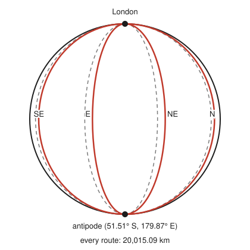
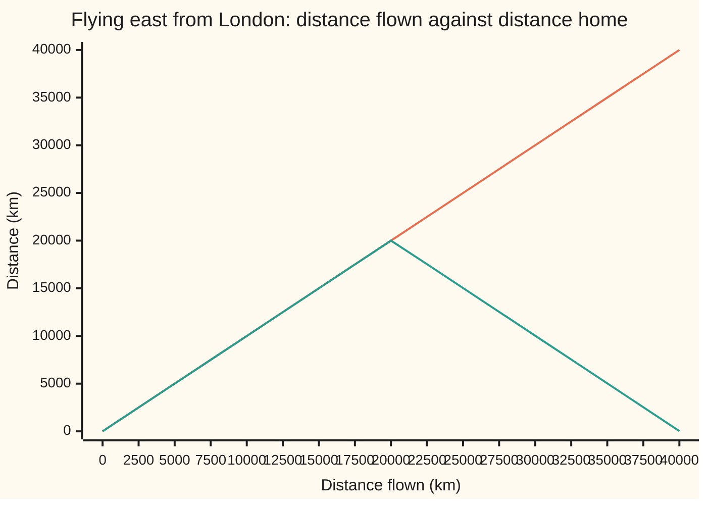

# Hopf-Rinow: when a shortest path is guaranteed to exist

[Syllabus](../../../SYLLABUS.md) → [Differential geometry and Lie groups](../README.md) → [Riemannian Geometry](../README.md#s05) → Hopf-Rinow

---

## General Overview

A plane leaves London and flies straight ahead along a great circle (the line where a plane through the Earth's centre cuts the surface). This card models the Earth as a sphere of radius 6371 km. For the first 20,015.09 km, the route the plane has flown is the shortest way home. Just past that, it is not.

The reason sits at London's antipode, the point directly through the Earth, at 51.5074° S, 179.8722° E, in the Pacific south-east of New Zealand. Every great circle out of London reaches it after exactly 20,015.09 km, half the Earth's circumference. North, east, south-west: all routes tie. Past that point, turning round and flying the other way is shorter. A plane that flies 22,000 km east ends up only 18,030.17 km from London.

This card answers two questions about shortest routes on a curved surface.

1. **When is a shortest route guaranteed to exist?** The Hopf-Rinow theorem says: whenever the surface has no missing points at a finite distance. Cut the North Pole out of the globe and London has no shortest route to its mirror point, at the same latitude on the opposite side of the pole. The promise runs one way only: an open disc cut from a flat sheet is missing its rim, yet every two of its points are joined by a straight segment.
2. **Where does a straight-ahead route stop being shortest?** At its cut point: where two routes first tie, or where neighbouring routes first meet again. On the globe both happen at the antipode.

<p align="center"></p>

The globe in orthographic projection (seen from far away), turned so London is at the top. Solid red routes leave London heading north, north-east, east and south-east on the near side; dashed routes are the other four headings, on the far side. All eight meet at the antipode, each 20,015.09 km long.

**On a connected curved space that is complete, meaning no route can run off the edge in finite length, every two points are joined by a shortest route; a route that goes straight ahead stays shortest only up to its cut point, where another route first ties with it or its neighbours first focus back onto it.**

**What kind of fact this is:** the Hopf-Rinow theorem (1931), a global theorem: it needs the whole space to be complete, not just a neighbourhood. This card outlines the proof: the key step, that completeness gives shortest routes, in Steps 2 and 3, and the rest in a fold; the full proof is in Lee, Chapter 6. The facts about the globe's cut points are proved here. The Cartan-Hadamard theorem is stated with its source, not proved.

---

## The formula

This card uses the shelf's language. A **Riemannian metric** measures lengths and angles at each point ([Riemannian metric](01-riemannian-metrics.md)). The length of a route $`\gamma`$ is $`L(\gamma)`$. The distance $`d(p, q)`$ is the smallest length a route from $`p`$ to $`q`$ can get close to:

```math
d(p, q) = \inf \{\, L(\gamma) : \gamma \text{ a route from } p \text{ to } q \,\}
```

**Read it aloud:** the distance from p to q is the greatest lower bound of the lengths of all routes between them.

An infimum (greatest lower bound) need not be reached. The question "does a shortest route exist?" asks whether some route has length exactly $`d(p, q)`$.

A **geodesic** is a route that goes straight ahead, with no turning in the surface. The **exponential map** $`\exp_p`$ takes a direction $`v`$ at $`p`$, a vector in the tangent plane $`T_pM`$ (the flat plane of all directions and speeds at $`p`$), and flies along the geodesic in that direction for the distance $`\lvert v\rvert`$ ([Geodesic and exponential map](04-geodesics-and-the-exponential-map.md)). A space is **complete** when every Cauchy sequence (a list whose late terms all bunch together) has a limit in the space ([Complete space](../../17-Topology/01-Metric%20Spaces/05-completeness-and-completion.md)).

**Hopf-Rinow.** For a connected space $`M`$ with a Riemannian metric, these are equivalent:

```math
(M, d) \text{ is complete} \iff \exp_p \text{ is defined on all of } T_pM \text{ for some } p \iff \text{closed bounded sets are compact}
```

**Read it aloud:** the space has no holes at finite distance exactly when, from some point, every geodesic can be flown forever, exactly when every closed and bounded set is compact (every sequence in the set has a sub-list that converges to a point of the set).

Checking it: the globe is a closed, bounded set in 3D space, so it is compact, and so is every closed set on it. The third condition holds, so the globe is complete. On the globe without the North Pole, from every point the geodesic aimed at the missing pole stops when it gets there (from London, after 4280.18 km). The second condition fails, so that space is not complete.

When any one condition holds, the theorem adds:

```math
\text{for all } p, q \in M \text{ there is a geodesic } \gamma \text{ from } p \text{ to } q \text{ with } L(\gamma) = d(p, q)
```

**Read it aloud:** in a complete space, every two points are joined by a geodesic that is a shortest route.

The second result says where a geodesic stops being shortest on the globe. Fly from $`p`$ at unit speed for $`t`$ km along a great circle:

```math
d\big(p, \gamma(t)\big) = R \arccos\big(\cos(t/R)\big) = \begin{cases} t, & 0 \le t \le \pi R \\ 2\pi R - t, & \pi R \le t \le 2\pi R \end{cases}
```

**Read it aloud:** the distance home equals the distance flown until half a circumference, then shrinks back to zero.

The distance flown at which a geodesic stops being shortest is its **cut time**. The point it reaches there is its **cut point**. The set of all cut points from $`p`$ is the **cut locus**. On the globe, every geodesic from London has cut time $`\pi R`$ = 20,015.09 km, and the cut locus is the single antipode.

| Symbol | Plain meaning | In our example | Push it up and the answer… |
| --- | --- | --- | --- |
| $`M`$ | the space, with its Riemannian metric | the globe, a sphere | — |
| $`p`$, $`q`$ | two points of $`M`$ | London; Sydney, or London's antipode | — |
| $`\gamma`$, $`\gamma(t)`$ | a route; the point reached after $`t`$ km | a great circle out of London | — |
| $`t`$ | distance flown along a geodesic, in km | 22,000 km east | distance home rises to 20,015.09, then falls |
| $`L(\gamma)`$ | the length of route $`\gamma`$, in km | 8560.36 km London to its mirror over the pole | — |
| $`d(p, q)`$ | the distance: the infimum of route lengths, in km | 16,993.93 km London to Sydney | — |
| $`T_pM`$, $`v`$ | the tangent plane at $`p`$; a direction and distance in it | heading 60.713392° from north, 16,993.93 km | — |
| $`\exp_p(v)`$ | fly from $`p`$ along the geodesic in direction $`v`$ for $`\lvert v\rvert`$ km | lands 0.000268 km from Sydney | — |
| $`R`$ | the Earth's radius, a model value | 6371 km | cut time $`\pi R`$ grows |
| $`r`$, $`x`$ | radius of a small circle round $`p`$; the point on it closest to $`q`$ | 500 km; heading 60.713392° | — |
| $`\alpha`$, $`J(t)`$ | angle between two headings, in radians in formulas; the gap a Jacobi field predicts, in km | 1°, which is π/180 rad; $`J = \alpha R \sin(t/R)`$ | gap grows in proportion |
| $`C`$ | circumference of a flat cylinder | 40,030.17 km | cut time $`C/2`$ grows |

### When it holds

- **The space must be complete.** Remove the North Pole: London's route to its mirror point over the pole, 8560.36 km, is gone, and every detour is longer. A shortest route no longer exists.
- **The space must be connected.** Between two separate pieces there is no route at all, so $`d(p, q)`$ is not even finite.
- **Hopf-Rinow promises existence, not uniqueness.** At the antipode, every heading ties: each of the eight tested reaches it after 20,015.09 km.
- **A geodesic is shortest only up to its cut point.** Fly past the antipode, to 22,000 km, and the route home the other way is 18,030.17 km.
- **The metric is positive definite.** In relativity, where time and space have opposite signs, completeness does not give shortest or longest paths, and the theorem fails.

---

## Why it works

### Step 0: shoot, and let completeness make sure the shot never falls off

To find the shortest route from $`p`$ to $`q`$, stand at $`p`$ and look around a small circle. Pick the point on that circle closest to $`q`$, and fly straight through it. The proof shows this flight hits $`q`$ after exactly $`d(p, q)`$ km.

The flight only works if the geodesic can be flown that far. On the globe with the pole cut out, a plane flying due north from London leaves the space after 4280.18 km. Completeness is the promise that this never happens.

### Step 1: near a point, geodesics are shortest

Close to $`p`$, the exponential map is a smooth one-to-one map from a small disc of directions onto a small round neighbourhood. Inside it, the geodesic from $`p`$ is the unique shortest route, and the circle of radius $`r`$ around $`p`$ is the set of points at distance exactly $`r`$ (see [Geodesic and exponential map](04-geodesics-and-the-exponential-map.md); the standard proof uses the Gauss lemma, that geodesics from $`p`$ cross these circles at right angles). This is a local fact: it holds on every Riemannian manifold, complete or not.

### Step 2: pick the closest point on a small circle

Take a circle of radius $`r`$ around $`p`$, small enough for Step 1. The circle is a closed, bounded curve, so the distance to $`q`$, a continuous function on it, reaches a minimum somewhere ([Extreme value theorem](../../06-Calculus%20and%20analysis/01-Limits%20and%20Continuity/07-extreme-value-theorem.md)). Call that point $`x`$. Every route from $`p`$ to $`q`$ crosses the circle, so it is at least $`r + d(x, q)`$ long, and so is $`d(p, q)`$. The triangle inequality through $`x`$ gives $`d(p, q) \le r + d(x, q)`$. So the two are equal:

```math
d(p, q) = r + d(x, q)
```

**Read it aloud:** the distance to q equals the radius of the small circle plus the distance from its best point to q.

London to Sydney is 16,993.93 km. On the 500 km circle round London, the closest point to Sydney lies on heading 60.713392°. Then 500 + d(x, Sydney) = 16,993.93 km, as the formula says. The standard bearing formula gives 60.713386°, the same heading to five decimal places.

### Step 3: fly through it, and the gap closes steadily

Let $`\gamma`$ be the geodesic from $`p`$ through $`x`$. Call a time $`t`$ good when $`d(\gamma(t), q) = d(p, q) - t`$: flying $`t`$ km cost exactly $`t`$ km of the remaining distance. Step 2 says $`t = r`$ is good.

Repeat Step 2 from the point $`\gamma(t)`$. Its best small-circle point lies on the continuation of $`\gamma`$; otherwise the route would have a corner, and a corner can be cut short. So good times push forward, and the set of good times is closed. The largest good time is therefore $`d(p, q)`$ itself, where the remaining distance is 0 and $`\gamma`$ has reached $`q`$.

The flight along heading 60.713392° for 16,993.93 km lands 0.000268 km from Sydney. The miss comes from the search's finite precision in the heading, not from the method.

<details>
<summary>Detailed proof outline: the three conditions are equivalent, and each gives shortest routes</summary>

Write (a) for "complete", (b) for "$`\exp_p`$ is defined on all of $`T_pM`$", (c) for "closed bounded sets are compact".

**(b) gives shortest routes from p.** Steps 2 and 3. The flight in Step 3 needs $`\gamma(t)`$ to exist for every $`t`$ up to $`d(p, q)`$, which is what (b) says.

**(b) gives (c).** A bounded set lies inside some closed ball around $`p`$. By the previous paragraph, every point of that ball is $`\exp_p(v)`$ for some $`v`$ no longer than the ball's radius. That disc of directions is compact and $`\exp_p`$ is continuous, so the ball is compact. A closed subset of a compact set is compact.

**(c) gives (a).** A Cauchy sequence is bounded, so it lies in a compact closed ball. It has a convergent sub-list, and a Cauchy sequence with a convergent sub-list converges.

**(a) gives (b) at every point.** Suppose a unit-speed geodesic stops at some finite time. Two of its points are never farther apart than the length of the arc between them. So its points just before the stopping time form a Cauchy sequence. By (a) they converge to a point of $`M`$. Near that point, geodesics exist for a fixed length in every direction, so $`\gamma`$ continues past its stopping time, a contradiction.

The full details, including the closedness argument in Step 3, are in Lee, *Introduction to Riemannian Manifolds*, Chapter 6.

</details>

### Step 4: on the globe, the cut point is the antipode

Two reasons can end a geodesic's run as a shortest route.

1. **A tie.** Another route of the same length reaches the same point. Past a tie, a corner trick shortens the original route.
2. **A conjugate point.** Neighbouring geodesics from $`p`$ meet again. A [Jacobi field](09-jacobi-fields-and-comparison-theorems.md) measures the gap between neighbours; a conjugate point is where it first returns to zero. Past it, a nearby wiggled route is shorter.

The cut point is whichever comes first. On the globe both come at once, at the antipode:

- **Ties.** Every heading from London reaches the antipode after $`\pi R`$ = 20,015.09 km. Aim the Step 2 search at the antipode and every heading on the 500 km circle gives 19,515.09 km, with spread 0.000000 km: there is no best direction.
- **Neighbours refocus.** Headings 90° and 91° start $`\alpha`$ = 1° apart. Their gap follows $`J(t) = \alpha R \sin(t/R)`$: 78.58 km after 5000 km, 111.19 km at a quarter circle, and 0.00 km at the antipode.

Past the antipode, the formula gives $`d = 2\pi R - t < t`$. The flown route is longer than the way back.



The orange line is the distance flown. The green line is the shortest distance home, measured from the plane's position. They agree up to the cut time, 20,015.09 km, and part there.

### Step 5: a tie with no refocusing, and a space with no cut points

The two reasons can come apart. Roll a sheet of paper into a flat cylinder of circumference $`C`$ = 40,030.17 km, the equator's length. A route flown around it has distance home $`\min(t, C - t)`$: after 30,000 km, it is 10,030.17 km from the start. At $`C/2`$ = 20,015.09 km the two ways round tie, so that is the cut point.

Yet the cylinder is flat. Neighbouring routes spread as on a plane: for headings 1° apart the Jacobi gap is $`\alpha t`$ = 349.33 km at 20,015.09 km, and the distance measured on the cylinder is 349.32 km. They never refocus. The cut comes from the shape's topology (the loop round the cylinder), not from curvature. The cylinder is complete: unrolled, every geodesic is a straight line in the plane, which runs forever, so $`\exp_p`$ is defined on all of $`T_pM`$. So Hopf-Rinow still gives shortest routes; at the cut point there are two. It is not simply connected, which is why the next theorem allows its tie.

**Cartan-Hadamard** goes the other way. If $`M`$ is complete, simply connected (every loop can shrink to a point) and its sectional curvature (the curvature of each two-dimensional slice through a point, from [Riemann curvature tensor](06-riemann-curvature-tensor.md)) is never positive, then $`\exp_p`$ is one-to-one onto $`M`$. No ties and no conjugate points: every geodesic is shortest for its whole length. On the hyperbolic plane with curvature $`-1/R^2`$, the globe's curvature with the sign flipped ([Sphere, plane and hyperbolic space](05-model-spaces-of-constant-curvature.md)), the gap is $`\alpha R \sinh(t/R)`$: 1284.16 km at 20,015.09 km. This theorem is stated here, not proved; see Lee, Chapter 12.

---

## Worked numbers, by hand

The Earth is a sphere of radius $`R`$ = 6371 km. London is at 51.5074° N, 0.1278° W; Sydney at 33.8688° S, 151.2093° E.

| Step | Arithmetic | Value |
| --- | --- | --- |
| cut time on the globe | $`\pi R = \pi \times 6371`$ | 20,015.09 km |
| antipode | latitude −51.5074, longitude −0.1278 + 180 | 51.5074° S, 179.8722° E |
| eight headings flown $`\pi R`$ | miss from the antipode, closed form | 0.000000 km each |
| same, stepped (RK4) | miss at 100 steps; at 200 steps | 0.1624 m; 0.0102 m, ratio 16.00 |
| London to Sydney | great-circle distance | 16,993.93 km |
| best point on the 500 km circle | heading by search; by bearing formula | 60.713392°; 60.713386° |
| Step 2's identity | 500 + d(x, Sydney) | 16,993.93 km |
| fly the heading 16,993.93 km | miss from Sydney | 0.000268 km |
| fly 22,000 km east | $`2\pi R - 22000 = 40030.17 - 22000`$ | **18,030.17 km home** |

A route flown 22,000 km from London has passed its cut point: the plane is 18,030.17 km from home, and the shortest way back is ahead of it, not behind.

### What breaks if you drop a piece

| Mistake | Comes out at | What went wrong |
| --- | --- | --- |
| Flying straight past the antipode and calling it shortest | flown 22,000 km, distance home 18,030.17 km | The route is past its cut point, $`\pi R`$ = 20,015.09 km |
| Dropping completeness: the globe without the North Pole | detours 2.4401, 0.0244, 0.0002 km longer than 8560.36 km, never equal | The infimum is the route through the missing pole; no route reaches it |
| Assuming the shortest route is unique | London to its antipode: 8 headings, each 20,015.09 km | Hopf-Rinow gives existence only; ties mark the cut locus |
| Expecting a cut point only where neighbours refocus | flat cylinder: routes tie at 20,015.09 km, neighbour gap 349.32 km, not 0 | Ties from topology cut a geodesic with no conjugate point |

---

## Code, from first principles, and it actually runs

The code puts the globe in three dimensions, with points as unit vectors and great circles in closed form. It takes five roads. The closed-form great circle is checked against an RK4 (fourth-order Runge-Kutta) stepping of the geodesic equation at two step sizes. The proof's shooting search for London to Sydney is checked against the bearing formula and against the distance formula. Every distance home is measured from positions and checked against $`R \arccos(\cos(t/R))`$. The punctured-globe detours are computed as two legs and checked against spherical Pythagoras (for a right-angled triangle on the globe, the cosine of the long side divided by R is the product of the same cosines for the other two sides). Finally, the flat cylinder is built in 3D with radius $`C/(2\pi)`$: its distance home, its two ways round and the gap between neighbouring routes are measured on the surface and checked against $`\min(t, C - t)`$ and $`\alpha t`$.

### Python

```python
# Hopf-Rinow and where shortest routes end -- the check behind the card.
# Nothing is imported except math.  The Earth is a sphere of radius 6371 km.
# Points are unit vectors; a flight along heading h is a great circle.
# Roads: closed-form great circles against an RK4-stepped geodesic, the
# proof's "shoot through the nearest point" search against the bearing
# formula, and closed-form distances against distances measured point to point.
import math
R = 6371.0
D = math.pi / 180

def pos(phi, th):                      # phi down from the North Pole, th east
    return (math.sin(phi * D) * math.cos(th * D), math.sin(phi * D) * math.sin(th * D), math.cos(phi * D))
def dot(a, b): return a[0] * b[0] + a[1] * b[1] + a[2] * b[2]
def cross(a, b): return (a[1] * b[2] - a[2] * b[1], a[2] * b[0] - a[0] * b[2], a[0] * b[1] - a[1] * b[0])
def dist(a, b):                        # surface distance in km, accurate near antipodes
    c = cross(a, b)
    return R * math.atan2(math.sqrt(dot(c, c)), dot(a, b))
def start(phi, th, h):                 # position and unit direction for heading h deg
    north = (-math.cos(phi * D) * math.cos(th * D), -math.cos(phi * D) * math.sin(th * D), math.sin(phi * D))
    east = (-math.sin(th * D), math.cos(th * D), 0.0)
    return pos(phi, th), [math.cos(h * D) * north[i] + math.sin(h * D) * east[i] for i in range(3)]
def fly(phi, th, h, t):                # road one, closed form: a great circle, t km along
    p, u = start(phi, th, h)
    return tuple(math.cos(t / R) * p[i] + math.sin(t / R) * u[i] for i in range(3))
def rk4(phi, th, h, t, n):             # road two: step x'' = -|x'|^2 x / |x|^2 in km
    p, v = start(phi, th, h)
    x = [R * c for c in p]
    def acc(x, v): k = -sum(c * c for c in v) / sum(c * c for c in x); return [k * c for c in x]
    dt = t / n
    for _ in range(n):
        a1 = acc(x, v)
        x2 = [x[i] + dt / 2 * v[i] for i in range(3)]; v2 = [v[i] + dt / 2 * a1[i] for i in range(3)]; a2 = acc(x2, v2)
        x3 = [x[i] + dt / 2 * v2[i] for i in range(3)]; v3 = [v[i] + dt / 2 * a2[i] for i in range(3)]; a3 = acc(x3, v3)
        x4 = [x[i] + dt * v3[i] for i in range(3)]; v4 = [v[i] + dt * a3[i] for i in range(3)]; a4 = acc(x4, v4)
        x = [x[i] + dt / 6 * (v[i] + 2 * v2[i] + 2 * v3[i] + v4[i]) for i in range(3)]
        v = [v[i] + dt / 6 * (a1[i] + 2 * a2[i] + 2 * a3[i] + a4[i]) for i in range(3)]
    return x

LON = (90 - 51.5074, -0.1278)          # London
SYD = (90 + 33.8688, 151.2093)         # Sydney
ANT = (180 - LON[0], LON[1] + 180)     # London's antipode
HALF = math.pi * R
print(f"globe: R = {R:.0f} km, half a great circle pi R = {HALF:.2f} km, full circle {2 * HALF:.2f} km")
print(f"London's antipode: latitude {90 - ANT[0]:.4f}, longitude {ANT[1]:.4f}")
heads = [0, 45, 90, 135, 180, 225, 270, 315]
print("eight headings from London, each flown pi R km: miss from the antipode (km)")
ties = [dist(fly(*LON, h, HALF), pos(*ANT)) for h in heads]
print("  closed form: " + " ".join(f"{m:.6f}" for m in ties))
err = {}
for n in (100, 200):
    err[n] = [dist([c / R for c in rk4(*LON, h, HALF, n)], pos(*ANT)) * 1000 for h in heads]
    print(f"  RK4, {n} steps of {HALF / n:.2f} km, miss in metres: " + " ".join(f"{e:.4f}" for e in err[n]))
print(f"  error ratio, 100 steps over 200 steps: {err[100][0] / err[200][0]:.2f} (RK4 predicts 16)")

dpq = dist(pos(*LON), pos(*SYD))       # Hopf-Rinow: shoot through the nearest point
DEL = 500.0
f = lambda h: dist(fly(*LON, h, DEL), pos(*SYD))
h0 = min(range(360), key=f)
lo, hi = h0 - 1.0, h0 + 1.0
for _ in range(80):                    # golden-section search on the heading
    m1, m2 = hi - 0.618033988749895 * (hi - lo), lo + 0.618033988749895 * (hi - lo)
    lo, hi = (lo, m2) if f(m1) < f(m2) else (m1, hi)
hb = (lo + hi) / 2
p1, p2, dl = (90 - LON[0]) * D, (90 - SYD[0]) * D, (SYD[1] - LON[1]) * D   # latitudes, longitude gap
bear = math.atan2(math.sin(dl) * math.cos(p2), math.cos(p1) * math.sin(p2) - math.sin(p1) * math.cos(p2) * math.cos(dl)) / D
print(f"London to Sydney: distance {dpq:.2f} km")
print(f"  nearest point to Sydney on the {DEL:.0f} km circle: heading {hb:.6f}, bearing formula {bear % 360:.6f}")
print(f"  {DEL:.0f} + distance from that point = {DEL + f(hb):.2f} km")
print(f"  fly that heading {dpq:.2f} km: lands {dist(fly(*LON, hb, dpq), pos(*SYD)):.6f} km from Sydney")
g = [dist(fly(*LON, h, DEL), pos(*ANT)) for h in range(360)]
print(f"  same search aimed at the antipode: every heading gives {min(g):.2f} km, spread {max(g) - min(g):.6f} km")

print("fly east from London: km flown, distance home (measured), R arccos(cos(t/R))")
chart = []
for t in [2500 * k for k in range(17)] + [HALF]:
    meas = dist(pos(*LON), fly(*LON, 90, t))
    chart.append(meas)
    print(f"  {t:9.2f} {meas:9.2f} {R * math.acos(math.cos(t / R)):9.2f}")
print("chart, distance home: " + ", ".join(f"{c:.0f}" for c in chart[:17]))

MIR = (LON[0], LON[1] + 180)           # London's mirror across the North Pole
dm = dist(pos(*LON), pos(*MIR))
print(f"London to its mirror over the pole: {dm:.2f} km, by the pole; 2 x {LON[0]:.4f} deg x R = {2 * LON[0] * D * R:.2f}")
print("globe with the pole removed: detour through a point delta from the pole")
det = []
for dd in (1.0, 0.1, 0.01):
    w = pos(dd, LON[1] + 90)
    det.append((2 * dist(pos(*LON), w), 2 * R * math.acos(math.cos(LON[0] * D) * math.cos(dd * D))))
    print(f"  delta {dd:4.2f} deg = {dd * D * R:6.2f} km: route {det[-1][0]:.4f} km, Pythagoras {det[-1][1]:.4f} km, extra {det[-1][0] - dm:.4f} km")
print(f"  flying due north, the route leaves the punctured globe after {LON[0] * D * R:.2f} km")

A = 1.0                                # two headings 1 degree apart: Jacobi field size
print("headings 90 and 91 from London: gap (km), Jacobi alpha R sin(t/R), flat alpha t, hyperbolic alpha R sinh(t/R)")
gaps = []
for t in (5000.0, HALF / 2, 15000.0, HALF):
    gap = dist(fly(*LON, 90, t), fly(*LON, 90 + A, t))
    gaps.append(gap)
    print(f"  t {t:8.2f}: {gap:7.2f} {A * D * R * math.sin(t / R):7.2f} {A * D * t:7.2f} {A * D * R * math.sinh(t / R):8.2f}")
C = 2 * HALF                           # flat cylinder with the equator's length, built in 3D
RC = C / (2 * math.pi)                 # its radius, km
def cpt(e, n): return (RC * math.cos(e / RC), RC * math.sin(e / RC), n)   # unrolled (east, north) -> 3D point
def cdist(a, b):                       # on the surface: shorter arc round the axis, then Pythagoras with the height
    arc = RC * math.atan2(a[0] * b[1] - a[1] * b[0], a[0] * b[0] + a[1] * b[1])
    return math.sqrt(arc * arc + (a[2] - b[2]) * (a[2] - b[2]))
print(f"flat cylinder in 3D, circumference {C:.2f} km, radius {RC:.2f} km: distance home, the two ways round, gap to heading 91")
cyl = []
for t in (10000.0, HALF, 30000.0):
    p = cpt(t, 0.0)
    east = RC * (math.atan2(p[1], p[0]) % (2 * math.pi))   # the way round going east, read from the 3D point
    home, gap = cdist(cpt(0.0, 0.0), p), cdist(p, cpt(t * math.sin((90 + A) * D), t * math.cos((90 + A) * D)))
    cyl.append((t, home, east, C - east, gap))
    print(f"  flown {t:8.2f}: home {home:8.2f}, min(t, C - t) {min(t, C - t):8.2f}; east {east:8.2f}, west {C - east:8.2f}, "
          f"tied: {'yes' if abs(east - (C - east)) < 1e-6 else 'no'}; gap {gap:6.2f}, alpha t {A * D * t:6.2f}")
print(f"what breaks: fly 22000.00 km east, distance home {dist(pos(*LON), fly(*LON, 90, 22000.0)):.2f} km")
print("figure, centre (210, 200), radius 160 px; London (210, 40), antipode (210, 360); route half-widths px: "
      + " ".join(f"{abs(160 * math.cos((h + 20) * D)):.1f}" for h in heads[:4]))   # orthographic view

assert max(ties) < 1e-6                                       # every heading ties at the antipode
assert all(e < 50 for e in err[100]) and 14 < err[100][0] / err[200][0] < 18   # RK4 is fourth order
assert abs(DEL + f(hb) - dpq) < 1e-6 and abs(hb - bear % 360) < 1e-5          # shooting = bearing formula
assert dist(fly(*LON, hb, dpq), pos(*SYD)) < 1e-3                             # the shot lands on Sydney
assert max(g) - min(g) < 1e-6                                                  # no best heading at the antipode
assert all(abs(c - min(t, 2 * HALF - t)) < 1e-6 for c, t in zip(chart, [2500 * k for k in range(17)] + [HALF]))
assert all(a > dm and abs(a - b) < 1e-6 for a, b in det) and det[0][0] > det[1][0] > det[2][0]
assert abs(gaps[1] - A * D * R) < 1e-6 and gaps[3] < 1e-6                     # neighbours refocus at pi R
assert all(abs(h - min(t, C - t)) < 1e-6 for t, h, e, w, g in cyl)                  # measured on the surface = min(t, C - t)
assert [abs(e - w) < 1e-6 for t, h, e, w, g in cyl] == [False, True, False]          # the two ways round tie only at pi R
assert all(abs(g - A * D * t) < 1e-4 * A * D * t for t, h, e, w, g in cyl)           # flat: neighbours spread as alpha t
print("ALL CHECKS PASS")
```

**Ran 2026-11-19 on macOS, Python 3.14.10, standard library only. All checks passed. Output, pasted from the run:**

```
globe: R = 6371 km, half a great circle pi R = 20015.09 km, full circle 40030.17 km
London's antipode: latitude -51.5074, longitude 179.8722
eight headings from London, each flown pi R km: miss from the antipode (km)
  closed form: 0.000000 0.000000 0.000000 0.000000 0.000000 0.000000 0.000000 0.000000
  RK4, 100 steps of 200.15 km, miss in metres: 0.1624 0.1624 0.1624 0.1624 0.1624 0.1624 0.1624 0.1624
  RK4, 200 steps of 100.08 km, miss in metres: 0.0102 0.0102 0.0102 0.0102 0.0102 0.0102 0.0102 0.0102
  error ratio, 100 steps over 200 steps: 16.00 (RK4 predicts 16)
London to Sydney: distance 16993.93 km
  nearest point to Sydney on the 500 km circle: heading 60.713392, bearing formula 60.713386
  500 + distance from that point = 16993.93 km
  fly that heading 16993.93 km: lands 0.000268 km from Sydney
  same search aimed at the antipode: every heading gives 19515.09 km, spread 0.000000 km
fly east from London: km flown, distance home (measured), R arccos(cos(t/R))
       0.00      0.00      0.00
    2500.00   2500.00   2500.00
    5000.00   5000.00   5000.00
    7500.00   7500.00   7500.00
   10000.00  10000.00  10000.00
   12500.00  12500.00  12500.00
   15000.00  15000.00  15000.00
   17500.00  17500.00  17500.00
   20000.00  20000.00  20000.00
   22500.00  17530.17  17530.17
   25000.00  15030.17  15030.17
   27500.00  12530.17  12530.17
   30000.00  10030.17  10030.17
   32500.00   7530.17   7530.17
   35000.00   5030.17   5030.17
   37500.00   2530.17   2530.17
   40000.00     30.17     30.17
   20015.09  20015.09  20015.09
chart, distance home: 0, 2500, 5000, 7500, 10000, 12500, 15000, 17500, 20000, 17530, 15030, 12530, 10030, 7530, 5030, 2530, 30
London to its mirror over the pole: 8560.36 km, by the pole; 2 x 38.4926 deg x R = 8560.36
globe with the pole removed: detour through a point delta from the pole
  delta 1.00 deg = 111.19 km: route 8562.8038 km, Pythagoras 8562.8038 km, extra 2.4401 km
  delta 0.10 deg =  11.12 km: route 8560.3881 km, Pythagoras 8560.3881 km, extra 0.0244 km
  delta 0.01 deg =   1.11 km: route 8560.3639 km, Pythagoras 8560.3639 km, extra 0.0002 km
  flying due north, the route leaves the punctured globe after 4280.18 km
headings 90 and 91 from London: gap (km), Jacobi alpha R sin(t/R), flat alpha t, hyperbolic alpha R sinh(t/R)
  t  5000.00:   78.58   78.58   87.27    96.50
  t 10007.54:  111.19  111.19  174.66   255.89
  t 15000.00:   78.77   78.77  261.80   580.27
  t 20015.09:    0.00    0.00  349.33  1284.16
flat cylinder in 3D, circumference 40030.17 km, radius 6371.00 km: distance home, the two ways round, gap to heading 91
  flown 10000.00: home 10000.00, min(t, C - t) 10000.00; east 10000.00, west 30030.17, tied: no; gap 174.53, alpha t 174.53
  flown 20015.09: home 20015.09, min(t, C - t) 20015.09; east 20015.09, west 20015.09, tied: yes; gap 349.32, alpha t 349.33
  flown 30000.00: home 10030.17, min(t, C - t) 10030.17; east 30000.00, west 10030.17, tied: no; gap 523.59, alpha t 523.60
what breaks: fly 22000.00 km east, distance home 18030.17 km
figure, centre (210, 200), radius 160 px; London (210, 40), antipode (210, 360); route half-widths px: 150.4 67.6 54.7 145.0
ALL CHECKS PASS
```

### Rust

Same numbers, same labels, built with `rustc --edition 2021 -O`.

```rust
// Hopf-Rinow and where shortest routes end -- the same check as the Python, in
// Rust.  No crates.  The Earth is a sphere of radius 6371 km.  Points are unit
// vectors; a flight along heading h is a great circle.  Roads: closed-form
// great circles against an RK4-stepped geodesic, the proof's "shoot through the
// nearest point" search against the bearing formula, and closed-form distances
// against distances measured point to point.
const R: f64 = 6371.0;
const D: f64 = std::f64::consts::PI / 180.0;
type V = [f64; 3];

fn pos(phi: f64, th: f64) -> V {         // phi down from the North Pole, th east
    [(phi * D).sin() * (th * D).cos(), (phi * D).sin() * (th * D).sin(), (phi * D).cos()]
}
fn dot(a: V, b: V) -> f64 { a[0] * b[0] + a[1] * b[1] + a[2] * b[2] }
fn cross(a: V, b: V) -> V { [a[1] * b[2] - a[2] * b[1], a[2] * b[0] - a[0] * b[2], a[0] * b[1] - a[1] * b[0]] }
fn dist(a: V, b: V) -> f64 {             // surface distance in km, accurate near antipodes
    let c = cross(a, b);
    R * dot(c, c).sqrt().atan2(dot(a, b))
}
fn start(phi: f64, th: f64, h: f64) -> (V, V) { // position and unit direction for heading h deg
    let north = [-(phi * D).cos() * (th * D).cos(), -(phi * D).cos() * (th * D).sin(), (phi * D).sin()];
    let east = [-(th * D).sin(), (th * D).cos(), 0.0];
    let mut u = [0.0; 3];
    for i in 0..3 { u[i] = (h * D).cos() * north[i] + (h * D).sin() * east[i] }
    (pos(phi, th), u)
}
fn fly(s: (f64, f64), h: f64, t: f64) -> V { // road one, closed form: a great circle, t km along
    let (p, u) = start(s.0, s.1, h);
    let mut x = [0.0; 3];
    for i in 0..3 { x[i] = (t / R).cos() * p[i] + (t / R).sin() * u[i] }
    x
}
fn acc(x: V, v: V) -> V {
    let k = -(v[0] * v[0] + v[1] * v[1] + v[2] * v[2]) / (x[0] * x[0] + x[1] * x[1] + x[2] * x[2]);
    [k * x[0], k * x[1], k * x[2]]
}
fn step(x: V, v: V, c: f64) -> V { [x[0] + c * v[0], x[1] + c * v[1], x[2] + c * v[2]] }
fn rk4(s: (f64, f64), h: f64, t: f64, n: usize) -> V { // road two: step x'' = -|x'|^2 x / |x|^2 in km
    let (p, mut v) = start(s.0, s.1, h);
    let mut x = [R * p[0], R * p[1], R * p[2]];
    let dt = t / n as f64;
    for _ in 0..n {
        let a1 = acc(x, v);
        let (x2, v2) = (step(x, v, dt / 2.0), step(v, a1, dt / 2.0)); let a2 = acc(x2, v2);
        let (x3, v3) = (step(x, v2, dt / 2.0), step(v, a2, dt / 2.0)); let a3 = acc(x3, v3);
        let (x4, v4) = (step(x, v3, dt), step(v, a3, dt)); let a4 = acc(x4, v4);
        let (mut xn, mut vn) = ([0.0; 3], [0.0; 3]);
        for i in 0..3 {
            xn[i] = x[i] + dt / 6.0 * (v[i] + 2.0 * v2[i] + 2.0 * v3[i] + v4[i]);
            vn[i] = v[i] + dt / 6.0 * (a1[i] + 2.0 * a2[i] + 2.0 * a3[i] + a4[i]);
        }
        x = xn; v = vn;
    }
    x
}
fn join(v: &[f64], p: usize) -> String { v.iter().map(|x| format!("{:.*}", p, x)).collect::<Vec<_>>().join(" ") }

fn main() {
    let lon = (90.0 - 51.5074, -0.1278);              // London
    let syd = (90.0 + 33.8688, 151.2093);             // Sydney
    let ant = (180.0 - lon.0, lon.1 + 180.0);         // London's antipode
    let (pl, ps, pa) = (pos(lon.0, lon.1), pos(syd.0, syd.1), pos(ant.0, ant.1));
    let half = std::f64::consts::PI * R;
    println!("globe: R = {:.0} km, half a great circle pi R = {:.2} km, full circle {:.2} km", R, half, 2.0 * half);
    println!("London's antipode: latitude {:.4}, longitude {:.4}", 90.0 - ant.0, ant.1);
    let heads = [0.0, 45.0, 90.0, 135.0, 180.0, 225.0, 270.0, 315.0];
    println!("eight headings from London, each flown pi R km: miss from the antipode (km)");
    let ties: Vec<f64> = heads.iter().map(|&h| dist(fly(lon, h, half), pa)).collect();
    println!("  closed form: {}", join(&ties, 6));
    let mut err = vec![];
    for n in [100usize, 200] {
        let e: Vec<f64> = heads.iter().map(|&h| { let x = rk4(lon, h, half, n); dist([x[0] / R, x[1] / R, x[2] / R], pa) * 1000.0 }).collect();
        println!("  RK4, {} steps of {:.2} km, miss in metres: {}", n, half / n as f64, join(&e, 4));
        err.push(e);
    }
    println!("  error ratio, 100 steps over 200 steps: {:.2} (RK4 predicts 16)", err[0][0] / err[1][0]);

    let dpq = dist(pl, ps);                           // Hopf-Rinow: shoot through the nearest point
    let del = 500.0;
    let f = |h: f64| dist(fly(lon, h, del), ps);
    let mut h0 = 0;
    for h in 1..360 { if f(h as f64) < f(h0 as f64) { h0 = h } }
    let (mut lo, mut hi) = (h0 as f64 - 1.0, h0 as f64 + 1.0);
    for _ in 0..80 {                                  // golden-section search on the heading
        let (m1, m2) = (hi - 0.618033988749895 * (hi - lo), lo + 0.618033988749895 * (hi - lo));
        if f(m1) < f(m2) { hi = m2 } else { lo = m1 }
    }
    let hb = (lo + hi) / 2.0;
    let (p1, p2, dl) = ((90.0 - lon.0) * D, (90.0 - syd.0) * D, (syd.1 - lon.1) * D); // latitudes, longitude gap
    let bear = ((dl.sin() * p2.cos()).atan2(p1.cos() * p2.sin() - p1.sin() * p2.cos() * dl.cos()) / D).rem_euclid(360.0);
    println!("London to Sydney: distance {:.2} km", dpq);
    println!("  nearest point to Sydney on the {:.0} km circle: heading {:.6}, bearing formula {:.6}", del, hb, bear);
    println!("  {:.0} + distance from that point = {:.2} km", del, del + f(hb));
    let miss = dist(fly(lon, hb, dpq), ps);
    println!("  fly that heading {:.2} km: lands {:.6} km from Sydney", dpq, miss);
    let g: Vec<f64> = (0..360).map(|h| dist(fly(lon, h as f64, del), pa)).collect();
    let (gmin, gmax) = (g.iter().cloned().fold(f64::MAX, f64::min), g.iter().cloned().fold(f64::MIN, f64::max));
    println!("  same search aimed at the antipode: every heading gives {:.2} km, spread {:.6} km", gmin, gmax - gmin);

    println!("fly east from London: km flown, distance home (measured), R arccos(cos(t/R))");
    let mut ts: Vec<f64> = (0..17).map(|k| 2500.0 * k as f64).collect();
    ts.push(half);
    let mut chart = vec![];
    for &t in &ts {
        let meas = dist(pl, fly(lon, 90.0, t));
        chart.push(meas);
        println!("  {:9.2} {:9.2} {:9.2}", t, meas, R * (t / R).cos().acos());
    }
    println!("chart, distance home: {}", chart[..17].iter().map(|c| format!("{:.0}", c)).collect::<Vec<_>>().join(", "));

    let mir = pos(lon.0, lon.1 + 180.0);              // London's mirror across the North Pole
    let dm = dist(pl, mir);
    println!("London to its mirror over the pole: {:.2} km, by the pole; 2 x {:.4} deg x R = {:.2}", dm, lon.0, 2.0 * lon.0 * D * R);
    println!("globe with the pole removed: detour through a point delta from the pole");
    let mut det = vec![];
    for dd in [1.0, 0.1, 0.01] {
        let w = pos(dd, lon.1 + 90.0);
        let (a, b) = (2.0 * dist(pl, w), 2.0 * R * ((lon.0 * D).cos() * (dd * D).cos()).acos());
        det.push((a, b));
        println!("  delta {:4.2} deg = {:6.2} km: route {:.4} km, Pythagoras {:.4} km, extra {:.4} km", dd, dd * D * R, a, b, a - dm);
    }
    println!("  flying due north, the route leaves the punctured globe after {:.2} km", lon.0 * D * R);

    let al = 1.0;                                     // two headings 1 degree apart: Jacobi field size
    println!("headings 90 and 91 from London: gap (km), Jacobi alpha R sin(t/R), flat alpha t, hyperbolic alpha R sinh(t/R)");
    let mut gaps = vec![];
    for t in [5000.0, half / 2.0, 15000.0, half] {
        let gap = dist(fly(lon, 90.0, t), fly(lon, 90.0 + al, t));
        gaps.push(gap);
        println!("  t {:8.2}: {:7.2} {:7.2} {:7.2} {:8.2}", t, gap, al * D * R * (t / R).sin(), al * D * t, al * D * R * (t / R).sinh());
    }
    let c = 2.0 * half;                               // flat cylinder with the equator's length, built in 3D
    let rc = c / (2.0 * std::f64::consts::PI);        // its radius, km
    let cpt = |e: f64, n: f64| -> V { [rc * (e / rc).cos(), rc * (e / rc).sin(), n] }; // unrolled (east, north) -> 3D point
    let cdist = |a: V, b: V| -> f64 {                 // on the surface: shorter arc round the axis, then Pythagoras with the height
        let arc = rc * (a[0] * b[1] - a[1] * b[0]).atan2(a[0] * b[0] + a[1] * b[1]);
        (arc * arc + (a[2] - b[2]) * (a[2] - b[2])).sqrt()
    };
    println!("flat cylinder in 3D, circumference {:.2} km, radius {:.2} km: distance home, the two ways round, gap to heading 91", c, rc);
    let mut cyl = vec![];
    for t in [10000.0, half, 30000.0] {
        let p = cpt(t, 0.0);
        let east = rc * p[1].atan2(p[0]).rem_euclid(2.0 * std::f64::consts::PI); // the way round going east, read from the 3D point
        let (home, gap) = (cdist(cpt(0.0, 0.0), p), cdist(p, cpt(t * ((90.0 + al) * D).sin(), t * ((90.0 + al) * D).cos())));
        cyl.push((t, home, east, c - east, gap));
        println!("  flown {:8.2}: home {:8.2}, min(t, C - t) {:8.2}; east {:8.2}, west {:8.2}, tied: {}; gap {:6.2}, alpha t {:6.2}", t, home, t.min(c - t),
                 east, c - east, if (east - (c - east)).abs() < 1e-6 { "yes" } else { "no" }, gap, al * D * t);
    }
    println!("what breaks: fly 22000.00 km east, distance home {:.2} km", dist(pl, fly(lon, 90.0, 22000.0)));
    println!("figure, centre (210, 200), radius 160 px; London (210, 40), antipode (210, 360); route half-widths px: {}",
             heads[..4].iter().map(|h| format!("{:.1}", (160.0 * ((h + 20.0) * D).cos()).abs())).collect::<Vec<_>>().join(" "));

    assert!(ties.iter().all(|&m| m < 1e-6));                          // every heading ties at the antipode
    assert!(err[0].iter().all(|&e| e < 50.0) && 14.0 < err[0][0] / err[1][0] && err[0][0] / err[1][0] < 18.0);
    assert!((del + f(hb) - dpq).abs() < 1e-6 && (hb - bear).abs() < 1e-5); // shooting = bearing formula
    assert!(miss < 1e-3);                                             // the shot lands on Sydney
    assert!(gmax - gmin < 1e-6);                                      // no best heading at the antipode
    assert!(chart.iter().zip(&ts).all(|(m, &t)| (m - t.min(2.0 * half - t)).abs() < 1e-6));
    assert!(det.iter().all(|&(a, b)| a > dm && (a - b).abs() < 1e-6) && det[0].0 > det[1].0 && det[1].0 > det[2].0);
    assert!((gaps[1] - al * D * R).abs() < 1e-6 && gaps[3] < 1e-6);     // neighbours refocus at pi R
    assert!(cyl.iter().all(|&(t, h, _, _, _)| (h - t.min(c - t)).abs() < 1e-6));        // measured on the surface = min(t, C - t)
    assert!(cyl.iter().map(|&(_, _, e, w, _)| (e - w).abs() < 1e-6).collect::<Vec<_>>() == vec![false, true, false]); // tie only at pi R
    assert!(cyl.iter().all(|&(t, _, _, _, g)| (g - al * D * t).abs() < 1e-4 * al * D * t)); // flat: neighbours spread as alpha t
    println!("ALL CHECKS PASS");
}
```

**Ran 2026-11-19 on macOS, rustc 1.98.1, no crates. All checks passed. Output, pasted from the run:**

```
globe: R = 6371 km, half a great circle pi R = 20015.09 km, full circle 40030.17 km
London's antipode: latitude -51.5074, longitude 179.8722
eight headings from London, each flown pi R km: miss from the antipode (km)
  closed form: 0.000000 0.000000 0.000000 0.000000 0.000000 0.000000 0.000000 0.000000
  RK4, 100 steps of 200.15 km, miss in metres: 0.1624 0.1624 0.1624 0.1624 0.1624 0.1624 0.1624 0.1624
  RK4, 200 steps of 100.08 km, miss in metres: 0.0102 0.0102 0.0102 0.0102 0.0102 0.0102 0.0102 0.0102
  error ratio, 100 steps over 200 steps: 16.00 (RK4 predicts 16)
London to Sydney: distance 16993.93 km
  nearest point to Sydney on the 500 km circle: heading 60.713392, bearing formula 60.713386
  500 + distance from that point = 16993.93 km
  fly that heading 16993.93 km: lands 0.000268 km from Sydney
  same search aimed at the antipode: every heading gives 19515.09 km, spread 0.000000 km
fly east from London: km flown, distance home (measured), R arccos(cos(t/R))
       0.00      0.00      0.00
    2500.00   2500.00   2500.00
    5000.00   5000.00   5000.00
    7500.00   7500.00   7500.00
   10000.00  10000.00  10000.00
   12500.00  12500.00  12500.00
   15000.00  15000.00  15000.00
   17500.00  17500.00  17500.00
   20000.00  20000.00  20000.00
   22500.00  17530.17  17530.17
   25000.00  15030.17  15030.17
   27500.00  12530.17  12530.17
   30000.00  10030.17  10030.17
   32500.00   7530.17   7530.17
   35000.00   5030.17   5030.17
   37500.00   2530.17   2530.17
   40000.00     30.17     30.17
   20015.09  20015.09  20015.09
chart, distance home: 0, 2500, 5000, 7500, 10000, 12500, 15000, 17500, 20000, 17530, 15030, 12530, 10030, 7530, 5030, 2530, 30
London to its mirror over the pole: 8560.36 km, by the pole; 2 x 38.4926 deg x R = 8560.36
globe with the pole removed: detour through a point delta from the pole
  delta 1.00 deg = 111.19 km: route 8562.8038 km, Pythagoras 8562.8038 km, extra 2.4401 km
  delta 0.10 deg =  11.12 km: route 8560.3881 km, Pythagoras 8560.3881 km, extra 0.0244 km
  delta 0.01 deg =   1.11 km: route 8560.3639 km, Pythagoras 8560.3639 km, extra 0.0002 km
  flying due north, the route leaves the punctured globe after 4280.18 km
headings 90 and 91 from London: gap (km), Jacobi alpha R sin(t/R), flat alpha t, hyperbolic alpha R sinh(t/R)
  t  5000.00:   78.58   78.58   87.27    96.50
  t 10007.54:  111.19  111.19  174.66   255.89
  t 15000.00:   78.77   78.77  261.80   580.27
  t 20015.09:    0.00    0.00  349.33  1284.16
flat cylinder in 3D, circumference 40030.17 km, radius 6371.00 km: distance home, the two ways round, gap to heading 91
  flown 10000.00: home 10000.00, min(t, C - t) 10000.00; east 10000.00, west 30030.17, tied: no; gap 174.53, alpha t 174.53
  flown 20015.09: home 20015.09, min(t, C - t) 20015.09; east 20015.09, west 20015.09, tied: yes; gap 349.32, alpha t 349.33
  flown 30000.00: home 10030.17, min(t, C - t) 10030.17; east 30000.00, west 10030.17, tied: no; gap 523.59, alpha t 523.60
what breaks: fly 22000.00 km east, distance home 18030.17 km
figure, centre (210, 200), radius 160 px; London (210, 40), antipode (210, 360); route half-widths px: 150.4 67.6 54.7 145.0
ALL CHECKS PASS
```

### Lean

Lean proves two claims: one for every connected Riemannian space, one for a globe of any radius.

- Take a connected space with a Riemannian metric. It is complete exactly when every closed, bounded set in it is compact.
- Take a globe of radius $`R`$ and a great circle flown $`t`$ km, where $`0 \le t \le 2\pi R`$. Then the distance home, $`R`$ times the angle at the centre, is $`\min(t, 2\pi R - t)`$.
- Take any heading from the starting point. Then the plane reaches the antipode after exactly $`\pi R`$ km, so all routes tie there.

Lean does not prove that shortest routes exist; the Python and Rust checks test that, and every number, on the globe.

```lean
-- Hopf-Rinow: on a connected Riemannian manifold, completeness is the same as closed bounded sets being compact, and on a globe a great circle is shortest exactly up to the antipode, where every heading ties.
import Mathlib.Geometry.Manifold.Riemannian.Basic
import Mathlib.Geometry.Euclidean.Angle.Unoriented.Basic
import Mathlib.Analysis.SpecialFunctions.Trigonometric.Basic

open Set Manifold Bundle
open scoped Manifold ContDiff ENNReal

/-- Hopf-Rinow-Cohn-Vossen, metric form: in a complete, locally compact metric space where one can
always walk most of the way from `x` towards `y` (approximate shortest routes), every closed ball
is compact. -/
theorem isCompact_closedBall_of_approx_route {X : Type*} [MetricSpace X] [CompleteSpace X]
    [LocallyCompactSpace X]
    (happ : ∀ x y : X, ∀ r : ℝ, 0 ≤ r → r ≤ dist x y → ∀ δ : ℝ, 0 < δ →
      ∃ z, dist x z ≤ r ∧ dist z y < dist x y - r + δ)
    (x : X) (r₀ : ℝ) : IsCompact (Metric.closedBall x r₀) := by
  have app' : ∀ y : X, ∀ r : ℝ, 0 ≤ r → ∀ δ : ℝ, 0 < δ →
      ∃ z, dist x z ≤ r ∧ dist z y < max (dist x y - r) 0 + δ := by
    intro y r hr δ hδ
    rcases le_total (dist x y) r with h | h
    · exact ⟨y, h, by simp; linarith [le_max_right (dist x y - r) 0]⟩
    · obtain ⟨z, hz1, hz2⟩ := happ x y r hr h δ hδ
      exact ⟨z, hz1, by linarith [le_max_left (dist x y - r) 0]⟩
  by_contra hr₀
  let S := {r : ℝ | IsCompact (Metric.closedBall x r)}
  have down : ∀ r s, s ∈ S → r ≤ s → r ∈ S := fun r s hs hrs =>
    IsCompact.of_isClosed_subset hs Metric.isClosed_closedBall
      (Metric.closedBall_subset_closedBall hrs)
  have h0 : (0 : ℝ) ∈ S := by
    show IsCompact _
    rw [Metric.closedBall_zero]; exact isCompact_singleton
  have bdd : BddAbove S := ⟨r₀, fun s hs => by
    by_contra hlt; push Not at hlt; exact hr₀ (down _ _ hs hlt.le)⟩
  set ρ := sSup S with hρdef
  have hρ0 : 0 ≤ ρ := le_csSup bdd h0
  have below : ∀ r < ρ, r ∈ S := fun r hr => by
    obtain ⟨s, hs, hrs⟩ := exists_lt_of_lt_csSup ⟨0, h0⟩ hr
    exact down r s hs hrs.le
  have hρS : ρ ∈ S := by
    rcases hρ0.eq_or_lt with h | h
    · rw [← h]; exact h0
    · show IsCompact _
      apply TotallyBounded.isCompact_of_isClosed _ Metric.isClosed_closedBall
      rw [Metric.totallyBounded_iff]
      intro ε hε
      set η := min (ε / 3) (ρ / 2) with hηdef
      have hη : 0 < η := lt_min (by linarith) (by linarith)
      have hη1 := min_le_left (ε / 3) (ρ / 2)
      have hη2 := min_le_right (ε / 3) (ρ / 2)
      have hrS : ρ - η ∈ S := below _ (by linarith)
      have hr0 : 0 ≤ ρ - η := by linarith
      obtain ⟨t, ht, hcover⟩ :=
        Metric.totallyBounded_iff.1 (IsCompact.totallyBounded hrS) (ε / 3) (by linarith)
      refine ⟨t, ht, fun y hy => ?_⟩
      obtain ⟨z, hz1, hz2⟩ := app' y (ρ - η) hr0 (ε / 3) (by linarith)
      have hz : z ∈ Metric.closedBall x (ρ - η) := by
        rw [Metric.mem_closedBall, dist_comm]; exact hz1
      obtain ⟨w, hw, hzw⟩ := mem_iUnion₂.1 (hcover hz)
      refine mem_iUnion₂.2 ⟨w, hw, ?_⟩
      rw [Metric.mem_ball] at hzw ⊢
      rw [Metric.mem_closedBall, dist_comm] at hy
      have hm : max (dist x y - (ρ - η)) 0 ≤ η := max_le (by linarith) hη.le
      calc dist y w ≤ dist y z + dist z w := dist_triangle _ _ _
        _ < ε := by rw [dist_comm y z]; linarith
  obtain ⟨K', hK', hsub⟩ := exists_compact_superset (show IsCompact (Metric.closedBall x ρ) from hρS)
  obtain ⟨δ, hδ, hth⟩ := IsCompact.exists_thickening_subset_open
    (show IsCompact (Metric.closedBall x ρ) from hρS) isOpen_interior hsub
  have hbig : ρ + δ / 2 ∈ S := by
    show IsCompact _
    apply hK'.of_isClosed_subset Metric.isClosed_closedBall
    intro y hy
    apply interior_subset
    apply hth
    rw [Metric.mem_thickening_iff]
    obtain ⟨z, hz1, hz2⟩ := app' y ρ hρ0 (δ / 2) (by linarith)
    refine ⟨z, ?_, ?_⟩
    · rw [Metric.mem_closedBall, dist_comm]; exact hz1
    · rw [Metric.mem_closedBall, dist_comm] at hy
      have hm : max (dist x y - ρ) 0 ≤ δ / 2 := max_le (by linarith) (by linarith)
      rw [dist_comm]; linarith
  have := le_csSup bdd hbig
  linarith

/-! The standard way to say "let `M` be a smooth Riemannian manifold without boundary, of finite
dimension": its distance `edist p q` is the infimum of the lengths of `C¹` routes from `p` to `q`,
each length measured with the metric's norm on the tangent spaces (`IsRiemannianManifold`). -/

section HopfRinow

variable
  {E : Type*} [NormedAddCommGroup E] [NormedSpace ℝ E] [FiniteDimensional ℝ E]
  {H : Type*} [TopologicalSpace H] {I : ModelWithCorners ℝ E H} [I.Boundaryless]
  {M : Type*} [MetricSpace M] [ChartedSpace H M] [IsManifold I ∞ M]
  [RiemannianBundle (fun (x : M) ↦ TangentSpace I x)]
  [IsContMDiffRiemannianBundle I ∞ E (fun (x : M) ↦ TangentSpace I x)]
  [IsRiemannianManifold I M]

include I in
omit [FiniteDimensional ℝ E] [I.Boundaryless] in
/-- On a Riemannian manifold one can walk distance `r` from `x` towards `y` and land almost on a
shortest route: the rest of the way is at most `d(x, y) - r + δ`. -/
theorem riemannian_exists_approx_route (x y : M) (r : ℝ) (hr : 0 ≤ r) (hry : r ≤ dist x y)
    (δ : ℝ) (hδ : 0 < δ) : ∃ z, dist x z ≤ r ∧ dist z y < dist x y - r + δ := by
  have h1 : riemannianEDist I x y < ENNReal.ofReal (dist x y + δ) := by
    rw [← IsRiemannianManifold.out (I := I), edist_dist,
      ENNReal.ofReal_lt_ofReal_iff (by linarith [dist_nonneg (x := x) (y := y)])]
    linarith
  obtain ⟨γ, hγ0, hγ1, hγ, hlen⟩ := exists_lt_of_riemannianEDist_lt h1
  have hcont : ContinuousOn (fun t => dist x (γ t)) (Icc 0 1) :=
    (continuous_const.dist continuous_id).comp_continuousOn hγ.continuousOn
  have hrmem : r ∈ Icc ((fun t => dist x (γ t)) 0) ((fun t => dist x (γ t)) 1) :=
    ⟨by simp [hγ0, hr], by simp [hγ1, hry]⟩
  obtain ⟨t, ht, hft⟩ := intermediate_value_Icc zero_le_one hcont hrmem
  have e1 : edist x (γ t) ≤ pathELength I γ 0 t := by
    rw [IsRiemannianManifold.out (I := I)]
    exact riemannianEDist_le_pathELength (hγ.mono (Icc_subset_Icc le_rfl ht.2)) hγ0 rfl ht.1
  have e2 : edist (γ t) y ≤ pathELength I γ t 1 := by
    rw [IsRiemannianManifold.out (I := I)]
    exact riemannianEDist_le_pathELength (hγ.mono (Icc_subset_Icc ht.1 le_rfl)) rfl hγ1 ht.2
  have e3 := pathELength_add (I := I) (γ := γ) ht.1 ht.2
  have h2 : edist x (γ t) + edist (γ t) y < ENNReal.ofReal (dist x y + δ) :=
    calc edist x (γ t) + edist (γ t) y ≤ pathELength I γ 0 t + pathELength I γ t 1 :=
          add_le_add e1 e2
      _ = pathELength I γ 0 1 := e3
      _ < _ := hlen
  rw [edist_dist, edist_dist, ← ENNReal.ofReal_add dist_nonneg dist_nonneg,
    ENNReal.ofReal_lt_ofReal_iff (by linarith [dist_nonneg (x := x) (y := y)])] at h2
  simp only at hft
  exact ⟨γ t, hft.le, by linarith⟩

include I in
/-- Hopf-Rinow, the equivalence of (a) and (c). A connected Riemannian manifold is complete
exactly when every closed and bounded set in it is compact. -/
theorem complete_iff_closed_bounded_compact [ConnectedSpace M] :
    CompleteSpace M ↔ ∀ s : Set M, IsClosed s → Bornology.IsBounded s → IsCompact s := by
  constructor
  · intro hc
    have : LocallyCompactSpace M := Manifold.locallyCompact_of_finiteDimensional I
    have : ProperSpace M :=
      ⟨isCompact_closedBall_of_approx_route (riemannian_exists_approx_route (I := I))⟩
    intro s hs hb
    exact Metric.isCompact_of_isClosed_isBounded hs hb
  · intro h
    have : ProperSpace M :=
      ⟨fun x r => h _ Metric.isClosed_closedBall Metric.isBounded_closedBall⟩
    infer_instance


end HopfRinow

section Globe

variable {F : Type*} [NormedAddCommGroup F] [InnerProductSpace ℝ F]

/-- On the globe, the cut point is the antipode. Take a globe of radius `R > 0` (the points at
distance `R` from the centre, where the distance between two points is `R` times the angle between
them at the centre). Fly from `p` along the great circle `γ(t) = cos(t/R) p + R sin(t/R) u`, where
`u` is a unit heading flat along the ground at `p`. After flying `t` km, for `0 ≤ t ≤ 2πR`, the
distance home is `min(t, 2πR - t)`: the route flown is shortest exactly until `t = πR`, and after
that the way back round is shorter. Every heading `u` reaches the antipode `-p` at `t = πR`, so
there all routes tie. -/
theorem great_circle_shortest_until_antipode (R : ℝ) (hR : 0 < R) (p u : F) (hp : ‖p‖ = R)
    (hu : ‖u‖ = 1) (hpu : inner ℝ p u = 0) (t : ℝ) (ht0 : 0 ≤ t) (ht : t ≤ 2 * Real.pi * R) :
    let γ : ℝ → F := fun s => Real.cos (s / R) • p + (R * Real.sin (s / R)) • u
    R * InnerProductGeometry.angle p (γ t) = min t (2 * Real.pi * R - t) ∧
      γ (Real.pi * R) = -p := by
  intro γ
  constructor
  · have hR0 : R ≠ 0 := hR.ne'
    have hinner : inner ℝ p (γ t) = Real.cos (t / R) * R ^ 2 := by
      simp only [γ, inner_add_right, inner_smul_right, hpu, real_inner_self_eq_norm_sq, hp]
      ring
    have hnorm : ‖γ t‖ = R := by
      have h2 : ‖γ t‖ ^ 2 = R ^ 2 := by
        simp only [γ]
        rw [norm_add_sq_real, inner_smul_left, inner_smul_right, hpu, norm_smul, norm_smul,
          Real.norm_eq_abs, Real.norm_eq_abs, hp, hu]
        simp only [mul_zero, mul_one, conj_trivial]
        rw [mul_pow, sq_abs, sq_abs]
        nlinarith [Real.sin_sq_add_cos_sq (t / R)]
      have := abs_of_pos hR
      nlinarith [norm_nonneg (γ t), sq_nonneg (‖γ t‖ - R), sq_nonneg (‖γ t‖ + R)]
    unfold InnerProductGeometry.angle
    rw [hinner, hnorm, hp]
    have hc : Real.cos (t / R) * R ^ 2 / (R * R) = Real.cos (t / R) := by
      field_simp
    rw [hc]
    have hθ0 : 0 ≤ t / R := div_nonneg ht0 hR.le
    have hθ2 : t / R ≤ 2 * Real.pi := by rw [div_le_iff₀ hR]; linarith
    rcases le_total t (Real.pi * R) with h | h
    · have hθ : t / R ≤ Real.pi := by rw [div_le_iff₀ hR]; linarith
      rw [Real.arccos_cos hθ0 hθ, min_eq_left (by linarith)]
      field_simp
    · have hθ : Real.pi ≤ t / R := by rw [le_div_iff₀ hR]; linarith
      rw [← Real.cos_two_pi_sub, Real.arccos_cos (by linarith) (by linarith),
        min_eq_right (by linarith)]
      field_simp
  · simp only [γ]
    rw [mul_div_assoc, div_self hR.ne', mul_one, Real.cos_pi, Real.sin_pi]
    simp

end Globe

#print axioms isCompact_closedBall_of_approx_route
#print axioms riemannian_exists_approx_route
#print axioms complete_iff_closed_bounded_compact
#print axioms great_circle_shortest_until_antipode
```

**Checked 2026-11-19 on macOS, Lean 4.36.0-rc2, Mathlib v4.36.0-rc2. Every proof is complete and uses only Lean's standard axioms. Output, pasted from the run:**

```
'isCompact_closedBall_of_approx_route' depends on axioms: [propext, Classical.choice, Quot.sound]
'riemannian_exists_approx_route' depends on axioms: [propext, Classical.choice, Quot.sound]
'complete_iff_closed_bounded_compact' depends on axioms: [propext, Classical.choice, Quot.sound]
'great_circle_shortest_until_antipode' depends on axioms: [propext, Classical.choice, Quot.sound]
```

> [!TIP]
> **Try changing**
> Guess first, then run the Python.
> - **Use the equatorial radius.** Change `R = 6371.0` to `R = 6378.137`. Does the cut time move? Yes, to $`\pi R`$ = 20,037.51 km, and London to Sydney becomes 17,012.97 km. The cut point is still the antipode: only the size changed.
> - **Shoot from a bigger circle.** Change `DEL = 500.0` to `DEL = 5000.0`. Does Step 2 still work? Yes: the best heading is 60.713389°, and 5000 + d(x, Sydney) is still 16,993.93 km. The method needs only a circle inside the region where geodesics are shortest, and on the globe that region reaches the antipode.
> - **Spread the headings.** Change `A = 1.0` to `A = 2.0`. The gap at a quarter circle doubles to 222.39 km, and it still closes to 0.00 km at the antipode. (The printed label still says 91.) The refocusing does not depend on the angle.

---

## The usual mistake

> [!warning]
> **Thinking a geodesic is a shortest route for its whole length.** A geodesic is only locally shortest: short pieces of it are shortest. Over a long run it can pass its cut point. A plane flying 22,000 km east from London is 18,030.17 km from home; the shortest way back is ahead.
>
> - **Thinking every two points have a shortest route.** On the globe without the North Pole, London's route to its mirror point over the pole would be 8560.36 km. Detours come within 0.0002 km of it, yet none reaches it.
> - **Thinking a shortest route is unique.** London to its antipode has a shortest route on every heading, each 20,015.09 km.
> - **Confusing the cut point with the conjugate point.** On a flat cylinder of circumference 40,030.17 km, routes tie at 20,015.09 km while neighbouring routes are still 349.32 km apart. The cut point comes first.
> - **Treating completeness as "bounded" or "finite size".** The flat plane is unbounded and complete (every straight line runs forever); the globe without one point is bounded and incomplete. Completeness is about holes, not size.

---

## Where you meet it in real life

- **Flight planning.** Airlines start from the great-circle route, the shortest route on the globe. For cities close to antipodal, many routes nearly tie, so winds and airspace decide the route, not distance.
- **Surveying and geodesy.** Computing the distance between two points means finding the geodesic that joins them. The standard method shoots from one point and adjusts the heading until it hits the other, as in Steps 2 and 3. Hopf-Rinow is the guarantee that the target exists.
- **Optimisation on curved sets.** Methods that step along geodesics, on spheres of unit vectors or on rotations, need $`\exp_p`$ defined for every step size: completeness. Their inverse step, $`\log_p`$, is defined only away from the cut locus: on the globe, everywhere except the antipode.
- **Robot and camera rotations.** Two orientations that differ by a half turn are joined by two equally short rotations, a tie at the cut locus. Interpolation software must choose one, and a small change in the input flips the choice.
- **General relativity.** A spacetime is called singular when some geodesic cannot be continued past a finite parameter value (for a falling observer, a finite time): the opposite of completeness. Spacetime is not Riemannian, so Hopf-Rinow does not apply there.

> **Say it back**
> A geodesic goes straight ahead and is shortest over short stretches. Hopf-Rinow says that on a connected Riemannian space, completeness, geodesics flying forever and closed bounded sets being compact are the same condition. Any of them guarantees a shortest route between every two points, found by shooting through the best point on a small circle. A geodesic stops being shortest at its cut point, where another route ties or neighbouring routes refocus. On the globe both happen at the antipode, 20,015.09 km out.

---

## What this builds on

- [Jacobi field](09-jacobi-fields-and-comparison-theorems.md): the gap between neighbouring geodesics, and the conjugate point where it returns to zero.
- [Extreme value theorem](../../06-Calculus%20and%20analysis/01-Limits%20and%20Continuity/07-extreme-value-theorem.md): a continuous function on a closed bounded set reaches its minimum, which finds the best point on the small circle.
- [Complete space](../../17-Topology/01-Metric%20Spaces/05-completeness-and-completion.md): Cauchy sequences and completeness, the hypothesis this card turns into shortest routes.
- [Geodesic and exponential map](04-geodesics-and-the-exponential-map.md): geodesics, $`\exp_p`$ and the local fact that short geodesics are shortest.
- [Riemannian metric](01-riemannian-metrics.md): lengths of routes and the distance $`d(p, q)`$.
- [Sphere, plane and hyperbolic space](05-model-spaces-of-constant-curvature.md): the three model spaces, whose cut loci are a point, empty and empty.

## Where this goes next

- [Riemannian gradient descent](../07-Geometric%20Analysis%20and%20Physics/05-optimisation-on-manifolds.md): steps along geodesics on a curved set, which rely on completeness for every step size.
- [Frechet mean](../07-Geometric%20Analysis%20and%20Physics/08-frechet-means-and-statistics-on-curved-data.md): the average of points on a curved space, unique when the points sit in a small enough ball, well away from each other's cut loci.
- [Einstein equations](../07-Geometric%20Analysis%20and%20Physics/02-einstein-equations-in-outline.md): curved spacetime, where geodesics that stop in finite time mark singularities.

On a globe the cut locus is a single point, but on a slightly flattened Earth it is a short arc; how does the cut locus change shape as the curvature varies?

---

## Sources

Verified 2026-11-19: every link below resolves to the publisher's page.

- Hopf, Heinz, and Willi Rinow. "Ueber den Begriff der vollständigen differentialgeometrischen Fläche." *Commentarii Mathematici Helvetici* 3 (1931). [DOI 10.1007/BF01601813](https://doi.org/10.1007/BF01601813). The original theorem: complete surfaces have shortest routes.
- Lee, John M. *Introduction to Riemannian Manifolds*, 2nd ed. Graduate Texts in Mathematics 176, Springer, 2018. [DOI 10.1007/978-3-319-91755-9](https://doi.org/10.1007/978-3-319-91755-9). Chapter 6: the Hopf-Rinow theorem with full proof; Chapter 10: conjugate points and cut points; Chapter 12: the Cartan-Hadamard theorem.
- Moritz, Helmut. "Geodetic Reference System 1980." *Journal of Geodesy* 74 (2000). [DOI 10.1007/s001900050278](https://doi.org/10.1007/s001900050278). The Earth's equatorial and mean radii, the source of the 6371 km model radius.
