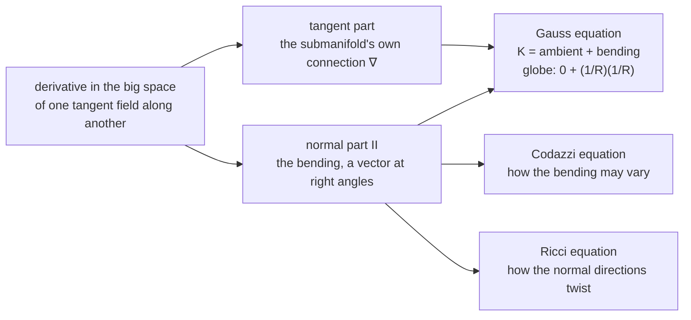

# Gauss, Codazzi and Ricci equations: a submanifold's curvature split into inside and outside

[Syllabus](../../../SYLLABUS.md) → [Differential geometry and Lie groups](../README.md) → [Riemannian Geometry](../README.md#s05) → Gauss, Codazzi and Ricci equations

---

## General Overview

Model the Earth as a ball of radius 6,371 km sitting in flat space. Space itself has no curvature. Yet a surveyor on the globe measures curvature $`K = 2.4637 \times 10^{-8}`$ per km²: triangles have too many degrees, and circles come up short ([Riemann curvature tensor](06-riemann-curvature-tensor.md)).

That curvature does not come from space. It comes from the way the globe bends inside space. Every direction on the globe turns away from its tangent plane at $`1/R = 1.5696 \times 10^{-4}`$ per km. Multiply the bending rates of two directions at right angles, and the product is the globe's curvature.

A stranger case: the round 3-sphere is every point at distance 1 from the centre of four-dimensional space, and its curvature is +1. Inside it sits the **Clifford torus**, a doughnut surface made from two circles of radius $`1/\sqrt2`$. Inside the 3-sphere it bends by +1 one way and −1 the other. The total is $`1 + (1)(-1) = 0`$: a flat torus in a round space.

A **submanifold** is a smooth shape of $`n`$ dimensions inside a larger space $`\tilde M`$ of $`n + k`$ dimensions; $`k`$ is the **codimension**, the number of extra directions ([Regular value theorem](../03-Manifolds/06-submanifolds-and-the-regular-value-theorem.md)). Three equations split its curvature into the curvature of the space around it and its bending inside that space:

- **Gauss**: own curvature = ambient curvature + a bending term.
- **Codazzi**: the bending cannot change from place to place at will.
- **Ricci**: the directions at right angles to the submanifold twist in a way the bending fixes.

**The curvature a submanifold feels from inside equals the curvature of the space around it plus a term built from how it bends in that space, and the bending itself must obey two more equations, Codazzi's and Ricci's.**

**What kind of fact this is:** three theorems. Gauss's is proved on this card in Why it works; Codazzi's and Ricci's are sketched there, with every term in do Carmo's Chapter 6. All three are local: they hold point by point, with no global hypothesis. The converse, that data obeying all three come from a real submanifold, is stated with a source, not proved. The Earth as a sphere of radius 6,371 km is a model; the GRS80 ellipsoid below is a better one.

### The picture: one derivative, split in two



Each arrow is one step in Why it works.

---

## The formula

Notation first, in words.

- $`\Sigma`$ (say "sigma") is the submanifold, of dimension $`n`$, inside the ambient space $`\tilde M`$ with metric $`\tilde g`$. A tilde always marks the ambient space. The metric $`g`$ of $`\Sigma`$ is $`\tilde g`$ on tangent vectors ([Riemannian metric](01-riemannian-metrics.md)).
- $`\tilde\nabla`$ is the ambient space's derivative of vector fields, its Levi-Civita connection ([Levi-Civita connection](02-levi-civita-connection-and-christoffel-symbols.md)). In flat space it is the ordinary derivative.
- At each point, every ambient vector splits into a **tangent part**, inside $`\Sigma`$, and a **normal part**, at right angles to it. The normal parts form a $`k`$-dimensional space, the **normal space**.

Take two vector fields $`X`$, $`Y`$ tangent to $`\Sigma`$. Differentiate $`Y`$ along $`X`$ in the big space, and split the answer:

```math
\tilde\nabla_X Y = \nabla_X Y + \mathrm{II}(X, Y)
```

The tangent part $`\nabla_X Y`$ is the submanifold's own Levi-Civita connection. The normal part $`\mathrm{II}(X, Y)`$ is the **second fundamental form**: how fast $`\Sigma`$ leaves its tangent plane, as a normal vector. For a surface in ordinary space, its length along the unit normal is the $`L`$, $`M`$, $`N`$ of [Gauss map and second fundamental form](../02-Surfaces/04-gauss-map-and-second-fundamental-form.md).

Then the **Gauss equation**, for two tangent vectors $`X`$, $`Y`$ spanning a plane:

```math
\mathrm{sec}(X, Y) = \widetilde{\mathrm{sec}}(X, Y) + \frac{\tilde g\big(\mathrm{II}(X, X), \mathrm{II}(Y, Y)\big) - \big\lvert \mathrm{II}(X, Y) \big\rvert^2}{\lvert X \rvert^2 \lvert Y \rvert^2 - g(X, Y)^2}
```

**Read it aloud:** "the curvature of a plane inside the submanifold is the ambient curvature of that plane, plus the bending in the two directions multiplied together, minus the square of the mixed bending, all per unit of squared area."

For a hypersurface ($`k = 1`$) with unit normal $`\nu`$ (say "nu"), $`\mathrm{II}`$ has one number per pair of directions. In the two principal directions it is $`\kappa_1`$ and $`\kappa_2`$, the greatest and least bending rates, and the formula becomes $`K = \tilde K + \kappa_1 \kappa_2`$.

The other two equations, with the full tensor $`\mathrm{Rm}`$ and vectors $`X, Y, Z`$ tangent and $`\xi`$, $`\eta`$ (say "xi", "eta") normal:

```math
\text{Codazzi:}\ \big(\widetilde{\mathrm{Rm}}(X, Y) Z\big)^{\perp} = (\nabla_X \mathrm{II})(Y, Z) - (\nabla_Y \mathrm{II})(X, Z), \qquad \text{Ricci:}\ \tilde g\big(\widetilde{\mathrm{Rm}}(X, Y)\xi, \eta\big) = \tilde g\big(R^{\perp}(X, Y)\xi, \eta\big) - g\big([A_\xi, A_\eta] X, Y\big)
```

**Read it aloud:** "the normal part of the ambient curvature is the failure of the bending's rate of change to be symmetric; and the ambient curvature between two normals is the twist of the normal space minus the commutator of the two shape operators."

The **shape operator** $`A_\nu`$ says how the normal $`\nu`$ tips along a tangent direction: $`g(A_\nu X, Y) = \tilde g(\mathrm{II}(X, Y), \nu)`$. For a surface in ordinary space it is the matrix $`W`$ of shelf 02. The **commutator** $`[A_\xi, A_\eta] = A_\xi A_\eta - A_\eta A_\xi`$ is zero when the order of the two does not matter.

The **mean curvature vector** is the average bending over $`n`$ orthonormal directions $`e_1, \dots, e_n`$:

```math
\mathbf{H} = \frac{1}{n}\sum_{i=1}^{n} \mathrm{II}(e_i, e_i)
```

A submanifold with $`\mathbf{H} = 0`$ everywhere is **minimal**, as a soap film is ([Minimal surface](../02-Surfaces/07-minimal-surfaces-and-soap-films.md)).

| Symbol | Plain meaning | In our example | Push it up and the answer… |
| --- | --- | --- | --- |
| $`\Sigma`$, $`n`$; $`\tilde M`$, $`k`$ | the submanifold and its dimension; the ambient space and the codimension | globe: $`n = 2`$, $`k = 1`$ in flat 3-space; Clifford torus: $`k = 2`$ in flat 4-space, $`k = 1`$ in the 3-sphere | — |
| $`g`$, $`\tilde g`$; $`E`$, $`F`$, $`G`$ | the metrics of $`\Sigma`$ and $`\tilde M`$; the metric's entries in a surface chart | Clifford torus: $`E = G = 0.5`$, $`F = 0`$ | — |
| $`\tilde\nabla`$, $`\nabla`$, $`\nabla^\perp`$; $`\nabla_X \mathrm{II}`$; $`{}^\top`$, $`{}^\perp`$ | derivatives in the ambient space, in $`\Sigma`$, and of normal fields (normal part only); the rate of change of II itself; the tangent part and the normal part of a vector | flat 4-space: ordinary derivatives | — |
| $`X, Y, Z, W`$; $`e_1, \dots, e_n`$; $`[X, Y]`$; $`p`$, $`d`$ | tangent vectors; tangent vectors of length 1 at right angles; the Lie bracket; a point and its distance from the origin (on the unit 3-sphere, $`p`$ is also the sphere's unit normal) | east and south on the globe | — |
| $`\mathrm{II}(X, Y)`$; $`L`$, $`M`$, $`N`$ | second fundamental form, a normal vector; its components along $`\nu`$ in a surface chart (in km when the chart is in radians) | globe: $`\lvert \mathrm{II}(e_1, e_1) \rvert = 1/R = 1.5696 \times 10^{-4}`$ per km | more bending, larger $`K`$ |
| $`\nu`$, $`\xi`$, $`\eta`$; $`A_\nu`$; $`[A_\xi, A_\eta]`$ | normal vectors of length 1; the shape operator; the commutator of two of them | Clifford torus in the 3-sphere: $`A_\nu`$ has eigenvalues −1 and +1 | — |
| $`\kappa_1`$, $`\kappa_2`$; $`\rho_m`$, $`\rho_e`$; $`a`$, $`f`$, $`e^2`$ | principal curvatures, in 1/km; radii of curvature north-south and east-west on the ellipsoid ($`\kappa = 1/\rho`$); its equatorial radius, flattening, and $`e^2 = f(2 - f)`$ | London on GRS80: 1.5687e-4, 1.5646e-4 per km; 6374.612 km, 6391.256 km; $`a = 6378.137`$ km | flatter ellipsoid, larger gap between $`\kappa_1`$ and $`\kappa_2`$ |
| $`\mathbf{H}`$ | mean curvature vector, the average bending | Clifford torus: length 1 in 4-space, 0 in the 3-sphere | — |
| $`\mathrm{Rm}`$, $`\mathrm{sec}`$, $`K`$ | the curvature tensor of $`\Sigma`$, its sectional curvature, and $`K`$ for a surface | globe: $`2.4637 \times 10^{-8}`$ per km² | — |
| $`\widetilde{\mathrm{Rm}}`$, $`\widetilde{\mathrm{sec}}`$, $`\tilde K`$ | the same for the ambient space | 0 in flat space; +1 in the unit 3-sphere | larger $`K`$ |
| $`R^\perp`$; $`z`$, $`w`$, $`i`$ | normal curvature: how far the normal space twists round a small loop, per unit area; two complex coordinates of 4-space, and $`i = \sqrt{-1}`$ | 0 on the Clifford torus; −1.024 on the test surface $`w = z^2/2`$ at $`z = 0.4 + 0.3i`$ | — |
| $`R`$; $`\varphi`$, $`\theta`$, $`u`$, $`v`$; $`\alpha`$, $`\beta`$ | the globe's radius; polar angle from the North Pole, longitude east, and the two chart coordinates in general; the Clifford torus's two angles | 6371 km; London at $`\varphi = 38.4926°`$ | $`K`$ falls as $`1/R^2`$ |

Sign convention: $`\mathrm{Rm}`$ is that of [Riemann curvature tensor](06-riemann-curvature-tensor.md), so the round sphere has $`\mathrm{sec} = +1/R^2`$. Books with the other order change signs in the tensor forms, not in the sectional form. The Ricci equation is not [Ricci and scalar curvature](07-ricci-and-scalar-curvature.md); both carry the name of Gregorio Ricci-Curbastro.

### When it holds

- **$`\Sigma`$ is smooth: II needs two derivatives, Codazzi three.** A cone's tip has no tangent plane, so II is undefined there, and all the cone's curvature hides in that point.
- **The metric on $`\Sigma`$ is the ambient metric restricted to it.** With any other metric, the left side measures a different shape and the equations fail.
- **The Gauss equation is local.** The Clifford torus is flat at every point, yet no smooth flat torus fits in ordinary 3-space (Step 5).
- **The converse needs all three equations.** Swap the ellipsoid's two radii: Gauss still holds, Codazzi fails by 32.495029 km, and no surface has those data.
- **Codimension 1 hides the Ricci equation.** With one normal direction the normal space cannot twist, and the Ricci equation says only $`0 = 0`$.

---

## Why it works

### Step 0: one derivative, two parts

Differentiate along $`\Sigma`$ in the big space, then split the answer into a part along $`\Sigma`$ and a part at right angles. An ant living in $`\Sigma`$ sees only the first part.

Curvature is built from derivatives, so the ambient curvature splits the same way. Its tangent part gives Gauss, its tangent-to-normal part gives Codazzi, and its normal-to-normal part gives Ricci.

### Step 1: the tangent part is the submanifold's own connection

Define $`\nabla_X Y`$ as the tangent part of $`\tilde\nabla_X Y`$. It satisfies the two rules that single out the Levi-Civita connection: it is symmetric, and it keeps the metric. So it **is** the Levi-Civita connection of $`g`$, the one the ant computes from lengths alone.

The normal part is symmetric, $`\mathrm{II}(X, Y) = \mathrm{II}(Y, X)`$, because $`\tilde\nabla_X Y - \tilde\nabla_Y X`$ is the Lie bracket $`[X, Y]`$ ([Lie bracket](../03-Manifolds/08-lie-brackets-and-frobenius-theorem.md)), which is tangent. II depends only on the vectors at the point: multiplying $`Y`$ by a function adds only a tangent term.

<details>
<summary>Detailed proof: the tangent part is the Levi-Civita connection</summary>

Symmetry: $`\tilde\nabla_X Y - \tilde\nabla_Y X = [X, Y]`$, and the bracket of two tangent fields is tangent. So the tangent parts satisfy $`\nabla_X Y - \nabla_Y X = [X, Y]`$, and the normal parts satisfy $`\mathrm{II}(X, Y) - \mathrm{II}(Y, X) = 0`$.

Keeping the metric: for tangent $`Y`$, $`Z`$,

$`\displaystyle X\,g(Y, Z) = \tilde g(\tilde\nabla_X Y, Z) + \tilde g(Y, \tilde\nabla_X Z) = g(\nabla_X Y, Z) + g(Y, \nabla_X Z)`$

because the normal parts are at right angles to $`Z`$ and $`Y`$. A connection that is symmetric and keeps the metric is the Levi-Civita connection; that uniqueness is proved on [Levi-Civita connection](02-levi-civita-connection-and-christoffel-symbols.md).

</details>

### Step 2: differentiating a normal gives the shape operator

Step along $`X`$ and watch a unit normal field $`\nu`$. Its change also splits. The tangent part is $`-A_\nu X`$, the shape operator. The normal part is $`\nabla^\perp_X \nu`$, how the normal space itself turns:

```math
\tilde\nabla_X \nu = -A_\nu X + \nabla^\perp_X \nu, \qquad g(A_\nu X, Y) = \tilde g\big(\mathrm{II}(X, Y), \nu\big)
```

The first equation is the **Weingarten equation**. The second follows from differentiating $`\tilde g(\nu, Y) = 0`$ along $`X`$. So II and the shape operators carry the same information.

### Step 3: the Gauss equation, from the tangent part of curvature

Curvature compares two orders of differentiation. Do it in the big space, $`\tilde\nabla_X \tilde\nabla_Y Z - \tilde\nabla_Y \tilde\nabla_X Z - \tilde\nabla_{[X, Y]} Z`$, and expand each $`\tilde\nabla`$ with the split of Step 1.

The terms with no II give $`\mathrm{Rm}(X, Y)Z`$. Each term where II appears once is a normal vector. The terms where II appears inside a shape operator come back tangent, through Step 2. Pair the tangent part with a fourth tangent vector $`W`$ (a vector here, not shelf 02's matrix $`W`$) and collect:

```math
\mathrm{Rm}(X, Y, Z, W) = \widetilde{\mathrm{Rm}}(X, Y, Z, W) + \tilde g\big(\mathrm{II}(X, W), \mathrm{II}(Y, Z)\big) - \tilde g\big(\mathrm{II}(X, Z), \mathrm{II}(Y, W)\big)
```

Set $`Z = Y`$ and $`W = X`$ and divide by the squared area: that is the sectional form in The formula.

<details>
<summary>Detailed proof: expanding the two orders of differentiation</summary>

By Step 1, $`\tilde\nabla_Y Z = \nabla_Y Z + \mathrm{II}(Y, Z)`$. Differentiate along $`X`$. The first piece splits by Step 1 again, the second by Step 2 applied to the normal field $`\mathrm{II}(Y, Z)`$:

$`\displaystyle \tilde\nabla_X \tilde\nabla_Y Z = \nabla_X \nabla_Y Z + \mathrm{II}(X, \nabla_Y Z) - A_{\mathrm{II}(Y, Z)} X + \nabla^\perp_X \mathrm{II}(Y, Z)`$

Here $`A_\xi`$ for a normal vector $`\xi`$ of any length is defined by the same Weingarten rule. Swap $`X`$ and $`Y`$, subtract, and subtract $`\tilde\nabla_{[X, Y]} Z = \nabla_{[X, Y]} Z + \mathrm{II}([X, Y], Z)`$. The tangent part of the result is

$`\displaystyle \big(\widetilde{\mathrm{Rm}}(X, Y) Z\big)^{\top} = \mathrm{Rm}(X, Y) Z - A_{\mathrm{II}(Y, Z)} X + A_{\mathrm{II}(X, Z)} Y`$

Pair with $`W`$ and use $`g(A_\xi X, W) = \tilde g(\mathrm{II}(X, W), \xi)`$:

$`\displaystyle \widetilde{\mathrm{Rm}}(X, Y, Z, W) = \mathrm{Rm}(X, Y, Z, W) - \tilde g\big(\mathrm{II}(X, W), \mathrm{II}(Y, Z)\big) + \tilde g\big(\mathrm{II}(Y, W), \mathrm{II}(X, Z)\big)`$

Rearranged, this is the Gauss equation.

</details>

### Step 4: Codazzi and Ricci, from the other parts

In outline; do Carmo's Chapter 6 has every term.

1. **Codazzi.** The normal part of the expansion in Step 3 is $`\nabla^\perp_X \mathrm{II}(Y, Z) - \nabla^\perp_Y \mathrm{II}(X, Z)`$ plus II terms. They collect into $`(\nabla_X \mathrm{II})(Y, Z) - (\nabla_Y \mathrm{II})(X, Z)`$, where $`(\nabla_X \mathrm{II})(Y, Z) = \nabla^\perp_X \big(\mathrm{II}(Y, Z)\big) - \mathrm{II}(\nabla_X Y, Z) - \mathrm{II}(Y, \nabla_X Z)`$.
2. **Ricci.** Now differentiate a normal field $`\xi`$ twice instead of a tangent one, using Step 2. The normal part of the result is $`R^\perp(X, Y)\xi`$, the curvature of $`\nabla^\perp`$, plus two II terms. Paired with a second normal $`\eta`$, those two terms give $`-g([A_\xi, A_\eta] X, Y)`$, minus the commutator.

In a flat or round ambient space both left sides are zero. Codazzi then says the rate of change of II is symmetric, and Ricci says the normal space twists exactly as much as the shape operators fail to commute.

For a surface in 3-space, in a chart $`(u, v)`$ with $`F = M = 0`$, Codazzi is two equations, $`L_v = \tfrac12 E_v (L/E + N/G)`$ and $`N_u = \tfrac12 G_u (L/E + N/G)`$; a subscript is a rate of change along that coordinate. On the ellipsoid ($`u = \varphi`$, $`v = \theta`$) nothing depends on longitude, so the first reads $`0 = 0`$. The GRS80 ellipsoid passes the second; with its radii swapped the two sides differ by 32.495029 km.

### Step 5: what Gauss says about shapes

1. **Theorema Egregium.** For a surface in flat 3-space, $`\widetilde{\mathrm{sec}} = 0`$ and $`k = 1`$, so $`K = (LN - M^2)/(EG - F^2)`$. The left side is computed from the metric alone. So the product of the two bendings is intrinsic: that is [Theorema Egregium](../02-Surfaces/08-theorema-egregium.md), the case $`n = 2`$, $`k = 1`$.
2. **The same shape, two splits.** The Clifford torus sits in the unit 3-sphere, which sits in flat 4-space. In 4-space the ambient term is 0 and the two bendings are at right angles, so $`K = 0 + 0`$. In the 3-sphere, $`K = 1 + (-1)(1)`$. They agree because the torus's normal plane in 4-space is spanned by the 3-sphere's normal $`p`$ and the torus's normal $`\nu`$ inside it. Along $`p`$ the bendings give $`(-1)(-1) = 1`$, the 3-sphere's own Gauss equation; along $`\nu`$ they give $`(-1)(1)`$. One sum, grouped two ways: $`K`$ belongs to the torus, not to the split.
3. **A global consequence.** Every smooth closed surface (bounded, with no edge) in ordinary 3-space has a point where $`K > 0`$. Take the point $`p`$ farthest from the origin, at distance $`d`$. The surface lies inside the ball of radius $`d`$ and touches its boundary at $`p`$, so it bends at least as much as that sphere: $`\kappa_1, \kappa_2 \ge 1/d`$ there, and $`K \ge 1/d^2`$. So no smooth flat torus fits in 3-space. The Clifford torus needs a fourth dimension.

The converse is stated here, not proved. Take a metric, a normal space with its own connection, and a candidate II on a patch with no holes. If they obey all three equations for a flat or round ambient space, a submanifold with exactly these data exists, unique up to a rigid motion (Tenenblat, in Sources). For surfaces in 3-space this is Bonnet's theorem of 1867.

---

## Worked numbers, by hand

**The globe.** On a sphere of radius $`R`$ in flat space, every unit direction bends by $`1/R`$, and the mixed bending is zero.

| Step | Arithmetic | Value |
| --- | --- | --- |
| bending per direction | $`1/R = 1/6371`$ | $`1.5696 \times 10^{-4}`$ per km |
| ambient curvature | flat space | 0 |
| Gauss equation | $`0 + (1.5696 \times 10^{-4})^2 - 0^2`$ | **$`2.4637 \times 10^{-8}`$ per km²** |

It matches the curvature a surveyor measures from inside; the code reads it off the embedding with error $`5.0 \times 10^{-7}`$.

**The real globe, GRS80.** The reference ellipsoid has equatorial radius $`a = 6378.137`$ km and flattening $`f = 1/298.257222101`$. At London it bends differently north-south and east-west.

| Step | Arithmetic | Value |
| --- | --- | --- |
| north-south radius | $`\rho_m = a(1 - e^2)/(1 - e^2\cos^2\varphi)^{3/2}`$, with $`e^2 = f(2 - f)`$ | 6374.612 km |
| east-west radius | $`\rho_e = a/(1 - e^2\cos^2\varphi)^{1/2}`$ | 6391.256 km |
| principal curvatures | $`1/\rho_m`$, $`1/\rho_e`$ | $`1.5687 \times 10^{-4}`$, $`1.5646 \times 10^{-4}`$ per km |
| Gauss equation | $`0 + (1.5687 \times 10^{-4})(1.5646 \times 10^{-4})`$ | **$`2.4545 \times 10^{-8}`$ per km²** |

The sphere model overstates $`K`$ at London by 0.375 percent. The metric alone, through Gauss's formula, gives the same $`2.4545 \times 10^{-8}`$.

**The Clifford torus**, the points $`(\cos\alpha, \sin\alpha, \cos\beta, \sin\beta)/\sqrt2`$ for angles $`\alpha`$, $`\beta`$ (say "alpha", "beta").

In a curved space that sits in flat space, II comes by hand: take II in flat space and drop its part along the curved space's normal, here the point $`p`$. Each circle has radius $`1/\sqrt2`$ and bends toward its centre at rate $`\sqrt2`$: $`\mathrm{II}(e_1, e_1) = -\sqrt2\,(\cos\alpha, \sin\alpha, 0, 0)`$ and $`\mathrm{II}(e_2, e_2) = -\sqrt2\,(0, 0, \cos\beta, \sin\beta)`$. Each has dot product −1 with $`p`$, and −1 and +1 with the torus's normal in the 3-sphere, $`\nu = (\cos\alpha, \sin\alpha, -\cos\beta, -\sin\beta)/\sqrt2`$.

| Step | Arithmetic | Value |
| --- | --- | --- |
| metric | $`E = G = (1/\sqrt2)^2`$, $`F = 0`$ | 0.5, 0.5, 0 |
| split 1: bending in 4-space | $`\lvert \mathrm{II}(e_1, e_1) \rvert^2 = 2`$; the two at right angles | dot product 0 |
| split 1: Gauss | $`0 + 0 - 0`$ | 0 |
| split 2: part along the sphere's normal $`p`$ | dot products with $`p`$, multiplied: $`(-1)(-1)`$ | ambient +1 |
| split 2: bending in the 3-sphere | dot products with $`\nu`$ | −1, +1 |
| split 2: Gauss | $`1 + (-1)(1)`$ | **0** |
| mean curvature in the 3-sphere | $`(-1 + 1)/2`$ | 0: minimal |
| area | $`(2\pi)^2 \times 0.5 = 2\pi^2`$ | 19.7392 |

In 4-space the torus's mean curvature vector points to the centre with length 1.

**The Ricci equation, on a twisted surface.** Write a point of 4-space as two complex numbers $`(z, w)`$. The surface $`w = z^2/2`$ is the set of points $`(x, y, (x^2 - y^2)/2, xy)`$ with $`z = x + iy`$. Its normal plane turns as it moves, so the Ricci equation has something to say. Take $`z = 0.4 + 0.3i`$, so $`\lvert z \rvert^2 = 0.25`$.

| Step | Arithmetic | Value |
| --- | --- | --- |
| curvature, closed form | $`-2/(1 + 0.25)^3`$ | −1.024000 |
| twist of the normal frame round a small loop | $`R^\perp`$, from the frame's derivatives | −1.023998 |
| commutator of the two shape operators | $`g([A_{\xi}, A_{\eta}] X, Y)`$ per unit area | **−1.024000** |

Flat 4-space puts 0 on the left of the Ricci equation, so the twist must equal the commutator, and it does to five decimals. Both signs flip to +1.024 if the two normals $`\xi`$, $`\eta`$ are swapped. The twist also equals $`K`$ because $`w = z^2/2`$ is a complex curve (one equation in complex numbers): on such a curve in 4-space the normal plane twists exactly as much as the surface curves, up to that sign.

### What breaks if you drop a piece

| Mistake | Comes out at | What went wrong |
| --- | --- | --- |
| Keep the ambient term only | globe $`K = 0`$; Clifford torus $`K = 1`$ | the bending is half of the equation |
| Keep the bending term only, Clifford torus in the 3-sphere | $`K = -1`$ | the 3-sphere's own curvature +1 is missing |
| Drop the mixed term $`\lvert \mathrm{II}(X, Y) \rvert^2`$ on $`w = z^2/2`$ at $`z = 0.4 + 0.3i`$ | $`K = -0.512`$, not $`-1.024`$ | in a chart that is not principal the mixed bending is not zero |
| Put the round sphere's II on the ellipsoid's metric | Gauss gives $`2.4637 \times 10^{-8}`$, the metric gives $`2.4545 \times 10^{-8}`$ | II and the metric must belong to one surface |
| Swap the ellipsoid's two radii | Gauss still holds; Codazzi off by 32.495029 km | Gauss alone does not make a surface: Codazzi fails |

---

## Code, from first principles, and it actually runs

The code reads the metric and II off each embedding by central differences (derivatives estimated from nearby points), removes the tangent part with a small linear solve, and applies the Gauss equation in any dimension and codimension. Five roads: the globe's bending against $`1/R^2`$ at three steps; the GRS80 curvature from the embedding, from the metric alone and in closed form, plus Codazzi; a 3-dimensional case, the unit 3-sphere; the Clifford torus split two ways; and the Ricci equation, the twist of a normal frame against the commutator of the shape operators.

### Python

```python
# Gauss, Codazzi and Ricci equations: the check behind the card. Standard library only.
# Curvature of a submanifold = ambient curvature + bending from the second fundamental form II.
# Roads: II from an embedding by finite differences, the metric alone, closed forms, two splits.
import math
from functools import reduce

def sci(x, d=4):                 # scientific text, the same as Rust's {:.4e}
    m, e = f"{x:.{d}e}".split("e")
    return f"{m}e{int(e)}"
def fx(x, d):                    # fixed text with no negative zero
    s = f"{x:.{d}f}"
    return s[1:] if s.startswith("-") and float(s) == 0 else s
dot = lambda a, b: reduce(lambda t, pq: t + pq[0] * pq[1], zip(a, b), 0.0)   # plain left-to-right sum

def solve(A, b):                 # Gaussian elimination for a small square system
    n = len(b); M = [A[i][:] + [b[i]] for i in range(n)]
    for i in range(n):
        for k in range(i + 1, n):
            M[k] = [M[k][j] - M[k][i] / M[i][i] * M[i][j] for j in range(n + 1)]
    x = [0.0] * n
    for i in reversed(range(n)):
        x[i] = (M[i][n] - dot(M[i][i + 1:n], x[i + 1:])) / M[i][i]
    return x

def forms(emb, x, h):            # metric g_ij and II_ij (normal vectors) by central differences
    n = len(x)
    P = lambda *s: emb([x[i] + sum(h * c for k, c in s if k == i) for i in range(n)])
    p0 = P()
    r = [[(a - b) / (2 * h) for a, b in zip(P((i, 1)), P((i, -1)))] for i in range(n)]
    g = [[dot(r[i], r[j]) for j in range(n)] for i in range(n)]
    def perp(w):                 # the part of w at right angles to every tangent arrow
        c = solve(g, [dot(w, r[i]) for i in range(n)])
        return [w[m] - dot(c, [r[i][m] for i in range(n)]) for m in range(len(w))]
    def d2(i, j):
        if i == j:
            return [(a - 2 * c + b) / h ** 2 for a, b, c in zip(P((i, 1)), P((i, -1)), p0)]
        q = [P((i, s), (j, t)) for s, t in ((1, 1), (1, -1), (-1, 1), (-1, -1))]
        return [(q[0][m] - q[1][m] - q[2][m] + q[3][m]) / (4 * h * h) for m in range(len(p0))]
    return g, [[perp(d2(i, j)) for j in range(n)] for i in range(n)], perp

def gauss_sec(g, II, i, j, amb=0.0):  # Gauss equation for the plane of coordinate arrows i, j
    area2 = g[i][i] * g[j][j] - g[i][j] ** 2
    return amb + (dot(II[i][i], II[j][j]) - dot(II[i][j], II[i][j])) / area2

R = 6371.0                                            # the globe as a sphere of radius 6371 km
PHI = math.radians(90 - 51.5074)                      # London: polar angle from the North Pole
sphere = lambda x: [R * math.sin(x[0]) * math.cos(x[1]), R * math.sin(x[0]) * math.sin(x[1]), R * math.cos(x[0])]
print(f"globe: R = {R:.1f} km, London phi = {math.degrees(PHI):.4f} deg, 1/R = {sci(1 / R)} per km, target K = 1/R^2 = {sci(1 / R ** 2)} per km^2")
for h in (4e-2, 2e-3, 1e-3):
    g, II, _ = forms(sphere, [PHI, 0.3], h)
    K = gauss_sec(g, II, 0, 1)
    print(f"  step {h:g}: II/g = {sci(math.sqrt(dot(II[0][0], II[0][0])) / g[0][0])}, {sci(math.sqrt(dot(II[1][1], II[1][1])) / g[1][1])} per km; K = 0 + bending = {sci(K)}, rel err {sci(abs(K * R * R - 1), 1)}")
    assert abs(K * R * R - 1) < h * h                 # second order: the error falls as the step squared

# the real globe: the GRS80 ellipsoid at London, where II is no longer a multiple of g
A, FL = 6378.137, 1 / 298.257222101; E2 = FL * (2 - FL)
rho_e = lambda p: A / math.sqrt(1 - E2 * math.cos(p) ** 2)                  # east-west radius
rho_m = lambda p: A * (1 - E2) / (1 - E2 * math.cos(p) ** 2) ** 1.5         # north-south radius
ell = lambda x: [rho_e(x[0]) * math.sin(x[0]) * math.cos(x[1]), rho_e(x[0]) * math.sin(x[0]) * math.sin(x[1]),
                 rho_e(x[0]) * (1 - E2) * math.cos(x[0])]
Kc = 1 / (rho_m(PHI) * rho_e(PHI))
print(f"GRS80 (a = {A:.3f} km, 1/f = {1 / FL:.9f}) at London: rho_m = {rho_m(PHI):.3f} km, rho_e = {rho_e(PHI):.3f} km, K = 1/(rho_m rho_e) = {sci(Kc)} per km^2")
g, II, _ = forms(ell, [PHI, 0.3], 1e-3)
k1, k2 = math.sqrt(dot(II[0][0], II[0][0])) / g[0][0], math.sqrt(dot(II[1][1], II[1][1])) / g[1][1]
Ke = gauss_sec(g, II, 0, 1)
print(f"  outside road: kappa_1 = {sci(k1)}, kappa_2 = {sci(k2)} per km, |II_12| = {fx(math.sqrt(dot(II[0][1], II[0][1])), 6)}, K = {sci(Ke)}")
assert abs(k1 * rho_m(PHI) - 1) < 1e-6 and abs(Ke / Kc - 1) < 1e-6
Eg, Gg = lambda p: rho_m(p) ** 2, lambda p: (rho_e(p) * math.sin(p)) ** 2   # the metric: E and G
def K_inside(p, h):              # Gauss's formula for F = 0 and nothing depending on theta
    f = lambda q: (Gg(q + h) - Gg(q - h)) / (2 * h) / math.sqrt(Eg(q) * Gg(q))
    return -(f(p + h) - f(p - h)) / (2 * h) / (2 * math.sqrt(Eg(p) * Gg(p)))
errs = [abs(K_inside(PHI, h) / Kc - 1) for h in (2e-3, 1e-3)]
print(f"  inside road, metric alone: K = {sci(K_inside(PHI, 1e-3))}; rel err {sci(errs[0], 1)} then {sci(errs[1], 1)}")
assert errs[1] < 1e-5 and 3 < errs[0] / errs[1] < 5
print(f"  sphere of 6371 km is off by {100 * (1 / R ** 2 / Kc - 1):.3f} percent at London")
def codazzi(L, N, p, h=1e-4):    # N_phi - (G_phi / 2)(L/E + N/G): zero for every real surface
    Gp = (Gg(p + h) - Gg(p - h)) / (2 * h)
    return (N(p + h) - N(p - h)) / (2 * h) - Gp / 2 * (L(p) / Eg(p) + N(p) / Gg(p))
c_ok = codazzi(rho_m, lambda p: Gg(p) / rho_e(p), PHI)         # true II: L = rho_m, N = G / rho_e
c_bad = codazzi(lambda p: Eg(p) / rho_e(p), lambda p: Gg(p) / rho_m(p), PHI)
print(f"  Codazzi residual: true II {fx(c_ok, 6)} km; radii swapped {c_bad:.6f} km")
assert abs(c_ok) < 1e-5 and abs(c_bad) > 1.0

# the Clifford torus: flat, inside the round unit 3-sphere, inside 4-space
s3 = lambda x: [math.cos(x[0]) * math.cos(x[1]), math.cos(x[0]) * math.sin(x[1]), math.sin(x[0]) * math.cos(x[2]), math.sin(x[0]) * math.sin(x[2])]
g3, II3, _ = forms(s3, [math.pi / 4, 0.3, 1.1], 1e-4)
secs = [gauss_sec(g3, II3, i, j) for i, j in ((0, 1), (0, 2), (1, 2))]
print("unit 3-sphere in 4-space (n = 3): sec of the three coordinate planes = " + ", ".join(f"{s:.6f}" for s in secs))
assert all(abs(s - 1) < 1e-5 for s in secs)
tor = lambda x: [math.cos(x[0]) / math.sqrt(2), math.sin(x[0]) / math.sqrt(2), math.cos(x[1]) / math.sqrt(2), math.sin(x[1]) / math.sqrt(2)]
pt = [0.3, 1.1]; p = tor(pt)
g, II, _ = forms(tor, pt, 1e-4)
K4 = gauss_sec(g, II, 0, 1)
Hv = [(II[0][0][m] / g[0][0] + II[1][1][m] / g[1][1]) / 2 for m in range(4)]
print(f"Clifford torus: E = {g[0][0]:.6f}, F = {fx(g[0][1], 6)}, G = {g[1][1]:.6f}; area = 4 pi^2 E = {4 * math.pi ** 2 * g[0][0]:.4f}")
print(f"  split 1, in flat 4-space (k = 2): <II_11, II_22> = {fx(dot(II[0][0], II[1][1]), 6)}, |II(e1,e1)|^2 = {dot(II[0][0], II[0][0]) / g[0][0] ** 2:.6f}, K = 0 + {fx(K4, 6)}")
print(f"    mean curvature vector H = {fx(Hv[0], 6)}, {fx(Hv[1], 6)}, {fx(Hv[2], 6)}, {fx(Hv[3], 6)}; point = {p[0]:.6f}, {p[1]:.6f}, {p[2]:.6f}, {p[3]:.6f}")
assert abs(K4) < 1e-6 and all(abs(Hv[m] + p[m]) < 1e-6 for m in range(4))
nu = [math.cos(pt[0]) / math.sqrt(2), math.sin(pt[0]) / math.sqrt(2), -math.cos(pt[1]) / math.sqrt(2), -math.sin(pt[1]) / math.sqrt(2)]
hp = [[dot(II[i][j], p) / math.sqrt(g[i][i] * g[j][j]) for j in range(2)] for i in range(2)]   # part along the 3-sphere's normal p
hS = [[dot(II[i][j], nu) / math.sqrt(g[i][i] * g[j][j]) for j in range(2)] for i in range(2)]  # part along nu: II inside the 3-sphere
amb = hp[0][0] * hp[1][1] - hp[0][1] ** 2; KS = amb + hS[0][0] * hS[1][1] - hS[0][1] ** 2       # Gauss for the 3-sphere in 4-space
print(f"  split 2, in the unit 3-sphere (k = 1): II along p = {hp[0][0]:.6f}, {hp[1][1]:.6f}, so ambient = ({hp[0][0]:.6f})({hp[1][1]:.6f}) = {amb:.6f}")
print(f"    II along nu = principal curvatures {hS[0][0]:.6f}, {hS[1][1]:.6f}, mean {fx((hS[0][0] + hS[1][1]) / 2, 6)} (minimal); K = {amb:.6f} + ({hS[0][0]:.6f})({hS[1][1]:.6f}) = {fx(KS, 6)}")
assert abs(hp[0][0] + 1) < 1e-6 and abs(hp[1][1] + 1) < 1e-6 and abs(amb - secs[0]) < 1e-5 and abs(hS[0][0] + 1) < 1e-6 and abs(hS[1][1] - 1) < 1e-6 and abs(KS - K4) < 1e-6

# Ricci equation, flat 4-space: <R_perp(du,dv) nu1, nu2> = <[A1, A2] du, dv>
def frame(emb, x):               # orthonormal normal frame by Gram-Schmidt on e1, e3
    perp = forms(emb, x, 1e-5)[2]
    a = perp([1, 0, 0, 0]); a = [t / math.sqrt(dot(a, a)) for t in a]
    b = perp([0, 0, 1, 0]); b = [t - dot(b, a) * s for t, s in zip(b, a)]
    return a, [t / math.sqrt(dot(b, b)) for t in b]
def ricci(emb, x, h=1e-3):
    def om(y, i):                # omega_i = <d_i nu1, nu2>, the normal plane's turning rate
        yp, ym = y[:], y[:]; yp[i] += h; ym[i] -= h
        return dot([(a - b) / (2 * h) for a, b in zip(frame(emb, yp)[0], frame(emb, ym)[0])], frame(emb, y)[1])
    sh = lambda i, s: [x[k] + (s * h if k == i else 0) for k in range(2)]
    Rp = (om(sh(0, 1), 1) - om(sh(0, -1), 1) - om(sh(1, 1), 0) + om(sh(1, -1), 0)) / (2 * h)
    g, II, _ = forms(emb, x, 1e-3)
    n1, n2 = frame(emb, x)
    As = [[solve(g, [dot(II[0][j], n), dot(II[1][j], n)]) for j in range(2)] for n in (n1, n2)]
    Am = [[[A[j][i] for j in range(2)] for i in range(2)] for A in As]      # column j = A applied to d_j
    C = [[dot(Am[0][i], [Am[1][k][j] for k in range(2)]) - dot(Am[1][i], [Am[0][k][j] for k in range(2)]) for j in range(2)] for i in range(2)]
    area = math.sqrt(g[0][0] * g[1][1] - g[0][1] ** 2)       # per unit area, so it is chart-free
    return Rp / area, dot([C[k][0] for k in range(2)], [g[k][1] for k in range(2)]) / area, gauss_sec(g, II, 0, 1), g, II
par = lambda y: [y[0], y[1], (y[0] ** 2 - y[1] ** 2) / 2, y[0] * y[1]]     # the complex curve w = z^2/2
for name, emb, x in (("Clifford torus", tor, pt), ("w = z^2/2 at z = 0.4 + 0.3i", par, [0.4, 0.3])):
    Rp, cm, K, gp, IIp = ricci(emb, x)
    print(f"Ricci equation, {name}: normal curvature = {fx(Rp, 6)}, from [A1,A2] = {fx(cm, 6)}; K = {fx(K, 6)}")
    assert abs(Rp - cm) < 1e-4
print(f"  closed form for w = z^2/2: K = -2/(1+|z|^2)^3 = {-2 / 1.25 ** 3:.6f}")
assert abs(K + 2 / 1.25 ** 3) < 1e-5 and abs(Rp - K) < 1e-4

# what breaks
print(f"break: ambient term only: globe K = 0, Clifford torus in the 3-sphere K = {amb:.6f}")
print(f"break: bending term only, Clifford torus in the 3-sphere: K = {hS[0][0] * hS[1][1]:.6f}")
print(f"break: drop |II_12|^2, w = z^2/2 at 0.4 + 0.3i: K = {dot(IIp[0][0], IIp[1][1]) / (gp[0][0] * gp[1][1] - gp[0][1] ** 2):.6f}")
print(f"break: sphere's II on the ellipsoid's metric: Gauss says {sci(1 / R ** 2)}, metric says {sci(Kc)}")
print(f"try: Moon, R = 1737.4 km: 1/R = {sci(1 / 1737.4)} per km, K = {sci(1 / 1737.4 ** 2)} per km^2; GRS80: North Pole K = {sci(1 / rho_m(0) ** 2)}, equator K = {sci(1 / (rho_m(math.pi / 2) * rho_e(math.pi / 2)))}")
print("ALL CHECKS PASS")
```

**Ran 2026-11-24 on macOS, Python 3.14.10, standard library only. All checks passed. Output, pasted from the run:**

```
globe: R = 6371.0 km, London phi = 38.4926 deg, 1/R = 1.5696e-4 per km, target K = 1/R^2 = 2.4637e-8 per km^2
  step 0.04: II/g = 1.5702e-4, 1.5702e-4 per km; K = 0 + bending = 2.4657e-8, rel err 8.0e-4
  step 0.002: II/g = 1.5696e-4, 1.5696e-4 per km; K = 0 + bending = 2.4637e-8, rel err 2.0e-6
  step 0.001: II/g = 1.5696e-4, 1.5696e-4 per km; K = 0 + bending = 2.4637e-8, rel err 5.0e-7
GRS80 (a = 6378.137 km, 1/f = 298.257222101) at London: rho_m = 6374.612 km, rho_e = 6391.256 km, K = 1/(rho_m rho_e) = 2.4545e-8 per km^2
  outside road: kappa_1 = 1.5687e-4, kappa_2 = 1.5646e-4 per km, |II_12| = 0.000000, K = 2.4545e-8
  inside road, metric alone: K = 2.4545e-8; rel err 3.5e-6 then 8.7e-7
  sphere of 6371 km is off by 0.375 percent at London
  Codazzi residual: true II 0.000000 km; radii swapped 32.495029 km
unit 3-sphere in 4-space (n = 3): sec of the three coordinate planes = 1.000000, 1.000000, 1.000000
Clifford torus: E = 0.500000, F = 0.000000, G = 0.500000; area = 4 pi^2 E = 19.7392
  split 1, in flat 4-space (k = 2): <II_11, II_22> = 0.000000, |II(e1,e1)|^2 = 2.000000, K = 0 + 0.000000
    mean curvature vector H = -0.675525, -0.208964, -0.320741, -0.630179; point = 0.675525, 0.208964, 0.320741, 0.630179
  split 2, in the unit 3-sphere (k = 1): II along p = -1.000000, -1.000000, so ambient = (-1.000000)(-1.000000) = 1.000000
    II along nu = principal curvatures -1.000000, 1.000000, mean 0.000000 (minimal); K = 1.000000 + (-1.000000)(1.000000) = 0.000000
Ricci equation, Clifford torus: normal curvature = 0.000000, from [A1,A2] = 0.000000; K = 0.000000
Ricci equation, w = z^2/2 at z = 0.4 + 0.3i: normal curvature = -1.023998, from [A1,A2] = -1.024000; K = -1.024000
  closed form for w = z^2/2: K = -2/(1+|z|^2)^3 = -1.024000
break: ambient term only: globe K = 0, Clifford torus in the 3-sphere K = 1.000000
break: bending term only, Clifford torus in the 3-sphere: K = -1.000000
break: drop |II_12|^2, w = z^2/2 at 0.4 + 0.3i: K = -0.512000
break: sphere's II on the ellipsoid's metric: Gauss says 2.4637e-8, metric says 2.4545e-8
try: Moon, R = 1737.4 km: 1/R = 5.7557e-4 per km, K = 3.3128e-7 per km^2; GRS80: North Pole K = 2.4417e-8, equator K = 2.4747e-8
ALL CHECKS PASS
```

### Rust

```rust
// Gauss, Codazzi and Ricci equations: the check behind the card. Rust std only.
// Curvature of a submanifold = ambient curvature + bending from the second fundamental form II.
// Roads: II from an embedding by finite differences, the metric alone, closed forms, two splits.
use std::f64::consts::PI;

type V = Vec<f64>;
type Emb<'a> = &'a dyn Fn(&[f64]) -> V;
fn sci(x: f64, d: usize) -> String { format!("{:.*e}", d, x) }
fn fx(x: f64, d: usize) -> String {
    let s = format!("{:.*}", d, x);
    if s.starts_with('-') && s[1..].parse::<f64>().unwrap() == 0.0 { s[1..].to_string() } else { s }
}
fn dot(a: &[f64], b: &[f64]) -> f64 { a.iter().zip(b).fold(0.0, |t, (p, q)| t + p * q) }
fn solve(a: &[V], b: &[f64]) -> V { // Gaussian elimination for a small square system
    let n = b.len();
    let mut m: Vec<V> = (0..n).map(|i| { let mut r = a[i].clone(); r.push(b[i]); r }).collect();
    for i in 0..n {
        for k in i + 1..n { let f = m[k][i] / m[i][i]; for j in 0..=n { m[k][j] = m[k][j] - f * m[i][j]; } }
    }
    let mut x = vec![0.0; n];
    for i in (0..n).rev() { x[i] = (m[i][n] - dot(&m[i][i + 1..n], &x[i + 1..])) / m[i][i]; }
    x
}
fn perp(g: &[V], r: &[V], w: &[f64]) -> V { // the part of w at right angles to every tangent arrow
    let b: V = r.iter().map(|ri| dot(w, ri)).collect();
    let c = solve(g, &b);
    (0..w.len()).map(|m| w[m] - dot(&c, &r.iter().map(|ri| ri[m]).collect::<V>())).collect()
}
// metric g_ij, II_ij (normal vectors) and tangent arrows by central differences
fn forms(emb: Emb, x: &[f64], h: f64) -> (Vec<V>, Vec<Vec<V>>, Vec<V>) {
    let n = x.len();
    let at = |s: &[(usize, f64)]| { let mut y = x.to_vec(); for &(k, c) in s { y[k] = x[k] + h * c; } emb(&y) };
    let p0 = at(&[]);
    let r: Vec<V> = (0..n).map(|i| at(&[(i, 1.0)]).iter().zip(at(&[(i, -1.0)])).map(|(a, b)| (a - b) / (2.0 * h)).collect()).collect();
    let g: Vec<V> = (0..n).map(|i| (0..n).map(|j| dot(&r[i], &r[j])).collect()).collect();
    let d2 = |i: usize, j: usize| -> V {
        if i == j {
            let (a, b) = (at(&[(i, 1.0)]), at(&[(i, -1.0)]));
            (0..p0.len()).map(|m| (a[m] - 2.0 * p0[m] + b[m]) / (h * h)).collect()
        } else {
            let q: Vec<V> = [(1.0, 1.0), (1.0, -1.0), (-1.0, 1.0), (-1.0, -1.0)].iter().map(|&(s, t)| at(&[(i, s), (j, t)])).collect();
            (0..p0.len()).map(|m| (q[0][m] - q[1][m] - q[2][m] + q[3][m]) / (4.0 * h * h)).collect()
        }
    };
    let ii = (0..n).map(|i| (0..n).map(|j| perp(&g, &r, &d2(i, j))).collect()).collect();
    (g, ii, r)
}
fn gauss_sec(g: &[V], ii: &[Vec<V>], i: usize, j: usize, amb: f64) -> f64 { // Gauss equation, plane i, j
    let area2 = g[i][i] * g[j][j] - g[i][j] * g[i][j];
    amb + (dot(&ii[i][i], &ii[j][j]) - dot(&ii[i][j], &ii[i][j])) / area2
}
fn norm(a: &[f64]) -> f64 { dot(a, a).sqrt() }
fn frame(emb: Emb, x: &[f64]) -> (V, V) { // orthonormal normal frame by Gram-Schmidt on e1, e3
    let (g, _, r) = forms(emb, x, 1e-5);
    let a = perp(&g, &r, &[1.0, 0.0, 0.0, 0.0]); let a: V = a.iter().map(|t| t / norm(&a)).collect();
    let b = perp(&g, &r, &[0.0, 0.0, 1.0, 0.0]); let d = dot(&b, &a);
    let b: V = b.iter().zip(&a).map(|(t, s)| t - d * s).collect();
    (a.clone(), b.iter().map(|t| t / norm(&b)).collect())
}
fn ricci(emb: Emb, x: &[f64]) -> (f64, f64, f64, Vec<V>, Vec<Vec<V>>) { let h = 1e-3;
    let om = |y: &[f64], i: usize| { // omega_i = <d_i nu1, nu2>, the normal plane's turning rate
        let (mut yp, mut ym) = (y.to_vec(), y.to_vec());
        yp[i] += h; ym[i] -= h;
        let (fp, fm, f0) = (frame(emb, &yp).0, frame(emb, &ym).0, frame(emb, y).1);
        dot(&fp.iter().zip(&fm).map(|(a, b)| (a - b) / (2.0 * h)).collect::<V>(), &f0)
    };
    let sh = |i: usize, s: f64| -> V { (0..2).map(|k| if k == i { x[k] + s * h } else { x[k] }).collect() };
    let rp = (om(&sh(0, 1.0), 1) - om(&sh(0, -1.0), 1) - om(&sh(1, 1.0), 0) + om(&sh(1, -1.0), 0)) / (2.0 * h);
    let (g, ii, _) = forms(emb, x, 1e-3);
    let (n1, n2) = frame(emb, x);
    let am: Vec<Vec<V>> = [&n1, &n2].iter().map(|n| {
        let cols: Vec<V> = (0..2).map(|j| solve(&g, &[dot(&ii[0][j], n), dot(&ii[1][j], n)])).collect();
        (0..2).map(|i| (0..2).map(|j| cols[j][i]).collect()).collect() // column j = A applied to d_j
    }).collect();
    let col = |a: &Vec<V>, j: usize| -> V { (0..2).map(|k| a[k][j]).collect() };
    let c: Vec<V> = (0..2).map(|i| (0..2).map(|j| dot(&am[0][i], &col(&am[1], j)) - dot(&am[1][i], &col(&am[0], j))).collect()).collect();
    let area = (g[0][0] * g[1][1] - g[0][1] * g[0][1]).sqrt(); // per unit area, so it is chart-free
    let cm = dot(&[c[0][0], c[1][0]], &[g[0][1], g[1][1]]) / area;
    (rp / area, cm, gauss_sec(&g, &ii, 0, 1, 0.0), g, ii)
}
const R: f64 = 6371.0; // the globe as a sphere of radius 6371 km
const A: f64 = 6378.137;
fn e2() -> f64 { let fl = 1.0 / 298.257222101; fl * (2.0 - fl) }
fn rho_e(p: f64) -> f64 { A / (1.0 - e2() * p.cos().powi(2)).sqrt() } // east-west radius
fn rho_m(p: f64) -> f64 { A * (1.0 - e2()) / (1.0 - e2() * p.cos().powi(2)).powf(1.5) } // north-south radius
fn eg(p: f64) -> f64 { rho_m(p).powi(2) }
fn gg(p: f64) -> f64 { (rho_e(p) * p.sin()).powi(2) }
fn k_inside(p: f64, h: f64) -> f64 { // Gauss's formula for F = 0 and nothing depending on theta
    let f = |q: f64| (gg(q + h) - gg(q - h)) / (2.0 * h) / (eg(q) * gg(q)).sqrt();
    -(f(p + h) - f(p - h)) / (2.0 * h) / (2.0 * (eg(p) * gg(p)).sqrt())
}
fn codazzi(l: &dyn Fn(f64) -> f64, n: &dyn Fn(f64) -> f64, p: f64) -> f64 { // zero for every real surface
    let h = 1e-4;
    let gp = (gg(p + h) - gg(p - h)) / (2.0 * h);
    (n(p + h) - n(p - h)) / (2.0 * h) - gp / 2.0 * (l(p) / eg(p) + n(p) / gg(p))
}

fn main() {
    let phi = (90.0f64 - 51.5074).to_radians(); // London: polar angle from the North Pole
    let sphere = |x: &[f64]| vec![R * x[0].sin() * x[1].cos(), R * x[0].sin() * x[1].sin(), R * x[0].cos()];
    println!("globe: R = {:.1} km, London phi = {:.4} deg, 1/R = {} per km, target K = 1/R^2 = {} per km^2", R, phi.to_degrees(), sci(1.0 / R, 4), sci(1.0 / (R * R), 4));
    for h in [4e-2, 2e-3, 1e-3] {
        let (g, ii, _) = forms(&sphere, &[phi, 0.3], h);
        let k = gauss_sec(&g, &ii, 0, 1, 0.0);
        println!("  step {}: II/g = {}, {} per km; K = 0 + bending = {}, rel err {}", h, sci(norm(&ii[0][0]) / g[0][0], 4), sci(norm(&ii[1][1]) / g[1][1], 4), sci(k, 4), sci((k * R * R - 1.0).abs(), 1));
        assert!((k * R * R - 1.0).abs() < h * h); // second order: the error falls as the step squared
    }

    // the real globe: the GRS80 ellipsoid at London, where II is no longer a multiple of g
    let e2v = e2();
    let ell = |x: &[f64]| vec![rho_e(x[0]) * x[0].sin() * x[1].cos(), rho_e(x[0]) * x[0].sin() * x[1].sin(), rho_e(x[0]) * (1.0 - e2v) * x[0].cos()];
    let kc = 1.0 / (rho_m(phi) * rho_e(phi));
    println!("GRS80 (a = {:.3} km, 1/f = {:.9}) at London: rho_m = {:.3} km, rho_e = {:.3} km, K = 1/(rho_m rho_e) = {} per km^2", A, 1.0 / (1.0 / 298.257222101), rho_m(phi), rho_e(phi), sci(kc, 4));
    let (g, ii, _) = forms(&ell, &[phi, 0.3], 1e-3);
    let (k1, k2) = (norm(&ii[0][0]) / g[0][0], norm(&ii[1][1]) / g[1][1]);
    let ke = gauss_sec(&g, &ii, 0, 1, 0.0);
    println!("  outside road: kappa_1 = {}, kappa_2 = {} per km, |II_12| = {}, K = {}", sci(k1, 4), sci(k2, 4), fx(norm(&ii[0][1]), 6), sci(ke, 4));
    assert!((k1 * rho_m(phi) - 1.0).abs() < 1e-6 && (ke / kc - 1.0).abs() < 1e-6);
    let errs: V = [2e-3, 1e-3].iter().map(|&h| (k_inside(phi, h) / kc - 1.0).abs()).collect();
    println!("  inside road, metric alone: K = {}; rel err {} then {}", sci(k_inside(phi, 1e-3), 4), sci(errs[0], 1), sci(errs[1], 1));
    assert!(errs[1] < 1e-5 && 3.0 < errs[0] / errs[1] && errs[0] / errs[1] < 5.0);
    println!("  sphere of 6371 km is off by {:.3} percent at London", 100.0 * (1.0 / (R * R) / kc - 1.0));
    let c_ok = codazzi(&rho_m, &|p| gg(p) / rho_e(p), phi); // true II: L = rho_m, N = G / rho_e
    let c_bad = codazzi(&|p| eg(p) / rho_e(p), &|p| gg(p) / rho_m(p), phi);
    println!("  Codazzi residual: true II {} km; radii swapped {:.6} km", fx(c_ok, 6), c_bad);
    assert!(c_ok.abs() < 1e-5 && c_bad.abs() > 1.0);

    // the Clifford torus: flat, inside the round unit 3-sphere, inside 4-space
    let s3 = |x: &[f64]| vec![x[0].cos() * x[1].cos(), x[0].cos() * x[1].sin(), x[0].sin() * x[2].cos(), x[0].sin() * x[2].sin()];
    let (g3, ii3, _) = forms(&s3, &[PI / 4.0, 0.3, 1.1], 1e-4);
    let secs: V = [(0, 1), (0, 2), (1, 2)].iter().map(|&(i, j)| gauss_sec(&g3, &ii3, i, j, 0.0)).collect();
    println!("unit 3-sphere in 4-space (n = 3): sec of the three coordinate planes = {}", secs.iter().map(|s| format!("{:.6}", s)).collect::<Vec<_>>().join(", "));
    assert!(secs.iter().all(|s| (s - 1.0).abs() < 1e-5));
    let s2 = 2.0f64.sqrt();
    let tor = |x: &[f64]| vec![x[0].cos() / s2, x[0].sin() / s2, x[1].cos() / s2, x[1].sin() / s2];
    let pt = [0.3, 1.1]; let p = tor(&pt);
    let (g, ii, _) = forms(&tor, &pt, 1e-4);
    let k4 = gauss_sec(&g, &ii, 0, 1, 0.0);
    let hv: V = (0..4).map(|m| (ii[0][0][m] / g[0][0] + ii[1][1][m] / g[1][1]) / 2.0).collect();
    println!("Clifford torus: E = {:.6}, F = {}, G = {:.6}; area = 4 pi^2 E = {:.4}", g[0][0], fx(g[0][1], 6), g[1][1], 4.0 * PI.powi(2) * g[0][0]);
    println!("  split 1, in flat 4-space (k = 2): <II_11, II_22> = {}, |II(e1,e1)|^2 = {:.6}, K = 0 + {}", fx(dot(&ii[0][0], &ii[1][1]), 6), dot(&ii[0][0], &ii[0][0]) / g[0][0].powi(2), fx(k4, 6));
    println!("    mean curvature vector H = {}, {}, {}, {}; point = {:.6}, {:.6}, {:.6}, {:.6}", fx(hv[0], 6), fx(hv[1], 6), fx(hv[2], 6), fx(hv[3], 6), p[0], p[1], p[2], p[3]);
    assert!(k4.abs() < 1e-6 && (0..4).all(|m| (hv[m] + p[m]).abs() < 1e-6));
    let nu = [pt[0].cos() / s2, pt[0].sin() / s2, -pt[1].cos() / s2, -pt[1].sin() / s2];
    let hp: Vec<V> = (0..2).map(|i| (0..2).map(|j| dot(&ii[i][j], &p) / (g[i][i] * g[j][j]).sqrt()).collect()).collect(); // part along the 3-sphere's normal p
    let hs: Vec<V> = (0..2).map(|i| (0..2).map(|j| dot(&ii[i][j], &nu) / (g[i][i] * g[j][j]).sqrt()).collect()).collect(); // part along nu: II inside the 3-sphere
    let amb = hp[0][0] * hp[1][1] - hp[0][1].powi(2); let ks = amb + hs[0][0] * hs[1][1] - hs[0][1].powi(2); // Gauss for the 3-sphere in 4-space
    println!("  split 2, in the unit 3-sphere (k = 1): II along p = {:.6}, {:.6}, so ambient = ({:.6})({:.6}) = {:.6}", hp[0][0], hp[1][1], hp[0][0], hp[1][1], amb);
    println!("    II along nu = principal curvatures {:.6}, {:.6}, mean {} (minimal); K = {:.6} + ({:.6})({:.6}) = {}", hs[0][0], hs[1][1], fx((hs[0][0] + hs[1][1]) / 2.0, 6), amb, hs[0][0], hs[1][1], fx(ks, 6));
    assert!((hp[0][0] + 1.0).abs() < 1e-6 && (hp[1][1] + 1.0).abs() < 1e-6 && (amb - secs[0]).abs() < 1e-5 && (hs[0][0] + 1.0).abs() < 1e-6 && (hs[1][1] - 1.0).abs() < 1e-6 && (ks - k4).abs() < 1e-6);
    // Ricci equation, flat 4-space: <R_perp(du,dv) nu1, nu2> = <[A1, A2] du, dv>
    let par = |y: &[f64]| vec![y[0], y[1], (y[0].powi(2) - y[1].powi(2)) / 2.0, y[0] * y[1]]; // w = z^2/2
    let cases: [(&str, Emb, [f64; 2]); 2] = [("Clifford torus", &tor, pt), ("w = z^2/2 at z = 0.4 + 0.3i", &par, [0.4, 0.3])];
    let mut last = (0.0, 0.0, 0.0, vec![], vec![]);
    for (name, emb, x) in cases {
        last = ricci(emb, &x);
        println!("Ricci equation, {}: normal curvature = {}, from [A1,A2] = {}; K = {}", name, fx(last.0, 6), fx(last.1, 6), fx(last.2, 6));
        assert!((last.0 - last.1).abs() < 1e-4);
    }
    let (rp, _, k, gp, iip) = last;
    println!("  closed form for w = z^2/2: K = -2/(1+|z|^2)^3 = {:.6}", -2.0 / 1.25f64.powi(3));
    assert!((k + 2.0 / 1.25f64.powi(3)).abs() < 1e-5 && (rp - k).abs() < 1e-4);
    // what breaks
    println!("break: ambient term only: globe K = 0, Clifford torus in the 3-sphere K = {:.6}", amb);
    println!("break: bending term only, Clifford torus in the 3-sphere: K = {:.6}", hs[0][0] * hs[1][1]);
    println!("break: drop |II_12|^2, w = z^2/2 at 0.4 + 0.3i: K = {:.6}", dot(&iip[0][0], &iip[1][1]) / (gp[0][0] * gp[1][1] - gp[0][1].powi(2)));
    println!("break: sphere's II on the ellipsoid's metric: Gauss says {}, metric says {}", sci(1.0 / (R * R), 4), sci(kc, 4));
    println!("try: Moon, R = 1737.4 km: 1/R = {} per km, K = {} per km^2; GRS80: North Pole K = {}, equator K = {}", sci(1.0 / 1737.4, 4), sci(1.0 / 1737.4f64.powi(2), 4), sci(1.0 / rho_m(0.0).powi(2), 4), sci(1.0 / (rho_m(PI / 2.0) * rho_e(PI / 2.0)), 4));
    println!("ALL CHECKS PASS");
}
```

**Ran 2026-11-24 on macOS, rustc 1.98.1, no crates. All checks passed. Output, pasted from the run:**

```
globe: R = 6371.0 km, London phi = 38.4926 deg, 1/R = 1.5696e-4 per km, target K = 1/R^2 = 2.4637e-8 per km^2
  step 0.04: II/g = 1.5702e-4, 1.5702e-4 per km; K = 0 + bending = 2.4657e-8, rel err 8.0e-4
  step 0.002: II/g = 1.5696e-4, 1.5696e-4 per km; K = 0 + bending = 2.4637e-8, rel err 2.0e-6
  step 0.001: II/g = 1.5696e-4, 1.5696e-4 per km; K = 0 + bending = 2.4637e-8, rel err 5.0e-7
GRS80 (a = 6378.137 km, 1/f = 298.257222101) at London: rho_m = 6374.612 km, rho_e = 6391.256 km, K = 1/(rho_m rho_e) = 2.4545e-8 per km^2
  outside road: kappa_1 = 1.5687e-4, kappa_2 = 1.5646e-4 per km, |II_12| = 0.000000, K = 2.4545e-8
  inside road, metric alone: K = 2.4545e-8; rel err 3.5e-6 then 8.7e-7
  sphere of 6371 km is off by 0.375 percent at London
  Codazzi residual: true II 0.000000 km; radii swapped 32.495029 km
unit 3-sphere in 4-space (n = 3): sec of the three coordinate planes = 1.000000, 1.000000, 1.000000
Clifford torus: E = 0.500000, F = 0.000000, G = 0.500000; area = 4 pi^2 E = 19.7392
  split 1, in flat 4-space (k = 2): <II_11, II_22> = 0.000000, |II(e1,e1)|^2 = 2.000000, K = 0 + 0.000000
    mean curvature vector H = -0.675525, -0.208964, -0.320741, -0.630179; point = 0.675525, 0.208964, 0.320741, 0.630179
  split 2, in the unit 3-sphere (k = 1): II along p = -1.000000, -1.000000, so ambient = (-1.000000)(-1.000000) = 1.000000
    II along nu = principal curvatures -1.000000, 1.000000, mean 0.000000 (minimal); K = 1.000000 + (-1.000000)(1.000000) = 0.000000
Ricci equation, Clifford torus: normal curvature = 0.000000, from [A1,A2] = 0.000000; K = 0.000000
Ricci equation, w = z^2/2 at z = 0.4 + 0.3i: normal curvature = -1.023998, from [A1,A2] = -1.024000; K = -1.024000
  closed form for w = z^2/2: K = -2/(1+|z|^2)^3 = -1.024000
break: ambient term only: globe K = 0, Clifford torus in the 3-sphere K = 1.000000
break: bending term only, Clifford torus in the 3-sphere: K = -1.000000
break: drop |II_12|^2, w = z^2/2 at 0.4 + 0.3i: K = -0.512000
break: sphere's II on the ellipsoid's metric: Gauss says 2.4637e-8, metric says 2.4545e-8
try: Moon, R = 1737.4 km: 1/R = 5.7557e-4 per km, K = 3.3128e-7 per km^2; GRS80: North Pole K = 2.4417e-8, equator K = 2.4747e-8
ALL CHECKS PASS
```

### Lean

Lean proves the Gauss equation for any smooth submanifold of flat space, in any dimension and codimension, and the card's exact numbers.

- Take a smooth chart of a submanifold of flat space whose coordinate tangent vectors are linearly independent at a point. Then Step 3's tensor form holds there, with ambient term 0 and $`\mathrm{Rm}`$ computed from the metric alone.
- In that chart, the sectional form in The formula holds for the plane of any two coordinate tangent vectors.
- Take any normal vectors of length 1, at right angles, that span the normal space. Then the bending term is a sum of one hypersurface term per normal, as in Step 5.
- Take the globe of radius $`R`$, which bends by $`1/R`$ in every direction with no mixed bending. Then $`K = 0 + (1/R)(1/R) - 0^2 = 1/R^2`$.
- Take the Clifford torus in the 3-sphere, with principal curvatures −1 and +1. Then $`K = 1 + (-1)(1) = 0`$, its mean curvature is 0, and its area is $`2\pi^2`$.
- Take $`w = z^2/2`$ at $`z = 0.4 + 0.3i`$. Then $`K = -2/(1 + 0.25)^3 = -1.024`$, and dropping the mixed term gives $`-0.512`$.

Codazzi, Ricci, curved ambient spaces, the GRS80 ellipsoid and all computed numbers are left to the Python and Rust checks.

```lean
-- Gauss, Codazzi and Ricci equations: for a smooth n-dimensional patch in flat m-dimensional space, in any codimension, the curvature computed from the metric alone equals the bending term built from the second fundamental form II, the normal part of the second derivatives.
import Mathlib.Analysis.Calculus.ContDiff.Basic
import Mathlib.Analysis.Calculus.FDeriv.Basic
import Mathlib.Analysis.InnerProductSpace.PiL2
import Mathlib.Analysis.InnerProductSpace.Projection.FiniteDimensional
import Mathlib.LinearAlgebra.Matrix.NonsingularInverse
import Mathlib.Analysis.SpecialFunctions.Pow.Real
import Mathlib.Tactic
import Mathlib.Analysis.Calculus.ContDiff.Comp
import Mathlib.Analysis.Calculus.FDeriv.Symmetric
import Mathlib.Analysis.InnerProductSpace.Calculus
import Mathlib.Analysis.InnerProductSpace.GramMatrix

open scoped ContDiff RealInnerProductSpace

namespace GaussCodazzi

/-! A patch `r` sends a chart point `x = (x¹, …, xⁿ)` to a point of flat space `ℝᵐ`
(`EuclideanSpace ℝ (Fin m)`), the ambient space, whose curvature is 0. The codimension is `m - n`. -/

/-- The partial derivative `∂ᵢ f` at `x`: how fast `f` changes as the coordinate `xⁱ` grows. -/
noncomputable def pd {n : ℕ} {V : Type*} [NormedAddCommGroup V] [NormedSpace ℝ V]
    (i : Fin n) (f : (Fin n → ℝ) → V) (x : Fin n → ℝ) : V :=
  fderiv ℝ f x (Pi.single i 1)

/-- The metric of the patch, the ambient metric on its tangent arrows: `gᵢⱼ = ⟨∂ᵢ r, ∂ⱼ r⟩`. -/
noncomputable def metric {n m : ℕ} (r : (Fin n → ℝ) → EuclideanSpace ℝ (Fin m))
    (i j : Fin n) (x : Fin n → ℝ) : ℝ :=
  ⟪pd i r x, pd j r x⟫

/-- The inverse metric `gⁱʲ` at `x`, the inverse of the matrix `(gᵢⱼ)`. -/
noncomputable def metricInv {n m : ℕ} (r : (Fin n → ℝ) → EuclideanSpace ℝ (Fin m))
    (x : Fin n → ℝ) : Matrix (Fin n) (Fin n) ℝ :=
  (Matrix.of fun i j => metric r i j x)⁻¹

/-- Christoffel symbol of the first kind, from the metric alone:
`Γₖ,ᵢⱼ = ½ (∂ᵢ gⱼₖ + ∂ⱼ gᵢₖ - ∂ₖ gᵢⱼ)`. -/
noncomputable def christoffel {n m : ℕ} (r : (Fin n → ℝ) → EuclideanSpace ℝ (Fin m))
    (k i j : Fin n) (x : Fin n → ℝ) : ℝ :=
  (1 / 2) * (pd i (metric r j k) x + pd j (metric r i k) x - pd k (metric r i j) x)

/-- The curvature tensor `Rm(∂ᵢ, ∂ⱼ, ∂ₖ, ∂ₗ)` of the patch, computed from the metric `g` and its first
and second derivatives only (what an ant living in the patch can measure), with the card's sign
convention, so that the round sphere has positive sectional curvature. -/
noncomputable def intrinsicRm {n m : ℕ} (r : (Fin n → ℝ) → EuclideanSpace ℝ (Fin m))
    (i j k l : Fin n) (x : Fin n → ℝ) : ℝ :=
  (1 / 2) * (pd j (pd l (metric r i k)) x + pd i (pd k (metric r j l)) x
      - pd j (pd k (metric r i l)) x - pd i (pd l (metric r j k)) x)
    + ∑ p, ∑ q, metricInv r x p q *
      (christoffel r p i k x * christoffel r q j l x - christoffel r p i l x * christoffel r q j k x)

/-- The sectional curvature of the plane of the coordinate arrows `∂ᵢ`, `∂ⱼ`, from the metric alone:
`sec = Rm(∂ᵢ, ∂ⱼ, ∂ⱼ, ∂ᵢ) / (gᵢᵢ gⱼⱼ - gᵢⱼ²)`. -/
noncomputable def intrinsicSec {n m : ℕ} (r : (Fin n → ℝ) → EuclideanSpace ℝ (Fin m))
    (i j : Fin n) (x : Fin n → ℝ) : ℝ :=
  intrinsicRm r i j j i x / (metric r i i x * metric r j j x - metric r i j x ^ 2)

/-- The tangent space of the patch at `x`: the span of the arrows `∂₁ r, …, ∂ₙ r`. -/
noncomputable def tangentSpace {n m : ℕ} (r : (Fin n → ℝ) → EuclideanSpace ℝ (Fin m))
    (x : Fin n → ℝ) : Submodule ℝ (EuclideanSpace ℝ (Fin m)) :=
  Submodule.span ℝ (Set.range fun i => pd i r x)

/-- The second fundamental form `II(∂ᵢ, ∂ⱼ)`: the normal part of the second derivative `∂ᵢ ∂ⱼ r`,
its orthogonal projection onto the normal space (the orthogonal complement of the tangent space).
It is a vector in the normal space, not a number, when the codimension is above 1. -/
noncomputable def II {n m : ℕ} (r : (Fin n → ℝ) → EuclideanSpace ℝ (Fin m))
    (x : Fin n → ℝ) (i j : Fin n) : EuclideanSpace ℝ (Fin m) :=
  (tangentSpace r x)ᗮ.starProjection (pd j (pd i r) x)


/-! Helper lemmas. -/

theorem pd_contDiffOn {n : ℕ} {V : Type*} [NormedAddCommGroup V] [NormedSpace ℝ V]
    {U : Set (Fin n → ℝ)} (hU : IsOpen U) {f : (Fin n → ℝ) → V} (hf : ContDiffOn ℝ ∞ f U)
    (i : Fin n) : ContDiffOn ℝ ∞ (pd i f) U := by
  have h1 : ContDiffOn ℝ ∞ (fderiv ℝ f) U := hf.fderiv_of_isOpen hU (by simp)
  exact h1.clm_apply contDiffOn_const

theorem diffAt_of_contDiffOn {n : ℕ} {V : Type*} [NormedAddCommGroup V] [NormedSpace ℝ V]
    {U : Set (Fin n → ℝ)} (hU : IsOpen U) {f : (Fin n → ℝ) → V} (hf : ContDiffOn ℝ ∞ f U)
    {y : Fin n → ℝ} (hy : y ∈ U) : DifferentiableAt ℝ f y :=
  (hf.contDiffAt (hU.mem_nhds hy)).differentiableAt (by simp)

theorem pd_pd_eq_fderiv2 {n : ℕ} {V : Type*} [NormedAddCommGroup V] [NormedSpace ℝ V]
    {f : (Fin n → ℝ) → V} {y : Fin n → ℝ} (hf : ContDiffAt ℝ ∞ f y) (a b : Fin n) :
    pd b (pd a f) y = fderiv ℝ (fderiv ℝ f) y (Pi.single b 1) (Pi.single a 1) := by
  have hd : DifferentiableAt ℝ (fderiv ℝ f) y :=
    (hf.fderiv_right (m := 1) (by simp)).differentiableAt (by simp)
  unfold pd
  rw [fderiv_clm_apply hd (differentiableAt_const _)]
  simp

theorem pd_comm {n : ℕ} {V : Type*} [NormedAddCommGroup V] [NormedSpace ℝ V]
    {U : Set (Fin n → ℝ)} (hU : IsOpen U) {f : (Fin n → ℝ) → V} (hf : ContDiffOn ℝ ∞ f U)
    {y : Fin n → ℝ} (hy : y ∈ U) (a b : Fin n) :
    pd b (pd a f) y = pd a (pd b f) y := by
  have hfy : ContDiffAt ℝ ∞ f y := hf.contDiffAt (hU.mem_nhds hy)
  rw [pd_pd_eq_fderiv2 hfy, pd_pd_eq_fderiv2 hfy]
  exact hfy.isSymmSndFDerivAt (by simp) _ _

theorem pd_congr {n : ℕ} {V : Type*} [NormedAddCommGroup V] [NormedSpace ℝ V]
    {f g : (Fin n → ℝ) → V} {y : Fin n → ℝ} (h : f =ᶠ[nhds y] g) (k : Fin n) :
    pd k f y = pd k g y := by
  unfold pd
  rw [h.fderiv_eq]

theorem pd_add {n : ℕ} {V : Type*} [NormedAddCommGroup V] [NormedSpace ℝ V]
    {f g : (Fin n → ℝ) → V} {y : Fin n → ℝ} (hf : DifferentiableAt ℝ f y)
    (hg : DifferentiableAt ℝ g y) (k : Fin n) :
    pd k (fun z => f z + g z) y = pd k f y + pd k g y := by
  unfold pd
  rw [show (fun z => f z + g z) = f + g from rfl, fderiv_add hf hg]
  rfl

theorem pd_inner {n m : ℕ} {f g : (Fin n → ℝ) → EuclideanSpace ℝ (Fin m)} {y : Fin n → ℝ}
    (hf : DifferentiableAt ℝ f y) (hg : DifferentiableAt ℝ g y) (k : Fin n) :
    pd k (fun z => ⟪f z, g z⟫) y = ⟪pd k f y, g y⟫ + ⟪f y, pd k g y⟫ := by
  unfold pd
  rw [fderiv_inner_apply ℝ hf hg, add_comm]

#print axioms pd_contDiffOn
#print axioms diffAt_of_contDiffOn
#print axioms pd_pd_eq_fderiv2
#print axioms pd_comm
#print axioms pd_congr
#print axioms pd_add
#print axioms pd_inner


theorem pd_metric {n m : ℕ} {r : (Fin n → ℝ) → EuclideanSpace ℝ (Fin m)} {U : Set (Fin n → ℝ)}
    (hU : IsOpen U) (hr : ContDiffOn ℝ ∞ r U) {y : Fin n → ℝ} (hy : y ∈ U) (i k l : Fin n) :
    pd l (metric r i k) y = ⟪pd l (pd i r) y, pd k r y⟫ + ⟪pd i r y, pd l (pd k r) y⟫ :=
  pd_inner (diffAt_of_contDiffOn hU (pd_contDiffOn hU hr i) hy)
    (diffAt_of_contDiffOn hU (pd_contDiffOn hU hr k) hy) l

theorem pd_pd_metric {n m : ℕ} {r : (Fin n → ℝ) → EuclideanSpace ℝ (Fin m)} {U : Set (Fin n → ℝ)}
    (hU : IsOpen U) (hr : ContDiffOn ℝ ∞ r U) {x : Fin n → ℝ} (hx : x ∈ U) (i k l j : Fin n) :
    pd j (pd l (metric r i k)) x =
      ⟪pd j (pd l (pd i r)) x, pd k r x⟫ + ⟪pd l (pd i r) x, pd j (pd k r) x⟫ +
        (⟪pd j (pd i r) x, pd l (pd k r) x⟫ + ⟪pd i r x, pd j (pd l (pd k r)) x⟫) := by
  have hev : pd l (metric r i k) =ᶠ[nhds x]
      fun y => ⟪pd l (pd i r) y, pd k r y⟫ + ⟪pd i r y, pd l (pd k r) y⟫ := by
    filter_upwards [hU.mem_nhds hx] with y hy
    exact pd_metric hU hr hy i k l
  have d1 := fun a => diffAt_of_contDiffOn hU (pd_contDiffOn hU hr a) hx
  have d2 := fun a b => diffAt_of_contDiffOn hU (pd_contDiffOn hU (pd_contDiffOn hU hr a) b) hx
  rw [pd_congr hev, pd_add ((d2 i l).inner ℝ (d1 k)) ((d1 i).inner ℝ (d2 k l)),
    pd_inner (d2 i l) (d1 k), pd_inner (d1 i) (d2 k l)]

theorem christoffel_eq {n m : ℕ} {r : (Fin n → ℝ) → EuclideanSpace ℝ (Fin m)} {U : Set (Fin n → ℝ)}
    (hU : IsOpen U) (hr : ContDiffOn ℝ ∞ r U) {x : Fin n → ℝ} (hx : x ∈ U) (k i j : Fin n) :
    christoffel r k i j x = ⟪pd j (pd i r) x, pd k r x⟫ := by
  unfold christoffel
  rw [pd_metric hU hr hx, pd_metric hU hr hx, pd_metric hU hr hx, pd_comm hU hr hx j i,
    pd_comm hU hr hx k i, pd_comm hU hr hx k j]
  linarith [real_inner_comm (pd j r x) (pd k (pd i r) x)]

theorem inner_split {m : ℕ} (K : Submodule ℝ (EuclideanSpace ℝ (Fin m)))
    [K.HasOrthogonalProjection] (v w : EuclideanSpace ℝ (Fin m)) :
    ⟪v, w⟫ = ⟪K.starProjection v, K.starProjection w⟫ +
      ⟪Kᗮ.starProjection v, Kᗮ.starProjection w⟫ := by
  rw [Submodule.starProjection_orthogonal_val, Submodule.starProjection_orthogonal_val]
  have h1 := K.starProjection_inner_eq_zero v (K.starProjection w) (K.starProjection_apply_mem w)
  have h2 := K.starProjection_inner_eq_zero w (K.starProjection v) (K.starProjection_apply_mem v)
  simp only [inner_sub_left, inner_sub_right] at h1 h2 ⊢
  linarith [real_inner_comm w (K.starProjection v),
    real_inner_comm (K.starProjection w) (K.starProjection v)]

theorem tangent_proj_inner {n m : ℕ} (r : (Fin n → ℝ) → EuclideanSpace ℝ (Fin m))
    (x : Fin n → ℝ) (himm : LinearIndependent ℝ fun i => pd i r x)
    (v w : EuclideanSpace ℝ (Fin m)) :
    ∑ p, ∑ q, metricInv r x p q * (⟪v, pd p r x⟫ * ⟪w, pd q r x⟫) =
      ⟪(tangentSpace r x).starProjection v, (tangentSpace r x).starProjection w⟫ := by
  set K := tangentSpace r x with hK
  set G : Matrix (Fin n) (Fin n) ℝ := Matrix.of fun i j => metric r i j x with hG
  have hdet : G.det ≠ 0 := (Matrix.det_gram_ne_zero_iff_linearIndependent (𝕜 := ℝ)).2 himm
  have hinv : G⁻¹ * G = 1 := Matrix.nonsing_inv_mul G (isUnit_iff_ne_zero.mpr hdet)
  set u : EuclideanSpace ℝ (Fin m) := ∑ p, ∑ q, (G⁻¹ p q * ⟪v, pd p r x⟫) • pd q r x with hu
  have hmem : ∀ q, pd q r x ∈ K := fun q => Submodule.subset_span ⟨q, rfl⟩
  have huK : u ∈ K := Submodule.sum_mem _ fun p _ => Submodule.sum_mem _ fun q _ =>
    Submodule.smul_mem _ _ (hmem q)
  have hTv : K.starProjection v = u := by
    apply Submodule.eq_starProjection_of_mem_of_inner_eq_zero huK
    intro z hz
    refine Submodule.span_induction ?_ ?_ ?_ ?_ hz
    · rintro _ ⟨s, rfl⟩
      rw [inner_sub_left, hu, sum_inner]
      simp_rw [sum_inner, real_inner_smul_left]
      have key : ∀ p, ∑ q, G⁻¹ p q * ⟪v, pd p r x⟫ * ⟪pd q r x, pd s r x⟫ =
          ⟪v, pd p r x⟫ * (G⁻¹ * G) p s := by
        intro p
        rw [Matrix.mul_apply, Finset.mul_sum]
        refine Finset.sum_congr rfl fun q _ => ?_
        simp only [hG, Matrix.of_apply, metric]
        ring
      simp_rw [key, hinv, Matrix.one_apply]
      simp
    · simp
    · intro a b _ _ ha hb
      rw [inner_add_right, ha, hb, add_zero]
    · intro c a _ ha
      rw [real_inner_smul_right, ha, mul_zero]
  have h := K.starProjection_inner_eq_zero w u huK
  rw [inner_sub_left] at h
  rw [hTv, real_inner_comm (K.starProjection w) u]
  have hw : ⟪u, w⟫ = ∑ p, ∑ q, metricInv r x p q * (⟪v, pd p r x⟫ * ⟪w, pd q r x⟫) := by
    rw [hu, sum_inner]
    refine Finset.sum_congr rfl fun p _ => ?_
    rw [sum_inner]
    refine Finset.sum_congr rfl fun q _ => ?_
    rw [real_inner_smul_left, real_inner_comm w (pd q r x)]
    simp only [metricInv, hG]
    ring
  linarith [real_inner_comm w u]

#print axioms pd_metric
#print axioms pd_pd_metric
#print axioms christoffel_eq
#print axioms inner_split
#print axioms tangent_proj_inner


theorem intrinsicRm_eq {n m : ℕ} (r : (Fin n → ℝ) → EuclideanSpace ℝ (Fin m))
    (U : Set (Fin n → ℝ)) (hU : IsOpen U) (hr : ContDiffOn ℝ ∞ r U)
    (x : Fin n → ℝ) (hx : x ∈ U) (himm : LinearIndependent ℝ fun i => pd i r x)
    (i j k l : Fin n) :
    intrinsicRm r i j k l x = ⟪II r x i l, II r x j k⟫ - ⟪II r x i k, II r x j l⟫ := by
  have hp := fun a => pd_contDiffOn hU hr a
  have hs : ∀ a b, pd b (pd a r) x = pd a (pd b r) x := fun a b => pd_comm hU hr hx a b
  have ht1 : ∀ a b c, pd c (pd b (pd a r)) x = pd c (pd a (pd b r)) x := by
    intro a b c
    apply pd_congr
    filter_upwards [hU.mem_nhds hx] with y hy
    exact pd_comm hU hr hy a b
  have ht2 : ∀ a b c, pd c (pd b (pd a r)) x = pd b (pd c (pd a r)) x :=
    fun a b c => pd_comm hU (hp a) hx b c
  unfold intrinsicRm
  rw [pd_pd_metric hU hr hx, pd_pd_metric hU hr hx, pd_pd_metric hU hr hx,
    pd_pd_metric hU hr hx]
  simp_rw [christoffel_eq hU hr hx, mul_sub, Finset.sum_sub_distrib]
  rw [tangent_proj_inner r x himm, tangent_proj_inner r x himm]
  unfold II
  have e1 : pd j (pd l (pd i r)) x = pd i (pd l (pd j r)) x := by
    rw [ht1 i l j, ht2 l i j, ht1 l j i]
  have e3 : pd i (pd k (pd j r)) x = pd j (pd k (pd i r)) x := by
    rw [ht1 j k i, ht2 k j i, ht1 k i j]
  rw [e1, e3, ht1 k l j, ht1 l k i, hs k j, hs l i, hs l j, hs k i, hs j i, hs l k]
  linarith [inner_split (tangentSpace r x) (pd l (pd i r) x) (pd k (pd j r) x),
    inner_split (tangentSpace r x) (pd k (pd i r) x) (pd l (pd j r) x),
    real_inner_comm (pd l (pd i r) x) (pd k (pd j r) x),
    real_inner_comm (pd k (pd i r) x) (pd l (pd j r) x)]


theorem frame_sum {m : ℕ} (K : Submodule ℝ (EuclideanSpace ℝ (Fin m)))
    [K.HasOrthogonalProjection] {ι : Type*} [Fintype ι] (ν : OrthonormalBasis ι ℝ K)
    (a b : EuclideanSpace ℝ (Fin m)) :
    ∑ t, ⟪K.starProjection a, (ν t : EuclideanSpace ℝ (Fin m))⟫ *
        ⟪K.starProjection b, (ν t : EuclideanSpace ℝ (Fin m))⟫ =
      ⟪K.starProjection a, K.starProjection b⟫ := by
  rw [Submodule.starProjection_apply, Submodule.starProjection_apply]
  simp_rw [← Submodule.coe_inner]
  rw [← ν.sum_inner_mul_inner]
  refine Finset.sum_congr rfl fun t _ => ?_
  rw [real_inner_comm (ν t) (K.orthogonalProjectionOnto b)]

theorem II_symm {n m : ℕ} (r : (Fin n → ℝ) → EuclideanSpace ℝ (Fin m))
    (U : Set (Fin n → ℝ)) (hU : IsOpen U) (hr : ContDiffOn ℝ ∞ r U)
    (x : Fin n → ℝ) (hx : x ∈ U) (i j : Fin n) : II r x j i = II r x i j := by
  unfold II
  rw [pd_comm hU hr hx j i]

#print axioms intrinsicRm_eq
#print axioms frame_sum
#print axioms II_symm

/-- **Gauss equation, sectional form.** For a smooth patch of any dimension `n` sitting in flat space
`ℝᵐ` of any codimension, with the metric it inherits from that space, the curvature of the plane of
two coordinate arrows, computed from the metric alone, equals the ambient curvature 0 plus the bending
in the two directions dotted together, minus the square of the mixed bending, per unit squared area:
`sec(∂ᵢ, ∂ⱼ) = 0 + (⟨II(∂ᵢ,∂ᵢ), II(∂ⱼ,∂ⱼ)⟩ - |II(∂ᵢ,∂ⱼ)|²) / (|∂ᵢ|²|∂ⱼ|² - ⟨∂ᵢ,∂ⱼ⟩²)`. -/
theorem gauss_equation {n m : ℕ} (r : (Fin n → ℝ) → EuclideanSpace ℝ (Fin m))
    (U : Set (Fin n → ℝ)) (hU : IsOpen U) (hr : ContDiffOn ℝ ∞ r U)
    (x : Fin n → ℝ) (hx : x ∈ U) (himm : LinearIndependent ℝ fun i => pd i r x)
    (i j : Fin n) :
    intrinsicSec r i j x =
      0 + (⟪II r x i i, II r x j j⟫ - ‖II r x i j‖ ^ 2) /
        (metric r i i x * metric r j j x - metric r i j x ^ 2) := by
  unfold intrinsicSec
  rw [intrinsicRm_eq r U hU hr x hx himm, II_symm r U hU hr x hx j i,
    real_inner_self_eq_norm_sq, zero_add]

/-- **Gauss equation, tensor form** (Step 3 of the card). With flat ambient space, the curvature tensor
of the patch, computed from the metric alone, is built from the bending only:
`Rm(∂ᵢ, ∂ⱼ, ∂ₖ, ∂ₗ) = 0 + ⟨II(∂ᵢ,∂ₗ), II(∂ⱼ,∂ₖ)⟩ - ⟨II(∂ᵢ,∂ₖ), II(∂ⱼ,∂ₗ)⟩`. -/
theorem gauss_equation_tensor {n m : ℕ} (r : (Fin n → ℝ) → EuclideanSpace ℝ (Fin m))
    (U : Set (Fin n → ℝ)) (hU : IsOpen U) (hr : ContDiffOn ℝ ∞ r U)
    (x : Fin n → ℝ) (hx : x ∈ U) (himm : LinearIndependent ℝ fun i => pd i r x)
    (i j k l : Fin n) :
    intrinsicRm r i j k l x =
      0 + ⟪II r x i l, II r x j k⟫ - ⟪II r x i k, II r x j l⟫ := by
  rw [intrinsicRm_eq r U hU hr x hx himm, zero_add]

/-- **One sum, grouped by normal directions.** In codimension `k` the two bendings are vectors, and the
Gauss equation takes their dot product. Written in any orthonormal frame `ν₁, …, νₖ` of the normal
space, with one number `hᵃᵢⱼ = ⟨II(∂ᵢ,∂ⱼ), νₐ⟩` per normal direction, it becomes a sum of `k`
hypersurface terms `hᵃᵢᵢ hᵃⱼⱼ - (hᵃᵢⱼ)²` (for one normal and principal directions, `κ₁ κ₂`):
`sec(∂ᵢ, ∂ⱼ) = Σₐ (hᵃᵢᵢ hᵃⱼⱼ - (hᵃᵢⱼ)²) / (gᵢᵢ gⱼⱼ - gᵢⱼ²)`. -/
theorem gauss_equation_normal_frame {n m : ℕ} (r : (Fin n → ℝ) → EuclideanSpace ℝ (Fin m))
    (U : Set (Fin n → ℝ)) (hU : IsOpen U) (hr : ContDiffOn ℝ ∞ r U)
    (x : Fin n → ℝ) (hx : x ∈ U) (himm : LinearIndependent ℝ fun i => pd i r x)
    {ι : Type*} [Fintype ι] (ν : OrthonormalBasis ι ℝ (tangentSpace r x)ᗮ) (i j : Fin n) :
    intrinsicSec r i j x =
      (∑ a, (⟪II r x i i, (ν a : EuclideanSpace ℝ (Fin m))⟫ * ⟪II r x j j, (ν a : EuclideanSpace ℝ (Fin m))⟫
          - ⟪II r x i j, (ν a : EuclideanSpace ℝ (Fin m))⟫ ^ 2)) /
        (metric r i i x * metric r j j x - metric r i j x ^ 2) := by
  rw [gauss_equation r U hU hr x hx himm i j, zero_add, Finset.sum_sub_distrib]
  congr 1
  have h1 := frame_sum (tangentSpace r x)ᗮ ν (pd i (pd i r) x) (pd j (pd j r) x)
  have h2 := frame_sum (tangentSpace r x)ᗮ ν (pd j (pd i r) x) (pd j (pd i r) x)
  unfold II
  rw [h1, ← real_inner_self_eq_norm_sq, ← h2]
  simp only [sq]

/-! The card's exact worked numbers. -/

-- The globe of radius R in flat space: every direction bends by 1/R, no mixed bending: K = 0 + (1/R)(1/R) - 0² = 1/R².
example (R : ℝ) : 0 + (1 / R) * (1 / R) - 0 ^ 2 = 1 / R ^ 2 := by ring

-- Clifford torus, split 1 (flat 4-space): the two bending vectors are at right angles, K = 0 + 0 - 0 = 0.
example : (0 : ℤ) + 0 - 0 = 0 := by decide

-- Clifford torus, split 2: the 3-sphere's own Gauss equation, ambient curvature (-1)(-1) = 1.
example : (-1 : ℤ) * (-1) = 1 := by decide

-- Clifford torus, split 2: K = 1 + (-1)(1) = 0, a flat torus in a round space.
example : (1 : ℤ) + (-1) * 1 = 0 := by decide

-- Clifford torus in the 3-sphere: mean curvature (-1 + 1)/2 = 0, so it is minimal.
example : ((-1 : ℚ) + 1) / 2 = 0 := by norm_num

-- Clifford torus in 4-space: |II(e₁, e₁)|² = (√2)² = 2.
example : Real.sqrt 2 ^ 2 = 2 := by norm_num

-- Clifford torus: E = G = (1/√2)² = 1/2.
example : (1 / Real.sqrt 2) ^ 2 = 1 / 2 := by norm_num

-- Clifford torus: area (2π)² × 1/2 = 2π².
example : (2 * Real.pi) ^ 2 * (1 / 2) = 2 * Real.pi ^ 2 := by ring

-- The twisted surface w = z²/2 at z = 0.4 + 0.3i: |z|² = 1/4.
example : (4 / 10 : ℚ) ^ 2 + (3 / 10) ^ 2 = 1 / 4 := by norm_num

-- Its curvature, closed form: -2/(1 + 1/4)³ = -128/125, which is -1.024.
example : (-2 : ℚ) / (1 + 1 / 4) ^ 3 = -128 / 125 := by norm_num

-- Dropping the mixed term halves it: -64/125, which is -0.512.
example : (-128 / 125 : ℚ) / 2 = -64 / 125 := by norm_num

#print axioms gauss_equation
#print axioms gauss_equation_tensor
#print axioms gauss_equation_normal_frame

end GaussCodazzi
```

**Checked 2026-11-24 on macOS, Lean 4.36.0-rc2, Mathlib v4.36.0-rc2. Every proof is complete and uses only Lean's standard axioms. Output, pasted from the run:**

```
'GaussCodazzi.pd_contDiffOn' depends on axioms: [propext, Classical.choice, Quot.sound]
'GaussCodazzi.diffAt_of_contDiffOn' depends on axioms: [propext, Classical.choice, Quot.sound]
'GaussCodazzi.pd_pd_eq_fderiv2' depends on axioms: [propext, Classical.choice, Quot.sound]
'GaussCodazzi.pd_comm' depends on axioms: [propext, Classical.choice, Quot.sound]
'GaussCodazzi.pd_congr' depends on axioms: [propext, Classical.choice, Quot.sound]
'GaussCodazzi.pd_add' depends on axioms: [propext, Classical.choice, Quot.sound]
'GaussCodazzi.pd_inner' depends on axioms: [propext, Classical.choice, Quot.sound]
'GaussCodazzi.pd_metric' depends on axioms: [propext, Classical.choice, Quot.sound]
'GaussCodazzi.pd_pd_metric' depends on axioms: [propext, Classical.choice, Quot.sound]
'GaussCodazzi.christoffel_eq' depends on axioms: [propext, Classical.choice, Quot.sound]
'GaussCodazzi.inner_split' depends on axioms: [propext, Classical.choice, Quot.sound]
'GaussCodazzi.tangent_proj_inner' depends on axioms: [propext, Classical.choice, Quot.sound]
'GaussCodazzi.intrinsicRm_eq' depends on axioms: [propext, Classical.choice, Quot.sound]
'GaussCodazzi.frame_sum' depends on axioms: [propext, Classical.choice, Quot.sound]
'GaussCodazzi.II_symm' depends on axioms: [propext, Classical.choice, Quot.sound]
'GaussCodazzi.gauss_equation' depends on axioms: [propext, Classical.choice, Quot.sound]
'GaussCodazzi.gauss_equation_tensor' depends on axioms: [propext, Classical.choice, Quot.sound]
'GaussCodazzi.gauss_equation_normal_frame' depends on axioms: [propext, Classical.choice, Quot.sound]
```

> [!TIP]
> **Try changing**
> - Guess first: on the Moon, radius 1737.4 km, is the bending term larger or smaller? Change `R = 6371.0` to `R = 1737.4`, or read the try line. The globe lines read $`1/R = 5.7557 \times 10^{-4}`$ per km and $`K = 3.3128 \times 10^{-7}`$ per km², larger: a smaller ball bends more.
> - Guess first: is the real globe more curved at the North Pole or at the equator? The try line answers it: $`2.4417 \times 10^{-8}`$ per km² at the pole, $`2.4747 \times 10^{-8}`$ at the equator, London between at $`2.4545 \times 10^{-8}`$. The flattened Earth is flattest at the poles.
> - Guess first: if the difference step grows twenty times, how much worse is $`K`$? The step 0.04 line answers it: $`K = 2.4657 \times 10^{-8}`$, error $`8.0 \times 10^{-4}`$, against $`2.0 \times 10^{-6}`$ at step 0.002. The error grows as the step squared, as the assert checks.
> - Guess first: is the Clifford torus flat everywhere, or only at the chosen point? Change `pt = [0.3, 1.1]` to `pt = [2.0, 5.0]`. Both splits again give $`K = 0`$, with principal curvatures −1 and +1 and mean curvature 0.

---

## The usual mistake

> [!warning]
> **Reading the curvature of a submanifold off its bending alone.** The bending term is only half of the Gauss equation. The Clifford torus bends by −1 and +1 inside the 3-sphere, so the bending alone says $`K = -1`$, a saddle. Add the 3-sphere's own curvature +1 and the torus is flat, $`K = 0`$, which the metric $`E = G = 0.5`$, $`F = 0`$ confirms.
>
> Smaller traps:
> - **Forgetting the mixed term.** In a chart that does not follow the principal directions, $`\mathrm{II}(X, Y)`$ is not zero. On $`w = z^2/2`$ at $`z = 0.4 + 0.3i`$, dropping it gives $`-0.512`$ instead of $`-1.024`$.
> - **Treating the two bendings as numbers when $`k > 1`$.** In codimension 2 they are vectors, and the Gauss equation takes their dot product. In 4-space the Clifford torus has $`\lvert \mathrm{II}(e_1, e_1) \rvert^2 = 2`$, yet $`K = 0`$, because the two bending vectors are at right angles.
> - **Mixing sign conventions.** With the other order inside $`\mathrm{Rm}(X, Y)`$, signs in the tensor forms change; mix two books and the globe can come out negative. Its sec must be $`+1/R^2 = 2.4637 \times 10^{-8}`$ per km².

---

## Where you meet it in real life

- **Geodesy.** The GRS80 ellipsoid, a reference shape for map coordinates, has $`K = 2.4545 \times 10^{-8}`$ per km² at London, 0.375 percent below the sphere model. Gauss turns its two radii into that number; Codazzi ties how they change with latitude.
- **The Willmore problem.** For a torus in ordinary 3-space, the Willmore energy is the integral of the squared mean curvature over its area. Marques and Neves proved in 2014 that it is never below $`2\pi^2`$, the area 19.7392 of the Clifford torus; the best torus is a stereographic picture of the Clifford torus.
- **General relativity.** One instant of time is a 3-dimensional slice of spacetime. Its Gauss and Codazzi equations are the constraint equations: the starting data of a black-hole simulation must obey them ([Einstein equations](../07-Geometric%20Analysis%20and%20Physics/02-einstein-equations-in-outline.md)).

> **Say it back**
> Differentiate along a submanifold in the big space and split the answer into a part along it and a part at right angles. The part at right angles is the second fundamental form, the bending. The Gauss equation says the submanifold's curvature is the ambient curvature plus the bending in two directions multiplied, minus the mixed bending squared: $`0 + (1/R)^2`$ on the globe, $`1 + (-1)(1) = 0`$ on the Clifford torus. Codazzi and Ricci say how the bending may change and how the normal directions twist. Data that obey all three come from a real submanifold.

---

## What this builds on

- [Riemann curvature tensor](06-riemann-curvature-tensor.md): the tensor $`\mathrm{Rm}`$ and sectional curvature, on both sides of every equation here.
- [Levi-Civita connection](02-levi-civita-connection-and-christoffel-symbols.md): the derivative $`\tilde\nabla`$ that is split, and the uniqueness that makes its tangent part the submanifold's own connection.
- [Riemannian metric](01-riemannian-metrics.md): the metric $`g`$, here inherited from the ambient space.
- [Gauss map and second fundamental form](../02-Surfaces/04-gauss-map-and-second-fundamental-form.md): $`L`$, $`M`$, $`N`$ and the shape operator $`W`$ for a surface in 3-space, the case $`k = 1`$ of II and $`A_\nu`$.
- [Theorema Egregium](../02-Surfaces/08-theorema-egregium.md): the Gauss equation for $`n = 2`$, $`k = 1`$ in flat space, with the metric-only formula the code uses on the ellipsoid.
- [Minimal surface](../02-Surfaces/07-minimal-surfaces-and-soap-films.md): mean curvature zero, which here becomes $`\mathbf{H} = 0`$ in any codimension; the Clifford torus is minimal in the 3-sphere.

## Where this goes next

- [Einstein equations](../07-Geometric%20Analysis%20and%20Physics/02-einstein-equations-in-outline.md): the Gauss and Codazzi equations of a slice of spacetime become the constraint equations of general relativity.
- [Ricci flow](../07-Geometric%20Analysis%20and%20Physics/01-ricci-flow-and-the-poincare-proof-in-outline.md): evolves a metric by its own curvature, the intrinsic side of the Gauss equation.
- [Mean curvature flow](../07-Geometric%20Analysis%20and%20Physics/11-mean-curvature-flow.md): moves a submanifold along $`\mathbf{H}`$, so it shrinks area the way a soap film does.

The question this card leaves open: the three equations say which bendings are possible, so which shapes can sit inside which spaces at all, and how many extra dimensions does that take?

---

## Sources

Verified 2026-11-24: every link below resolves to the publisher's page.

- Lee, John M. *Introduction to Riemannian Manifolds*, 2nd ed. Graduate Texts in Mathematics 176. Springer, 2018. Chapter 8, "Riemannian Submanifolds". [doi:10.1007/978-3-319-91755-9_8](https://doi.org/10.1007/978-3-319-91755-9_8). The Gauss formula, Weingarten equation, Gauss and Codazzi equations, in the sign convention used here.
- do Carmo, Manfredo P. *Riemannian Geometry*. Birkhäuser, 1992. Chapter 6, "Isometric Immersions". [doi:10.1007/978-1-4757-2201-7_7](https://doi.org/10.1007/978-1-4757-2201-7_7). All three equations, the Ricci equation and the normal connection included; it orders $`\mathrm{Rm}(X, Y)`$ the other way.
- Tenenblat, Keti. "On Isometric Immersions of Riemannian Manifolds." *Boletim da Sociedade Brasileira de Matemática* 2, no. 2 (1971): 23–36. [doi:10.1007/BF02584682](https://doi.org/10.1007/BF02584682). The converse: data obeying Gauss, Codazzi and Ricci come from a submanifold of a space of constant curvature.
- Moritz, Helmut. "Geodetic Reference System 1980." *Journal of Geodesy* 74, no. 1 (2000): 128–133. [doi:10.1007/s001900050278](https://doi.org/10.1007/s001900050278). The GRS80 equatorial radius 6378.137 km and flattening 1/298.257222101.
- Marques, Fernando C., and André Neves. "Min-Max Theory and the Willmore Conjecture." *Annals of Mathematics* 179, no. 2 (2014): 683–782. [doi:10.4007/annals.2014.179.2.6](https://doi.org/10.4007/annals.2014.179.2.6). The proof that the Clifford torus has the least Willmore energy among tori, $`2\pi^2`$.
