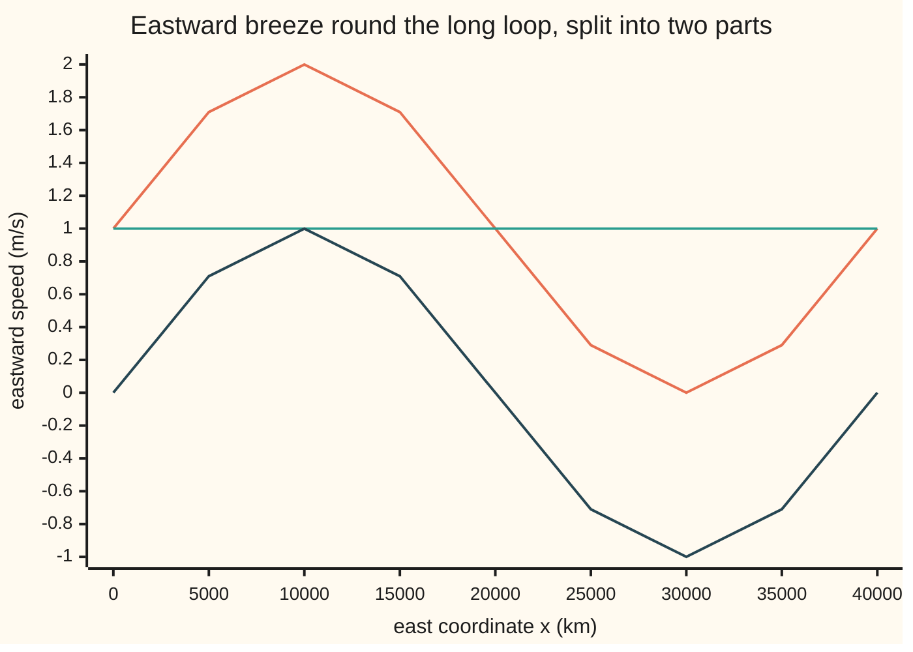

# Hodge's theorem: every cohomology class has exactly one harmonic form

[Syllabus](../../../SYLLABUS.md) → [Differential geometry and Lie groups](../README.md) → [Riemannian Geometry](../README.md#s05) → Hodge's theorem

---

## General Overview

Picture a doughnut-shaped world. Its long circle is 40,000 km and its short circle 20,000 km. The world is flat: cut it open and it lies as a rectangle 40,000 km by 20,000 km, with opposite edges glued. That surface is a **flat torus**, with area 800,000,000 km². It is an abstract world: no doughnut in ordinary space is flat (Step 5 of [Gauss, Codazzi and Ricci equations](11-second-fundamental-form-and-gauss-codazzi.md)), but the glued rectangle needs no space around it.

A breeze blows east across it. Its speed changes with the east coordinate $`x`$ (in km): $`u = 1 + \sin(2\pi x / 40{,}000)`$ m/s. It is 1 m/s at $`x = 0`$, 2 m/s at $`x = 10{,}000`$ km, and calm at $`x = 30{,}000`$ km. A pilot who flies the long loop round the world asks one question: what average tailwind does the whole loop give?

The answer is exactly 1 m/s. The breeze splits into two parts. One is a steady 1 m/s jet that circles the world. The other is a gust pattern that comes from a "height" function, so it adds up to zero round every loop. The steady jet is the **harmonic part**. It is the one piece of the breeze that the hole in the doughnut forces to exist.

This card builds the tool that finds that part: the **Hodge Laplacian**, a Laplacian that acts on 1-forms (wind-like fields) instead of on functions. Its solutions on a closed surface are the harmonic forms. They come in exactly one per hole. So solving Laplace's equation counts holes, here independent loops round the world: 2 on the torus, one round each circle, and 0 on the globe.

**On a closed, oriented Riemannian manifold, every de Rham class contains exactly one harmonic form (one with $`d\omega = 0`$ and $`\delta\omega = 0`$), so the number of independent solutions of the Hodge Laplacian's equation $`\Delta_H \omega = 0`$ in degree k is the Betti number $`b_k`$, the number of k-dimensional holes.**

**What kind of fact this is:** a global theorem, with the manifold closed (compact, with no edge). Uniqueness is proved on this card for every closed manifold. Existence is proved on this card for the flat torus, by Fourier series, and for any grid. The general existence proof needs elliptic regularity, which is stated here, not proved; Warner's Chapter 6 in Sources proves it.

### The picture: the breeze, its harmonic part and its exact part



Orange: the breeze, $`1 + \sin(2\pi x/40{,}000)`$. Green: its harmonic part, a flat 1 m/s. Dark blue: its exact part, $`\sin(2\pi x/40{,}000)`$, the slope of a height function. The dark blue curve has as much area above zero as below, so it adds nothing round the loop. At every $`x`$, orange is green plus dark blue.

---

## The formula

New notation, in words first. This card introduces the **codifferential** $`\delta`$, the **Hodge Laplacian** $`\Delta_H`$ and the space $`\mathcal H^k`$ of **harmonic k-forms**. From [Hodge star](../04-Differential%20Forms/09-hodge-star-and-maxwell-in-forms.md): the star $`\star`$ turns a k-form into an (N − k)-form using the metric, on a manifold $`M`$ of dimension $`N`$ (capital, because $`n`$ counts waves below), and $`\delta`$ was met there in passing. From [de Rham cohomology](../04-Differential%20Forms/08-de-rham-cohomology.md): $`H^k_{dR}(M)`$ is closed k-forms modulo exact ones, with dimension $`b_k`$.

The metric gives two forms an **inner product**, a number that measures how much they point the same way, added up over the whole manifold:

```math
\langle \alpha, \beta \rangle = \int_M (\alpha, \beta)_g \; dV_g, \qquad \|\alpha\|^2 = \langle \alpha, \alpha \rangle
```

Here $`(\alpha, \beta)_g`$ is the pointwise dot product the metric gives, and $`dV_g`$ is the volume form of [Volume form and Laplace-Beltrami](08-volume-form-and-the-laplace-beltrami-operator.md). The codifferential is the adjoint of $`d`$ for this inner product, and the Hodge Laplacian combines the two:

```math
\langle d\alpha, \beta \rangle = \langle \alpha, \delta\beta \rangle, \qquad \Delta_H = d\,\delta + \delta\, d, \qquad \mathcal H^k = \{\omega : \Delta_H \omega = 0\} \cong H^k_{dR}(M)
```

**Read it aloud:** delta is the operation that moves d to the other side of the inner product. The Hodge Laplacian is d-delta plus delta-d. Its solutions in degree k (the forms it sends to zero) match the k-th de Rham group one for one, so its dimension is the k-th Betti number.

On the flat torus, with coordinates $`x`$ east and $`y`$ north (both in km) and the metric $`dx^2 + dy^2`$, everything is explicit. For a 1-form $`\omega = u\,dx + v\,dy`$:

```math
\delta\omega = -\Big(\frac{\partial u}{\partial x} + \frac{\partial v}{\partial y}\Big), \qquad \Delta_H \omega = -\Big(\frac{\partial^2 u}{\partial x^2} + \frac{\partial^2 u}{\partial y^2}\Big)dx - \Big(\frac{\partial^2 v}{\partial x^2} + \frac{\partial^2 v}{\partial y^2}\Big)dy
```

**Read it aloud:** delta is minus the divergence. The Hodge Laplacian on a flat torus is minus the ordinary Laplacian, applied to each coefficient separately.

Every form splits into three perpendicular parts, the **Hodge decomposition**:

```math
\omega = h + d\alpha + \delta\beta, \qquad (1 + \sin\tfrac{2\pi x}{40{,}000})\,dx = \underbrace{dx}_{h} + \underbrace{d\Big(-\tfrac{40{,}000}{2\pi}\cos\tfrac{2\pi x}{40{,}000}\Big)}_{d\alpha} + \underbrace{0}_{\delta\beta}
```

**Read it aloud:** any form is a harmonic part, plus an exact part (the d of a function), plus a coexact part (the delta of a 2-form). For the breeze, the harmonic part is $`dx`$, the exact part comes from a height of amplitude 6366.197724 km, and the coexact part is zero.

| Symbol | Plain meaning | In our example | Push it up and the answer… |
| --- | --- | --- | --- |
| $`L_1`$, $`L_2`$; $`x`$, $`y`$ | the torus's long and short circles; east and north coordinates | 40,000 km, 20,000 km | longer circles: smaller nonzero eigenvalues; the count stays 2 |
| $`\omega = u\,dx + v\,dy`$ | a 1-form: it eats a direction and returns a rate; here $`u`$ and $`v`$ are the eastward and northward breeze in m/s | $`u = 1 + \sin(2\pi x/L_1)`$, $`v = 0`$ | — |
| $`\langle \alpha, \beta \rangle`$, $`\Vert\alpha\Vert^2`$; $`(\alpha, \beta)_g`$, $`dV_g`$ | inner product of two forms, summed over the manifold; its square size, the **energy**; the pointwise dot product; the volume form | mean square of $`\omega`$: 1.5 | — |
| $`\delta`$, $`\star`$ | codifferential: adjoint of $`d`$, lowers the degree by one; on 1-forms, minus the divergence; the Hodge star | $`\delta\omega = -(2\pi/L_1)\cos(2\pi x/L_1)`$ | — |
| $`\Delta_H`$, $`\Delta_g`$ | Hodge Laplacian $`d\delta + \delta d`$; the Laplace-Beltrami operator, equal to $`-\Delta_H`$ on functions; with the Hodge sign every eigenvalue is 0 or positive | lowest nonzero: 2.467401 × 10⁻⁸ per km² | — |
| $`\mathcal H^k`$, $`\Omega^k`$, $`H^k_{dR}`$ | harmonic k-forms, $`\Delta_H\omega = 0`$; all smooth k-forms; the de Rham group | $`\mathcal H^1`$ = all $`a\,dx + b\,dy`$ | — |
| $`a`$, $`b`$ | coefficients of the harmonic part: the averages of $`u`$ and $`v`$ | $`a = 1`$, $`b = 0`$ | stronger mean jet |
| $`h`$, $`d\alpha`$, $`\delta\beta`$; $`\eta`$ | harmonic, exact and coexact parts; in the proof, the Green's operator applied to $`\omega - h`$ | $`dx`$; $`d(-6366.197724\cos(2\pi x/L_1))`$; 0 | — |
| $`b_k`$ | Betti number: number of independent k-dimensional holes | torus 1, 2, 1; globe 1, 0, 1 | — |
| $`m`$, $`n`$; $`\lambda(m, n)`$; $`\nu`$ | whole numbers counting waves round each circle; the Hodge Laplacian's eigenvalue on that wave; the gust's wave number $`2\pi/L_1`$, nu (not $`k`$, which is the degree; the code calls it `k`) | $`\lambda(1, 0) = (2\pi/L_1)^2`$; $`\nu`$ = 1/6366.197724 per km | more waves: larger eigenvalue |
| $`d_0`$, $`d_1`$, $`\Delta_1`$, $`c`$; $`V`$, $`E`$, $`F`$ | on a grid: $`d`$ from corners to edges, and from edges to squares; the grid Hodge Laplacian on edges; a cochain, one number per edge; numbers of corners, edges, squares | 8 × 4 grid of 5000 km squares: 32, 64, 32 | finer grid: same count |

### When it holds

- **The manifold is compact with no edge.** Then the adjoint rule has no boundary term, and harmonic forms are closed and coclosed. On the flat plane, $`dx = d(x)`$ is harmonic and exact, so the zero class holds a nonzero harmonic form: uniqueness fails.
- **There is a metric.** $`\delta`$, and so $`\Delta_H`$, are built from it. A different metric picks a different harmonic form in each class, but the count $`b_k`$ does not change.
- **Both halves of the Laplacian are kept.** Drop $`\delta d`$ and every coclosed form passes; on the 8 × 4 grid the "count" becomes 33, not 2.
- **The manifold is oriented and coefficients are real.** The star needs an orientation for Poincaré duality $`b_k = b_{N-k}`$. Twists that only real numbers miss (torsion) are invisible to harmonic forms, as they are to de Rham classes.

---

## Why it works

### Step 0: the harmonic form is the least-energy member of its class

A class is a closed form plus every exact form, $`\omega + d\alpha`$. These forms all give the same loop integrals. Among them, pick the one with the least energy $`\|\omega + d\alpha\|^2`$: the calmest breeze with the same circulation round every loop.

The least-energy member is perpendicular to every exact form. Perpendicular to all $`d\alpha`$ means $`\langle h, d\alpha \rangle = \langle \delta h, \alpha \rangle = 0`$ for every $`\alpha`$, which says $`\delta h = 0`$. So the calmest member is closed and coclosed. That is what harmonic means. The rest of this section makes each step exact.

This is [Dirichlet's principle](../../19-Partial%20differential%20equations/04-Laplace%2C%20Poisson%20and%20Potentials/06-dirichlet-principle-and-variational-form.md) moved from functions to forms: the settled state stores the least energy.

### Step 1: delta is minus the divergence, from the adjoint rule

Take a function $`\alpha`$ and a 1-form $`\beta = u\,dx + v\,dy`$ on the torus. Then $`d\alpha = \alpha_x\,dx + \alpha_y\,dy`$, where a subscript means a partial derivative. The inner product is

```math
\langle d\alpha, \beta \rangle = \int (\alpha_x u + \alpha_y v)\, dx\, dy = -\int \alpha\, (u_x + v_y)\, dx\, dy
```

The second equality integrates by parts. The torus has no edge, so no boundary term appears. So $`\delta\beta = -(u_x + v_y)`$. For the breeze, $`\delta\omega = -(2\pi/L_1)\cos(2\pi x/L_1)`$, not zero: the breeze speeds up and slows down along its own path, so air piles up in places.

In general $`\delta = \pm{\star}d{\star}`$, with a sign fixed by the degree and dimension. On a 2-form $`\beta = \psi\,dx\wedge dy`$ on the torus (psi, $`\psi`$, a function) it gives $`\delta\beta = \psi_y\,dx - \psi_x\,dy`$.

A **coexact** form is one of these, $`\delta\beta`$. Example: a crosswind $`\cos(2\pi y/L_2)\,dx`$, blowing east with a speed that changes going north. It is not closed: its curl at $`y = 5000`$ km is 0.314159 m/s per 1000 km. It is $`\delta\beta`$ for $`\psi = (L_2/2\pi)\sin(2\pi y/L_2)`$, with $`L_2/2\pi`$ = 3183.098862 km. The check confirms it by a finite difference: at $`y = 2500`$ km, $`\psi_y`$ = 0.707107 = $`\cos(\pi/4)`$.

### Step 2: harmonic means closed and coclosed

Pair $`\Delta_H\omega`$ with $`\omega`$ and move each $`d`$ and $`\delta`$ across:

```math
\langle \Delta_H\omega, \omega \rangle = \langle d\delta\omega, \omega \rangle + \langle \delta d\omega, \omega \rangle = \|\delta\omega\|^2 + \|d\omega\|^2
```

Both terms are squares, so neither is negative. If $`\Delta_H\omega = 0`$, both vanish: $`d\omega = 0`$ and $`\delta\omega = 0`$. The converse is clear. On a closed manifold, harmonic, closed-and-coclosed and "solves $`\Delta_H\omega = 0`$" are the same thing.

On functions, $`\Delta_H f = \delta d f = -\Delta_g f`$, the Laplace-Beltrami operator with the opposite sign. This card keeps the Hodge sign, which makes every eigenvalue 0 or positive.

### Step 3: one class, at most one harmonic form

Say $`h_1`$ and $`h_2`$ are harmonic and in the same class. Their difference is harmonic and exact: $`h_1 - h_2 = d\alpha`$. Then

```math
\|d\alpha\|^2 = \langle d\alpha, h_1 - h_2 \rangle = \langle \alpha, \delta(h_1 - h_2) \rangle = 0
```

So $`h_1 = h_2`$. The same line shows that a harmonic form is perpendicular to every exact form. It gives the least-energy property of Step 0: $`\|h + d\alpha\|^2 = \|h\|^2 + \|d\alpha\|^2`$.

For the breeze, the mean squares are 1.5 for the breeze, 1 for $`dx`$ and 0.5 for the exact part, and the cross term is 0. The harmonic part is the calmest form with the same circulation.

```
mean square, (m/s)^2
breeze        ##############################  1.500000
harmonic dx   ####################            1.000000
exact part    ##########                      0.500000
```

### Step 4: on the torus, every class has a harmonic form (Fourier)

Expand each coefficient in waves $`e^{2\pi i(mx/L_1 + ny/L_2)}`$, where $`i = \sqrt{-1}`$ and $`m`$, $`n`$ are whole numbers, as in [Fourier coefficients](../../20-Harmonic%20analysis/01-Fourier%20Series%20in%20Depth/01-fourier-coefficients-and-orthogonality.md). By the formula above, $`\Delta_H`$ multiplies each wave by

```math
\lambda(m, n) = \Big(\frac{2\pi m}{L_1}\Big)^2 + \Big(\frac{2\pi n}{L_2}\Big)^2
```

It is zero only for $`m = n = 0`$, the constant wave. So a harmonic 1-form has constant coefficients: $`\mathcal H^1 = \{a\,dx + b\,dy\}`$, of dimension 2. Functions and 2-forms have one coefficient each, so $`\mathcal H^0`$ and $`\mathcal H^2`$ have dimension 1. The counts 1, 2, 1 are the Betti numbers of the torus.

The lowest nonzero eigenvalues are 2.467401 × 10⁻⁸ per km² for one wave round the long circle and 9.869604 × 10⁻⁸ for one wave round the short circle. These are not zero, so every non-constant wave can be divided by its $`\lambda`$. That division builds the decomposition.

<details>
<summary>Detailed proof: the Hodge decomposition on the flat torus</summary>

Let $`\omega`$ be a smooth 1-form. Take its constant Fourier term as $`h`$: its coefficients are the averages $`a`$ of $`u`$ and $`b`$ of $`v`$. What is left has no constant wave, so divide each wave by its $`\lambda(m, n)`$. This gives a smooth form $`\eta`$, the **Green's operator** applied to $`\omega - h`$, with

$`\displaystyle \Delta_H \eta = \omega - h .`$

The Fourier coefficients of $`\eta`$ fall off faster than those of $`\omega`$, so $`\eta`$ is smooth. Expand $`\Delta_H`$:

$`\displaystyle \omega = h + d(\delta\eta) + \delta(d\eta) .`$

That is harmonic plus exact plus coexact. The three parts are perpendicular: $`\langle d\alpha, \delta\beta \rangle = \langle dd\alpha, \beta \rangle = 0`$, and Step 3 handles the harmonic part.

If $`\omega`$ is closed, the coexact part is zero, because $`\|\delta d\eta\|^2 = \langle d\delta d\eta, d\eta \rangle`$ and $`d\delta d\eta = d\omega - dd\delta\eta - dh = 0`$. So every closed form is its harmonic part plus an exact form: every class contains a harmonic form. With Step 3, exactly one.

For the breeze, $`h = dx`$ and $`\omega - h = \sin(\nu x)\,dx`$, with $`\nu = 2\pi/L_1`$. Then $`\eta = \sin(\nu x)/\nu^2\, dx`$, $`\delta\eta = -\cos(\nu x)/\nu`$ and $`d\eta = 0`$. So the exact part is $`d(-\cos(\nu x)/\nu)`$, and $`1/\nu = L_1/2\pi`$ = 6366.197724 km.

</details>

### Step 5: on any closed manifold, the same result (stated)

The torus proof used Fourier series. A general closed manifold has no such waves, but the Hodge Laplacian still has a full set of eigenforms. The reason is the operator $`(1 + \Delta_H)^{-1}`$, which needs no division by zero. The equation $`(1 + \Delta_H)\eta = \sigma`$ always has a weak solution (one that holds after pairing with every smooth form), by the Riesz representation theorem, because $`\|\eta\|^2 + \|d\eta\|^2 + \|\delta\eta\|^2`$ is zero only for $`\eta = 0`$. That inverse is compact and symmetric, so [Compact and symmetric](../../18-Functional%20analysis/03-Bounded%20Operators/08-spectral-theorem-for-compact-self-adjoint-operators.md) gives an orthonormal basis of its eigenforms, which are eigenforms of $`\Delta_H`$ too. The kernel $`\mathcal H^k`$ is then finite-dimensional, and the **Green's operator**, Step 4's division by each nonzero eigenvalue, is built on this basis.

Two analytic facts are needed and are stated here without proof; Warner's Chapter 6 proves both:

1. **Elliptic regularity** (Weyl's lemma, in Sources): a weak solution of $`(1 + \Delta_H)\eta = \sigma`$ or $`\Delta_H\eta = \sigma`$, with a smooth right-hand side $`\sigma`$, is itself smooth.
2. **Compactness** (Rellich's theorem): on a compact manifold, a sequence of forms whose energy and first-derivative energy stay bounded has a subsequence that converges in energy. This makes $`(1 + \Delta_H)^{-1}`$ compact.

With these, Step 4's proof runs word for word. The result is **Hodge's theorem**: $`\Omega^k = \mathcal H^k \oplus d\Omega^{k-1} \oplus \delta\Omega^{k+1}`$, and $`\mathcal H^k \cong H^k_{dR}(M)`$. Warner proves it in full in Chapter 6, and Jost in Chapter 3.

### Step 6: the star turns holes of degree k into holes of degree N − k

The star commutes with the Hodge Laplacian: $`{\star}\Delta_H = \Delta_H{\star}`$. So it sends harmonic k-forms to harmonic (N − k)-forms, and it is invertible. That gives **Poincaré duality**, $`b_k = b_{N-k}`$.

On the torus, $`\star 1 = dx\wedge dy`$, $`\star dx = dy`$ and $`\star dy = -dx`$. The star swaps the two harmonic 1-forms and pairs the constants with the area form. The counts 1, 2, 1 read the same backwards.

### Step 7: the grid version, with an exact count

Cut the torus into an 8 × 4 grid of 5000 km squares: 32 corners, 64 edges, 32 squares. A 1-form becomes one number per edge: its integral along that edge. The derivative $`d_0`$ takes corner values to edge differences. The derivative $`d_1`$ adds an edge cochain round each square. On square cells, $`\delta`$ becomes the transpose of $`d`$, divided by the area of a square. The grid Hodge Laplacian on edges is

```math
\Delta_1 = \frac{d_0 d_0^{\mathsf T} + d_1^{\mathsf T} d_1}{(5000 \text{ km})^2}
```

Here is the whole proof that its kernel counts holes. Pair $`\Delta_1 c`$ with $`c`$, as in Step 2: $`\Delta_1 c = 0`$ exactly when $`d_1 c = 0`$ and $`d_0^{\mathsf T} c = 0`$. Linear algebra splits the 64 edge numbers into three perpendicular pieces: the image of $`d_0`$ (exact), the image of $`d_1^{\mathsf T}`$ (coexact) and the kernel of $`\Delta_1`$ (harmonic). The closed cochains are exact plus harmonic, so the kernel is the closed cochains modulo the exact ones. That is the grid's cohomology, the same 1, 2, 1 as [de Rham cohomology](../04-Differential%20Forms/08-de-rham-cohomology.md) finds.

The check finds each rank with arithmetic modulo the prime 1,000,000,007, which can only undercount the true rank. Kernel vectors give the lower bound. In degrees 0 and 2 the constants lie in the kernel by construction. In degree 1 the check applies $`\Delta_1`$ to "every edge east" and "every edge north" and gets exactly zero. The kernel's size is squeezed between the two bounds, so the counts 1, 2, 1 are exact.

### Step 8: the globe has no harmonic 1-forms

On the round sphere every closed 1-form is exact, since $`b_1 = 0`$ ([de Rham cohomology](../04-Differential%20Forms/08-de-rham-cohomology.md) computes 1, 0, 1). So a harmonic 1-form is $`df`$ with $`\delta df = 0`$, that is $`\Delta_g f = 0`$. Multiply by $`f`$ and integrate: $`\|df\|^2 = 0`$, so $`f`$ is constant and $`df = 0`$.

So a jet stream circling the globe cannot be both curl-free and free of sources. It has curl, and its circulation lives in its coexact part. On the doughnut world, a uniform jet is harmonic.

That argument takes $`b_1 = 0`$ as input, so it does not count the holes independently. Two roads find the count without it. The check counts on a cube's surface, the globe flattened onto six squares: 8 corners, 12 edges, 6 faces, harmonic counts 1, 0, 1. And curvature does it on the smooth globe: Bochner's theorem, on the next card, shows that positive Ricci curvature leaves no harmonic 1-form at all.

---

## Worked numbers, by hand

The torus: $`L_1 = 40{,}000`$ km, $`L_2 = 20{,}000`$ km. The breeze $`\omega = (1 + \sin \nu x)\,dx`$ in m/s, with $`\nu = 2\pi/L_1`$.

| Step | Arithmetic | Value |
| --- | --- | --- |
| Is $`\omega`$ closed? | $`d\omega = \partial_y(1 + \sin \nu x)\, dy\wedge dx`$ | 0: closed |
| Is $`\omega`$ coclosed? | $`\delta\omega = -\nu\cos \nu x`$ | no |
| harmonic coefficient $`a`$ | average of $`1 + \sin \nu x`$ over one loop | 1 |
| harmonic coefficient $`b`$ | average of the $`dy`$ coefficient, 0 | 0 |
| potential amplitude | $`1/\nu = 40{,}000/2\pi`$ | 6366.197724 km |
| breeze at $`x = 5000`$ km | $`1 + \sin(\pi/4)`$ | 1.707107 m/s |
| split at $`x = 5000`$ km | harmonic 1 + exact 0.707107 | 1.707107 m/s |
| long-loop integral | $`\int_0^{40{,}000} (1 + \sin \nu x)\, dx`$ | 40000 km·m/s |
| **average tailwind** | $`40{,}000 / 40{,}000`$ | **1 m/s** |

The average tailwind round the long loop is exactly 1 m/s, the harmonic part. The gusts help on one half and cost on the other, and cancel exactly.

The count of holes, by the grid, with two checks on it and the cube for the globe:

| Road | Degree 0 | Degree 1 | Degree 2 |
| --- | --- | --- | --- |
| Fourier zero modes | 1 | 2 | 1 |
| grid 8 × 4 kernel | 1 | 2 | 1 |
| Euler count $`V - E + F = 32 - 64 + 32`$ | $`b_0 - b_1 + b_2 = 0`$ | | |
| cube (globe) kernel | 1 | 0 | 1 |

### What breaks if you drop a piece

| Mistake | Comes out at | What went wrong |
| --- | --- | --- |
| Drop $`\delta d`$: count the kernel of $`d\delta`$ on the 8 × 4 grid | 33 "holes" (right: 2) | that kernel is every coclosed cochain, swirls included |
| Drop $`d\delta`$: count the kernel of $`\delta d`$ | 33 (right: 2) | that kernel is every closed cochain, 31 exact ones included |
| Read the harmonic part at one point, $`x = 10{,}000`$ km | 2 m/s (right: 1) | the harmonic part is the average, not a sample |
| Keep the breeze itself as the class's representative | mean square 1.5 (least: 1) | it is closed but not coclosed |
| Use the flat plane, which is not compact | $`dx = d(x)`$ harmonic and exact | on the torus $`x`$ jumps by 40000 km round the loop; on the plane it does not, and uniqueness fails |

---

## Code, from first principles, and it actually runs

Both programs build the Hodge Laplacian from scratch and make one exact count of the holes, 1, 2, 1, checked against the Fourier argument and the Euler number. The count (road 2) builds a grid torus, forms $`d_0`$, $`d_1`$ and the three grid Laplacians, and finds their kernels exactly by rank modulo a prime plus explicit kernel vectors. The Fourier argument (road 1) counts one constant wave and multiplies by the number of basis forms in each degree, 1, 2, 1, so it confirms the count rather than finding it independently. The Euler number (road 3) checks only the alternating sum $`b_0 - b_1 + b_2`$. The same code gives 1, 0, 1 on a cube. Then the grid Laplacian is applied to a wave, and its eigenvalue converges to the smooth one about fourfold per halving of the grid. Last, the breeze is sampled at 64 points and split, and each part is checked against its closed form.

### Python

```python
# Hodge Laplacian and harmonic forms -- the check behind the card.  Standard library only.
# A flat torus 40,000 km by 20,000 km.  Roads to its hole count b = (1, 2, 1):
#   road 1: zero modes of the Hodge Laplacian's Fourier spectrum
#   road 2: exact kernel of a grid Hodge Laplacian (rank mod a prime, plus kernel vectors)
#   road 3: the Euler count V - E + F against b0 - b1 + b2
# A cube stands in for the globe: b = (1, 0, 1).  Then the example's split, by sampling.
from math import sin, cos, pi

L1, L2 = 40000.0, 20000.0                      # the torus's two circles, km
P = 1_000_000_007                              # a prime: ranks mod P bound the true ranks
def f6(x): return "%.6f" % (0.0 if abs(x) < 5e-7 else x)

def rank_mod_p(A):                             # row reduction with arithmetic mod P
    A = [[x % P for x in row] for row in A]; r = 0
    for c in range(len(A[0])):
        piv = next((i for i in range(r, len(A)) if A[i][c]), None)
        if piv is None: continue
        A[r], A[piv] = A[piv], A[r]
        inv = pow(A[r][c], P - 2, P); A[r] = [x * inv % P for x in A[r]]
        for i in range(r + 1, len(A)):
            if A[i][c]:
                f = A[i][c]; A[i] = [(x - f * y) % P for x, y in zip(A[i], A[r])]
        r += 1
    return r

def mul(A, B): return [[sum(a * b for a, b in zip(row, col)) for col in zip(*B)] for row in A]
def tr(A): return [list(r) for r in zip(*A)]

def build(nv, edges, faces):                   # d0: functions -> 1-forms, d1: 1-forms -> 2-forms
    look = {}
    for k, (a, b) in enumerate(edges): look[(a, b)] = (k, 1); look[(b, a)] = (k, -1)
    d0 = [[0] * nv for _ in edges]
    for k, (a, b) in enumerate(edges): d0[k][a] -= 1; d0[k][b] += 1
    d1 = [[0] * len(edges) for _ in faces]
    for f, cyc in enumerate(faces):
        for a, b in zip(cyc, cyc[1:] + cyc[:1]):
            k, s = look[(a, b)]; d1[f][k] += s
    return d0, d1

def grid(n1, n2):                              # n1 x n2 square cells, opposite edges glued
    v = lambda i, j: i % n1 + n1 * (j % n2)
    E = [(v(i, j), v(i + 1, j)) for j in range(n2) for i in range(n1)] + \
        [(v(i, j), v(i, j + 1)) for j in range(n2) for i in range(n1)]
    F = [[v(i, j), v(i + 1, j), v(i + 1, j + 1), v(i, j + 1)] for j in range(n2) for i in range(n1)]
    return n1 * n2, E, F

def cube():                                    # the globe, flattened onto a cube's six faces
    E = [(a, a | 1 << t) for t in range(3) for a in range(8) if not a >> t & 1]
    F = []
    for t in range(3):
        u, w = [1 << s for s in range(3) if s != t]
        for side in (0, 1):
            b = side << t; F.append([b, b ^ u, b ^ u ^ w, b ^ w])
    return 8, E, F

def hodge_counts(nv, E, F):                    # nullities of the three Hodge Laplacians
    d0, d1 = build(nv, E, F)
    assert all(x == 0 for row in mul(d1, d0) for x in row)       # d after d is zero
    up, down = mul(d0, tr(d0)), mul(tr(d1), d1)                   # d delta and delta d
    L1 = [[a + b for a, b in zip(r, s)] for r, s in zip(up, down)]
    L0, L2 = mul(tr(d0), d0), mul(d1, tr(d1))
    null = [len(M) - rank_mod_p(M) for M in (L0, L1, L2)]
    return null, (len(up) - rank_mod_p(up), len(down) - rank_mod_p(down)), L1

def apply(M, v): return [sum(a * b for a, b in zip(row, v)) for row in M]

print("torus %.0f km by %.0f km, area %.0f km^2" % (L1, L2, L1 * L2))
# road 1: Fourier.  e^{2 pi i (m x/L1 + n y/L2)} times a basis form has eigenvalue lam(m, n)
lam = lambda m, n: (2 * pi * m / L1) ** 2 + (2 * pi * n / L2) ** 2
zero_modes = sum(1 for m in range(-4, 5) for n in range(-4, 5) if lam(m, n) == 0.0)
fourier = [zero_modes * comps for comps in (1, 2, 1)]           # 1, 2, 1 basis forms per degree
print("road 1 Fourier zero modes in degrees 0 1 2:", *fourier)
print("lowest nonzero eigenvalues x 1e8 per km^2: %s (east-west), %s (north-south)"
      % (f6(lam(1, 0) * 1e8), f6(lam(0, 1) * 1e8)))
# road 2: grid Hodge Laplacian on 8 x 4 cells of 5000 km
nv, E, F = grid(8, 4)
null, drop, L1g = hodge_counts(nv, E, F)
N = 32; dx, dy = [1] * N + [0] * N, [0] * N + [1] * N           # the two constant 1-forms
assert apply(L1g, dx) == [0] * 64 and apply(L1g, dy) == [0] * 64  # kernel has dimension >= 2
assert null == fourier                                             # so mod-P nullity 2 is exact
print("road 2 grid 8 x 4 of %.0f km: V E F = %d %d %d, harmonic counts" % (L1 / 8, nv, len(E), len(F)), *null)
print("dropping delta d leaves %d; dropping d delta leaves %d" % drop)
assert drop == (len(E) - (nv - 1), len(E) - (len(F) - 1))       # closed or coclosed cochains
chi = nv - len(E) + len(F); assert chi == null[0] - null[1] + null[2]
print("road 3 Euler count V - E + F = %d = b0 - b1 + b2" % chi)
cv, cE, cF = cube(); cnull, _, _ = hodge_counts(cv, cE, cF)
assert cnull == [1, 0, 1]; assert cv - len(cE) + len(cF) == cnull[0] - cnull[1] + cnull[2]
print("cube (globe): V E F = %d %d %d, harmonic counts" % (cv, len(cE), len(cF)), *cnull)
tnull, tdrop, _ = hodge_counts(*grid(12, 6))
assert tnull == null
print("try grid 12 x 6: harmonic counts", *tnull, "| dropping delta d leaves", tdrop[0])

def eig_check(n1, n2):                         # grid Laplacian on the cochain of cos(kx) dx
    nv, E, F = grid(n1, n2); _, _, L = hodge_counts(nv, E, F)
    h, k = L1 / n1, 2 * pi / L1
    c = [(sin(k * (i + 1) * h) - sin(k * i * h)) / k for j in range(n2) for i in range(n1)] + [0.0] * (n1 * n2)
    ratios = [a / b for a, b in zip(apply(L, c), c) if abs(b) > 1e-6]
    assert max(ratios) - min(ratios) < 1e-9                        # an eigenvector of the grid
    assert abs(ratios[0] - 4 * sin(k * h / 2) ** 2) < 1e-12         # discrete Fourier formula
    return ratios[0] / h ** 2
e8, e16, ex = eig_check(8, 4), eig_check(16, 8), lam(1, 0)
assert (ex - e8) / (ex - e16) > 3.9
print("grid eigenvalue x 1e8: 8x4 %s, 16x8 %s, smooth %s; error ratio %.2f"
      % (f6(e8 * 1e8), f6(e16 * 1e8), f6(ex * 1e8), (ex - e8) / (ex - e16)))

# the example: wind form (1 + sin(2 pi x / L1)) dx, sampled at 64 points round the long loop
k, M = 2 * pi / L1, 64
xs = [L1 * i / M for i in range(M)]
u = [1 + sin(k * x) for x in xs]
a = sum(u) / M                                 # harmonic part: the average coefficient
s1 = 2 * sum(ui * sin(k * x) for ui, x in zip(u, xs)) / M
amp = s1 / k                                   # exact part = d(-amp cos(kx))
pot = lambda x: -amp * cos(k * x)
x0 = 5000.0; slope = (pot(x0 + 0.5) - pot(x0 - 0.5)) / 1.0
assert abs(a - 1) < 1e-12 and abs(amp - L1 / (2 * pi)) < 1e-8 and abs(slope - sin(k * x0)) < 1e-6
print("harmonic part %s dx + %s dy; sine share %s; potential amplitude L1/2pi %s km"
      % (f6(a), f6(0.0), f6(s1), f6(amp)))
print("at x = 5000 km: wind %s = harmonic %s + exact %s (slope of potential)"
      % (f6(1 + sin(k * x0)), f6(a), f6(slope)))
loop = sum(u) * L1 / M                         # the short loop's integral is 0: no dy part
print("long loop integral %s km m/s, average tailwind %s m/s" % (f6(loop), f6(loop / L1)))
ms = [sum(v * v for v in u) / M, a * a, sum((s1 * sin(k * x)) ** 2 for x in xs) / M, sum(a * s1 * sin(k * x) for x in xs) / M]
assert abs(ms[0] - 1.5) < 1e-12 and abs(ms[2] - 0.5) < 1e-12 and abs(ms[3]) < 1e-12 and abs(ms[0] - ms[1] - ms[2]) < 1e-12
print("mean squares: form %s = harmonic %s + exact %s; cross term %s" % tuple(f6(m) for m in ms))
print("wrong: harmonic part read at x = 10000 km gives %s" % f6(1 + sin(k * 10000.0)))
# a crosswind cos(2 pi y / L2) dx is coexact: delta of b dx^dy, b = (L2/2pi) sin(2 pi y/L2)
q = 2 * pi / L2; b = lambda y: sin(q * y) / q
y0 = 2500.0; dbdy = (b(y0 + 0.5) - b(y0 - 0.5)) / 1.0
assert abs(dbdy - cos(q * y0)) < 1e-6
print("coexact: L2/2pi %s km; delta(beta) at y = 2500 km %s; curl x 1000 km %s"
      % (f6(1 / q), f6(dbdy), f6(q * sin(q * 5000.0) * 1000)))
print("plane: dx = d(x) is harmonic and exact; torus: dx round the long loop %s km, not exact"
      % f6(sum(dx[:8]) * L1 / 8))
u3 = [1 + 3 * sin(k * x) for x in xs]
print("try 1 + 3 sin: harmonic %s, potential amplitude %s km, mean square %s" % (f6(sum(u3) / M),
      f6(2 * sum(v * sin(k * x) for v, x in zip(u3, xs)) / M / k), f6(sum(v * v for v in u3) / M)))
cx = [5000 * i for i in range(9)]
for name, g in (("wind", lambda x: 1 + sin(k * x)), ("exact", lambda x: sin(k * x))):
    print("chart " + name + ":", *["%.2f" % (0.0 if abs(g(x)) < 5e-3 else g(x)) for x in cx])
print("ALL CHECKS PASS")
```

**Ran 2026-11-24 on macOS, Python 3.14.10, standard library only. All checks passed. Output, pasted from the run:**

```
torus 40000 km by 20000 km, area 800000000 km^2
road 1 Fourier zero modes in degrees 0 1 2: 1 2 1
lowest nonzero eigenvalues x 1e8 per km^2: 2.467401 (east-west), 9.869604 (north-south)
road 2 grid 8 x 4 of 5000 km: V E F = 32 64 32, harmonic counts 1 2 1
dropping delta d leaves 33; dropping d delta leaves 33
road 3 Euler count V - E + F = 0 = b0 - b1 + b2
cube (globe): V E F = 8 12 6, harmonic counts 1 0 1
try grid 12 x 6: harmonic counts 1 2 1 | dropping delta d leaves 73
grid eigenvalue x 1e8: 8x4 2.343146, 16x8 2.435855, smooth 2.467401; error ratio 3.94
harmonic part 1.000000 dx + 0.000000 dy; sine share 1.000000; potential amplitude L1/2pi 6366.197724 km
at x = 5000 km: wind 1.707107 = harmonic 1.000000 + exact 0.707107 (slope of potential)
long loop integral 40000.000000 km m/s, average tailwind 1.000000 m/s
mean squares: form 1.500000 = harmonic 1.000000 + exact 0.500000; cross term 0.000000
wrong: harmonic part read at x = 10000 km gives 2.000000
coexact: L2/2pi 3183.098862 km; delta(beta) at y = 2500 km 0.707107; curl x 1000 km 0.314159
plane: dx = d(x) is harmonic and exact; torus: dx round the long loop 40000.000000 km, not exact
try 1 + 3 sin: harmonic 1.000000, potential amplitude 19098.593171 km, mean square 5.500000
chart wind: 1.00 1.71 2.00 1.71 1.00 0.29 0.00 0.29 1.00
chart exact: 0.00 0.71 1.00 0.71 0.00 -0.71 -1.00 -0.71 0.00
ALL CHECKS PASS
```

### Rust

```rust
// Hodge Laplacian and harmonic forms -- the check behind the card.  std only, no crates.
// A flat torus 40,000 km by 20,000 km.  Roads to its hole count b = (1, 2, 1):
//   road 1: zero modes of the Hodge Laplacian's Fourier spectrum
//   road 2: exact kernel of a grid Hodge Laplacian (rank mod a prime, plus kernel vectors)
//   road 3: the Euler count V - E + F against b0 - b1 + b2
// A cube stands in for the globe: b = (1, 0, 1).  Then the example's split, by sampling.
use std::collections::HashMap;
use std::f64::consts::PI;

const L1: f64 = 40000.0; // the torus's two circles, km
const L2: f64 = 20000.0;
const P: i64 = 1_000_000_007; // a prime: ranks mod P bound the true ranks
type Mat = Vec<Vec<i64>>;

fn f6(x: f64) -> String { format!("{:.6}", if x.abs() < 5e-7 { 0.0 } else { x }) }

fn pow_mod(b: i64, e: i64) -> i64 { if e == 0 { 1 } else { let h = pow_mod(b * b % P, e / 2); if e % 2 == 1 { h * b % P } else { h } } }

fn rank_mod_p(m: &Mat) -> usize { // row reduction with arithmetic mod P
    let mut a: Mat = m.iter().map(|row| row.iter().map(|x| x.rem_euclid(P)).collect()).collect();
    let mut r = 0;
    for c in 0..a[0].len() {
        let piv = match (r..a.len()).find(|&i| a[i][c] != 0) { Some(p) => p, None => continue };
        a.swap(r, piv);
        let inv = pow_mod(a[r][c], P - 2);
        for x in a[r].iter_mut() { *x = *x * inv % P; }
        for i in r + 1..a.len() {
            let f = a[i][c];
            if f != 0 { for j in 0..a[i].len() { a[i][j] = (a[i][j] - f * a[r][j]).rem_euclid(P); } }
        }
        r += 1;
    }
    r
}

fn mul(a: &Mat, b: &Mat) -> Mat {
    a.iter().map(|row| (0..b[0].len()).map(|j| row.iter().zip(b).map(|(x, br)| x * br[j]).sum()).collect()).collect()
}
fn tr(a: &Mat) -> Mat { (0..a[0].len()).map(|j| a.iter().map(|r| r[j]).collect()).collect() }

struct Cx { nv: usize, e: Vec<(usize, usize)>, f: Vec<Vec<usize>> }

fn build(c: &Cx) -> (Mat, Mat) { // d0: functions -> 1-forms, d1: 1-forms -> 2-forms
    let mut look = HashMap::new();
    for (k, &(a, b)) in c.e.iter().enumerate() { look.insert((a, b), (k, 1)); look.insert((b, a), (k, -1)); }
    let mut d0 = vec![vec![0i64; c.nv]; c.e.len()];
    for (k, &(a, b)) in c.e.iter().enumerate() { d0[k][a] -= 1; d0[k][b] += 1; }
    let mut d1 = vec![vec![0i64; c.e.len()]; c.f.len()];
    for (fi, cyc) in c.f.iter().enumerate() {
        for t in 0..cyc.len() { let (k, s) = look[&(cyc[t], cyc[(t + 1) % cyc.len()])]; d1[fi][k] += s; }
    }
    (d0, d1)
}

fn grid(n1: usize, n2: usize) -> Cx { // n1 x n2 square cells, opposite edges glued
    let v = |i: usize, j: usize| i % n1 + n1 * (j % n2);
    let cells: Vec<(usize, usize)> = (0..n2).flat_map(|j| (0..n1).map(move |i| (i, j))).collect();
    let mut e: Vec<(usize, usize)> = cells.iter().map(|&(i, j)| (v(i, j), v(i + 1, j))).collect();
    e.extend(cells.iter().map(|&(i, j)| (v(i, j), v(i, j + 1))));
    let f = cells.iter().map(|&(i, j)| vec![v(i, j), v(i + 1, j), v(i + 1, j + 1), v(i, j + 1)]).collect();
    Cx { nv: n1 * n2, e, f }
}

fn cube() -> Cx { // the globe, flattened onto a cube's six faces
    let mut e = vec![];
    for t in 0..3 { for a in 0..8usize { if (a >> t) & 1 == 0 { e.push((a, a | 1 << t)); } } }
    let mut f = vec![];
    for t in 0..3 {
        let uw: Vec<usize> = (0..3).filter(|&s| s != t).map(|s| 1 << s).collect();
        let (u, w) = (uw[0], uw[1]);
        for side in 0..2usize { let b = side << t; f.push(vec![b, b ^ u, b ^ u ^ w, b ^ w]); }
    }
    Cx { nv: 8, e, f }
}

fn hodge_counts(c: &Cx) -> (Vec<usize>, (usize, usize), Mat) { // nullities of the three Laplacians
    let (d0, d1) = build(c);
    assert!(mul(&d1, &d0).iter().all(|r| r.iter().all(|&x| x == 0))); // d after d is zero
    let (up, down) = (mul(&d0, &tr(&d0)), mul(&tr(&d1), &d1)); // d delta and delta d
    let l1: Mat = up.iter().zip(&down).map(|(r, s)| r.iter().zip(s).map(|(a, b)| a + b).collect()).collect();
    let (l0, l2) = (mul(&tr(&d0), &d0), mul(&d1, &tr(&d1)));
    let null = [&l0, &l1, &l2].iter().map(|m| m.len() - rank_mod_p(m)).collect();
    (null, (up.len() - rank_mod_p(&up), down.len() - rank_mod_p(&down)), l1)
}

fn apply(m: &Mat, v: &[f64]) -> Vec<f64> { m.iter().map(|r| r.iter().zip(v).map(|(&a, b)| a as f64 * b).sum()).collect() }
fn lam(m: i64, n: i64) -> f64 { (2.0 * PI * m as f64 / L1).powi(2) + (2.0 * PI * n as f64 / L2).powi(2) }
fn join(v: &[usize]) -> String { v.iter().map(|x| x.to_string()).collect::<Vec<_>>().join(" ") }

fn eig_check(n1: usize, n2: usize) -> f64 { // grid Laplacian on the cochain of cos(kx) dx
    let (_, _, l) = hodge_counts(&grid(n1, n2));
    let (h, k) = (L1 / n1 as f64, 2.0 * PI / L1);
    let mut c: Vec<f64> = (0..n1 * n2).map(|t| ((k * (t % n1 + 1) as f64 * h).sin() - (k * (t % n1) as f64 * h).sin()) / k).collect();
    c.extend(vec![0.0; n1 * n2]);
    let ratios: Vec<f64> = apply(&l, &c).iter().zip(&c).filter(|(_, b)| b.abs() > 1e-6).map(|(a, b)| a / b).collect();
    let (mx, mn) = ratios.iter().fold((f64::MIN, f64::MAX), |(x, y), &r| (x.max(r), y.min(r)));
    assert!(mx - mn < 1e-9); // an eigenvector of the grid
    assert!((ratios[0] - 4.0 * (k * h / 2.0).sin().powi(2)).abs() < 1e-12); // discrete Fourier formula
    ratios[0] / (h * h)
}

fn main() {
    println!("torus {:.0} km by {:.0} km, area {:.0} km^2", L1, L2, L1 * L2);
    // road 1: Fourier.  e^{2 pi i (m x/L1 + n y/L2)} times a basis form has eigenvalue lam(m, n)
    let zero_modes = (-4..5).flat_map(|m| (-4..5).map(move |n| lam(m, n))).filter(|&l| l == 0.0).count();
    let fourier: Vec<usize> = [1, 2, 1].iter().map(|c| zero_modes * c).collect();
    println!("road 1 Fourier zero modes in degrees 0 1 2: {}", join(&fourier));
    println!("lowest nonzero eigenvalues x 1e8 per km^2: {} (east-west), {} (north-south)", f6(lam(1, 0) * 1e8), f6(lam(0, 1) * 1e8));
    // road 2: grid Hodge Laplacian on 8 x 4 cells of 5000 km
    let g = grid(8, 4);
    let (null, drop, l1g) = hodge_counts(&g);
    let dx: Vec<f64> = (0..64).map(|i| if i < 32 { 1.0 } else { 0.0 }).collect(); // the two constant 1-forms
    let dy: Vec<f64> = (0..64).map(|i| if i < 32 { 0.0 } else { 1.0 }).collect();
    assert!(apply(&l1g, &dx).iter().chain(apply(&l1g, &dy).iter()).all(|&x| x == 0.0)); // kernel >= 2
    assert_eq!(null, fourier); // so mod-P nullity 2 is exact
    println!("road 2 grid 8 x 4 of {:.0} km: V E F = {} {} {}, harmonic counts {}", L1 / 8.0, g.nv, g.e.len(), g.f.len(), join(&null));
    println!("dropping delta d leaves {}; dropping d delta leaves {}", drop.0, drop.1);
    assert_eq!(drop, (g.e.len() - (g.nv - 1), g.e.len() - (g.f.len() - 1))); // closed or coclosed cochains
    let chi = g.nv as i64 - g.e.len() as i64 + g.f.len() as i64;
    assert_eq!(chi, null[0] as i64 - null[1] as i64 + null[2] as i64);
    println!("road 3 Euler count V - E + F = {} = b0 - b1 + b2", chi);
    let cb = cube(); let (cnull, _, _) = hodge_counts(&cb);
    assert_eq!(cnull, vec![1, 0, 1]);
    assert_eq!(cb.nv as i64 - cb.e.len() as i64 + cb.f.len() as i64, cnull[0] as i64 - cnull[1] as i64 + cnull[2] as i64);
    println!("cube (globe): V E F = {} {} {}, harmonic counts {}", cb.nv, cb.e.len(), cb.f.len(), join(&cnull));
    let (tnull, tdrop, _) = hodge_counts(&grid(12, 6)); assert_eq!(tnull, null);
    println!("try grid 12 x 6: harmonic counts {} | dropping delta d leaves {}", join(&tnull), tdrop.0);
    let (e8, e16, ex) = (eig_check(8, 4), eig_check(16, 8), lam(1, 0)); assert!((ex - e8) / (ex - e16) > 3.9);
    println!("grid eigenvalue x 1e8: 8x4 {}, 16x8 {}, smooth {}; error ratio {:.2}",
             f6(e8 * 1e8), f6(e16 * 1e8), f6(ex * 1e8), (ex - e8) / (ex - e16));

    // the example: wind form (1 + sin(2 pi x / L1)) dx, sampled at 64 points round the long loop
    let (k, mf) = (2.0 * PI / L1, 64.0);
    let xs: Vec<f64> = (0..64).map(|i| L1 * i as f64 / mf).collect();
    let u: Vec<f64> = xs.iter().map(|x| 1.0 + (k * x).sin()).collect();
    let a = u.iter().sum::<f64>() / mf; // harmonic part: the average coefficient
    let s1 = 2.0 * u.iter().zip(&xs).map(|(ui, x)| ui * (k * x).sin()).sum::<f64>() / mf;
    let amp = s1 / k; // exact part = d(-amp cos(kx))
    let pot = |x: f64| -amp * (k * x).cos();
    let x0 = 5000.0; let slope = (pot(x0 + 0.5) - pot(x0 - 0.5)) / 1.0;
    assert!((a - 1.0).abs() < 1e-12 && (amp - L1 / (2.0 * PI)).abs() < 1e-8 && (slope - (k * x0).sin()).abs() < 1e-6);
    println!("harmonic part {} dx + {} dy; sine share {}; potential amplitude L1/2pi {} km", f6(a), f6(0.0), f6(s1), f6(amp));
    println!("at x = 5000 km: wind {} = harmonic {} + exact {} (slope of potential)", f6(1.0 + (k * x0).sin()), f6(a), f6(slope));
    let lp = u.iter().sum::<f64>() * L1 / mf; // the short loop's integral is 0: no dy part
    println!("long loop integral {} km m/s, average tailwind {} m/s", f6(lp), f6(lp / L1));
    let ms = [u.iter().map(|v| v * v).sum::<f64>() / mf, a * a,
              xs.iter().map(|x| (s1 * (k * x).sin()).powi(2)).sum::<f64>() / mf, xs.iter().map(|x| a * s1 * (k * x).sin()).sum::<f64>() / mf];
    assert!((ms[0] - 1.5).abs() < 1e-12 && (ms[2] - 0.5).abs() < 1e-12 && ms[3].abs() < 1e-12 && (ms[0] - ms[1] - ms[2]).abs() < 1e-12);
    println!("mean squares: form {} = harmonic {} + exact {}; cross term {}", f6(ms[0]), f6(ms[1]), f6(ms[2]), f6(ms[3]));
    println!("wrong: harmonic part read at x = 10000 km gives {}", f6(1.0 + (k * 10000.0).sin()));
    // a crosswind cos(2 pi y / L2) dx is coexact: delta of b dx^dy, b = (L2/2pi) sin(2 pi y/L2)
    let q = 2.0 * PI / L2; let b = |y: f64| (q * y).sin() / q;
    let y0 = 2500.0; let dbdy = (b(y0 + 0.5) - b(y0 - 0.5)) / 1.0;
    assert!((dbdy - (q * y0).cos()).abs() < 1e-6);
    println!("coexact: L2/2pi {} km; delta(beta) at y = 2500 km {}; curl x 1000 km {}", f6(1.0 / q), f6(dbdy), f6(q * (q * 5000.0).sin() * 1000.0));
    println!("plane: dx = d(x) is harmonic and exact; torus: dx round the long loop {} km, not exact",
             f6(dx[..8].iter().sum::<f64>() * L1 / 8.0));
    let u3: Vec<f64> = xs.iter().map(|x| 1.0 + 3.0 * (k * x).sin()).collect();
    println!("try 1 + 3 sin: harmonic {}, potential amplitude {} km, mean square {}", f6(u3.iter().sum::<f64>() / mf),
             f6(2.0 * u3.iter().zip(&xs).map(|(v, x)| v * (k * x).sin()).sum::<f64>() / mf / k),
             f6(u3.iter().map(|v| v * v).sum::<f64>() / mf));
    let cx: Vec<f64> = (0..9).map(|i| 5000.0 * i as f64).collect();
    let charts: [(&str, Box<dyn Fn(f64) -> f64>); 2] = [("wind", Box::new(move |x| 1.0 + (k * x).sin())), ("exact", Box::new(move |x| (k * x).sin()))];
    for (name, g) in charts.iter() {
        let s: Vec<String> = cx.iter().map(|&x| { let v = g(x); format!("{:.2}", if v.abs() < 5e-3 { 0.0 } else { v }) }).collect();
        println!("chart {}: {}", name, s.join(" "));
    }
    println!("ALL CHECKS PASS");
}
```

**Ran 2026-11-24 on macOS, rustc 1.98.1, no crates. All checks passed. Output, pasted from the run:**

```
torus 40000 km by 20000 km, area 800000000 km^2
road 1 Fourier zero modes in degrees 0 1 2: 1 2 1
lowest nonzero eigenvalues x 1e8 per km^2: 2.467401 (east-west), 9.869604 (north-south)
road 2 grid 8 x 4 of 5000 km: V E F = 32 64 32, harmonic counts 1 2 1
dropping delta d leaves 33; dropping d delta leaves 33
road 3 Euler count V - E + F = 0 = b0 - b1 + b2
cube (globe): V E F = 8 12 6, harmonic counts 1 0 1
try grid 12 x 6: harmonic counts 1 2 1 | dropping delta d leaves 73
grid eigenvalue x 1e8: 8x4 2.343146, 16x8 2.435855, smooth 2.467401; error ratio 3.94
harmonic part 1.000000 dx + 0.000000 dy; sine share 1.000000; potential amplitude L1/2pi 6366.197724 km
at x = 5000 km: wind 1.707107 = harmonic 1.000000 + exact 0.707107 (slope of potential)
long loop integral 40000.000000 km m/s, average tailwind 1.000000 m/s
mean squares: form 1.500000 = harmonic 1.000000 + exact 0.500000; cross term 0.000000
wrong: harmonic part read at x = 10000 km gives 2.000000
coexact: L2/2pi 3183.098862 km; delta(beta) at y = 2500 km 0.707107; curl x 1000 km 0.314159
plane: dx = d(x) is harmonic and exact; torus: dx round the long loop 40000.000000 km, not exact
try 1 + 3 sin: harmonic 1.000000, potential amplitude 19098.593171 km, mean square 5.500000
chart wind: 1.00 1.71 2.00 1.71 1.00 0.29 0.00 0.29 1.00
chart exact: 0.00 0.71 1.00 0.71 0.00 -0.71 -1.00 -0.71 0.00
ALL CHECKS PASS
```

The grid eigenvalues 2.343146 and 2.435855 approach the smooth 2.467401 (all × 10⁻⁸ per km²), with the error shrinking 3.94 times when the grid is halved. The grid count of holes is exact at every size; only the eigenvalues are approximate.

### Lean

Lean proves Hodge's theorem in its grid form for any finite setup, and the breeze's split on a loop of any length.

- Take a finite grid-like setup: cochains with an inner product, and any $`d_0`$, $`d_1`$ with $`d_1 d_0 = 0`$. Then every closed cochain has exactly one harmonic cochain in its class.
- Take the same setup. Then the number of independent harmonic cochains is the Betti number: independent closed ones minus independent exact ones.
- In the same setup, a cochain is harmonic exactly when it is closed and coclosed.
- Take a loop of any length $`L > 0`$, such as 40,000 km. Then $`\sin(2\pi x/L)`$ is the slope of $`-(L/2\pi)\cos(2\pi x/L)`$, so it is exact.
- Take the same loop. Then the breeze $`1 + \sin(2\pi x/L)`$ averages exactly 1, its harmonic part.
- Take the same loop. Then the mean squares are 3/2 for the breeze and 1/2 for the exact part.
- Lean also checks the arithmetic of three counts, not the grids themselves. They are $`32 - 64 + 32 = 1 - 2 + 1`$, $`8 - 12 + 6 = 1 - 0 + 1`$ and $`64 - (32 - 1) = 33`$.

The actual grid and cube kernels, the Fourier count, the eigenvalues and the crosswind are left to the Python and Rust checks.

```lean
-- Hodge's theorem: on a finite cochain complex with an inner product, every cohomology class holds exactly one harmonic cochain, so the harmonic count is the Betti number, and the torus breeze splits into its average dx plus an exact part.
import Mathlib.Analysis.InnerProductSpace.Adjoint
import Mathlib.LinearAlgebra.Dimension.RankNullity
import Mathlib.Analysis.SpecialFunctions.Trigonometric.Deriv
import Mathlib.Analysis.SpecialFunctions.Integrals.Basic

open Real

variable {V₀ V₁ V₂ : Type*}
  [NormedAddCommGroup V₀] [InnerProductSpace ℝ V₀] [FiniteDimensional ℝ V₀]
  [NormedAddCommGroup V₁] [InnerProductSpace ℝ V₁] [FiniteDimensional ℝ V₁]
  [NormedAddCommGroup V₂] [InnerProductSpace ℝ V₂] [FiniteDimensional ℝ V₂]

/-- The Hodge Laplacian in the middle degree of `V₀ → V₁ → V₂`: `d δ + δ d`, where the
codifferential `δ` is the adjoint of `d` for the inner product (the grid version of Step 7). -/
noncomputable def hodgeLaplacian (d₀ : V₀ →ₗ[ℝ] V₁) (d₁ : V₁ →ₗ[ℝ] V₂) : V₁ →ₗ[ℝ] V₁ :=
  d₀ ∘ₗ LinearMap.adjoint d₀ + LinearMap.adjoint d₁ ∘ₗ d₁

theorem adjoint_apply_eq_zero_iff_mem_orthogonal_range
    (d₀ : V₀ →ₗ[ℝ] V₁) (ω : V₁) :
    LinearMap.adjoint d₀ ω = 0 ↔ ω ∈ (LinearMap.range d₀)ᗮ := by
  rw [Submodule.mem_orthogonal]
  constructor
  · rintro h u ⟨v, rfl⟩
    rw [← LinearMap.adjoint_inner_right, h, inner_zero_right]
  · intro h
    apply ext_inner_left ℝ
    intro v
    rw [LinearMap.adjoint_inner_right, inner_zero_right]
    exact h _ ⟨v, rfl⟩

#print axioms adjoint_apply_eq_zero_iff_mem_orthogonal_range

theorem inner_hodgeLaplacian_self
    (d₀ : V₀ →ₗ[ℝ] V₁) (d₁ : V₁ →ₗ[ℝ] V₂) (ω : V₁) :
    inner ℝ (hodgeLaplacian d₀ d₁ ω) ω =
      inner ℝ (LinearMap.adjoint d₀ ω) (LinearMap.adjoint d₀ ω) + inner ℝ (d₁ ω) (d₁ ω) := by
  simp only [hodgeLaplacian, LinearMap.add_apply, LinearMap.comp_apply, inner_add_left]
  rw [← LinearMap.adjoint_inner_right d₀, LinearMap.adjoint_inner_left d₁]

#print axioms inner_hodgeLaplacian_self

theorem hodgeLaplacian_eq_zero_iff
    (d₀ : V₀ →ₗ[ℝ] V₁) (d₁ : V₁ →ₗ[ℝ] V₂) (ω : V₁) :
    hodgeLaplacian d₀ d₁ ω = 0 ↔ d₁ ω = 0 ∧ LinearMap.adjoint d₀ ω = 0 := by
  constructor
  · intro h
    have h1 := inner_hodgeLaplacian_self d₀ d₁ ω
    rw [h, inner_zero_left] at h1
    have a := real_inner_self_nonneg (x := LinearMap.adjoint d₀ ω)
    have b := real_inner_self_nonneg (x := d₁ ω)
    refine ⟨(inner_self_eq_zero (𝕜 := ℝ)).mp (by linarith), (inner_self_eq_zero (𝕜 := ℝ)).mp (by linarith)⟩
  · rintro ⟨h1, h2⟩
    simp [hodgeLaplacian, h1, h2]

#print axioms hodgeLaplacian_eq_zero_iff

theorem harmonic_iff_closed_and_mem_orthogonal
    (d₀ : V₀ →ₗ[ℝ] V₁) (d₁ : V₁ →ₗ[ℝ] V₂) (ω : V₁) :
    hodgeLaplacian d₀ d₁ ω = 0 ↔ d₁ ω = 0 ∧ ω ∈ (LinearMap.range d₀)ᗮ := by
  rw [hodgeLaplacian_eq_zero_iff, adjoint_apply_eq_zero_iff_mem_orthogonal_range]

#print axioms harmonic_iff_closed_and_mem_orthogonal

theorem hasDerivAt_cos_antideriv (L : ℝ) (hL : 0 < L) (x : ℝ) :
    HasDerivAt (fun x => -(L / (2 * π)) * cos (2 * π * x / L))
      (sin (2 * π * x / L)) x := by
  have h1 : HasDerivAt (fun x => 2 * π * x / L) (2 * π / L) x := by
    simpa using ((hasDerivAt_id x).const_mul (2 * π)).div_const L
  have h2 := (h1.cos).const_mul (-(L / (2 * π)))
  convert h2 using 1
  field_simp [pi_ne_zero, hL.ne']

#print axioms hasDerivAt_cos_antideriv

theorem hasDerivAt_sin_sq_antideriv (L : ℝ) (hL : 0 < L) (x : ℝ) :
    HasDerivAt (fun x => x / 2 - L / (8 * π) * sin (2 * (2 * π * x / L)))
      (sin (2 * π * x / L) ^ 2) x := by
  have h1 : HasDerivAt (fun x => 2 * (2 * π * x / L)) (2 * (2 * π / L)) x := by
    simpa using (((hasDerivAt_id x).const_mul (2 * π)).div_const L).const_mul 2
  have h2 : HasDerivAt (fun x => x / 2 - L / (8 * π) * sin (2 * (2 * π * x / L)))
      (1 / 2 - L / (8 * π) * (cos (2 * (2 * π * x / L)) * (2 * (2 * π / L)))) x :=
    ((hasDerivAt_id' x).div_const 2).sub ((h1.sin).const_mul (L / (8 * π)))
  convert h2 using 1
  rw [cos_two_mul, cos_sq']
  field_simp [pi_ne_zero, hL.ne']
  ring

#print axioms hasDerivAt_sin_sq_antideriv

/-- Hodge's theorem, in its finite (grid) form: when `d` after `d` is zero, every closed
cochain `ω` has exactly one harmonic cochain `h` in its class (`ω - h` is exact), and so the
number of independent harmonic cochains is the Betti number, the dimension of the closed
cochains minus the dimension of the exact ones. -/
theorem every_class_has_exactly_one_harmonic_form
    (d₀ : V₀ →ₗ[ℝ] V₁) (d₁ : V₁ →ₗ[ℝ] V₂) (hdd : d₁ ∘ₗ d₀ = 0) :
    (∀ ω : V₁, d₁ ω = 0 →
      ∃! h : V₁, hodgeLaplacian d₀ d₁ h = 0 ∧ ω - h ∈ LinearMap.range d₀) ∧
    Module.finrank ℝ (LinearMap.ker (hodgeLaplacian d₀ d₁)) +
        Module.finrank ℝ (LinearMap.range d₀) =
      Module.finrank ℝ (LinearMap.ker d₁) := by
  have hrange : ∀ y ∈ LinearMap.range d₀, d₁ y = 0 := by
    rintro y ⟨v, rfl⟩
    exact LinearMap.congr_fun hdd v
  have hexists : ∀ ω : V₁, d₁ ω = 0 →
      ∃ h : V₁, hodgeLaplacian d₀ d₁ h = 0 ∧ ω - h ∈ LinearMap.range d₀ := by
    intro ω hω
    obtain ⟨y, hy, z, hz, rfl⟩ := (LinearMap.range d₀).exists_add_mem_mem_orthogonal ω
    refine ⟨z, ?_, by simpa using hy⟩
    rw [harmonic_iff_closed_and_mem_orthogonal]
    refine ⟨?_, hz⟩
    rw [map_add, hrange y hy, zero_add] at hω
    exact hω
  have hinf : LinearMap.ker (hodgeLaplacian d₀ d₁) ⊓ LinearMap.range d₀ = ⊥ := by
    rw [eq_bot_iff]
    rintro x ⟨hx1, hx2⟩
    rw [SetLike.mem_coe, LinearMap.mem_ker, harmonic_iff_closed_and_mem_orthogonal] at hx1
    have := (LinearMap.range d₀).inf_orthogonal_eq_bot
    rw [eq_bot_iff] at this
    exact this ⟨hx2, hx1.2⟩
  have hsup : LinearMap.ker (hodgeLaplacian d₀ d₁) ⊔ LinearMap.range d₀ = LinearMap.ker d₁ := by
    apply le_antisymm
    · apply sup_le
      · intro x hx
        rw [LinearMap.mem_ker, harmonic_iff_closed_and_mem_orthogonal] at hx
        exact hx.1
      · intro x hx
        exact hrange x hx
    · intro ω hω
      obtain ⟨h, hh, hd⟩ := hexists ω hω
      have : ω = h + (ω - h) := by abel
      rw [this]
      exact Submodule.add_mem_sup hh hd
  refine ⟨?_, ?_⟩
  · intro ω hω
    obtain ⟨h, hh, hd⟩ := hexists ω hω
    refine ⟨h, ⟨hh, hd⟩, ?_⟩
    rintro h' ⟨hh', hd'⟩
    have hmem : h' - h ∈ LinearMap.ker (hodgeLaplacian d₀ d₁) ⊓ LinearMap.range d₀ := by
      refine ⟨?_, ?_⟩
      · show hodgeLaplacian d₀ d₁ (h' - h) = 0
        rw [map_sub, hh, hh', sub_zero]
      · have := Submodule.sub_mem _ hd hd'
        rwa [show ω - h - (ω - h') = h' - h by abel] at this
    rw [hinf, Submodule.mem_bot, sub_eq_zero] at hmem
    exact hmem
  · have := Submodule.finrank_sup_add_finrank_inf_eq
      (LinearMap.ker (hodgeLaplacian d₀ d₁)) (LinearMap.range d₀)
    rw [hsup, hinf, finrank_bot, add_zero] at this
    exact this.symm

/-- Harmonic means closed and coclosed: the Hodge Laplacian kills a cochain exactly when
`d` kills it and the codifferential `δ` (the adjoint of `d`) kills it. -/
theorem harmonic_iff_closed_and_coclosed
    (d₀ : V₀ →ₗ[ℝ] V₁) (d₁ : V₁ →ₗ[ℝ] V₂) (ω : V₁) :
    hodgeLaplacian d₀ d₁ ω = 0 ↔ d₁ ω = 0 ∧ LinearMap.adjoint d₀ ω = 0 := by
  exact hodgeLaplacian_eq_zero_iff d₀ d₁ ω

/-- The card's breeze on a loop of length `L`: `(1 + sin(2πx/L)) dx` is its harmonic part `dx`
plus the exact part `d(-(L/2π) cos(2πx/L))`. The harmonic coefficient is the average, 1; the
mean squares are 3/2 for the breeze, 1 for `dx` and 1/2 for the exact part. -/
theorem breeze_splits_into_harmonic_dx_plus_exact (L : ℝ) (hL : 0 < L) :
    (∀ x : ℝ, HasDerivAt (fun x => -(L / (2 * π)) * cos (2 * π * x / L))
      (sin (2 * π * x / L)) x) ∧
    (1 / L) * ∫ x in (0 : ℝ)..L, (1 + sin (2 * π * x / L)) = 1 ∧
    (1 / L) * ∫ x in (0 : ℝ)..L, (1 + sin (2 * π * x / L)) ^ 2 = 3 / 2 ∧
    (1 / L) * ∫ x in (0 : ℝ)..L, (sin (2 * π * x / L)) ^ 2 = 1 / 2 := by
  have hc : Continuous fun x : ℝ => sin (2 * π * x / L) := by fun_prop
  have hLL : 2 * π * L / L = 2 * π := by field_simp
  have hs : sin (2 * (2 * π)) = 0 := by rw [sin_two_mul, sin_two_pi]; simp
  have hF := hasDerivAt_cos_antideriv L hL
  have hG := hasDerivAt_sin_sq_antideriv L hL
  refine ⟨hF, ?_, ?_, ?_⟩
  · rw [intervalIntegral.integral_eq_sub_of_hasDerivAt
      (f := fun x => x + -(L / (2 * π)) * cos (2 * π * x / L))
      (fun x _ => (hasDerivAt_id x).add (hF x)) ((continuous_const.add hc).intervalIntegrable _ _)]
    simp only [hLL, cos_two_pi, mul_zero, zero_div, cos_zero]
    field_simp
    ring
  · have hd : ∀ x, HasDerivAt
        (fun x => x + 2 * (-(L / (2 * π)) * cos (2 * π * x / L)) +
          (x / 2 - L / (8 * π) * sin (2 * (2 * π * x / L))))
        ((1 + sin (2 * π * x / L)) ^ 2) x := by
      intro x
      exact (((hasDerivAt_id' x).add ((hF x).const_mul 2)).add (hG x)).congr_deriv (by ring)
    rw [intervalIntegral.integral_eq_sub_of_hasDerivAt (fun x _ => hd x)
      (((continuous_const.add hc).pow 2).intervalIntegrable _ _)]
    simp only [hLL, cos_two_pi, mul_zero, zero_div, cos_zero, sin_zero, hs]
    field_simp
    ring
  · rw [intervalIntegral.integral_eq_sub_of_hasDerivAt (fun x _ => hG x)
      ((hc.pow 2).intervalIntegrable _ _)]
    simp only [hLL, mul_zero, zero_div, sin_zero, hs]
    field_simp
    ring

-- The 8 x 4 grid torus: V - E + F = 32 - 64 + 32 = b0 - b1 + b2 = 1 - 2 + 1.
example : (8 * 4 : ℤ) - 2 * (8 * 4) + 8 * 4 = 1 - 2 + 1 := by norm_num
-- The cube standing in for the globe: 8 - 12 + 6 = 1 - 0 + 1.
example : (8 : ℤ) - 12 + 6 = 1 - 0 + 1 := by norm_num
-- Dropping half the Laplacian on the 8 x 4 grid: 64 - (32 - 1) = 33 "holes", not 2.
example : (64 : ℕ) - (32 - 1) = 33 := by norm_num

#print axioms every_class_has_exactly_one_harmonic_form
#print axioms harmonic_iff_closed_and_coclosed
#print axioms breeze_splits_into_harmonic_dx_plus_exact
```

**Checked 2026-11-24 on macOS, Lean 4.36.0-rc2, Mathlib v4.36.0-rc2. Every proof is complete and uses only Lean's standard axioms. Output, pasted from the run:**

```
'adjoint_apply_eq_zero_iff_mem_orthogonal_range' depends on axioms: [propext, Classical.choice, Quot.sound]
'inner_hodgeLaplacian_self' depends on axioms: [propext, Classical.choice, Quot.sound]
'hodgeLaplacian_eq_zero_iff' depends on axioms: [propext, Classical.choice, Quot.sound]
'harmonic_iff_closed_and_mem_orthogonal' depends on axioms: [propext, Classical.choice, Quot.sound]
'hasDerivAt_cos_antideriv' depends on axioms: [propext, Classical.choice, Quot.sound]
'hasDerivAt_sin_sq_antideriv' depends on axioms: [propext, Classical.choice, Quot.sound]
'every_class_has_exactly_one_harmonic_form' depends on axioms: [propext, Classical.choice, Quot.sound]
'harmonic_iff_closed_and_coclosed' depends on axioms: [propext, Classical.choice, Quot.sound]
'breeze_splits_into_harmonic_dx_plus_exact' depends on axioms: [propext, Classical.choice, Quot.sound]
```

> [!TIP]
> **Try changing**
> - Guess first: does a finer grid find more holes? The `try grid 12 x 6` line already runs it: the counts stay 1, 2, 1. Dropping $`\delta d`$ now gives 73, so the wrong count grows with the grid while the right one does not. Changing `grid(8, 4)` itself stops the run at the next assert, which is written for the 64 edges of the 8 × 4 grid.
> - Guess first: what does a stronger gust do to the harmonic part? The `try 1 + 3 sin` line computes the breeze `1 + 3 * sin(k * x)`: the harmonic part stays 1, the potential amplitude triples to 19098.593171 km, and the mean square rises to 5.5. Editing `u` itself trips the asserts, which hold the closed forms of the original breeze.
> - Guess first: what happens on the globe? The line `cv, cE, cF = cube()` runs the same code on the cube. The counts are 1, 0, 1: no harmonic 1-forms. Change `cube()` there to `grid(8, 4)` and the assert `cnull == [1, 0, 1]` fails, because the torus has 1, 2, 1.
> - Guess first: what changes when the torus is square? Set `L2 = 40000.0`. The north-south eigenvalue drops to 2.467401, equal to the east-west one, and the count of zero modes stays 2.

---

## The usual mistake

> [!warning]
> **Taking "harmonic" to mean "closed".** A closed form has zero curl, and every class is full of them: the breeze and $`dx`$ are both closed and in the same class. Harmonic also needs coclosed, zero divergence. Keep only half of the Hodge Laplacian and the 8 × 4 grid reports 33 holes instead of 2.
>
> Smaller traps:
> - **Reading the harmonic part off at one point.** At $`x = 10{,}000`$ km the breeze is 2 m/s, but its harmonic part is the average, 1 m/s.
> - **Forgetting compactness.** On the plane, $`dx`$ is harmonic and exact, so harmonic forms no longer count holes. On the torus, $`x`$ is not a function: it jumps by 40000 km round the long loop.
> - **Mixing the two Laplacian signs.** On functions $`\Delta_H = -\Delta_g`$. With the Hodge sign the breeze's gust wave has eigenvalue $`+2.467401 \times 10^{-8}`$ per km²; with the Laplace-Beltrami sign it is negative.
> - **Thinking the harmonic form is a property of the shape alone.** It depends on the metric. Stretch the torus and a different form becomes harmonic in each class. Only the count, 2, belongs to the topology.

---

## Where you meet it in real life

- **Weather models on the globe.** A wind field is split into a part with no curl (a gradient) and a part with no divergence (a swirl), as on [Hodge star](../04-Differential%20Forms/09-hodge-star-and-maxwell-in-forms.md). On the sphere there is no third, harmonic part, by Step 8.
- **Fluid simulation.** Each time step of an incompressible flow solver removes the exact part of the velocity, by solving a Poisson equation. What is left is coexact plus harmonic, and in a domain with holes the harmonic part carries the flow round them.
- **Ranking from comparisons.** Votes between pairs of items live on the edges of a graph. HodgeRank splits them into a gradient (a consistent ranking), a local curl (small cycles such as A beats B beats C beats A) and a harmonic part (cycles round holes in the comparison graph).
- **Fusion reactors.** In the vacuum inside a doughnut-shaped tokamak, the main magnetic field has zero curl and zero divergence, yet circles the hole. Its strength is fixed by the coil current that threads the hole: a harmonic field on a region with a hole.

> **Say it back**
> The codifferential $`\delta`$ is the adjoint of $`d`$, and the Hodge Laplacian is $`d\delta + \delta d`$. On a closed manifold its solutions are exactly the forms that are both closed and coclosed. Each de Rham class contains exactly one of them, the least-energy member, so the number of solutions in degree k is the Betti number $`b_k`$. On the 40,000 by 20,000 km torus these are $`a\,dx + b\,dy`$, two of them, while the globe has none. The breeze $`(1 + \sin(2\pi x/40{,}000))\,dx`$ splits into its harmonic part $`dx`$ and the exact part $`d(-6366.197724\cos(2\pi x/40{,}000))`$.

---

## What this builds on

- [Hodge star](../04-Differential%20Forms/09-hodge-star-and-maxwell-in-forms.md): the star built from the metric, and $`\delta = \pm{\star}d{\star}`$, first met there in passing. Its Step 6 states the theorem this card proves.
- [de Rham cohomology](../04-Differential%20Forms/08-de-rham-cohomology.md): closed forms modulo exact ones, and the torus's $`b_1 = 2`$, the number this card recovers by solving Laplace's equation.
- [Volume form and Laplace-Beltrami](08-volume-form-and-the-laplace-beltrami-operator.md): the volume form that defines the inner product, and $`\Delta_g`$, which is $`-\Delta_H`$ on functions.
- [Riemannian metric](01-riemannian-metrics.md): the metric that turns forms into lengths and angles, and so makes "perpendicular" and "least energy" meaningful.
- [Compact and symmetric](../../18-Functional%20analysis/03-Bounded%20Operators/08-spectral-theorem-for-compact-self-adjoint-operators.md): the spectral theorem that gives the Green's operator a basis of eigenforms in the general proof.
- [Fourier coefficients](../../20-Harmonic%20analysis/01-Fourier%20Series%20in%20Depth/01-fourier-coefficients-and-orthogonality.md): the waves that diagonalise the Hodge Laplacian on the torus and give the full proof there.

## Where this goes next

- [Bochner's theorem](13-bochner-technique-and-vanishing-theorems.md): curvature enters the Hodge Laplacian through the Weitzenböck formula, and positive Ricci curvature kills every harmonic 1-form, so $`b_1 = 0`$. Step 8's globe is the first example.
- [Cheeger's inequality](15-cheegers-inequality-and-spectral-geometry.md): the lowest nonzero eigenvalue, here 2.467401 × 10⁻⁸ per km², read as a measure of how hard the shape is to cut in two.
- [Hodge decomposition](../../22-Algebraic%20geometry/05-Cohomology%20and%20the%20Hodge%20Conjecture/05-hodge-decomposition.md): met earlier, in wing 22; worth rereading now. On a Kähler manifold (a complex manifold whose metric fits its complex structure) the harmonic forms split further by type, the first step towards the Hodge conjecture. Its Step 5 assumed the theorem proved here.

The question this card leaves open: the count of harmonic forms is fixed by topology, but how does the shape of the metric, through its curvature, control their size and the gap above zero?

---

## Sources

Verified 2026-11-24: every link below resolves to the publisher's page.

- Warner, Frank W. *Foundations of Differentiable Manifolds and Lie Groups*. Graduate Texts in Mathematics 94, Springer, 1983. [doi:10.1007/978-1-4757-1799-0](https://doi.org/10.1007/978-1-4757-1799-0). Chapter 6, "The Hodge Theorem": the full proof, with elliptic regularity and compactness (Step 5).
- Jost, Jürgen. *Riemannian Geometry and Geometric Analysis*, 7th ed. Universitext, Springer, 2017. [doi:10.1007/978-3-319-61860-9](https://doi.org/10.1007/978-3-319-61860-9). Chapter 3, "The Laplace Operator and Harmonic Differential Forms": the codifferential, the Hodge Laplacian and the decomposition.
- Weyl, Hermann. "The method of orthogonal projection in potential theory." *Duke Mathematical Journal* 7, no. 1 (1940): 411–444. [doi:10.1215/S0012-7094-40-00725-6](https://doi.org/10.1215/S0012-7094-40-00725-6). The orthogonal splitting and Weyl's lemma, the regularity fact stated in Step 5.
- Jiang, Xiaoye, Lek-Heng Lim, Yuan Yao, and Yinyu Ye. "Statistical ranking and combinatorial Hodge theory." *Mathematical Programming* 127, no. 1 (2011): 203–244. [doi:10.1007/s10107-010-0419-x](https://doi.org/10.1007/s10107-010-0419-x). The grid version of Step 7 on graphs, and HodgeRank.
