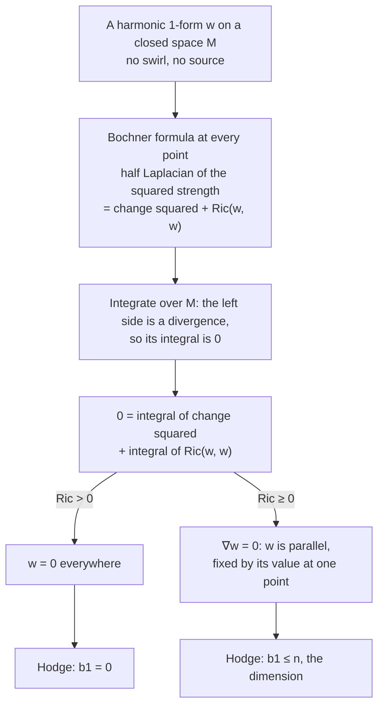
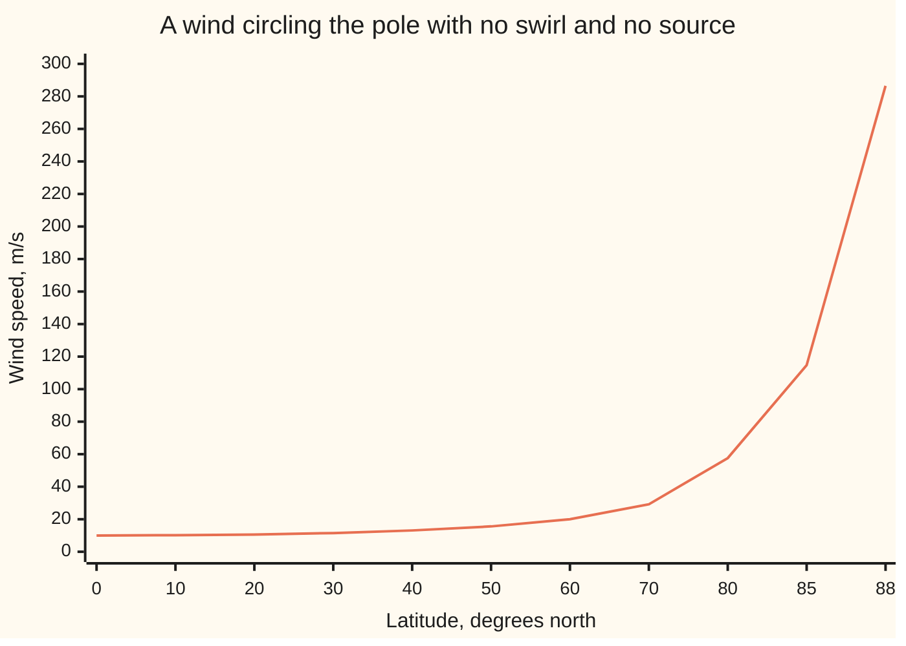

# Bochner's theorem: positive Ricci curvature leaves no room for harmonic loops

[Syllabus](../../../SYLLABUS.md) → [Differential geometry and Lie groups](../README.md) → [Riemannian Geometry](../README.md#s05) → Bochner's theorem

---

## General Overview

Picture a steady wind on a planet that has two properties. It has **no swirl**: carried round any small loop, it does no net work. It has **no source**: no point where air pours out or drains in. A wind with both properties is called **harmonic**.

On a flat map that wraps around, east to west and north to south, a harmonic wind is easy to make. Blow 10 m/s due east everywhere. The map is a **flat torus** (a doughnut surface with zero curvature): a 40,000 km by 20,000 km rectangle whose opposite edges are joined.

On the globe, try a wind that circles the North Pole. With no swirl, it must speed up toward the pole, as water does near a drain. At 10 m/s on the equator it is 20.0 m/s at latitude 60°, 286.5 m/s at 88°, and infinite at the pole. The pole breaks it. Every attempt fails somewhere: the globe carries no harmonic wind except the calm one.

Topology already says this for the round globe. Bochner's theorem says it from **curvature** alone: any closed space (finite, with no edge) whose Ricci curvature (the curvature of planes through one direction, added up) is positive carries no harmonic wind. A harmonic wind would blow a nonzero total round some loop, and that loop could not be shrunk away however many times it was run. With no harmonic wind, no swirl-free wind blows a nonzero total round any loop. The first Betti number, $`b_1`$, counts the independent loops that some swirl-free wind does go round, so it is zero. The proof is one formula, then one integral.

**Half the Laplacian of a harmonic form's squared strength equals its change squared plus Ricci curvature; on a closed space that Laplacian integrates to zero, so positive Ricci curvature forces every harmonic 1-form to vanish and the first Betti number to be zero.**

**What kind of fact this is:** a theorem. The pointwise formula is local and is proved on this card in Why it works. The vanishing results are global: they need a closed space (compact, with no edge). The bound $`b_1 \le n`$ for non-negative Ricci curvature is proved here, and so is flatness in its equality case. That the equality case is a torus, and Bochner's theorem on symmetries, are stated with sources (Petersen; Bochner 1946).

### The picture: the proof as a chain



---

## The formula

Notation first, in words. $`M`$ is a closed, connected Riemannian manifold of dimension $`n`$ (a smooth space in one piece, with a metric $`g`$ for lengths and angles, compact and with no edge). A **1-form** $`\omega`$ is a covector field: at each point, a linear rule that eats one direction and returns a number ([Covectors and tensor fields](../03-Manifolds/05-covectors-and-tensor-fields.md)). Its partner vector field $`\omega^\sharp`$ is the wind, with $`g(\omega^\sharp, v) = \omega(v)`$. The code writes $`\omega`$ as `w`.

Three operators act on it:

- $`d\omega`$ is the **exterior derivative**, the swirl ([Exterior derivative](../04-Differential%20Forms/03-exterior-derivative.md)). On a surface it is the curl.
- $`\delta\omega = -\mathrm{div}\,\omega^\sharp`$ is the **codifferential**, minus the divergence: the source.
- $`\nabla\omega`$ is the covariant derivative from the [Levi-Civita connection](02-levi-civita-connection-and-christoffel-symbols.md): how $`\omega`$ changes from point to point, with the turning of the coordinates taken out.

$`\omega`$ is **harmonic** when $`d\omega = 0`$ and $`\delta\omega = 0`$. The Laplacian $`\Delta_g`$ is the Laplace-Beltrami operator, $`\Delta_g f = \mathrm{div}\,\mathrm{grad}\,f`$, with wing 08's sign ([Volume form and Laplace-Beltrami](08-volume-form-and-the-laplace-beltrami-operator.md)). For a harmonic 1-form, the **Bochner formula** is

```math
\tfrac12\,\Delta_g \lvert\omega\rvert^2 = \lvert\nabla\omega\rvert^2 + \mathrm{Ric}(\omega^\sharp, \omega^\sharp)
```

**Read it aloud:** half the Laplacian of the wind's squared strength equals the squared size of its change from place to place, plus Ricci curvature measured along the wind.

Integrate it over $`M`$. The left side is a divergence, so the divergence theorem makes its integral zero on a space with no edge:

```math
0 = \int_M \lvert\nabla\omega\rvert^2\, dV_g + \int_M \mathrm{Ric}(\omega^\sharp, \omega^\sharp)\, dV_g
```

**Read it aloud:** on a closed space, the total change of a harmonic form plus its total Ricci curvature is zero.

The first integral is never negative. If Ricci curvature is positive, the second is positive unless $`\omega = 0`$. By [Hodge's theorem](12-hodge-laplacian-and-harmonic-forms.md), the harmonic 1-forms count the first Betti number $`b_1`$ (the number of independent loops that cannot be shrunk to a point, counted with real coefficients). So:

```math
\mathrm{Ric} > 0 \ \Rightarrow\ b_1(M) = 0, \qquad \mathrm{Ric} \ge 0 \ \Rightarrow\ b_1(M) \le n
```

**Read it aloud:** positive Ricci curvature leaves no harmonic loops; non-negative Ricci curvature leaves at most one per dimension.

For a 1-form that is not harmonic, the same calculation gives the **Weitzenböck identity**, integrated over a closed space:

```math
\int_M \big(\lvert d\omega\rvert^2 + (\delta\omega)^2\big)\, dV_g = \int_M \lvert\nabla\omega\rvert^2\, dV_g + \int_M \mathrm{Ric}(\omega^\sharp, \omega^\sharp)\, dV_g
```

**Read it aloud:** the total swirl squared plus the total source squared equals the total change squared plus the total Ricci curvature.

Before integration it is an identity between operators, the **Weitzenböck formula** $`\Delta_H\omega = \nabla^*\nabla\omega + \mathrm{Ric}(\omega)`$: the Hodge Laplacian is the rough Laplacian $`\nabla^*\nabla`$ plus Ricci curvature applied to $`\omega`$. The fold in Step 1 derives both.

| Symbol | Plain meaning | In our example | Push it up and the answer… |
| --- | --- | --- | --- |
| $`M`$, $`n`$ | the closed space and its dimension | the globe, $`n = 2`$ | more room: the bound $`b_1 \le n`$ grows |
| $`R`$, $`a`$ | the globe's radius (a model of the Earth); the band's edge, as a polar angle | 6371 km; 23.44° | $`R`$: curvature $`1/R^2`$ falls, the globe integrals stay put; $`a`$: edge flow falls |
| $`\varphi`$, $`\theta`$, $`x`$, $`y`$ | polar angle from the North Pole and longitude east; graph-chart position on the equator plane, km | London: $`\varphi`$ = 38.4926° | — (chart) |
| $`\omega`$, $`\omega^\sharp`$, $`\omega_j`$ | a 1-form, its wind, its components in a frame $`e_j`$ | $`d\theta`$, the wind circling the pole | — |
| $`\lvert\omega\rvert^2`$ | the wind's squared strength, $`g^{ij}\omega_i\omega_j`$ | $`R^2\lvert\omega\rvert^2`$ = 2.581320 at London | — |
| $`\nabla\omega`$, $`\lvert\nabla\omega\rvert^2`$ | change from point to point, and its squared size | $`R^4\lvert\nabla\omega\rvert^2`$ = 8.163789 at London | the right side grows |
| $`\mathrm{Ric}`$, $`\mathrm{Ric}_{jk}`$, $`K`$ | Ricci curvature: plane curvatures through one direction, added; its components, and $`\mathrm{Ric}(\omega)`$ with components $`\sum_k \mathrm{Ric}_{jk}\omega_k`$; Gaussian curvature, with $`\mathrm{Ric} = Kg`$ on a surface | $`g/R^2`$ on the globe, 0 on the flat torus | harmonic forms are squeezed out |
| $`d`$, $`\delta`$ | swirl (exterior derivative) and minus divergence (codifferential) | both 0 for $`d\theta`$ | — |
| $`\Delta_g`$, $`\Delta_H`$, $`\nabla^*\nabla`$ | Laplace-Beltrami operator, div grad; Hodge Laplacian $`d\delta + \delta d`$, which is $`-\Delta_g`$ on functions; rough Laplacian, minus the sum of second covariant derivatives $`\sum_i \nabla_i\nabla_i`$ | $`\Delta_g f = -2f/R^2`$ | — |
| $`dV_g`$ | volume element (area on a surface) | $`R^2\sin\varphi\,d\varphi\,d\theta`$ | — |
| $`b_1`$ | first Betti number: independent loops that do not shrink, counted with real coefficients | 0 on the globe, 2 on the flat torus | — |
| $`f`$, $`X`$, $`L_1`$, $`k`$, $`p`$, $`e_i`$ | height above the equator plane; a Killing field; the edge Laplacian; a curvature lower bound; a point; frame vectors | $`f = R\cos\varphi`$ km | — |

### When it holds

- **The space is closed: compact, with no edge.** Take the band between the polar circles, which leaves out both poles. There the wind $`d\theta`$ is harmonic and Ricci curvature is positive. The integral of the left side is not 0 but a flow through the two edges: 72.861927 in units of $`1/R^2`$. The band has $`b_1 = 1`$.
- **Ricci curvature is positive, not just non-negative.** On the flat torus Ricci curvature is 0, and the east wind $`dx`$ survives with $`\nabla\omega = 0`$. There $`b_1 = 2`$. Non-negative curvature, positive at even one point, is enough for $`b_1 = 0`$.
- **The metric is at least twice differentiable.** The formula takes two derivatives of $`g`$ through Ricci curvature. A cone point concentrates curvature at one spot and the formula cannot see it there.
- **The form is harmonic.** For a form with swirl or source, the formula gains terms in $`d\omega`$ and $`\delta\omega`$. The integrated Weitzenböck identity above is the version that holds for every 1-form.
- **One sign convention all the way through.** Here $`\Delta_g`$ = div grad and the round sphere has sectional curvature $`+1/R^2`$. Books that use the Hodge sign $`\Delta_H = d\delta + \delta d`$ write the same formula as $`-\tfrac12\Delta_H\lvert\omega\rvert^2`$ on the left.

---

## Why it works

### Step 0: reorder two derivatives, and the cost is curvature

A harmonic form has no swirl and no source. Both are first derivatives. The Laplacian of $`\lvert\omega\rvert^2`$ needs second derivatives. No swirl lets us swap the two slots of $`\nabla\omega`$. That turns the second derivative into "the derivative of the source", which is zero. The only price is a swap in the *order* of differentiation, and on a curved space that swap costs curvature. Summed over directions, the cost is exactly Ricci curvature.

So the formula has no room for anything else. Integrate, and a positive cost has nowhere to go.

### Step 1: the formula at one point

Work at a point in a frame of unit vectors $`e_1, \dots, e_n`$ at right angles (an orthonormal frame) that is parallel at that point, so it adds no Christoffel terms there. Write $`\omega_j = \omega(e_j)`$ and $`\nabla_i\omega_j`$ for the derivative of $`\omega_j`$ in direction $`e_i`$. Expanding $`\tfrac12\Delta_g\lvert\omega\rvert^2`$ gives two terms: $`\lvert\nabla\omega\rvert^2`$, and $`\omega`$ paired with its second derivative. The second derivative becomes Ricci curvature in three moves.

<details>
<summary>Detailed proof: the Bochner formula for a harmonic 1-form, then the Weitzenböck identity for any 1-form</summary>

In the parallel orthonormal frame, $`\Delta_g`$ of a function is $`\sum_i \nabla_i\nabla_i`$. Apply it to $`\tfrac12\lvert\omega\rvert^2 = \tfrac12\sum_j \omega_j^2`$ with the product rule:

$`\displaystyle \tfrac12\,\Delta_g\lvert\omega\rvert^2 = \sum_{i,j} (\nabla_i\omega_j)^2 + \sum_{i,j} \omega_j\, \nabla_i\nabla_i\omega_j`$

The first sum is $`\lvert\nabla\omega\rvert^2`$.

**No swirl.** $`d\omega = 0`$ says $`\nabla_i\omega_j = \nabla_j\omega_i`$: the covariant derivative is symmetric, because the Levi-Civita connection has no torsion. So $`\nabla_i\nabla_i\omega_j = \nabla_i\nabla_j\omega_i`$.

**Swap the order.** The Ricci identity says that swapping two covariant derivatives on a 1-form applies the curvature tensor to it. Summed over $`i`$, only the Ricci part remains:

$`\displaystyle \sum_i \nabla_i\nabla_j\omega_i = \sum_i \nabla_j\nabla_i\omega_i + \sum_k \mathrm{Ric}_{jk}\,\omega_k`$

The sign is the one that gives the round sphere positive curvature, as on [Ricci and scalar curvature](07-ricci-and-scalar-curvature.md).

**No source.** $`\delta\omega = 0`$ says $`\sum_i \nabla_i\omega_i = 0`$ everywhere, so its derivative $`\sum_i\nabla_j\nabla_i\omega_i`$ is 0. What is left is $`\sum_i \nabla_i\nabla_i\omega_j = \sum_k \mathrm{Ric}_{jk}\omega_k`$. Pair it with $`\omega_j`$ and sum:

$`\displaystyle \tfrac12\,\Delta_g\lvert\omega\rvert^2 = \lvert\nabla\omega\rvert^2 + \sum_{j,k}\mathrm{Ric}_{jk}\,\omega_j\omega_k`$

The last sum is $`\mathrm{Ric}(\omega^\sharp, \omega^\sharp)`$. Both sides are scalars, so the identity holds in every chart.

**Any 1-form.** Keep what the two conditions killed. With $`(d\omega)_{ij} = \nabla_i\omega_j - \nabla_j\omega_i`$ and $`\delta\omega = -\sum_i \nabla_i\omega_i`$, the same moves give

$`\displaystyle \sum_i \nabla_i\nabla_i\omega_j = \sum_i \nabla_i (d\omega)_{ij} - \nabla_j\,\delta\omega + \sum_k \mathrm{Ric}_{jk}\,\omega_k`$

The Hodge Laplacian of a 1-form is $`(\Delta_H\omega)_j = \nabla_j\,\delta\omega - \sum_i \nabla_i (d\omega)_{ij}`$, so this line is the Weitzenböck formula $`\Delta_H\omega = \nabla^*\nabla\omega + \mathrm{Ric}(\omega)`$, with $`\nabla^*\nabla\omega = -\sum_i \nabla_i\nabla_i\omega`$. To integrate, pair it with $`\omega_j`$, sum, and move one derivative across each extra term; a closed space adds no boundary terms:

$`\displaystyle \int \sum_{i,j} \omega_j\,\nabla_i (d\omega)_{ij}\, dV_g = -\int \lvert d\omega\rvert^2\, dV_g, \qquad -\int \sum_j \omega_j\,\nabla_j\,\delta\omega\, dV_g = -\int (\delta\omega)^2\, dV_g`$

The first uses $`\sum_{i,j} \nabla_i\omega_j\,(d\omega)_{ij} = \lvert d\omega\rvert^2`$, true because $`d\omega`$ is antisymmetric. With $`\int \tfrac12\Delta_g\lvert\omega\rvert^2\, dV_g = 0`$ this leaves $`0 = \int\lvert\nabla\omega\rvert^2 + \int\mathrm{Ric}(\omega^\sharp, \omega^\sharp) - \int\lvert d\omega\rvert^2 - \int(\delta\omega)^2`$: the Weitzenböck identity.

</details>

The code checks the formula at London for the polar wind $`d\theta`$, in two charts. In units of $`R`$: $`R^4\lvert\nabla\omega\rvert^2`$ = 8.163789 and $`R^4\,\mathrm{Ric}(\omega^\sharp, \omega^\sharp)`$ = 2.581320 add to 10.745110. Half the Laplacian, by finite differences, is 10.745111 in the sphere chart and 10.745118 in the graph chart (points labelled by their position on the equator plane, $`x`$ and $`y`$ in km).

### Step 2: integrate over a closed space

$`\Delta_g f`$ is the divergence of $`\mathrm{grad}\,f`$. The divergence theorem turns its integral into a flow through the edge ([Stokes on manifolds](../04-Differential%20Forms/06-stokes-theorem-on-manifolds.md)). A closed space has no edge, so:

```math
\int_M \tfrac12\,\Delta_g\lvert\omega\rvert^2\, dV_g = 0
```

The polar wind shows why the edge matters. With 10 m/s at the equator, its speed is 10 divided by the cosine of the latitude:



The line is the harmonic wind $`d\theta`$, scaled to 10 m/s at the equator. It is harmonic everywhere except at the poles, where it blows up. The latitudes are labels, not a scale: the last steps, 80° to 85° to 88°, are shorter than the rest, so near the pole the true rise is steeper than drawn. A closed globe includes the poles, so this wind is not allowed there.

The band between the polar circles has two edges, so there the integral is the edge flow, $`4\pi\cos a/\sin^2 a`$ in units of $`1/R^2`$ for edges at polar angle $`a`$. At the Arctic Circle, $`a`$ = 23.44°, that is 72.861927. The code's integral of the left side gives 72.861520, and of the right side, 53.096563 + 19.764943. The closed forms are 53.096972 + 19.764955, the second being $`4\pi\ln\cot(a/2)`$, so the midpoint rule is off in the fourth decimal.

### Step 3: positive Ricci curvature kills every harmonic form

With the left side gone, $`0 = \int\lvert\nabla\omega\rvert^2 + \int\mathrm{Ric}(\omega^\sharp, \omega^\sharp)`$. Both integrands are at least 0, so both are 0 everywhere.

If $`\mathrm{Ric} > 0`$, then $`\mathrm{Ric}(\omega^\sharp, \omega^\sharp) = 0`$ forces $`\omega = 0`$ at every point. Hodge's theorem puts one harmonic form in each de Rham class ([de Rham cohomology](../04-Differential%20Forms/08-de-rham-cohomology.md)), so the first de Rham group is zero and $`b_1 = 0`$.

On the real Earth, the WGS 84 ellipsoid (the flattened model used by GPS), Gaussian curvature runs from 2.441716 × 10⁻⁸ 1/km² at the poles to 2.474739 × 10⁻⁸ at the equator. On a surface $`\mathrm{Ric} = Kg`$, so Ricci curvature is positive everywhere, and Bochner's theorem rules out harmonic winds on the real Earth too. The argument never needs to know that the Earth is shaped like a sphere.

### Step 4: zero Ricci curvature leaves parallel forms, at most n of them

If only $`\mathrm{Ric} \ge 0`$, Step 3 still gives $`\nabla\omega = 0`$: the form is **parallel**. A parallel form is carried along any path by [Parallel transport](03-parallel-transport-and-holonomy.md), so its value at one point $`p`$ fixes it everywhere. The map from harmonic forms to covectors at $`p`$ is one-to-one, and covectors at $`p`$ form an $`n`$-dimensional space. So $`b_1 \le n`$.

If $`\mathrm{Ric} > 0`$ at even one point $`p`$, then $`\omega(p) = 0`$, and a parallel form that vanishes at one point vanishes everywhere: $`b_1 = 0`$.

The flat torus reaches the bound. Its harmonic forms are $`dx`$ and $`dy`$, both parallel, so $`b_1 = 2 = n`$. The converse says that $`b_1 = n`$ with $`\mathrm{Ric} \ge 0`$ happens only on flat tori. Flatness is quick: $`n`$ independent parallel forms make a parallel frame, and swapping two derivatives of a parallel form costs nothing, so the curvature is zero. That a closed flat space with $`b_1 = n`$ is a torus is stated here, not proved; one proof uses the Cheeger–Gromoll splitting theorem (Petersen, in Sources).

### Step 5: the whole globe, by hand

The Weitzenböck identity can be checked in closed form. Take the height above the equator plane, $`f = R\cos\varphi`$ in km, and $`\omega = df`$. It has no swirl, since $`d(df) = 0`$, but it has sources: it points uphill toward the North Pole, so it flows out of the southern half and into the northern half.

From [Volume form and Laplace-Beltrami](08-volume-form-and-the-laplace-beltrami-operator.md), $`\Delta_g f = -2f/R^2`$. The second derivative of $`f`$ is $`-f g/R^2`$, so $`\lvert\nabla\omega\rvert^2 = 2\cos^2\varphi/R^2`$. A squared size cannot see the sign of the Christoffel term in $`\nabla\omega`$, so the code also checks one entry: at London $`\nabla_\theta\omega_\theta = -R\sin^2\varphi\cos\varphi`$, which is −0.303212 times $`R`$. Also $`\lvert\omega\rvert^2 = \sin^2\varphi`$. With $`dV_g = R^2\sin\varphi\,d\varphi\,d\theta`$:

```math
\int (\delta\omega)^2 = \frac{16\pi}{3}, \qquad \int\lvert\nabla\omega\rvert^2 = \frac{8\pi}{3}, \qquad \int \mathrm{Ric}(\omega^\sharp, \omega^\sharp) = \frac{8\pi}{3}
```

Every $`R`$ cancels, so the three numbers are the same on the Moon. The source term is forced to be at least the curvature term. On the globe a wind with no swirl must have a source.

### Step 6: the same technique, other objects

A [Killing field](../06-Lie%20Groups/07-killing-fields-and-symmetries-of-a-metric.md) $`X`$ (a direction in which the metric does not change) obeys the formula with the curvature sign reversed: $`\tfrac12\Delta_g\lvert X\rvert^2 = \lvert\nabla X\rvert^2 - \mathrm{Ric}(X, X)`$. So on a closed space with $`\mathrm{Ric} < 0`$ every Killing field is zero, and the space has only finitely many isometries (distance-preserving maps of itself). Bochner proved this in the same 1946 paper; it is stated here, not proved.

Compare Bonnet–Myers, stated on [Jacobi field](09-jacobi-fields-and-comparison-theorems.md) for sectional curvature. Myers's 1941 version needs only a positive lower bound on Ricci curvature. On a closed space $`\mathrm{Ric} > 0`$ has such a bound, and Myers's theorem then gives a finite fundamental group (finitely many classes of loops), which implies $`b_1 = 0`$. So on 1-forms Bochner's route proves less. Its strength is reach: the same formula works for higher forms, spinors and eigenfunctions.

---

## Worked numbers, by hand

The pointwise formula at London for the polar wind $`\omega = d\theta`$, then the whole-globe identity for $`\omega = df`$. Pointwise values are in units of $`R`$: $`\lvert\omega\rvert^2`$ times $`R^2`$, the rest times $`R^4`$.

| Step | Arithmetic | Value |
| --- | --- | --- |
| London's polar angle | 90° − 51.5074° | 38.4926° |
| distance from the Earth's axis | $`R\sin\varphi = 6371 \times \sin 38.4926°`$ | 3965.396754 km |
| squared strength, $`R^2\lvert\omega\rvert^2 = 1/\sin^2\varphi`$ | $`(6371 / 3965.396754)^2`$ | 2.581320 |
| change, $`R^4\lvert\nabla\omega\rvert^2 = 2\cos^2\varphi/\sin^4\varphi`$ | $`2 \times 2.581320 \times (2.581320 - 1)`$ | 8.163789 |
| curvature, $`R^4\,\mathrm{Ric}(\omega^\sharp, \omega^\sharp) = 1/\sin^2\varphi`$ | $`\mathrm{Ric} = g/R^2`$, so $`R^2\lvert\omega\rvert^2`$ again | 2.581320 |
| right side | 8.163789 + 2.581320, unrounded | 10.745110 |
| left side, half the Laplacian, sphere chart | finite differences | 10.745111 |
| globe, $`\int(\delta\omega)^2`$ | $`16\pi/3`$ | 16.755161 |
| globe, $`\int\lvert\nabla\omega\rvert^2`$ | $`8\pi/3`$ | 8.377580 |
| globe, $`\int\mathrm{Ric}(\omega^\sharp, \omega^\sharp)`$ | $`8\pi/3`$ | 8.377580 |
| Weitzenböck on the globe | 8.377580 + 8.377580 | **16.755161** |

The polar wind obeys the Bochner formula at London to six figures, and on the whole globe the source of $`df`$ is exactly as large as its change plus its curvature: no wind on the globe escapes the curvature term.

### What breaks if you drop a piece

| Mistake | Comes out at | What went wrong |
| --- | --- | --- |
| Drop the Ricci term at London | 8.163789 against 10.745110 | the formula without curvature is false on a curved space |
| Drop the Ricci term on the whole globe | 8.377588 against 16.755175 | half of the source term is curvature |
| Use a space with an edge: the band from 23.44° | left side 72.861520, not 0; $`b_1 = 1`$ | the edge flow survives the integral, and $`d\theta`$ stays harmonic |
| Allow $`\mathrm{Ric} = 0`$: the flat torus | $`b_1 = 2`$, harmonic $`dx`$ with $`\lvert\nabla\omega\rvert^2 = 0`$ | nothing positive is left to force $`\omega = 0`$ |

---

## Code, from first principles, and it actually runs

The code builds everything from the metric. Small central differences of $`g`$ give the Christoffel symbols, differences of those give Ricci curvature, and the covariant derivative, divergence and Laplacian follow. It takes **four independent roads**. First, the Bochner formula at London in two charts, against the closed form, plus one entry of $`\nabla\omega`$ whose sign the squared sizes cannot see. Second, the Weitzenböck identity integrated over the whole globe, against $`16\pi/3`$ and $`8\pi/3`$, at two step sizes. Third, on the band, the integral of each side against its closed form. Fourth, $`b_1`$ counted twice by exact whole-number rank on triangulated surfaces: once from the boundary maps, once as the number of discrete harmonic forms, the null space of the edge Laplacian $`L_1`$ (numbers on edges with no swirl round any triangle and no source at any vertex). The WGS 84 curvature is checked chart against closed form at every whole degree of latitude.

### Python

```python
# Bochner's theorem -- the check behind the card.  Standard library only.
# The Bochner formula is checked at London in two charts of the globe, then integrated
# over the whole globe and over a band, and Betti numbers are counted by exact rank.
from math import sin, cos, tan, atan, sqrt, pi, radians, log

R = 6371.0                       # globe radius, km
A, B = 6378.137, 6356.7523142    # WGS 84 equatorial and polar radii, km

sphere = lambda r: lambda p: [[r * r, 0.0], [0.0, (r * sin(p[0])) ** 2]]      # polar angle phi, longitude theta
def graph(p):     # x, y in km on the equator plane, northern half
    w = R * R - p[0] ** 2 - p[1] ** 2
    return [[1 + p[0] ** 2 / w, p[0] * p[1] / w], [p[0] * p[1] / w, 1 + p[1] ** 2 / w]]
flat = lambda p: [[1.0, 0.0], [0.0, 1.0]]                                          # wrap-around map, km
wgs = lambda p: [[(A * sin(p[0])) ** 2 + (B * cos(p[0])) ** 2, 0.0], [0.0, (A * cos(p[0])) ** 2]]  # parametric latitude

det = lambda g: g[0][0] * g[1][1] - g[0][1] * g[1][0]
inv = lambda g: [[g[1][1] / det(g), -g[0][1] / det(g)], [-g[1][0] / det(g), g[0][0] / det(g)]]
def dif(f, p, i, h):             # central difference of f in coordinate i
    a, b = list(p), list(p); a[i] += h; b[i] -= h
    return (f(a) - f(b)) / (2 * h)
def gam(ch, p, h):               # Christoffel symbols G[l][j][k] from the metric alone
    gi = inv(ch(p)); dg = [[[dif(lambda q: ch(q)[a][b], p, m, h) for b in range(2)] for a in range(2)] for m in range(2)]
    return [[[0.5 * sum(gi[l][m] * (dg[j][m][k] + dg[k][m][j] - dg[m][j][k]) for m in range(2))
              for k in range(2)] for j in range(2)] for l in range(2)]
def ric(ch, p, h):               # Ric_jk = Rm^i_jik, curvature from the Christoffel symbols
    G = gam(ch, p, h)
    dG = [[[[dif(lambda q: gam(ch, q, h)[l][j][k], p, i, h) for k in range(2)] for j in range(2)] for l in range(2)]
          for i in range(2)]
    def Rm(l, k, i, j):
        return dG[i][l][j][k] - dG[j][l][i][k] + sum(G[l][i][m] * G[m][j][k] - G[l][j][m] * G[m][i][k] for m in range(2))
    return [[sum(Rm(i, j, i, k) for i in range(2)) for k in range(2)] for j in range(2)]
def nab(ch, w, p, h):            # covariant derivative (nabla_i w)_j = d_i w_j - G^k_ij w_k
    G, wp = gam(ch, p, h), w(p)
    return [[dif(lambda q: w(q)[j], p, i, h) - sum(G[k][i][j] * wp[k] for k in range(2)) for j in range(2)] for i in range(2)]
def div(ch, w, p, h):            # divergence of the wind w-sharp: (1/sqrt det g) d_i (sqrt det g g^ij w_j)
    flux = lambda q, i: sqrt(det(ch(q))) * sum(inv(ch(q))[i][j] * w(q)[j] for j in range(2))
    return sum(dif(lambda q: flux(q, i), p, i, h) for i in range(2)) / sqrt(det(ch(p)))
def lap(ch, f, p, h):            # Laplace-Beltrami = divergence of the gradient
    return div(ch, lambda q: [dif(f, q, 0, h), dif(f, q, 1, h)], p, h)
def sq1(ch, w, p):               # |w|^2 = g^ij w_i w_j
    gi, v = inv(ch(p)), w(p); return sum(gi[i][j] * v[i] * v[j] for i in range(2) for j in range(2))
def bochner(ch, w, p, h):        # |w|^2, |nabla w|^2, Ric(w, w), (1/2) Laplacian |w|^2, curl, divergence
    gi, N, Rc, v = inv(ch(p)), nab(ch, w, p, h), ric(ch, p, h), w(p)
    n2 = sum(gi[i][a] * gi[j][b] * N[i][j] * N[a][b] for i in range(2) for j in range(2) for a in range(2) for b in range(2))
    rw = sum(gi[j][a] * gi[k][b] * Rc[j][k] * v[a] * v[b] for j in range(2) for k in range(2) for a in range(2) for b in range(2))
    return sq1(ch, w, p), n2, rw, 0.5 * lap(ch, lambda q: sq1(ch, w, q), p, h), N[0][1] - N[1][0], div(ch, w, p, h)
def show(label, *vs):              # tiny rounding noise prints as 0
    print(f"{label:<46}" + "".join(f"{(v if abs(v) >= 5e-7 else 0.0):>12.6f}" for v in vs))

# ---- road 1: the Bochner formula at London for the harmonic wind d(theta), two charts ----
ph, th = radians(90 - 51.5074), radians(-0.1278)
sA = bochner(sphere(R), lambda p: [0.0, 1.0], [ph, th], 1e-4)
sB = bochner(graph, lambda p: [-p[1] / (p[0] ** 2 + p[1] ** 2), p[0] / (p[0] ** 2 + p[1] ** 2)],
             [R * sin(ph) * cos(th), R * sin(ph) * sin(th)], 1.0)
s, c = sin(ph), cos(ph); exact = [1 / s ** 2, 2 * c * c / s ** 4, 1 / s ** 2, 1 / s ** 2 + 2 * c * c / s ** 4]
show("London: polar angle (deg), R sin(phi) (km)", 90 - 51.5074, R * s)
for k, lab in enumerate(["R^2 |w|^2", "R^4 |nabla w|^2", "R^4 Ric(w, w)", "R^4 half Laplacian |w|^2"]):
    show(lab + ": sphere, graph, exact", sA[k] * R ** (2 if k == 0 else 4), sB[k] * R ** (2 if k == 0 else 4), exact[k])
show("R^4 (|nabla w|^2 + Ric): sphere, graph", (sA[1] + sA[2]) * R ** 4, (sB[1] + sB[2]) * R ** 4)
show("R^2 curl, R^2 divergence: graph chart", sB[4] * R * R, sB[5] * R * R)
hd = nab(sphere(R), lambda q: [-R * sin(q[0]), 0.0], [ph, th], 1e-4)[1][1] / R   # w = df, f = height: sign-sensitive entry
show("London, w = df: nabla_theta w_theta / R, exact", hd, -s * s * c)

# ---- road 2: the whole globe, closed form w = d(height), height = r cos(phi) ----
def globe(r, N):                 # midpoint rule in phi; nothing depends on theta
    tot = [0.0, 0.0, 0.0]
    for i in range(N):
        p = [pi * (i + 0.5) / N, 0.3]; wt = 2 * pi * r * r * sin(p[0]) * pi / N
        b = bochner(sphere(r), lambda q: [-r * sin(q[0]), 0.0], p, 1e-4)
        tot = [tot[0] + wt * lap(sphere(r), lambda q: r * cos(q[0]), p, 1e-4) ** 2, tot[1] + wt * b[1], tot[2] + wt * b[2]]
    return tot
G, G2 = globe(R, 1200), globe(R, 600)
show("globe: int (delta w)^2, |nabla w|^2, Ric", *G)
show("  same with half the steps", *G2)
show("  closed forms 16 pi/3, 8 pi/3, 8 pi/3", 16 * pi / 3, 8 * pi / 3, 8 * pi / 3)
show("  Moon, r = 1737.4 km", *globe(1737.4, 1200))

# ---- road 3: globe minus its poles, the band between two polar circles, w = d(theta) ----
def band(deg, N=1200):           # R^2 times the integrals of each side, and the edge flux in closed form
    a, tot = radians(deg), [0.0, 0.0, 0.0]
    for i in range(N):
        p = [a + (pi - 2 * a) * (i + 0.5) / N, 0.3]; wt = 2 * pi * R * R * sin(p[0]) * (pi - 2 * a) / N
        b = bochner(sphere(R), lambda q: [0.0, 1.0], p, 1e-4)
        tot = [tot[0] + wt * b[3], tot[1] + wt * b[1], tot[2] + wt * b[2]]
    f, rc = 4 * pi * cos(a) / sin(a) ** 2, 4 * pi * log(1 / tan(a / 2))   # edge flux; int Ric = 4 pi ln cot(a/2)
    return [t * R * R for t in tot] + [f, f - rc, rc]        # int |nabla w|^2 = 4 pi (cos a / sin^2 a - ln cot(a/2))
bands = [band(23.44), band(10.0)]
for deg, bd in zip((23.44, 10.0), bands): show(f"band from {deg:5.2f} deg: lhs, nabla, Ric, flux", *bd[:4]); show("  closed forms of nabla, Ric", *bd[4:])

# ---- WGS 84: Gaussian curvature K = Ric_22 / g_22 at every whole degree of latitude ----
def Kc(b):                       # closed form: (1 - e^2 sin^2 lat)^2 / (A^2 (1 - e^2)), lat = geodetic latitude
    e2 = 1 - B * B / (A * A); s2 = sin(atan(A / B * tan(b))) ** 2; return (1 - e2 * s2) ** 2 / (A * A * (1 - e2))
Ks = [ric(wgs, [radians(d), 0.0], 1e-4)[1][1] / wgs([radians(d), 0.0])[1][1] for d in range(-89, 90)]
show("WGS 84 K x 1e8 (1/km^2): min, max", min(Ks) * 1e8, max(Ks) * 1e8)
show("  closed form at 89 deg, equator, pole", Kc(radians(89)) * 1e8, Kc(0.0) * 1e8, B * B / A ** 4 * 1e8)
show("flat 40000 x 20000 km map, w = dx: three", *bochner(flat, lambda p: [1.0, 0.0], [40000.0 * 0.3, 20000.0 * 0.7], 1.0)[:3])

# ---- road 4: Betti number b1 counted by exact rank on triangulated surfaces ----
def rank(M):                     # fraction-free (Bareiss) elimination: whole numbers, exact
    M, r, prev = [row[:] for row in M], 0, 1
    for c in range(len(M[0])):
        p = next((i for i in range(r, len(M)) if M[i][c] != 0), None)
        if p is None: continue
        M[r], M[p] = M[p], M[r]
        for i in range(r + 1, len(M)):
            for j in range(c + 1, len(M[0])):
                num = M[r][c] * M[i][j] - M[i][c] * M[r][j]; assert num % prev == 0; M[i][j] = num // prev
            M[i][c] = 0
        prev, r = M[r][c], r + 1
    return r
def grid(n, m, wrap):            # n by m squares, each cut into two triangles; wrap north-south or not
    rows = m if wrap else m + 1; v = lambda i, j: i % n + n * (j % rows)
    return [t for i in range(n) for j in range(m) for t in ([v(i, j), v(i + 1, j), v(i + 1, j + 1)], [v(i, j), v(i + 1, j + 1), v(i, j + 1)])]
def betti(tri, n):               # V, E, F, b1 = E - rank d0 - rank d1, nullity of the edge Laplacian, L1 times the east cochain
    V = 1 + max(max(t) for t in tri); E = sorted({tuple(sorted((t[a], t[b]))) for t in tri for a, b in ((0, 1), (1, 2), (0, 2))})
    d0 = [[(k == b) - (k == a) for k in range(V)] for a, b in E]
    d1 = [[sum(sg * (e == tuple(sorted(pr))) * (1 if pr[0] < pr[1] else -1) for pr, sg in (((t[0], t[1]), 1), ((t[1], t[2]), 1), ((t[0], t[2]), -1)))
           for e in E] for t in tri]
    L1 = [[sum(d0[i][k] * d0[j][k] for k in range(V)) + sum(d1[t][i] * d1[t][j] for t in range(len(tri))) for j in range(len(E))] for i in range(len(E))]
    east = [((b % n) - (a % n) + 1) % n - 1 for a, b in E]               # x-step of each edge on an n-wide grid
    return V, len(E), len(tri), len(E) - rank(d0) - rank(d1), len(E) - rank(L1), [sum(L1[i][j] * east[j] for j in range(len(E))) for i in range(len(E))]
octa = [[0, i, i % 4 + 1] for i in range(1, 5)] + [[5, i % 4 + 1, i] for i in range(1, 5)]
o, t3, cy = betti(octa, 3), betti(grid(3, 3, True), 3), betti(grid(3, 1, False), 3)
for name, x in (("octahedron", o), ("3x3 torus", t3), ("3x1 band", cy)):
    print(f"{name} V E F {x[0]} {x[1]} {x[2]}: b1 by ranks {x[3]}, harmonic 1-cochains {x[4]}")
print(f"east cochain on the torus has L1 x = 0: {'yes' if not any(t3[5]) else 'no'}")

# ---- the wind that circles the pole with no swirl and no source: 10 m/s at the equator ----
print("wind m/s at latitude " + " ".join(f"{L}:{10 * R / (R * sin(radians(90 - L))):.1f}" for L in (0, 10, 20, 30, 40, 50, 60, 70, 80, 85, 88)))

assert all(abs(sA[k] * R ** (2 if k == 0 else 4) - exact[k]) < 1e-5 for k in range(4)) and abs(hd + s * s * c) < 1e-6, "sphere chart against exact"
assert all(abs((sB[k] - sA[k]) / sA[k]) < 1e-6 for k in range(4)), "two charts agree"
assert abs(sB[3] - sB[1] - sB[2]) < 1e-6 * sB[3], "Bochner formula pointwise"
assert abs(G[0] - 16 * pi / 3) < 1e-4 > abs(G[1] - 8 * pi / 3), "globe integrals against 16 pi / 3 and 8 pi / 3"
assert abs(G[0] - G[1] - G[2]) < 1e-4, "integrated Weitzenbock identity"
assert abs(G2[0] - G[0]) > 2 * abs(G[0] - 16 * pi / 3), "halving the steps cuts the error about fourfold"
assert all(abs(bd[0] - bd[3]) < 1e-4 * bd[3] and abs(bd[0] - bd[1] - bd[2]) < 1e-4 * bd[3] and abs(bd[1] - bd[4]) < 1e-4 * bd[3] and abs(bd[2] - bd[5]) < 1e-4 * bd[3] for bd in bands), "band: lhs is the edge flux; each side against its closed form"
assert all(abs(k - Kc(radians(d))) < 1e-6 * k for k, d in zip(Ks, range(-89, 90))) and min(Ks) > B * B / A ** 4, "WGS 84 K, closed form, positive"
assert (o[3], o[4], t3[3], t3[4], cy[3], cy[4], any(t3[5])) == (0, 0, 2, 2, 1, 1, False), "b1 by two counts; east is harmonic"
print("ALL CHECKS PASS")
```

**Ran 2026-11-24 on macOS, Python 3.14.10, standard library only. All checks passed. Output, pasted from the run:**

```
London: polar angle (deg), R sin(phi) (km)       38.492600 3965.396754
R^2 |w|^2: sphere, graph, exact                   2.581320    2.581320    2.581320
R^4 |nabla w|^2: sphere, graph, exact             8.163789    8.163789    8.163789
R^4 Ric(w, w): sphere, graph, exact               2.581320    2.581321    2.581320
R^4 half Laplacian |w|^2: sphere, graph, exact   10.745111   10.745118   10.745110
R^4 (|nabla w|^2 + Ric): sphere, graph           10.745110   10.745110
R^2 curl, R^2 divergence: graph chart             0.000000    0.000000
London, w = df: nabla_theta w_theta / R, exact   -0.303212   -0.303212
globe: int (delta w)^2, |nabla w|^2, Ric         16.755175    8.377588    8.377581
  same with half the steps                       16.755218    8.377609    8.377581
  closed forms 16 pi/3, 8 pi/3, 8 pi/3           16.755161    8.377580    8.377580
  Moon, r = 1737.4 km                            16.755175    8.377588    8.377581
band from 23.44 deg: lhs, nabla, Ric, flux       72.861520   53.096563   19.764943   72.861927
  closed forms of nabla, Ric                     53.096972   19.764955
band from 10.00 deg: lhs, nabla, Ric, flux      410.394840  379.779752   30.614678  410.412768
  closed forms of nabla, Ric                    379.797997   30.614771
WGS 84 K x 1e8 (1/km^2): min, max                 2.441726    2.474739
  closed form at 89 deg, equator, pole            2.441726    2.474739    2.441716
flat 40000 x 20000 km map, w = dx: three          1.000000    0.000000    0.000000
octahedron V E F 6 12 8: b1 by ranks 0, harmonic 1-cochains 0
3x3 torus V E F 9 27 18: b1 by ranks 2, harmonic 1-cochains 2
3x1 band V E F 6 12 6: b1 by ranks 1, harmonic 1-cochains 1
east cochain on the torus has L1 x = 0: yes
wind m/s at latitude 0:10.0 10:10.2 20:10.6 30:11.5 40:13.1 50:15.6 60:20.0 70:29.2 80:57.6 85:114.7 88:286.5
ALL CHECKS PASS
```

### Rust

```rust
// Bochner's theorem -- the check behind the card.  Rust std only, no crates.
// The Bochner formula is checked at London in two charts of the globe, then integrated
// over the whole globe and over a band, and Betti numbers are counted by exact rank.
use std::f64::consts::PI;
type M2 = [[f64; 2]; 2];
type Ch<'a> = &'a dyn Fn([f64; 2]) -> M2;
type Fm<'a> = &'a dyn Fn([f64; 2]) -> [f64; 2];
const R: f64 = 6371.0; // globe radius, km
const A: f64 = 6378.137; const B: f64 = 6356.7523142; // WGS 84 equatorial and polar radii, km
fn sphere(r: f64) -> impl Fn([f64; 2]) -> M2 { move |p| [[r * r, 0.0], [0.0, (r * p[0].sin()).powf(2.0)]] }
fn graph(p: [f64; 2]) -> M2 { // x, y in km on the equator plane, northern half
    let w = R * R - p[0].powf(2.0) - p[1].powf(2.0);
    [[1.0 + p[0].powf(2.0) / w, p[0] * p[1] / w], [p[0] * p[1] / w, 1.0 + p[1].powf(2.0) / w]]
}
fn flat(_p: [f64; 2]) -> M2 { [[1.0, 0.0], [0.0, 1.0]] } // wrap-around map, km
fn wgs(p: [f64; 2]) -> M2 { // parametric latitude beta and longitude
    [[(A * p[0].sin()).powf(2.0) + (B * p[0].cos()).powf(2.0), 0.0], [0.0, (A * p[0].cos()).powf(2.0)]]
}
fn det(g: &M2) -> f64 { g[0][0] * g[1][1] - g[0][1] * g[1][0] }
fn inv(g: &M2) -> M2 { [[g[1][1] / det(g), -g[0][1] / det(g)], [-g[1][0] / det(g), g[0][0] / det(g)]] }
fn dif(f: &dyn Fn([f64; 2]) -> f64, p: [f64; 2], i: usize, h: f64) -> f64 { // central difference
    let (mut a, mut b) = (p, p); a[i] += h; b[i] -= h; (f(a) - f(b)) / (2.0 * h)
}
fn gam(ch: Ch, p: [f64; 2], h: f64) -> [[[f64; 2]; 2]; 2] { // Christoffel symbols G[l][j][k]
    let (gi, mut dg, mut g) = (inv(&ch(p)), [[[0.0; 2]; 2]; 2], [[[0.0; 2]; 2]; 2]);
    for m in 0..2 { for a in 0..2 { for b in 0..2 { dg[m][a][b] = dif(&|q| ch(q)[a][b], p, m, h); } } }
    for l in 0..2 { for j in 0..2 { for k in 0..2 {
        g[l][j][k] = 0.5 * (0..2).fold(0.0, |s, m| s + gi[l][m] * (dg[j][m][k] + dg[k][m][j] - dg[m][j][k]));
    } } }
    g
}
fn ric(ch: Ch, p: [f64; 2], h: f64) -> M2 { // Ric_jk = Rm^i_jik
    let (g, mut dg) = (gam(ch, p, h), [[[[0.0; 2]; 2]; 2]; 2]);
    for i in 0..2 { for l in 0..2 { for j in 0..2 { for k in 0..2 { dg[i][l][j][k] = dif(&|q| gam(ch, q, h)[l][j][k], p, i, h); } } } }
    let rm = |l: usize, k: usize, i: usize, j: usize|
        dg[i][l][j][k] - dg[j][l][i][k] + (0..2).fold(0.0, |s, m| s + (g[l][i][m] * g[m][j][k] - g[l][j][m] * g[m][i][k]));
    let c = |j: usize, k: usize| rm(0, j, 0, k) + rm(1, j, 1, k); [[c(0, 0), c(0, 1)], [c(1, 0), c(1, 1)]]
}
fn nab(ch: Ch, w: Fm, p: [f64; 2], h: f64) -> M2 { // (nabla_i w)_j = d_i w_j - G^k_ij w_k
    let (g, wp, mut n) = (gam(ch, p, h), w(p), [[0.0; 2]; 2]);
    for i in 0..2 { for j in 0..2 { n[i][j] = dif(&|q| w(q)[j], p, i, h) - (g[0][i][j] * wp[0] + g[1][i][j] * wp[1]); } }
    n
}
fn div(ch: Ch, w: Fm, p: [f64; 2], h: f64) -> f64 { // (1/sqrt det g) d_i (sqrt det g g^ij w_j)
    let flux = |q: [f64; 2], i: usize| det(&ch(q)).sqrt() * (inv(&ch(q))[i][0] * w(q)[0] + inv(&ch(q))[i][1] * w(q)[1]);
    (dif(&|q| flux(q, 0), p, 0, h) + dif(&|q| flux(q, 1), p, 1, h)) / det(&ch(p)).sqrt()
}
fn lap(ch: Ch, f: &dyn Fn([f64; 2]) -> f64, p: [f64; 2], h: f64) -> f64 { div(ch, &|q| [dif(f, q, 0, h), dif(f, q, 1, h)], p, h) }
fn sq1(ch: Ch, w: Fm, p: [f64; 2]) -> f64 {
    let (gi, v) = (inv(&ch(p)), w(p));
    (0..4).fold(0.0, |s, ij| s + gi[ij / 2][ij % 2] * v[ij / 2] * v[ij % 2])
}
fn bochner(ch: Ch, w: Fm, p: [f64; 2], h: f64) -> [f64; 6] { // |w|^2, |nabla w|^2, Ric(w,w), half Laplacian, curl, div
    let (gi, n, rc, v) = (inv(&ch(p)), nab(ch, w, p, h), ric(ch, p, h), w(p));
    let (mut n2, mut rw) = (0.0, 0.0);
    for i in 0..2 { for j in 0..2 { for a in 0..2 { for b in 0..2 {
        n2 += gi[i][a] * gi[j][b] * n[i][j] * n[a][b];
        rw += gi[i][a] * gi[j][b] * rc[i][j] * v[a] * v[b];
    } } } }
    [sq1(ch, w, p), n2, rw, 0.5 * lap(ch, &|q| sq1(ch, w, q), p, h), n[0][1] - n[1][0], div(ch, w, p, h)]
}
fn show(label: &str, vs: &[f64]) { // tiny rounding noise prints as 0
    let s: String = vs.iter().map(|v| format!("{:>12.6}", if v.abs() >= 5e-7 { *v } else { 0.0 })).collect();
    println!("{:<46}{}", label, s);
}
fn globe(r: f64, n: usize) -> [f64; 3] { // whole globe, w = d(height), midpoint rule in phi
    let (mut t, sp) = ([0.0; 3], sphere(r));
    for i in 0..n {
        let p = [PI * (i as f64 + 0.5) / n as f64, 0.3]; let wt = 2.0 * PI * r * r * p[0].sin() * PI / n as f64;
        let b = bochner(&sp, &|q| [-r * q[0].sin(), 0.0], p, 1e-4);
        t = [t[0] + wt * lap(&sp, &|q| r * q[0].cos(), p, 1e-4).powf(2.0), t[1] + wt * b[1], t[2] + wt * b[2]];
    }
    t
}
fn band(deg: f64, n: usize) -> [f64; 6] { // R^2 times each side over the band, the edge flux and both sides in closed form
    let (a, sp, mut t) = (deg.to_radians(), sphere(R), [0.0; 3]);
    for i in 0..n {
        let p = [a + (PI - 2.0 * a) * (i as f64 + 0.5) / n as f64, 0.3]; let wt = 2.0 * PI * R * R * p[0].sin() * (PI - 2.0 * a) / n as f64;
        let b = bochner(&sp, &|_q| [0.0, 1.0], p, 1e-4);
        t = [t[0] + wt * b[3], t[1] + wt * b[1], t[2] + wt * b[2]];
    }
    let (f, rc) = (4.0 * PI * a.cos() / a.sin().powf(2.0), 4.0 * PI * (1.0 / (a / 2.0).tan()).ln()); // edge flux; int Ric = 4 pi ln cot(a/2)
    [t[0] * R * R, t[1] * R * R, t[2] * R * R, f, f - rc, rc] // int |nabla w|^2 = 4 pi (cos a / sin^2 a - ln cot(a/2))
}
fn kc(b: f64) -> f64 { // closed form: (1 - e^2 sin^2 lat)^2 / (A^2 (1 - e^2)), lat = geodetic latitude
    let (e2, s2) = (1.0 - B * B / (A * A), (A / B * b.tan()).atan().sin().powf(2.0));
    (1.0 - e2 * s2).powf(2.0) / (A * A * (1.0 - e2))
}
fn rank(m0: &Vec<Vec<i128>>) -> usize { // fraction-free (Bareiss) elimination, exact
    let (mut m, mut r, mut prev) = (m0.clone(), 0usize, 1i128);
    for c in 0..m[0].len() {
        let Some(p) = (r..m.len()).find(|&i| m[i][c] != 0) else { continue };
        m.swap(r, p);
        for i in r + 1..m.len() {
            for j in c + 1..m[0].len() { let num = m[r][c] * m[i][j] - m[i][c] * m[r][j]; assert!(num % prev == 0); m[i][j] = num / prev; }
            m[i][c] = 0;
        }
        prev = m[r][c]; r += 1;
    }
    r
}
fn grid(n: usize, m: usize, wrap: bool) -> Vec<[usize; 3]> { // n by m squares, two triangles each
    let (rows, mut t) = (if wrap { m } else { m + 1 }, vec![]);
    let v = |i: usize, j: usize| i % n + n * (j % rows);
    for i in 0..n { for j in 0..m { t.push([v(i, j), v(i + 1, j), v(i + 1, j + 1)]); t.push([v(i, j), v(i + 1, j + 1), v(i, j + 1)]); } }
    t
}
fn betti(tri: &Vec<[usize; 3]>, n: i128) -> (usize, usize, usize, usize, usize, Vec<i128>) {
    let nv = 1 + tri.iter().map(|t| *t.iter().max().unwrap()).max().unwrap();
    let mut e: Vec<(usize, usize)> = vec![];
    for t in tri { for (a, b) in [(0, 1), (1, 2), (0, 2)] { e.push((t[a].min(t[b]), t[a].max(t[b]))); } }
    e.sort(); e.dedup();
    let d0: Vec<Vec<i128>> = e.iter().map(|&(a, b)| (0..nv).map(|k| (k == b) as i128 - (k == a) as i128).collect()).collect();
    let d1: Vec<Vec<i128>> = tri.iter().map(|t| e.iter().map(|&ed| {
        [((t[0], t[1]), 1), ((t[1], t[2]), 1), ((t[0], t[2]), -1)].iter().map(|&((x, y), sg)|
            sg * ((ed == (x.min(y), x.max(y))) as i128) * if x < y { 1 } else { -1 }).sum()
    }).collect()).collect();
    let ne = e.len(); let l1: Vec<Vec<i128>> = (0..ne).map(|i| (0..ne).map(|j|
        (0..nv).map(|k| d0[i][k] * d0[j][k]).sum::<i128>() + (0..tri.len()).map(|t| d1[t][i] * d1[t][j]).sum::<i128>()).collect()).collect();
    let east: Vec<i128> = e.iter().map(|&(a, b)| ((b as i128 % n) - (a as i128 % n) + 1).rem_euclid(n) - 1).collect();
    let le = (0..ne).map(|i| (0..ne).map(|j| l1[i][j] * east[j]).sum()).collect();
    (nv, ne, tri.len(), ne - rank(&d0) - rank(&d1), ne - rank(&l1), le)
}
fn main() {
    let (ph, th) = ((90.0 - 51.5074f64).to_radians(), (-0.1278f64).to_radians());
    let sa = bochner(&sphere(R), &|_p| [0.0, 1.0], [ph, th], 1e-4);
    let sb = bochner(&graph, &|p| [-p[1] / (p[0].powf(2.0) + p[1].powf(2.0)), p[0] / (p[0].powf(2.0) + p[1].powf(2.0))],
                     [R * ph.sin() * th.cos(), R * ph.sin() * th.sin()], 1.0);
    let (s, c) = (ph.sin(), ph.cos()); let exact = [1.0 / s.powf(2.0), 2.0 * c * c / s.powf(4.0), 1.0 / s.powf(2.0), 1.0 / s.powf(2.0) + 2.0 * c * c / s.powf(4.0)];
    show("London: polar angle (deg), R sin(phi) (km)", &[90.0 - 51.5074, R * s]);
    let sc = |k: usize| R.powf(if k == 0 { 2.0 } else { 4.0 });
    for (k, lab) in ["R^2 |w|^2", "R^4 |nabla w|^2", "R^4 Ric(w, w)", "R^4 half Laplacian |w|^2"].iter().enumerate() {
        show(&format!("{}: sphere, graph, exact", lab), &[sa[k] * sc(k), sb[k] * sc(k), exact[k]]);
    }
    show("R^4 (|nabla w|^2 + Ric): sphere, graph", &[(sa[1] + sa[2]) * R.powf(4.0), (sb[1] + sb[2]) * R.powf(4.0)]);
    show("R^2 curl, R^2 divergence: graph chart", &[sb[4] * R * R, sb[5] * R * R]);
    let hd = nab(&sphere(R), &|q| [-R * q[0].sin(), 0.0], [ph, th], 1e-4)[1][1] / R; // w = df, f = height: sign-sensitive entry
    show("London, w = df: nabla_theta w_theta / R, exact", &[hd, -s * s * c]);
    let (g, g2) = (globe(R, 1200), globe(R, 600));
    show("globe: int (delta w)^2, |nabla w|^2, Ric", &g);
    show("  same with half the steps", &g2);
    show("  closed forms 16 pi/3, 8 pi/3, 8 pi/3", &[16.0 * PI / 3.0, 8.0 * PI / 3.0, 8.0 * PI / 3.0]);
    show("  Moon, r = 1737.4 km", &globe(1737.4, 1200));
    let bands = [band(23.44, 1200), band(10.0, 1200)];
    for (deg, bd) in [23.44, 10.0].iter().zip(bands.iter()) { show(&format!("band from {:5.2} deg: lhs, nabla, Ric, flux", deg), &bd[..4]); show("  closed forms of nabla, Ric", &bd[4..]); }
    let ks: Vec<f64> = (-89..90).map(|d: i32| ric(&wgs, [(d as f64).to_radians(), 0.0], 1e-4)[1][1] / wgs([(d as f64).to_radians(), 0.0])[1][1]).collect();
    let (kmin, kmax) = (ks.iter().cloned().fold(f64::INFINITY, f64::min), ks.iter().cloned().fold(0.0, f64::max));
    show("WGS 84 K x 1e8 (1/km^2): min, max", &[kmin * 1e8, kmax * 1e8]);
    show("  closed form at 89 deg, equator, pole", &[kc(89f64.to_radians()) * 1e8, kc(0.0) * 1e8, B * B / A.powf(4.0) * 1e8]);
    show("flat 40000 x 20000 km map, w = dx: three", &bochner(&flat, &|_p| [1.0, 0.0], [40000.0 * 0.3, 20000.0 * 0.7], 1.0)[..3]);
    let octa: Vec<[usize; 3]> = (1..5).map(|i| [0, i, i % 4 + 1]).chain((1..5).map(|i| [5, i % 4 + 1, i])).collect();
    let (o, t3, cy) = (betti(&octa, 3), betti(&grid(3, 3, true), 3), betti(&grid(3, 1, false), 3));
    for (name, x) in [("octahedron", &o), ("3x3 torus", &t3), ("3x1 band", &cy)] {
        println!("{} V E F {} {} {}: b1 by ranks {}, harmonic 1-cochains {}", name, x.0, x.1, x.2, x.3, x.4);
    }
    let east_ok = t3.5.iter().all(|&v| v == 0); println!("east cochain on the torus has L1 x = 0: {}", if east_ok { "yes" } else { "no" });
    let winds: Vec<String> = [0, 10, 20, 30, 40, 50, 60, 70, 80, 85, 88].iter()
        .map(|&l: &i32| format!("{}:{:.1}", l, 10.0 * R / (R * ((90 - l) as f64).to_radians().sin()))).collect();
    println!("wind m/s at latitude {}", winds.join(" "));
    assert!((0..4).all(|k| (sa[k] * sc(k) - exact[k]).abs() < 1e-5) && (hd + s * s * c).abs() < 1e-6, "sphere chart against exact");
    assert!((0..4).all(|k| ((sb[k] - sa[k]) / sa[k]).abs() < 1e-6), "two charts agree");
    assert!((sb[3] - sb[1] - sb[2]).abs() < 1e-6 * sb[3], "Bochner formula pointwise");
    assert!((g[0] - 16.0 * PI / 3.0).abs() < 1e-4 && (g[1] - 8.0 * PI / 3.0).abs() < 1e-4, "globe integrals against closed forms");
    assert!((g[0] - g[1] - g[2]).abs() < 1e-4, "integrated Weitzenbock identity");
    assert!((g2[0] - g[0]).abs() > 2.0 * (g[0] - 16.0 * PI / 3.0).abs(), "halving the steps cuts the error about fourfold");
    assert!(bands.iter().all(|bd| (bd[0] - bd[3]).abs() < 1e-4 * bd[3] && (bd[0] - bd[1] - bd[2]).abs() < 1e-4 * bd[3] && (bd[1] - bd[4]).abs() < 1e-4 * bd[3] && (bd[2] - bd[5]).abs() < 1e-4 * bd[3]), "band: lhs is the edge flux; each side against its closed form");
    assert!(ks.iter().zip(-89..90).all(|(k, d): (&f64, i32)| (k - kc((d as f64).to_radians())).abs() < 1e-6 * k) && kmin > B * B / A.powf(4.0), "WGS 84 K, closed form, positive");
    assert!((o.3, o.4, t3.3, t3.4, cy.3, cy.4, east_ok) == (0, 0, 2, 2, 1, 1, true), "b1 by two counts; east is harmonic");
    println!("ALL CHECKS PASS");
}
```

**Ran 2026-11-24 on macOS, rustc 1.98.1, no crates. All checks passed. Output, pasted from the run:**

```
London: polar angle (deg), R sin(phi) (km)       38.492600 3965.396754
R^2 |w|^2: sphere, graph, exact                   2.581320    2.581320    2.581320
R^4 |nabla w|^2: sphere, graph, exact             8.163789    8.163789    8.163789
R^4 Ric(w, w): sphere, graph, exact               2.581320    2.581321    2.581320
R^4 half Laplacian |w|^2: sphere, graph, exact   10.745111   10.745118   10.745110
R^4 (|nabla w|^2 + Ric): sphere, graph           10.745110   10.745110
R^2 curl, R^2 divergence: graph chart             0.000000    0.000000
London, w = df: nabla_theta w_theta / R, exact   -0.303212   -0.303212
globe: int (delta w)^2, |nabla w|^2, Ric         16.755175    8.377588    8.377581
  same with half the steps                       16.755218    8.377609    8.377581
  closed forms 16 pi/3, 8 pi/3, 8 pi/3           16.755161    8.377580    8.377580
  Moon, r = 1737.4 km                            16.755175    8.377588    8.377581
band from 23.44 deg: lhs, nabla, Ric, flux       72.861520   53.096563   19.764943   72.861927
  closed forms of nabla, Ric                     53.096972   19.764955
band from 10.00 deg: lhs, nabla, Ric, flux      410.394840  379.779752   30.614678  410.412768
  closed forms of nabla, Ric                    379.797997   30.614771
WGS 84 K x 1e8 (1/km^2): min, max                 2.441726    2.474739
  closed form at 89 deg, equator, pole            2.441726    2.474739    2.441716
flat 40000 x 20000 km map, w = dx: three          1.000000    0.000000    0.000000
octahedron V E F 6 12 8: b1 by ranks 0, harmonic 1-cochains 0
3x3 torus V E F 9 27 18: b1 by ranks 2, harmonic 1-cochains 2
3x1 band V E F 6 12 6: b1 by ranks 1, harmonic 1-cochains 1
east cochain on the torus has L1 x = 0: yes
wind m/s at latitude 0:10.0 10:10.2 20:10.6 30:11.5 40:13.1 50:15.6 60:20.0 70:29.2 80:57.6 85:114.7 88:286.5
ALL CHECKS PASS
```

### Lean

Lean proves the integral steps of Bochner's theorem on any closed space, given the Bochner formula, and the globe integrals for every radius.

- Suppose a form on a closed space obeys the Bochner formula, its left side integrates to 0, and Ricci curvature is positive. Then the form is 0 at every point.
- Suppose the same for a space of forms, but with Ricci curvature only non-negative. Then every form in it is parallel.
- Suppose also that a parallel form which is 0 at one point $`p`$ is 0 everywhere, as parallel transport gives. Then the space has dimension at most $`n`$, the bound $`b_1 \le n`$.
- Take the globe of any radius and the height form $`\omega = df`$ from Step 5. Then its source term integrates to $`16\pi/3`$.
- Take the same form. Then its change and curvature terms each give $`8\pi/3`$, which sum to $`16\pi/3`$.
- Take any polar angle with $`\sin\varphi \ne 0`$. Then $`2\cos^2\varphi/\sin^4\varphi = 2u(u - 1)`$ with $`u = 1/\sin^2\varphi`$, London's step.
- Take the octahedron, the 3 by 3 torus and the 3 by 1 band. Then $`V - E + F = b_0 - b_1 + b_2`$ with the printed $`b_1`$.

The Bochner formula at London, the band, the WGS 84 curvature and the Betti ranks are left to the Python and Rust checks.

```lean
-- Bochner's theorem: on a closed space the integrated Bochner formula forces every harmonic 1-form to vanish under positive Ricci curvature and to be parallel, at most n of them, under non-negative Ricci curvature, and on the round globe the integrated Weitzenböck identity reads 16π/3 = 8π/3 + 8π/3.
import Mathlib.MeasureTheory.Integral.Bochner.Basic
import Mathlib.MeasureTheory.Measure.OpenPos
import Mathlib.LinearAlgebra.BilinearMap
import Mathlib.LinearAlgebra.Dimension.Finrank
import Mathlib.Analysis.SpecialFunctions.Integrals.Basic

open MeasureTheory Real

/-- A continuous non-negative function on a compact space whose integral against a finite
measure that charges every nonempty open set is zero vanishes everywhere. -/
lemma bochner_continuous_nonneg_integral_zero
    {M : Type*} [TopologicalSpace M] [CompactSpace M] [MeasurableSpace M] [BorelSpace M]
    (μ : Measure M) [IsFiniteMeasure μ] [μ.IsOpenPosMeasure]
    (g : M → ℝ) (hg : Continuous g) (hnn : ∀ x, 0 ≤ g x) (hint : ∫ x, g x ∂μ = 0) :
    ∀ x, g x = 0 := by
  have hi : Integrable g μ :=
    hg.integrable_of_hasCompactSupport (HasCompactSupport.of_compactSpace g)
  have hae : g =ᵐ[μ] 0 := (integral_eq_zero_iff_of_nonneg (fun x => hnn x) hi).mp hint
  have h := (hg.ae_eq_iff_eq μ continuous_const).mp hae
  intro x
  exact congrFun h x

#print axioms bochner_continuous_nonneg_integral_zero

/-- Positive Ricci curvature leaves no harmonic 1-form. Mathlib has no Ricci curvature of a
Riemannian manifold, so the geometry enters as data at each point x of the space M: the form's
value ω(x) in the covectors E x, its covariant derivative ∇ω(x) in a normed space F x, Ricci
curvature Ric_x as a bilinear form on E x, and the half Laplacian (1/2) Δ_g |ω|² as a function.
The space is closed: compact, with its volume a finite measure that gives every nonempty open
set positive volume, and, having no edge, the Laplacian integrates to zero over it. If the
Bochner formula (1/2) Δ_g |ω|² = |∇ω|² + Ric(ω, ω) holds at every point and Ricci curvature is
positive, Ric_x(v, v) > 0 for every covector v ≠ 0, then ω = 0 at every point. -/
theorem positive_ricci_kills_harmonic_one_forms
    {M : Type*} [TopologicalSpace M] [CompactSpace M] [MeasurableSpace M] [BorelSpace M]
    (μ : Measure M) [IsFiniteMeasure μ] [μ.IsOpenPosMeasure]
    {E F : M → Type*} [∀ x, AddCommGroup (E x)] [∀ x, Module ℝ (E x)]
    [∀ x, NormedAddCommGroup (F x)]
    (ω : (x : M) → E x) (nablaω : (x : M) → F x)
    (Ric : (x : M) → LinearMap.BilinForm ℝ (E x)) (halfLap : M → ℝ)
    (h_cont_nabla : Continuous fun x => ‖nablaω x‖ ^ 2)
    (h_cont_ric : Continuous fun x => Ric x (ω x) (ω x))
    (h_bochner : ∀ x, halfLap x = ‖nablaω x‖ ^ 2 + Ric x (ω x) (ω x))
    (h_closed : ∫ x, halfLap x ∂μ = 0)
    (h_ric_pos : ∀ x (v : E x), v ≠ 0 → 0 < Ric x v v) :
    ∀ x, ω x = 0 := by
  have hcont : Continuous halfLap := by
    have : halfLap = fun x => ‖nablaω x‖ ^ 2 + Ric x (ω x) (ω x) := funext h_bochner
    rw [this]; exact h_cont_nabla.add h_cont_ric
  have hnn : ∀ x, 0 ≤ Ric x (ω x) (ω x) := by
    intro x
    by_cases h : ω x = 0
    · rw [h]; simp
    · exact (h_ric_pos x (ω x) h).le
  have hzero := bochner_continuous_nonneg_integral_zero μ halfLap hcont
    (fun x => by rw [h_bochner]; exact add_nonneg (sq_nonneg _) (hnn x)) h_closed
  intro x
  by_contra hx
  have h1 := h_ric_pos x (ω x) hx
  have h2 := hzero x
  rw [h_bochner] at h2
  nlinarith [sq_nonneg ‖nablaω x‖]

/-- Non-negative Ricci curvature leaves at most n harmonic 1-forms, all parallel. Take a
vector space H of harmonic 1-forms on a closed space M, each obeying the Bochner formula
(1/2) Δ_g |ω|² = |∇ω|² + Ric(ω, ω), with the Laplacian integrating to zero over M. If Ricci
curvature is non-negative, Ric_x(v, v) ≥ 0 for every covector v, then every form in H is
parallel, ∇ω = 0 everywhere. A parallel form is fixed by its value at one point p (parallel
transport), so if the covectors at p form a space of dimension n, then H has dimension at most n:
b_1 ≤ n. -/
theorem nonneg_ricci_harmonic_forms_parallel_and_at_most_n
    {M : Type*} [TopologicalSpace M] [CompactSpace M] [MeasurableSpace M] [BorelSpace M]
    (μ : Measure M) [IsFiniteMeasure μ] [μ.IsOpenPosMeasure]
    {E F : M → Type*} [∀ x, AddCommGroup (E x)] [∀ x, Module ℝ (E x)]
    [∀ x, NormedAddCommGroup (F x)]
    (H : Submodule ℝ ((x : M) → E x))
    (nabla : ((x : M) → E x) → (x : M) → F x)
    (Ric : (x : M) → LinearMap.BilinForm ℝ (E x))
    (halfLap : ((x : M) → E x) → M → ℝ)
    (h_cont_nabla : ∀ ω ∈ H, Continuous fun x => ‖nabla ω x‖ ^ 2)
    (h_cont_ric : ∀ ω ∈ H, Continuous fun x => Ric x (ω x) (ω x))
    (h_bochner : ∀ ω ∈ H, ∀ x, halfLap ω x = ‖nabla ω x‖ ^ 2 + Ric x (ω x) (ω x))
    (h_closed : ∀ ω ∈ H, ∫ x, halfLap ω x ∂μ = 0)
    (h_ric_nonneg : ∀ x (v : E x), 0 ≤ Ric x v v)
    (p : M) (n : ℕ) [FiniteDimensional ℝ (E p)] (h_dim : Module.finrank ℝ (E p) = n)
    (h_parallel : ∀ ω ∈ H, (∀ x, nabla ω x = 0) → ω p = 0 → ω = 0) :
    (∀ ω ∈ H, ∀ x, nabla ω x = 0) ∧ Module.rank ℝ H ≤ n := by
  have hpar : ∀ ω ∈ H, ∀ x, nabla ω x = 0 := by
    intro ω hω
    have hcont : Continuous (halfLap ω) := by
      have : halfLap ω = fun x => ‖nabla ω x‖ ^ 2 + Ric x (ω x) (ω x) := funext (h_bochner ω hω)
      rw [this]; exact (h_cont_nabla ω hω).add (h_cont_ric ω hω)
    have hzero := bochner_continuous_nonneg_integral_zero μ (halfLap ω) hcont
      (fun x => by rw [h_bochner ω hω]; exact add_nonneg (sq_nonneg _) (h_ric_nonneg x _))
      (h_closed ω hω)
    intro x
    have h2 := hzero x
    rw [h_bochner ω hω] at h2
    have h3 := h_ric_nonneg x (ω x)
    have h4 : ‖nabla ω x‖ ^ 2 = 0 := by nlinarith [sq_nonneg ‖nabla ω x‖]
    have h5 : ‖nabla ω x‖ = 0 := by simpa using h4
    exact norm_eq_zero.mp h5
  refine ⟨hpar, ?_⟩
  let ev : H →ₗ[ℝ] E p :=
    { toFun := fun ω => (ω : (x : M) → E x) p
      map_add' := fun a b => rfl
      map_smul' := fun c a => rfl }
  have hinj : Function.Injective ev := by
    rw [← LinearMap.ker_eq_bot, LinearMap.ker_eq_bot']
    intro ω hω
    have h0 : (ω : (x : M) → E x) = 0 :=
      h_parallel ω ω.2 (hpar ω ω.2) hω
    exact Subtype.ext h0
  have : FiniteDimensional ℝ H := Module.Finite.of_injective ev hinj
  have hle : Module.finrank ℝ H ≤ n :=
    h_dim ▸ LinearMap.finrank_le_finrank_of_injective hinj
  rw [← Module.finrank_eq_rank]
  exact_mod_cast hle

/-- The whole globe, by hand. On the round globe of radius R, with polar angle φ and area
element R² sin φ dφ dθ, take the height f = R cos φ and ω = df. Its source is δω = 2 cos φ / R,
its change squared is |∇ω|² = 2 cos² φ / R², and its Ricci term is Ric(ω, ω) = sin² φ / R².
Integrated over the globe these give 16π/3, 8π/3 and 8π/3, whatever R is: the Weitzenböck
identity 16π/3 = 8π/3 + 8π/3 (the form has no swirl). -/
theorem globe_weitzenbock_integrals (R : ℝ) (hR : 0 < R) :
    2 * π * ∫ φ in (0 : ℝ)..π, (2 * cos φ / R) ^ 2 * (R ^ 2 * sin φ) = 16 * π / 3 ∧
    2 * π * ∫ φ in (0 : ℝ)..π, (2 * cos φ ^ 2 / R ^ 2) * (R ^ 2 * sin φ) = 8 * π / 3 ∧
    2 * π * ∫ φ in (0 : ℝ)..π, (sin φ ^ 2 / R ^ 2) * (R ^ 2 * sin φ) = 8 * π / 3 := by
  have hR0 : R ≠ 0 := hR.ne'
  -- ∫ cos² sin = 2/3 via the antiderivative -cos³/3
  have hc : ∫ φ in (0 : ℝ)..π, cos φ ^ 2 * sin φ = 2 / 3 := by
    have := intervalIntegral.integral_eq_sub_of_hasDerivAt
      (f := fun φ => -(cos φ ^ 3) / 3) (f' := fun φ => cos φ ^ 2 * sin φ) (a := 0) (b := π)
      (fun x _ => by
        have h := ((hasDerivAt_cos x).pow 3).neg.div_const 3
        convert h using 1; push_cast; ring)
      (by apply Continuous.intervalIntegrable; fun_prop)
    rw [this]; simp; norm_num
  -- ∫ sin³ = 4/3 via the antiderivative -cos + cos³/3
  have hs : ∫ φ in (0 : ℝ)..π, sin φ ^ 3 = 4 / 3 := by
    have := intervalIntegral.integral_eq_sub_of_hasDerivAt
      (f := fun φ => -cos φ + cos φ ^ 3 / 3) (f' := fun φ => sin φ ^ 3) (a := 0) (b := π)
      (fun x _ => by
        have h := (hasDerivAt_cos x).neg.add (((hasDerivAt_cos x).pow 3).div_const 3)
        convert h using 1; push_cast
        rw [show sin x ^ 3 = sin x * sin x ^ 2 by ring, sin_sq]; ring)
      (by apply Continuous.intervalIntegrable; fun_prop)
    rw [this]; simp; norm_num
  have e1 : (fun φ => (2 * cos φ / R) ^ 2 * (R ^ 2 * sin φ)) = fun φ => 4 * (cos φ ^ 2 * sin φ) := by
    funext φ; field_simp; ring
  have e2 : (fun φ => (2 * cos φ ^ 2 / R ^ 2) * (R ^ 2 * sin φ)) = fun φ => 2 * (cos φ ^ 2 * sin φ) := by
    funext φ; field_simp
  have e3 : (fun φ => (sin φ ^ 2 / R ^ 2) * (R ^ 2 * sin φ)) = fun φ => sin φ ^ 3 := by
    funext φ; field_simp
  refine ⟨?_, ?_, ?_⟩
  · rw [e1, intervalIntegral.integral_const_mul, hc]; ring
  · rw [e2, intervalIntegral.integral_const_mul, hc]; ring
  · rw [e3, hs]; ring

-- The closed forms on the globe add up: 16π/3 = 8π/3 + 8π/3.
example : 16 * π / 3 = 8 * π / 3 + 8 * π / 3 := by ring
-- London, by hand: with s = sin φ, c = cos φ, R⁴ |∇ω|² = 2c²/s⁴ = 2 (1/s²)(1/s² - 1).
example (s c : ℝ) (hs : s ≠ 0) (h : s ^ 2 + c ^ 2 = 1) :
    2 * c ^ 2 / s ^ 4 = 2 * (1 / s ^ 2) * (1 / s ^ 2 - 1) := by
  have hc : c ^ 2 = 1 - s ^ 2 := by linarith
  rw [hc]; field_simp
-- The code's triangulated surfaces: V - E + F = b_0 - b_1 + b_2 with the printed b_1.
-- Octahedron (a sphere): 6 - 12 + 8 = 1 - 0 + 1, so b_1 = 0.
example : (6 : ℤ) - 12 + 8 = 1 - 0 + 1 := by norm_num
-- 3 by 3 torus: 9 - 27 + 18 = 1 - 2 + 1, so b_1 = 2 = n, the equality case.
example : (9 : ℤ) - 27 + 18 = 1 - 2 + 1 := by norm_num
-- 3 by 1 band (an edge, so b_2 = 0): 6 - 12 + 6 = 1 - 1 + 0, so b_1 = 1.
example : (6 : ℤ) - 12 + 6 = 1 - 1 + 0 := by norm_num

#print axioms positive_ricci_kills_harmonic_one_forms
#print axioms nonneg_ricci_harmonic_forms_parallel_and_at_most_n
#print axioms globe_weitzenbock_integrals
```

**Checked 2026-11-24 on macOS, Lean 4.36.0-rc2, Mathlib v4.36.0-rc2. Every proof is complete and uses only Lean's standard axioms. Output, pasted from the run:**

```
'bochner_continuous_nonneg_integral_zero' depends on axioms: [propext, Classical.choice, Quot.sound]
'positive_ricci_kills_harmonic_one_forms' depends on axioms: [propext, Classical.choice, Quot.sound]
'nonneg_ricci_harmonic_forms_parallel_and_at_most_n' depends on axioms: [propext, Classical.choice, Quot.sound]
'globe_weitzenbock_integrals' depends on axioms: [propext, Classical.choice, Quot.sound]
```

> [!TIP]
> **Try changing**
> - Guess first: on the Moon, radius 1737.4 km, do the whole-globe integrals grow or shrink? They are already printed: 16.755175, 8.377588, 8.377581, the same as for the Earth. Every $`R`$ cancels, so curvature size does not matter, only its sign.
> - Guess first: move the band's edges from the polar circles to 10° from each pole; does the edge flow grow or shrink? Change `band(23.44)` to `band(10.0)`, as the second band line does: the flow is 410.412768, up from 72.861927. The polar wind piles up near the poles, and as the edges close on them the flow grows without limit.
> - Guess first: cut the torus open north to south; how many loops survive? The `3x1 band` line already runs `grid(3, 1, False)`: $`b_1 = 1`$, by both counts. Editing the torus's `grid(3, 3, True)` instead trips the final assert, which expects the torus's 2.
> - Guess first: halve the integration steps on the globe; how much larger is the error? Change `globe(R, 1200)` to `globe(R, 600)`, as the half-steps line does: 16.755218 against the exact 16.755161, about four times as far off as 16.755175.

---

## The usual mistake

> [!warning]
> **Reading $`b_1 = 0`$ as "every loop shrinks".** $`b_1`$ counts loops with real coefficients. A loop that does not shrink, but shrinks when run twice, is invisible to it. The rotation group SO(3), with its standard metric (the same at every rotation), has positive Ricci curvature and $`b_1 = 0`$, yet a full turn about one axis cannot be shrunk to "no turn"; two full turns can. Bochner's theorem says no harmonic 1-forms. Myers's theorem says more: only finitely many classes of loops.
>
> Smaller traps:
> - **Forgetting the edge.** The Bochner formula holds pointwise on any space. The vanishing needs a closed one. On the band between the polar circles the left side integrates to 72.861520, not 0.
> - **Asking for too little curvature.** $`\mathrm{Ric} \ge 0`$ everywhere gives only $`b_1 \le n`$. The flat torus has $`b_1 = 2`$.
> - **Dropping the curvature term.** In flat space $`\tfrac12\Delta\lvert\omega\rvert^2 = \lvert\nabla\omega\rvert^2`$ for a harmonic form. On the globe at London that gives 8.163789 for a true 10.745110.
> - **Mixing Laplacian signs.** With the Hodge sign, the formula reads $`-\tfrac12\Delta_H\lvert\omega\rvert^2 = \lvert\nabla\omega\rvert^2 + \mathrm{Ric}(\omega^\sharp, \omega^\sharp)`$. Mix the two and the curvature term changes sides, which makes positive curvature appear to create harmonic forms.

---

## Where you meet it in real life

- **Sampling and heat flow.** In the Bakry–Émery form of the Bochner formula, a density whose logarithm bends down everywhere acts like positive Ricci curvature. That yields convergence rates for heat flow and for Langevin sampling in statistics and machine learning.
- **The lowest frequency of a surface.** Apply the formula to $`\omega = df`$ for an eigenfunction $`f`$. If $`\mathrm{Ric} \ge (n-1)k > 0`$, the lowest nonzero eigenvalue of $`-\Delta_g`$ (a frequency squared) is at least $`nk`$: Lichnerowicz's bound. The height function of Step 5 meets it exactly.
- **Spinors.** The Lichnerowicz formula is a Bochner formula for spinors (the fields of electrons), with a quarter of the scalar curvature as its curvature term. It is the first step in proving that the torus carries no metric of positive scalar curvature.
- **Higher forms.** With the full curvature operator in place of Ricci, the same argument gives $`b_1 = \dots = b_{n-1} = 0`$ when that operator is positive (Gallot and Meyer).
- **Flows on networks.** The code's edge Laplacian $`L_1`$ splits a flow on a network's edges into gradient, swirl and harmonic parts. It is used to rank items from pairwise comparisons and in topological data analysis.

> **Say it back**
> A harmonic 1-form is a wind with no swirl and no source. Squaring its strength and taking half the Laplacian gives its change squared plus Ricci curvature, because the only cost of swapping two derivatives is curvature. On a closed space that Laplacian integrates to zero, so positive Ricci curvature leaves no harmonic form, and Hodge's theorem turns that into $`b_1 = 0`$. With Ricci curvature only non-negative, harmonic forms are parallel and $`b_1 \le n`$; the flat torus reaches $`b_1 = 2`$. The globe's polar wind shows the mechanism: it is harmonic on the band, and the poles, where the integral would close up, are where it blows up.

---

## What this builds on

- [Hodge's theorem](12-hodge-laplacian-and-harmonic-forms.md): each de Rham class has exactly one harmonic form, so counting harmonic 1-forms counts $`b_1`$.
- [Ricci and scalar curvature](07-ricci-and-scalar-curvature.md): Ricci curvature as the sum of plane curvatures through one direction, the term that appears when two derivatives are swapped.
- [Levi-Civita connection](02-levi-civita-connection-and-christoffel-symbols.md): the covariant derivative $`\nabla\omega`$, built from the metric alone and symmetric because it has no torsion.
- [Jacobi field](09-jacobi-fields-and-comparison-theorems.md): the comparison theorems and Bonnet–Myers, the other route from positive curvature to topology.
- [Volume form and Laplace-Beltrami](08-volume-form-and-the-laplace-beltrami-operator.md): $`dV_g`$, $`\Delta_g`$ with its sign, and $`\Delta_g f = -2f/R^2`$ for the height function $`f`$.
- [de Rham cohomology](../04-Differential%20Forms/08-de-rham-cohomology.md): closed forms modulo exact ones, the group whose dimension is $`b_1`$.

## Where this goes next

- [Bishop-Gromov](14-bishop-gromov-volume-comparison.md): a lower bound on Ricci curvature controls the volume of every ball.
- [Cheeger's inequality](15-cheegers-inequality-and-spectral-geometry.md): another lower bound on a space's lowest frequency, from how hard the space is to cut in two.
- [Killing field](../06-Lie%20Groups/07-killing-fields-and-symmetries-of-a-metric.md): symmetries of a metric, which Bochner's argument with the opposite sign rules out under negative Ricci curvature.
- [Hairy ball theorem](../06-Lie%20Groups/09-vector-field-zeros-and-the-hairy-ball.md): every wind on the globe stops somewhere, a statement about zeros rather than about harmonic forms.
- [Spinors and the Dirac operator](../07-Geometric%20Analysis%20and%20Physics/12-spinors-dirac-operators-and-the-index-theorem.md): the Lichnerowicz formula, the Bochner formula for spinors.

The question this card leaves open: Bochner's theorem forbids harmonic loops under positive Ricci curvature, so which spaces carry a metric of positive Ricci curvature at all?

---

## Sources

Verified 2026-11-24: every link below resolves to the publisher's page.

- Bochner, Salomon. "Vector fields and Ricci curvature." *Bulletin of the American Mathematical Society* 52, no. 9 (1946): 776–797. [doi:10.1090/S0002-9904-1946-08647-4](https://doi.org/10.1090/S0002-9904-1946-08647-4). The original: $`b_1 = 0`$ under positive Ricci curvature, $`b_1 \le n`$ under non-negative, and the Killing-field result.
- Myers, S. B. "Riemannian manifolds with positive mean curvature." *Duke Mathematical Journal* 8, no. 2 (1941): 401–404. [doi:10.1215/S0012-7094-41-00832-3](https://doi.org/10.1215/S0012-7094-41-00832-3). The diameter bound and finite fundamental group under a positive Ricci lower bound, the comparison in Step 6.
- Petersen, Peter. *Riemannian Geometry*, 3rd ed. Springer, 2016. [doi:10.1007/978-3-319-26654-1](https://doi.org/10.1007/978-3-319-26654-1). The Bochner technique in full, with the equality case for flat tori and the splitting theorem.
- Eckmann, Beno. "Harmonische Funktionen und Randwertaufgaben in einem Komplex." *Commentarii Mathematici Helvetici* 17 (1944): 240–255. [doi:10.1007/BF02566245](https://doi.org/10.1007/BF02566245). Discrete harmonic forms on a triangulated space and their count, the code's fourth road.
- IOGP. *EPSG Geodetic Parameter Dataset*, ellipsoid 7030, WGS 84. [Registry entry](https://epsg.org/ellipsoid_7030/WGS-84.html). The semi-major axis 6,378,137 m and inverse flattening 298.257223563 behind the WGS 84 curvatures.
