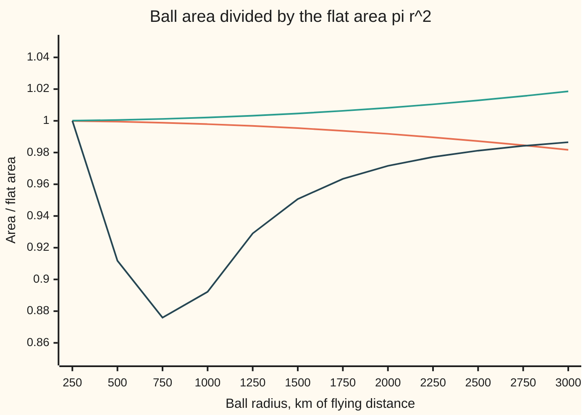

# Bishop-Gromov: a lower bound on Ricci curvature caps the volume of every ball

[Syllabus](../../../SYLLABUS.md) → [Differential geometry and Lie groups](../README.md) → [Riemannian Geometry](../README.md#s05) → Bishop-Gromov

---

## General Overview

Draw a ring round London Heathrow at 1,000 km flying distance, measured along the Earth's surface. Take the Earth as a sphere of radius 6,371 km, a model. The land and sea inside the ring cover 3,135,148.0 km². A flat map promises $`\pi \times 1000^2`$ = 3,141,592.7 km². The globe gives 6,444.6 km² less.

That shortfall is the effect of curvature that [Ricci and scalar curvature](07-ricci-and-scalar-curvature.md) measured for small balls. This card asks a stronger question. Suppose all you know about a space is that its curvature is never below some value. What can you say about balls of every size, not just small ones?

The Bishop-Gromov theorem answers it. Divide the area of a ball by the area of the same-radius ball in a model space with exactly the bounding curvature. As the radius grows, that ratio can only fall. It starts at 1 for a tiny ball, so it stays at or below 1 for ever.

On the globe, compared with a flat plane, the ratio is 0.997949 at 1,000 km, 0.991815 at 2,000 km and 0.949716 at 5,000 km. It never rises. The same theorem says that on any complete surface whose curvature is at least that of this globe, no ball is bigger than the globe's ball of the same radius.

**A lower bound on Ricci curvature, on a complete space, makes the ratio of a ball's volume to the model ball's volume fall as the radius grows, so every ball is at most as big as the model's ball.**

**What kind of fact this is:** a global theorem, proved on this card in Why it works, with two hypotheses that both matter: a Ricci lower bound everywhere, and completeness. The splitting theorem and the sphere theorems at the end are stated with sources, not proved.

### The picture: the ratio as the ball grows



Orange: the globe. Its curvature is positive, so the theorem applies, and the ratio only falls. Green: a saddle-shaped surface with curvature $`-1/6371^2`$ per km². The hypothesis fails, and the ratio rises above 1. Dark blue: a flat map with a closed circular no-fly zone, radius 300 km, centred 600 km from the airport. Its curvature is 0, but it has a hole, so it is not complete. The ratio dips and then climbs again, which the theorem forbids on a complete space.

---

## The formula

Notation first, in words. $`M`$ is a space of dimension $`n`$ with metric $`g`$ ([Riemannian metric](01-riemannian-metrics.md)). The **ball** $`B_r(p)`$ is every point within distance $`r`$ of the centre $`p`$, distance measured inside the space. $`\mathrm{Vol}`$ is its volume, which is area when $`n = 2`$ ([Volume form and Laplace-Beltrami](08-volume-form-and-the-laplace-beltrami-operator.md)).

The hypothesis is a lower bound on Ricci curvature. $`\mathrm{Ric}(v, v)`$ adds up the curvatures of the $`n - 1`$ planes through a unit direction $`v`$ ([Ricci and scalar curvature](07-ricci-and-scalar-curvature.md)). So the natural bound has a factor $`n - 1`$:

```math
\mathrm{Ric} \ge (n-1)\,k\,g \quad\text{means}\quad \mathrm{Ric}(v, v) \ge (n-1)\,k \ \text{ for every unit direction } v
```

**Read it aloud:** the planes through any direction have curvatures that add up to at least $`n - 1`$ times $`k`$, as if each plane had curvature $`k`$.

On a surface, $`\mathrm{Ric} = K g`$, with $`K`$ the Gaussian curvature. So the bound reads $`K \ge k`$. The globe has $`K = 1/R^2`$ everywhere, so $`\mathrm{Ric} = g/R^2`$, with $`R`$ = 6,371 km.

The **model ball** is the ball in the space of constant curvature $`k`$ ([Sphere, plane and hyperbolic space](05-model-spaces-of-constant-curvature.md)). Its volume comes from the model's gap per radian of spread, $`\mathrm{sn}_k`$, from [Jacobi field](09-jacobi-fields-and-comparison-theorems.md): $`\sin(\sqrt{k}\,s)/\sqrt{k}`$ for $`k > 0`$, $`s`$ for $`k = 0`$, $`\sinh(\sqrt{-k}\,s)/\sqrt{-k}`$ for $`k < 0`$:

```math
V_k(r) = n\,\omega_n \int_0^r \mathrm{sn}_k(s)^{\,n-1}\, ds
```

**Read it aloud:** the model ball's volume adds up thin shells; a shell at distance $`s`$ has the size of the unit sphere of directions times the gap per radian, raised to the power $`n - 1`$.

Here $`\omega_n`$ is the volume of the flat unit ball, so $`n\,\omega_n`$ is the size of the unit sphere of directions: $`2\pi`$ when $`n = 2`$. On a surface with $`k = 1/R^2`$, the model ball is the globe's cap, $`V_k(r) = 2\pi R^2 (1 - \cos(r/R))`$. With $`k = 0`$ it is the flat disc, $`\pi r^2`$.

The theorem:

```math
M \text{ complete},\ \mathrm{Ric} \ge (n-1)\,k\,g \ \Longrightarrow\ r \mapsto \frac{\mathrm{Vol}\,B_r(p)}{V_k(r)} \text{ never increases, and } \mathrm{Vol}\,B_r(p) \le V_k(r)
```

**Read it aloud:** on a complete space with Ricci curvature at least that of the model, the ball's share of the model ball can only shrink as the ball grows, so the ball is never bigger than the model's.

The second half is **Bishop's inequality** (1960s). The first half, the ratio form, is **Gromov's**, around 1980. When $`k > 0`$, the radius runs up to $`\pi/\sqrt{k}`$, the model's antipode; past it the space has nothing left to add.

| Symbol | Plain meaning | In our example | Push it up and the answer… |
| --- | --- | --- | --- |
| $`M`$, $`n`$, $`g`$ | the space, its dimension, its metric | the globe's surface, $`n = 2`$ | — |
| $`p`$, $`r`$, $`R`$ | centre of the ball; its radius, measured inside the space; the globe's radius; all in km | Heathrow; 1,000 km; 6,371 km | larger $`r`$: the ratio falls |
| $`B_r(p)`$, $`\mathrm{Vol}`$ | the ball, and its volume (area on a surface), km² | 3,135,148.0 km² | — |
| $`\mathrm{Rm}`$, $`\mathrm{Ric}`$, $`K`$, $`\sec`$ | curvature tensor; Ricci curvature; Gaussian curvature, with $`\mathrm{Ric} = Kg`$ on a surface; sectional curvature of a plane; curvatures in 1/km² | $`K = 1/6371^2`$ | balls shrink |
| $`k`$ | the lower bound: $`\mathrm{Ric} \ge (n-1)kg`$ | $`1/R^2`$ for the globe test; 0 for the flat test | the cap tightens |
| $`\mathrm{sn}_k(s)`$ | the model's gap per radian of spread, km | $`R\sin(s/R)`$ | — |
| $`V_k(r)`$, $`\omega_n`$ | volume of the model ball; volume of the flat unit ball, so $`n\omega_n`$ is the unit sphere of directions | $`2\pi R^2(1 - \cos(r/R))`$; $`\omega_2 = \pi`$ | — |
| $`\gamma`$, $`s`$, $`v`$, $`A(s, v)`$ | a geodesic from $`p`$, distance along it, its starting direction, and the density: shell size per unit of direction | $`A = R\sin(s/R)`$ on the globe | — |
| $`m(s, v)`$, $`m_k`$, $`W`$ | mean curvature of the distance sphere, $`m = A'/A`$; the model's value; $`W`$ the sphere's shape operator, whose trace is $`m`$ | 0.000991846 and 0.000991848 per km at 1,000 km on the flattened Earth | spheres open out faster |
| $`a`$, $`b`$, $`\rho`$ | WGS 84 equator radius and polar semi-axis; comparison radius $`a^2/b`$ | 6,378.137, 6,356.752, 6,399.594 km | — |
| $`J_i`$, $`e_i`$, $`\mathcal{J}`$, $`\mathcal{R}`$ | in the proofs: Jacobi fields with starting rates $`e_i`$, a frame at right angles to $`v`$; the matrix of the $`J_i`$; the matrix of curvature along $`\gamma`$ | on the globe, $`\mathcal{R} = 1/R^2`$ | — |
| $`\delta`$, $`\mu`$, $`u_1`$, $`u_2`$, $`U_1`$, $`U_2`$, $`t`$ | helpers inside the folded proofs, each defined where it appears | — | — |

A prime means $`d/ds`$, the rate along the geodesic.

### When it holds

- **The Ricci bound holds everywhere, with the right sign.** On the saddle, curvature is negative everywhere and the ratio climbs: 1.002055 at 1,000 km, 1.018615 at 3,000 km.
- **The space is complete.** Every geodesic can be extended without end, as on [Hopf-Rinow](10-hopf-rinow-and-completeness.md). With a no-fly zone cut out, the ratio falls to 0.8758 at 770 km, its lowest on a 10 km scan, and then rises: 0.8816 at 900 km.
- **The model uses $`k`$, not $`(n-1)k`$.** A three-dimensional round sphere of radius $`R`$ has $`\mathrm{Ric} = 2g/R^2`$, so $`k = 1/R^2`$. Reading $`k = 2/R^2`$ gives a "cap" smaller than the true ball.
- **The bound is the lowest curvature anywhere.** The flattened Earth is least curved at the poles. Its ball round the North Pole beats a sphere built from its most curved point.
- **It is an upper bound on volume only.** A Ricci lower bound does not stop a ball from being far smaller than the model, as on a thin cylinder.

---

## Why it works

### Step 0: shells, and a ratio that can only fall

Shoot geodesics out of $`p`$ in every direction. The volume of a ball is the sum of thin shells, and each shell's size is built from Jacobi field gaps: their determinant. The Ricci bound limits how fast that shell size can grow, compared with the model's. So the ratio of shell sizes falls. A ratio of running totals of two quantities whose ratio falls also falls. That is the whole proof.

### Step 1: volume in polar coordinates

Write each point of the ball as "go distance $`s`$ in direction $`v`$". The volume element in these coordinates is $`A(s, v)\,ds\,dv`$ ([Volume form and Laplace-Beltrami](08-volume-form-and-the-laplace-beltrami-operator.md)). The density $`A`$ is the determinant of the $`n - 1`$ Jacobi fields that start at 0 with unit rates at right angles to $`v`$. On a surface it is one Jacobi field, the gap per radian $`f`$ from [Jacobi field](09-jacobi-fields-and-comparison-theorems.md).

Completeness enters here. By [Hopf-Rinow](10-hopf-rinow-and-completeness.md), every point at distance under $`r`$ is reached by a shortest geodesic from $`p`$. A geodesic stops being shortest at its cut point. Set $`A = 0`$ past that point. Then

```math
\mathrm{Vol}\,B_r(p) = \int_{\text{directions}} \int_0^r A(s, v)\, ds\, dv
```

**Read it aloud:** the ball's volume is the density added up out to radius $`r`$ along every direction, counting each point once, on the geodesic that reaches it first.

### Step 2: the shell's growth rate obeys a Riccati equation

Let $`m = A'/A`$, the rate at which the shell grows, per unit of shell. Geometrically, $`m`$ is the **mean curvature** of the distance sphere: the trace of its shape operator $`W`$ (the rate the sphere's normal turns, as on shelf 02's [Gauss map and second fundamental form](../02-Surfaces/04-gauss-map-and-second-fundamental-form.md)).

The Jacobi equation $`J'' + \mathrm{Rm}(J, \gamma')\gamma' = 0`$ turns into an equation for $`W`$. Taking its trace gives the **Riccati equation** (a first-order equation with a squared term):

```math
m' + \mathrm{tr}(W^2) + \mathrm{Ric}(v, v) = 0
```

On a surface, $`W`$ is one number, $`m = f'/f`$, and the equation is $`m' + m^2 + K = 0`$. That is $`f'' + Kf = 0`$ divided by $`f`$. The code checks it on the flattened Earth: the worst relative error, from a difference quotient, is 0.000162486.

In higher dimensions, the squares of $`W`$'s $`n - 1`$ eigenvalues add up to at least the square of their sum over $`n - 1`$ (Cauchy-Schwarz). With the Ricci bound:

```math
m' + \frac{m^2}{n-1} \le -(n-1)\,k
```

**Read it aloud:** the shell's growth rate falls at least as fast as the model's, because only the trace of curvature, which is Ricci, pushes on it.

<details>
<summary>Detailed proof: the Riccati equation from Jacobi fields</summary>

Fix a direction $`v`$ and a parallel frame along its geodesic. Put the $`n-1`$ Jacobi fields $`J_i`$, with $`J_i(0) = 0`$ and $`J_i'(0) = e_i`$, as the columns of a matrix $`\mathcal{J}(s)`$. Let $`\mathcal{R}`$ be the matrix of $`w \mapsto \mathrm{Rm}(w, \gamma')\gamma'`$. The Jacobi equation says

$`\displaystyle \mathcal{J}'' + \mathcal{R}\,\mathcal{J} = 0.`$

Set $`W = \mathcal{J}'\mathcal{J}^{-1}`$, defined before the first conjugate point. Then

$`\displaystyle W' = \mathcal{J}''\mathcal{J}^{-1} - \mathcal{J}'\mathcal{J}^{-1}\mathcal{J}'\mathcal{J}^{-1} = -\mathcal{R} - W^2.`$

Jacobi's formula for a determinant gives $`(\det\mathcal{J})'/\det\mathcal{J} = \mathrm{tr}\,W`$, so $`m = A'/A = \mathrm{tr}\,W`$. The trace of $`\mathcal{R}`$ is $`\mathrm{Ric}(v, v)`$. Take the trace of the equation for $`W'`$:

$`\displaystyle m' = -\mathrm{Ric}(v, v) - \mathrm{tr}(W^2).`$

$`W`$ is symmetric (the Jacobi fields come from one point), so $`\mathrm{tr}(W^2)`$ is the sum of its squared eigenvalues. Cauchy-Schwarz gives $`\mathrm{tr}(W^2) \ge (\mathrm{tr}\,W)^2/(n-1) = m^2/(n-1)`$. With $`\mathrm{Ric}(v, v) \ge (n-1)k`$, the inequality follows.

</details>

### Step 3: compare with the model, and the density ratio falls

In the model space the inequality is an equality. There $`A = \mathrm{sn}_k^{\,n-1}`$ and $`m_k = (n-1)\,\mathrm{sn}_k'/\mathrm{sn}_k`$. Near the centre both rates are $`(n-1)/s`$, since every space looks flat close up.

The true rate starts level with the model's and is pushed down at least as hard. So it never gets above the model's: $`m \le m_k`$. Then

```math
\left(\log \frac{A(s, v)}{\mathrm{sn}_k(s)^{\,n-1}}\right)' = m - m_k \le 0
```

so the density ratio $`A/\mathrm{sn}_k^{\,n-1}`$ never rises. Past the cut point $`A`$ drops to 0, which only helps.

On the flattened Earth, round the North Pole at 1,000 km, the code finds $`m`$ = 0.000991846 per km. The model with the lowest curvature anywhere, a sphere of radius $`\rho`$ = 6,399.594 km, gives 0.000991848. The flat plane gives $`1/r`$ = 0.001000000.

<details>
<summary>Detailed proof: why the true rate stays below the model's</summary>

Let $`\delta = m - m_k`$. Subtract the model's equality from the inequality:

$`\displaystyle \delta' \le -\frac{m^2 - m_k^2}{n-1} = -\frac{m + m_k}{n-1}\,\delta.`$

Let $`\mu(s) = \exp\int (m + m_k)/(n-1)\,ds`$. Both rates are about $`(n-1)/s`$ near 0, so $`\mu`$ behaves like $`s^2`$ and $`\mu\delta \to 0`$ as $`s \to 0`$. The inequality says $`(\mu\delta)' \le 0`$. So $`\mu\delta \le 0`$, and since $`\mu > 0`$, $`\delta \le 0`$.

</details>

### Step 4: a falling ratio of densities gives a falling ratio of volumes

Here is the averaging step. Take two positive functions $`u_1`$ and $`u_2`$ of $`s`$ whose ratio $`u_1/u_2`$ never rises. Then the ratio of their running totals, $`\int_0^r u_1 \big/ \int_0^r u_2`$, never rises either. The new shell added at radius $`r`$ has the smallest ratio so far, so it pulls the running ratio down.

Apply it with $`u_1`$ the density summed over directions and $`u_2 = n\omega_n\,\mathrm{sn}_k^{\,n-1}`$. The running totals are $`\mathrm{Vol}\,B_r(p)`$ and $`V_k(r)`$. That is the theorem.

As $`r \to 0`$ the ball looks flat and the ratio tends to 1. A ratio that starts at 1 and never rises stays at or below 1. That is Bishop's inequality.

<details>
<summary>Detailed proof: the ratio of running totals</summary>

Write $`U_1(r) = \int_0^r u_1`$ and $`U_2(r) = \int_0^r u_2`$. Then

$`\displaystyle \left(\frac{U_1}{U_2}\right)' = \frac{u_1(r)\,U_2(r) - u_2(r)\,U_1(r)}{U_2(r)^2}, \qquad u_1(r)U_2(r) - u_2(r)U_1(r) = \int_0^r u_2(r)\,u_2(t)\left(\frac{u_1(r)}{u_2(r)} - \frac{u_1(t)}{u_2(t)}\right) dt.`$

Each bracket is at most 0, because $`u_1/u_2`$ never rises and $`t \le r`$. So the derivative is at most 0.

</details>

### Step 5: what the theorem gives at once

- **Polynomial growth.** With $`\mathrm{Ric} \ge 0`$, every ball has $`\mathrm{Vol}\,B_r \le \omega_n r^n`$: never more than flat space.
- **Doubling.** The ratio at $`2r`$ is at most the ratio at $`r`$. With $`k = 0`$ that means $`\mathrm{Vol}\,B_{2r} \le 2^n\,\mathrm{Vol}\,B_r`$. On the globe, area(2,000 km)/area(1,000 km) = 3.975414, under the cap of 4.
- **Rigidity.** If a ball has exactly the model's volume, the ratio is constant, every inequality above is an equality, and the ball is a copy of the model ball.
- **Gromov's precompactness theorem.** Doubling lets a fixed number of small balls cover any ball. So the spaces of dimension $`n`$, with $`\mathrm{Ric} \ge (n-1)kg`$ and diameter at most a fixed number, form a family in which every sequence has a subsequence converging in the Gromov-Hausdorff sense (a distance between whole spaces). Stated, with Petersen in Sources.

### Step 6: what the splitting and sphere theorems add

Bishop-Gromov uses Ricci from below to cap volume. Two further theorems turn curvature bounds into the shape of the whole space.

- **The splitting theorem** (Cheeger and Gromoll, 1971). Take a complete space with $`\mathrm{Ric} \ge 0`$ that contains a **line**: a geodesic, infinite in both directions, that is shortest between every two of its points. Then the space is a product of a smaller space with a straight line, like an infinite cylinder. The globe has no line: every great circle stops being shortest at the antipode, 20,015.09 km out. Stated, not proved.
- **The topological sphere theorem** (Berger 1960, Klingenberg 1961). A complete, simply connected space (every loop in it shrinks to a point) whose sectional curvature is greater than $`1/4`$ and at most $`1`$, after rescaling, is homeomorphic to the round sphere: a continuous map with a continuous inverse turns one into the other. This needs sectional curvature, not Ricci.
- **The differentiable sphere theorem** (Brendle and Schoen, 2009). Under the same pinching it is a sphere up to smooth change of coordinates (diffeomorphic). The 1/4 is sharp: the complex projective plane (a four-dimensional space whose points are the complex lines through the origin of $`\mathbb{C}^3`$) has sectional curvature from 1/4 to 1 and is not a sphere.

The flattened Earth has $`K_{\min}/K_{\max}`$ = 0.986656, far inside the quarter-pinched range. On a surface the conclusion was already known from Gauss-Bonnet; the theorems have force from dimension 3 up.

---

## Worked numbers, by hand

The ball of 1,000 km round Heathrow on the 6,371 km globe:

| Step | Arithmetic | Value |
| --- | --- | --- |
| angle at the Earth's centre | $`r/R = 1000/6371`$ | 0.156961 rad |
| its cosine | $`\cos 0.156961`$ | 0.987707 |
| fraction of the cap formula | $`1 - \cos(r/R)`$ | 0.012293144 |
| model area factor | $`2\pi R^2 = 2\pi \times 6371^2`$ | 255,032,236.0 km² |
| ball area | $`255{,}032{,}236.0 \times 0.012293144`$ | 3,135,148.0 km² |
| same, from the Jacobi field $`f'' = -f/R^2`$ stepped by RK4 | $`2\pi \int_0^{1000} f\, ds`$ | 3,135,148.0 km² |
| flat area | $`\pi \times 1000^2`$ | 3,141,592.7 km² |
| shortfall | $`3{,}141{,}592.7 - 3{,}135{,}148.0`$ | 6,444.6 km² |
| **ratio to flat** | $`3{,}135{,}148.0 / 3{,}141{,}592.7`$ | **0.997949** |
| ratio at 2,000, 5,000 and 10,000 km | same steps | 0.991815, 0.949716, 0.810832 |

The ratio falls as the ball grows, as the theorem says it must on a surface with $`K \ge 0`$. At 15,000 km it is 0.615465, and at the antipode, $`r = \pi R`$, it is 0.405285, which is $`4/\pi^2`$.

**The flattened Earth.** WGS 84 has $`a`$ = 6,378.137 km and $`b`$ = 6,356.752 km. Its curvature is lowest at the poles, $`K = b^2/a^4`$, the curvature of a sphere of radius $`\rho = a^2/b`$ = 6,399.594 km. So $`\mathrm{Ric} \ge g/\rho^2`$ everywhere, and every ball must fit inside that sphere's ball.

| Ball round the North Pole | 1,000 km | 3,000 km | 5,000 km |
| --- | ---: | ---: | ---: |
| area, polar cap formula | 3,135,205.0 | 27,760,033.6 | 74,619,136.5 |
| area, Jacobi equation stepped | 3,135,205.0 | 27,760,033.6 | 74,619,136.5 |
| model sphere, radius 6,399.594 km | 3,135,205.5 | 27,760,327.6 | 74,624,981.1 |
| area / model | 0.999999866 | 0.999989409 | 0.999921682 |

Each polar ball is at most the model's, and the ratio falls. The pole's ball is bigger than the 6,371 km globe's ball of 3,135,148.0 km². A sphere of the right radius is still a valid cap.

### What breaks if you drop a piece

| Mistake | Comes out at | What went wrong |
| --- | --- | --- |
| Use the theorem on the saddle, curvature $`-1/6371^2`$ | ratio 1.002055 at 1,000 km, 1.018615 at 3,000 km | Ric is negative, so $`\mathrm{Ric} \ge 0`$ fails and the ball beats flat |
| Use it on the flat map with a no-fly zone | ratio 0.8758 at 770 km, its lowest, then 0.8816 at 900 km and 0.9716 at 2,000 km | not complete: geodesics run into the zone's edge, and points behind it arrive late by bent routes |
| Read $`\mathrm{Ric} = 2g/R^2`$ on a 3D round sphere as $`k = 2/R^2`$ | "cap" 4,147,703,987 km³ at 1,000 km, below the true 4,168,198,866 km³ | $`k`$ is per plane; the factor $`n - 1 = 2`$ is already in the bound |
| Take the comparison sphere from the flattened Earth's most curved point, radius $`b`$ | "cap" 3,135,119.1 km², below the pole's true 3,135,205.0 km² | the bound must be the lowest curvature anywhere |

In the no-fly zone, the point 1,200 km east, straight behind the zone, is 1,353.390 km away by air: two straight legs that touch the zone's edge, and a 60° arc round it. The ball of 1,200 km does not reach that point, though the flat disc of 1,200 km does.

---

## Code, from first principles, and it actually runs

The code builds ball areas several ways and checks each claim. On the globe it gets the 1,000 km ball from the cap formula and from a Jacobi field stepped by Runge-Kutta (RK4), and the saddle's balls at 1,000 and 3,000 km the same two ways. On the flattened Earth it gets the polar ball from the cap formula and from the Jacobi equation with the ellipsoid's curvature, then checks the Riccati equation, $`m \le m_k`$, and that both ratios never rise. For the no-fly zone it finds ball areas along rays by bisection and by counting a 5 km grid, scans the ratio every 10 km from 600 to 1,000 km for its lowest point, and checks one wrap-around distance by hand. The 3D ball is a closed form checked against a sum of shells. That makes two independent roads to each kind of area on the card.

### Python

```python
# Bishop-Gromov volume comparison -- the check behind the card.  Standard library only.
# A ball is everything within flying distance r of one point.  Roads: closed-form ball
# areas against areas built from Jacobi fields stepped by RK4; the flattened Earth's polar
# ball from its geometry against the Jacobi equation; a no-fly zone by rays against a grid.
from math import sin, cos, sqrt, pi, acos, asin, asinh, cosh, hypot

R = 6371.0                                   # the globe, km (a model)
A_EQ, B_POL = 6378.137, 6356.752314245       # WGS 84 semi-axes, km
def flat(r): return pi * r * r
def globe(r, rr=R): return 2 * pi * rr * rr * (1 - cos(r / rr))
def saddle(r): return 2 * pi * R * R * (cosh(r / R) - 1)

def rk4(F, y, h):
    k1 = F(y); k2 = F([a + h / 2 * b for a, b in zip(y, k1)])
    k3 = F([a + h / 2 * b for a, b in zip(y, k2)]); k4 = F([a + h * b for a, b in zip(y, k3)])
    return [a + h / 6 * (p + 2 * q + 2 * u + v) for a, p, q, u, v in zip(y, k1, k2, k3, k4)]

def jacobi_area(K, r, steps):                # state: gap per radian f, its rate, area
    y, h = [0.0, 1.0, 0.0], r / steps
    for _ in range(steps): y = rk4(lambda z: [z[1], -K * z[0], 2 * pi * z[0]], y, h)
    return y[2]

# ---- 1. the globe: ball of 1,000 km, two roads, and the ratio against flat ----
g1000, j1000 = globe(1000.0), jacobi_area(1 / R**2, 1000.0, 100)
print(f"globe ball r=1000 km   closed {g1000:.1f}   Jacobi RK4 {j1000:.1f}   flat {flat(1000.0):.1f}")
print(f"r/R {1000 / R:.6f}   cos(r/R) {cos(1000 / R):.6f}   2 pi R^2 {2 * pi * R * R:.1f}")
print(f"shortfall {flat(1000.0) - g1000:.1f} km2   1-cos(r/R) {1 - cos(1000 / R):.9f}")
radii = [1000.0, 2000.0, 5000.0, 10000.0, 15000.0, pi * R]
ratios = [globe(r) / flat(r) for r in radii]
print(f"ratio area/(pi r^2) at r = 1000 2000 5000 10000 15000 piR={pi * R:.2f}:", " ".join(f"{q:.6f}" for q in ratios))
print(f"doubling: area(2000)/area(1000) = {globe(2000.0) / g1000:.6f}  (Ric >= 0 caps it at 4)")

# ---- 2. the flattened Earth, ball round the North Pole: polar caps ----
C2 = A_EQ**2 - B_POL**2
def w(be): return sqrt(A_EQ**2 * sin(be)**2 + B_POL**2 * cos(be)**2)
def K_ell(be): return B_POL**2 / w(be)**4   # Gaussian curvature at parametric latitude be
def cap(be):                                  # cap area from the pole down to latitude be, closed form
    G = lambda u: u / 2 * sqrt(B_POL**2 + C2 * u * u) + B_POL**2 / (2 * sqrt(C2)) * asinh(sqrt(C2) * u / B_POL)
    return 2 * pi * A_EQ * (G(1.0) - G(sin(be)))
KMIN, KMAX = K_ell(pi / 2), K_ell(0.0)
RHO = 1 / sqrt(KMIN)                          # radius of the least curved comparison sphere
y, h, ok = [pi / 2, 0.0, 1.0, 0.0], 1.0, True # beta, Jacobi f, f', area by Jacobi
prev_ratio, prev_dens, prev_m, worst_riccati, rows = 1.0, 1.0, None, 0.0, []
for i in range(1, 5001):
    y = rk4(lambda z: [-1 / w(z[0]), z[2], -K_ell(z[0]) * z[1], 2 * pi * z[1]], y, h)
    s = i * h; be, f, fp, area = y
    m, m_model = fp / f, sqrt(KMIN) / (sin(sqrt(KMIN) * s) / cos(sqrt(KMIN) * s))
    dens = f / (sin(sqrt(KMIN) * s) / sqrt(KMIN))
    if prev_m is not None and s > 500:        # Riccati: m' + m^2 = -K, m' by a difference quotient
        mid_m, mid_K = (m + prev_m) / 2, K_ell(be + h / (2 * w(be)))
        worst_riccati = max(worst_riccati, abs((m - prev_m) / h + mid_m * mid_m + mid_K) / mid_K)
    prev_m = m
    ok = ok and m <= m_model + 1e-12 and dens <= prev_dens + 1e-12
    prev_dens = dens
    if i % 1000 == 0:
        ratio = area / globe(s, RHO)
        ok = ok and ratio <= prev_ratio + 1e-12; prev_ratio = ratio
        if i == 1000: print(f"pole r=1000  m = f'/f {m:.9f}  model {m_model:.9f}  flat 1/r {1 / s:.9f}")
        rows.append((s, A_EQ * cos(be), f, cap(be), area, globe(s, RHO), globe(s), ratio, area / flat(s)))
for s, fg, fj, ac, aj, am, a6371, q, qf in rows:
    print(f"pole r={s:5.0f}  f geom {fg:.6f}  f Jacobi {fj:.6f}  area cap {ac:.1f}  Jacobi {aj:.1f}")
    print(f"           model rho {am:.1f}  globe 6371 {a6371:.1f}  area/model {q:.9f}  area/flat {qf:.6f}")
print(f"Riccati m' + m^2 + K, worst relative error {worst_riccati:.9f}")
print(f"sphere of radius b = {B_POL:.3f} km, ball r=1000: {globe(1000.0, B_POL):.1f}  (below the pole's ball)")
print(f"comparison radius rho = a^2/b = {RHO:.3f} km   pinching Kmin/Kmax = {KMIN / KMAX:.6f}")

# ---- 3. what breaks: the saddle (Ric < 0), the no-fly zone (not complete), a 3D slip ----
D, Z = 600.0, 300.0                           # zone centre 600 km east, radius 300 km, flat map
def fly(x, yy):                               # flying distance from the airport at the origin
    cx = x - D; dc = hypot(cx, yy)
    if dc < Z: return None
    beta = acos(max(-1.0, min(1.0, -cx / dc))) - acos(Z / D) - acos(Z / dc)
    return hypot(x, yy) if beta <= 0 else sqrt(D * D - Z * Z) + sqrt(dc * dc - Z * Z) + Z * beta
def zone_rays(r, m=4000):
    tot = 0.0
    for i in range(m):
        th = (i + 0.5) * pi / m
        if th >= asin(Z / D): tot += r * r / 2; continue
        q = sqrt(Z * Z - (D * sin(th))**2); t1, t2 = D * cos(th) - q, D * cos(th) + q
        if r <= t1: tot += r * r / 2; continue
        tot += t1 * t1 / 2; lo, hi = t2 * 1.000001, r
        if lo >= r or fly(lo * cos(th), lo * sin(th)) > r: continue
        for _ in range(60):
            mid = (lo + hi) / 2
            if fly(mid * cos(th), mid * sin(th)) <= r: lo = mid
            else: hi = mid
        tot += (lo * lo - t2 * t2) / 2
    return 2 * tot * pi / m
def zone_grid(r, cell=5.0):
    n, cnt = int(r / cell) + 1, 0
    for i in range(-n, n):
        for j in range(n):
            x, yy = (i + 0.5) * cell, (j + 0.5) * cell
            d = fly(x, yy) if x * x + yy * yy <= r * r else None
            if d is not None and d <= r: cnt += 1
    return 2 * cnt * cell * cell
behind = 2 * sqrt(D * D - Z * Z) + Z * pi / 3    # straight behind the zone: two tangents, a 60-degree arc
print(f"point 1200 km east, behind the zone: by air {fly(1200.0, 0.0):.3f} km, by hand {behind:.3f} km")
zr = [zone_rays(r) / flat(r) for r in (300.0, 500.0, 700.0, 900.0, 1200.0, 2000.0)]
zg = [zone_grid(r) / flat(r) for r in (700.0, 2000.0)]
print("no-fly zone ratio at r = 300 500 700 900 1200 2000:", " ".join(f"{q:.4f}" for q in zr))
print(f"  grid count at 700 and 2000: {zg[0]:.4f} {zg[1]:.4f}")
zmin = min((zone_rays(r) / flat(r), r) for r in [10.0 * i for i in range(60, 101)])
zgm = zone_grid(zmin[1]) / flat(zmin[1])
print(f"  lowest ratio, r = 600 to 1000 km in 10 km steps: {zmin[0]:.4f} at {zmin[1]:.0f} km, grid count {zgm:.4f}")
sj = [jacobi_area(-1 / R**2, r, 300) / flat(r) for r in (1000.0, 3000.0)]
print(f"saddle ratio at 1000 and 3000: {saddle(1000.0) / flat(1000.0):.6f} {saddle(3000.0) / flat(3000.0):.6f}   Jacobi RK4 {sj[0]:.6f} {sj[1]:.6f}")
def s3_ball(r, rr): return pi * rr * rr * (2 * r - rr * sin(2 * r / rr))
def s3_shells(r, rr, n=2000): return sum(4 * pi * (rr * sin((i + 0.5) * r / n / rr))**2 * r / n for i in range(n))
true3, wrong3 = s3_ball(1000.0, R), s3_ball(1000.0, R / sqrt(2))
print(f"3D globe ball r=1000: true {true3:.0f} km3, model read as k=2/R^2 gives {wrong3:.0f}")
chart_r = [250.0 * i for i in range(1, 13)]
print("chart r:", " ".join(f"{r:.0f}" for r in chart_r))
print("chart globe:", " ".join(f"{globe(r) / flat(r):.4f}" for r in chart_r))
print("chart saddle:", " ".join(f"{saddle(r) / flat(r):.4f}" for r in chart_r))
print("chart no-fly:", " ".join(f"{zone_rays(r, 2000) / flat(r):.4f}" for r in chart_r))

assert abs(j1000 - g1000) < 1e-3, "Jacobi-built area must match the closed form"
assert abs(flat(1000.0) - g1000 - 6444.6) < 0.1, "shortfall agrees with the Ricci card"
assert all(a > b for a, b in zip(ratios, ratios[1:])), "Ric >= 0: the ratio only falls"
assert worst_riccati < 1e-3, "the mean curvature of the circles obeys the Riccati equation"
assert ok, "Riccati bound m <= model, density ratio and volume ratio never rise"
assert all(abs(r[1] - r[2]) < 1e-6 for r in rows), "circle radius: geometry and Jacobi agree"
assert all(abs(r[3] - r[4]) < 1e-3 for r in rows), "ball area: closed form and Jacobi agree"
assert all(r[4] <= r[5] for r in rows), "Bishop: no bigger than the comparison sphere"
assert globe(1000.0, B_POL) < rows[0][4], "the most curved sphere is not a valid upper bound"
assert abs(zr[2] - zg[0]) < 2e-3 and abs(zr[5] - zg[1]) < 2e-3 and abs(zmin[0] - zgm) < 2e-3, "rays and grid agree"
assert abs(fly(1200.0, 0.0) - behind) < 1e-9, "wrap-around distance against the hand formula"
assert zmin[0] < zr[2] < zr[3], "no-fly zone: the ratio falls past 700 km, then rises, so completeness was needed"
assert saddle(1000.0) > flat(1000.0), "saddle: Ric < 0 lets the ball beat flat"
assert all(abs(q - saddle(r) / flat(r)) < 1e-9 for q, r in zip(sj, (1000.0, 3000.0))), "saddle: Jacobi-built area matches the closed form"
assert abs(ratios[-1] - 4 / pi**2) < 1e-12, "whole globe: 4 pi R^2 over pi (pi R)^2 is 4/pi^2"
assert all(abs(s3_shells(1000.0, q) / s3_ball(1000.0, q) - 1) < 1e-6 for q in (R, R / sqrt(2))), "3D ball: shells against closed form"
assert wrong3 < true3, "3D slip: the misread model is smaller than the true ball"
print("ALL CHECKS PASS")
```

**Ran 2026-11-24 on macOS, Python 3.14.10, standard library only. All checks passed. Output, pasted from the run:**

```
globe ball r=1000 km   closed 3135148.0   Jacobi RK4 3135148.0   flat 3141592.7
r/R 0.156961   cos(r/R) 0.987707   2 pi R^2 255032236.0
shortfall 6444.6 km2   1-cos(r/R) 0.012293144
ratio area/(pi r^2) at r = 1000 2000 5000 10000 15000 piR=20015.09: 0.997949 0.991815 0.949716 0.810832 0.615465 0.405285
doubling: area(2000)/area(1000) = 3.975414  (Ric >= 0 caps it at 4)
pole r=1000  m = f'/f 0.000991846  model 0.000991848  flat 1/r 0.001000000
pole r= 1000  f geom 995.935039  f Jacobi 995.935039  area cap 3135205.0  Jacobi 3135205.0
           model rho 3135205.5  globe 6371 3135148.0  area/model 0.999999866  area/flat 0.997967
pole r= 2000  f geom 1967.589861  f Jacobi 1967.589861  area cap 12464398.2  Jacobi 12464398.2
           model rho 12464424.6  globe 6371 12463510.5  area/model 0.999997880  area/flat 0.991885
pole r= 3000  f geom 2891.231503  f Jacobi 2891.231503  area cap 27760033.6  Jacobi 27760033.6
           model rho 27760327.6  globe 6371 27755737.6  area/model 0.999989409  area/flat 0.981810
pole r= 4000  f geom 3744.218736  f Jacobi 3744.218736  area cap 48648592.7  Jacobi 48648592.7
           model rho 48650191.1  globe 6371 48635850.2  area/model 0.999967145  area/flat 0.967833
pole r= 5000  f geom 4505.538893  f Jacobi 4505.538893  area cap 74619136.5  Jacobi 74619136.5
           model rho 74624981.1  globe 6371 74590483.9  area/model 0.999921682  area/flat 0.950080
Riccati m' + m^2 + K, worst relative error 0.000162486
sphere of radius b = 6356.752 km, ball r=1000: 3135119.1  (below the pole's ball)
comparison radius rho = a^2/b = 6399.594 km   pinching Kmin/Kmax = 0.986656
point 1200 km east, behind the zone: by air 1353.390 km, by hand 1353.390 km
no-fly zone ratio at r = 300 500 700 900 1200 2000: 1.0000 0.9118 0.8776 0.8816 0.9227 0.9716
  grid count at 700 and 2000: 0.8776 0.9716
  lowest ratio, r = 600 to 1000 km in 10 km steps: 0.8758 at 770 km, grid count 0.8756
saddle ratio at 1000 and 3000: 1.002055 1.018615   Jacobi RK4 1.002055 1.018615
3D globe ball r=1000: true 4168198866 km3, model read as k=2/R^2 gives 4147703987
chart r: 250 500 750 1000 1250 1500 1750 2000 2250 2500 2750 3000
chart globe: 0.9999 0.9995 0.9988 0.9979 0.9968 0.9954 0.9937 0.9918 0.9896 0.9872 0.9846 0.9817
chart saddle: 1.0001 1.0005 1.0012 1.0021 1.0032 1.0046 1.0063 1.0082 1.0104 1.0129 1.0156 1.0186
chart no-fly: 1.0000 0.9118 0.8759 0.8922 0.9290 0.9507 0.9634 0.9716 0.9772 0.9812 0.9842 0.9865
ALL CHECKS PASS
```

### Rust

The same checks in Rust, with the same output line for line. RK4 works on vectors, and the flying distance returns `None` inside the zone.

```rust
// Bishop-Gromov volume comparison -- the same check as bishop_gromov_volume_comparison_check.py.
// Standard library only, no crates.  A ball is everything within flying distance r of one point.
// Roads: closed-form ball areas against areas built from Jacobi fields stepped by RK4; the flattened
// Earth's polar ball from its geometry against the Jacobi equation; a no-fly zone by rays and a grid.
use std::f64::consts::PI;

const R: f64 = 6371.0;                                  // the globe, km (a model)
const A_EQ: f64 = 6378.137;                             // WGS 84 semi-axes, km
const B_POL: f64 = 6356.752314245;
const D: f64 = 600.0; const Z: f64 = 300.0;             // no-fly zone: centre km east of the airport, radius km

fn flat(r: f64) -> f64 { PI * r * r }
fn globe(r: f64, rr: f64) -> f64 { 2.0 * PI * rr * rr * (1.0 - (r / rr).cos()) }
fn saddle(r: f64) -> f64 { 2.0 * PI * R * R * ((r / R).cosh() - 1.0) }

fn rk4<F: Fn(&[f64]) -> Vec<f64>>(f: F, y: &[f64], h: f64) -> Vec<f64> {
    let step = |a: &[f64], b: &[f64], c: f64| -> Vec<f64> { a.iter().zip(b).map(|(x, d)| x + c * d).collect() };
    let k1 = f(y); let k2 = f(&step(y, &k1, h / 2.0));
    let k3 = f(&step(y, &k2, h / 2.0)); let k4 = f(&step(y, &k3, h));
    (0..y.len()).map(|i| y[i] + h / 6.0 * (k1[i] + 2.0 * k2[i] + 2.0 * k3[i] + k4[i])).collect()
}

fn jacobi_area(k: f64, r: f64, steps: usize) -> f64 {   // state: gap per radian f, its rate, area
    let (mut y, h) = (vec![0.0, 1.0, 0.0], r / steps as f64);
    for _ in 0..steps { y = rk4(|z| vec![z[1], -k * z[0], 2.0 * PI * z[0]], &y, h); }
    y[2]
}

fn w(be: f64) -> f64 { (A_EQ * A_EQ * be.sin().powi(2) + B_POL * B_POL * be.cos().powi(2)).sqrt() }
fn k_ell(be: f64) -> f64 { B_POL * B_POL / w(be).powi(4) } // Gaussian curvature at parametric latitude be
fn cap(be: f64) -> f64 {                                 // cap area from the pole down to latitude be
    let c = (A_EQ * A_EQ - B_POL * B_POL).sqrt();
    let g = |u: f64| u / 2.0 * (B_POL * B_POL + c * c * u * u).sqrt() + B_POL * B_POL / (2.0 * c) * (c * u / B_POL).asinh();
    2.0 * PI * A_EQ * (g(1.0) - g(be.sin()))
}

fn fly(x: f64, y: f64) -> Option<f64> {                 // flying distance from the airport at the origin
    let cx = x - D;
    let dc = cx.hypot(y);
    if dc < Z { return None; }
    let beta = (-cx / dc).max(-1.0).min(1.0).acos() - (Z / D).acos() - (Z / dc).acos();
    Some(if beta <= 0.0 { x.hypot(y) } else { (D * D - Z * Z).sqrt() + (dc * dc - Z * Z).sqrt() + Z * beta })
}

fn zone_rays(r: f64, m: usize) -> f64 {
    let mut tot = 0.0;
    for i in 0..m {
        let th = (i as f64 + 0.5) * PI / m as f64;
        if th >= (Z / D).asin() { tot += r * r / 2.0; continue; }
        let q = (Z * Z - (D * th.sin()).powi(2)).sqrt();
        let (t1, t2) = (D * th.cos() - q, D * th.cos() + q);
        if r <= t1 { tot += r * r / 2.0; continue; }
        tot += t1 * t1 / 2.0;
        let (mut lo, mut hi) = (t2 * 1.000001, r);
        if lo >= r || fly(lo * th.cos(), lo * th.sin()).unwrap() > r { continue; }
        for _ in 0..60 {
            let mid = (lo + hi) / 2.0;
            if fly(mid * th.cos(), mid * th.sin()).unwrap() <= r { lo = mid; } else { hi = mid; }
        }
        tot += (lo * lo - t2 * t2) / 2.0;
    }
    2.0 * tot * PI / m as f64
}

fn zone_grid(r: f64, cell: f64) -> f64 {
    let n = (r / cell) as i64 + 1;
    let mut cnt = 0u64;
    for i in -n..n {
        for j in 0..n {
            let (x, y) = ((i as f64 + 0.5) * cell, (j as f64 + 0.5) * cell);
            if x * x + y * y > r * r { continue; }
            if let Some(d) = fly(x, y) { if d <= r { cnt += 1; } }
        }
    }
    2.0 * cnt as f64 * cell * cell
}

fn s3_ball(r: f64, rr: f64) -> f64 { PI * rr * rr * (2.0 * r - rr * (2.0 * r / rr).sin()) }
fn s3_shells(r: f64, rr: f64, n: usize) -> f64 {           // 3D ball as a sum of shells 4 pi sn^2 ds
    (0..n).map(|i| 4.0 * PI * (rr * ((i as f64 + 0.5) * r / n as f64 / rr).sin()).powi(2) * r / n as f64).sum()
}

fn join(v: &[f64], p: usize) -> String { v.iter().map(|q| format!("{:.*}", p, q)).collect::<Vec<_>>().join(" ") }

fn main() {
    // ---- 1. the globe: ball of 1,000 km, two roads, and the ratio against flat ----
    let (g1000, j1000) = (globe(1000.0, R), jacobi_area(1.0 / (R * R), 1000.0, 100));
    println!("globe ball r=1000 km   closed {:.1}   Jacobi RK4 {:.1}   flat {:.1}", g1000, j1000, flat(1000.0));
    println!("r/R {:.6}   cos(r/R) {:.6}   2 pi R^2 {:.1}", 1000.0 / R, (1000.0 / R).cos(), 2.0 * PI * R * R);
    println!("shortfall {:.1} km2   1-cos(r/R) {:.9}", flat(1000.0) - g1000, 1.0 - (1000.0 / R).cos());
    let radii = [1000.0, 2000.0, 5000.0, 10000.0, 15000.0, PI * R];
    let ratios: Vec<f64> = radii.iter().map(|&r| globe(r, R) / flat(r)).collect();
    println!("ratio area/(pi r^2) at r = 1000 2000 5000 10000 15000 piR={:.2}: {}", PI * R, join(&ratios, 6));
    println!("doubling: area(2000)/area(1000) = {:.6}  (Ric >= 0 caps it at 4)", globe(2000.0, R) / g1000);

    // ---- 2. the flattened Earth, ball round the North Pole: polar caps ----
    let (kmin, kmax) = (k_ell(PI / 2.0), k_ell(0.0));
    let rho = 1.0 / kmin.sqrt();                        // radius of the least curved comparison sphere
    let (mut y, h, mut ok) = (vec![PI / 2.0, 0.0, 1.0, 0.0], 1.0, true); // beta, Jacobi f, f', area
    let (mut prev_ratio, mut prev_dens, mut prev_m, mut worst) = (1.0, 1.0, f64::NAN, 0.0f64);
    let mut rows: Vec<[f64; 9]> = Vec::new();
    for i in 1..=5000 {
        y = rk4(|z| vec![-1.0 / w(z[0]), z[2], -k_ell(z[0]) * z[1], 2.0 * PI * z[1]], &y, h);
        let s = i as f64 * h;
        let (be, f, fp, area) = (y[0], y[1], y[2], y[3]);
        let sk = kmin.sqrt();
        let (m, m_model) = (fp / f, sk / ((sk * s).sin() / (sk * s).cos()));
        let dens = f / ((sk * s).sin() / sk);
        if !prev_m.is_nan() && s > 500.0 {              // Riccati: m' + m^2 = -K, m' by a difference quotient
            let (mid_m, mid_k) = ((m + prev_m) / 2.0, k_ell(be + h / (2.0 * w(be))));
            worst = worst.max(((m - prev_m) / h + mid_m * mid_m + mid_k).abs() / mid_k);
        }
        prev_m = m;
        ok = ok && m <= m_model + 1e-12 && dens <= prev_dens + 1e-12;
        prev_dens = dens;
        if i % 1000 == 0 {
            let ratio = area / globe(s, rho);
            ok = ok && ratio <= prev_ratio + 1e-12;
            prev_ratio = ratio;
            if i == 1000 { println!("pole r=1000  m = f'/f {:.9}  model {:.9}  flat 1/r {:.9}", m, m_model, 1.0 / s); }
            rows.push([s, A_EQ * be.cos(), f, cap(be), area, globe(s, rho), globe(s, R), ratio, area / flat(s)]);
        }
    }
    for r in &rows {
        println!("pole r={:5.0}  f geom {:.6}  f Jacobi {:.6}  area cap {:.1}  Jacobi {:.1}", r[0], r[1], r[2], r[3], r[4]);
        println!("           model rho {:.1}  globe 6371 {:.1}  area/model {:.9}  area/flat {:.6}", r[5], r[6], r[7], r[8]);
    }
    println!("Riccati m' + m^2 + K, worst relative error {:.9}", worst);
    println!("sphere of radius b = {:.3} km, ball r=1000: {:.1}  (below the pole's ball)", B_POL, globe(1000.0, B_POL));
    println!("comparison radius rho = a^2/b = {:.3} km   pinching Kmin/Kmax = {:.6}", rho, kmin / kmax);

    // ---- 3. what breaks: the saddle (Ric < 0), the no-fly zone (not complete), a 3D slip ----
    let behind = 2.0 * (D * D - Z * Z).sqrt() + Z * PI / 3.0; // two tangents and a 60-degree arc
    println!("point 1200 km east, behind the zone: by air {:.3} km, by hand {:.3} km", fly(1200.0, 0.0).unwrap(), behind);
    let zr: Vec<f64> = [300.0, 500.0, 700.0, 900.0, 1200.0, 2000.0].iter().map(|&r| zone_rays(r, 4000) / flat(r)).collect();
    let zg: Vec<f64> = [700.0, 2000.0].iter().map(|&r| zone_grid(r, 5.0) / flat(r)).collect();
    println!("no-fly zone ratio at r = 300 500 700 900 1200 2000: {}", join(&zr, 4));
    println!("  grid count at 700 and 2000: {:.4} {:.4}", zg[0], zg[1]);
    let zmin = (60..=100).map(|i| 10.0 * i as f64).map(|r| (zone_rays(r, 4000) / flat(r), r)).fold((f64::INFINITY, 0.0), |a, b| if b.0 < a.0 { b } else { a });
    let zgm = zone_grid(zmin.1, 5.0) / flat(zmin.1);
    println!("  lowest ratio, r = 600 to 1000 km in 10 km steps: {:.4} at {:.0} km, grid count {:.4}", zmin.0, zmin.1, zgm);
    let sj: Vec<f64> = [1000.0, 3000.0].iter().map(|&r| jacobi_area(-1.0 / (R * R), r, 300) / flat(r)).collect();
    println!("saddle ratio at 1000 and 3000: {:.6} {:.6}   Jacobi RK4 {:.6} {:.6}", saddle(1000.0) / flat(1000.0), saddle(3000.0) / flat(3000.0), sj[0], sj[1]);
    let (true3, wrong3) = (s3_ball(1000.0, R), s3_ball(1000.0, R / 2f64.sqrt()));
    println!("3D globe ball r=1000: true {:.0} km3, model read as k=2/R^2 gives {:.0}", true3, wrong3);
    let chart_r: Vec<f64> = (1..=12).map(|i| 250.0 * i as f64).collect();
    println!("chart r: {}", join(&chart_r, 0));
    println!("chart globe: {}", join(&chart_r.iter().map(|&r| globe(r, R) / flat(r)).collect::<Vec<_>>(), 4));
    println!("chart saddle: {}", join(&chart_r.iter().map(|&r| saddle(r) / flat(r)).collect::<Vec<_>>(), 4));
    println!("chart no-fly: {}", join(&chart_r.iter().map(|&r| zone_rays(r, 2000) / flat(r)).collect::<Vec<_>>(), 4));

    assert!((j1000 - g1000).abs() < 1e-3, "Jacobi-built area must match the closed form");
    assert!((flat(1000.0) - g1000 - 6444.6).abs() < 0.1, "shortfall agrees with the Ricci card");
    assert!(ratios.windows(2).all(|p| p[0] > p[1]), "Ric >= 0: the ratio only falls");
    assert!(worst < 1e-3, "the mean curvature of the circles obeys the Riccati equation");
    assert!(ok, "Riccati bound m <= model, density ratio and volume ratio never rise");
    assert!(rows.iter().all(|r| (r[1] - r[2]).abs() < 1e-6), "circle radius: geometry and Jacobi agree");
    assert!(rows.iter().all(|r| (r[3] - r[4]).abs() < 1e-3), "ball area: closed form and Jacobi agree");
    assert!(rows.iter().all(|r| r[4] <= r[5]), "Bishop: no bigger than the comparison sphere");
    assert!(globe(1000.0, B_POL) < rows[0][4], "the most curved sphere is not a valid upper bound");
    assert!((zr[2] - zg[0]).abs() < 2e-3 && (zr[5] - zg[1]).abs() < 2e-3 && (zmin.0 - zgm).abs() < 2e-3, "rays and grid agree");
    assert!((fly(1200.0, 0.0).unwrap() - behind).abs() < 1e-9, "wrap-around distance against the hand formula");
    assert!(zmin.0 < zr[2] && zr[2] < zr[3], "no-fly zone: the ratio falls past 700 km, then rises, so completeness was needed");
    assert!(saddle(1000.0) > flat(1000.0), "saddle: Ric < 0 lets the ball beat flat");
    assert!(sj.iter().zip([1000.0, 3000.0]).all(|(q, r)| (q - saddle(r) / flat(r)).abs() < 1e-9), "saddle: Jacobi-built area matches the closed form");
    assert!((ratios[5] - 4.0 / (PI * PI)).abs() < 1e-12, "whole globe: 4 pi R^2 over pi (pi R)^2 is 4/pi^2");
    assert!([R, R / 2f64.sqrt()].iter().all(|&q| (s3_shells(1000.0, q, 2000) / s3_ball(1000.0, q) - 1.0).abs() < 1e-6), "3D ball: shells against closed form");
    assert!(wrong3 < true3, "3D slip: the misread model is smaller than the true ball");
    println!("ALL CHECKS PASS");
}
```

**Ran 2026-11-24 on macOS, rustc 1.98.1, no crates. All checks passed. Output, pasted from the run:**

```
globe ball r=1000 km   closed 3135148.0   Jacobi RK4 3135148.0   flat 3141592.7
r/R 0.156961   cos(r/R) 0.987707   2 pi R^2 255032236.0
shortfall 6444.6 km2   1-cos(r/R) 0.012293144
ratio area/(pi r^2) at r = 1000 2000 5000 10000 15000 piR=20015.09: 0.997949 0.991815 0.949716 0.810832 0.615465 0.405285
doubling: area(2000)/area(1000) = 3.975414  (Ric >= 0 caps it at 4)
pole r=1000  m = f'/f 0.000991846  model 0.000991848  flat 1/r 0.001000000
pole r= 1000  f geom 995.935039  f Jacobi 995.935039  area cap 3135205.0  Jacobi 3135205.0
           model rho 3135205.5  globe 6371 3135148.0  area/model 0.999999866  area/flat 0.997967
pole r= 2000  f geom 1967.589861  f Jacobi 1967.589861  area cap 12464398.2  Jacobi 12464398.2
           model rho 12464424.6  globe 6371 12463510.5  area/model 0.999997880  area/flat 0.991885
pole r= 3000  f geom 2891.231503  f Jacobi 2891.231503  area cap 27760033.6  Jacobi 27760033.6
           model rho 27760327.6  globe 6371 27755737.6  area/model 0.999989409  area/flat 0.981810
pole r= 4000  f geom 3744.218736  f Jacobi 3744.218736  area cap 48648592.7  Jacobi 48648592.7
           model rho 48650191.1  globe 6371 48635850.2  area/model 0.999967145  area/flat 0.967833
pole r= 5000  f geom 4505.538893  f Jacobi 4505.538893  area cap 74619136.5  Jacobi 74619136.5
           model rho 74624981.1  globe 6371 74590483.9  area/model 0.999921682  area/flat 0.950080
Riccati m' + m^2 + K, worst relative error 0.000162486
sphere of radius b = 6356.752 km, ball r=1000: 3135119.1  (below the pole's ball)
comparison radius rho = a^2/b = 6399.594 km   pinching Kmin/Kmax = 0.986656
point 1200 km east, behind the zone: by air 1353.390 km, by hand 1353.390 km
no-fly zone ratio at r = 300 500 700 900 1200 2000: 1.0000 0.9118 0.8776 0.8816 0.9227 0.9716
  grid count at 700 and 2000: 0.8776 0.9716
  lowest ratio, r = 600 to 1000 km in 10 km steps: 0.8758 at 770 km, grid count 0.8756
saddle ratio at 1000 and 3000: 1.002055 1.018615   Jacobi RK4 1.002055 1.018615
3D globe ball r=1000: true 4168198866 km3, model read as k=2/R^2 gives 4147703987
chart r: 250 500 750 1000 1250 1500 1750 2000 2250 2500 2750 3000
chart globe: 0.9999 0.9995 0.9988 0.9979 0.9968 0.9954 0.9937 0.9918 0.9896 0.9872 0.9846 0.9817
chart saddle: 1.0001 1.0005 1.0012 1.0021 1.0032 1.0046 1.0063 1.0082 1.0104 1.0129 1.0156 1.0186
chart no-fly: 1.0000 0.9118 0.8759 0.8922 0.9290 0.9507 0.9634 0.9716 0.9772 0.9812 0.9842 0.9865
ALL CHECKS PASS
```

### Lean

Lean proves the averaging step of Step 4 in general, and the theorem itself on a globe of any radius.

- Take two positive functions $`u_1`$ and $`u_2`$ of $`s > 0`$, with finite running totals, whose ratio never rises. Then the ratio of their running totals never rises either.
- Take a globe of radius $`R`$ and a ball of radius $`r`$, with $`0 < r \le \pi R`$. Then the ball's area, $`2\pi R^2(1 - \cos(r/R))`$, divided by $`\pi r^2`$, never rises as $`r`$ grows.
- Take a globe of radius $`R`$ and any radius $`r`$. Then $`2\pi R^2(1 - \cos(r/R)) \le \pi r^2`$: the ball is never bigger than the flat disc.
- Take $`r = \pi R`$, the antipode. Then the ratio to flat is exactly $`4/\pi^2`$.
- Take shells of size $`2\pi R\sin(s/R)`$ out to radius $`r`$. Then they add up to the cap $`2\pi R^2(1 - \cos(r/R))`$.
- Take the 3D round sphere's shells, $`4\pi (R\sin(s/R))^2`$. Then they add up to the ball volume $`\pi R^2(2r - R\sin(2r/R))`$.
- The flat disc of radius $`2r`$ has exactly $`2^2 = 4`$ times the area of the disc of radius $`r`$.
- Take a 3D round sphere with $`\mathrm{Ric} = 2g/R^2`$. Then $`k = 1/R^2`$, not $`2/R^2`$, since $`(3 - 1)(1/R^2) = 2/R^2`$.

The Python and Rust checks cover the rest: every decimal number, the flattened Earth, the saddle and the no-fly zone.

```lean
-- Bishop-Gromov: if the ratio of two positive shell densities never rises, the ratio of their running totals never rises either, and on the globe of radius R the ball's area divided by the flat area π r² never rises up to the antipode and never exceeds 1.
import Mathlib.Analysis.SpecialFunctions.Integrals.Basic
import Mathlib.Analysis.SpecialFunctions.Trigonometric.Bounds
import Mathlib.Tactic.FieldSimp
import Mathlib.Tactic.NormNum

open Real MeasureTheory

namespace BishopGromov

/-! Mathlib has no Riemannian volume or Ricci curvature, so the theorem on a complete space is
not stated here. This file states exactly the card's averaging step (Step 4), which turns a
falling ratio of shell densities into a falling ratio of ball volumes, and the theorem's
content on the 6,371 km globe of radius `R` against the flat plane (`k = 0`, `n = 2`), where the
ball of radius `r ≤ πR` has area `2πR²(1 − cos(r/R))` and the flat disc has area `πr²`. -/

/-- **The ratio of running totals never rises.** Take two positive functions `u₁` and `u₂` of the
distance `s > 0` (the shell sizes of the ball and of the model ball) whose ratio `u₁/u₂` never
rises as `s` grows. Then the ratio of their running totals, `∫₀^r u₁ / ∫₀^r u₂` (the ball's volume
over the model ball's volume), never rises as `r` grows. -/
theorem running_total_ratio_antitone {u₁ u₂ : ℝ → ℝ}
    (h₁ : ∀ s, 0 < s → 0 < u₁ s) (h₂ : ∀ s, 0 < s → 0 < u₂ s)
    (hi₁ : ∀ r, IntervalIntegrable u₁ volume 0 r) (hi₂ : ∀ r, IntervalIntegrable u₂ volume 0 r)
    (hanti : AntitoneOn (fun s => u₁ s / u₂ s) (Set.Ioi 0)) :
    AntitoneOn (fun r => (∫ s in (0 : ℝ)..r, u₁ s) / (∫ s in (0 : ℝ)..r, u₂ s)) (Set.Ioi 0) := by
  intro a ha b hb hab
  have ha' : (0:ℝ) < a := ha
  have hb' : (0:ℝ) < b := hb
  have i1ab : IntervalIntegrable u₁ volume a b := (hi₁ a).symm.trans (hi₁ b)
  have i2ab : IntervalIntegrable u₂ volume a b := (hi₂ a).symm.trans (hi₂ b)
  have e1 : (∫ s in (0:ℝ)..b, u₁ s) = (∫ s in (0:ℝ)..a, u₁ s) + ∫ s in a..b, u₁ s :=
    (intervalIntegral.integral_add_adjacent_intervals (hi₁ a) i1ab).symm
  have e2 : (∫ s in (0:ℝ)..b, u₂ s) = (∫ s in (0:ℝ)..a, u₂ s) + ∫ s in a..b, u₂ s :=
    (intervalIntegral.integral_add_adjacent_intervals (hi₂ a) i2ab).symm
  have hu2a := h₂ a ha'
  have L : (u₁ a / u₂ a) * (∫ s in (0:ℝ)..a, u₂ s) ≤ ∫ s in (0:ℝ)..a, u₁ s := by
    rw [← intervalIntegral.integral_const_mul]
    apply intervalIntegral.integral_mono_on_of_le_Ioo ha'.le ((hi₂ a).const_mul _) (hi₁ a)
    intro s hs
    have hs0 : 0 < s := hs.1
    have h := hanti hs0 ha' hs.2.le
    have hu2s := h₂ s hs0
    simp only at h
    rw [div_le_div_iff₀ hu2a hu2s] at h
    rw [div_mul_eq_mul_div, div_le_iff₀ hu2a]
    linarith
  have U : (∫ s in a..b, u₁ s) ≤ (u₁ a / u₂ a) * ∫ s in a..b, u₂ s := by
    rw [← intervalIntegral.integral_const_mul]
    apply intervalIntegral.integral_mono_on hab i1ab (i2ab.const_mul _)
    intro s hs
    have hs0 : 0 < s := lt_of_lt_of_le ha' hs.1
    have h := hanti ha' hs0 hs.1
    have hu2s := h₂ s hs0
    simp only at h
    rw [div_le_div_iff₀ hu2s hu2a] at h
    rw [div_mul_eq_mul_div, le_div_iff₀ hu2a]
    linarith
  have Y : 0 ≤ ∫ s in a..b, u₂ s :=
    intervalIntegral.integral_nonneg hab (fun s hs => (h₂ s (lt_of_lt_of_le ha' hs.1)).le)
  have P2a : 0 < ∫ s in (0:ℝ)..a, u₂ s :=
    intervalIntegral.intervalIntegral_pos_of_pos_on (hi₂ a) (fun s hs => h₂ s hs.1) ha'
  have P2b : 0 < ∫ s in (0:ℝ)..b, u₂ s := by rw [e2]; linarith
  simp only
  rw [div_le_div_iff₀ P2b P2a, e1, e2]
  nlinarith [mul_le_mul_of_nonneg_left U P2a.le, mul_le_mul_of_nonneg_left L Y]

/-- **On the globe the ratio only falls.** On a globe of radius `R > 0` the ball of radius `r`
has area `2πR²(1 − cos(r/R))`. Its ratio to the flat disc's area `πr²` never rises as `r` grows
from just above 0 up to the antipode, `r = πR`. -/
theorem globe_ball_ratio_antitone (R : ℝ) (hR : 0 < R) :
    AntitoneOn (fun r => 2 * π * R ^ 2 * (1 - cos (r / R)) / (π * r ^ 2))
      (Set.Ioc 0 (π * R)) := by
  have key : ∀ t : ℝ, 0 < t → t < π → t * sin t ≤ 2 * (1 - cos t) := by
    intro t ht0 htπ
    have hx0 : 0 < t / 2 := by linarith
    have hxπ : t / 2 < π / 2 := by linarith
    have hcos : 0 < cos (t / 2) := cos_pos_of_mem_Ioo ⟨by linarith, hxπ⟩
    have hsin : 0 < sin (t / 2) := sin_pos_of_pos_of_lt_pi hx0 (by linarith)
    have htan := lt_tan hx0 hxπ
    rw [tan_eq_sin_div_cos, lt_div_iff₀ hcos] at htan
    have ht : t = 2 * (t / 2) := by ring
    rw [ht, sin_two_mul, cos_two_mul]
    nlinarith [mul_pos hsin (sub_pos.mpr htan), sin_sq_add_cos_sq (t / 2)]
  have hRne : R ≠ 0 := hR.ne'
  have hderiv : ∀ x : ℝ, x ≠ 0 → HasDerivAt (fun r => 2 * π * R ^ 2 * (1 - cos (r / R)) / (π * r ^ 2))
      ((2 * π * R ^ 2 * (-(-sin (x / R) * (1 / R))) * (π * x ^ 2)
        - 2 * π * R ^ 2 * (1 - cos (x / R)) * (π * (2 * x))) / (π * x ^ 2) ^ 2) x := by
    intro x hx
    have h1 : HasDerivAt (fun r => r / R) (1 / R) x := by
      simpa using (hasDerivAt_id x).div_const R
    have h2 := ((h1.cos).const_sub 1).const_mul (2 * π * R ^ 2)
    have h3 : HasDerivAt (fun r => π * r ^ 2) (π * (2 * x)) x := by
      simpa using (hasDerivAt_pow 2 x).const_mul π
    exact h2.div h3 (by positivity)
  apply antitoneOn_of_deriv_nonpos (convex_Ioc 0 (π * R))
  · apply ContinuousOn.div (by fun_prop) (by fun_prop)
    intro x hx
    have : 0 < x := hx.1
    positivity
  · intro x hx
    rw [interior_Ioc] at hx
    exact (hderiv x hx.1.ne').differentiableAt.differentiableWithinAt
  · intro x hx
    rw [interior_Ioc] at hx
    obtain ⟨hx0, hxπ⟩ := hx
    rw [(hderiv x hx0.ne').deriv]
    apply div_nonpos_of_nonpos_of_nonneg _ (by positivity)
    have ht0 : 0 < x / R := div_pos hx0 hR
    have htπ : x / R < π := by rw [div_lt_iff₀ hR]; linarith
    have k := key (x / R) ht0 htπ
    have hxe : x = R * (x / R) := by field_simp
    set t := x / R with htdef
    rw [hxe]
    have hπ := pi_pos
    have : 0 ≤ 2 * π ^ 2 * R ^ 3 * t * (2 * (1 - cos t) - t * sin t) :=
      mul_nonneg (by positivity) (by linarith)
    field_simp
    nlinarith [this]

/-- **Bishop's inequality on the globe.** The globe has curvature `1/R² ≥ 0`, so its ball of
radius `r` is no bigger than the flat disc of the same radius:
`2πR²(1 − cos(r/R)) ≤ πr²`. (The formula is the ball's area for `0 ≤ r ≤ πR`; the inequality
holds for every `r`.) -/
theorem globe_ball_area_le_flat_disc (R r : ℝ) (hR : 0 < R) :
    2 * π * R ^ 2 * (1 - cos (r / R)) ≤ π * r ^ 2 := by
  have h := one_sub_sq_div_two_le_cos (x := r / R)
  have hπ := pi_pos
  have : 1 - cos (r / R) ≤ (r / R) ^ 2 / 2 := by linarith
  calc 2 * π * R ^ 2 * (1 - cos (r / R)) ≤ 2 * π * R ^ 2 * ((r / R) ^ 2 / 2) :=
        mul_le_mul_of_nonneg_left this (by positivity)
    _ = π * r ^ 2 := by field_simp

/-! The card's exact worked numbers. -/

-- At the antipode, r = πR, the whole globe 4πR² over the flat π(πR)² is exactly 4/π².
example (R : ℝ) (hR : 0 < R) :
    2 * π * R ^ 2 * (1 - cos (π * R / R)) / (π * (π * R) ^ 2) = 4 / π ^ 2 := by
  have hπ := pi_pos
  rw [mul_div_cancel_right₀ π hR.ne', cos_pi]
  field_simp
  ring

-- The model ball on the globe adds up shells of size 2π R sin(s/R): its area is 2πR²(1 − cos(r/R)).
example (R r : ℝ) (hR : 0 < R) :
    ∫ s in (0 : ℝ)..r, 2 * π * (R * sin (s / R)) = 2 * π * R ^ 2 * (1 - cos (r / R)) := by
  have hd : ∀ x ∈ Set.uIcc (0:ℝ) r, HasDerivAt (fun s => -(2 * π * R ^ 2 * cos (s / R)))
      (2 * π * (R * sin (x / R))) x := by
    intro x _
    have h1 : HasDerivAt (fun s => s / R) (1 / R) x := by
      simpa using (hasDerivAt_id x).div_const R
    convert ((h1.cos).const_mul (2 * π * R ^ 2)).neg using 1
    field_simp
  rw [intervalIntegral.integral_eq_sub_of_hasDerivAt hd
    ((by fun_prop : Continuous fun s => 2 * π * (R * sin (s / R))).intervalIntegrable _ _)]
  simp only [zero_div, cos_zero]
  ring

-- The 3D ball of the round sphere of radius R adds up shells 4π (R sin(s/R))²:
-- its volume is πR²(2r − R sin(2r/R)).
example (R r : ℝ) (hR : 0 < R) :
    ∫ s in (0 : ℝ)..r, 4 * π * (R * sin (s / R)) ^ 2 = π * R ^ 2 * (2 * r - R * sin (2 * r / R)) := by
  have hd : ∀ x ∈ Set.uIcc (0:ℝ) r, HasDerivAt (fun s => π * R ^ 2 * (2 * s - R * sin (2 * s / R)))
      (4 * π * (R * sin (x / R)) ^ 2) x := by
    intro x _
    have h1 : HasDerivAt (fun s => 2 * s / R) (2 / R) x := by
      simpa using ((hasDerivAt_id x).const_mul 2).div_const R
    have h2 : HasDerivAt (fun s => 2 * s) 2 x := by
      simpa using (hasDerivAt_id x).const_mul 2
    convert ((h2.sub ((h1.sin).const_mul R)).const_mul (π * R ^ 2)) using 1
    have : 2 * x / R = 2 * (x / R) := by ring
    rw [this, cos_two_mul]
    have := sin_sq_add_cos_sq (x / R)
    field_simp
    nlinarith [this]
  rw [intervalIntegral.integral_eq_sub_of_hasDerivAt hd
    ((by fun_prop : Continuous fun s => 4 * π * (R * sin (s / R)) ^ 2).intervalIntegrable _ _)]
  simp

-- Flat doubling, the cap for Ric ≥ 0 in dimension 2: the disc of radius 2r is exactly 2² = 4 times the disc of radius r.
example (r : ℝ) : π * (2 * r) ^ 2 = 2 ^ 2 * (π * r ^ 2) := by
  ring

-- A 3D round sphere of radius R has Ric = 2g/R² = (n − 1) k g with n = 3, so k = 1/R², not 2/R².
example (R : ℝ) (hR : 0 < R) : ((3 : ℝ) - 1) * (1 / R ^ 2) = 2 / R ^ 2 := by
  ring

#print axioms running_total_ratio_antitone
#print axioms globe_ball_ratio_antitone
#print axioms globe_ball_area_le_flat_disc

end BishopGromov
```

**Checked 2026-11-24 on macOS, Lean 4.36.0-rc2, Mathlib v4.36.0-rc2. Every proof is complete and uses only Lean's standard axioms. Output, pasted from the run:**

```
'BishopGromov.running_total_ratio_antitone' depends on axioms: [propext, Classical.choice, Quot.sound]
'BishopGromov.globe_ball_ratio_antitone' depends on axioms: [propext, Classical.choice, Quot.sound]
'BishopGromov.globe_ball_area_le_flat_disc' depends on axioms: [propext, Classical.choice, Quot.sound]
```

> [!TIP]
> **Try changing**
> - Guess first: does doubling stay under 4 on the saddle? In the doubling line, change `globe(2000.0) / g1000` to `saddle(2000.0) / saddle(1000.0)`. It prints 4.024687, over the cap: doubling needs $`\mathrm{Ric} \ge 0`$.
> - Guess first: flip the sign in `-K * z[0]` inside `jacobi_area`. The area becomes the saddle's, a ratio of 1.002055 to flat, and the first assert stops the run.
> - Guess first: set `RHO = B_POL`, the sphere of the most curved point. Its ball at 1,000 km is 3,135,119.1 km², below the pole's 3,135,205.0 km². The ratio against it rises, and the never-rise assert stops the run.
> - Guess first: set `RHO = R`, the 6,371 km globe. Its ball, 3,135,148.0 km², is also below the pole's. The globe is more curved than the pole, so it is not a valid cap, and the same assert stops the run.

---

## The usual mistake

> [!warning]
> **Forgetting completeness.** The Ricci bound alone is not enough. A flat map with a closed 300 km no-fly zone has curvature 0 everywhere, yet its ball ratio rises from its lowest, 0.8758 at 770 km, to 0.9716 at 2,000 km. The proof needs every point to be reached by a shortest geodesic, which [Hopf-Rinow](10-hopf-rinow-and-completeness.md) supplies only on a complete space.
>
> - **Putting $`(n-1)k`$ into the model.** The model's constant is the per-plane curvature $`k`$. On a 3D sphere, using $`2/R^2`$ claims a cap of 4,147,703,987 km³ for a ball of 4,168,198,866 km³.
> - **Taking the bound at one point.** The bound is the lowest curvature anywhere. The sphere of the flattened Earth's most curved point gives 3,135,119.1 km², less than the pole's true ball of 3,135,205.0 km².
> - **Reading it as a lower bound on volume.** Bishop-Gromov caps volume. A long thin cylinder has $`\mathrm{Ric} = 0`$ and balls far smaller than flat discs.
> - **Expecting Ricci to give the sphere theorem.** The sphere theorems need sectional curvature pinched between 1/4 and 1. A Ricci bound caps volume but does not fix the shape.

---

## Where you meet it in real life

- **Flight range rings.** Twin-engine aircraft must stay within a set flying time of a diversion airport, so planners draw range rings on the globe. A 1,000 km ring on the 6,371 km globe covers 3,135,148.0 km². The theorem guarantees that no 1,000 km ring covers more on any complete surface curved at least that much everywhere.
- **Gravity and light.** In general relativity the same Riccati inequality, called the Raychaudhuri equation, says positive energy focuses a bundle of light rays. It drives the Hawking-Penrose singularity theorems.
- **Analysis on curved spaces.** Doubling is a key input to heat-kernel bounds on spaces with Ricci bounded below, such as the Li-Yau bounds on how fast heat spreads from a point.
- **Spaces of shapes.** Gromov's precompactness theorem lets geometers take limits of spaces with a Ricci lower bound. That limit theory was a tool in the study of Ricci flow.

> **Say it back**
> Write a ball's volume as shells along geodesics from its centre. A Ricci lower bound means each shell grows no faster than in the model space, by the Riccati inequality $`m' + m^2/(n-1) \le -(n-1)k`$. A falling ratio of shells gives a falling ratio of running totals, so $`\mathrm{Vol}\,B_r / V_k(r)`$ never rises and the ball never beats the model. On the globe the 1,000 km ball is 3,135,148.0 km², ratio 0.997949 to flat, and the ratio keeps falling. Drop completeness, as with a no-fly zone, and the ratio can rise again.

---

## What this builds on

- [Jacobi field](09-jacobi-fields-and-comparison-theorems.md): the gap between neighbouring geodesics, whose determinant is the shell density here, and the crossing argument this card repeats for the shell's growth rate.
- [Hopf-Rinow](10-hopf-rinow-and-completeness.md): completeness gives a shortest geodesic to every point, so polar coordinates cover the ball; cut points are where the density is set to 0.
- [Ricci and scalar curvature](07-ricci-and-scalar-curvature.md): Ricci as the trace of curvature along one direction, and the small-ball shortfall this card turns into a bound at every radius.
- [Volume form and Laplace-Beltrami](08-volume-form-and-the-laplace-beltrami-operator.md): the volume element $`dV_g`$, written here in polar coordinates.
- [Sphere, plane and hyperbolic space](05-model-spaces-of-constant-curvature.md): the three model spaces whose balls are the caps.

## Where this goes next

- [Cheeger's inequality](15-cheegers-inequality-and-spectral-geometry.md): how a space's volume and the area of the surfaces that cut it control its lowest vibration frequency; volume bounds like these are part of its input.

A Ricci lower bound caps the volume of every ball; what it says about a space whose balls are far smaller than the model's, a collapsing space, is the question this card leaves open.

---

## Sources

Verified 2026-11-24: every link below resolves to the publisher's page.

- Petersen, Peter. *Riemannian Geometry*, 3rd ed. Graduate Texts in Mathematics 171. Springer, 2016. [doi:10.1007/978-3-319-26654-1](https://doi.org/10.1007/978-3-319-26654-1). Volume comparison by the mean-curvature (Riccati) route, Gromov's precompactness and the splitting theorem.
- Lee, John M. *Introduction to Riemannian Manifolds*, 2nd ed. Graduate Texts in Mathematics 176. Springer, 2018. [doi:10.1007/978-3-319-91755-9](https://doi.org/10.1007/978-3-319-91755-9). Comparison theory, the Riccati equation for the distance function and Bishop-Gromov with proofs.
- Cheeger, Jeff, and Detlef Gromoll. "The splitting theorem for manifolds of nonnegative Ricci curvature." *Journal of Differential Geometry* 6 (1971): 119–128. [doi:10.4310/jdg/1214430220](https://doi.org/10.4310/jdg/1214430220). The splitting theorem stated in Step 6.
- Klingenberg, Wilhelm. "Über Riemannsche Mannigfaltigkeiten mit positiver Krümmung." *Commentarii Mathematici Helvetici* 35 (1961): 47–54. [doi:10.1007/BF02567004](https://doi.org/10.1007/BF02567004). The step that completed the topological sphere theorem.
- Brendle, Simon, and Richard Schoen. "Manifolds with 1/4-pinched curvature are space forms." *Journal of the American Mathematical Society* 22 (2009): 287–307. [doi:10.1090/S0894-0347-08-00613-9](https://doi.org/10.1090/S0894-0347-08-00613-9). The differentiable sphere theorem.
