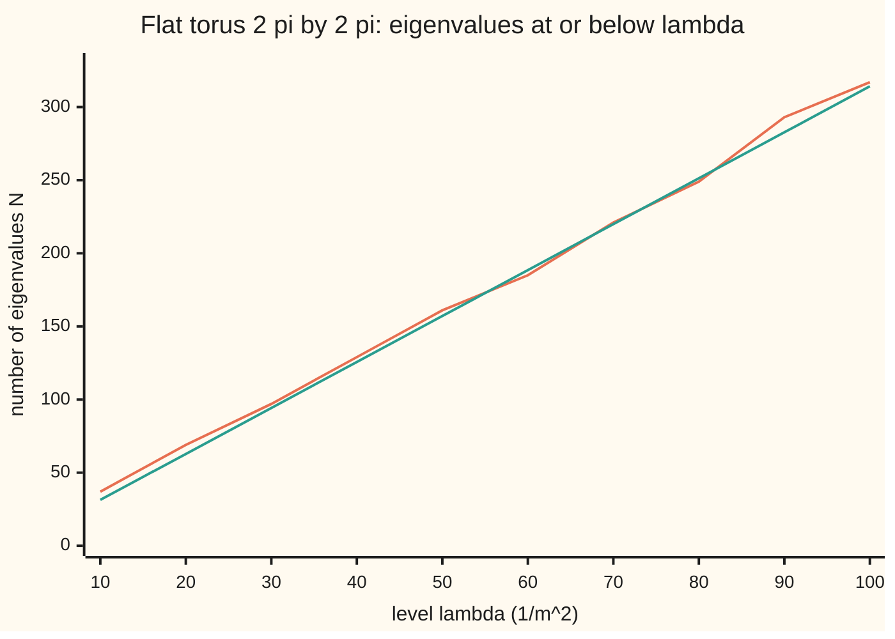

# Cheeger's inequality: a low first note forces a thin neck on a curved space

[Syllabus](../../../SYLLABUS.md) → [Differential geometry and Lie groups](../README.md) → [Riemannian Geometry](../README.md#s05) → Cheeger's inequality

---

## General Overview

Take a thin steel shell shaped like a ball of radius 1 m. Heat one side and cool the other. The imbalance fades, and its slowest pattern fades at a rate set by one number: the shell's first eigenvalue $`\lambda_1`$ (lambda one), here exactly 2 per m². It is the smallest nonzero rate at which the Laplacian (the operator that compares a value with the average of its neighbours) shrinks a pattern; the steel's heat diffusivity times $`\lambda_1`$ is the fading rate. On a drumhead the same operator's eigenvalues set the notes, each frequency in proportion to the square root of its eigenvalue ([Weyl's law](../../19-Partial%20differential%20equations/06-Weak%20Solutions%20and%20Free%20Boundaries/13-weyls-law.md)). So this card borrows the drum's word and calls $`\lambda_1`$ the **first note**. The steel shell itself rings by elasticity, a different equation, so on the shell the word is an analogy.

Now weld two such shells to the ends of a pipe 1 m long and only 0.1 m in circumference. This is a **dumbbell**. Its first note drops to 0.013970 per m². Heat must squeeze through the pipe, so an imbalance between the two bells lasts far longer. The pipe is a **thin neck**: a small cut that splits the shape into two large pieces.

That picture is the easy direction, and it leans on the pipe's length as well as its thinness. Cheeger's inequality runs the other way. It measures how thin the thinnest neck is by one number, the **Cheeger constant** $`h`$: the smallest ratio of cut size to the smaller piece's size. It proves that the first note is at least $`h^2/4`$. So a low first note forces a thin neck somewhere, and a space with no thin neck cannot have a low first note.

Before the bound, the card lists the whole spectrum (the full list of eigenvalues) of two shapes with exact answers. On a flat torus, 317 eigenvalues sit at or below 100. On the round sphere, 121 sit at or below 110. Weyl's law predicts 314.2 and 110 from the volume alone. The globe of the house example is that sphere, scaled to 6371 km, so its first note is $`2/6371^2 = 4.9274 \times 10^{-8}`$ per km²: eigenvalues shrink as the square of the size grows.

**The first nonzero eigenvalue of the Laplacian on a closed curved space is at least a quarter of the square of its Cheeger constant, so only a space with a thin neck can have a low first note; the eigenvalues as a whole pile up at a rate set by the volume alone.**

**What kind of fact this is:** Cheeger's inequality is a global theorem on closed manifolds, proved on this card in Why it works. The spectra of the torus and the sphere are theorems, proved here. Weyl's law on closed manifolds, Buser's reverse bound, the sphere's isoperimetric inequality and Milnor's sound-alike tori are theorems stated with their sources. The dumbbell's 0.013970 is computed on a mesh, at two step sizes.

### The picture: the torus count climbs along Weyl's line



Orange: the true count, by two independent counts in the checks. Green: Weyl's law, $`\pi\lambda`$. The count jumps in steps and wanders a little above and below the line, but never drifts away from it.

---

## The formula

New notation, in words first. A **closed manifold** $`M`$ is a curved space that is bounded and has no edge, like a sphere or a torus. On this card $`d`$ is its dimension, because the letter $`n`$ labels a torus mode below. The Laplacian $`\Delta_g`$ is the one from [Volume form and Laplace-Beltrami](08-volume-form-and-the-laplace-beltrami-operator.md), with wing 08's sign. Its eigenvalues are the numbers $`\lambda`$ that allow a nonzero $`f`$ with

```math
-\Delta_g f = \lambda f, \qquad 0 = \lambda_0 < \lambda_1 \le \lambda_2 \le \dots
```

**Read it aloud:** minus the Laplacian of $`f`$ is a multiple of $`f`$. The multiples climb from zero, which belongs to the constant functions.

The two exact spectra, with each eigenvalue repeated as often as it has independent patterns (its **multiplicity**):

```math
\text{torus } 2\pi \times 2\pi:\ \lambda = m^2 + n^2,\ m, n \text{ whole numbers}; \qquad \text{unit sphere}:\ \lambda = k(k+1) \text{ with multiplicity } 2k+1
```

Weyl's law on a closed manifold, with $`N(\lambda)`$ the number of eigenvalues at or below $`\lambda`$:

```math
N(\lambda) \approx \frac{\omega_d\, \mathrm{vol}(M)\, \lambda^{d/2}}{(2\pi)^d}
```

**Read it aloud:** the count grows like the volume times a power of the level, with a constant that depends only on the dimension.

The Cheeger constant and Cheeger's inequality:

```math
h(M) = \inf_{\Sigma} \frac{\mathrm{area}(\Sigma)}{\min\big(\mathrm{vol}(A),\ \mathrm{vol}(B)\big)}, \qquad \lambda_1 \ \ge\ \frac{h(M)^2}{4}
```

**Read it aloud:** over every cut that splits the space into two pieces, take the cut's size divided by the smaller piece's size; the smallest such ratio is $`h`$, and the first note is at least $`h`$ squared over four.

On the unit sphere the best cut is the equator: $`h = 2\pi / 2\pi = 1`$, and $`\lambda_1 = 2 \ge 0.25`$.

| Symbol | Plain meaning | In our example | Push it up and the answer… |
| --- | --- | --- | --- |
| $`M`$, $`d`$, $`g`$ | the closed manifold; its dimension; its metric | torus, sphere, dumbbell; $`d = 2`$ | — |
| $`\Delta_g`$, $`f`$, $`\mathrm{grad}\, f`$ | the Laplace-Beltrami operator; an eigenfunction (a pattern the operator only rescales); its gradient arrow | $`f = z`$, the height, on the sphere | — |
| $`\lambda`$, $`\lambda_1`$ | an eigenvalue, per m²; the first nonzero one, the first note | 2 sphere; 1 torus; 0.013970 dumbbell | faster fading |
| $`m`$, $`n`$; $`k`$, $`K`$ | whole-number wave counts across the torus, one per direction; degree of a sphere pattern, and the top degree counted ($`K`$ here is a degree, not shelf 02's Gaussian curvature) | $`m^2 + n^2 \le 100`$; $`K = 10`$, since $`10 \times 11 = 110`$ | higher eigenvalue |
| $`x, y, z`$, $`r`$; $`p`$, $`Y`$; $`\binom{a}{2}`$ | flat coordinates and distance from the centre; a harmonic polynomial and its sphere pattern; $`a(a-1)/2`$, the number of pairs | $`p = z`$ gives $`Y = z`$, eigenvalue 2 | — |
| $`N(\lambda)`$ | eigenvalues at or below $`\lambda`$, with multiplicity | 317 torus; 121 sphere | — |
| $`\omega_d`$, $`\mathrm{vol}(M)`$, $`dV_g`$ | volume of the unit ball in $`d`$ dimensions; the manifold's volume; the volume form | $`\omega_2 = \pi`$; $`4\pi^2`$ torus, $`4\pi`$ sphere | more eigenvalues |
| $`\Sigma`$, $`A`$, $`B`$; $`\alpha`$ | a cut (a curve on a surface) and the two pieces it leaves; a cap's angular radius | the equator and two hemispheres; caps of 30°, 60°, 90° | — |
| $`h`$ | Cheeger constant: the smallest cut-to-piece ratio | 1 sphere; 0.636620 torus; at most 0.007958 dumbbell | higher floor on $`\lambda_1`$ |
| $`c`$, $`\ell`$, $`A_b`$ | neck circumference; neck length; one bell's area | 0.1 m; 1 m; 12.565575 m² | $`c`$ up raises $`\lambda_1`$; $`\ell`$ up lowers it |
| $`\delta`$; $`E_8 \oplus E_8`$, $`D_{16}^+`$ | Ricci curvature is at least $`-(d-1)\delta^2`$; two lattices (regular grids of points) in 16 dimensions | $`\delta = 0`$ sphere and torus | Buser's ceiling rises |
| $`\Omega`$, $`u`$, $`w`$, $`t`$ | in the proof: where $`f > 0`$; $`f`$ there and 0 elsewhere; $`u^2`$; a slicing height | on the sphere, $`\Omega`$ is the top hemisphere | — |

### When it holds

- **Closed: bounded, with no edge.** Then the constants have eigenvalue 0 and $`\lambda_1`$ is the first note above them. On a region with a clamped edge, as in [Weyl's law](../../19-Partial%20differential%20equations/06-Weak%20Solutions%20and%20Free%20Boundaries/13-weyls-law.md), $`h`$ is defined without the minimum, and the same proof gives $`\lambda_1 \ge h^2/4`$ for that version.
- **Connected.** Two separate spheres have a cut of size zero, so $`h = 0`$, and indeed $`\lambda_1 = 0`$: the function that is 1 on one sphere and −1 on the other.
- **$`h`$ is the smallest ratio, not any ratio.** One cut gives only an upper bound on $`h`$. Put a 30° cap's ratio 3.732051 into the bound and it claims $`\lambda_1 \ge 3.482051`$, but $`\lambda_1 = 2`$.
- **Weyl's law is a rate, not an exact count.** It fixes the leading growth; the torus count sits 317 against 314.2, and the gap is a smaller power of $`\lambda`$.
- **Buser's reverse bound needs a curvature floor, and the floor's depth counts.** Smoothed, the dumbbell's sharp joints become tight collars of strongly negative curvature, so $`\delta`$ is large and the $`\delta = 0`$ ceiling $`\lambda_1 \le 10h^2`$ does not apply: 0.013970 against at most 0.000633.

---

## Why it works

### Step 0: the first note is a cheapest way to be uneven

The first note is the smallest **energy ratio** over all patterns with average zero. The energy ratio is $`\int |\mathrm{grad}\, f|^2 \big/ \int f^2`$, the steepness paid per unit of unevenness ([Compact and symmetric](../../18-Functional%20analysis/03-Bounded%20Operators/08-spectral-theorem-for-compact-self-adjoint-operators.md) proves that the extreme value of such a ratio is an eigenvalue).

A thin neck makes unevenness cheap. Set $`f = +1`$ on one bell and $`-1`$ on the other, and pay for steepness only along the neck. So a long, thin pipe forces a low note.

Cheeger's idea runs the other way. Start from a cheap uneven pattern. Slice it at every height. Each slice is a cut, and the co-area formula below adds up the cut sizes. If every cut were large compared with its piece, the pattern could not have been cheap.

### Step 1: the torus spectrum

On the flat torus $`2\pi \times 2\pi`$, with coordinates $`x`$ and $`y`$, the patterns $`\cos(mx + ny)`$ and $`\sin(mx + ny)`$ fit round both directions. Each has Laplacian $`-(m^2 + n^2)`$ times itself. Fourier series show these patterns build every function on the torus, so the list is complete.

The points $`(m, n)`$ and $`(-m, -n)`$ give the same cosine and opposite sines, so each pair of opposite lattice points carries one cosine and one sine: one pattern per point, with the constant at $`(0, 0)`$. So $`N(100)`$ is the number of whole-number points inside a circle of radius 10: **317**, found by the checks once pair by pair and once row by row.

### Step 2: the sphere spectrum

Take a polynomial $`p`$ in $`x, y, z`$ with every term of degree $`k`$ and flat Laplacian zero (a **harmonic** polynomial). Its values on the unit sphere form a pattern $`Y`$. [The Laplacian in round coordinates, and the modes it splits into](../../19-Partial%20differential%20equations/04-Laplace%2C%20Poisson%20and%20Potentials/07-laplacian-in-polar-and-spherical-coordinates.md) splits the flat Laplacian as $`\partial_r^2 + (2/r)\,\partial_r + \Delta_g/r^2`$, with $`\Delta_g`$ the sphere's, and derives the result below. In one line, since $`p = r^k Y`$:

```math
0 = k(k-1)\, r^{k-2} Y + 2k\, r^{k-2} Y + r^{k-2}\, \Delta_g Y \quad\Rightarrow\quad -\Delta_g Y = k(k+1)\, Y
```

**Read it aloud:** a harmonic polynomial of degree $`k`$ restricts to a sphere pattern with eigenvalue $`k`$ times $`k + 1`$.

The checks confirm 2, 6 and 12 for $`k = 1, 2, 3`$ with card 08's chart formula, by finite differences.

**Multiplicity.** Degree-$`k`$ polynomials in three letters number $`\binom{k+2}{2}`$. The flat Laplacian maps them onto degree $`k - 2`$, which number $`\binom{k}{2}`$. What is left is harmonic:

```math
\binom{k+2}{2} - \binom{k}{2} = 2k + 1
```

The checks compute that dimension by exact rank, for $`k = 0`$ to 10: 1, 3, 5, … 21. A rank shows only that the map is onto, so the checks also apply the same matrix to $`r^k`$, for even $`k`$, and get $`k(k+1)\,r^{k-2}`$, a test that a wrong operator, such as one missing the $`\partial_z^2`$ term, fails. Polynomials can approximate any function on the sphere, so these patterns are the whole list.

### Step 3: Weyl's law on the torus and the sphere

[Weyl's law](../../19-Partial%20differential%20equations/06-Weak%20Solutions%20and%20Free%20Boundaries/13-weyls-law.md) proves the count on plane regions by squares inside and around. On a closed manifold the same leading term holds (Minakshisundaram and Pleijel, in the sources); this card states it without proof and checks it twice.

- **Torus.** The 317 points fill a disc of radius $`\sqrt{\lambda}`$, area $`\pi\lambda`$, one point per unit square. Weyl: $`\omega_2 \cdot 4\pi^2 \cdot \lambda/(2\pi)^2 = \pi\lambda`$, which is 314.2 at 100. The miss is at most a few times the circle's length.
- **Sphere.** Up to degree $`K`$ the multiplicities add to $`1 + 3 + \dots + (2K+1) = (K+1)^2`$. At $`K = 10`$ that is **121**, at level $`\lambda = 110`$. Weyl: $`\pi \cdot 4\pi \cdot 110/(2\pi)^2 = 110`$. The ratio $`(K+1)^2/(K(K+1))`$ tends to 1.

### Step 4: a thin neck gives a low note

On the dumbbell, take the test pattern of Step 0, falling in a straight line along the neck. Its steepness is $`2/\ell`$ over neck area $`c\,\ell`$. By symmetry its average is zero, so

```math
\lambda_1 \ \le\ \frac{4c/\ell}{2A_b + c\,\ell/3} = 0.015895
```

**Read it aloud:** the first note is at most the neck's energy divided by the unevenness, which lives almost all on the two bells.

That is close to $`c/(2\pi\ell)`$ = 0.015915. The mesh gives the true value, 0.013970. It is lower because the true pattern is not held at exactly ±1 on the bells: it keeps sloping a little into each bell near the joint, which spreads the steepness and lowers the cost.

Cheeger, read backwards, says $`h \le 2\sqrt{\lambda_1} = 0.236388`$. The neck cut, at most 0.007958, is far below that, so the two agree.

### Step 5: Cheeger's inequality

Let $`f`$ be a first eigenfunction. Change its sign if needed so that the region where $`f > 0`$ holds at most half the volume. Let $`u`$ be $`f`$ there and 0 elsewhere, and let $`w = u^2`$.

The proof has three moves:

1. **Energy.** On $`\{f > 0\}`$, the pattern $`u`$ still has energy ratio $`\lambda_1`$, since $`u = 0`$ on that region's edge.
2. **Slicing.** The co-area formula writes $`\int |\mathrm{grad}\, w|`$ as the sum of the sizes of the level sets $`\{w = t\}`$. Each level set cuts off $`\{w > t\}`$, the smaller piece, so its size is at least $`h`$ times that piece's volume. Adding up gives $`\int |\mathrm{grad}\, w| \ge h \int u^2`$.
3. **Cauchy-Schwarz.** $`|\mathrm{grad}\, w| = 2u\, |\mathrm{grad}\, u|`$, so $`\int |\mathrm{grad}\, w| \le 2\sqrt{\int u^2 \int |\mathrm{grad}\, u|^2}`$.

Put moves 2 and 3 together, square, and divide: $`h^2/4 \le \int |\mathrm{grad}\, u|^2 / \int u^2 = \lambda_1`$.

<details>
<summary>Detailed proof: Cheeger's inequality, line by line</summary>

Let $`-\Delta_g f = \lambda_1 f`$, with $`\Omega = \{f > 0\}`$ and $`\mathrm{vol}(\Omega) \le \tfrac12 \mathrm{vol}(M)`$. Such a sign exists because $`f`$ has average zero, so both $`\{f > 0\}`$ and $`\{f < 0\}`$ are nonempty, and one of them holds at most half.

**Energy.** Multiply $`-\Delta_g f = \lambda_1 f`$ by $`u`$ and integrate over $`M`$. Integration by parts (the divergence theorem, with no edge on $`M`$) gives

$`\displaystyle \int_M |\mathrm{grad}\, u|^2 \, dV_g = \lambda_1 \int_M u^2 \, dV_g`$

because $`\mathrm{grad}\, u = \mathrm{grad}\, f`$ on $`\Omega`$ and $`\mathrm{grad}\, u = 0`$ almost everywhere outside it.

**Co-area.** For a function $`w \ge 0`$ the co-area formula reads

$`\displaystyle \int_M |\mathrm{grad}\, w| \, dV_g = \int_0^\infty \mathrm{area}(\{w = t\}) \, dt`$

For $`t > 0`$ the set $`\{w > t\}`$ lies inside $`\Omega`$, so it is the smaller piece, and the definition of $`h`$ gives $`\mathrm{area}(\{w = t\}) \ge h\, \mathrm{vol}(\{w > t\})`$. The layer-cake formula $`\int_0^\infty \mathrm{vol}(\{w > t\})\, dt = \int_M w`$ then gives

$`\displaystyle \int_M |\mathrm{grad}\, w| \, dV_g \ \ge\ h \int_M u^2 \, dV_g`$

**Cauchy-Schwarz.** Since $`\mathrm{grad}\, w = 2u\, \mathrm{grad}\, u`$,

$`\displaystyle \int_M |\mathrm{grad}\, w| \ \le\ 2 \Big(\int_M u^2\Big)^{1/2} \Big(\int_M |\mathrm{grad}\, u|^2\Big)^{1/2}`$

**Combine.** Chain the two bounds, divide by $`\big(\int u^2\big)^{1/2}`$, square, and use the energy identity:

$`\displaystyle \frac{h^2}{4} \ \le\ \frac{\int_M |\mathrm{grad}\, u|^2}{\int_M u^2} = \lambda_1`$

On the unit sphere with $`f = z`$, the checks evaluate every term by quadrature: $`\int u^2 = 2.094395`$ (which is $`2\pi/3`$), $`\int |\mathrm{grad}\, u|^2 = 4.188790`$, ratio 2.000000; $`\int |\mathrm{grad}\, w| = 4.188790`$ both directly and by the co-area integral of level-circle lengths; and the chain reads 2.094395 ≤ 4.188790 ≤ 5.923844.

</details>

### Step 6: the sphere's and the torus's Cheeger constants

**Sphere.** A cap of angular radius $`\alpha`$ has area $`2\pi(1 - \cos\alpha)`$ and rim $`2\pi\sin\alpha`$. The ratio is $`\sin\alpha/(1 - \cos\alpha) = \cot(\alpha/2)`$. It falls to 1 at the hemisphere, $`\alpha = 90°`$. The isoperimetric inequality on the sphere says caps are the best cuts for their area (Osserman, in the sources). So $`h = 1`$, and Cheeger gives $`\lambda_1 \ge 0.25`$. The truth is 2: the bound is correct but loose here.

**Torus.** Two parallel circles of length $`2\pi`$ cut the torus into two bands of area $`2\pi^2`$ each. The ratio is $`4\pi/2\pi^2 = 2/\pi = 0.636620`$. A single disc holding half the area does worse, 0.797885. On a flat torus the best cuts are circles or pairs of parallel lines (Howards, Hutchings and Morgan, in the sources), so $`h = 0.636620`$ and $`\lambda_1 = 1 \ge 0.101321`$.

### Step 7: Buser's reverse bound, stated

Peter Buser proved the matching ceiling in 1982, without proof on this card. If the Ricci curvature (from [Ricci and scalar curvature](07-ricci-and-scalar-curvature.md)) is at least $`-(d - 1)\delta^2`$, then

```math
\lambda_1 \ \le\ 2\delta(d-1)\, h + 10\, h^2
```

**Read it aloud:** with curvature not too negative, a large first note forces a large Cheeger constant.

The sphere and the torus have $`\delta = 0`$, so $`0.25 \le 2 \le 10`$ and $`0.101321 \le 1 \le 4.052847`$. Together the two bounds pin $`h`$ and $`\lambda_1`$ to each other. The proof compares small balls with model balls, the method of [Bishop-Gromov](14-bishop-gromov-volume-comparison.md).

The dumbbell has no useful $`\delta`$. In the model the pipe meets each bell at a sharp crease. Smoothed out, that crease becomes a tight saddle-shaped collar whose curvature is large and negative, and the tighter the collar, the larger $`\delta`$ must be. Its first note, 0.013970, is far above $`10h^2 \le 0.000633`$. The ceiling truly needs the curvature bound.

### Step 8: the notes do not fix the shape, stated

The list of eigenvalues determines the volume (Weyl) and bounds the necks (Cheeger and Buser). It does not determine the shape. In 1964 John Milnor gave two flat tori in 16 dimensions with the same list of eigenvalues that are not isometric (no distance-keeping map takes one onto the other). They come from two different lattices, $`E_8 \oplus E_8`$ and $`D_{16}^+`$, with the same count of points at every distance. The planar version of the question is Kac's drum problem on [Weyl's law](../../19-Partial%20differential%20equations/06-Weak%20Solutions%20and%20Free%20Boundaries/13-weyls-law.md).

---

## Worked numbers, by hand

| Step | Arithmetic | Value |
| --- | --- | --- |
| torus count | whole-number pairs with $`m^2 + n^2 \le 100`$ | 317 |
| torus Weyl | $`\pi \times 100`$ | 314.2 |
| sphere count | $`1 + 3 + \dots + 21 = 11^2`$, at $`10 \times 11 = 110`$ | 121 |
| sphere Weyl | $`\pi \cdot 4\pi \cdot 110 / (2\pi)^2`$ | 110 |
| equator cut | rim $`2\pi`$ over hemisphere $`2\pi`$ | $`h = 1`$ |
| Cheeger floor | $`1^2/4`$ | 0.25 |
| sphere first note | $`k = 1`$: $`1 \times 2`$ | **2 ≥ 0.25** |
| dumbbell neck cut | $`0.1 / 12.565575`$ | $`h \le 0.007958`$ |
| dumbbell test pattern | $`0.4 / (2 \times 12.565575 + 0.1/3)`$ | $`\lambda_1 \le 0.015895`$ |
| dumbbell mesh | 2000 and 4000 cells | **0.013969, 0.013970** |

The round sphere has no thin neck, and its first note, 2, clears Cheeger's floor of 0.25; the dumbbell's pipe drops its first note to 0.013970.

### What breaks if you drop a piece

| Mistake | Comes out at | What went wrong |
| --- | --- | --- |
| Sphere eigenvalues counted once each, without multiplicity | 11 against Weyl's 110 | each $`k(k+1)`$ has $`2k + 1`$ patterns |
| Torus counted with $`m, n \ge 0`$ only | 90 against 314.2 | each lattice point carries one pattern: $`(m, -n)`$ is a different wave, and $`(-m, -n)`$ carries the sine partner of $`(m, n)`$'s cosine |
| A 30° cap's ratio used as $`h`$ | $`\lambda_1 \ge 3.482051`$, but $`\lambda_1 = 2`$ | $`h`$ is the smallest ratio; one cut only bounds it from above |
| Buser's $`10h^2`$ ceiling on the dumbbell | at most 0.000633, but $`\lambda_1 = 0.013970`$ | the joints' collars have strongly negative curvature, so the $`\delta = 0`$ ceiling does not apply |

The code prints all four.

---

## Code, from first principles, and it actually runs

Nothing is imported except Python's `math`. The code reaches each exact answer by two roads that share no arithmetic. The torus count runs pair by pair and row by row. The sphere's multiplicities come from an exact rank of the flat Laplacian on polynomials, against $`2k + 1`$, with the matrix itself tested on $`r^k`$. Its eigenvalues come from card 08's chart formula by finite differences, against $`k(k+1)`$. A rotational mesh (one that keeps only patterns which are the same all round the axis; the lowest nonzero pattern of the sphere and of the dumbbell is of that kind), whose eigenvalues are found by Sturm counting (shift the mesh matrix down by a trial value; the number of negative pivots in its elimination equals the number of eigenvalues below that value), gives the sphere's $`\lambda_1`$ against the exact 2 at two step sizes. The proof's integrals are computed by quadrature against closed forms. The dumbbell has no exact answer: its mesh value is checked at two step sizes and against the test-pattern bound, one method rather than two roads.

### Python

```python
# Cheeger's inequality and spectral geometry -- the check behind the card.
# Standard library only.  Flat torus 2 pi by 2 pi, unit sphere, and a dumbbell:
# two unit spheres joined by a tube 1 m long and 0.1 m round.  Eigenvalues are
# counted against Weyl's law, then the first note is set against Cheeger's h.
import math
PI = math.pi

def isqrt(n):                                  # largest r with r*r <= n
    r = 0
    while (r + 1) * (r + 1) <= n:
        r += 1
    return r

def torus_brute(lam):                          # road one: every (m, n) pair
    return sum(1 for m in range(-20, 21) for n in range(-20, 21) if m * m + n * n <= lam)

def torus_rows(lam):                           # road two: one row of m at a time
    return sum(2 * isqrt(lam - m * m) + 1 for m in range(-isqrt(lam), isqrt(lam) + 1))

P = 1000000007                                 # a prime; rank mod P bounds rank over Q
def harmonic_dim(k):                           # kernel of the flat Laplacian, degree k -> k-2
    mons = lambda d: [(a, b, d - a - b) for a in range(d + 1) for b in range(d + 1 - a)]
    cols, rows = mons(k), mons(k - 2) if k >= 2 else []
    where = {m: i for i, m in enumerate(rows)}
    A = [[0] * len(cols) for _ in rows]
    for j, (a, b, c) in enumerate(cols):
        for e, (da, db, dc) in ((a, (2, 0, 0)), (b, (0, 2, 0)), (c, (0, 0, 2))):
            if e >= 2:
                A[where[(a - da, b - db, c - dc)]][j] += e * (e - 1)
    rk = lambda d: [math.factorial(d // 2) // (math.factorial(a // 2) * math.factorial(b // 2) * math.factorial(c // 2)) * (1 - (a | b | c) % 2) for a, b, c in mons(d)]
    assert k % 2 or k < 2 or [sum(u * v for u, v in zip(row, rk(k))) for row in A] == [k * (k + 1) * v for v in rk(k - 2)]  # radial road: Lap r^k = k(k+1) r^(k-2)
    rank, r = 0, 0
    for col in range(len(cols)):               # Gaussian elimination modulo P
        piv = next((i for i in range(r, len(rows)) if A[i][col] % P), None)
        if piv is None:
            continue
        A[r], A[piv] = A[piv], A[r]
        inv = pow(A[r][col], P - 2, P)
        for i in range(len(rows)):
            if i != r and A[i][col] % P:
                f = A[i][col] * inv % P
                A[i] = [(x - f * y) % P for x, y in zip(A[i], A[r])]
        r += 1
        rank += 1
    assert rank == len(rows)                   # full rank mod P forces full rank over Q
    return len(cols) - rank

def lap_ratio(k, ph=1.0, th=0.3, d=1e-4):      # card 08's chart formula, by differences
    Y = lambda p, t: math.sin(p) ** k * math.cos(k * t)
    y0 = Y(ph, th)
    dph = (math.sin(ph + d / 2) * (Y(ph + d, th) - y0) - math.sin(ph - d / 2) * (y0 - Y(ph - d, th))) / (d * d * math.sin(ph))
    dth = (Y(ph, th + d) - 2 * y0 + Y(ph, th - d)) / (d * d * math.sin(ph) ** 2)
    return (dph + dth) / y0

C = 0.1                                        # neck circumference, m
R0 = C / (2 * PI)                              # neck radius
ALPHA = math.asin(R0)
SJ, NECK = PI - ALPHA, 1.0                     # bell length along the metal; tube length
def sphere_r(s): return math.sin(s)
def bell_r(s):                                 # dumbbell profile: bell, tube, bell
    if s <= SJ: return math.sin(s)
    if s <= SJ + NECK: return R0
    return math.sin(2 * SJ + NECK - s)

def lam1_mesh(prof, length, N):                # rotational mesh, Sturm-count bisection
    h = length / N
    mass = [2 * PI * prof((i + 0.5) * h) * h for i in range(N)]
    cond = [2 * PI * prof((i + 1) * h) / h for i in range(N - 1)]
    diag = [((cond[i - 1] if i else 0) + (cond[i] if i < N - 1 else 0)) / mass[i] for i in range(N)]
    off2 = [cond[i] ** 2 / (mass[i] * mass[i + 1]) for i in range(N - 1)]
    def below(x):                              # eigenvalues under x, by Sylvester's law
        q, cnt = diag[0] - x, 0
        for i in range(N):
            if i:
                q = diag[i] - x - off2[i - 1] / (q if q != 0 else 1e-300)
            cnt += q < 0
        return cnt
    lo, hi = 0.0, 10.0
    for _ in range(60):
        mid = (lo + hi) / 2
        lo, hi = (lo, mid) if below(mid) >= 2 else (mid, hi)
    return (lo + hi) / 2

nt, wt = torus_brute(100), PI * 100
print(f"torus 2pi x 2pi: eigenvalues m^2 + n^2 <= 100: brute {nt}, by rows {torus_rows(100)}; Weyl pi x 100 = {wt:.1f}")
chart = [torus_brute(l) for l in range(10, 101, 10)]
print("chart, torus count at lambda = 10..100:", chart)
print("chart, Weyl pi x lambda:", [round(PI * l, 1) for l in range(10, 101, 10)])
mult = [harmonic_dim(k) for k in range(11)]
print(f"sphere multiplicity by exact rank, k = 0..10: {mult}")
print(f"sphere eigenvalue k(k+1), chart formula by differences, k = 1, 2, 3: " + ", ".join(f"{-lap_ratio(k):.6f}" for k in (1, 2, 3)))
ns, ws = sum(mult), PI * 4 * PI * 110 / (4 * PI * PI)
print(f"sphere: eigenvalues <= 110 with multiplicity {ns}, (K + 1)^2 = {11 ** 2}; Weyl = {ws:.1f}")
print(f"globe, radius 6371 km: lambda1 = 2/6371^2 = {2e8 / 6371 ** 2:.4f} x 1e-8 per km2")
for N in (200, 400):
    l = lam1_mesh(sphere_r, PI, N)
    print(f"sphere lambda1 on a {N}-cell mesh: {l:.6f}, error {l - 2:.6f}")
print("sphere caps, alpha deg: area, rim, rim/area")
for a in (30, 60, 90):
    t = math.radians(a)
    print(f"  {a:2d}: {2 * PI * (1 - math.cos(t)):.6f}  {2 * PI * math.sin(t):.6f}  {math.sin(t) / (1 - math.cos(t)):.6f}")
hs = min(math.sin(t) / (1 - math.cos(t)) for t in [i * PI / 2000 for i in range(1, 1001)])
print(f"sphere: h = {hs:.6f}; Cheeger h^2/4 = {hs * hs / 4:.6f} <= lambda1 = 2 <= Buser 10 h^2 = {10 * hs * hs:.6f}")
ht, hd = 4 * PI / (2 * PI * PI), 2 * math.sqrt(PI / (2 * PI * PI))
print(f"torus half-cuts: two circles {ht:.6f}, one disc {hd:.6f}; h^2/4 = {ht * ht / 4:.6f} <= 1 <= 10 h^2 = {10 * ht * ht:.6f}")
q = [(i + 0.5) * (PI / 2) / 20000 for i in range(20000)]
dq = (PI / 2) / 20000
iu2 = sum(math.cos(p) ** 2 * 2 * PI * math.sin(p) for p in q) * dq
igu = sum(math.sin(p) ** 2 * 2 * PI * math.sin(p) for p in q) * dq
igw = sum(2 * math.cos(p) * math.sin(p) * 2 * PI * math.sin(p) for p in q) * dq
coa = sum(2 * PI * math.sqrt(1 - (i + 0.5) / 20000) for i in range(20000)) / 20000
print(f"proof on the hemisphere: int u^2 {iu2:.6f} (2pi/3 {2 * PI / 3:.6f}), int |grad u|^2 {igu:.6f}, ratio {igu / iu2:.6f}")
print(f"  int |grad w| {igw:.6f}, coarea int length dt {coa:.6f}, 2 sqrt(..) {2 * math.sqrt(iu2 * igu):.6f}")
Ab = 2 * PI * (1 + math.cos(ALPHA))
LT = 2 * SJ + NECK
hn = C / Ab
ray = (4 * C / NECK) / (2 * Ab + C * NECK / 3)
lds = [lam1_mesh(bell_r, LT, N) for N in (2000, 4000)]
print(f"dumbbell: bell area {Ab:.6f}, neck cut h <= {hn:.6f}, test-function bound {ray:.6f}, C/(2pi) = {C / (2 * PI):.6f}")
print(f"dumbbell lambda1 on 2000 and 4000 cells: {lds[0]:.6f}, {lds[1]:.6f}")
print(f"  Cheeger: h <= 2 sqrt(lambda1) = {2 * math.sqrt(lds[1]):.6f}; no-curvature Buser 10 h^2 <= {10 * hn * hn:.6f} < lambda1")
print(f"mistake 1, sphere eigenvalues without multiplicity: {len(mult)} against Weyl {ws:.1f}")
print(f"mistake 2, torus with m, n >= 0 only: {sum(1 for m in range(11) for n in range(11) if m * m + n * n <= 100)} against {wt:.1f}")
c30 = math.sin(PI / 6) / (1 - math.cos(PI / 6))
print(f"mistake 3, any cut's ratio as h: 30-degree cap {c30:.6f} gives lambda1 >= {c30 * c30 / 4:.6f}, but lambda1 = 2")
assert nt == torus_rows(100) == 317 and abs(nt - wt) < 2 * math.sqrt(wt)    # two counts, Weyl
assert mult == [2 * k + 1 for k in range(11)] and ns == 121                 # rank against 2k+1
assert all(abs(-lap_ratio(k) - k * (k + 1)) < 1e-5 for k in (1, 2, 3))      # chart against k(k+1)
assert abs(lam1_mesh(sphere_r, PI, 400) - 2) < 1e-4 and abs(hs - 1) < 1e-9  # mesh against exact
assert abs(igu / iu2 - 2) < 1e-6 and abs(igw - coa) < 1e-4 and hs * iu2 <= igw <= 2 * math.sqrt(iu2 * igu)
assert lds[1] <= ray + 1e-6 and abs(lds[1] - lds[0]) < 1e-4 and 10 * hn * hn < lds[1]
print("ALL CHECKS PASS")
```

**Ran 2026-11-24 on macOS, Python 3.14.10, standard library only. All checks passed. Output, pasted from the run:**

```
torus 2pi x 2pi: eigenvalues m^2 + n^2 <= 100: brute 317, by rows 317; Weyl pi x 100 = 314.2
chart, torus count at lambda = 10..100: [37, 69, 97, 129, 161, 185, 221, 249, 293, 317]
chart, Weyl pi x lambda: [31.4, 62.8, 94.2, 125.7, 157.1, 188.5, 219.9, 251.3, 282.7, 314.2]
sphere multiplicity by exact rank, k = 0..10: [1, 3, 5, 7, 9, 11, 13, 15, 17, 19, 21]
sphere eigenvalue k(k+1), chart formula by differences, k = 1, 2, 3: 2.000000, 6.000000, 12.000000
sphere: eigenvalues <= 110 with multiplicity 121, (K + 1)^2 = 121; Weyl = 110.0
globe, radius 6371 km: lambda1 = 2/6371^2 = 4.9274 x 1e-8 per km2
sphere lambda1 on a 200-cell mesh: 1.999897, error -0.000103
sphere lambda1 on a 400-cell mesh: 1.999974, error -0.000026
sphere caps, alpha deg: area, rim, rim/area
  30: 0.841787  3.141593  3.732051
  60: 3.141593  5.441398  1.732051
  90: 6.283185  6.283185  1.000000
sphere: h = 1.000000; Cheeger h^2/4 = 0.250000 <= lambda1 = 2 <= Buser 10 h^2 = 10.000000
torus half-cuts: two circles 0.636620, one disc 0.797885; h^2/4 = 0.101321 <= 1 <= 10 h^2 = 4.052847
proof on the hemisphere: int u^2 2.094395 (2pi/3 2.094395), int |grad u|^2 4.188790, ratio 2.000000
  int |grad w| 4.188790, coarea int length dt 4.188790, 2 sqrt(..) 5.923844
dumbbell: bell area 12.565575, neck cut h <= 0.007958, test-function bound 0.015895, C/(2pi) = 0.015915
dumbbell lambda1 on 2000 and 4000 cells: 0.013969, 0.013970
  Cheeger: h <= 2 sqrt(lambda1) = 0.236388; no-curvature Buser 10 h^2 <= 0.000633 < lambda1
mistake 1, sphere eigenvalues without multiplicity: 11 against Weyl 110.0
mistake 2, torus with m, n >= 0 only: 90 against 314.2
mistake 3, any cut's ratio as h: 30-degree cap 3.732051 gives lambda1 >= 3.482051, but lambda1 = 2
ALL CHECKS PASS
```

### Rust

Same numbers, same labels, built with `rustc --edition 2021 -O`.

```rust
// Cheeger's inequality and spectral geometry -- the same check as the Python, in
// Rust.  No crates.  Flat torus 2 pi by 2 pi, unit sphere, and a dumbbell: two
// unit spheres joined by a tube 1 m long and 0.1 m round.  Eigenvalues are
// counted against Weyl's law, then the first note is set against Cheeger's h.
use std::f64::consts::PI;

fn isqrt(n: i64) -> i64 { let mut r = 0; while (r + 1) * (r + 1) <= n { r += 1 } r }   // largest r with r*r <= n

fn torus_brute(lam: i64) -> i64 {                // road one: every (m, n) pair
    let mut c = 0;
    for m in -20..=20i64 { for n in -20..=20i64 { if m * m + n * n <= lam { c += 1 } } }
    c
}

fn torus_rows(lam: i64) -> i64 {                 // road two: one row of m at a time
    (-isqrt(lam)..=isqrt(lam)).map(|m| 2 * isqrt(lam - m * m) + 1).sum()
}

const P: i64 = 1000000007;                       // a prime; rank mod P bounds rank over Q
fn modpow(mut b: i64, mut e: i64) -> i64 {
    let mut r = 1;
    b %= P;
    while e > 0 { if e & 1 == 1 { r = r * b % P } b = b * b % P; e >>= 1 }
    r
}

fn mons(d: i64) -> Vec<(i64, i64, i64)> {
    let mut v = Vec::new();
    for a in 0..=d { for b in 0..=d - a { v.push((a, b, d - a - b)) } }
    v
}

fn harmonic_dim(k: i64) -> i64 {                 // kernel of the flat Laplacian, degree k -> k-2
    let cols = mons(k);
    let rows = if k >= 2 { mons(k - 2) } else { Vec::new() };
    let mut a = vec![vec![0i64; cols.len()]; rows.len()];
    for (j, &(x, y, z)) in cols.iter().enumerate() {
        for &(e, t) in &[(x, (x - 2, y, z)), (y, (x, y - 2, z)), (z, (x, y, z - 2))] {
            if e >= 2 {
                let i = rows.iter().position(|&m| m == t).unwrap();
                a[i][j] += e * (e - 1);
            }
        }
    }
    let fact = |n: i64| (1..=n).product::<i64>();
    let rk = |d: i64| -> Vec<i64> { mons(d).iter().map(|&(x, y, z)| if (x | y | z) % 2 == 1 { 0 } else { fact(d / 2) / (fact(x / 2) * fact(y / 2) * fact(z / 2)) }).collect() };
    assert!(k % 2 == 1 || k < 2 || a.iter().map(|row| row.iter().zip(rk(k)).map(|(u, v)| u * v).sum::<i64>()).eq(rk(k - 2).into_iter().map(|v| k * (k + 1) * v))); // radial road: Lap r^k = k(k+1) r^(k-2)
    let (mut rank, mut r) = (0usize, 0usize);
    for col in 0..cols.len() {                   // Gaussian elimination modulo P
        let piv = (r..rows.len()).find(|&i| a[i][col] % P != 0);
        let piv = match piv { Some(p) => p, None => continue };
        a.swap(r, piv);
        let inv = modpow(a[r][col], P - 2);
        for i in 0..rows.len() {
            if i != r && a[i][col] % P != 0 {
                let f = a[i][col] * inv % P;
                let pr = a[r].clone();
                for c in 0..cols.len() { a[i][c] = (a[i][c] - f * pr[c]).rem_euclid(P) }
            }
        }
        r += 1;
        rank += 1;
    }
    assert!(rank == rows.len());                 // full rank mod P forces full rank over Q
    (cols.len() - rank) as i64
}

fn lap_ratio(k: i32) -> f64 {                    // card 08's chart formula, by differences
    let (ph, th, d) = (1.0f64, 0.3f64, 1e-4f64);
    let y = |p: f64, t: f64| p.sin().powi(k) * (k as f64 * t).cos();
    let y0 = y(ph, th);
    let dph = ((ph + d / 2.0).sin() * (y(ph + d, th) - y0) - (ph - d / 2.0).sin() * (y0 - y(ph - d, th))) / (d * d * ph.sin());
    let dth = (y(ph, th + d) - 2.0 * y0 + y(ph, th - d)) / (d * d * ph.sin().powi(2));
    (dph + dth) / y0
}

const C: f64 = 0.1;                              // neck circumference, m
fn r0() -> f64 { C / (2.0 * PI) }                // neck radius
fn sj() -> f64 { PI - r0().asin() }              // bell length along the metal
const NECK: f64 = 1.0;                           // tube length
fn sphere_r(s: f64) -> f64 { s.sin() }
fn bell_r(s: f64) -> f64 {                       // dumbbell profile: bell, tube, bell
    if s <= sj() { s.sin() } else if s <= sj() + NECK { r0() } else { (2.0 * sj() + NECK - s).sin() }
}

fn lam1_mesh(prof: fn(f64) -> f64, length: f64, n: usize) -> f64 {   // Sturm-count bisection
    let h = length / n as f64;
    let mass: Vec<f64> = (0..n).map(|i| 2.0 * PI * prof((i as f64 + 0.5) * h) * h).collect();
    let cond: Vec<f64> = (0..n - 1).map(|i| 2.0 * PI * prof((i as f64 + 1.0) * h) / h).collect();
    let diag: Vec<f64> = (0..n).map(|i| ((if i > 0 { cond[i - 1] } else { 0.0 }) + (if i < n - 1 { cond[i] } else { 0.0 })) / mass[i]).collect();
    let off2: Vec<f64> = (0..n - 1).map(|i| cond[i] * cond[i] / (mass[i] * mass[i + 1])).collect();
    let below = |x: f64| -> usize {              // eigenvalues under x, by Sylvester's law
        let (mut q, mut cnt) = (diag[0] - x, 0);
        for i in 0..n {
            if i > 0 { q = diag[i] - x - off2[i - 1] / (if q != 0.0 { q } else { 1e-300 }) }
            if q < 0.0 { cnt += 1 }
        }
        cnt
    };
    let (mut lo, mut hi) = (0.0f64, 10.0f64);
    for _ in 0..60 {
        let mid = (lo + hi) / 2.0;
        if below(mid) >= 2 { hi = mid } else { lo = mid }
    }
    (lo + hi) / 2.0
}

fn list1(v: &[f64]) -> String { v.iter().map(|x| format!("{:.1}", x)).collect::<Vec<_>>().join(", ") }

fn main() {
    let (nt, wt) = (torus_brute(100), PI * 100.0);
    println!("torus 2pi x 2pi: eigenvalues m^2 + n^2 <= 100: brute {}, by rows {}; Weyl pi x 100 = {:.1}", nt, torus_rows(100), wt);
    let chart: Vec<i64> = (1..=10).map(|i| torus_brute(10 * i)).collect();
    println!("chart, torus count at lambda = 10..100: {:?}", chart);
    let wl: Vec<f64> = (1..=10).map(|i| PI * (10 * i) as f64).collect();
    println!("chart, Weyl pi x lambda: [{}]", list1(&wl));
    let mult: Vec<i64> = (0..11).map(harmonic_dim).collect();
    println!("sphere multiplicity by exact rank, k = 0..10: {:?}", mult);
    let fd: Vec<String> = [1, 2, 3].iter().map(|&k| format!("{:.6}", -lap_ratio(k))).collect();
    println!("sphere eigenvalue k(k+1), chart formula by differences, k = 1, 2, 3: {}", fd.join(", "));
    let (ns, ws): (i64, f64) = (mult.iter().sum(), PI * 4.0 * PI * 110.0 / (4.0 * PI * PI));
    println!("sphere: eigenvalues <= 110 with multiplicity {}, (K + 1)^2 = {}; Weyl = {:.1}", ns, 11 * 11, ws);
    println!("globe, radius 6371 km: lambda1 = 2/6371^2 = {:.4} x 1e-8 per km2", 2e8 / (6371.0f64 * 6371.0));
    for &n in &[200usize, 400] {
        let l = lam1_mesh(sphere_r, PI, n);
        println!("sphere lambda1 on a {}-cell mesh: {:.6}, error {:.6}", n, l, l - 2.0);
    }
    println!("sphere caps, alpha deg: area, rim, rim/area");
    for &a in &[30i32, 60, 90] {
        let t = (a as f64).to_radians();
        println!("  {:2}: {:.6}  {:.6}  {:.6}", a, 2.0 * PI * (1.0 - t.cos()), 2.0 * PI * t.sin(), t.sin() / (1.0 - t.cos()));
    }
    let hs = (1..=1000).map(|i| { let t = i as f64 * PI / 2000.0; t.sin() / (1.0 - t.cos()) }).fold(f64::INFINITY, f64::min);
    println!("sphere: h = {:.6}; Cheeger h^2/4 = {:.6} <= lambda1 = 2 <= Buser 10 h^2 = {:.6}", hs, hs * hs / 4.0, 10.0 * hs * hs);
    let (ht, hd) = (4.0 * PI / (2.0 * PI * PI), 2.0 * (PI / (2.0 * PI * PI)).sqrt());
    println!("torus half-cuts: two circles {:.6}, one disc {:.6}; h^2/4 = {:.6} <= 1 <= 10 h^2 = {:.6}", ht, hd, ht * ht / 4.0, 10.0 * ht * ht);
    let dq = (PI / 2.0) / 20000.0;
    let (mut iu2, mut igu, mut igw, mut coa) = (0.0f64, 0.0f64, 0.0f64, 0.0f64);
    for i in 0..20000 {
        let p = (i as f64 + 0.5) * (PI / 2.0) / 20000.0;
        iu2 += p.cos().powi(2) * 2.0 * PI * p.sin();
        igu += p.sin().powi(2) * 2.0 * PI * p.sin();
        igw += 2.0 * p.cos() * p.sin() * 2.0 * PI * p.sin();
        coa += 2.0 * PI * (1.0 - (i as f64 + 0.5) / 20000.0).sqrt();
    }
    let (iu2, igu, igw, coa) = (iu2 * dq, igu * dq, igw * dq, coa / 20000.0);
    println!("proof on the hemisphere: int u^2 {:.6} (2pi/3 {:.6}), int |grad u|^2 {:.6}, ratio {:.6}", iu2, 2.0 * PI / 3.0, igu, igu / iu2);
    println!("  int |grad w| {:.6}, coarea int length dt {:.6}, 2 sqrt(..) {:.6}", igw, coa, 2.0 * (iu2 * igu).sqrt());
    let ab = 2.0 * PI * (1.0 + r0().asin().cos());
    let lt = 2.0 * sj() + NECK;
    let hn = C / ab;
    let ray = (4.0 * C / NECK) / (2.0 * ab + C * NECK / 3.0);
    let lds: Vec<f64> = [2000usize, 4000].iter().map(|&n| lam1_mesh(bell_r, lt, n)).collect();
    println!("dumbbell: bell area {:.6}, neck cut h <= {:.6}, test-function bound {:.6}, C/(2pi) = {:.6}", ab, hn, ray, C / (2.0 * PI));
    println!("dumbbell lambda1 on 2000 and 4000 cells: {:.6}, {:.6}", lds[0], lds[1]);
    println!("  Cheeger: h <= 2 sqrt(lambda1) = {:.6}; no-curvature Buser 10 h^2 <= {:.6} < lambda1", 2.0 * lds[1].sqrt(), 10.0 * hn * hn);
    println!("mistake 1, sphere eigenvalues without multiplicity: {} against Weyl {:.1}", mult.len(), ws);
    let quad = (0..11i64).map(|m| (0..11i64).filter(|n| m * m + n * n <= 100).count()).sum::<usize>();
    println!("mistake 2, torus with m, n >= 0 only: {} against {:.1}", quad, wt);
    let c30 = (PI / 6.0).sin() / (1.0 - (PI / 6.0).cos());
    println!("mistake 3, any cut's ratio as h: 30-degree cap {:.6} gives lambda1 >= {:.6}, but lambda1 = 2", c30, c30 * c30 / 4.0);
    assert!(nt == torus_rows(100) && nt == 317 && ((nt as f64) - wt).abs() < 2.0 * wt.sqrt());
    assert!(mult == (0..11).map(|k| 2 * k + 1).collect::<Vec<i64>>() && ns == 121);
    assert!([1, 2, 3].iter().all(|&k| (-lap_ratio(k) - (k * (k + 1)) as f64).abs() < 1e-5));
    assert!((lam1_mesh(sphere_r, PI, 400) - 2.0).abs() < 1e-4 && (hs - 1.0).abs() < 1e-9);
    assert!((igu / iu2 - 2.0).abs() < 1e-6 && (igw - coa).abs() < 1e-4 && hs * iu2 <= igw && igw <= 2.0 * (iu2 * igu).sqrt());
    assert!(lds[1] <= ray + 1e-6 && (lds[1] - lds[0]).abs() < 1e-4 && 10.0 * hn * hn < lds[1]);
    println!("ALL CHECKS PASS");
}
```

**Ran 2026-11-24 on macOS, rustc 1.98.1, no crates. All checks passed. Output, pasted from the run:**

```
torus 2pi x 2pi: eigenvalues m^2 + n^2 <= 100: brute 317, by rows 317; Weyl pi x 100 = 314.2
chart, torus count at lambda = 10..100: [37, 69, 97, 129, 161, 185, 221, 249, 293, 317]
chart, Weyl pi x lambda: [31.4, 62.8, 94.2, 125.7, 157.1, 188.5, 219.9, 251.3, 282.7, 314.2]
sphere multiplicity by exact rank, k = 0..10: [1, 3, 5, 7, 9, 11, 13, 15, 17, 19, 21]
sphere eigenvalue k(k+1), chart formula by differences, k = 1, 2, 3: 2.000000, 6.000000, 12.000000
sphere: eigenvalues <= 110 with multiplicity 121, (K + 1)^2 = 121; Weyl = 110.0
globe, radius 6371 km: lambda1 = 2/6371^2 = 4.9274 x 1e-8 per km2
sphere lambda1 on a 200-cell mesh: 1.999897, error -0.000103
sphere lambda1 on a 400-cell mesh: 1.999974, error -0.000026
sphere caps, alpha deg: area, rim, rim/area
  30: 0.841787  3.141593  3.732051
  60: 3.141593  5.441398  1.732051
  90: 6.283185  6.283185  1.000000
sphere: h = 1.000000; Cheeger h^2/4 = 0.250000 <= lambda1 = 2 <= Buser 10 h^2 = 10.000000
torus half-cuts: two circles 0.636620, one disc 0.797885; h^2/4 = 0.101321 <= 1 <= 10 h^2 = 4.052847
proof on the hemisphere: int u^2 2.094395 (2pi/3 2.094395), int |grad u|^2 4.188790, ratio 2.000000
  int |grad w| 4.188790, coarea int length dt 4.188790, 2 sqrt(..) 5.923844
dumbbell: bell area 12.565575, neck cut h <= 0.007958, test-function bound 0.015895, C/(2pi) = 0.015915
dumbbell lambda1 on 2000 and 4000 cells: 0.013969, 0.013970
  Cheeger: h <= 2 sqrt(lambda1) = 0.236388; no-curvature Buser 10 h^2 <= 0.000633 < lambda1
mistake 1, sphere eigenvalues without multiplicity: 11 against Weyl 110.0
mistake 2, torus with m, n >= 0 only: 90 against 314.2
mistake 3, any cut's ratio as h: 30-degree cap 3.732051 gives lambda1 >= 3.482051, but lambda1 = 2
ALL CHECKS PASS
```

The two outputs match line for line.

### Lean

Lean proves the card's exact counts on the torus and the sphere, Weyl's sphere prediction, and the last step of Cheeger's proof.

- Take any top degree $`K`$. Then the sphere's eigenvalues at or below $`K(K+1)`$, counted with multiplicity, number $`(K+1)^2`$.
- Take the level $`K(K+1)`$. Then Weyl's prediction $`\pi \cdot 4\pi \cdot K(K+1)/(2\pi)^2`$ is exactly $`K(K+1)`$.
- Take any degree $`k`$. Then $`\binom{k+2}{2} - \binom{k}{2} = 2k + 1`$, the multiplicity count of Step 2.
- Suppose the three moves of Step 5 hold, with $`\int u^2 > 0`$ and $`h \ge 0`$. Then $`\lambda_1 \ge h^2/4`$.
- Take the flat torus. Then exactly 317 whole-number pairs have $`m^2 + n^2 \le 100`$, and all ten chart counts match.
- The sphere's count at level 110 is 121, and the sphere's first note, 2, clears the equator cut's floor of 0.25.
- The first two mistakes come out as the card says: 11 distinct sphere eigenvalues, and 90 torus points in one quarter of the lattice.

Lean takes both spectra as given; the meshes, integrals, caps and dumbbell are left to the Python and Rust checks.

```lean
-- Cheeger's inequality: this file proves the card's exact whole-number spectral counts (the unit sphere's eigenvalue count against Weyl's law, the multiplicity 2k + 1, the torus count 317) and the closing algebra of Cheeger's proof that turns the co-area and Cauchy-Schwarz bounds into λ₁ ≥ h²/4.
import Mathlib.Analysis.SpecialFunctions.Pow.Real
import Mathlib.Analysis.SpecialFunctions.Trigonometric.Basic
import Mathlib.Algebra.BigOperators.Intervals
import Mathlib.Data.Int.Interval

open Finset

/-- Weyl's law is exact at the top of each level on the unit sphere. The sphere's eigenvalues
are k(k + 1), each repeated 2k + 1 times. At the level λ = K(K + 1), the number of eigenvalues
at or below λ, counted with multiplicity, is (K + 1)², and Weyl's prediction
ω₂ · vol(S²) · λ / (2π)² = π · 4π · K(K + 1) / (2π)² is exactly K(K + 1).
(Every degree k with k(k + 1) ≤ λ is at most λ, so summing over k ≤ λ misses none.) -/
theorem sphere_eigenvalue_count_and_weyl (K : ℕ) :
    (∑ k ∈ (range (K * (K + 1) + 1)).filter (fun k => k * (k + 1) ≤ K * (K + 1)), (2 * k + 1))
        = (K + 1) ^ 2 ∧
      Real.pi * (4 * Real.pi) * ((K : ℝ) * (K + 1)) / (2 * Real.pi) ^ 2 = (K : ℝ) * (K + 1) := by
  have hf : (range (K * (K + 1) + 1)).filter (fun k => k * (k + 1) ≤ K * (K + 1))
      = range (K + 1) := by
    ext k
    simp only [mem_filter, mem_range]
    constructor
    · rintro ⟨_, h⟩
      by_contra hk
      replace hk := Nat.lt_of_not_le hk
      have : (K + 1) * (K + 2) ≤ k * (k + 1) := Nat.mul_le_mul (by omega) (by omega)
      nlinarith
    · intro hk
      refine ⟨?_, Nat.mul_le_mul (by omega) (by omega)⟩
      nlinarith
  refine ⟨?_, ?_⟩
  · rw [hf]
    clear hf
    induction K with
    | zero => simp
    | succ n ih => rw [sum_range_succ, ih]; ring
  · have hpi : Real.pi ≠ 0 := Real.pi_ne_zero
    field_simp
    ring

/-- The multiplicity of the sphere eigenvalue k(k + 1). Degree-k polynomials in x, y, z number
C(k + 2, 2); the flat Laplacian maps them onto degree k − 2, which number C(k, 2); what is left,
the harmonic ones, number C(k + 2, 2) − C(k, 2) = 2k + 1. -/
theorem sphere_multiplicity_count (k : ℕ) :
    ((k + 2).choose 2 : ℤ) - (k.choose 2 : ℤ) = 2 * k + 1 := by
  simp [Nat.choose_succ_succ]
  ring

/-- The last step of Cheeger's proof. Write a = ∫ u² > 0, E = ∫ |grad u|² ≥ 0 and
G = ∫ |grad w| for w = u². If the energy identity E = λ₁ a holds, the co-area bound gives
h a ≤ G with h ≥ 0, and Cauchy-Schwarz gives G ≤ 2 √(a E), then λ₁ ≥ h² / 4. -/
theorem cheeger_bound_from_coarea_and_cauchy_schwarz {a E G h lam : ℝ}
    (ha : 0 < a) (hE : 0 ≤ E) (hh : 0 ≤ h)
    (henergy : E = lam * a) (hcoarea : h * a ≤ G) (hcs : G ≤ 2 * Real.sqrt (a * E)) :
    h ^ 2 / 4 ≤ lam := by
  have hlam : 0 ≤ lam := by
    by_contra hneg
    replace hneg := lt_of_not_ge hneg
    nlinarith
  have h1 : h * a ≤ 2 * Real.sqrt (a * E) := le_trans hcoarea hcs
  have hpos : 0 ≤ h * a := by positivity
  have hsq := Real.sq_sqrt (show 0 ≤ a * E by positivity)
  have h2 : (h * a) ^ 2 ≤ 4 * (a * E) := by
    have := pow_le_pow_left₀ hpos h1 2
    rw [mul_pow, mul_pow, hsq] at this
    linarith
  subst henergy
  have ha2 : 0 < a ^ 2 := by positivity
  by_contra hc
  replace hc := lt_of_not_ge hc
  nlinarith

-- Torus 2π × 2π: the whole-number points (m, n) with m² + n² ≤ 100 number 317.
set_option maxRecDepth 100000 in
example : ((Icc (-10 : ℤ) 10 ×ˢ Icc (-10 : ℤ) 10).filter
    (fun p => p.1 ^ 2 + p.2 ^ 2 ≤ 100)).card = 317 := by decide

-- The chart: the torus count at λ = 10, 20, ..., 100.
example : (List.range 10).map (fun i => ((Icc (-10 : ℤ) 10 ×ˢ Icc (-10 : ℤ) 10).filter
    (fun p => p.1 ^ 2 + p.2 ^ 2 ≤ 10 * ((i : ℤ) + 1))).card)
      = [37, 69, 97, 129, 161, 185, 221, 249, 293, 317] := by decide +kernel

-- Mistake 2: counting the torus with m, n ≥ 0 only gives 90.
example : ((range 11 ×ˢ range 11).filter
    (fun p : ℕ × ℕ => p.1 ^ 2 + p.2 ^ 2 ≤ 100)).card = 90 := by decide

-- Sphere: K = 10 gives level 10 × 11 = 110 and count 1 + 3 + ... + 21 = 121.
example : 10 * 11 = 110 := by norm_num
example : ∑ k ∈ (range 111).filter (fun k => k * (k + 1) ≤ 110), (2 * k + 1) = 121 := by decide
example : (List.range 11).map (fun k => 2 * k + 1) = [1, 3, 5, 7, 9, 11, 13, 15, 17, 19, 21] := by
  decide

-- Mistake 1: the sphere's distinct eigenvalues at or below 110 number only 11.
example : ((range 111).filter (fun k => k * (k + 1) ≤ 110)).card = 11 := by decide

-- Equator cut: h = 2π / 2π = 1, and the first note 2 = 1 × 2 clears the floor 1² / 4.
example : (1 : ℚ) ^ 2 / 4 ≤ 1 * 2 := by norm_num

#print axioms sphere_eigenvalue_count_and_weyl
#print axioms sphere_multiplicity_count
#print axioms cheeger_bound_from_coarea_and_cauchy_schwarz
```

**Checked 2026-11-24 on macOS, Lean 4.36.0-rc2, Mathlib v4.36.0-rc2. Every proof is complete and uses only Lean's standard axioms. Output, pasted from the run:**

```
'sphere_eigenvalue_count_and_weyl' depends on axioms: [propext, Classical.choice, Quot.sound]
'sphere_multiplicity_count' depends on axioms: [propext]
'cheeger_bound_from_coarea_and_cauchy_schwarz' depends on axioms: [propext, Classical.choice, Quot.sound]
```

> [!TIP]
> **Try changing**
> Guess first, then run it.
> - **A wider neck.** Set `C = 0.2`. Guess: does the first note double? The test-pattern bound nearly does, 0.031755, but the mesh gives 0.025784: the bending near each joint matters more for a wider neck.
> - **A longer neck.** Set `NECK` to `2.0`. The mesh first note falls from 0.013970 to 0.007427, a little more than half, because the joints do not lengthen.
> - **A higher torus level.** Change both 100s in the torus line to 400. Guess the count before running: it is 1257, against Weyl's 1256.6; the first assert then stops the run, since it is pinned to 317.
> - **A coarser sphere mesh.** Change `(200, 400)` to `(100, 200)`. The error at 100 cells is 0.000411, four times the 0.000103 at 200: the mesh error shrinks as the square of the step.

---

## The usual mistake

> [!warning]
> **Putting any cut's ratio into Cheeger's bound.** The bound uses $`h`$, the smallest ratio over every cut. A cut you happen to draw gives an upper bound on $`h`$, which says nothing below $`\lambda_1`$. A 30° cap on the unit sphere has ratio 3.732051; used as $`h`$ it claims $`\lambda_1 \ge 3.482051`$, yet $`\lambda_1 = 2`$.
>
> - **Forgetting multiplicity.** The sphere has 11 distinct eigenvalues up to 110 but 121 counted properly; Weyl's 110 matches the second.
> - **Counting only one quarter of the torus lattice.** With $`m, n \ge 0`$ the count is 90, not 317.
> - **Reading Cheeger as a two-way bound.** On the sphere $`\lambda_1 = 2`$ sits far above the floor 0.25. A ceiling needs Buser's curvature hypothesis, and the dumbbell breaks it: 0.013970 against $`10h^2 \le 0.000633`$.
> - **Treating 0 as the first note.** On a closed manifold the constants always have eigenvalue 0; $`\lambda_1`$ is the first one above it.

---

## Where you meet it in real life

- **Splitting networks.** The graph version, from [The graph Laplacian](../../14-Applied%20and%20computational/07-Network%20Science%20and%20Spectral%20Graphs/03-graph-laplacian-and-spectral-clustering.md), bounds the best cut by the second eigenvalue. Spectral clustering in data analysis rests on it.
- **Heat and diffusion on the globe.** Climate models expand fields in sphere patterns. Keeping every degree up to $`K`$ keeps $`(K+1)^2`$ patterns, the count of Step 3.
- **Shape recognition.** A surface's eigenvalue list does not change when the surface bends without stretching, so it serves as a fingerprint for 3D scans. Milnor's tori show that the fingerprint can match for two different shapes.
- **Mixing of random motion.** A particle wandering on a surface forgets its start at a rate set by $`\lambda_1`$. Cheeger's inequality says a space with no bottleneck mixes fast.

> **Say it back**
> The eigenvalues of the Laplacian on a closed space are its notes, and their count up to a level grows with the volume: 317 against 314.2 on the torus, 121 against 110 on the sphere. The first note above zero is the cheapest way to make a pattern uneven. Cheeger's constant measures the thinnest neck, the smallest cut-to-piece ratio. Slicing the first pattern at every height proves the note is at least that constant squared over four. Buser's reverse bound needs curvature bounded below, and a dumbbell with a thin pipe shows why.

---

## What this builds on

- [Volume form and Laplace-Beltrami](08-volume-form-and-the-laplace-beltrami-operator.md): $`dV_g`$, $`\Delta_g`$ and its sign, and the chart formula the checks use on the sphere.
- [Bishop-Gromov](14-bishop-gromov-volume-comparison.md): ball volumes compared with a model space, the tool behind Buser's ceiling.
- [Helmholtz](../../19-Partial%20differential%20equations/04-Laplace%2C%20Poisson%20and%20Potentials/08-helmholtz-and-eigenfunctions.md): eigenvalues as the modes of a region, and the energy ratio of Step 0.
- [Weyl's law](../../19-Partial%20differential%20equations/06-Weak%20Solutions%20and%20Free%20Boundaries/13-weyls-law.md): the count proved on plane regions; this card checks it on closed manifolds.
- [The graph Laplacian](../../14-Applied%20and%20computational/07-Network%20Science%20and%20Spectral%20Graphs/03-graph-laplacian-and-spectral-clustering.md): the same cut-against-eigenvalue story on a network, where that card left Cheeger's inequality open.
- [Compact and symmetric](../../18-Functional%20analysis/03-Bounded%20Operators/08-spectral-theorem-for-compact-self-adjoint-operators.md): why the eigenvalues form a list with a basis of patterns, and why the first is a minimum of a ratio.

Siblings used along the way: [Ricci and scalar curvature](07-ricci-and-scalar-curvature.md) for the Ricci bound in Buser's theorem; [Sphere, plane and hyperbolic space](05-model-spaces-of-constant-curvature.md) for the round sphere.

## Where this goes next

- [Ricci flow](../07-Geometric%20Analysis%20and%20Physics/01-ricci-flow-and-the-poincare-proof-in-outline.md): the metric itself evolves, and Perelman's monotone quantity is the lowest eigenvalue of an operator built from $`\Delta_g`$ and the scalar curvature.
- Global Analysis (planned): the heat kernel, which packs the whole eigenvalue list into one function and proves Weyl's law on closed manifolds.

The question this card leaves open: Cheeger and Buser tie the first note to the thinnest neck, but what single geometric quantity pins down the second, third and later notes?

---

## Sources

Verified 2026-11-24: every link below resolves to the publisher's page.

- Minakshisundaram, S., and Å. Pleijel. "Some Properties of the Eigenfunctions of the Laplace-Operator on Riemannian Manifolds." *Canadian Journal of Mathematics* 1, no. 3 (1949): 242–256. [doi:10.4153/CJM-1949-021-5](https://doi.org/10.4153/CJM-1949-021-5). Weyl's law on a closed manifold, the count stated in Step 3.
- Buser, Peter. "A Note on the Isoperimetric Constant." *Annales scientifiques de l'École normale supérieure* (4) 15 (1982): 213–230. [doi:10.24033/asens.1426](https://doi.org/10.24033/asens.1426). The reverse bound $`\lambda_1 \le 2\delta(d-1)h + 10h^2`$ under a Ricci lower bound, Step 7.
- Milnor, John. "Eigenvalues of the Laplace Operator on Certain Manifolds." *Proceedings of the National Academy of Sciences* 51, no. 4 (1964): 542. [doi:10.1073/pnas.51.4.542](https://doi.org/10.1073/pnas.51.4.542). Two 16-dimensional flat tori with one spectrum, Step 8.
- Osserman, Robert. "The Isoperimetric Inequality." *Bulletin of the American Mathematical Society* 84, no. 6 (1978): 1182–1238. [doi:10.1090/S0002-9904-1978-14553-4](https://doi.org/10.1090/S0002-9904-1978-14553-4). The isoperimetric inequality on the sphere, which makes the equator the best cut, Step 6.
- Howards, Hugh, Michael Hutchings, and Frank Morgan. "The Isoperimetric Problem on Surfaces." *The American Mathematical Monthly* 106, no. 5 (1999): 430–439. [doi:10.1080/00029890.1999.12005065](https://doi.org/10.1080/00029890.1999.12005065). Best cuts on the flat torus are circles or pairs of parallel lines, Step 6.
