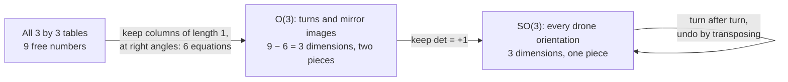
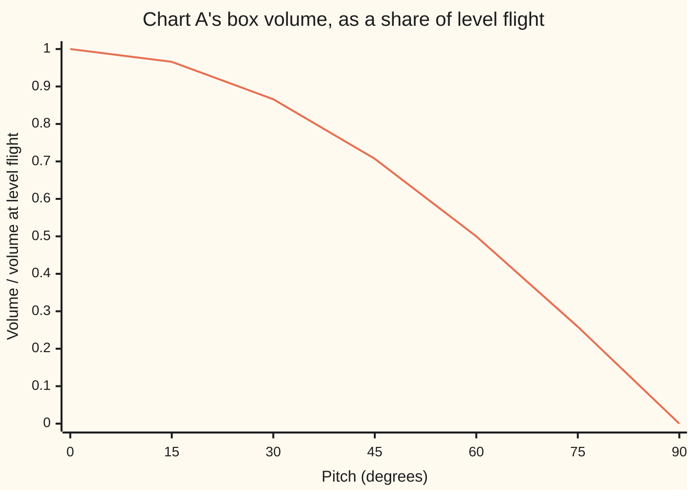

# Lie group: a group that is also a smooth manifold

[Syllabus](../../../SYLLABUS.md) → [Differential geometry and Lie groups](../README.md) → [Lie Groups](../README.md#s06) → Lie group

---

## General Overview

A camera drone hovers over a field. Its flight controller holds its orientation as nine numbers in a 3 by 3 table. The three columns say where the drone's nose, right wing and belly point, each written as north, east and down parts.

Right now the drone heads 30° clockwise from north, its nose is pitched 10° up, and its right wing is rolled 5° down. The nose column reads 0.8529 north, 0.4924 east, −0.1736 down. The minus sign means the nose points a little up.

Two facts about the set of all such orientations make it special.

- **It is a group.** Turn, then turn again, and the result is one turn. Every turn can be undone. The gimbal under the drone tilts the camera 30° down from the nose, and the camera's orientation is the two turns combined into one.
- **It is a smooth shape.** Nine numbers are stored, but they are tied together. Near any orientation, three numbers are enough to move the drone freely and smoothly. Yaw, pitch and roll do this everywhere except at pitch ±90°. The set is a curved 3-dimensional space sitting inside the flat 9-dimensional space of all 3 by 3 tables.

A set that is both, with turning and undoing done smoothly, is a **Lie group** (said "lee", after Sophus Lie, who studied continuous symmetry from the 1870s). This card checks that the drone's orientations form one, and finds its dimension: 3.

**A Lie group is a group whose members also form a smooth curved space, a manifold, so that combining two members and undoing one are smooth operations; the drone's orientations are one, of dimension 9 − 6 = 3.**

**What kind of fact this is:** the Lie group is a definition. That the turns of space form a Lie group of dimension 3 is a theorem, proved on this card in Why it works, with one step, the regular value theorem, used here and proved on its own card ([Regular value theorem](../03-Manifolds/06-submanifolds-and-the-regular-value-theorem.md)).

### The picture: nine numbers, six ties, three free



The loop on the right is the group: combining two orientations never leaves the set.

---

## The formula

Notation first, in words. A **matrix** is a table of numbers with a size ([Matrices](../../03-Algebra/04-Matrices/01-matrices-and-the-matrix-zoo.md)). $`R^{T}`$ is the transpose of $`R`$: rows become columns. $`I`$ is the identity matrix, 1s on the diagonal and 0s elsewhere. $`\det R`$ is the determinant: the factor by which $`R`$ scales volume, with a minus sign if it mirrors ([Determinants](../../03-Algebra/05-Solving%20Systems/04-determinants.md)). $`\mathbb{R}^{3\times 3}`$ is the set of all 3 by 3 tables of real numbers.

The rotation group, also called the special orthogonal group, is

```math
SO(3) = \{\, R \in \mathbb{R}^{3\times 3} : R^{T}R = I,\ \det R = +1 \,\}
```

**Read it aloud:** the turns of space are the 3 by 3 tables whose columns have length 1, meet at right angles, and keep left-handed and right-handed apart.

A **Lie group** $`G`$ is a group that is also a smooth manifold, where the two maps

```math
(a, b) \mapsto a\,b \qquad\text{and}\qquad a \mapsto a^{-1}
```

are smooth. A **smooth manifold** is a set where every point has a neighborhood described by a few real coordinates, called a **chart**, and where two charts overlap the change from one to the other has derivatives of every order. The number of coordinates is the **dimension**, written $`\dim`$. The card that builds manifolds in full is [Smooth manifold](../03-Manifolds/01-smooth-manifolds-and-charts.md).

The dimension of the rotation group is a count:

```math
\dim SO(n) = n^2 - \frac{n(n+1)}{2} = \frac{n(n-1)}{2}, \qquad \dim SO(3) = 9 - 6 = 3
```

**Read it aloud:** start with all $`n^2`$ entries, take away one for each different equation in $`R^{T}R = I`$, and what is left is the number of free directions.

| Symbol | Plain meaning | In our example | Push it up and the answer… |
| --- | --- | --- | --- |
| $`R`$, $`R_0`$, $`R_g`$, $`A`$, $`B`$ | a rotation matrix; its columns are where nose, right wing and belly point, in north, east, down | $`R_0`$ the drone, $`R_g`$ the gimbal's 30° tilt; $`A`$, $`B`$ any two turns | — |
| $`R^{T}`$ | the transpose: rows swapped with columns | undoes $`R_0`$ | — |
| $`I`$ | the identity matrix: the turn that does nothing | the drone level, nose north | — |
| $`\det R`$ | the determinant: volume scale, with sign | +1 for every turn | −1 is a mirror image |
| $`SO(3)`$, $`O(3)`$ | turns; turns together with mirror images | every drone orientation; plus mirrored ones | — |
| $`G`$ | any Lie group | $`SO(3)`$ | — |
| $`n`$, $`\mathbb{R}^{n\times n}`$; $`N`$, $`k`$ | the matrix size; all $`n`$ by $`n`$ tables; numbers stored, and equations tying them | 3; 9 numbers; $`N = 9`$, $`k = 6`$ | dimension grows as $`n(n-1)/2`$; it is $`N - k`$ |
| $`\dim`$ | the number of coordinates a chart needs | 3 | — |
| $`H`$, $`S`$ | a small change to a matrix, a direction to move in; a symmetric matrix the derivative must reach | one of 9 directions in $`\mathbb{R}^{3\times 3}`$; 6 free entries | — |
| $`K`$ | a skew matrix: $`K^{T} = -K`$, 3 free entries | the directions that stay inside $`SO(3)`$ | — |
| $`\psi`$, $`\theta`$, $`\phi`$; $`R_z`$, $`R_y`$, $`R_x`$ | yaw, pitch, roll: chart A's coordinates; the single turns about the down, right-wing and nose axes | 30°, 10°, 5° | pitch 90° breaks the chart |
| $`GL`$, $`U`$, $`SU`$, $`U^{*}`$ | the other matrix groups, in the table below; the conjugate transpose | — | — |

On this card $`\theta`$ and $`\phi`$ are pitch and roll, the aircraft names. Elsewhere in this wing they are the globe's angles. Here $`H`$ and $`K`$ are matrices; elsewhere in this wing they are mean and Gaussian curvature.

### The matrix groups

Most Lie groups met in practice are groups of matrices. Here $`U^{*}`$ is the conjugate transpose of a complex matrix: transpose it and flip the sign of every imaginary part.

| Group | Condition | Dimension | At n = 3 |
| --- | --- | --- | --- |
| $`GL(n,\mathbb{R})`$, general linear | $`\det A \neq 0`$ | $`n^2`$ | 9 |
| $`O(n)`$, orthogonal | $`R^{T}R = I`$ | $`n(n-1)/2`$ | 3 |
| $`SO(n)`$, special orthogonal | $`R^{T}R = I`$, $`\det R = 1`$ | $`n(n-1)/2`$ | 3 |
| $`U(n)`$, unitary | complex, $`U^{*}U = I`$ | $`n^2`$ | 9 |
| $`SU(n)`$, special unitary | $`U^{*}U = I`$, $`\det U = 1`$ | $`n^2 - 1`$ | 8 |

$`GL(n,\mathbb{R})`$ is the easy case. The tables with nonzero determinant fill an open region of the flat $`n^2`$-number space, so its charts are the entries themselves. $`O(n)`$ and $`SO(n)`$ are closed subgroups of it. $`U(n)`$ and $`SU(n)`$ are closed subgroups of $`GL(2n,\mathbb{R})`$, once each complex entry is written as two real numbers.

### When it holds

- **The equations must be independent at every point.** If the derivative of the constraint lost rank somewhere, the set could have a corner or a crossing there. For $`SO(3)`$ it never does; the code tests 1,000 random orientations.
- **Count different equations, not written ones.** $`R^{T}R = I`$ has 9 entries but only 6 different equations, because $`R^{T}R`$ is symmetric. Counting 9 gives dimension 0, a false answer.
- **Group operations must be smooth too.** A group that is a manifold with a jumpy multiplication is not a Lie group. For matrices, entries of a product are sums of products, so this holds for free.
- **A chart is local.** Yaw, pitch and roll work near the drone's orientation but fail at pitch 90°. That is a fault of the chart, not of the group. The result is global: every point of $`SO(3)`$ has a good chart.
- **Mirror images are not turns.** Dropping $`\det R = +1`$ gives $`O(3)`$, which has the same dimension but two separate pieces.

---

## Why it works

### Step 0: a set cut out by independent equations is smooth

Take the surface of a ball: three numbers $`x`$, $`y`$, $`z`$ (north, east, down) locate a point, and one equation, $`x^2 + y^2 + z^2 = 1`$, ties them. The equation's gradient is never zero there, so the surface is smooth, with 3 − 1 = 2 free numbers.

The same holds in any size. Take $`N`$ numbers tied by $`k`$ equations. If the $`k`$ equations pull in independent directions at every solution, the solutions form a smooth manifold of dimension $`N - k`$. In symbols, the derivative of the equations, a $`k`$ by $`N`$ matrix, must have rank $`k`$ (rank: the number of independent rows).

This is the regular value theorem ([Regular value theorem](../03-Manifolds/06-submanifolds-and-the-regular-value-theorem.md)). It is a direct use of the implicit function theorem, which solves the equations for $`k`$ of the numbers in terms of the other $`N - k`$ ([Inverse and implicit function theorems](../../06-Calculus%20and%20analysis/07-Several%20Variables/07-inverse-and-implicit-function-theorems.md)). Those $`N - k`$ numbers are the chart.

For the drone, $`N = 9`$ entries. The rest of the proof finds $`k`$ and checks independence.

### Step 1: the turns form a group

A group is a collection with one operation that stays inside, can be bracketed either way, has a do-nothing member, and lets every member be undone ([Groups](../../03-Algebra/08-Groups/01-groups.md)). The operation here is matrix multiplication: do $`B`$, then $`A`$.

- **Closed.** If $`A^{T}A = I`$ and $`B^{T}B = I`$, then $`(AB)^{T}(AB) = B^{T}A^{T}AB = B^{T}B = I`$. Determinants multiply, so $`\det(AB) = 1 \times 1 = 1`$.
- **Brackets.** Matrix multiplication is associative.
- **Do nothing.** $`I`$ passes both tests.
- **Undo.** $`R^{T}R = I`$ says $`R^{T}`$ undoes $`R`$, and $`R^{T}`$ is itself a turn.

The camera shows it at work. The gimbal's tilt $`R_g`$ is a turn of 30° nose-down about the right wing. The camera's orientation is $`R_0 R_g`$: first $`R_g`$ tilts the camera inside the drone's own frame, then $`R_0`$ carries that frame to north, east and down. The code finds it passes both tests. Its optical axis points 19.8858° below the horizon at heading 27.3439°. The 5° roll is why the heading is not exactly 30°.

### Step 2: six different equations, not nine

The entry in row $`i`$, column $`j`$ of $`R^{T}R`$ is the dot product of column $`i`$ with column $`j`$. So $`R^{T}R = I`$ says:

- three equations, "each column has length 1";
- three equations, "each pair of columns meets at a right angle".

The other three entries repeat these: column 2 dotted with column 1 is column 1 dotted with column 2. So $`k = 6`$, and the count gives 9 − 6 = 3.

### Step 3: the six equations are independent everywhere

Move $`R`$ a small amount $`H`$. Then

```math
(R + H)^{T}(R + H) = I + \left(H^{T}R + R^{T}H\right) + H^{T}H
```

The bracket is the derivative of the constraint at $`R`$ in the direction $`H`$. It is always a symmetric matrix, and symmetric 3 by 3 matrices have 6 free entries. The derivative has rank 6 if it can reach every symmetric matrix $`S`$.

It can. Choose $`H = \tfrac{1}{2}RS`$. Then $`H^{T}R + R^{T}H = \tfrac{1}{2}S R^{T}R + \tfrac{1}{2}R^{T}RS = S`$. This works at every $`R`$ with $`R^{T}R = I`$, so Step 0 applies at every point: $`O(3)`$ is a smooth manifold of dimension 3.

The directions that stay inside are those with $`H^{T}R + R^{T}H = 0`$. Write $`H = RK`$; the condition becomes $`K^{T} + K = 0`$. So the allowed directions at $`R`$ are $`R`$ times a skew matrix, and a skew 3 by 3 matrix has 3 free entries above its zero diagonal. Three free directions, again.

<details>
<summary>Detailed proof: the skew directions are exactly the kernel</summary>

If $`H = RK`$ with $`K^{T} = -K`$, then $`H^{T}R + R^{T}H = K^{T}R^{T}R + R^{T}RK = K^{T} + K = 0`$.

Conversely, any $`H`$ can be written $`H = RK`$ with $`K = R^{T}H`$, since $`RR^{T} = I`$. Then $`H^{T}R + R^{T}H = K^{T} + K`$, and this is zero exactly when $`K`$ is skew.

So the kernel of the derivative, the set of directions it sends to zero, is the 3-dimensional space $`\{RK : K^{T} = -K\}`$. The rank-nullity count agrees: 9 directions in, rank 6, kernel 3.

</details>

The set of allowed directions at the identity, the skew matrices, gets its own card: [Lie algebra](02-lie-algebras-and-the-exponential-map.md).

### Step 4: the determinant splits off the turns

On $`O(3)`$ the determinant is $`+1`$ or $`-1`$, since $`\det(R^{T})\det(R) = \det I = 1`$. The determinant is a polynomial in the entries, so it changes continuously. Moving smoothly through $`O(3)`$, it cannot jump from $`+1`$ to $`-1`$.

So $`O(3)`$ falls into at least two pieces with nothing between them. The mirror table with diagonal 1, 1, −1 passes $`R^{T}R = I`$ exactly but has determinant −1: no amount of turning reaches it.

$`SO(3)`$ itself is one piece. Every turn is one turn by some angle about one axis ([Rotation group](04-rotations-so3-and-quaternions.md) proves the axis exists). Shrinking that angle steadily to 0 slides the turn to $`I`$ without leaving $`SO(3)`$. So $`O(3)`$ has exactly two pieces: $`SO(3)`$, the piece holding $`I`$, and its mirror image. Each piece is open in $`O(3)`$, so $`SO(3)`$ is still a manifold of dimension 3.

### Step 5: combining and undoing are smooth

Each entry of $`AB`$ is a sum of three products of entries: a polynomial, so smooth. Undoing is the transpose: entries move, nothing is computed. Both maps are smooth, and $`SO(3)`$ is a Lie group.

The same argument covers every group in the table. A theorem of Élie Cartan goes further: any closed subgroup of $`GL(n,\mathbb{R})`$ is a Lie group. It is stated here, not proved; Hall (chapter 3) and Lee (chapter 20) prove it.

### Step 6: charts give the same 3

Dimension belongs to the shape, so every chart must find the same number. The code tries two.

- **Chart A, yaw, pitch and roll.** $`R = R_z(\psi)\,R_y(\theta)\,R_x(\phi)`$: turn about the down axis, then the right wing, then the nose. At 30°, 10°, 5° the three directions it moves in are independent: rank 3.
- **Chart B, axis and angle.** Every turn is one turn about one axis. The drone's orientation is a single turn of 31.5578° about a tilted axis. Wiggling the three parts of the axis-times-angle arrow gives rank 3 again.

Both charts' directions satisfy Step 3's derivative test: each is $`R_0`$ times a skew matrix. Three roads, one number.

Chart A has a weak spot. As the pitch rises, its three directions squeeze together. The volume of the small box they span shrinks exactly like $`\cos\theta`$:



The one line is the measured volume ratio; it matches $`\cos\theta`$ to four places at every point. At level flight the volume is 2.8284, which is $`2\sqrt{2}`$.

At 90° the volume is zero: yaw and roll turn the drone about the same line, and chart A has only 2 independent directions. This is **gimbal lock**. Chart B has rank 3 at the same orientation, so the group is fine; only the chart failed. [Rotation group](04-rotations-so3-and-quaternions.md) handles this in practice.

<details>
<summary>Why no single chart covers all of SO(3)</summary>

$`SO(3)`$ is closed and bounded inside the 9-number space, since every entry lies between −1 and 1. So it is compact.

A single chart covering all of it would match $`SO(3)`$ smoothly and one-to-one with an open region of ordinary 3-dimensional space. That region would then be compact too. But a nonempty region of ordinary space cannot be both open and compact.

So every atlas of $`SO(3)`$, every set of charts covering it, needs at least two charts. Each three-angle recipe must fail somewhere; for yaw, pitch and roll it fails at pitch ±90°.

</details>

---

## Worked numbers, by hand

| Step | Arithmetic | Value |
| --- | --- | --- |
| the drone's nose column | yaw 30°, pitch 10°, roll 5° | 0.8529, 0.4924, −0.1736 |
| its length squared | 0.7274 + 0.2425 + 0.0302 | 1.0000 |
| nose column dotted with wing column | from the full $`R_0`$ | 0.0000 |
| the determinant | three-by-three expansion | 1.0000 |
| entries of a 3 by 3 table | 3 × 3 | 9 |
| different equations in $`R^{T}R = I`$ | 3 lengths + 3 right angles | 6 |
| free directions | 9 − 6 | **3** |
| the camera, $`R_0 R_g`$ | turn after turn | 19.8858° below the horizon, heading 27.3439° |

The drone's orientation has three free numbers, however many are stored.

### What breaks if you drop a piece

| Mistake | Comes out at | What went wrong |
| --- | --- | --- |
| Counting all 9 written equations of $`R^{T}R = I`$ | 9 − 9 = 0 | three equations are repeats, since $`R^{T}R`$ is symmetric |
| Trusting chart A everywhere | rank 2 at pitch 90°, where chart B has rank 3 | the chart fails, not the group: gimbal lock |
| Dropping $`\det R = +1`$ | the mirror diag(1, 1, −1): $`R^{T}R - I`$ is 0.0000, det −1.0000 | it is in $`O(3)`$ but no turn reaches it |
| Averaging two turns entry by entry | north and south headings give det 0.0000, $`R^{T}R - I`$ size 1.4142 | the group is curved, so a straight-line average leaves it |

The code prints all four.

---

## Code, from first principles, and it actually runs

The code builds the drone's orientation from yaw, pitch and roll, then checks the group rules on the camera's turn. It finds the dimension by three independent roads: 9 minus the rank of the constraint's derivative (Step 3), and the rank of two different charts (Step 6). It also tests the derivative's rank at 1,000 random orientations (SplitMix64, seed 2026) and repeats road 1 for $`SO(2)`$ and $`SO(4)`$. Chart directions come from central differences, checked against the closed form $`2\sqrt{2}\cos\theta`$. The drone's own matrix is checked against the closed forms of its nose column, $`(\cos\psi\cos\theta,\ \sin\psi\cos\theta,\ -\sin\theta)`$, and its down row, $`(-\sin\theta,\ \cos\theta\sin\phi,\ \cos\theta\cos\phi)`$.

### Python

```python
# Lie group: a group that is also a smooth manifold -- the check behind the card.
# Standard library only.  A drone's orientation is a 3 x 3 rotation matrix R,
# axes north, east, down.  The set of all of them, SO(3), is shown to be a group
# and a smooth 3-dimensional manifold.  The dimension comes by three roads:
# road 1 counts free entries, 9 minus the rank of the constraint's derivative;
# roads 2 and 3 count the independent directions of two different charts.
import math
D = math.pi / 180

def mul(A, B):
    return [[sum(A[i][k] * B[k][j] for k in range(len(B))) for j in range(len(B[0]))] for i in range(len(A))]
def tp(A):
    return [list(r) for r in zip(*A)]
def eye(n):
    return [[1.0 if i == j else 0.0 for j in range(n)] for i in range(n)]
def rx(a):
    return [[1, 0, 0], [0, math.cos(a), -math.sin(a)], [0, math.sin(a), math.cos(a)]]
def ry(a):
    return [[math.cos(a), 0, math.sin(a)], [0, 1, 0], [-math.sin(a), 0, math.cos(a)]]
def rz(a):
    return [[math.cos(a), -math.sin(a), 0], [math.sin(a), math.cos(a), 0], [0, 0, 1]]
def euler(x):                              # chart A: yaw, pitch, roll, in radians
    return mul(rz(x[0]), mul(ry(x[1]), rx(x[2])))
def rodrigues(v):                          # chart B: axis times angle, in radians
    t = math.sqrt(sum(c * c for c in v))
    if t == 0:
        return eye(3)
    x, y, z = (c / t for c in v)
    K = [[0, -z, y], [z, 0, -x], [-y, x, 0]]
    K2 = mul(K, K)
    return [[(i == j) + math.sin(t) * K[i][j] + (1 - math.cos(t)) * K2[i][j] for j in range(3)] for i in range(3)]
def axis_angle(R):                         # the inverse of chart B, valid for angles below 180 degrees
    t = math.acos((R[0][0] + R[1][1] + R[2][2] - 1) / 2)
    s = 2 * math.sin(t)
    return [t * (R[2][1] - R[1][2]) / s, t * (R[0][2] - R[2][0]) / s, t * (R[1][0] - R[0][1]) / s]
def det3(A):
    return (A[0][0] * (A[1][1] * A[2][2] - A[1][2] * A[2][1]) - A[0][1] * (A[1][0] * A[2][2] - A[1][2] * A[2][0])
            + A[0][2] * (A[1][0] * A[2][1] - A[1][1] * A[2][0]))
def residual(R):                           # size of R^T R - I, zero exactly on O(n)
    P, n = mul(tp(R), R), len(R)
    return math.sqrt(sum((P[i][j] - (i == j)) ** 2 for i in range(n) for j in range(n)))
def rank(rows, tol=1e-7):                  # Gaussian elimination with partial pivoting
    M, r = [list(x) for x in rows], 0
    for c in range(len(M[0])):
        p = max(range(r, len(M)), key=lambda i: abs(M[i][c]), default=None)
        if p is None or abs(M[p][c]) < tol:
            continue
        M[r], M[p] = M[p], M[r]
        for i in range(r + 1, len(M)):
            f = M[i][c] / M[r][c]
            M[i] = [a - f * b for a, b in zip(M[i], M[r])]
        r += 1
    return r
def constraint_rows(R):                    # derivative of H -> H^T R + R^T H, one row per entry i <= j
    n = len(R)
    return [[(b == i) * R[a][j] + (b == j) * R[a][i] for a in range(n) for b in range(n)]
            for i in range(n) for j in range(i, n)]
def chart_columns(chart, x, h=1e-6):       # central differences: one 9-number column per coordinate
    cols = []
    for k in range(3):
        up, dn = list(x), list(x)
        up[k] += h; dn[k] -= h
        A, B = chart(up), chart(dn)
        cols.append([(A[i][j] - B[i][j]) / (2 * h) for i in range(3) for j in range(3)])
    return cols
def volume(cols):                          # square root of the Gram determinant
    return math.sqrt(max(0.0, det3([[sum(a * b for a, b in zip(c1, c2)) for c2 in cols] for c1 in cols])))
def f4(x):
    return f"{0.0 if abs(x) < 5e-5 else x:.4f}"
def yn(claim):
    return "yes" if claim else "no"
def rotation_n(n):                          # an n-dimensional turn: plane turns in planes (0,1), (1,2), ...
    R = eye(n)
    for k in range(n - 1):
        G = eye(n); a = 0.3 + 0.2 * k
        G[k][k], G[k][k + 1], G[k + 1][k], G[k + 1][k + 1] = math.cos(a), -math.sin(a), math.sin(a), math.cos(a)
        R = mul(R, G)
    return R
state = 2026                               # SplitMix64, seed 2026, for random orientations
def uniform():
    global state
    state = (state + 0x9E3779B97F4A7C15) & (2 ** 64 - 1)
    z = state
    z = ((z ^ (z >> 30)) * 0xBF58476D1CE4E5B9) & (2 ** 64 - 1)
    z = ((z ^ (z >> 27)) * 0x94D049BB133111EB) & (2 ** 64 - 1)
    return ((z ^ (z >> 31)) >> 11) / 2 ** 53

drone = [30 * D, 10 * D, 5 * D]            # yaw 30, pitch 10 nose up, roll 5 right wing down
R0 = euler(drone)
for i, name in enumerate(["north", "east ", "down "]):
    print(f"R0 row {name}: {' '.join(f4(R0[i][j]) for j in range(3))}")
sq = [R0[i][0] ** 2 for i in range(3)]
print(f"R0 column 1 squared: {' + '.join(f4(x) for x in sq)} = {f4(sum(sq))}; column 1 . column 2 = {f4(sum(R0[i][0] * R0[i][1] for i in range(3)))}")
print(f"R0: R^T R - I below 1e-12: {yn(residual(R0) < 1e-12)}; det {f4(det3(R0))}")
cam = mul(R0, ry(-30 * D))                 # gimbal tilts the camera 30 degrees down from the nose
print(f"camera = R0 G: R^T R - I below 1e-12: {yn(residual(cam) < 1e-12)}; det {f4(det3(cam))}")
print(f"camera axis below horizon {f4(math.asin(cam[2][0]) / D)} deg, heading {f4(math.atan2(cam[1][0], cam[0][0]) / D)} deg")
print(f"inverse is the transpose: R0 R0^T - I below 1e-12: {yn(residual(tp(R0)) < 1e-12)}")
road1 = 9 - rank(constraint_rows(R0))
v0 = axis_angle(R0)
cA, cB = chart_columns(euler, drone), chart_columns(rodrigues, v0)
print(f"road 1: 9 entries - rank {rank(constraint_rows(R0))} of the constraint = {road1}")
print(f"road 2: rank of chart A (yaw, pitch, roll) at the drone = {rank(cA)}")
print(f"road 3: rank of chart B (axis-angle) at the drone = {rank(cB)}")
print(f"chart B point: angle {f4(math.sqrt(sum(c * c for c in v0)) / D)} deg, rebuilt R0 error below 1e-12: {yn(residual(mul(tp(R0), rodrigues(v0))) < 1e-12)}")
tang = max(abs(sum(r * c for r, c in zip(row, col))) for row in constraint_rows(R0) for col in cA + cB)
print(f"chart directions obey the constraint's derivative, worst miss below 1e-8: {yn(tang < 1e-8)}")
ranks = []
for _ in range(1000):
    x = [(2 * uniform() - 1) * math.pi, (uniform() - 0.5) * math.pi, (2 * uniform() - 1) * math.pi]
    ranks.append(rank(constraint_rows(euler(x))))
print(f"1000 random orientations with constraint rank 6: {ranks.count(6)}")
so = [len(eye(n)) ** 2 - rank(constraint_rows(rotation_n(n))) for n in (2, 3, 4)]
print(f"SO(n) by road 1, n = 2, 3, 4: {so}; by n(n-1)/2: {[n * (n - 1) // 2 for n in (2, 3, 4)]}")
print(f"n = 3: GL {3 * 3}, O {3 * 2 // 2}, SO {3 * 2 // 2}, U {3 * 3}, SU {3 * 3 - 1}")
vols = [volume(chart_columns(euler, [30 * D, p * D, 5 * D])) for p in range(0, 91, 15)]
print(f"chart A volume at level flight {f4(vols[0])}; 2 sqrt 2 = {f4(2 * math.sqrt(2))}")
print(f"chart A volume / level, pitch 0..90 by 15: {' '.join(f4(v / vols[0]) for v in vols)}")
print(f"cos(pitch), pitch 0..90 by 15:            {' '.join(f4(math.cos(p * D)) for p in range(0, 91, 15))}")
lock = [30 * D, 90 * D, 5 * D]
print(f"mistake 1, all 9 equations of R^T R = I counted: 9 - 9 = {9 - 9}")
print(f"mistake 2, pitch 90: chart A rank {rank(chart_columns(euler, lock))}, chart B rank {rank(chart_columns(rodrigues, axis_angle(euler(lock))))}")
mirror = [[1, 0, 0], [0, 1, 0], [0, 0, -1]]
print(f"mistake 3, mirror diag(1, 1, -1): R^T R - I = {f4(residual(mirror))}, det {f4(det3(mirror))}")
avg = [[(a + b) / 2 for a, b in zip(r1, r2)] for r1, r2 in zip(rz(0), rz(180 * D))]
print(f"mistake 4, north and south headings averaged: det {f4(det3(avg))}, R^T R - I = {f4(residual(avg))}")
assert road1 == 3 and rank(cA) == 3 and rank(cB) == 3            # three roads, one dimension
assert tang < 1e-8 and ranks.count(6) == 1000                    # charts move along the constraint surface
assert so == [n * (n - 1) // 2 for n in (2, 3, 4)]               # the rank count against the formula
assert max(abs(v / vols[0] - math.cos(p * D)) for v, p in zip(vols, range(0, 91, 15))) < 1e-6
assert abs(vols[0] - 2 * math.sqrt(2)) < 1e-6                    # finite differences against the closed form
assert rank(chart_columns(euler, lock)) == 2 and abs(det3(avg)) < 1e-12
assert max(residual(M) for M in [R0, cam] + [rotation_n(n) for n in (2, 3, 4)]) < 1e-12   # all are turns
assert abs(det3(R0) - 1) < 1e-12 and abs(det3(cam) - 1) < 1e-12                 # det +1, not mirrors
yaw, pitch, roll = drone                   # R0's nose column and down row against their closed forms
assert max(abs(a - b) for a, b in zip([R0[0][0], R0[1][0], R0[2][0], R0[2][1], R0[2][2]], [math.cos(yaw) * math.cos(pitch), math.sin(yaw) * math.cos(pitch), -math.sin(pitch), math.cos(pitch) * math.sin(roll), math.cos(pitch) * math.cos(roll)])) < 1e-12
print("ALL CHECKS PASS")
```

**Ran 2026-11-19 on macOS, Python 3.14.10, standard library only. All checks passed. Output, pasted from the run:**

```
R0 row north: 0.8529 -0.4850 0.1934
R0 row east : 0.4924 0.8703 0.0110
R0 row down : -0.1736 0.0858 0.9811
R0 column 1 squared: 0.7274 + 0.2425 + 0.0302 = 1.0000; column 1 . column 2 = 0.0000
R0: R^T R - I below 1e-12: yes; det 1.0000
camera = R0 G: R^T R - I below 1e-12: yes; det 1.0000
camera axis below horizon 19.8858 deg, heading 27.3439 deg
inverse is the transpose: R0 R0^T - I below 1e-12: yes
road 1: 9 entries - rank 6 of the constraint = 3
road 2: rank of chart A (yaw, pitch, roll) at the drone = 3
road 3: rank of chart B (axis-angle) at the drone = 3
chart B point: angle 31.5578 deg, rebuilt R0 error below 1e-12: yes
chart directions obey the constraint's derivative, worst miss below 1e-8: yes
1000 random orientations with constraint rank 6: 1000
SO(n) by road 1, n = 2, 3, 4: [1, 3, 6]; by n(n-1)/2: [1, 3, 6]
n = 3: GL 9, O 3, SO 3, U 9, SU 8
chart A volume at level flight 2.8284; 2 sqrt 2 = 2.8284
chart A volume / level, pitch 0..90 by 15: 1.0000 0.9659 0.8660 0.7071 0.5000 0.2588 0.0000
cos(pitch), pitch 0..90 by 15:            1.0000 0.9659 0.8660 0.7071 0.5000 0.2588 0.0000
mistake 1, all 9 equations of R^T R = I counted: 9 - 9 = 0
mistake 2, pitch 90: chart A rank 2, chart B rank 3
mistake 3, mirror diag(1, 1, -1): R^T R - I = 0.0000, det -1.0000
mistake 4, north and south headings averaged: det 0.0000, R^T R - I = 1.4142
ALL CHECKS PASS
```

### Rust

Same numbers, same labels, built with `rustc --edition 2021 -O`.

```rust
// Lie group: a group that is also a smooth manifold -- the same check as the
// Python, in Rust.  No crates.  A drone's orientation is a 3 x 3 rotation matrix
// R, axes north, east, down.  The set of all of them, SO(3), is shown to be a
// group and a smooth 3-dimensional manifold.  The dimension comes by three roads:
// road 1 counts free entries, 9 minus the rank of the constraint's derivative;
// roads 2 and 3 count the independent directions of two different charts.
use std::f64::consts::PI;
type M = Vec<Vec<f64>>;
const D: f64 = PI / 180.0;

fn mul(a: &M, b: &M) -> M {
    (0..a.len()).map(|i| (0..b[0].len()).map(|j| (0..b.len()).map(|k| a[i][k] * b[k][j]).sum()).collect()).collect()
}
fn tp(a: &M) -> M { (0..a[0].len()).map(|j| (0..a.len()).map(|i| a[i][j]).collect()).collect() }
fn eye(n: usize) -> M { (0..n).map(|i| (0..n).map(|j| if i == j { 1.0 } else { 0.0 }).collect()).collect() }
fn rx(a: f64) -> M { vec![vec![1.0, 0.0, 0.0], vec![0.0, a.cos(), -a.sin()], vec![0.0, a.sin(), a.cos()]] }
fn ry(a: f64) -> M { vec![vec![a.cos(), 0.0, a.sin()], vec![0.0, 1.0, 0.0], vec![-a.sin(), 0.0, a.cos()]] }
fn rz(a: f64) -> M { vec![vec![a.cos(), -a.sin(), 0.0], vec![a.sin(), a.cos(), 0.0], vec![0.0, 0.0, 1.0]] }
fn euler(x: &[f64]) -> M { mul(&rz(x[0]), &mul(&ry(x[1]), &rx(x[2]))) }   // chart A: yaw, pitch, roll
fn rodrigues(v: &[f64]) -> M {                                           // chart B: axis times angle
    let t = v.iter().map(|c| c * c).sum::<f64>().sqrt();
    if t == 0.0 { return eye(3); }
    let (x, y, z) = (v[0] / t, v[1] / t, v[2] / t);
    let k = vec![vec![0.0, -z, y], vec![z, 0.0, -x], vec![-y, x, 0.0]];
    let k2 = mul(&k, &k);
    (0..3).map(|i| (0..3).map(|j| (if i == j { 1.0 } else { 0.0 }) + t.sin() * k[i][j] + (1.0 - t.cos()) * k2[i][j]).collect()).collect()
}
fn axis_angle(r: &M) -> Vec<f64> {                // the inverse of chart B, valid for angles below 180 degrees
    let t = ((r[0][0] + r[1][1] + r[2][2] - 1.0) / 2.0).acos();
    let s = 2.0 * t.sin();
    vec![t * (r[2][1] - r[1][2]) / s, t * (r[0][2] - r[2][0]) / s, t * (r[1][0] - r[0][1]) / s]
}
fn det3(a: &M) -> f64 {
    a[0][0] * (a[1][1] * a[2][2] - a[1][2] * a[2][1]) - a[0][1] * (a[1][0] * a[2][2] - a[1][2] * a[2][0])
        + a[0][2] * (a[1][0] * a[2][1] - a[1][1] * a[2][0])
}
fn residual(r: &M) -> f64 {                       // size of R^T R - I, zero exactly on O(n)
    let (p, n) = (mul(&tp(r), r), r.len());
    let mut s = 0.0;
    for i in 0..n { for j in 0..n { let d = p[i][j] - if i == j { 1.0 } else { 0.0 }; s += d * d; } }
    s.sqrt()
}
fn rank(rows: &M) -> usize {                      // Gaussian elimination with partial pivoting
    let (mut m, mut r) = (rows.clone(), 0);
    for c in 0..m[0].len() {
        if r == m.len() { continue; }
        let mut p = r;
        for i in r..m.len() { if m[i][c].abs() > m[p][c].abs() { p = i; } }
        if m[p][c].abs() < 1e-7 { continue; }
        m.swap(r, p);
        for i in r + 1..m.len() {
            let f = m[i][c] / m[r][c];
            let top = m[r].clone();
            for (a, b) in m[i].iter_mut().zip(top.iter()) { *a -= f * b; }
        }
        r += 1;
    }
    r
}
fn constraint_rows(r: &M) -> M {                  // derivative of H -> H^T R + R^T H, one row per entry i <= j
    let n = r.len();
    let mut out = Vec::new();
    for i in 0..n { for j in i..n {
        let mut row = Vec::new();
        for a in 0..n { for b in 0..n {
            row.push(if b == i { r[a][j] } else { 0.0 } + if b == j { r[a][i] } else { 0.0 });
        } }
        out.push(row);
    } }
    out
}
fn chart_columns(chart: fn(&[f64]) -> M, x: &[f64]) -> M {   // central differences, one column per coordinate
    let h = 1e-6;
    (0..3).map(|k| {
        let (mut up, mut dn) = (x.to_vec(), x.to_vec());
        up[k] += h; dn[k] -= h;
        let (a, b) = (chart(&up), chart(&dn));
        (0..9).map(|q| (a[q / 3][q % 3] - b[q / 3][q % 3]) / (2.0 * h)).collect()
    }).collect()
}
fn dot(a: &[f64], b: &[f64]) -> f64 { a.iter().zip(b).map(|(x, y)| x * y).sum() }
fn volume(cols: &M) -> f64 {                      // square root of the Gram determinant
    let g: M = cols.iter().map(|c1| cols.iter().map(|c2| dot(c1, c2)).collect()).collect();
    det3(&g).max(0.0).sqrt()
}
fn f4(x: f64) -> String { format!("{:.4}", if x.abs() < 5e-5 { 0.0 } else { x }) }
fn yn(claim: bool) -> &'static str { if claim { "yes" } else { "no" } }
fn rotation_n(n: usize) -> M {                    // an n-dimensional turn: plane turns in planes (0,1), (1,2), ...
    let mut r = eye(n);
    for k in 0..n - 1 {
        let (mut g, a) = (eye(n), 0.3 + 0.2 * k as f64);
        g[k][k] = a.cos(); g[k][k + 1] = -a.sin(); g[k + 1][k] = a.sin(); g[k + 1][k + 1] = a.cos();
        r = mul(&r, &g);
    }
    r
}
struct SplitMix(u64);                             // SplitMix64, seed 2026, for random orientations
impl SplitMix {
    fn uniform(&mut self) -> f64 {
        self.0 = self.0.wrapping_add(0x9E3779B97F4A7C15);
        let mut z = self.0;
        z = (z ^ (z >> 30)).wrapping_mul(0xBF58476D1CE4E5B9);
        z = (z ^ (z >> 27)).wrapping_mul(0x94D049BB133111EB);
        ((z ^ (z >> 31)) >> 11) as f64 / 9007199254740992.0
    }
}

fn main() {
    let drone = [30.0 * D, 10.0 * D, 5.0 * D];   // yaw 30, pitch 10 nose up, roll 5 right wing down
    let r0 = euler(&drone);
    for (i, name) in ["north", "east ", "down "].iter().enumerate() {
        println!("R0 row {}: {}", name, (0..3).map(|j| f4(r0[i][j])).collect::<Vec<_>>().join(" "));
    }
    let sq: Vec<f64> = (0..3).map(|i| r0[i][0] * r0[i][0]).collect();
    println!("R0 column 1 squared: {} = {}; column 1 . column 2 = {}", sq.iter().map(|&x| f4(x)).collect::<Vec<_>>().join(" + "),
             f4(sq.iter().sum()), f4((0..3).map(|i| r0[i][0] * r0[i][1]).sum()));
    println!("R0: R^T R - I below 1e-12: {}; det {}", yn(residual(&r0) < 1e-12), f4(det3(&r0)));
    let cam = mul(&r0, &ry(-30.0 * D));           // gimbal tilts the camera 30 degrees down from the nose
    println!("camera = R0 G: R^T R - I below 1e-12: {}; det {}", yn(residual(&cam) < 1e-12), f4(det3(&cam)));
    println!("camera axis below horizon {} deg, heading {} deg", f4(cam[2][0].asin() / D), f4(cam[1][0].atan2(cam[0][0]) / D));
    println!("inverse is the transpose: R0 R0^T - I below 1e-12: {}", yn(residual(&tp(&r0)) < 1e-12));
    let rank1 = rank(&constraint_rows(&r0));
    let road1 = 9 - rank1;
    let v0 = axis_angle(&r0);
    let (ca, cb) = (chart_columns(euler, &drone), chart_columns(rodrigues, &v0));
    println!("road 1: 9 entries - rank {} of the constraint = {}", rank1, road1);
    println!("road 2: rank of chart A (yaw, pitch, roll) at the drone = {}", rank(&ca));
    println!("road 3: rank of chart B (axis-angle) at the drone = {}", rank(&cb));
    println!("chart B point: angle {} deg, rebuilt R0 error below 1e-12: {}",
             f4(dot(&v0, &v0).sqrt() / D), yn(residual(&mul(&tp(&r0), &rodrigues(&v0))) < 1e-12));
    let mut tang: f64 = 0.0;
    for row in constraint_rows(&r0) { for col in ca.iter().chain(cb.iter()) { tang = tang.max(dot(&row, col).abs()); } }
    println!("chart directions obey the constraint's derivative, worst miss below 1e-8: {}", yn(tang < 1e-8));
    let mut rng = SplitMix(2026);
    let mut full = 0;
    for _ in 0..1000 {
        let x = [(2.0 * rng.uniform() - 1.0) * PI, (rng.uniform() - 0.5) * PI, (2.0 * rng.uniform() - 1.0) * PI];
        if rank(&constraint_rows(&euler(&x))) == 6 { full += 1; }
    }
    println!("1000 random orientations with constraint rank 6: {}", full);
    let so: Vec<usize> = [2, 3, 4].iter().map(|&n| n * n - rank(&constraint_rows(&rotation_n(n)))).collect();
    let formula: Vec<usize> = [2usize, 3, 4].iter().map(|&n| n * (n - 1) / 2).collect();
    println!("SO(n) by road 1, n = 2, 3, 4: {:?}; by n(n-1)/2: {:?}", so, formula);
    println!("n = 3: GL {}, O {}, SO {}, U {}, SU {}", 3 * 3, 3 * 2 / 2, 3 * 2 / 2, 3 * 3, 3 * 3 - 1);
    let pitches: Vec<f64> = (0..7).map(|k| 15.0 * k as f64).collect();
    let vols: Vec<f64> = pitches.iter().map(|p| volume(&chart_columns(euler, &[30.0 * D, p * D, 5.0 * D]))).collect();
    println!("chart A volume at level flight {}; 2 sqrt 2 = {}", f4(vols[0]), f4(2.0 * 2f64.sqrt()));
    println!("chart A volume / level, pitch 0..90 by 15: {}", vols.iter().map(|v| f4(v / vols[0])).collect::<Vec<_>>().join(" "));
    println!("cos(pitch), pitch 0..90 by 15:            {}", pitches.iter().map(|p| f4((p * D).cos())).collect::<Vec<_>>().join(" "));
    let lock = [30.0 * D, 90.0 * D, 5.0 * D];
    let (lock_a, lock_b) = (rank(&chart_columns(euler, &lock)), rank(&chart_columns(rodrigues, &axis_angle(&euler(&lock)))));
    println!("mistake 1, all 9 equations of R^T R = I counted: 9 - 9 = {}", 9 - 9);
    println!("mistake 2, pitch 90: chart A rank {}, chart B rank {}", lock_a, lock_b);
    let mirror = vec![vec![1.0, 0.0, 0.0], vec![0.0, 1.0, 0.0], vec![0.0, 0.0, -1.0]];
    println!("mistake 3, mirror diag(1, 1, -1): R^T R - I = {}, det {}", f4(residual(&mirror)), f4(det3(&mirror)));
    let (n0, s0) = (rz(0.0), rz(180.0 * D));
    let avg: M = (0..3).map(|i| (0..3).map(|j| (n0[i][j] + s0[i][j]) / 2.0).collect()).collect();
    println!("mistake 4, north and south headings averaged: det {}, R^T R - I = {}", f4(det3(&avg)), f4(residual(&avg)));
    assert!(road1 == 3 && rank(&ca) == 3 && rank(&cb) == 3);             // three roads, one dimension
    assert!(tang < 1e-8 && full == 1000);                                // charts move along the constraint surface
    assert!(so == formula);                                              // the rank count against the formula
    assert!(vols.iter().zip(&pitches).all(|(v, p)| (v / vols[0] - (p * D).cos()).abs() < 1e-6));
    assert!((vols[0] - 2.0 * 2f64.sqrt()).abs() < 1e-6);                 // finite differences against the closed form
    assert!(lock_a == 2 && det3(&avg).abs() < 1e-12);
    assert!([&r0, &cam, &rotation_n(2), &rotation_n(3), &rotation_n(4)].iter().all(|m| residual(m) < 1e-12));  // all are turns
    assert!((det3(&r0) - 1.0).abs() < 1e-12 && (det3(&cam) - 1.0).abs() < 1e-12);  // det +1, not mirrors
    let [yaw, pitch, roll] = drone;              // R0's nose column and down row against their closed forms
    assert!([r0[0][0] - yaw.cos() * pitch.cos(), r0[1][0] - yaw.sin() * pitch.cos(), r0[2][0] + pitch.sin(), r0[2][1] - pitch.cos() * roll.sin(), r0[2][2] - pitch.cos() * roll.cos()].iter().all(|e| e.abs() < 1e-12));
    println!("ALL CHECKS PASS");
}
```

**Ran 2026-11-19 on macOS, rustc 1.98.1, no crates. All checks passed. Output, pasted from the run:**

```
R0 row north: 0.8529 -0.4850 0.1934
R0 row east : 0.4924 0.8703 0.0110
R0 row down : -0.1736 0.0858 0.9811
R0 column 1 squared: 0.7274 + 0.2425 + 0.0302 = 1.0000; column 1 . column 2 = 0.0000
R0: R^T R - I below 1e-12: yes; det 1.0000
camera = R0 G: R^T R - I below 1e-12: yes; det 1.0000
camera axis below horizon 19.8858 deg, heading 27.3439 deg
inverse is the transpose: R0 R0^T - I below 1e-12: yes
road 1: 9 entries - rank 6 of the constraint = 3
road 2: rank of chart A (yaw, pitch, roll) at the drone = 3
road 3: rank of chart B (axis-angle) at the drone = 3
chart B point: angle 31.5578 deg, rebuilt R0 error below 1e-12: yes
chart directions obey the constraint's derivative, worst miss below 1e-8: yes
1000 random orientations with constraint rank 6: 1000
SO(n) by road 1, n = 2, 3, 4: [1, 3, 6]; by n(n-1)/2: [1, 3, 6]
n = 3: GL 9, O 3, SO 3, U 9, SU 8
chart A volume at level flight 2.8284; 2 sqrt 2 = 2.8284
chart A volume / level, pitch 0..90 by 15: 1.0000 0.9659 0.8660 0.7071 0.5000 0.2588 0.0000
cos(pitch), pitch 0..90 by 15:            1.0000 0.9659 0.8660 0.7071 0.5000 0.2588 0.0000
mistake 1, all 9 equations of R^T R = I counted: 9 - 9 = 0
mistake 2, pitch 90: chart A rank 2, chart B rank 3
mistake 3, mirror diag(1, 1, -1): R^T R - I = 0.0000, det -1.0000
mistake 4, north and south headings averaged: det 0.0000, R^T R - I = 1.4142
ALL CHECKS PASS
```

The two outputs match line for line.

### Lean

Lean proves that turns combine and undo, and the rank count, for matrices of every size $`n`$.

- Suppose $`A`$ and $`B`$ are turns. Then $`AB`$ and $`A^{T}`$ are turns, and $`A^{T}`$ undoes $`A`$.
- Suppose $`R^{T}R = I`$. Then the derivative $`H^{T}R + R^{T}H`$ reaches exactly the symmetric matrices, so its rank is $`n(n+1)/2`$.
- Suppose $`R^{T}R = I`$. Then the directions with $`H^{T}R + R^{T}H = 0`$ form a space of dimension $`n(n-1)/2`$.
- The whole-number counts: $`9 - 6 = 3`$, and $`n(n-1)/2`$ is 1, 3, 6, 10 for $`n`$ = 2 to 5.

The drone's numbers, both charts and gimbal lock are left to the Python and Rust checks; the regular value theorem is used, not proved.

```lean
-- Lie group: the turns of n-dimensional space form a group, and at every turn the n(n+1)/2 equations of RᵀR = I are independent and leave n(n-1)/2 free directions, which is 3 for the drone.
import Mathlib.LinearAlgebra.Matrix.Symmetric
import Mathlib.LinearAlgebra.Matrix.Determinant.Basic
import Mathlib.LinearAlgebra.Dimension.Finrank
import Mathlib.LinearAlgebra.FiniteDimensional.Defs
import Mathlib.Data.Real.Basic
import Mathlib.Data.Sym.Card
import Mathlib.LinearAlgebra.FiniteDimensional.Lemmas
import Mathlib.LinearAlgebra.Matrix.ToLin

open Matrix

/-- The derivative of the constraint `RᵀR = I` at `R`: a small change `H` to `R`
changes `RᵀR` by `Hᵀ R + Rᵀ H`, to first order. -/
noncomputable def constraintDerivative (n : ℕ) (R : Matrix (Fin n) (Fin n) ℝ) :
    Matrix (Fin n) (Fin n) ℝ →ₗ[ℝ] Matrix (Fin n) (Fin n) ℝ :=
  LinearMap.mulRight ℝ R ∘ₗ (transposeLinearEquiv (Fin n) (Fin n) ℝ ℝ).toLinearMap
    + LinearMap.mulLeft ℝ Rᵀ

-- The map above is exactly H ↦ Hᵀ R + Rᵀ H.
example (n : ℕ) (R H : Matrix (Fin n) (Fin n) ℝ) :
    constraintDerivative n R H = Hᵀ * R + Rᵀ * H := rfl

/-- The map sending a function on unordered pairs to the symmetric matrix it fills in. -/
noncomputable def symFill (n : ℕ) : (Sym2 (Fin n) → ℝ) →ₗ[ℝ] Matrix (Fin n) (Fin n) ℝ where
  toFun f := Matrix.of fun i j => f s(i, j)
  map_add' f g := by ext i j; simp
  map_smul' c f := by ext i j; simp

theorem symFill_injective (n : ℕ) : Function.Injective (symFill n) := by
  intro f g h
  funext z
  induction z using Sym2.ind with
  | h i j => exact congrFun (congrFun h i) j

theorem range_symFill (n : ℕ) (S : Matrix (Fin n) (Fin n) ℝ) :
    S ∈ LinearMap.range (symFill n) ↔ S.IsSymm := by
  constructor
  · rintro ⟨f, rfl⟩
    ext i j
    simp [symFill, Sym2.eq_swap]
  · intro hS
    refine ⟨Sym2.lift ⟨fun i j => S i j, fun i j => (hS.apply i j).symm⟩, ?_⟩
    ext i j
    simp [symFill, Sym2.lift_mk]

theorem finrank_range_symFill (n : ℕ) :
    Module.finrank ℝ (LinearMap.range (symFill n)) = n * (n + 1) / 2 := by
  rw [LinearMap.finrank_range_of_inj (symFill_injective n), Module.finrank_fintype_fun_eq_card,
    Sym2.card, Fintype.card_fin, Nat.choose_two_right, Nat.add_sub_cancel, Nat.mul_comm]

theorem range_constraintDerivative (n : ℕ) (R : Matrix (Fin n) (Fin n) ℝ)
    (hR : Rᵀ * R = 1) (S : Matrix (Fin n) (Fin n) ℝ) :
    S ∈ LinearMap.range (constraintDerivative n R) ↔ S.IsSymm := by
  constructor
  · rintro ⟨H, rfl⟩
    change (Hᵀ * R + Rᵀ * H)ᵀ = Hᵀ * R + Rᵀ * H
    rw [transpose_add, transpose_mul, transpose_mul, transpose_transpose, transpose_transpose,
      add_comm]
  · intro hS
    refine ⟨R * ((1 / 2 : ℝ) • S), ?_⟩
    change (R * ((1 / 2 : ℝ) • S))ᵀ * R + Rᵀ * (R * ((1 / 2 : ℝ) • S)) = S
    have hS' : Sᵀ = S := hS
    rw [transpose_mul, transpose_smul, hS', Matrix.mul_assoc, ← Matrix.mul_assoc Rᵀ R, hR,
      Matrix.one_mul, Matrix.mul_one, ← add_smul]
    norm_num

theorem range_constraintDerivative_eq (n : ℕ) (R : Matrix (Fin n) (Fin n) ℝ)
    (hR : Rᵀ * R = 1) :
    LinearMap.range (constraintDerivative n R) = LinearMap.range (symFill n) := by
  ext S
  rw [range_constraintDerivative n R hR, range_symFill]

#print axioms symFill_injective
#print axioms range_symFill
#print axioms finrank_range_symFill
#print axioms range_constraintDerivative
#print axioms range_constraintDerivative_eq

/-- The dimension count: at every matrix `R` with `RᵀR = I`, the directions `H` that keep
`RᵀR = I` to first order (those with `Hᵀ R + Rᵀ H = 0`) form a space of dimension
`n(n-1)/2`. For the drone's turns, `n = 3`, this is `9 - 6 = 3`. -/
theorem rotation_group_dimension (n : ℕ) (R : Matrix (Fin n) (Fin n) ℝ)
    (hR : Rᵀ * R = 1) :
    Module.finrank ℝ (LinearMap.ker (constraintDerivative n R)) = n * (n - 1) / 2 := by
  have h := LinearMap.finrank_range_add_finrank_ker (constraintDerivative n R)
  rw [range_constraintDerivative_eq n R hR, finrank_range_symFill, Module.finrank_matrix,
    Fintype.card_fin, Module.finrank_self, mul_one] at h
  have h2 : n * (n + 1) / 2 = n * (n - 1) / 2 + n := by
    rcases n with _ | m
    · rfl
    · rw [Nat.add_sub_cancel, show (m + 1) * (m + 1 + 1) = (m + 1) * m + (m + 1) * 2 by ring,
        Nat.add_mul_div_right _ _ Nat.two_pos]
  have h3 : n * (n - 1) / 2 * 2 = n * (n - 1) :=
    Nat.div_mul_cancel (Nat.even_mul_pred_self n).two_dvd
  have h4 : n * n = n * (n - 1) + n := by
    rcases n with _ | m
    · rfl
    · rw [Nat.add_sub_cancel]; ring
  omega

/-- The equations are independent at every point: at every `R` with `RᵀR = I`, the
derivative `H ↦ Hᵀ R + Rᵀ H` reaches exactly the symmetric matrices, so its rank is the
number of different equations in `RᵀR = I`, which is `n(n+1)/2` (6 when `n = 3`). -/
theorem constraint_derivative_onto_symmetric (n : ℕ) (R : Matrix (Fin n) (Fin n) ℝ)
    (hR : Rᵀ * R = 1) :
    (∀ S : Matrix (Fin n) (Fin n) ℝ,
        S ∈ LinearMap.range (constraintDerivative n R) ↔ S.IsSymm) ∧
      Module.finrank ℝ (LinearMap.range (constraintDerivative n R)) = n * (n + 1) / 2 := by
  exact ⟨range_constraintDerivative n R hR, by
    rw [range_constraintDerivative_eq n R hR, finrank_range_symFill]⟩

/-- The turns form a group: if `A` and `B` are turns (`AᵀA = I`, `det = 1`), then so is
the combined turn `A B`, and the transpose `Aᵀ` is a turn that undoes `A`. -/
theorem rotations_form_group (n : ℕ) (A B : Matrix (Fin n) (Fin n) ℝ)
    (hA : Aᵀ * A = 1 ∧ A.det = 1) (hB : Bᵀ * B = 1 ∧ B.det = 1) :
    ((A * B)ᵀ * (A * B) = 1 ∧ (A * B).det = 1) ∧
      ((Aᵀ)ᵀ * Aᵀ = 1 ∧ Aᵀ.det = 1) ∧ Aᵀ * A = 1 ∧ A * Aᵀ = 1 := by
  obtain ⟨hA1, hA2⟩ := hA
  obtain ⟨hB1, hB2⟩ := hB
  have hA3 : A * Aᵀ = 1 := mul_eq_one_comm.mp hA1
  refine ⟨⟨?_, ?_⟩, ⟨?_, ?_⟩, hA1, hA3⟩
  · rw [transpose_mul, Matrix.mul_assoc, ← Matrix.mul_assoc Aᵀ, hA1, Matrix.one_mul, hB1]
  · rw [det_mul, hA2, hB2, one_mul]
  · rw [transpose_transpose, hA3]
  · rw [det_transpose, hA2]

-- The card's whole-number counts.
-- 9 entries, 6 different equations, 3 free directions.
example : 3 * 3 - 3 * (3 + 1) / 2 = 3 := by norm_num
-- Counting all 9 written equations gives 0, the false answer.
example : 3 * 3 - 9 = 0 := by norm_num
-- dim SO(n) for n = 2, 3, 4, 5: n² - n(n+1)/2 = n(n-1)/2 = 1, 3, 6, 10.
example : [2, 3, 4, 5].map (fun n => n * n - n * (n + 1) / 2) = [1, 3, 6, 10] := by decide
example : [2, 3, 4, 5].map (fun n => n * (n - 1) / 2) = [1, 3, 6, 10] := by decide
-- The matrix groups at n = 3: GL 9, O 3, SO 3, U 9, SU 8.
example : 3 ^ 2 = 9 ∧ 3 * (3 - 1) / 2 = 3 ∧ 3 ^ 2 - 1 = 8 := by norm_num

#print axioms rotation_group_dimension
#print axioms constraint_derivative_onto_symmetric
#print axioms rotations_form_group
```

**Checked 2026-11-19 on macOS, Lean 4.36.0-rc2, Mathlib v4.36.0-rc2. Every proof is complete and uses only Lean's standard axioms. Output, pasted from the run:**

```
'symFill_injective' depends on axioms: [propext, Classical.choice, Quot.sound]
'range_symFill' depends on axioms: [propext, Classical.choice, Quot.sound]
'finrank_range_symFill' depends on axioms: [propext, Classical.choice, Quot.sound]
'range_constraintDerivative' depends on axioms: [propext, Classical.choice, Quot.sound]
'range_constraintDerivative_eq' depends on axioms: [propext, Classical.choice, Quot.sound]
'rotation_group_dimension' depends on axioms: [propext, Classical.choice, Quot.sound]
'constraint_derivative_onto_symmetric' depends on axioms: [propext, Classical.choice, Quot.sound]
'rotations_form_group' depends on axioms: [propext, Classical.choice, Quot.sound]
```

> [!TIP]
> **Try changing**
> - **Fly straight up.** Guess first: what does road 2 report? Set `drone` to `[30 * D, 90 * D, 5 * D]`. Chart A's rank drops to 2 while roads 1 and 3 stay at 3, and the first assert stops the run.
> - **Tilt the camera further.** Guess first: does an 80° gimbal tilt look 90° down? Change `ry(-30 * D)` to `ry(-80 * D)`. The camera looks 69.3906° below the horizon at heading 15.8865°: the drone's 10° nose-up pitch takes some back.
> - **One size up.** Guess first: what is the dimension of $`SO(5)`$? Add 5 to the sizes in the line that builds `so`. Road 1 gives 10, which is 5 × 4 / 2; the assert, still listing three sizes, stops the run.
> - **Average north and east.** Guess first: is the halfway table a turn? Change `rz(180 * D)` to `rz(90 * D)`. The determinant is 0.5000 and $`R^{T}R - I`$ has size 0.7071, so no; the sixth assert stops the run.

---

## The usual mistake

> [!warning]
> **Treating the nine stored numbers as nine freedoms.** A flight controller stores 9 numbers, but they obey 6 equations, so only 3 are free. Change one entry on its own and the table stops being a turn: columns lose length 1 or stop meeting at right angles. Filters that update the 9 entries as if they were free drift off the group and must be pulled back.
>
> - **Counting written equations.** $`R^{T}R = I`$ looks like 9 equations. Only 6 are different, and counting 9 gives dimension 9 − 9 = 0.
> - **Blaming the group for gimbal lock.** At pitch 90° chart A has rank 2, but chart B has rank 3 at the same orientation. The group is smooth there; the chart is not.
> - **Forgetting the sign of the determinant.** The mirror diag(1, 1, −1) passes $`R^{T}R = I`$ with error 0.0000 but has determinant −1.0000. It is a reflection, not something a drone can do.
> - **Averaging entry by entry.** The halfway table between heading north and heading south has determinant 0.0000. Straight-line averages leave a curved set.

---

## Where you meet it in real life

- **Drones and aircraft.** Flight controllers track attitude, the orientation, as a member of $`SO(3)`$. They update it by multiplying by small turns, which keeps it on the group.
- **Robot arms.** A gripper's pose is a turn plus a shift. Those poses form another matrix Lie group, of dimension 6, and modern estimators work on it directly.
- **Phones and cameras.** A phone's motion sensor adds up gyroscope readings by multiplying small turns in $`SO(3)`$. Augmented-reality apps fit the camera's turn to what it sees.
- **Physics.** Quantum spin uses $`SU(2)`$, of dimension 3. The strong nuclear force uses $`SU(3)`$, of dimension 8. Each conserved quantity of a continuous symmetry comes from [Noether](08-noethers-theorem.md).

> **Say it back**
> A Lie group is a group that is also a smooth manifold, with combining and undoing done smoothly. The drone's orientations are the 3 by 3 tables with $`R^{T}R = I`$ and $`\det R = +1`$. Turn after turn is a turn and the transpose undoes it, so they form a group. The 9 entries obey 6 different equations, independent at every point, so the set is a smooth manifold of dimension 3. Two different charts find the same 3, and gimbal lock is a fault of one chart, not of the group.

---

## What this builds on

- [Groups](../../03-Algebra/08-Groups/01-groups.md): the four rules, which turns of the drone pass.
- [Matrices](../../03-Algebra/04-Matrices/01-matrices-and-the-matrix-zoo.md): tables of numbers, the transpose and the identity, the language of every matrix group.

## Where this goes next

- [Lie algebra](02-lie-algebras-and-the-exponential-map.md): the skew matrices of Step 3 as a space of their own, and the exponential that turns them back into turns.
- [Representation](05-representations-in-outline.md): a Lie group written as matrices acting on a space, so its symmetries can be computed.
- [Rotation group](04-rotations-so3-and-quaternions.md): $`SO(3)`$ in detail, with a four-number shortcut that avoids gimbal lock.
- [Group action and homogeneous space](06-homogeneous-spaces-and-group-actions.md): a Lie group moving the points of another space.

The question this card leaves open: every Lie group has a space of directions at the identity, so how much of the curved group can be rebuilt from that flat space alone?

---

## Sources

Verified 2026-11-19: every link below resolves to the publisher's page.

- Hall, Brian C. *Lie Groups, Lie Algebras, and Representations*, 2nd ed. Springer, 2015. [doi:10.1007/978-3-319-13467-3](https://doi.org/10.1007/978-3-319-13467-3). Matrix Lie groups from the start, including the closed-subgroup theorem.
- Lee, John M. *Introduction to Smooth Manifolds*, 2nd ed. Springer, 2012. [doi:10.1007/978-1-4419-9982-5](https://doi.org/10.1007/978-1-4419-9982-5). Smooth manifolds, the regular level set theorem, and Lie groups as manifolds.
- Stillwell, John. *Naive Lie Theory*. Springer, 2008. [doi:10.1007/978-0-387-78214-0](https://doi.org/10.1007/978-0-387-78214-0). Rotation groups and their dimensions with little machinery.
- Solà, Joan, Jeremie Deray, and Dinesh Atchuthan. "A micro Lie theory for state estimation in robotics." [arXiv:1812.01537](https://arxiv.org/abs/1812.01537). How drones and robots use $`SO(3)`$ and its relatives in estimation.
