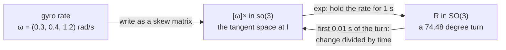
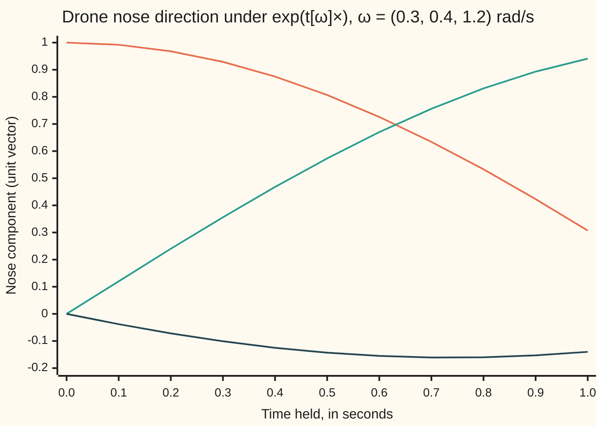

# Lie algebra: the tangent space at the identity, and exp back into the group

[Syllabus](../../../SYLLABUS.md) → [Differential geometry and Lie groups](../README.md) → [Lie Groups](../README.md#s06) → Lie algebra

---

## General Overview

A camera drone banks into a turn. Its gyroscope reads a steady body turn rate of 0.3 rad/s in roll, 0.4 rad/s in pitch and 1.2 rad/s in yaw. Roll turns about the forward axis, pitch about the left axis, yaw about the up axis. [Lie group](01-lie-groups-and-matrix-groups.md) uses forward, right and down axes instead (nose, right wing, belly), so its pitch and yaw signs are the reverse of this card's: here a positive pitch rate dips the nose and a positive yaw rate swings it left.

The flight computer must answer one question many times a second: if that rate holds for 1 s, where does the drone point at the end? The answer is a finished turn of 74.48° about one tilted axis. The nose swings from straight ahead to mostly left: 0.941 of its length points to the starting left, and it dips a little.

A rate is easy to store: three numbers that add like ordinary vectors. A finished turn is harder: a 3 by 3 rotation matrix, and two turns combine by multiplying, where order matters. This card connects the two.

- The **Lie algebra** of a group of matrices is the set of all velocities a path through the identity can have. For turns, it holds every possible turn rate.
- The **exponential map**, exp, takes a velocity and follows it for one unit of time. It turns a rate into a finished turn.
- The **bracket** measures how two rates fail to commute. A camera gimbal that pitches, yaws, pitches back and yaws back ends up rolled.

**The Lie algebra is the flat space of velocities at the group's identity; exp carries each velocity back into the group as the motion it produces when held, and the bracket records what is left over when two small motions are undone in the wrong order.**

**What kind of fact this is:** definitions (the Lie algebra, exp and the bracket), with theorems proved on this card in Why it works: the turn rates are exactly the skew-symmetric matrices, exp of one is a rotation given by Rodrigues' formula, and the bracket is what a small loop leaves behind. The first two are exact; the loop gives the bracket only to second order in its small angle. exp is one-to-one only for turns under 180°.

### The picture: from rate to turn and back



Left to right, exp turns a rate into a finished turn. The arrow back reads the rate off the first instant of the turn.

---

## The formula

Reminder from [Lie group](01-lie-groups-and-matrix-groups.md): $`SO(3)`$ is the group of 3 by 3 rotation matrices $`R`$, those with $`R^{T}R = I`$ and determinant 1. Here $`R^{T}`$ is the transpose (rows and columns swapped) and $`I`$ is the identity matrix, which changes nothing.

New notation, in words first. The **Lie algebra** of a matrix group $`G`$, written $`\mathfrak{g}`$ (a Gothic g), is the set of velocities $`R'(0)`$ (the rate of change of $`R(t)`$ at $`t = 0`$) of smooth paths $`R(t)`$ in $`G`$ that start at $`I`$. For $`SO(3)`$ it is written $`\mathfrak{so}(3)`$. The matrix $`[\omega]_\times`$, read "omega cross", is the matrix that does a cross product with $`\omega`$: $`[\omega]_\times v = \omega \times v`$ for every vector $`v`$. It is **skew-symmetric** (a skew matrix for short): its transpose is its negative, so it has zeros on the diagonal and opposite entries across it.

```math
[\omega]_\times = \begin{pmatrix} 0 & -\omega_z & \omega_y \\ \omega_z & 0 & -\omega_x \\ -\omega_y & \omega_x & 0 \end{pmatrix}, \qquad R(t) = \exp(t\,[\omega]_\times) = I + t[\omega]_\times + \frac{t^2[\omega]_\times^2}{2!} + \cdots
```

**Read it aloud:** write the turn rate as a skew matrix, scale it by the time, and sum the exponential series; the result is the finished turn.

[The matrix exponential](../../08-Differential%20equations%20and%20dynamics/04-Systems%20and%20the%20Matrix%20Exponential/04-the-matrix-exponential.md) already defines this series for any square matrix and proves that it converges. It also notes that an angle times the quarter-turn matrix exponentiates to a plane rotation. This card is about the series as a map from the Lie algebra into the group.

For a rotation the series has a closed form, **Rodrigues' formula**. Write the angle $`\theta = \lvert\omega\rvert t`$, the unit axis $`n = \omega/\lvert\omega\rvert`$ and $`K = [n]_\times`$:

```math
\exp(t\,[\omega]_\times) = I + \sin\theta\, K + (1 - \cos\theta)\, K^2
```

**Read it aloud:** a turn by angle theta about axis n is the identity, plus sine theta times the cross-with-n matrix, plus one minus cosine theta times its square.

The second idea is the **bracket** of two members $`X`$ and $`Y`$ of the Lie algebra:

```math
[X, Y] = XY - YX
```

**Read it aloud:** the bracket of X and Y is X times Y minus Y times X; it is zero exactly when the order does not matter.

For turn rates the bracket is the cross product of the rates: $`[[a]_\times, [b]_\times] = [a \times b]_\times`$. The unit roll, pitch and yaw rates $`L_x = [(1,0,0)]_\times`$, $`L_y`$ and $`L_z`$ satisfy $`[L_x, L_y] = L_z`$, $`[L_y, L_z] = L_x`$ and $`[L_z, L_x] = L_y`$.

| Symbol | Plain meaning | In our example | Push it up and the answer… |
| --- | --- | --- | --- |
| $`\omega`$; $`\omega_x`$, $`\omega_y`$, $`\omega_z`$ | body turn rate from the gyro; its roll, pitch and yaw parts, about the forward, left and up axes, in rad/s | (0.3, 0.4, 1.2), size 1.3 rad/s | faster, bigger finished turn |
| $`[a]_\times`$, $`v`$ | the matrix that crosses with vector $`a`$; $`v`$ any vector it acts on | $`[\omega]_\times`$ has entries ±1.2, ±0.4, ±0.3 | — |
| $`t`$, $`t_1`$, $`t_2`$ | how long the rate is held, in seconds | 1 s | turn grows; at 4.833 s it is back to $`I`$ |
| $`\theta`$, $`n`$, $`K`$ | turn angle $`\lvert\omega\rvert t`$ in radians; unit axis; $`K = [n]_\times`$ | 1.3 rad = 74.48°; (0.2308, 0.3077, 0.9231) | angle grows, axis stays |
| $`R`$, $`R_0`$, $`R^{T}`$, $`\mathrm{tr}\, R`$ | rotation matrix; a starting one; its transpose, which undoes it; its trace, the sum of the diagonal | trace 1.534998 | trace falls as the angle grows to 180° |
| $`I`$ | the identity matrix: no turn | — | — |
| $`\exp X`$, $`e^{X}`$ | the series $`I + X + X^2/2! + \cdots`$, with $`k! = 1 \times 2 \times \cdots \times k`$ | 40 terms in the code | — |
| $`G`$, $`\mathfrak{g}`$ | a matrix group; its Lie algebra, the velocities at $`I`$ | $`SO(3)`$, $`\mathfrak{so}(3)`$ | — |
| $`X`$, $`Y`$ | members of the Lie algebra | pitch rate, yaw rate | — |
| $`[X, Y]`$ | the bracket $`XY - YX`$ | $`[L_y, L_z] = L_x`$ | — |
| $`L_x`$, $`L_y`$, $`L_z`$ | unit roll, pitch and yaw rates, 1 rad/s each | the three generators | — |
| $`\varepsilon`$, $`C`$ | small gimbal angle; the gimbal loop's net turn | 0.1 rad = 5.73°; net 0.572° roll | net turn grows as $`\varepsilon^2`$ |

### When it holds

- **A constant rate.** $`\exp(t[\omega]_\times)`$ is the finished turn only while $`\omega`$ stays fixed. A rate that changes needs many short exps multiplied in order, because rates in different directions do not commute.
- **Rates combine before exp, never after.** $`e^{X}e^{Y} = e^{X+Y}`$ is guaranteed when $`XY = YX`$ and fails in general otherwise. Rolling 0.3, then pitching 0.4, then yawing 1.2 lands 16.31° away from holding all three together.
- **Angles under 180° for going back.** exp sends every rate to a rotation and reaches every rotation ([Rotation group](04-rotations-so3-and-quaternions.md)), but not one-to-one. A 3.9 rad turn is the same matrix as a 2.383 rad turn about the opposite axis, so reading the angle back gives 2.383.
- **Exact maths, approximate steps.** Rodrigues is exact. A flight computer that adds $`R\,[\omega]_\times`$ times a short step instead stays near the group but slowly leaves it.

---

## Why it works

### Step 0: velocities at the identity form a flat space

A group like $`SO(3)`$ is curved: the average of two rotation matrices is usually not a rotation. But near $`I`$ it looks flat, as a small patch of the Earth looks flat. Velocities of paths through $`I`$ can be added and scaled freely. That flat space is the Lie algebra.

exp is the bridge back. It takes a velocity and follows the group in that direction for one unit of time. Near the identity, the group's multiplication is then encoded by one product on the flat space: the bracket.

### Step 1: the turn rates are exactly the skew-symmetric matrices

[Lie group](01-lie-groups-and-matrix-groups.md) found the directions that stay inside $`SO(3)`$. At the identity the test is one line. A path $`R(t)`$ of rotations with $`R(0) = I`$ keeps $`R(t)^{T}R(t) = I`$; differentiate and set $`t = 0`$:

```math
R'(0)^{T} + R'(0) = 0
```

So every velocity $`X = R'(0)`$ is skew-symmetric: $`X^{T} = -X`$. A 3 by 3 skew matrix has three free entries, exactly $`\omega_x`$, $`\omega_y`$, $`\omega_z`$ in $`[\omega]_\times`$. Conversely, every skew $`X`$ is a velocity: Step 2 shows $`e^{tX}`$ is a path of rotations, and its velocity at $`t = 0`$ is $`X`$. So $`\mathfrak{so}(3)`$ is three-dimensional, like $`SO(3)`$.

The check confirms it backwards. Turning for 0.01 s and dividing the change by 0.01 gives $`[\omega]_\times`$ to within 0.008 per entry. At 0.005 s the gap halves to 0.004.

### Step 2: exp of a skew matrix is a rotation

Let $`X`$ be skew. The transpose of a series is the series of the transposes, so $`(e^{X})^{T} = e^{X^{T}} = e^{-X}`$. Since $`X`$ and $`-X`$ commute, $`e^{-X}e^{X} = e^{0} = I`$. So $`(e^{X})^{T}e^{X} = I`$: lengths and angles are kept.

The determinant of $`e^{tX}`$ moves continuously with $`t`$. It can only be +1 or −1 for a length-keeping matrix, and it is 1 at $`t = 0`$. So it stays 1. The check finds $`R^{T}R - I`$ below $`10^{-12}`$ and $`\det R = 1.000000`$.

### Step 3: a constant gyro rate gives a one-parameter subgroup

A gyro measures the turn rate in the drone's own frame. A short turn measured in that frame multiplies the orientation on the right. So the orientation obeys

```math
R'(t) = R(t)\,[\omega]_\times
```

[The matrix exponential](../../08-Differential%20equations%20and%20dynamics/04-Systems%20and%20the%20Matrix%20Exponential/04-the-matrix-exponential.md) proves the rate of $`e^{tX}`$ is $`e^{tX}X`$, and that the solution from $`R(0) = I`$ is unique. So $`R(t) = \exp(t[\omega]_\times)`$.

Its times add: holding for $`t_1`$ seconds, then $`t_2`$ more, gives $`e^{t_1X}e^{t_2X} = e^{(t_1+t_2)X}`$, because $`t_1X`$ and $`t_2X`$ commute. The check confirms that 0.4 s then 0.6 s equals 1 s. A path with this property is a **one-parameter subgroup**: a copy of the number line inside the group.

A vector field on the group attaches a velocity to every rotation. The field that attaches $`RX`$ at each rotation $`R`$ copies the one velocity $`X`$ from $`I`$ to every point by multiplying on the left; it is called **left-invariant**. Its flow lines (the paths that follow the field) are the turns $`R_0\, e^{tX}`$, one from each starting orientation $`R_0`$.

The drone's nose is the first column of $`R(t)`$. Over the second it swings left and dips:



Orange: forward component. Teal: left component. Dark blue: up component, negative because the nose dips.

### Step 4: the series collapses to Rodrigues' formula

Write $`\omega = \lvert\omega\rvert n`$ with $`n`$ a unit vector, and $`K = [n]_\times`$. A cross product twice gives $`n \times (n \times v) = n(n \cdot v) - v`$. Cross once more and $`K^3 = -K`$.

So the powers of $`K`$ cycle: $`K, K^2, -K, -K^2, K, \dots`$. In the series for $`e^{\theta K}`$ the odd powers collect $`\theta - \theta^3/3! + \cdots = \sin\theta`$ in front of $`K`$. The even powers collect $`\theta^2/2! - \theta^4/4! + \cdots = 1 - \cos\theta`$ in front of $`K^2`$. That is Rodrigues' formula.

<details>
<summary>Detailed proof: the series sorted into sine and cosine</summary>

From $`K^3 = -K`$, every power $`K^{2m+1} = (-1)^m K`$ and every power $`K^{2m+2} = (-1)^m K^2`$, for each whole number $`m \ge 0`$. The series converges absolutely, so its terms may be regrouped:

$`\displaystyle e^{\theta K} = I + \sum_{m \ge 0} \frac{(-1)^m \theta^{2m+1}}{(2m+1)!} K + \sum_{m \ge 0} \frac{(-1)^m \theta^{2m+2}}{(2m+2)!} K^2 = I + \sin\theta\, K + (1 - \cos\theta) K^2.`$

The first sum is the sine series. The second is $`1`$ minus the cosine series. Both come from [Taylor series](../../06-Calculus%20and%20analysis/06-Series/05-taylor-series.md).

</details>

The eigenvalues show the same thing ([Eigenvalues and eigenvectors](../../03-Algebra/07-Eigenvalues%20and%20Symmetric%20Matrices/02-eigenvalues-and-eigenvectors.md)). $`K`$ sends the axis $`n`$ to zero, eigenvalue 0. In the plane at right angles it acts as a quarter turn, with eigenvalues $`\pm i`$, where $`i = \sqrt{-1}`$. exp raises e to each eigenvalue times $`\theta`$: so $`R`$ has eigenvalues $`e^{0} = 1`$ and $`e^{\pm i\theta}`$. Their sum is the trace, $`1 + 2\cos\theta`$. For the drone the trace is 1.534998, which gives back $`\theta = 1.3`$ rad.

### Step 5: the bracket is what a small loop leaves behind

A camera gimbal pitches by $`\varepsilon`$, yaws by $`\varepsilon`$, pitches back, then yaws back, each about its own current axes. Moves in the body's frame multiply on the right, so the net turn is

```math
C = e^{\varepsilon L_y} e^{\varepsilon L_z} e^{-\varepsilon L_y} e^{-\varepsilon L_z} = I + \varepsilon^2 [L_y, L_z] + (\text{terms of size } \varepsilon^3)
```

Here $`L_y`$ and $`L_z`$ are the unit pitch and yaw rates. The first-order terms cancel: forward and back. The second-order terms leave exactly $`L_y L_z - L_z L_y`$.

Since $`[L_y, L_z] = L_x`$, the loop leaves a **roll**. At $`\varepsilon = 0.1`$ rad (5.73°) the net turn is 0.009992 rad (0.572°), close to $`\varepsilon^2 = 0.01`$. Its axis is (0.9975, 0.0499, −0.0499), nearly the forward axis; the small tilt is the $`\varepsilon^3`$ part.

<details>
<summary>Detailed proof: the loop expands to the bracket</summary>

Take any two members $`X`$ and $`Y`$ of the Lie algebra; the gimbal has $`X = L_y`$, $`Y = L_z`$. Call the four factors' rates $`a_1 = X`$, $`a_2 = Y`$, $`a_3 = -X`$, $`a_4 = -Y`$. Write $`O(\varepsilon^3)`$ for terms of size $`\varepsilon^3`$ or smaller. To second order each factor is $`I + \varepsilon a_j + \tfrac12 \varepsilon^2 a_j^2 + O(\varepsilon^3)`$, for $`j`$ from 1 to 4.

Multiply the four factors. The first-order part is $`\varepsilon(a_1 + a_2 + a_3 + a_4) = 0`$. The second-order part is the four half-squares plus every pair taken in order, $`a_j a_k`$ with $`j < k`$:

$`\displaystyle \tfrac12\varepsilon^2 (X^2 + Y^2 + X^2 + Y^2) + \varepsilon^2 (XY - X^2 - XY - YX - Y^2 + XY) = \varepsilon^2 (XY - YX).`$

So $`C = I + \varepsilon^2 [X, Y] + O(\varepsilon^3)`$, and $`(C - I)/\varepsilon^2`$ tends to $`[X, Y]`$ as $`\varepsilon`$ shrinks.

</details>

Two more facts finish the picture. The bracket of two skew matrices is skew: $`(XY - YX)^{T} = YX - XY`$. So the bracket never leaves $`\mathfrak{so}(3)`$. And applied to a vector, $`[[a]_\times, [b]_\times]v = a \times (b \times v) - b \times (a \times v) = (a \times b) \times v`$, the Jacobi identity of the cross product (the rule $`a \times (b \times v) + b \times (v \times a) + v \times (a \times b) = 0`$). The bracket of turn rates is their cross product.

---

## Worked numbers, by hand

Rate $`\omega = (0.3, 0.4, 1.2)`$ rad/s, held $`t = 1`$ s.

| Step | Arithmetic | Value |
| --- | --- | --- |
| size of the rate | $`\sqrt{0.09 + 0.16 + 1.44} = \sqrt{1.69}`$ | 1.3 rad/s |
| angle | $`1.3 \times 1`$ s | 1.3 rad = 74.48° |
| unit axis | $`(0.3, 0.4, 1.2)/1.3 = (3, 4, 12)/13`$ | (0.230769, 0.307692, 0.923077) |
| sine and one minus cosine | $`\sin 1.3`$, $`1 - \cos 1.3`$ | 0.963558, 0.732501 |
| entry row 2, column 1 of $`K`$ | $`n_z`$ | 0.923077 |
| same entry of $`K^2`$ | $`n_y n_x`$ | 0.071006 |
| entry of $`R`$ | $`0.963558 \times 0.923077 + 0.732501 \times 0.071006 = 0.889438 + 0.052012`$ | **0.941450** |
| trace of $`R`$ | $`1 + 2 \cos 1.3`$ | 1.534998 |
| gimbal loop, $`\varepsilon = 0.1`$ | $`\varepsilon^2`$ predicts 0.01 rad | **0.009992 rad = 0.572°** roll |

The entry 0.941450 is the left component of the nose after 1 s: 0.941 of the nose's length points to the starting left. The gimbal's four small moves leave a roll of just over half a degree, set by the bracket $`[L_y, L_z] = L_x`$.

### What breaks if you drop a piece

| Mistake | Comes out at | What went wrong |
| --- | --- | --- |
| e of each entry of $`[\omega]_\times`$ | determinant 4.835463, not 1 | exp uses matrix products, not entry-by-entry e |
| roll 0.3, then pitch 0.4, then yaw 1.2 | 16.31° from the true turn | rates do not commute, so $`e^{0.3L_x}e^{0.4L_y}e^{1.2L_z} \ne e^{[\omega]_\times}`$ |
| 100 plain steps $`R \leftarrow R(I + [\omega]_\times \cdot 0.01)`$ | determinant 1.017042; a unit vector grows to 1.008485 | a straight step leaves the curved group |
| angle read from the trace after 3 s | 2.383185 rad, not 3.9 | past 180° exp is not one-to-one |

The code prints all four.

---

## Code, from first principles, and it actually runs

The programs use only basic functions: square root, sine, cosine, arccosine, and e to a number for the entry-by-entry mistake. They reach the finished turn by three independent roads. Road 1 sums the exponential series to 40 terms. Road 2 is Rodrigues' formula from sine and cosine. Road 3 multiplies 1000 and then 2000 small gyro steps and watches the error halve. The bracket is also found three ways: by matrix products, by the cross product, and by running the gimbal loop at two sizes.

### Python

```python
# Lie algebra and the exponential map -- the check behind the card.  Nothing is
# imported but math.  A drone's gyro reads a steady body turn rate w (rad/s);
# held for t = 1 s it becomes a finished turn R = exp(t [w]x).  R is reached by
# three roads: the power series, Rodrigues' closed form, and many small steps.
# Then brackets: by matrix products, by the cross product, and by a gimbal loop.
from math import sin, cos, acos, sqrt, degrees, exp, pi

I = [[1.0 if i == j else 0.0 for j in range(3)] for i in range(3)]
def mul(a, b): return [[sum(a[i][k] * b[k][j] for k in range(3)) for j in range(3)] for i in range(3)]
def lin(a, b, s): return [[a[i][j] + s * b[i][j] for j in range(3)] for i in range(3)]   # a + s b
def sc(a, s): return [[s * x for x in row] for row in a]
def tr(a): return [[a[j][i] for j in range(3)] for i in range(3)]
def hat(w): return [[0.0, -w[2], w[1]], [w[2], 0.0, -w[0]], [-w[1], w[0], 0.0]]   # [w]x
def vee(a): return (a[2][1], a[0][2], a[1][0])                                     # undoes hat
def gap(a, b): return max(abs(a[i][j] - b[i][j]) for i in range(3) for j in range(3))
def br(x, y): return lin(mul(x, y), mul(y, x), -1.0)                                 # [X, Y] = XY - YX
def det(a): return (a[0][0] * (a[1][1] * a[2][2] - a[1][2] * a[2][1]) - a[0][1] * (a[1][0] * a[2][2] - a[1][2] * a[2][0])
                    + a[0][2] * (a[1][0] * a[2][1] - a[1][1] * a[2][0]))
def angle(r): return acos(max(-1.0, min(1.0, (r[0][0] + r[1][1] + r[2][2] - 1.0) / 2.0)))   # from the trace
def cross(a, b): return (a[1] * b[2] - a[2] * b[1], a[2] * b[0] - a[0] * b[2], a[0] * b[1] - a[1] * b[0])

def expm(x, terms=40):                          # road 1: I + X + X^2/2! + ... term by term
    s, term = [r[:] for r in I], [r[:] for r in I]
    for k in range(1, terms):
        term = sc(mul(term, x), 1.0 / k)
        s = lin(s, term, 1.0)
    return s

def rodrigues(w, t):                            # road 2: I + sin(th) K + (1 - cos(th)) K^2
    th = sqrt(sum(c * c for c in w)) * t
    k = hat([c * t / th for c in w])
    return lin(lin(I, k, sin(th)), mul(k, k), 1.0 - cos(th))

def steps(x, n):                                # road 3: n small gyro updates R <- R (I + X/n)
    r, s = [row[:] for row in I], lin(I, x, 1.0 / n)
    for _ in range(n):
        r = mul(r, s)
    return r

def f(x): return 0.0 if abs(x) < 5e-13 else x
def fv(v): return "(" + ", ".join(f"{f(c):.6f}" for c in v) + ")"
def fm(a): return "[" + ", ".join("[" + ", ".join(f"{f(c):.6f}" for c in row) + "]" for row in a) + "]"
def yn(c): return "yes" if c else "no"

w, t = (0.3, 0.4, 1.2), 1.0
W = hat(w)
th = sqrt(sum(c * c for c in w)) * t
axis = tuple(c / th for c in w)
R, Rr = expm(W), rodrigues(w, t)
e1000, e2000 = steps(W, 1000), steps(W, 2000)
print(f"rate w = {w} rad/s held {t:.0f} s: angle {th:.6f} rad = {degrees(th):.6f} deg, axis {fv(axis)}")
print(f"[w]x = {fm(W)}")
print(f"road 1, series:    R = {fm(R)}")
print(f"road 2, Rodrigues: R = {fm(Rr)}; agree to 1e-12: {yn(gap(R, Rr) < 1e-12)}")
print(f"by hand: sin(1.3) = {sin(th):.6f}, 1 - cos(1.3) = {1 - cos(th):.6f}; K^2 entry (2, 1) = {axis[1] * axis[0]:.6f}; entry (2, 1) = "
      f"{sin(th) * axis[2]:.6f} + {(1 - cos(th)) * axis[0] * axis[1]:.6f} = {sin(th) * axis[2] + (1 - cos(th)) * axis[0] * axis[1]:.6f}")
print(f"road 3, 1000 steps: off by {gap(e1000, R):.6f}, det {det(e1000):.6f}")
print(f"road 3, 2000 steps: off by {gap(e2000, R):.6f}, det {det(e2000):.6f}; error ratio {gap(e1000, R) / gap(e2000, R):.2f}")
print(f"R^T R - I largest entry {gap(mul(tr(R), R), I):.6f}; det R = {det(R):.6f}")
print(f"R times the axis = {fv([sum(R[i][j] * axis[j] for j in range(3)) for i in range(3)])}; [w]x times the axis = {fv([sum(W[i][j] * axis[j] for j in range(3)) for i in range(3)])}")
print(f"trace R = {R[0][0] + R[1][1] + R[2][2]:.6f} = 1 + 2 cos(1.3); angle back from the trace {angle(R):.6f} rad")
half = mul(expm(sc(W, 0.4)), expm(sc(W, 0.6)))
print(f"e^(0.4 [w]x) e^(0.6 [w]x) equals e^([w]x): {yn(gap(half, R) < 1e-12)}")
dq = [gap(sc(lin(expm(sc(W, h)), I, -1.0), 1.0 / h), W) for h in (0.01, 0.005)]
print(f"tangent at I: (R(h) - I)/h minus [w]x, h = 0.01: {dq[0]:.6f}, h = 0.005: {dq[1]:.6f}; ratio {dq[0] / dq[1]:.2f}")
times = [0.1 * k for k in range(11)]
noses = [[row[0] for row in expm(sc(W, s))] for s in times]
print("nose, t (s)  " + " ".join(f"{s:6.1f}" for s in times))
for i, name in enumerate("xyz"):
    print(f"nose, {name}      " + " ".join(f"{f(n[i]):6.3f}" for n in noses))

Lx, Ly, Lz = hat((1, 0, 0)), hat((0, 1, 0)), hat((0, 0, 1))
print(f"[Lx, Ly] = Lz: {yn(gap(br(Lx, Ly), Lz) == 0)}; [Ly, Lz] = Lx: {yn(gap(br(Ly, Lz), Lx) == 0)}; [Lz, Lx] = Ly: {yn(gap(br(Lz, Lx), Ly) == 0)}")
print(f"[Ly, Lz] = {fm(br(Ly, Lz))}")
g = (0.0, 0.5, 0.0)                             # the gimbal's pitch rate, rad/s
B = br(W, hat(g))
print(f"[[w]x, [g]x] for g = {g}: vector {fv(vee(B))}; w x g = {fv(cross(w, g))}; skew: {yn(gap(tr(B), sc(B, -1.0)) == 0)}")
loop = []
for eps in (0.1, 0.05):                         # pitch eps, yaw eps, pitch back, yaw back
    C = mul(mul(expm(sc(Ly, eps)), expm(sc(Lz, eps))), mul(expm(sc(Ly, -eps)), expm(sc(Lz, -eps))))
    v = vee(lin(C, tr(C), -1.0))
    n = sqrt(sum(c * c for c in v))
    loop.append((eps, angle(C), gap(sc(lin(C, I, -1.0), 1.0 / eps ** 2), Lx)))
    print(f"gimbal loop eps = {eps} rad = {degrees(eps):.6f} deg: net turn {angle(C):.6f} rad = {degrees(angle(C)):.6f} deg about {fv([c / n for c in v])}; "
          f"(C - I)/eps^2 minus Lx: {loop[-1][2]:.6f}")
print(f"gimbal loop error ratio {loop[0][2] / loop[1][2]:.2f}")

E = [[exp(x) for x in row] for row in W]
seq = mul(mul(expm(sc(Lx, 0.3)), expm(sc(Ly, 0.4))), expm(sc(Lz, 1.2)))
e100 = steps(W, 100)
R3 = expm(sc(W, 3.0))
bch = gap(mul(expm(sc(Ly, 0.1)), expm(sc(Lz, 0.1))), expm(sc(lin(Ly, Lz, 1.0), 0.1)))
print(f"mistake, e of each entry: det {det(E):.6f}, R^T R - I largest entry {gap(mul(tr(E), E), I):.6f}")
print(f"mistake, roll 0.3 then pitch 0.4 then yaw 1.2: off by {angle(mul(tr(R), seq)):.6f} rad = {degrees(angle(mul(tr(R), seq))):.6f} deg")
u = (0.8, -0.6, 0.0)                            # a unit vector at right angles to the axis
print(f"mistake, 100 plain steps: det {det(e100):.6f}; a unit vector at right angles to the axis ends {sqrt(sum(sum(e100[i][j] * u[j] for j in range(3)) ** 2 for i in range(3))):.6f} long")
print(f"mistake, angle from the trace after 3 s: {angle(R3):.6f} rad, not {3 * th:.6f}; 2 pi - 3.9 = {2 * pi - 3 * th:.6f}")
print(f"mistake, e^(0.1 Ly) e^(0.1 Lz) against e^(0.1 (Ly + Lz)): gap {bch:.6f}")
back = expm(sc(W, 2 * pi / th))
C2 = mul(mul(expm(sc(Ly, 0.2)), expm(sc(Lz, 0.2))), mul(expm(sc(Ly, -0.2)), expm(sc(Lz, -0.2))))
print(f"try, hold for 2 pi / 1.3 = {2 * pi / th:.6f} s: gap from I {gap(back, I):.6f}")
print(f"try, gimbal loop eps = 0.2: net turn {angle(C2):.6f} rad; w x (0, 0, 0.5) = {fv(cross(w, (0.0, 0.0, 0.5)))}")

assert gap(R, Rr) < 1e-12                                       # series = Rodrigues
assert gap(mul(tr(R), R), I) < 1e-12 and abs(det(R) - 1.0) < 1e-12  # it is a rotation
assert abs(angle(R) - 1.3) < 1e-12 and abs(angle(R3) - (2 * pi - 3.9)) < 1e-12
assert 1.95 < gap(e1000, R) / gap(e2000, R) < 2.05               # steps converge, first order
assert gap(half, R) < 1e-12                                     # one-parameter subgroup
assert 1.95 < dq[0] / dq[1] < 2.05                              # tangent at I is [w]x
assert gap(br(Ly, Lz), Lx) < 1e-15 and gap(B, hat(cross(w, g))) < 1e-15
assert 1.95 < loop[0][2] / loop[1][2] < 2.05 and abs(loop[0][1] - 0.01) < 1e-4   # loop -> eps^2 [X, Y]
print("ALL CHECKS PASS")
```

**Ran 2026-11-19 on macOS, Python 3.14.10, standard library only. All checks passed. Output, pasted from the run:**

```
rate w = (0.3, 0.4, 1.2) rad/s held 1 s: angle 1.300000 rad = 74.484513 deg, axis (0.230769, 0.307692, 0.923077)
[w]x = [[0.000000, -1.200000, 0.400000], [1.200000, 0.000000, -0.300000], [-0.400000, 0.300000, 0.000000]]
road 1, series:    R = [[0.306508, -0.837426, 0.452515], [0.941450, 0.336848, -0.014312], [-0.140444, 0.430407, 0.891642]]
road 2, Rodrigues: R = [[0.306508, -0.837426, 0.452515], [0.941450, 0.336848, -0.014312], [-0.140444, 0.430407, 0.891642]]; agree to 1e-12: yes
by hand: sin(1.3) = 0.963558, 1 - cos(1.3) = 0.732501; K^2 entry (2, 1) = 0.071006; entry (2, 1) = 0.889438 + 0.052012 = 0.941450
road 3, 1000 steps: off by 0.000768, det 1.001691
road 3, 2000 steps: off by 0.000384, det 1.000845; error ratio 2.00
R^T R - I largest entry 0.000000; det R = 1.000000
R times the axis = (0.230769, 0.307692, 0.923077); [w]x times the axis = (0.000000, 0.000000, 0.000000)
trace R = 1.534998 = 1 + 2 cos(1.3); angle back from the trace 1.300000 rad
e^(0.4 [w]x) e^(0.6 [w]x) equals e^([w]x): yes
tangent at I: (R(h) - I)/h minus [w]x, h = 0.01: 0.008000, h = 0.005: 0.004000; ratio 2.00
nose, t (s)     0.0    0.1    0.2    0.3    0.4    0.5    0.6    0.7    0.8    0.9    1.0
nose, x       1.000  0.992  0.968  0.929  0.875  0.807  0.726  0.634  0.533  0.423  0.307
nose, y       0.000  0.120  0.240  0.356  0.468  0.573  0.670  0.756  0.831  0.893  0.941
nose, z       0.000 -0.038 -0.072 -0.101 -0.125 -0.143 -0.155 -0.161 -0.160 -0.153 -0.140
[Lx, Ly] = Lz: yes; [Ly, Lz] = Lx: yes; [Lz, Lx] = Ly: yes
[Ly, Lz] = [[0.000000, 0.000000, 0.000000], [0.000000, 0.000000, -1.000000], [0.000000, 1.000000, 0.000000]]
[[w]x, [g]x] for g = (0.0, 0.5, 0.0): vector (-0.600000, 0.000000, 0.150000); w x g = (-0.600000, 0.000000, 0.150000); skew: yes
gimbal loop eps = 0.1 rad = 5.729578 deg: net turn 0.009992 rad = 0.572481 deg about (0.997505, 0.049917, -0.049917); (C - I)/eps^2 minus Lx: 0.050123
gimbal loop eps = 0.05 rad = 2.864789 deg: net turn 0.002499 rad = 0.143210 deg about (0.999375, 0.024990, -0.024990); (C - I)/eps^2 minus Lx: 0.025016
gimbal loop error ratio 2.00
mistake, e of each entry: det 4.835463, R^T R - I largest entry 11.472505
mistake, roll 0.3 then pitch 0.4 then yaw 1.2: off by 0.284717 rad = 16.313067 deg
mistake, 100 plain steps: det 1.017042; a unit vector at right angles to the axis ends 1.008485 long
mistake, angle from the trace after 3 s: 2.383185 rad, not 3.900000; 2 pi - 3.9 = 2.383185
mistake, e^(0.1 Ly) e^(0.1 Lz) against e^(0.1 (Ly + Lz)): gap 0.004992
try, hold for 2 pi / 1.3 = 4.833219 s: gap from I 0.000000
try, gimbal loop eps = 0.2: net turn 0.039868 rad; w x (0, 0, 0.5) = (0.200000, -0.150000, 0.000000)
ALL CHECKS PASS
```

### Rust

Same numbers, same labels, built with `rustc --edition 2021 -O`.

```rust
// Lie algebra and the exponential map -- the same check as the Python, in Rust.
// No crates.  A drone's gyro reads a steady body turn rate w (rad/s); held for
// t = 1 s it becomes a finished turn R = exp(t [w]x).  R is reached by three
// roads: the power series, Rodrigues' closed form, and many small steps.
// Then brackets: by matrix products, by the cross product, and by a gimbal loop.
use std::f64::consts::PI;
type M = [[f64; 3]; 3];
type V = [f64; 3];
const I3: M = [[1.0, 0.0, 0.0], [0.0, 1.0, 0.0], [0.0, 0.0, 1.0]];

fn mul(a: &M, b: &M) -> M {
    let mut z = [[0.0; 3]; 3];
    for i in 0..3 { for j in 0..3 { for k in 0..3 { z[i][j] += a[i][k] * b[k][j] } } }
    z
}
fn lin(a: &M, b: &M, s: f64) -> M {                 // a + s b
    let mut z = *a;
    for i in 0..3 { for j in 0..3 { z[i][j] += s * b[i][j] } }
    z
}
fn sc(a: &M, s: f64) -> M { lin(&[[0.0; 3]; 3], a, s) }
fn tr(a: &M) -> M { let mut z = *a; for i in 0..3 { for j in 0..3 { z[i][j] = a[j][i] } } z }
fn hat(w: V) -> M { [[0.0, -w[2], w[1]], [w[2], 0.0, -w[0]], [-w[1], w[0], 0.0]] }   // [w]x
fn vee(a: &M) -> V { [a[2][1], a[0][2], a[1][0]] }                                  // undoes hat
fn gap(a: &M, b: &M) -> f64 { let mut g: f64 = 0.0; for i in 0..3 { for j in 0..3 { g = g.max((a[i][j] - b[i][j]).abs()) } } g }
fn br(x: &M, y: &M) -> M { lin(&mul(x, y), &mul(y, x), -1.0) }                     // [X, Y] = XY - YX
fn det(a: &M) -> f64 {
    a[0][0] * (a[1][1] * a[2][2] - a[1][2] * a[2][1]) - a[0][1] * (a[1][0] * a[2][2] - a[1][2] * a[2][0])
        + a[0][2] * (a[1][0] * a[2][1] - a[1][1] * a[2][0])
}
fn angle(r: &M) -> f64 { ((r[0][0] + r[1][1] + r[2][2] - 1.0) / 2.0).max(-1.0).min(1.0).acos() }   // from the trace
fn cross(a: V, b: V) -> V { [a[1] * b[2] - a[2] * b[1], a[2] * b[0] - a[0] * b[2], a[0] * b[1] - a[1] * b[0]] }
fn app(a: &M, v: V) -> V { let mut z = [0.0; 3]; for i in 0..3 { for j in 0..3 { z[i] += a[i][j] * v[j] } } z }
fn norm(v: V) -> f64 { (v[0] * v[0] + v[1] * v[1] + v[2] * v[2]).sqrt() }

fn expm(x: &M) -> M {                               // road 1: I + X + X^2/2! + ... term by term
    let (mut s, mut term) = (I3, I3);
    for k in 1..40 {
        term = sc(&mul(&term, x), 1.0 / k as f64);
        s = lin(&s, &term, 1.0);
    }
    s
}
fn rodrigues(w: V, t: f64) -> M {                   // road 2: I + sin(th) K + (1 - cos(th)) K^2
    let th = norm(w) * t;
    let k = hat([w[0] * t / th, w[1] * t / th, w[2] * t / th]);
    lin(&lin(&I3, &k, th.sin()), &mul(&k, &k), 1.0 - th.cos())
}
fn steps(x: &M, n: usize) -> M {                    // road 3: n small gyro updates R <- R (I + X/n)
    let (mut r, s) = (I3, lin(&I3, x, 1.0 / n as f64));
    for _ in 0..n { r = mul(&r, &s) }
    r
}
fn loop_c(e: f64) -> M {                            // pitch e, yaw e, pitch back, yaw back
    let (ly, lz) = (hat([0.0, 1.0, 0.0]), hat([0.0, 0.0, 1.0]));
    mul(&mul(&expm(&sc(&ly, e)), &expm(&sc(&lz, e))), &mul(&expm(&sc(&ly, -e)), &expm(&sc(&lz, -e))))
}

fn f(x: f64) -> f64 { if x.abs() < 5e-13 { 0.0 } else { x } }
fn fv(v: V) -> String { format!("({:.6}, {:.6}, {:.6})", f(v[0]), f(v[1]), f(v[2])) }
fn fm(a: &M) -> String { format!("[{}]", a.iter().map(|r| format!("[{:.6}, {:.6}, {:.6}]", f(r[0]), f(r[1]), f(r[2]))).collect::<Vec<_>>().join(", ")) }
fn yn(c: bool) -> &'static str { if c { "yes" } else { "no" } }

fn main() {
    let (w, t): (V, f64) = ([0.3, 0.4, 1.2], 1.0);
    let wm = hat(w);
    let th = norm(w) * t;
    let axis = [w[0] / th, w[1] / th, w[2] / th];
    let (r, rr) = (expm(&wm), rodrigues(w, t));
    let (e1000, e2000) = (steps(&wm, 1000), steps(&wm, 2000));
    println!("rate w = (0.3, 0.4, 1.2) rad/s held {:.0} s: angle {:.6} rad = {:.6} deg, axis {}", t, th, th.to_degrees(), fv(axis));
    println!("[w]x = {}", fm(&wm));
    println!("road 1, series:    R = {}", fm(&r));
    println!("road 2, Rodrigues: R = {}; agree to 1e-12: {}", fm(&rr), yn(gap(&r, &rr) < 1e-12));
    println!("by hand: sin(1.3) = {:.6}, 1 - cos(1.3) = {:.6}; K^2 entry (2, 1) = {:.6}; entry (2, 1) = {:.6} + {:.6} = {:.6}", th.sin(), 1.0 - th.cos(),
             axis[1] * axis[0], th.sin() * axis[2], (1.0 - th.cos()) * axis[0] * axis[1], th.sin() * axis[2] + (1.0 - th.cos()) * axis[0] * axis[1]);
    println!("road 3, 1000 steps: off by {:.6}, det {:.6}", gap(&e1000, &r), det(&e1000));
    println!("road 3, 2000 steps: off by {:.6}, det {:.6}; error ratio {:.2}", gap(&e2000, &r), det(&e2000), gap(&e1000, &r) / gap(&e2000, &r));
    println!("R^T R - I largest entry {:.6}; det R = {:.6}", gap(&mul(&tr(&r), &r), &I3), det(&r));
    println!("R times the axis = {}; [w]x times the axis = {}", fv(app(&r, axis)), fv(app(&wm, axis)));
    println!("trace R = {:.6} = 1 + 2 cos(1.3); angle back from the trace {:.6} rad", r[0][0] + r[1][1] + r[2][2], angle(&r));
    let half = mul(&expm(&sc(&wm, 0.4)), &expm(&sc(&wm, 0.6)));
    println!("e^(0.4 [w]x) e^(0.6 [w]x) equals e^([w]x): {}", yn(gap(&half, &r) < 1e-12));
    let dq: Vec<f64> = [0.01, 0.005].iter().map(|&h| gap(&sc(&lin(&expm(&sc(&wm, h)), &I3, -1.0), 1.0 / h), &wm)).collect();
    println!("tangent at I: (R(h) - I)/h minus [w]x, h = 0.01: {:.6}, h = 0.005: {:.6}; ratio {:.2}", dq[0], dq[1], dq[0] / dq[1]);
    let times: Vec<f64> = (0..11).map(|k| 0.1 * k as f64).collect();
    let noses: Vec<V> = times.iter().map(|&s| app(&expm(&sc(&wm, s)), [1.0, 0.0, 0.0])).collect();
    println!("nose, t (s)  {}", times.iter().map(|s| format!("{:6.1}", s)).collect::<Vec<_>>().join(" "));
    for (i, name) in ["x", "y", "z"].iter().enumerate() {
        println!("nose, {}      {}", name, noses.iter().map(|n| format!("{:6.3}", f(n[i]))).collect::<Vec<_>>().join(" "));
    }

    let (lx, ly, lz) = (hat([1.0, 0.0, 0.0]), hat([0.0, 1.0, 0.0]), hat([0.0, 0.0, 1.0]));
    println!("[Lx, Ly] = Lz: {}; [Ly, Lz] = Lx: {}; [Lz, Lx] = Ly: {}", yn(gap(&br(&lx, &ly), &lz) == 0.0), yn(gap(&br(&ly, &lz), &lx) == 0.0), yn(gap(&br(&lz, &lx), &ly) == 0.0));
    println!("[Ly, Lz] = {}", fm(&br(&ly, &lz)));
    let g: V = [0.0, 0.5, 0.0];                     // the gimbal's pitch rate, rad/s
    let b = br(&wm, &hat(g));
    println!("[[w]x, [g]x] for g = (0.0, 0.5, 0.0): vector {}; w x g = {}; skew: {}", fv(vee(&b)), fv(cross(w, g)), yn(gap(&tr(&b), &sc(&b, -1.0)) == 0.0));
    let mut lp: Vec<(f64, f64)> = Vec::new();
    for e in [0.1_f64, 0.05] {
        let c = loop_c(e);
        let v = vee(&lin(&c, &tr(&c), -1.0));
        let n = norm(v);
        lp.push((angle(&c), gap(&sc(&lin(&c, &I3, -1.0), 1.0 / (e * e)), &lx)));
        println!("gimbal loop eps = {} rad = {:.6} deg: net turn {:.6} rad = {:.6} deg about {}; (C - I)/eps^2 minus Lx: {:.6}",
                 e, e.to_degrees(), angle(&c), angle(&c).to_degrees(), fv([v[0] / n, v[1] / n, v[2] / n]), lp[lp.len() - 1].1);
    }
    println!("gimbal loop error ratio {:.2}", lp[0].1 / lp[1].1);

    let mut ee = wm;
    for i in 0..3 { for j in 0..3 { ee[i][j] = wm[i][j].exp() } }
    let seq = mul(&mul(&expm(&sc(&lx, 0.3)), &expm(&sc(&ly, 0.4))), &expm(&sc(&lz, 1.2)));
    let e100 = steps(&wm, 100);
    let r3 = expm(&sc(&wm, 3.0));
    let bch = gap(&mul(&expm(&sc(&ly, 0.1)), &expm(&sc(&lz, 0.1))), &expm(&sc(&lin(&ly, &lz, 1.0), 0.1)));
    let off = angle(&mul(&tr(&r), &seq));
    println!("mistake, e of each entry: det {:.6}, R^T R - I largest entry {:.6}", det(&ee), gap(&mul(&tr(&ee), &ee), &I3));
    println!("mistake, roll 0.3 then pitch 0.4 then yaw 1.2: off by {:.6} rad = {:.6} deg", off, off.to_degrees());
    let u: V = [0.8, -0.6, 0.0];                    // a unit vector at right angles to the axis
    println!("mistake, 100 plain steps: det {:.6}; a unit vector at right angles to the axis ends {:.6} long", det(&e100), norm(app(&e100, u)));
    println!("mistake, angle from the trace after 3 s: {:.6} rad, not {:.6}; 2 pi - 3.9 = {:.6}", angle(&r3), 3.0 * th, 2.0 * PI - 3.0 * th);
    println!("mistake, e^(0.1 Ly) e^(0.1 Lz) against e^(0.1 (Ly + Lz)): gap {:.6}", bch);
    let back = expm(&sc(&wm, 2.0 * PI / th));
    println!("try, hold for 2 pi / 1.3 = {:.6} s: gap from I {:.6}", 2.0 * PI / th, gap(&back, &I3));
    println!("try, gimbal loop eps = 0.2: net turn {:.6} rad; w x (0, 0, 0.5) = {}", angle(&loop_c(0.2)), fv(cross(w, [0.0, 0.0, 0.5])));

    assert!(gap(&r, &rr) < 1e-12);                                         // series = Rodrigues
    assert!(gap(&mul(&tr(&r), &r), &I3) < 1e-12 && (det(&r) - 1.0).abs() < 1e-12);   // a rotation
    assert!((angle(&r) - 1.3).abs() < 1e-12 && (angle(&r3) - (2.0 * PI - 3.9)).abs() < 1e-12);
    let ratio = gap(&e1000, &r) / gap(&e2000, &r);
    assert!(1.95 < ratio && ratio < 2.05);                                 // steps converge, first order
    assert!(gap(&half, &r) < 1e-12);                                       // one-parameter subgroup
    assert!(1.95 < dq[0] / dq[1] && dq[0] / dq[1] < 2.05);                 // tangent at I is [w]x
    assert!(gap(&br(&ly, &lz), &lx) < 1e-15 && gap(&b, &hat(cross(w, g))) < 1e-15);
    assert!(1.95 < lp[0].1 / lp[1].1 && lp[0].1 / lp[1].1 < 2.05 && (lp[0].0 - 0.01).abs() < 1e-4);
    println!("ALL CHECKS PASS");
}
```

**Ran 2026-11-19 on macOS, rustc 1.98.1, no crates. All checks passed. Output, pasted from the run:**

```
rate w = (0.3, 0.4, 1.2) rad/s held 1 s: angle 1.300000 rad = 74.484513 deg, axis (0.230769, 0.307692, 0.923077)
[w]x = [[0.000000, -1.200000, 0.400000], [1.200000, 0.000000, -0.300000], [-0.400000, 0.300000, 0.000000]]
road 1, series:    R = [[0.306508, -0.837426, 0.452515], [0.941450, 0.336848, -0.014312], [-0.140444, 0.430407, 0.891642]]
road 2, Rodrigues: R = [[0.306508, -0.837426, 0.452515], [0.941450, 0.336848, -0.014312], [-0.140444, 0.430407, 0.891642]]; agree to 1e-12: yes
by hand: sin(1.3) = 0.963558, 1 - cos(1.3) = 0.732501; K^2 entry (2, 1) = 0.071006; entry (2, 1) = 0.889438 + 0.052012 = 0.941450
road 3, 1000 steps: off by 0.000768, det 1.001691
road 3, 2000 steps: off by 0.000384, det 1.000845; error ratio 2.00
R^T R - I largest entry 0.000000; det R = 1.000000
R times the axis = (0.230769, 0.307692, 0.923077); [w]x times the axis = (0.000000, 0.000000, 0.000000)
trace R = 1.534998 = 1 + 2 cos(1.3); angle back from the trace 1.300000 rad
e^(0.4 [w]x) e^(0.6 [w]x) equals e^([w]x): yes
tangent at I: (R(h) - I)/h minus [w]x, h = 0.01: 0.008000, h = 0.005: 0.004000; ratio 2.00
nose, t (s)     0.0    0.1    0.2    0.3    0.4    0.5    0.6    0.7    0.8    0.9    1.0
nose, x       1.000  0.992  0.968  0.929  0.875  0.807  0.726  0.634  0.533  0.423  0.307
nose, y       0.000  0.120  0.240  0.356  0.468  0.573  0.670  0.756  0.831  0.893  0.941
nose, z       0.000 -0.038 -0.072 -0.101 -0.125 -0.143 -0.155 -0.161 -0.160 -0.153 -0.140
[Lx, Ly] = Lz: yes; [Ly, Lz] = Lx: yes; [Lz, Lx] = Ly: yes
[Ly, Lz] = [[0.000000, 0.000000, 0.000000], [0.000000, 0.000000, -1.000000], [0.000000, 1.000000, 0.000000]]
[[w]x, [g]x] for g = (0.0, 0.5, 0.0): vector (-0.600000, 0.000000, 0.150000); w x g = (-0.600000, 0.000000, 0.150000); skew: yes
gimbal loop eps = 0.1 rad = 5.729578 deg: net turn 0.009992 rad = 0.572481 deg about (0.997505, 0.049917, -0.049917); (C - I)/eps^2 minus Lx: 0.050123
gimbal loop eps = 0.05 rad = 2.864789 deg: net turn 0.002499 rad = 0.143210 deg about (0.999375, 0.024990, -0.024990); (C - I)/eps^2 minus Lx: 0.025016
gimbal loop error ratio 2.00
mistake, e of each entry: det 4.835463, R^T R - I largest entry 11.472505
mistake, roll 0.3 then pitch 0.4 then yaw 1.2: off by 0.284717 rad = 16.313067 deg
mistake, 100 plain steps: det 1.017042; a unit vector at right angles to the axis ends 1.008485 long
mistake, angle from the trace after 3 s: 2.383185 rad, not 3.900000; 2 pi - 3.9 = 2.383185
mistake, e^(0.1 Ly) e^(0.1 Lz) against e^(0.1 (Ly + Lz)): gap 0.004992
try, hold for 2 pi / 1.3 = 4.833219 s: gap from I 0.000000
try, gimbal loop eps = 0.2: net turn 0.039868 rad; w x (0, 0, 0.5) = (0.200000, -0.150000, 0.000000)
ALL CHECKS PASS
```

The two outputs match line for line.

### Lean

Lean proves the three facts of Steps 2, 4 and 5 for every rate and time, and checks the worked numbers exactly.

- Take a 3 by 3 skew matrix $`X`$. Then $`e^{X}`$ is in $`SO(3)`$: $`(e^{X})^{T}e^{X} = I`$ and its determinant is 1.
- Take any rate $`\omega`$ and any time $`t`$. Then Rodrigues' formula $`\exp(t\,[\omega]_\times) = I + \sin\theta\, K + (1 - \cos\theta)\, K^2`$ holds. At $`\omega = 0`$ Lean takes $`n = 0`$, and both sides are $`I`$.
- Take any two rates $`a`$ and $`b`$. Then $`[[a]_\times, [b]_\times] = [a \times b]_\times`$: the bracket of turn rates is their cross product.
- Take the unit rates, with $`L_x`$ written out from $`[(1,0,0)]_\times`$. Then $`[L_x, L_y] = L_z`$, $`[L_y, L_z] = L_x`$ and $`[L_z, L_x] = L_y`$.
- The drone's rate (0.3, 0.4, 1.2) rad/s has size 1.3 rad/s, and its unit axis is (3, 4, 12)/13.
- Take a pitch rate of 0.5 rad/s, the vector (0, 0.5, 0). Then $`\omega`$ crossed with it is (−0.6, 0, 0.15).
- Take a yaw rate of 0.5 rad/s, the vector (0, 0, 0.5). Then $`\omega`$ crossed with it is (0.2, −0.15, 0).

Every decimal number, from the series sums to the gimbal loop and the mistakes table, is left to the Python and Rust checks.

```lean
-- Lie algebra: exp of a skew-symmetric 3 by 3 matrix is a rotation given by Rodrigues' formula, and the bracket of two turn rates is their cross product.
import Mathlib.Analysis.Normed.Algebra.MatrixExponential
import Mathlib.Analysis.SpecialFunctions.Trigonometric.Basic
import Mathlib.Analysis.SpecialFunctions.Trigonometric.Series
import Mathlib.LinearAlgebra.CrossProduct
import Mathlib.LinearAlgebra.UnitaryGroup
import Mathlib.Algebra.Lie.OfAssociative

open Matrix NormedSpace

/-! Here `LinearMap.toMatrix' (crossProduct ω)` is the card's `[ω]×`: the matrix that sends
every vector `v` to the cross product `ω × v`. The Euclidean length of `ω` is `√(ω ⬝ᵥ ω)`.
The bracket `⁅X, Y⁆` on matrices is Mathlib's commutator `X * Y - Y * X`. -/

open scoped Nat


theorem crossMatrix_smul (c : ℝ) (ω : Fin 3 → ℝ) :
    LinearMap.toMatrix' (crossProduct (c • ω)) = c • LinearMap.toMatrix' (crossProduct ω) := by
  rw [map_smul, map_smul]

theorem crossMatrix_eq (n : Fin 3 → ℝ) :
    LinearMap.toMatrix' (crossProduct n) = !![0, -n 2, n 1; n 2, 0, -n 0; -n 1, n 0, 0] := by
  ext i j
  fin_cases i <;> fin_cases j <;> simp [LinearMap.toMatrix'_apply, cross_apply]

theorem crossMatrix_pow_three (n : Fin 3 → ℝ) :
    LinearMap.toMatrix' (crossProduct n) ^ 3 = -(n ⬝ᵥ n) • LinearMap.toMatrix' (crossProduct n) := by
  rw [crossMatrix_eq, pow_succ, pow_two]
  ext i j
  fin_cases i <;> fin_cases j <;>
    simp [dotProduct, Fin.sum_univ_three] <;> ring

theorem exp_smul_of_pow_three (K : Matrix (Fin 3) (Fin 3) ℝ) (hK : K ^ 3 = -K) (θ : ℝ) :
    exp (θ • K) = 1 + Real.sin θ • K + (1 - Real.cos θ) • K ^ 2 := by
  have hodd : ∀ k : ℕ, K ^ (2 * k + 1) = (-1 : ℝ) ^ k • K := by
    intro k
    induction k with
    | zero => simp
    | succ k ih =>
      rw [show 2 * (k + 1) + 1 = (2 * k + 1) + 2 by ring, pow_add, ih, smul_mul_assoc,
        ← pow_succ' K 2, hK, pow_succ, smul_neg, ← neg_smul, mul_neg_one]
  have heven : ∀ k : ℕ, K ^ (2 * (k + 1)) = (-1 : ℝ) ^ k • K ^ 2 := by
    intro k
    rw [show 2 * (k + 1) = (2 * k + 1) + 1 by ring, pow_succ, hodd, smul_mul_assoc, sq]
  rw [exp_eq_tsum ℝ]
  refine HasSum.tsum_eq ?_
  have h0 : HasSum (fun k : ℕ => if k = 0 then (1 + K ^ 2) else 0) (1 + K ^ 2) :=
    hasSum_ite_eq 0 (1 + K ^ 2)
  have hc : HasSum (fun k : ℕ => ((-1) ^ k * θ ^ (2 * k) / ↑(2 * k)!) • (-K ^ 2)) (Real.cos θ • (-K ^ 2)) :=
    (Real.hasSum_cos θ).smul_const (-K ^ 2)
  have hs : HasSum (fun k : ℕ => ((-1) ^ k * θ ^ (2 * k + 1) / ↑(2 * k + 1)!) • K) (Real.sin θ • K) :=
    (Real.hasSum_sin θ).smul_const K
  have hval : (1 : Matrix (Fin 3) (Fin 3) ℝ) + Real.sin θ • K + (1 - Real.cos θ) • K ^ 2 =
      (Real.cos θ • (-K ^ 2) + (1 + K ^ 2)) + Real.sin θ • K := by
    module
  rw [hval]
  refine HasSum.even_add_odd ?_ ?_
  · convert hc.add h0 using 1
    ext k : 1
    rcases k with _ | k
    · simp
    · rw [smul_pow, heven, ite_eq_right (Nat.succ_ne_zero k), add_zero]
      simp only [div_eq_mul_inv]
      module
  · convert hs using 1
    ext k : 1
    rw [smul_pow, hodd]
    simp only [div_eq_mul_inv]
    module

#print axioms crossMatrix_smul
#print axioms crossMatrix_eq
#print axioms crossMatrix_pow_three
#print axioms exp_smul_of_pow_three

/-- Exp of a skew-symmetric matrix is a rotation: if the 3 by 3 real matrix `X` satisfies
`Xᵀ = -X`, then `exp X` is in `SO(3)`, that is, `(exp X)ᵀ * exp X = I` and `det (exp X) = 1`. -/
theorem exp_mem_specialOrthogonalGroup_of_skew (X : Matrix (Fin 3) (Fin 3) ℝ) (hX : Xᵀ = -X) :
    exp X ∈ Matrix.specialOrthogonalGroup (Fin 3) ℝ := by
  have hO : (exp X)ᵀ * exp X = 1 := by
    rw [← Matrix.exp_transpose, hX, Matrix.exp_neg]
    exact Matrix.nonsing_inv_mul _ ((Matrix.isUnit_iff_isUnit_det _).mp (Matrix.isUnit_exp _))
  rw [Matrix.mem_specialOrthogonalGroup_iff]
  refine ⟨(Matrix.mem_orthogonalGroup_iff' (Fin 3) ℝ).mpr hO, ?_⟩
  have hdet2 : (exp X).det * (exp X).det = 1 := by
    rw [← det_one (n := Fin 3) (R := ℝ), ← hO, det_mul, det_transpose]
  have hhalf : X = 2 • ((1 / 2 : ℝ) • X) := by
    rw [two_nsmul, ← add_smul]; norm_num
  have hsq : (exp X).det = (exp ((1 / 2 : ℝ) • X)).det ^ 2 := by
    conv_lhs => rw [hhalf]
    rw [Matrix.exp_nsmul, det_pow]
  nlinarith [sq_nonneg (exp ((1 / 2 : ℝ) • X)).det]

/-- Rodrigues' formula: a turn rate `ω` held for time `t` gives the finished turn
`exp (t [ω]×) = I + sin θ K + (1 - cos θ) K²`, where `θ = |ω| t` is the angle and
`K = [n]×` for the unit axis `n = ω / |ω|`. -/
theorem rodrigues_formula (ω : Fin 3 → ℝ) (t : ℝ) :
    exp (t • LinearMap.toMatrix' (crossProduct ω)) =
      1 + Real.sin (√(ω ⬝ᵥ ω) * t) • LinearMap.toMatrix' (crossProduct ((√(ω ⬝ᵥ ω))⁻¹ • ω))
        + (1 - Real.cos (√(ω ⬝ᵥ ω) * t)) •
            LinearMap.toMatrix' (crossProduct ((√(ω ⬝ᵥ ω))⁻¹ • ω)) ^ 2 := by
  have hnn : 0 ≤ ω ⬝ᵥ ω := Finset.sum_nonneg fun i _ => mul_self_nonneg (ω i)
  by_cases hs : √(ω ⬝ᵥ ω) = 0
  · have h0 : ω ⬝ᵥ ω = 0 := (Real.sqrt_eq_zero hnn).mp hs
    have hω : ω = 0 := by
      simp only [dotProduct, Fin.sum_univ_three] at h0
      have e0 : ω 0 = 0 := by nlinarith [mul_self_nonneg (ω 0), mul_self_nonneg (ω 1), mul_self_nonneg (ω 2)]
      have e1 : ω 1 = 0 := by nlinarith [mul_self_nonneg (ω 0), mul_self_nonneg (ω 1), mul_self_nonneg (ω 2)]
      have e2 : ω 2 = 0 := by nlinarith [mul_self_nonneg (ω 0), mul_self_nonneg (ω 1), mul_self_nonneg (ω 2)]
      funext i
      fin_cases i <;> simp [e0, e1, e2]
    subst hω
    simp
  · have hss : √(ω ⬝ᵥ ω) * √(ω ⬝ᵥ ω) = ω ⬝ᵥ ω := Real.mul_self_sqrt hnn
    have hK : LinearMap.toMatrix' (crossProduct ((√(ω ⬝ᵥ ω))⁻¹ • ω)) ^ 3 =
        -LinearMap.toMatrix' (crossProduct ((√(ω ⬝ᵥ ω))⁻¹ • ω)) := by
      rw [crossMatrix_pow_three]
      have h1 : ((√(ω ⬝ᵥ ω))⁻¹ • ω) ⬝ᵥ ((√(ω ⬝ᵥ ω))⁻¹ • ω) = 1 := by
        rw [dotProduct_smul, smul_dotProduct, smul_eq_mul, smul_eq_mul]
        have key : ∀ s d : ℝ, s ≠ 0 → s * s = d → s⁻¹ * (s⁻¹ * d) = 1 := by
          intro s d hs h
          subst h
          field_simp
        exact key _ _ hs hss
      rw [h1, neg_smul, one_smul]
    rw [← exp_smul_of_pow_three _ hK, crossMatrix_smul, smul_smul]
    congr 2
    generalize √(ω ⬝ᵥ ω) = s at hs ⊢
    field_simp

/-- The bracket of two turn rates is their cross product: `[[a]×, [b]×] = [a × b]×`. -/
theorem lie_crossMatrix_eq_crossMatrix_cross (a b : Fin 3 → ℝ) :
    ⁅LinearMap.toMatrix' (crossProduct a), LinearMap.toMatrix' (crossProduct b)⁆ =
      LinearMap.toMatrix' (crossProduct (a ⨯₃ b)) := by
  rw [Ring.lie_def, crossMatrix_eq, crossMatrix_eq, crossMatrix_eq]
  ext i j
  fin_cases i <;> fin_cases j <;>
    simp [cross_apply] <;> ring

/-! Worked examples from the card, checked exactly. -/

-- The unit roll rate `Lx = [(1, 0, 0)]×` written out as a matrix.
example : LinearMap.toMatrix' (crossProduct (![1, 0, 0] : Fin 3 → ℤ)) =
    !![0, 0, 0; 0, 0, -1; 0, 1, 0] := by
  ext i j; fin_cases i <;> fin_cases j <;> norm_num [LinearMap.toMatrix'_apply, cross_apply]

-- The unit roll, pitch and yaw rates and their bracket table.
-- `[Lx, Ly] = Lz`
example : ⁅!![(0 : ℤ), 0, 0; 0, 0, -1; 0, 1, 0], !![(0 : ℤ), 0, 1; 0, 0, 0; -1, 0, 0]⁆ =
    !![(0 : ℤ), -1, 0; 1, 0, 0; 0, 0, 0] := by
  decide
-- `[Ly, Lz] = Lx`
example : ⁅!![(0 : ℤ), 0, 1; 0, 0, 0; -1, 0, 0], !![(0 : ℤ), -1, 0; 1, 0, 0; 0, 0, 0]⁆ =
    !![(0 : ℤ), 0, 0; 0, 0, -1; 0, 1, 0] := by
  decide
-- `[Lz, Lx] = Ly`
example : ⁅!![(0 : ℤ), -1, 0; 1, 0, 0; 0, 0, 0], !![(0 : ℤ), 0, 0; 0, 0, -1; 0, 1, 0]⁆ =
    !![(0 : ℤ), 0, 1; 0, 0, 0; -1, 0, 0] := by
  decide

-- The gyro rate ω = (0.3, 0.4, 1.2) rad/s has size 1.3 rad/s: ω ⬝ ω = 1.69 = 1.3².
example : (![3/10, 2/5, 6/5] : Fin 3 → ℚ) ⬝ᵥ ![3/10, 2/5, 6/5] = (13/10) ^ 2 := by
  norm_num [dotProduct, Fin.sum_univ_three]

-- The unit axis is (3, 4, 12)/13, since 3² + 4² + 12² = 13².
example : (3 : ℕ) ^ 2 + 4 ^ 2 + 12 ^ 2 = 13 ^ 2 := by
  decide

-- ω × g for the gimbal's pitch rate g = (0, 0.5, 0) is (-0.6, 0, 0.15).
example : (![3/10, 2/5, 6/5] : Fin 3 → ℚ) ⨯₃ ![0, 1/2, 0] = ![-3/5, 0, 3/20] := by
  norm_num [cross_apply]

-- Swapping the gimbal's axis to a yaw rate (0, 0, 0.5) gives ω × g = (0.2, -0.15, 0).
example : (![3/10, 2/5, 6/5] : Fin 3 → ℚ) ⨯₃ ![0, 0, 1/2] = ![1/5, -3/20, 0] := by
  norm_num [cross_apply]

#print axioms exp_mem_specialOrthogonalGroup_of_skew
#print axioms rodrigues_formula
#print axioms lie_crossMatrix_eq_crossMatrix_cross
```

**Checked 2026-11-19 on macOS, Lean 4.36.0-rc2, Mathlib v4.36.0-rc2. Every proof is complete and uses only Lean's standard axioms. Output, pasted from the run:**

```
'crossMatrix_smul' depends on axioms: [propext, Classical.choice, Quot.sound]
'crossMatrix_eq' depends on axioms: [propext, Classical.choice, Quot.sound]
'crossMatrix_pow_three' depends on axioms: [propext, Classical.choice, Quot.sound]
'exp_smul_of_pow_three' depends on axioms: [propext, Classical.choice, Quot.sound]
'exp_mem_specialOrthogonalGroup_of_skew' depends on axioms: [propext, Classical.choice, Quot.sound]
'rodrigues_formula' depends on axioms: [propext, Classical.choice, Quot.sound]
'lie_crossMatrix_eq_crossMatrix_cross' depends on axioms: [propext, Classical.choice, Quot.sound]
```

> [!TIP]
> **Try changing**
> - **Hold the rate longer.** Guess first: after how many seconds is the drone back where it started? Put your guess in place of `3.0` in the `R3` line. At `2 * pi / th`, 4.833219 s, the angle read back is 0.000000 rad: a full 360° turn is $`I`$ again. The third assert, which expects 2.383185, stops the run.
> - **Widen the gimbal loop.** Guess first: what does doubling $`\varepsilon`$ to 0.2 rad do? Change the loop's `(0.1, 0.05)` to `(0.2, 0.1)`. The net roll at 0.2 rad is 0.039868 rad, four times as big, since it grows as $`\varepsilon^2`$. The last assert, which expects 0.01, stops the run.
> - **Swap the gimbal's axis.** Guess first: what does a yaw rate of 0.5 rad/s do to the bracket with $`\omega`$? Set `g = (0.0, 0.0, 0.5)`. The cross product becomes (0.2, −0.15, 0): roll and pitch, no yaw.

---

## The usual mistake

> [!warning]
> **Adding turns as if they were rates.** Rates add; finished turns multiply, and the order matters. Rolling 0.3 rad, then pitching 0.4, then yawing 1.2 is not the turn the gyro measured: it lands 16.31° off. Add the rates first, then take exp once.
>
> - **Exponentiating each entry.** e of each entry of $`[\omega]_\times`$ gives a matrix with determinant 4.835463. It is not a rotation at all.
> - **Plain steps without correction.** 100 steps of $`R(I + [\omega]_\times \cdot 0.01)`$ give determinant 1.017042, and a unit vector across the axis grows to 1.008485 long. Flight computers step with exp, or pull the matrix back to a rotation after each step.
> - **Adding exponents of non-commuting rates.** $`e^{0.1 L_y} e^{0.1 L_z}`$ differs from $`e^{0.1(L_y + L_z)}`$ by up to 0.004992 per entry, about half of $`0.01 [L_y, L_z]`$.
> - **Trusting the angle read back past 180°.** After 3 s the true angle is 3.9 rad, but the trace gives 2.383185 rad about the opposite axis.

---

## Where you meet it in real life

- **Drone and phone attitude.** A flight controller reads the gyro hundreds of times a second. Each time it multiplies its orientation by exp of the time step times $`[\omega]_\times`$. Visual-inertial odometry, which tracks a camera from images and motion sensors, does the same between frames.
- **Inertial navigation.** A vehicle that rocks about two axes at once, a quarter cycle apart, drifts about the third. Navigation systems correct this "coning" with a term built from the cross product of rates: the bracket at work.
- **Robot state estimation.** Optimizers that track a robot's pose (its position and orientation) correct a rotation $`R`$ by multiplying it by exp of a small correction rate. They search in the flat Lie algebra and map back with exp.
- **Spin in quantum mechanics.** Angular momentum operators obey the same bracket table as $`L_x`$, $`L_y`$, $`L_z`$, up to a constant factor. That is why measuring spin about one axis disturbs the other two. See [Representation](05-representations-in-outline.md).
- **Conserved quantities.** Each direction in the Lie algebra of a physical symmetry gives a conserved quantity: rotations give angular momentum. See [Noether](08-noethers-theorem.md).

> **Say it back**
> The Lie algebra of a matrix group is the flat space of velocities at the identity. For rotations those velocities are the skew-symmetric matrices $`[\omega]_\times`$, one for each turn rate. exp follows a velocity for one unit of time: the drone's rate (0.3, 0.4, 1.2) rad/s held for 1 s becomes a 74.48° turn, by the series or by Rodrigues' formula. The bracket XY − YX measures how two rates fail to commute. A gimbal's pitch-yaw-back-back loop of 0.1 rad leaves a roll of 0.01 rad, because $`[L_y, L_z] = L_x`$.

---

## What this builds on

- [Lie group](01-lie-groups-and-matrix-groups.md): matrix groups such as $`SO(3)`$ as smooth shapes, and their dimension.
- [The matrix exponential](../../08-Differential%20equations%20and%20dynamics/04-Systems%20and%20the%20Matrix%20Exponential/04-the-matrix-exponential.md): the series $`e^{A}`$, its convergence, its rate $`e^{tA}A`$, and $`e^{A+B} = e^{A}e^{B}`$ for commuting matrices.
- [Eigenvalues and eigenvectors](../../03-Algebra/07-Eigenvalues%20and%20Symmetric%20Matrices/02-eigenvalues-and-eigenvectors.md): the axis as the direction a turn leaves alone, and the trace as the sum of eigenvalues.

## Where this goes next

- [Baker-Campbell-Hausdorff](03-baker-campbell-hausdorff-in-outline.md): the exact rate whose exp equals $`e^{X}e^{Y}`$, written as $`X + Y + \tfrac12[X, Y] + \cdots`$, with the matrix log.
- [Rotation group](04-rotations-so3-and-quaternions.md): every rotation as exp of some rate, quaternions as a four-number shortcut, and smooth interpolation between turns.
- [Principal bundle and connection](10-principal-bundles-and-connections-in-outline.md): a Lie-algebra-valued field at every point, whose bracket gives curvature.

The bracket of every pair of rates is known, but how much of the group can be rebuilt from the bracket alone?

---

## Sources

Verified 2026-11-19: every link below resolves to the publisher's page.

- Hall, Brian C. *Lie Groups, Lie Algebras, and Representations*, 2nd ed. Springer, 2015. [doi:10.1007/978-3-319-13467-3](https://doi.org/10.1007/978-3-319-13467-3). The Lie algebra of a matrix group, exp, one-parameter subgroups, and the bracket as a limit of commutators.
- Stillwell, John. *Naive Lie Theory*. Springer, 2008. [doi:10.1007/978-0-387-78214-0](https://doi.org/10.1007/978-0-387-78214-0). Tangent spaces of rotation groups and the cross product as the bracket, at this card's level.
- Bortz, John. "A New Mathematical Formulation for Strapdown Inertial Navigation." *IEEE Transactions on Aerospace and Electronic Systems* 7, no. 1 (1971): 61–66. [doi:10.1109/TAES.1971.310252](https://doi.org/10.1109/TAES.1971.310252). The rotation-rate equation and the coning correction built from a cross product of rates.
- Forster, Christian, Luca Carlone, Frank Dellaert, and Davide Scaramuzza. "On-Manifold Preintegration for Real-Time Visual-Inertial Odometry." *IEEE Transactions on Robotics* 33, no. 1 (2017): 1–21. [doi:10.1109/TRO.2016.2597321](https://doi.org/10.1109/TRO.2016.2597321). Gyro readings integrated by exp on $`SO(3)`$.
- Solà, Joan, Jeremie Deray, and Dinesh Atchuthan. "A micro Lie theory for state estimation in robotics." arXiv:1812.01537, 2018. [arXiv page](https://arxiv.org/abs/1812.01537). Rodrigues' formula, $`[\omega]_\times`$, and corrections made in the Lie algebra.
