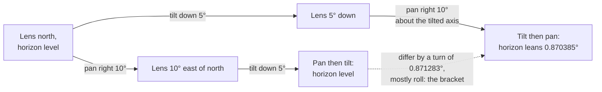
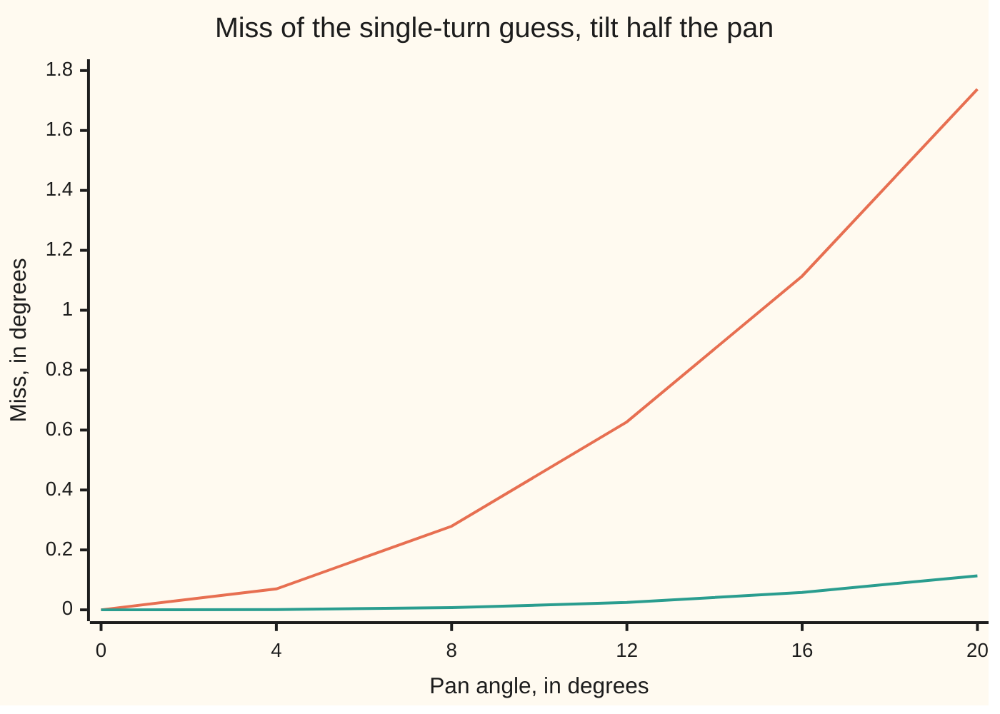

# Baker-Campbell-Hausdorff: two small motions leave a bracket behind

[Syllabus](../../../SYLLABUS.md) → [Differential geometry and Lie groups](../README.md) → [Lie Groups](../README.md#s06) → Baker-Campbell-Hausdorff

---

## General Overview

A drone hovers with its camera gimbal level, lens pointing north. The pilot sends two small nudges: **pan right 10°** and **tilt down 5°**. Each nudge turns the camera about its own current axes: pan about the camera's down axis, tilt about the camera's right axis.

Send them in each order and the camera ends in two different places.

- **Pan, then tilt.** The lens points 0.981060 north, 0.172987 east, 0.087156 down. The horizon in the picture stays level.
- **Tilt, then pan.** The lens points almost the same way: the two aims differ by only 0.084787°. But the horizon now leans by 0.870385°.

The two finished orientations differ by a turn of 0.871283°, nearly all of it roll (a turn about the lens axis). That leftover is the **bracket** of the two nudges (the part of the result that depends on their order). Its size is the pan angle times the tilt angle, both in radians: a roll of 0.872665°.

This card measures that leftover. It asks: which **single** steady turn does the same job as "pan, then tilt"? The naive guess is "pan plus tilt", one turn about a tilted axis. The guess misses by 1569.1366 arcseconds (an arcsecond is 1/3600 of a degree). Adding half the bracket cuts the miss to 51.0994 arcseconds. One more term cuts it to 0.0435.

**The single turn equal to two turns in a row is their sum, plus half their bracket, plus smaller nested brackets: the Baker-Campbell-Hausdorff series.**

**What kind of fact this is:** a theorem. The half-bracket term is proved on this card in Why it works, and the third-order term is computed in a fold. That every later term is a nested bracket (Dynkin's form of the series) is stated and cited, not proved. All of it is local: it holds for small enough turns.

### The picture: same two nudges, two orders



Pan about the tilted down axis drags the horizon with it. That is why camera gimbals put the pan motor outermost.

---

## The formula

Reminders from [Lie algebra](02-lie-algebras-and-the-exponential-map.md). A turn rate, or a small turn, is a vector $`u`$: its direction is the axis and its length is the angle in radians. The matrix $`[u]_\times`$, read "u cross", does a cross product with $`u`$. Such skew matrices form the Lie algebra $`\mathfrak{so}(3)`$, the flat space of velocities at the identity. $`e^{X}`$ is the exponential series of a matrix $`X`$, and $`[X, Y] = XY - YX`$ is the bracket. For turns, $`[[u]_\times, [v]_\times] = [u \times v]_\times`$.

[The matrix exponential](../../08-Differential%20equations%20and%20dynamics/04-Systems%20and%20the%20Matrix%20Exponential/04-the-matrix-exponential.md) shows that $`e^{A+B} = e^{A}e^{B}`$ holds when $`AB = BA`$ and fails in general otherwise: split two rooms' heat flows into parts that do not commute, and the predicted temperature comes out wrong. This card measures by how much.

New notation, in words first: the **matrix log**, written $`\log R`$, undoes exp. It is the member $`Z`$ of the Lie algebra, nearest zero, with $`e^{Z} = R`$. For a turn, $`\log R`$ is the single steady turn that lands on $`R`$.

```math
\log\left(e^{X}e^{Y}\right) = X + Y + \tfrac12[X, Y] + \tfrac1{12}\left([X, [X, Y]] + [Y, [Y, X]]\right) + \cdots
```

**Read it aloud:** one turn equal to "X, then Y" is X plus Y, plus half their bracket, plus a twelfth of two doubly nested brackets, plus smaller terms.

For turns, every bracket becomes a cross product, so the series works on vectors:

```math
z = u + v + \tfrac12\, u \times v + \tfrac1{12}\left(u \times (u \times v) + v \times (v \times u)\right) + \cdots
```

On the gimbal, with the axes forward, right, down of the starting camera (north, east, down at the start), pan is $`u = (0, 0, a)`$ and tilt is $`v = (0, -b, 0)`$. The cross product is $`u \times v = (ab, 0, 0)`$: a pure roll.

| Symbol | Plain meaning | In our example | Push it up and the answer… |
| --- | --- | --- | --- |
| $`a`$, $`b`$ | pan and tilt angles, in radians | 0.174533 (10°) and 0.087266 (5°) | the bracket grows as $`ab`$ |
| $`u`$, $`v`$ | the two turns as vectors: axis times angle, components forward, right, down | $`(0, 0, a)`$, $`(0, -b, 0)`$ | — |
| $`X`$, $`Y`$ | the same turns as skew matrices: $`X = [u]_\times`$, $`Y = [v]_\times`$ | members of $`\mathfrak{so}(3)`$ | — |
| $`[X, Y]`$, $`u \times v`$ | the bracket $`XY - YX`$, and its vector | roll of 0.872665° | a bigger leftover |
| $`e^{X}e^{Y}`$ | turn X, then turn Y about the moved axes | pan, then tilt | — |
| $`R`$, $`I`$ | a rotation matrix; the identity, no turn | $`R = e^{X}e^{Y}`$ | — |
| $`\log R`$, $`Z`$, $`z`$ | the matrix log; the single turn it gives, as a matrix and as a vector | $`z`$ = (0.436332°, −4.987298°, 9.993647°) | — |
| $`M`$; $`M_1`$, $`M_2`$, $`M_3`$ | $`R - I`$, what the log series expands; its parts with one, two, three factors | size 0.1948 for the gimbal | past size 1 the series runs away |
| $`s`$, $`k`$ | a factor scaling both nudges; the number of factors in a term | $`s`$ = 1, 0.5, 0.25 | a $`k`$-factor term grows as $`s^k`$ |
| $`\lVert X\rVert`$, $`\theta`$ | the operator norm, the most $`X`$ stretches any vector, which for $`[u]_\times`$ is the angle; the angle of one turn | $`a + b`$ = 0.261799; $`\theta`$ = 120.0000° at pan 90°, tilt 90° | — |
| $`A`$, $`B`$, $`h`$ | any two square matrices; a time step | rate matrices of a split equation | the splitting error grows as $`h^2`$ |

### When it holds

- **Small turns.** The series is guaranteed to converge when $`\lVert X\rVert + \lVert Y\rVert < \ln 2`$ = 0.693147 rad. The gimbal's 0.261799 rad is inside. At pan 90°, tilt 90° the log series itself runs away (What breaks).
- **Turns that do not commute.** Two pans about the same axis commute, the bracket is zero, and $`u + v`$ is exact. Every correction term needs a bracket.
- **The right order.** $`\log(e^{Y}e^{X})`$ has $`-\tfrac12[X, Y]`$. Swap the order and the roll flips sign: tilt-then-pan has $`z`$ = (−0.436332°, −4.987298°, 9.993647°).
- **A local statement.** The series describes the group near the identity. It says nothing about turns near 180°, where the log stops being unique.

---

## Why it works

### Step 0: the gap must be a bracket

If $`X`$ and $`Y`$ commute, $`e^{X}e^{Y} = e^{X+Y}`$ exactly. So the correction to $`X + Y`$ must vanish whenever $`XY = YX`$. The simplest quantity with that property is $`XY - YX`$: the bracket. Expanding both sides to second order shows the bracket is exactly what appears, with the factor one half.

### Step 1: expand both sides to second order

Write the exponential series and keep terms up to two factors:

```math
e^{X}e^{Y} = \left(I + X + \tfrac12 X^2\right)\left(I + Y + \tfrac12 Y^2\right) = I + X + Y + \tfrac12 X^2 + XY + \tfrac12 Y^2 + \cdots
```

```math
e^{X+Y} = I + X + Y + \tfrac12\left(X^2 + XY + YX + Y^2\right) + \cdots
```

The two differ only in their mixed terms: $`XY`$ against $`\tfrac12(XY + YX)`$. The difference is $`\tfrac12(XY - YX) = \tfrac12[X, Y]`$. Adding it inside the exponent repairs the gap at this order:

```math
e^{X}e^{Y} = e^{X + Y + \frac12[X, Y] + (\text{three or more factors})}
```

On the gimbal, $`\tfrac12 u \times v`$ is a roll of 0.436332°. That is the first component of the exact $`z`$.

### Step 2: the log series gives every term

To find the exponent directly, take the log. For $`R`$ near $`I`$ write $`R = I + M`$. The log has the same series as for numbers:

```math
\log(I + M) = M - \tfrac12 M^2 + \tfrac13 M^3 - \cdots
```

Put $`M = e^{X}e^{Y} - I`$ and collect terms by the number of factors. Two factors give $`\tfrac12[X, Y]`$ again. Three factors give the term with one twelfth.

<details>
<summary>Detailed proof: the third-order term is one twelfth of two nested brackets</summary>

Split $`M`$ by number of factors: $`M_1 = X + Y`$, $`M_2 = \tfrac12 X^2 + XY + \tfrac12 Y^2`$, and $`M_3 = \tfrac16 X^3 + \tfrac12 X^2Y + \tfrac12 XY^2 + \tfrac16 Y^3`$.

The three-factor part of the log is

$`\displaystyle M_3 - \tfrac12\left(M_1M_2 + M_2M_1\right) + \tfrac13 M_1^3`$

Read off the coefficient of each word, one at a time.

- $`XXY`$: $`\tfrac12 - \tfrac12\left(1 + \tfrac12\right) + \tfrac13 = \tfrac1{12}`$.
- $`XYX`$: $`0 - \tfrac12(0 + 1) + \tfrac13 = -\tfrac16`$.
- $`YXX`$: $`0 - \tfrac12\left(\tfrac12 + 0\right) + \tfrac13 = \tfrac1{12}`$.
- $`XXX`$: $`\tfrac16 - \tfrac12\left(\tfrac12 + \tfrac12\right) + \tfrac13 = 0`$, and the same for $`YYY`$.
- The words with two Y's mirror these: $`XYY`$ and $`YYX`$ get $`\tfrac1{12}`$, $`YXY`$ gets $`-\tfrac16`$.

Now expand the nested brackets:

$`\displaystyle [X, [X, Y]] = X^2Y - 2XYX + YX^2, \qquad [Y, [Y, X]] = Y^2X - 2YXY + XY^2`$

Their sum, divided by 12, has exactly the coefficients above. So the three-factor term is $`\tfrac1{12}\left([X, [X, Y]] + [Y, [Y, X]]\right)`$.

</details>

On the gimbal the third-order term moves tilt from −5° to −4.987308° and pan from 10° to 9.993654°. The exact log has −4.987298° and 9.993647°.

### Step 3: every term is a bracket

The pattern continues. Every term after $`X + Y`$ is built from nested brackets alone. Hall's book (Sources), chapter 5, proves this from an integral form of the formula. Dynkin wrote every term out explicitly; that form is stated here, not proved.

Its meaning matters more than its proof. Brackets of Lie-algebra members stay in the Lie algebra. So the product of two turns near the identity is fixed by the bracket alone. The group's curved shape near $`I`$ is coded in one operation on a flat space.

For turns, brackets are cross products. So the whole series runs on 3-vectors: $`z = u + v + \tfrac12 u \times v + \cdots`$, with no matrices needed.

### Step 4: the loop is a corollary

[Lie algebra](02-lie-algebras-and-the-exponential-map.md) shows that a loop of small moves leaves the bracket behind. The series explains why. Apply it twice to pan, tilt, unpan, untilt:

```math
e^{X}e^{Y}e^{-X}e^{-Y} = e^{X + Y + \frac12[X, Y]}\,e^{-X - Y + \frac12[X, Y]} = e^{[X, Y] + (\text{three or more factors})}
```

The sums $`X + Y`$ and $`-X - Y`$ cancel, and the bracket of the two exponents has three or more factors. Two halves of $`[X, Y]`$ remain. On the gimbal the loop leaves (0.867148°, 0.075866°, 0.037860°). The bracket predicts a roll of 0.872665°.

### Step 5: the miss shrinks by a power of the size

Scale both nudges by a factor $`s`$. A term with $`k`$ factors scales as $`s^k`$. So stopping after the $`k`$-factor terms misses by about $`s^{k+1}`$. Halving the nudges should divide the misses by 4, then 8.

The check finds 3.997 and 8.002. After the third-order term it finds 32.006, not 16, because the fourth-order term $`-\tfrac1{24}[Y, [X, [X, Y]]]`$ is zero for these two axes. Each of these ratios is a second road to the formula's coefficients: a wrong coefficient leaves an $`s^2`$ or $`s^3`$ error, and the ratio falls back to 4 or 8.

### Step 6: when the series converges

The log series converges when $`M`$ is small. A sufficient test uses the operator norm, which never grows faster under products than the product of norms: $`\lVert e^{X}e^{Y} - I\rVert \le e^{\lVert X\rVert + \lVert Y\rVert} - 1`$, and this is below 1 when $`\lVert X\rVert + \lVert Y\rVert < \ln 2`$.

For a turn by angle $`\theta`$ the exact test is sharper. $`M = R - I`$ has eigenvalues (stretch factors of its special directions) of size 0 and $`2\sin(\theta/2)`$. The series converges when that is below 1, so for turns under 60°. The gimbal's product gives 0.1948. Pan 90° then tilt 90° makes one turn of 120.0000°, size 1.7321, and the series runs away.

---

## Worked numbers, by hand

| Step | Arithmetic | Value |
| --- | --- | --- |
| angles in radians | 10 × π/180, 5 × π/180 | 0.174533, 0.087266 |
| pan and tilt as vectors | about down; about right, downward is negative | $`u`$ = (0, 0, 10°), $`v`$ = (0, −5°, 0) |
| first guess, $`u + v`$ | add the vectors | (0, −5°, 10°) |
| the bracket, $`u \times v`$ | $`(0 \cdot 0 - a \cdot (-b),\ 0,\ 0)`$ | ($`ab`$, 0, 0) = roll 0.872665° |
| half the bracket | 0.872665 / 2 | roll 0.436332° |
| third order, $`\tfrac1{12}`$ terms | $`(0,\ a^2b/12,\ -ab^2/12)`$ added | (0.436332°, −4.987308°, 9.993654°) |
| exact single turn, $`\log(e^{X}e^{Y})`$ | log of the product | **(0.436332°, −4.987298°, 9.993647°)** |
| misses of orders 1, 2, 3 | angle from each guess to the true product | 1569.1366, 51.0994, 0.0435 arcsec |

The one steady turn that matches "pan, then tilt" carries a roll of 0.436332°, which "pan plus tilt" leaves out entirely.

### What breaks if you drop a piece

| Mistake | Comes out at | What went wrong |
| --- | --- | --- |
| Dropping the bracket: $`z = u + v`$ | misses by 1569.1366 arcsec | the nudges do not commute |
| Bracket with the wrong sign, $`\tfrac12[Y, X]`$ | misses by 3137.0310 arcsec | that is the series for tilt, then pan |
| The series at pan 90°, tilt 90° | order 3 misses by 3.4093°; log series after 5, 10, 20 terms: 424.2°, 2368.4°, 136867.0° | the turns are not small: $`\pi > \ln 2`$, and the 120.0000° product fails the 60° test |
| Expecting a leftover from two pans, 10° and 5° | bracket 0.000000; $`u + v`$ misses by 0.0000 arcsec | turns about one axis commute, so nothing is left behind |

The code prints all four.

### The picture: how fast each guess goes wrong



Orange: $`u + v`$, growing as the square of the pan. Teal: with half the bracket added, growing as the cube and staying far smaller.

---

## Code, from first principles, and it actually runs

The programs build the two gimbal orders as 3 by 3 matrices and find the single turn that matches "pan, then tilt". They reach it by three independent roads. Road 1 is the closed-form log (angle from the trace, axis from the skew part). Road 2 is the log power series $`M - M^2/2 + \cdots`$, sharing no formula with road 1. Road 3 is the Baker-Campbell-Hausdorff series itself, whose misses must shrink 4, 8 and 32 times when the nudges are halved. The exponential is also built twice, by its series and by Rodrigues' formula.

### Python

```python
# Baker-Campbell-Hausdorff in outline -- the check behind the card.  Standard
# library only.  A camera gimbal pans 10 deg (about its down axis) and tilts
# 5 deg down (about its right axis), each about the camera's own current axes,
# in both orders.  Axes north, east, down; a turn is a rotation vector w, its
# generator the skew matrix [w]x.  Roads: exp by power series against the closed
# form; log by power series against the closed form; the BCH series against the
# exact log, with errors that shrink by 4, 8, 32 when the nudges are halved.
import math
D, AS = math.pi / 180, 3600 * 180 / math.pi          # radians per degree, arcseconds per radian
I3 = [[1.0, 0.0, 0.0], [0.0, 1.0, 0.0], [0.0, 0.0, 1.0]]
def mul(A, B): return [[sum(A[i][k] * B[k][j] for k in range(3)) for j in range(3)] for i in range(3)]
def lin(A, B, s=1.0): return [[A[i][j] + s * B[i][j] for j in range(3)] for i in range(3)]
def tp(A): return [[A[j][i] for j in range(3)] for i in range(3)]
def hat(w): return [[0.0, -w[2], w[1]], [w[2], 0.0, -w[0]], [-w[1], w[0], 0.0]]
def vee(K): return [(K[2][1] - K[1][2]) / 2, (K[0][2] - K[2][0]) / 2, (K[1][0] - K[0][1]) / 2]
def cross(u, v): return [u[1] * v[2] - u[2] * v[1], u[2] * v[0] - u[0] * v[2], u[0] * v[1] - u[1] * v[0]]
def add(*vs): return [sum(c) for c in zip(*vs)]
def sc(s, v): return [s * x for x in v]
def norm(v): return math.sqrt(sum(x * x for x in v))
def gap(A, B): return max(abs(A[i][j] - B[i][j]) for i in range(3) for j in range(3))
def br(A, B): return lin(mul(A, B), mul(B, A), -1.0)  # the bracket [A, B] = AB - BA

def exp_series(K, n=40):                               # road one: I + K + K^2/2! + ...
    S, P = I3, I3
    for k in range(1, n):
        P = [[x / k for x in row] for row in mul(P, K)]
        S = lin(S, P)
    return S
def exp_closed(w):                                     # road two: Rodrigues' formula
    t, K = norm(w), hat(w)
    if t == 0: return I3
    return lin(lin(I3, K, math.sin(t) / t), mul(K, K), (1 - math.cos(t)) / t ** 2)
def log_closed(R):                                     # road one: angle from the trace, axis from the skew part
    t = math.acos(max(-1.0, min(1.0, (R[0][0] + R[1][1] + R[2][2] - 1) / 2)))
    return sc(t / math.sin(t), vee(R)) if t > 1e-12 else vee(R)
def log_series(R, n):                                  # road two: M - M^2/2 + M^3/3 - ..., M = R - I
    M = lin(R, I3, -1.0)
    S, P = [[0.0] * 3 for _ in range(3)], I3
    for k in range(1, n + 1):
        P = mul(P, M)
        S = lin(S, P, (-1) ** (k + 1) / k)
    return S
def bch(u, v, order):                                  # the series, with [[u]x, [v]x] = [u x v]x
    terms = [add(u, v), sc(0.5, cross(u, v)),
             sc(1 / 12, add(cross(u, cross(u, v)), cross(v, cross(v, u))))]
    return add(*terms[:order])
def miss(z, R): return norm(log_closed(mul(exp_closed(sc(-1.0, z)), R))) * AS  # turn angle, arcsec
def v3(w): return "(" + ", ".join(f"{x / D:.6f}" for x in w) + ")"
def yn(c): return "yes" if c else "no"
def scaled(s, k):                                      # order-k miss with both nudges times s, arcsec
    us, vs = sc(s, u), sc(s, v)
    return miss(bch(us, vs, k), mul(exp_closed(us), exp_closed(vs)))

a, b = 10 * D, 5 * D
u, v = [0.0, 0.0, a], [0.0, -b, 0.0]                   # pan right 10 deg, tilt down 5 deg
X, Y = hat(u), hat(v)
P, T = exp_series(X), exp_series(Y)
PT, TP = mul(P, T), mul(T, P)                          # pan then tilt; tilt then pan
print(f"pan {a:.6f} rad, tilt {-b:.6f} rad; exp series = closed form below 1e-12: "
      f"{yn(gap(P, exp_closed(u)) < 1e-12 and gap(T, exp_closed(v)) < 1e-12)}")
for name, R in (("pan then tilt", PT), ("tilt then pan", TP)):
    print(f"{name}: camera points ({R[0][0]:.6f}, {R[1][0]:.6f}, {R[2][0]:.6f}), "
          f"horizon lean {math.atan2(R[2][1], R[2][2]) / D:.6f} deg")
aim = math.acos(sum(PT[i][0] * TP[i][0] for i in range(3)))
print(f"the two aims differ by {aim / D:.6f} deg; the orders differ by a turn of "
      f"{norm(log_closed(mul(tp(TP), PT))) / D:.6f} deg")
Z, Zs = log_closed(PT), vee(log_series(PT, 40))
print(f"Z = log(pan then tilt), deg: {v3(Z)}; log series agrees below 1e-12: {yn(norm(add(Z, sc(-1.0, Zs))) < 1e-12)}")
print(f"exp(Z) rebuilds pan then tilt below 1e-12: {yn(gap(exp_series(hat(Z)), PT) < 1e-12)}")
print(f"[X, Y] as matrices equals [u x v]x below 1e-15: {yn(gap(br(X, Y), hat(cross(u, v))) < 1e-15)}")
print(f"u x v, deg: {v3(cross(u, v))}; a times b = {a * b / D:.6f} deg of roll")
err = [miss(bch(u, v, k), PT) for k in (1, 2, 3)]
for k in (1, 2, 3):
    print(f"BCH to order {k}, deg {v3(bch(u, v, k))}: misses by {err[k - 1]:.4f} arcsec")
print(f"Z for tilt then pan, deg: {v3(log_closed(TP))}")
C = mul(PT, mul(exp_series(hat(sc(-1.0, u))), exp_series(hat(sc(-1.0, v)))))  # pan, tilt, unpan, untilt
print(f"pan, tilt, unpan, untilt leaves, deg: {v3(log_closed(C))}; [X, Y] predicts {v3(cross(u, v))}")
rat = []
for s in (1.0, 0.5, 0.25):
    rat.append([scaled(s, k) for k in (1, 2, 3)])
    print(f"nudges x {s:.2f}: orders 1, 2, 3 miss by {rat[-1][0]:.4f}, {rat[-1][1]:.4f}, {rat[-1][2]:.4f} arcsec")
r = [rat[0][k] / rat[1][k] for k in range(3)]
print(f"halving the nudges divides the misses by {r[0]:.3f}, {r[1]:.3f}, {r[2]:.3f}; "
      f"order-4 term -[Y, [X, [X, Y]]]/24 here: {norm(cross(v, cross(u, cross(u, v)))) / 24:.6f}")
for k, label in ((1, "X + Y misses"), (2, "with the bracket")):
    print(f"chart, pan 0..20 by 4, {label}, deg: " + ", ".join(f"{scaled(p / 10, k) / 3600:.4f}" for p in range(0, 21, 4)))
u2 = [0.0, 0.0, 5 * D]
print(f"mistake 1, two pans 10 and 5 deg: bracket {norm(cross(u, u2)):.6f}, X + Y misses by "
      f"{miss(add(u, u2), mul(P, exp_closed(u2))):.4f} arcsec")
print(f"mistake 2, bracket dropped: misses by {err[0]:.4f} arcsec")
print(f"mistake 3, bracket sign flipped: misses by {miss(add(u, v, sc(-0.5, cross(u, v))), PT):.4f} arcsec")
U, V = [0.0, 0.0, 90 * D], [0.0, -90 * D, 0.0]
B = mul(exp_closed(U), exp_closed(V))
grow = [norm(vee(log_series(B, n))) / D for n in (5, 10, 20)]
print(f"mistake 4, pan 90 then tilt 90: one turn of {norm(log_closed(B)) / D:.4f} deg; BCH order 3 misses by "
      f"{miss(bch(U, V, 3), B) / 3600:.4f} deg; log series after 5, 10, 20 terms: {grow[0]:.1f}, {grow[1]:.1f}, {grow[2]:.1f} deg")
rad = [2 * math.sin(norm(log_closed(R)) / 2) for R in (PT, B)]  # size of each eigenvalue of R - I
print(f"log series needs 2 sin(angle/2) below 1: house {rad[0]:.4f}, 90 then 90 {rad[1]:.4f}; "
      f"pan + tilt {a + b:.6f} rad against ln 2 = {math.log(2):.6f}")
assert norm(add(Z, sc(-1.0, Zs))) < 1e-12                     # two roads to the log agree
assert gap(br(X, Y), hat(cross(u, v))) < 1e-15                # matrix bracket = cross product
assert err[0] > 10 * err[1] and err[1] > 100 * err[2]          # each order shrinks the miss
assert abs(err[0] / 3600 - a * b / 2 / D) < 0.001             # first miss is half the bracket
assert 3.8 < r[0] < 4.2 and 7.6 < r[1] < 8.4 and 30 < r[2] < 34  # misses scale as s^2, s^3, s^5
assert abs(log_closed(C)[0] - a * b) < 0.01 * a * b           # the loop leaves the bracket's roll
assert grow[2] > 10 * grow[1] and grow[1] > 2 * grow[0] and rad[1] > 1                           # past the radius the series runs away
print("ALL CHECKS PASS")
```

**Ran 2026-11-19 on macOS, Python 3.14.10, standard library only. All checks passed. Output, pasted from the run:**

```
pan 0.174533 rad, tilt -0.087266 rad; exp series = closed form below 1e-12: yes
pan then tilt: camera points (0.981060, 0.172987, 0.087156), horizon lean 0.000000 deg
tilt then pan: camera points (0.981060, 0.173648, 0.085832), horizon lean -0.870385 deg
the two aims differ by 0.084787 deg; the orders differ by a turn of 0.871283 deg
Z = log(pan then tilt), deg: (0.436332, -4.987298, 9.993647); log series agrees below 1e-12: yes
exp(Z) rebuilds pan then tilt below 1e-12: yes
[X, Y] as matrices equals [u x v]x below 1e-15: yes
u x v, deg: (0.872665, 0.000000, -0.000000); a times b = 0.872665 deg of roll
BCH to order 1, deg (0.000000, -5.000000, 10.000000): misses by 1569.1366 arcsec
BCH to order 2, deg (0.436332, -5.000000, 10.000000): misses by 51.0994 arcsec
BCH to order 3, deg (0.436332, -4.987308, 9.993654): misses by 0.0435 arcsec
Z for tilt then pan, deg: (-0.436332, -4.987298, 9.993647)
pan, tilt, unpan, untilt leaves, deg: (0.867148, 0.075866, 0.037860); [X, Y] predicts (0.872665, 0.000000, -0.000000)
nudges x 1.00: orders 1, 2, 3 miss by 1569.1366, 51.0994, 0.0435 arcsec
nudges x 0.50: orders 1, 2, 3 miss by 392.5953, 6.3862, 0.0014 arcsec
nudges x 0.25: orders 1, 2, 3 miss by 98.1683, 0.7982, 0.0000 arcsec
halving the nudges divides the misses by 3.997, 8.002, 32.006; order-4 term -[Y, [X, [X, Y]]]/24 here: 0.000000
chart, pan 0..20 by 4, X + Y misses, deg: 0.0000, 0.0698, 0.2791, 0.6274, 1.1140, 1.7380
chart, pan 0..20 by 4, with the bracket, deg: 0.0000, 0.0009, 0.0073, 0.0245, 0.0582, 0.1136
mistake 1, two pans 10 and 5 deg: bracket 0.000000, X + Y misses by 0.0000 arcsec
mistake 2, bracket dropped: misses by 1569.1366 arcsec
mistake 3, bracket sign flipped: misses by 3137.0310 arcsec
mistake 4, pan 90 then tilt 90: one turn of 120.0000 deg; BCH order 3 misses by 3.4093 deg; log series after 5, 10, 20 terms: 424.2, 2368.4, 136867.0 deg
log series needs 2 sin(angle/2) below 1: house 0.1948, 90 then 90 1.7321; pan + tilt 0.261799 rad against ln 2 = 0.693147
ALL CHECKS PASS
```

### Rust

Same numbers, same labels, built with `rustc --edition 2021 -O`.

```rust
// Baker-Campbell-Hausdorff in outline -- the same check as the Python, in Rust.
// No crates.  A camera gimbal pans 10 deg (about its down axis) and tilts
// 5 deg down (about its right axis), each about the camera's own current axes,
// in both orders.  Axes north, east, down; a turn is a rotation vector w, its
// generator the skew matrix [w]x.  Roads: exp by power series against the closed
// form; log by power series against the closed form; the BCH series against the
// exact log, with errors that shrink by 4, 8, 32 when the nudges are halved.
use std::f64::consts::PI;
type M3 = [[f64; 3]; 3];
type V3 = [f64; 3];
const D: f64 = PI / 180.0;
const AS: f64 = 3600.0 * 180.0 / PI;
const I3: M3 = [[1.0, 0.0, 0.0], [0.0, 1.0, 0.0], [0.0, 0.0, 1.0]];

fn mul(a: &M3, b: &M3) -> M3 {
    let mut c = [[0.0; 3]; 3];
    for i in 0..3 { for j in 0..3 { c[i][j] = (0..3).map(|k| a[i][k] * b[k][j]).sum() } }
    c
}
fn lin(a: &M3, b: &M3, s: f64) -> M3 {
    let mut c = *a;
    for i in 0..3 { for j in 0..3 { c[i][j] += s * b[i][j] } }
    c
}
fn tp(a: &M3) -> M3 {
    let mut c = *a;
    for i in 0..3 { for j in 0..3 { c[i][j] = a[j][i] } }
    c
}
fn hat(w: V3) -> M3 { [[0.0, -w[2], w[1]], [w[2], 0.0, -w[0]], [-w[1], w[0], 0.0]] }
fn vee(k: &M3) -> V3 { [(k[2][1] - k[1][2]) / 2.0, (k[0][2] - k[2][0]) / 2.0, (k[1][0] - k[0][1]) / 2.0] }
fn cross(u: V3, v: V3) -> V3 { [u[1] * v[2] - u[2] * v[1], u[2] * v[0] - u[0] * v[2], u[0] * v[1] - u[1] * v[0]] }
fn add(u: V3, v: V3) -> V3 { [u[0] + v[0], u[1] + v[1], u[2] + v[2]] }
fn sc(s: f64, v: V3) -> V3 { [s * v[0], s * v[1], s * v[2]] }
fn norm(v: V3) -> f64 { (v[0] * v[0] + v[1] * v[1] + v[2] * v[2]).sqrt() }
fn gap(a: &M3, b: &M3) -> f64 {
    let mut g: f64 = 0.0;
    for i in 0..3 { for j in 0..3 { g = g.max((a[i][j] - b[i][j]).abs()) } }
    g
}
fn br(a: &M3, b: &M3) -> M3 { lin(&mul(a, b), &mul(b, a), -1.0) } // the bracket [A, B] = AB - BA

fn exp_series(k: &M3) -> M3 {                         // road one: I + K + K^2/2! + ...
    let (mut s, mut p) = (I3, I3);
    for n in 1..40 {
        p = mul(&p, k);
        for row in p.iter_mut() { for x in row.iter_mut() { *x /= n as f64 } }
        s = lin(&s, &p, 1.0);
    }
    s
}
fn exp_closed(w: V3) -> M3 {                          // road two: Rodrigues' formula
    let (t, k) = (norm(w), hat(w));
    if t == 0.0 { return I3 }
    lin(&lin(&I3, &k, t.sin() / t), &mul(&k, &k), (1.0 - t.cos()) / (t * t))
}
fn log_closed(r: &M3) -> V3 {                         // road one: angle from the trace, axis from the skew part
    let t = ((r[0][0] + r[1][1] + r[2][2] - 1.0) / 2.0).clamp(-1.0, 1.0).acos();
    if t > 1e-12 { sc(t / t.sin(), vee(r)) } else { vee(r) }
}
fn log_series(r: &M3, n: usize) -> M3 {               // road two: M - M^2/2 + M^3/3 - ..., M = R - I
    let m = lin(r, &I3, -1.0);
    let (mut s, mut p) = ([[0.0; 3]; 3], I3);
    for k in 1..=n {
        p = mul(&p, &m);
        let sign = if k % 2 == 1 { 1.0 } else { -1.0 };
        s = lin(&s, &p, sign / k as f64);
    }
    s
}
fn bch(u: V3, v: V3, order: usize) -> V3 {            // the series, with [[u]x, [v]x] = [u x v]x
    let terms = [add(u, v), sc(0.5, cross(u, v)),
                 sc(1.0 / 12.0, add(cross(u, cross(u, v)), cross(v, cross(v, u))))];
    terms[..order].iter().fold([0.0; 3], |acc, t| add(acc, *t))
}
fn miss(z: V3, r: &M3) -> f64 { norm(log_closed(&mul(&exp_closed(sc(-1.0, z)), r))) * AS } // turn angle, arcsec
fn v3(w: V3) -> String { format!("({:.6}, {:.6}, {:.6})", w[0] / D, w[1] / D, w[2] / D) }
fn yn(c: bool) -> &'static str { if c { "yes" } else { "no" } }

fn main() {
    let (a, b) = (10.0 * D, 5.0 * D);
    let (u, v): (V3, V3) = ([0.0, 0.0, a], [0.0, -b, 0.0]); // pan right 10 deg, tilt down 5 deg
    let scaled = |s: f64, k: usize| -> f64 {          // order-k miss with both nudges times s, arcsec
        let (us, vs) = (sc(s, u), sc(s, v));
        miss(bch(us, vs, k), &mul(&exp_closed(us), &exp_closed(vs)))
    };
    let (x, y) = (hat(u), hat(v));
    let (p, t) = (exp_series(&x), exp_series(&y));
    let (pt, tpm) = (mul(&p, &t), mul(&t, &p));       // pan then tilt; tilt then pan
    println!("pan {:.6} rad, tilt {:.6} rad; exp series = closed form below 1e-12: {}", a, -b,
             yn(gap(&p, &exp_closed(u)) < 1e-12 && gap(&t, &exp_closed(v)) < 1e-12));
    for (name, r) in [("pan then tilt", &pt), ("tilt then pan", &tpm)] {
        println!("{}: camera points ({:.6}, {:.6}, {:.6}), horizon lean {:.6} deg",
                 name, r[0][0], r[1][0], r[2][0], r[2][1].atan2(r[2][2]) / D);
    }
    let aim = (0..3).map(|i| pt[i][0] * tpm[i][0]).sum::<f64>().acos();
    println!("the two aims differ by {:.6} deg; the orders differ by a turn of {:.6} deg",
             aim / D, norm(log_closed(&mul(&tp(&tpm), &pt))) / D);
    let (z, zs) = (log_closed(&pt), vee(&log_series(&pt, 40)));
    println!("Z = log(pan then tilt), deg: {}; log series agrees below 1e-12: {}", v3(z), yn(norm(add(z, sc(-1.0, zs))) < 1e-12));
    println!("exp(Z) rebuilds pan then tilt below 1e-12: {}", yn(gap(&exp_series(&hat(z)), &pt) < 1e-12));
    println!("[X, Y] as matrices equals [u x v]x below 1e-15: {}", yn(gap(&br(&x, &y), &hat(cross(u, v))) < 1e-15));
    println!("u x v, deg: {}; a times b = {:.6} deg of roll", v3(cross(u, v)), a * b / D);
    let err: Vec<f64> = (1..=3).map(|k| miss(bch(u, v, k), &pt)).collect();
    for k in 1..=3 {
        println!("BCH to order {}, deg {}: misses by {:.4} arcsec", k, v3(bch(u, v, k)), err[k - 1]);
    }
    println!("Z for tilt then pan, deg: {}", v3(log_closed(&tpm)));
    let c = mul(&pt, &mul(&exp_series(&hat(sc(-1.0, u))), &exp_series(&hat(sc(-1.0, v))))); // pan, tilt, unpan, untilt
    println!("pan, tilt, unpan, untilt leaves, deg: {}; [X, Y] predicts {}", v3(log_closed(&c)), v3(cross(u, v)));
    let mut rat: Vec<Vec<f64>> = Vec::new();
    for s in [1.0, 0.5, 0.25] {
        rat.push((1..=3).map(|k| scaled(s, k)).collect());
        let q = &rat[rat.len() - 1];
        println!("nudges x {:.2}: orders 1, 2, 3 miss by {:.4}, {:.4}, {:.4} arcsec", s, q[0], q[1], q[2]);
    }
    let r: Vec<f64> = (0..3).map(|k| rat[0][k] / rat[1][k]).collect();
    println!("halving the nudges divides the misses by {:.3}, {:.3}, {:.3}; order-4 term -[Y, [X, [X, Y]]]/24 here: {:.6}",
             r[0], r[1], r[2], norm(cross(v, cross(u, cross(u, v)))) / 24.0);
    for (k, label) in [(1, "X + Y misses"), (2, "with the bracket")] {
        let pts: Vec<String> = (0..=20).step_by(4).map(|p| format!("{:.4}", scaled(p as f64 / 10.0, k) / 3600.0)).collect();
        println!("chart, pan 0..20 by 4, {}, deg: {}", label, pts.join(", "));
    }
    let u2: V3 = [0.0, 0.0, 5.0 * D];
    println!("mistake 1, two pans 10 and 5 deg: bracket {:.6}, X + Y misses by {:.4} arcsec",
             norm(cross(u, u2)), miss(add(u, u2), &mul(&p, &exp_closed(u2))));
    println!("mistake 2, bracket dropped: misses by {:.4} arcsec", err[0]);
    println!("mistake 3, bracket sign flipped: misses by {:.4} arcsec", miss(add(add(u, v), sc(-0.5, cross(u, v))), &pt));
    let (uu, vv): (V3, V3) = ([0.0, 0.0, 90.0 * D], [0.0, -90.0 * D, 0.0]);
    let bb = mul(&exp_closed(uu), &exp_closed(vv));
    let grow: Vec<f64> = [5, 10, 20].iter().map(|&n| norm(vee(&log_series(&bb, n))) / D).collect();
    println!("mistake 4, pan 90 then tilt 90: one turn of {:.4} deg; BCH order 3 misses by {:.4} deg; log series after 5, 10, 20 terms: {:.1}, {:.1}, {:.1} deg",
             norm(log_closed(&bb)) / D, miss(bch(uu, vv, 3), &bb) / 3600.0, grow[0], grow[1], grow[2]);
    let rad: Vec<f64> = [&pt, &bb].iter().map(|r| 2.0 * (norm(log_closed(r)) / 2.0).sin()).collect(); // size of each eigenvalue of R - I
    println!("log series needs 2 sin(angle/2) below 1: house {:.4}, 90 then 90 {:.4}; pan + tilt {:.6} rad against ln 2 = {:.6}",
             rad[0], rad[1], a + b, 2f64.ln());
    assert!(norm(add(z, sc(-1.0, zs))) < 1e-12);                     // two roads to the log agree
    assert!(gap(&br(&x, &y), &hat(cross(u, v))) < 1e-15);            // matrix bracket = cross product
    assert!(err[0] > 10.0 * err[1] && err[1] > 100.0 * err[2]);      // each order shrinks the miss
    assert!((err[0] / 3600.0 - a * b / 2.0 / D).abs() < 0.001);      // first miss is half the bracket
    assert!(3.8 < r[0] && r[0] < 4.2 && 7.6 < r[1] && r[1] < 8.4 && 30.0 < r[2] && r[2] < 34.0); // s^2, s^3, s^5
    assert!((log_closed(&c)[0] - a * b).abs() < 0.01 * a * b);       // the loop leaves the bracket's roll
    assert!(grow[2] > 10.0 * grow[1] && grow[1] > 2.0 * grow[0] && rad[1] > 1.0); // past the radius the series runs away
    println!("ALL CHECKS PASS");
}
```

**Ran 2026-11-19 on macOS, rustc 1.98.1, no crates. All checks passed. Output, pasted from the run:**

```
pan 0.174533 rad, tilt -0.087266 rad; exp series = closed form below 1e-12: yes
pan then tilt: camera points (0.981060, 0.172987, 0.087156), horizon lean 0.000000 deg
tilt then pan: camera points (0.981060, 0.173648, 0.085832), horizon lean -0.870385 deg
the two aims differ by 0.084787 deg; the orders differ by a turn of 0.871283 deg
Z = log(pan then tilt), deg: (0.436332, -4.987298, 9.993647); log series agrees below 1e-12: yes
exp(Z) rebuilds pan then tilt below 1e-12: yes
[X, Y] as matrices equals [u x v]x below 1e-15: yes
u x v, deg: (0.872665, 0.000000, -0.000000); a times b = 0.872665 deg of roll
BCH to order 1, deg (0.000000, -5.000000, 10.000000): misses by 1569.1366 arcsec
BCH to order 2, deg (0.436332, -5.000000, 10.000000): misses by 51.0994 arcsec
BCH to order 3, deg (0.436332, -4.987308, 9.993654): misses by 0.0435 arcsec
Z for tilt then pan, deg: (-0.436332, -4.987298, 9.993647)
pan, tilt, unpan, untilt leaves, deg: (0.867148, 0.075866, 0.037860); [X, Y] predicts (0.872665, 0.000000, -0.000000)
nudges x 1.00: orders 1, 2, 3 miss by 1569.1366, 51.0994, 0.0435 arcsec
nudges x 0.50: orders 1, 2, 3 miss by 392.5953, 6.3862, 0.0014 arcsec
nudges x 0.25: orders 1, 2, 3 miss by 98.1683, 0.7982, 0.0000 arcsec
halving the nudges divides the misses by 3.997, 8.002, 32.006; order-4 term -[Y, [X, [X, Y]]]/24 here: 0.000000
chart, pan 0..20 by 4, X + Y misses, deg: 0.0000, 0.0698, 0.2791, 0.6274, 1.1140, 1.7380
chart, pan 0..20 by 4, with the bracket, deg: 0.0000, 0.0009, 0.0073, 0.0245, 0.0582, 0.1136
mistake 1, two pans 10 and 5 deg: bracket 0.000000, X + Y misses by 0.0000 arcsec
mistake 2, bracket dropped: misses by 1569.1366 arcsec
mistake 3, bracket sign flipped: misses by 3137.0310 arcsec
mistake 4, pan 90 then tilt 90: one turn of 120.0000 deg; BCH order 3 misses by 3.4093 deg; log series after 5, 10, 20 terms: 424.2, 2368.4, 136867.0 deg
log series needs 2 sin(angle/2) below 1: house 0.1948, 90 then 90 1.7321; pan + tilt 0.261799 rad against ln 2 = 0.693147
ALL CHECKS PASS
```

The two outputs match line for line.

### Lean

Lean proves the second-order formula, the convergence test and the third-order term, for real square matrices of any size.

- Take two square matrices $`X`$, $`Y`$, scaled by a small factor $`s`$, and add half their bracket to their sum. Then $`e`$ to that power misses $`e^{sX}e^{sY}`$ by at most a constant times $`s^3`$.
- Take two square matrices $`X`$, $`Y`$ whose operator norms add to less than $`\ln 2`$. Then $`M = e^{X}e^{Y} - I`$ has operator norm below 1, and the log series converges.
- Take any two square matrices $`X`$, $`Y`$, with $`M_1`$, $`M_2`$, $`M_3`$ as in the third-order fold. Then the two-factor part of the log is exactly $`\tfrac12[X, Y]`$.
- Take the same matrices. Then the three-factor part is exactly $`\tfrac1{12}([X, [X, Y]] + [Y, [Y, X]])`$.
- The fold's word coefficients also check: $`\tfrac1{12}`$ for $`XXY`$ and $`YXX`$, $`-\tfrac16`$ for $`XYX`$, and 0 for $`XXX`$.
- Take the gimbal's pan $`u = (0, 0, a)`$ and tilt $`v = (0, -b, 0)`$. Then $`u \times v = (ab, 0, 0)`$, a pure roll.
- Take two pans about the same axis. Then their bracket is zero.

The gimbal's angles, the exact log, the misses, their shrink ratios and the 90° failure are left to the Python and Rust checks.

```lean
-- Baker-Campbell-Hausdorff: e^X e^Y equals e^(X + Y + [X, Y]/2) up to third-order terms, the log series converges when the norms add to less than ln 2, and the second- and third-order terms are half a bracket and a twelfth of two nested brackets.
import Mathlib.Analysis.Normed.Algebra.MatrixExponential
import Mathlib.Analysis.CStarAlgebra.Matrix
import Mathlib.Analysis.SpecialFunctions.Log.Basic
import Mathlib.Analysis.Asymptotics.Defs
import Mathlib.Algebra.Lie.OfAssociative
import Mathlib.LinearAlgebra.CrossProduct
import Mathlib.Analysis.SpecialFunctions.Exponential
import Mathlib.Tactic.Module
import Mathlib.Tactic.NoncommRing

open NormedSpace Filter Asymptotics Topology Matrix
open scoped Matrix.Norms.L2Operator

variable {n : Type*} [Fintype n] [DecidableEq n]

/-- Helper: `‖e^X - 1‖ ≤ e^‖X‖ - 1`, comparing the two exponential series term by term. -/
theorem bch_norm_exp_sub_one_le (X : Matrix n n ℝ) :
    ‖exp X - 1‖ ≤ Real.exp ‖X‖ - 1 := by
  have h1 : HasSum (fun k : ℕ => ((k + 1).factorial⁻¹ : ℝ) • X ^ (k + 1)) (exp X - 1) := by
    have := exp_series_hasSum_exp' (𝕂 := ℝ) X
    rw [← hasSum_nat_add_iff' 1] at this
    simpa using this
  have h2 : HasSum (fun k : ℕ => ((k + 1).factorial⁻¹ : ℝ) • ‖X‖ ^ (k + 1))
      (Real.exp ‖X‖ - 1) := by
    have := exp_series_hasSum_exp' (𝕂 := ℝ) ‖X‖
    rw [← hasSum_nat_add_iff' 1] at this
    simpa [Real.exp_eq_exp_ℝ] using this
  refine h1.norm_le_of_bounded h2 fun k => ?_
  rw [norm_smul, smul_eq_mul, Real.norm_of_nonneg (by positivity)]
  gcongr
  exact norm_pow_le' X (Nat.succ_pos k)

/-- Helper: Taylor's formula for the matrix exponential to second order,
`e^Z = 1 + Z + Z²/2 + O(‖Z‖³)` near `Z = 0`. -/
theorem bch_exp_sub_taylor_two_isBigO :
    (fun Z : Matrix n n ℝ => exp Z - (1 + Z + (1 / 2 : ℝ) • Z ^ 2))
      =O[𝓝 0] (fun Z => ‖Z‖ ^ 3) := by
  have := (exp_hasFPowerSeriesAt_zero (𝕂 := ℝ) (𝔸 := Matrix n n ℝ)).isBigO_sub_partialSum_pow 3
  refine this.congr_left fun Z => ?_
  simp [FormalMultilinearSeries.partialSum, Finset.sum_range_succ, expSeries_apply_eq]

/-- Helper: the same Taylor bound along a path `Z t` that is `O(t)`. -/
theorem bch_exp_comp_sub_taylor_two_isBigO (Z : ℝ → Matrix n n ℝ)
    (hZ : Z =O[𝓝 0] (fun t : ℝ => t)) :
    (fun t => exp (Z t) - (1 + Z t + (1 / 2 : ℝ) • Z t ^ 2)) =O[𝓝 0] (fun t : ℝ => t ^ 3) := by
  have hT : Tendsto Z (𝓝 0) (𝓝 0) := hZ.trans_tendsto (tendsto_id : Tendsto (fun t : ℝ => t) _ _)
  refine ((bch_exp_sub_taylor_two_isBigO (n := n)).comp_tendsto hT).trans ?_
  simpa [Function.comp_def] using hZ.norm_left.pow 3

/-- Helper: a scalar that is `O(t^k)` times a matrix path with a limit is `O(t^k)`. -/
theorem bch_smul_isBigO_of_tendsto (c : ℝ → ℝ) (V : ℝ → Matrix n n ℝ) (k : ℕ)
    (hc : c =O[𝓝 0] (fun t : ℝ => t ^ k)) (hV : Tendsto V (𝓝 0) (𝓝 (V 0))) :
    (fun t => c t • V t) =O[𝓝 0] (fun t : ℝ => t ^ k) := by
  simpa using hc.smul (hV.isBigO_one ℝ)

#print axioms bch_norm_exp_sub_one_le
#print axioms bch_exp_sub_taylor_two_isBigO
#print axioms bch_exp_comp_sub_taylor_two_isBigO
#print axioms bch_smul_isBigO_of_tendsto

/-- Two turns in a row equal one turn by their sum plus half their bracket, up to
terms with three or more factors: for square matrices `X`, `Y` scaled by a small
factor `t`, `e^(tX) e^(tY)` and `e^(t(X + Y) + (t²/2)[X, Y])` differ by at most a
constant times `t³` near `t = 0`. This is a local statement about small turns. -/
theorem exp_mul_exp_eq_exp_add_half_bracket_up_to_third_order (X Y : Matrix n n ℝ) :
    (fun t : ℝ => exp (t • X) * exp (t • Y)
        - exp (t • (X + Y) + (t ^ 2 / 2) • ⁅X, Y⁆))
      =O[𝓝 0] (fun t : ℝ => t ^ 3) := by
  set E : Matrix n n ℝ → Matrix n n ℝ := fun Z => 1 + Z + (1 / 2 : ℝ) • Z ^ 2 with hE
  set W : ℝ → Matrix n n ℝ := fun t => t • (X + Y) + (t ^ 2 / 2) • ⁅X, Y⁆ with hW
  have hid : ∀ t : ℝ, exp (t • X) * exp (t • Y) - exp (W t)
      = (E (t • X) * E (t • Y) - E (W t)) + (exp (t • X) - E (t • X)) * exp (t • Y)
        + E (t • X) * (exp (t • Y) - E (t • Y)) - (exp (W t) - E (W t)) := by
    intro t; noncomm_ring
  set C3 : Matrix n n ℝ := (1 / 2 : ℝ) • (X * Y ^ 2) + (1 / 2 : ℝ) • (X ^ 2 * Y)
      - (1 / 4 : ℝ) • ((X + Y) * ⁅X, Y⁆ + ⁅X, Y⁆ * (X + Y)) with hC3
  set C4 : Matrix n n ℝ := (1 / 4 : ℝ) • (X ^ 2 * Y ^ 2) - (1 / 8 : ℝ) • (⁅X, Y⁆ ^ 2) with hC4
  have hpoly : ∀ t : ℝ, E (t • X) * E (t • Y) - E (W t) = t ^ 3 • (C3 + t • C4) := by
    intro t
    simp only [hE, hW, hC3, hC4, Ring.lie_def, pow_succ, pow_zero, one_mul, mul_one, mul_add,
      add_mul, sub_mul, mul_sub, smul_mul_assoc, mul_smul_comm, smul_add, smul_sub, smul_smul,
      mul_assoc]
    module
  -- O(t) bounds for the arguments
  have hO1 : ∀ V : Matrix n n ℝ, (fun t : ℝ => t • V) =O[𝓝 0] (fun t : ℝ => t) := by
    intro V
    simpa using bch_smul_isBigO_of_tendsto (fun t => t) (fun _ => V) 1 (by simpa using isBigO_refl _ _)
      tendsto_const_nhds
  have hWO : W =O[𝓝 0] (fun t : ℝ => t) := by
    have h2 : (fun t : ℝ => (t ^ 2 / 2) • ⁅X, Y⁆) =O[𝓝 0] (fun t : ℝ => t) := by
      have : (fun t : ℝ => t ^ 2 / 2) =O[𝓝 0] (fun t : ℝ => t ^ 1) := by
        have h := (isBigO_refl (fun t : ℝ => t ^ 1) (𝓝 0)).mul
          (((continuous_id.div_const (2 : ℝ)).tendsto 0).isBigO_one ℝ)
        exact h.congr (fun t => by simp; ring) (fun t => by simp)
      simpa using bch_smul_isBigO_of_tendsto _ (fun _ => ⁅X, Y⁆) 1 this tendsto_const_nhds
    exact (hO1 (X + Y)).add h2
  have hcont : ∀ V : Matrix n n ℝ, Tendsto (fun t : ℝ => exp (t • V)) (𝓝 0) (𝓝 1) := by
    intro V
    have h0 : Tendsto (fun t : ℝ => t • V) (𝓝 0) (𝓝 0) :=
      (hO1 V).trans_tendsto (tendsto_id : Tendsto (fun t : ℝ => t) _ _)
    have h1 := ((exp_analytic (𝕂 := ℝ) (0 : Matrix n n ℝ)).continuousAt.tendsto).comp h0
    simpa [Function.comp_def] using h1
  have hEcont : ∀ V : Matrix n n ℝ, Tendsto (fun t : ℝ => E (t • V)) (𝓝 0) (𝓝 1) := by
    intro V
    have hc : Continuous (fun t : ℝ => E (t • V)) := by
      simp only [hE]; fun_prop
    simpa [hE] using hc.tendsto 0
  have hRX := bch_exp_comp_sub_taylor_two_isBigO _ (hO1 X)
  have hRY := bch_exp_comp_sub_taylor_two_isBigO _ (hO1 Y)
  have hRW := bch_exp_comp_sub_taylor_two_isBigO _ hWO
  have hP : (fun t : ℝ => t ^ 3 • (C3 + t • C4)) =O[𝓝 0] (fun t : ℝ => t ^ 3) :=
    bch_smul_isBigO_of_tendsto _ (fun t => C3 + t • C4) 3 (isBigO_refl _ _)
      ((by fun_prop : Continuous fun t : ℝ => C3 + t • C4).tendsto 0)
  have h1 : (fun t : ℝ => (exp (t • X) - E (t • X)) * exp (t • Y)) =O[𝓝 0]
      (fun t : ℝ => t ^ 3) := by
    exact (hRX.mul ((hcont Y).isBigO_one ℝ)).congr_right (fun t => by simp)
  have h2 : (fun t : ℝ => E (t • X) * (exp (t • Y) - E (t • Y))) =O[𝓝 0]
      (fun t : ℝ => t ^ 3) := by
    exact (((hEcont X).isBigO_one ℝ).mul hRY).congr_right (fun t => by simp)
  have key := ((hP.add h1).add h2).sub hRW
  refine key.congr_left fun t => ?_
  show _ = exp (t • X) * exp (t • Y) - exp (W t)
  rw [hid t, hpoly t]

/-- When the operator norms of `X` and `Y` add to less than `ln 2`, the matrix
`M = e^X e^Y - I` has norm below 1, so the log series `M - M²/2 + M³/3 - ⋯`
converges. -/
theorem log_series_converges_of_norm_add_lt_log_two (X Y : Matrix n n ℝ)
    (h : ‖X‖ + ‖Y‖ < Real.log 2) :
    ‖exp X * exp Y - 1‖ < 1 ∧
      Summable (fun k : ℕ =>
        ((-1 : ℝ) ^ k / (k + 1)) • (exp X * exp Y - 1) ^ (k + 1)) := by
  have hM : ‖exp X * exp Y - 1‖ < 1 := by
    have hid : exp X * exp Y - 1
        = (exp X - 1) * (exp Y - 1) + (exp X - 1) + (exp Y - 1) := by noncomm_ring
    have ha := bch_norm_exp_sub_one_le X
    have hb := bch_norm_exp_sub_one_le Y
    have ha0 : 0 ≤ Real.exp ‖X‖ - 1 := by
      have := Real.add_one_le_exp ‖X‖; linarith [norm_nonneg X]
    have hb0 : 0 ≤ Real.exp ‖Y‖ - 1 := by
      have := Real.add_one_le_exp ‖Y‖; linarith [norm_nonneg Y]
    have hexp : Real.exp (‖X‖ + ‖Y‖) < 2 := by
      calc Real.exp (‖X‖ + ‖Y‖) < Real.exp (Real.log 2) := Real.exp_lt_exp.mpr h
        _ = 2 := Real.exp_log (by norm_num)
    rw [Real.exp_add] at hexp
    calc ‖exp X * exp Y - 1‖
        ≤ ‖exp X - 1‖ * ‖exp Y - 1‖ + ‖exp X - 1‖ + ‖exp Y - 1‖ := by
          rw [hid]
          refine (norm_add_le _ _).trans ?_
          gcongr
          refine (norm_add_le _ _).trans ?_
          gcongr
          exact norm_mul_le _ _
      _ ≤ (Real.exp ‖X‖ - 1) * (Real.exp ‖Y‖ - 1) + (Real.exp ‖X‖ - 1)
            + (Real.exp ‖Y‖ - 1) := by
          gcongr
      _ < 1 := by nlinarith
  refine ⟨hM, ?_⟩
  refine Summable.of_norm_bounded
    (g := fun k : ℕ => ‖exp X * exp Y - 1‖ ^ (k + 1)) ?_ fun k => ?_
  · exact (summable_geometric_of_lt_one (norm_nonneg _) hM).mul_left _ |>.congr
      fun k => by ring
  · rw [norm_smul]
    calc ‖(-1 : ℝ) ^ k / (k + 1)‖ * ‖(exp X * exp Y - 1) ^ (k + 1)‖
        ≤ 1 * ‖exp X * exp Y - 1‖ ^ (k + 1) := by
          gcongr
          · rw [norm_div, norm_pow, norm_neg, norm_one, one_pow]
            rw [Real.norm_of_nonneg (by positivity)]
            rw [div_le_one (by positivity)]
            linarith [(k.cast_nonneg : (0:ℝ) ≤ k)]
          · exact norm_pow_le' _ (Nat.succ_pos k)
      _ = _ := one_mul _

/-- Collecting the log series of `e^X e^Y` by number of factors: with
`M₁ = X + Y`, `M₂ = X²/2 + XY + Y²/2`, `M₃ = X³/6 + X²Y/2 + XY²/2 + Y³/6`,
the two-factor part `M₂ - M₁²/2` is half the bracket `[X, Y]`, and the
three-factor part `M₃ - (M₁M₂ + M₂M₁)/2 + M₁³/3` is one twelfth of
`[X, [X, Y]] + [Y, [Y, X]]`. -/
theorem log_exp_mul_exp_second_and_third_order_terms (X Y : Matrix n n ℝ) :
    ((1 / 2 : ℝ) • X ^ 2 + X * Y + (1 / 2 : ℝ) • Y ^ 2)
        - (1 / 2 : ℝ) • (X + Y) ^ 2 = (1 / 2 : ℝ) • ⁅X, Y⁆ ∧
    ((1 / 6 : ℝ) • X ^ 3 + (1 / 2 : ℝ) • (X ^ 2 * Y) + (1 / 2 : ℝ) • (X * Y ^ 2)
        + (1 / 6 : ℝ) • Y ^ 3)
      - (1 / 2 : ℝ) • ((X + Y) * ((1 / 2 : ℝ) • X ^ 2 + X * Y + (1 / 2 : ℝ) • Y ^ 2)
          + ((1 / 2 : ℝ) • X ^ 2 + X * Y + (1 / 2 : ℝ) • Y ^ 2) * (X + Y))
      + (1 / 3 : ℝ) • (X + Y) ^ 3
      = (1 / 12 : ℝ) • (⁅X, ⁅X, Y⁆⁆ + ⁅Y, ⁅Y, X⁆⁆) := by
  constructor <;>
  · simp only [Ring.lie_def, pow_succ, pow_zero, one_mul, mul_add, add_mul, sub_mul, mul_sub,
      smul_mul_assoc, mul_smul_comm, smul_add, smul_sub, smul_smul, mul_assoc]
    module

-- The card's word coefficients in the three-factor part of the log.
-- XXY (and XYY, YYX by mirror): 1/2 - 1/2 (1 + 1/2) + 1/3 = 1/12
example : (1 / 2 : ℚ) - 1 / 2 * (1 + 1 / 2) + 1 / 3 = 1 / 12 := by norm_num
-- XYX (and YXY): 0 - 1/2 (0 + 1) + 1/3 = -1/6
example : (0 : ℚ) - 1 / 2 * (0 + 1) + 1 / 3 = -1 / 6 := by norm_num
-- YXX: 0 - 1/2 (1/2 + 0) + 1/3 = 1/12
example : (0 : ℚ) - 1 / 2 * (1 / 2 + 0) + 1 / 3 = 1 / 12 := by norm_num
-- XXX (and YYY): 1/6 - 1/2 (1/2 + 1/2) + 1/3 = 0
example : (1 / 6 : ℚ) - 1 / 2 * (1 / 2 + 1 / 2) + 1 / 3 = 0 := by norm_num
-- [X, [X, Y]] = X²Y - 2XYX + YX², divided by 12, gives XYX the coefficient -1/6.
example : (1 / 12 : ℚ) * (-2) = -1 / 6 := by norm_num

-- The gimbal: pan u = (0, 0, a), tilt v = (0, -b, 0) give the pure roll u × v = (ab, 0, 0).
example (a b : ℝ) : crossProduct ![0, 0, a] ![0, -b, 0] = ![a * b, 0, 0] := by
  norm_num [cross_apply]
-- Two pans about the same axis leave no bracket.
example (a b : ℝ) : crossProduct ![0, 0, a] ![0, 0, b] = ![0, 0, 0] := by
  norm_num [cross_apply]

#print axioms exp_mul_exp_eq_exp_add_half_bracket_up_to_third_order
#print axioms log_series_converges_of_norm_add_lt_log_two
#print axioms log_exp_mul_exp_second_and_third_order_terms
```

**Checked 2026-11-19 on macOS, Lean 4.36.0-rc2, Mathlib v4.36.0-rc2. Every proof is complete and uses only Lean's standard axioms. Output, pasted from the run:**

```
'bch_norm_exp_sub_one_le' depends on axioms: [propext, Classical.choice, Quot.sound]
'bch_exp_sub_taylor_two_isBigO' depends on axioms: [propext, Classical.choice, Quot.sound]
'bch_exp_comp_sub_taylor_two_isBigO' depends on axioms: [propext, Classical.choice, Quot.sound]
'bch_smul_isBigO_of_tendsto' depends on axioms: [propext, Classical.choice, Quot.sound]
'exp_mul_exp_eq_exp_add_half_bracket_up_to_third_order' depends on axioms: [propext, Classical.choice, Quot.sound]
'log_series_converges_of_norm_add_lt_log_two' depends on axioms: [propext, Classical.choice, Quot.sound]
'log_exp_mul_exp_second_and_third_order_terms' depends on axioms: [propext, Classical.choice, Quot.sound]
```

> [!TIP]
> **Try changing**
> Guess first, then run it. The asserts are pinned to the 10° pan and 5° tilt, so expect one to stop the program.
> - **Equal nudges.** Guess first: with pan and tilt both 10°, how big is the order-1 miss? Set `b = 10 * D`. The bracket doubles to a roll of 1.745329°, and the miss doubles to 3136.2877 arcsec. The fourth assert stops the run: at this size the third-order terms push the miss past its 0.001° tolerance.
> - **Swap the order.** Guess first: does $`X + Y + \tfrac12[X, Y]`$ still fit? Change `PT, TP = mul(P, T), mul(T, P)` to `PT, TP = mul(T, P), mul(P, T)`. The order-2 guess now misses by 3137.0310 arcsec, worse than order 1, and the third assert stops the run.
> - **Roll instead of pan.** Guess first: what does the bracket of a roll and a tilt point along? Change `u, v = [0.0, 0.0, a]` to `u, v = [a, 0.0, 0.0]`. Now $`u \times v`$ is (0, 0, −0.872665°), a pan to the left, and the loop assert, which tests the roll part, stops the run.
> - **Fewer log terms.** Guess first: are 5 terms of the log series enough? Change `log_series(PT, 40)` to `log_series(PT, 5)`. The size 0.1948 to the sixth power, over 6, is far above $`10^{-12}`$, so the two roads to the log disagree and the first assert stops the run.

---

## The usual mistake

> [!warning]
> **Adding small turns as if they were vectors.** Pan 10° plus tilt 5°, taken as one turn about the tilted axis $`u + v`$, misses the real "pan, then tilt" by 1569.1366 arcseconds. The missing piece is half the bracket, a roll of 0.436332°. Small turns nearly add, but the leftover is a product of the two angles, so it never vanishes by itself.
>
> - **Getting the order backwards.** $`\tfrac12[Y, X]`$ in place of $`\tfrac12[X, Y]`$ doubles the miss to 3137.0310 arcseconds. The first factor in the product is the first turn made, about the camera's own axes.
> - **Expecting the bracket to shrink like the nudges.** It shrinks like their product. Halve both nudges and the order-1 miss falls from 1569.1366 to 392.5953 arcseconds: four times, not two.
> - **Trusting the series at any size.** At pan 90° then tilt 90° the third-order guess misses by 3.4093°, and the log series grows 424.2°, 2368.4°, 136867.0° as terms are added.
> - **Hunting a bracket where none exists.** Two pans, 10° and 5°, commute: the bracket is 0.000000 and $`u + v`$ is exact.

---

## Where you meet it in real life

- **Camera gimbals.** Pan about a tilted axis leans the horizon, by close to the bracket: 0.870385° for these nudges. Gimbals mount the pan motor outermost, so pan always turns about the true vertical and the horizon stays level.
- **Inertial navigation.** A gyroscope reports small turn increments many times a second. Adding them as vectors drops the bracket. Strapdown navigation (the gyroscopes fixed to the vehicle) adds a cross-product correction for this "coning", in a form going back to Bortz (Sources).
- **Splitting methods for differential equations.** Solving a linear system whose rate matrix is $`A + B`$ by alternating short steps of $`A`$ and of $`B`$ makes an error of $`\tfrac12 h^2[A, B]`$ per step of length $`h`$. Symmetric splitting, half a step of $`A`$, a full step of $`B`$, half a step of $`A`$, cancels it. Lie-group integrators build on the same series (Iserles and coauthors, Sources).
- **Quantum mechanics.** When $`[X, Y]`$ commutes with both $`X`$ and $`Y`$, every nested bracket is zero and the series stops: $`e^{X}e^{Y} = e^{X + Y + \frac12[X, Y]}`$ exactly. Position and momentum shifts obey this rule.

> **Say it back**
> Two turns in a row equal one single turn, but that turn is not their sum. It is the sum plus half the bracket $`[X, Y] = XY - YX`$, plus nested brackets that shrink fast for small turns. Pan 10° then tilt 5° equals one turn with an extra roll of 0.436332°, and dropping it misses by 1569.1366 arcseconds. Every term is a bracket, so the product of small turns is fixed by the bracket alone. The series holds only for small turns; at 90° and 90° it runs away.

---

## What this builds on

- [Lie algebra](02-lie-algebras-and-the-exponential-map.md): the skew matrices $`[u]_\times`$, exp from the algebra into the group, and the bracket as what a small loop leaves behind.
- [The matrix exponential](../../08-Differential%20equations%20and%20dynamics/04-Systems%20and%20the%20Matrix%20Exponential/04-the-matrix-exponential.md): the series for $`e^{A}`$, and the fact that $`e^{A+B} = e^{A}e^{B}`$ holds when $`AB = BA`$ and fails in general otherwise.

## Where this goes next

- [Rotation group](04-rotations-so3-and-quaternions.md): turns in detail, with quaternions, whose product handles the bracket exactly with four numbers.
- [Representation](05-representations-in-outline.md): because the bracket fixes the product near the identity, a group can be studied through matrices that keep its bracket.
- [Principal bundle and connection](10-principal-bundles-and-connections-in-outline.md): a connection's curvature has a bracket part, the same leftover from a small loop, now taken around a loop in space.

The question this card leaves open: the series fixes the group near the identity, so how much of a whole Lie group does its bracket determine?

---

## Sources

Verified 2026-11-19: every link below resolves to the publisher's page.

- Hall, Brian C. *Lie Groups, Lie Algebras, and Representations*, 2nd ed. Springer, 2015. [doi:10.1007/978-3-319-13467-3](https://doi.org/10.1007/978-3-319-13467-3). Chapter 5 proves the Baker-Campbell-Hausdorff formula and its form in brackets.
- Stillwell, John. *Naive Lie Theory*. Springer, 2008. [doi:10.1007/978-0-387-78214-0](https://doi.org/10.1007/978-0-387-78214-0). The formula for matrix groups with little machinery.
- Bortz, John E. "A new mathematical formulation for strapdown inertial navigation." *IEEE Transactions on Aerospace and Electronic Systems*, 1971. [doi:10.1109/TAES.1971.310252](https://doi.org/10.1109/TAES.1971.310252). The rotation-vector update whose cross-product term corrects coning.
- Iserles, Arieh, Hans Z. Munthe-Kaas, Syvert P. Nørsett, and Antonella Zanna. "Lie-group methods." *Acta Numerica*, 2000. [doi:10.1017/S0962492900002154](https://doi.org/10.1017/S0962492900002154). Numerical methods built on exp, log and the series.
- Blanes, S., F. Casas, J. A. Oteo, and J. Ros. "The Magnus expansion and some of its applications." *Physics Reports*, 2009. [doi:10.1016/j.physrep.2008.11.001](https://doi.org/10.1016/j.physrep.2008.11.001). The series' convergence and its use in physics.
