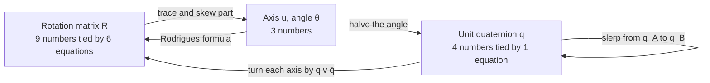
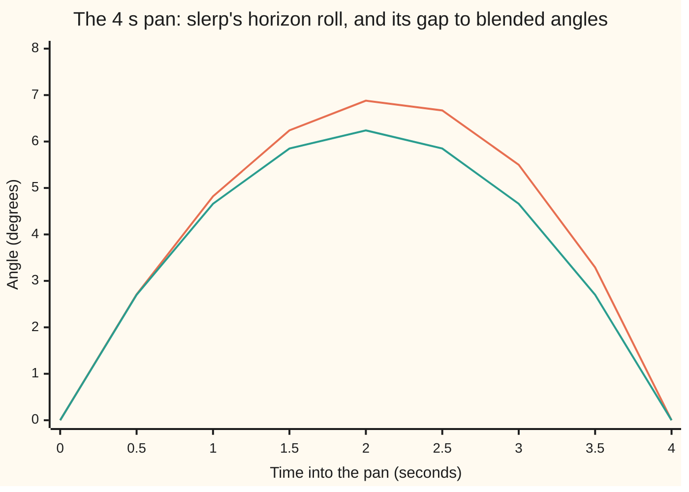

# Rotation group: three-dimensional turns and the four-number shortcut

[Syllabus](../../../SYLLABUS.md) → [Differential geometry and Lie groups](../README.md) → [Lie Groups](../README.md#s06) → Rotation group

---

## General Overview

A drone films a lakeside with a camera on a gimbal, a motorised mount that turns the camera on its own. Shot A looks at a boathouse: heading 30° clockwise from north, tilted 10° down. Shot B looks at a jetty: heading 120°, tilted 40° down.

The editor wants a smooth 4-second pan from shot A to shot B. The gimbal needs an exact orientation for every moment in between. So the flight software must blend two turns of space.

One turn can be written three ways, and each has a job.

- **A rotation matrix**, 9 numbers. It turns any vector by one multiplication, so motors and graphics use it.
- **An axis and an angle**, 3 numbers. Every turn is one turn about one line. Shot A is a turn of 31.5864° about a nearly vertical line.
- **A unit quaternion**, 4 numbers. It is a number with one ordinary part and three imaginary parts, like a complex number with two extra directions. Turns combine by multiplying these numbers, and blends are easy.

This card converts between the three, then blends shot A into shot B. The blend is called **slerp**, short for spherical linear interpolation. The pan turns the camera 93.8410° in all, at a steady 23.4602° per second. Mid-pan the camera heads 72.0972°, tilted 24.8417° down.

**Every turn of space is one turn by an angle θ about an axis u, and the four numbers q = cos(θ/2) + sin(θ/2)u carry out that turn as v ↦ q v q̄; so blending two turns becomes walking the shortest arc between two points on a sphere.**

**What kind of fact this is:** theorems, proved on this card in Why it works: every turn has an axis, the angle and axis can be read from the matrix, and q v q̄ is the turn. Slerp is a method; that it is the shortest blend at a steady rate is proved there too.

### The picture: one turn, three ways of writing it



Every arrow is a formula on this card, and the code runs each one. The loop on the right is the blend.

---

## The formula

Notation first, in words.

- $`SO(3)`$ is the rotation group: the 3 by 3 matrices $`R`$ with $`R^{T}R = I`$ and $`\det R = +1`$ ([Lie group](01-lie-groups-and-matrix-groups.md)). The axes point north, east and down.
- $`u`$ is a unit vector along the turn's axis. $`\theta`$ is the angle turned, anticlockwise when seen from the tip of $`u`$.
- $`[u]_\times`$ is the matrix that takes a cross product with $`u`$: $`[u]_\times v = u \times v`$ ([Lie algebra](02-lie-algebras-and-the-exponential-map.md)).
- $`\mathrm{tr}\, R`$ is the trace of $`R`$: the sum of its three diagonal entries.

**Axis and angle to matrix**, Rodrigues' formula, proved on the [Lie algebra](02-lie-algebras-and-the-exponential-map.md) card as the exponential $`R = \exp(\theta[u]_\times)`$:

```math
R = I + \sin\theta\,[u]_\times + (1 - \cos\theta)\,[u]_\times^{2}
```

**Matrix to axis and angle**, the way back, for angles strictly between 0° and 180°:

```math
\cos\theta = \frac{\mathrm{tr}\, R - 1}{2}, \qquad [u]_\times = \frac{R - R^{T}}{2\sin\theta}
```

**Axis and angle to quaternion.** A **quaternion** is a number $`q = w + x\,i + y\,j + z\,k`$. Here $`w, x, y, z`$ are ordinary numbers, and $`i, j, k`$ are three new units with $`i^2 = j^2 = k^2 = ijk = -1`$. These $`i, j, k`$ are quaternion units, not the complex $`i`$ alone; this card writes $`q`$ scalar first as $`(w, x, y, z)`$. The **conjugate** $`\bar q = w - x\,i - y\,j - z\,k`$ flips the three imaginary signs. A vector $`v = (v_x, v_y, v_z)`$ is the quaternion $`v_x i + v_y j + v_z k`$.

```math
q = \cos\tfrac{\theta}{2} + \sin\tfrac{\theta}{2}\,(u_x i + u_y j + u_z k), \qquad v \mapsto q\,v\,\bar q
```

**Read it aloud:** to turn by θ about u, take the quaternion made of the cosine of half the angle and the axis scaled by the sine of half the angle; sandwiching a vector between it and its conjugate turns the vector by the whole angle.

**Blending.** Shot A's quaternion is $`q_A`$ and shot B's is $`q_B`$, with the sign of $`q_B`$ chosen so their dot product $`q_A \cdot q_B = w_A w_B + x_A x_B + y_A y_B + z_A z_B`$ is not negative. Write $`\cos\Omega = q_A \cdot q_B`$. The blend a fraction $`t`$ of the way through, from 0 to 1, is

```math
\mathrm{slerp}(q_A, q_B; t) = \frac{\sin\big((1 - t)\,\Omega\big)\, q_A + \sin(t\,\Omega)\, q_B}{\sin\Omega}
```

**Read it aloud:** mix the two quaternions with sine weights, so the blend slides along the great circle between them at a steady rate, and the camera turns by $`2\Omega`$ in all.

| Symbol | Plain meaning | In our example | Push it up and the answer… |
| --- | --- | --- | --- |
| $`R`$, $`R_A`$, $`R_B`$ | a rotation matrix; its columns are where the camera's forward, right and down axes point | shot A's first column is 0.8529, 0.4924, 0.1736 | — |
| $`R^{T}`$, $`I`$, $`\mathrm{tr}\, R`$ | transpose; identity; sum of the diagonal | $`\mathrm{tr}\, R_A = 1 + 2\cos 31.5864°`$ | a bigger trace means a smaller turn |
| $`u`$, $`[u]_\times`$ | unit vector along the axis; the matrix that crosses with it | shot A: 0.0829, −0.3093, 0.9473 | — |
| $`\theta`$ | angle turned about $`u`$ | shot A: 31.5864°; shot B: 123.9514° | past 180° it reads back as a smaller turn about $`-u`$ |
| $`\exp`$, $`\log`$ | angle times axis to matrix, by Rodrigues' formula; matrix back to angle times axis, by Step 2 | $`\log R_A`$ is 31.5864° times $`u`$ | — |
| $`q = (w, x, y, z)`$; $`c`$, $`s`$ | a unit quaternion: $`w^2 + x^2 + y^2 + z^2 = 1`$; $`c = \cos(\theta/2)`$ and $`s = \sin(\theta/2)`$ are its two parts in Step 3 | $`q_A = (0.9623, 0.0226, -0.0842, 0.2578)`$ | $`w`$ falls as the turn grows: $`w = \cos(\theta/2)`$ |
| $`i, j, k`$ | quaternion units, $`i^2 = j^2 = k^2 = ijk = -1`$ | — | — |
| $`\bar q`$ | conjugate: imaginary signs flipped; the reverse turn | $`\bar q_A`$ turns the camera to heading −30.3813° | — |
| $`v`$ | a vector to be turned | the camera's forward axis $`(1, 0, 0)`$ | — |
| $`q_A \cdot q_B`$, $`\Omega`$ | dot product of two quaternions; the angle between them on the sphere | 0.6830; 46.9205° | the pan angle $`2\Omega`$ grows |
| $`t`$ | fraction of the pan done: seconds ÷ 4 | 0.5 at 2 s | the camera moves on at a steady rate |
| $`S^3`$, $`SU(2)`$ | the unit quaternions: a sphere in four dimensions, and the same set as a group | $`q_A`$ and $`q_B`$ are two of its points | — |

On this card $`\theta`$ is the angle of a turn. Elsewhere in this wing $`\theta`$ is the globe's longitude.

### When it holds

- **The quaternion must have length 1.** A quaternion of length $`\lvert q \rvert`$ stretches every vector by $`\lvert q \rvert^2`$ as well as turning it. A straight-line blend of $`q_A`$ and $`q_B`$ has length 0.9387 at 1 s, so it must be rescaled.
- **Reading the axis back needs an angle strictly between 0° and 180°.** At 0° every line is an axis. At 180° the skew part $`R - R^{T}`$ is zero, and the axis must come from $`R + I`$ instead.
- **$`q`$ and $`-q`$ are the same turn.** A blend must choose the sign with $`q_A \cdot q_B \ge 0`$. With the wrong sign it swings 266.1590° the long way round.
- **The order is part of the formula.** $`q\,v\,\bar q`$ turns forward; $`\bar q\,v\,q`$ turns backward. A product $`q_1 q_2`$ does $`q_2`$ first, as matrices do.
- **The shortest blend is not always the one wanted.** Slerp rolls the horizon 6.88° at mid-pan. A pan that must keep the horizon level blends heading and tilt instead, at the price of a longer path and trouble near straight down.

---

## Why it works

### Step 0: one sphere instead of three angles

Heading, tilt and roll are three angles, but they make a poor map of the turns. Near straight up or straight down two of them do the same job, and that is gimbal lock ([Lie group](01-lie-groups-and-matrix-groups.md)). The fix is to stop using angles as the coordinates.

Two facts make the fix work. Every turn is a turn about one axis (Step 1). And the unit quaternions, a smooth round sphere with no bad points, cover every turn exactly twice (Steps 3 and 4). Blending then happens on the sphere, where the shortest path is a great-circle arc (Step 5).

### Step 1: every turn has an axis

A turn $`R`$ has an axis when some nonzero vector stays put, $`Rv = v`$. That happens exactly when $`\det(R - I) = 0`$. Three facts give this:

- $`\det R = 1`$ and $`R^{T}R = I`$, so $`R - I = R(I - R^{T}) = R\,(I - R)^{T}`$;
- determinants multiply, and a transpose keeps the determinant, so $`\det(R - I) = \det(I - R)`$;
- flipping the sign of all three rows of a 3 by 3 matrix flips its determinant, so $`\det(I - R) = -\det(R - I)`$.

A number equal to its own negative is zero. So every turn of space fixes a line, its axis. This is Euler's rotation theorem. In the plane the same argument fails, because 2 rows give $`(-1)^2 = +1`$: a flat turn fixes only a point.

Across the axis, the turn spins the perpendicular plane like a complex number multiplied by $`\cos\theta + i\sin\theta`$ ([Complex numbers](../../07-Complex%20analysis/01-Complex%20Numbers%20and%20the%20Plane/01-complex-numbers.md)). Rodrigues' formula writes that down; the [Lie algebra](02-lie-algebras-and-the-exponential-map.md) card proves it from the exponential series.

### Step 2: the matrix gives back its angle and axis

Take the trace of Rodrigues' formula term by term. $`\mathrm{tr}\, I = 3`$. $`[u]_\times`$ has zeros on its diagonal, so its trace is 0. $`[u]_\times^{2} v = u \times (u \times v) = u(u \cdot v) - v`$, so $`[u]_\times^{2} = uu^{T} - I`$, whose trace is $`1 - 3 = -2`$. So

```math
\mathrm{tr}\, R = 3 + 0 - 2(1 - \cos\theta) = 1 + 2\cos\theta
```

Now subtract the transpose. $`I`$ and $`[u]_\times^{2}`$ are symmetric and cancel. $`[u]_\times`$ is skew, $`[u]_\times^{T} = -[u]_\times`$, so it doubles: $`R - R^{T} = 2\sin\theta\,[u]_\times`$. Divide by $`2\sin\theta`$ and read $`u`$ off the entries below the diagonal.

For shot A the trace gives 31.5864° and the axis is (0.0829, −0.3093, 0.9473). Its third part, the downward part, is 0.9473, so the axis is close to vertical: the turn is mostly the 30° heading change.

### Step 3: four numbers turn space

Hamilton found the quaternions in 1843, looking for a three-dimensional version of multiplying by $`\cos\theta + i\sin\theta`$. From $`i^2 = j^2 = k^2 = ijk = -1`$ come $`ij = k`$, $`jk = i`$, $`ki = j`$, and the reversed products $`ji = -k`$, $`kj = -i`$, $`ik = -j`$. Order matters, as it does for turns.

For two vectors written as quaternions the product packs both vector products into one:

```math
a\,b = -\,a \cdot b + a \times b
```

**Read it aloud:** the product of two pure quaternions has the negative dot product as its ordinary part and the cross product as its imaginary part.

Put $`q = c + s\,u`$ with $`c = \cos(\theta/2)`$ and $`s = \sin(\theta/2)`$. Split $`v`$ into its part along $`u`$ and its part across $`u`$.

- **Along the axis**, $`v`$ is a multiple of $`u`$. It commutes with $`q`$, so $`q\,v\,\bar q = v\,q\,\bar q = v`$: the axis stays put.
- **Across the axis**, $`u \cdot v = 0`$, so $`u\,v = u \times v = -\,v\,u`$. Moving $`v`$ past $`\bar q`$ turns it into $`q`$: $`v\,\bar q = q\,v`$. So $`q\,v\,\bar q = q^2 v`$.

And $`q^2 = \cos\theta + \sin\theta\,u`$, by the double-angle formulas and $`u\,u = -1`$. So the part across the axis becomes $`\cos\theta\,v + \sin\theta\,u \times v`$: turned by the full angle $`\theta`$. Each side of the sandwich turns by half, which is why $`q`$ carries $`\theta/2`$.

<details>
<summary>Detailed proof: the sandwich is Rodrigues' formula</summary>

For a unit vector $`u`$, the product rule gives $`u\,u = -u \cdot u + u \times u = -1`$. So with $`c = \cos(\theta/2)`$ and $`s = \sin(\theta/2)`$,

$`\displaystyle q^2 = c^2 + 2cs\,u + s^2\,u\,u = (c^2 - s^2) + 2cs\,u = \cos\theta + \sin\theta\,u`$

Write $`v = v_\parallel + v_\perp`$, with $`v_\parallel = (u \cdot v)u`$ along the axis and $`v_\perp`$ across it. The part along the axis is a multiple of $`u`$ and commutes with $`q`$, so

$`\displaystyle q\,v_\parallel\,\bar q = v_\parallel\,q\,\bar q = v_\parallel\,(c^2 + s^2) = v_\parallel`$

For the part across, $`u\,v_\perp = u \times v_\perp`$ and $`v_\perp u = v_\perp \times u = -u \times v_\perp`$. Then

$`\displaystyle v_\perp \bar q = c\,v_\perp - s\,v_\perp u = c\,v_\perp + s\,u\,v_\perp = q\,v_\perp`$

$`\displaystyle q\,v_\perp\,\bar q = q^2\,v_\perp = \cos\theta\,v_\perp + \sin\theta\,u \times v_\perp`$

Adding the two parts, and using $`u \times v_\perp = u \times v = [u]_\times v`$ and $`v_\perp = -[u]_\times^2 v`$,

$`\displaystyle q\,v\,\bar q = v + \sin\theta\,[u]_\times v + (1 - \cos\theta)\,[u]_\times^2 v`$

which is Rodrigues' formula applied to $`v`$. The result has no ordinary part, so it is a vector again.

</details>

Chaining also works. Doing $`q_2`$ then $`q_1`$ gives $`q_1 (q_2 v \bar q_2) \bar q_1 = (q_1 q_2)\,v\,\overline{q_1 q_2}`$, since the conjugate of a product reverses the order. So the turn "$`q_2`$, then $`q_1`$" is the single quaternion $`q_1 q_2`$. The code builds shot A both ways: as one matrix $`R_z R_y R_x`$, and as the product of two half-angle quaternions. They agree to 12 places.

### Step 4: two quaternions for every turn

A unit quaternion has $`w^2 + x^2 + y^2 + z^2 = 1`$: it is a point of the sphere $`S^3`$, the points at distance 1 from the origin in four-dimensional space. Every turn is reached, since Step 1 gives it an axis and an angle.

The sign drops out of the sandwich: $`(-q)\,v\,\overline{(-q)} = q\,v\,\bar q`$. So $`q`$ and $`-q`$, opposite points of the sphere, are the same turn. Turning 360° about any axis gives $`q = \cos 180° = -1`$, not $`+1`$; only 720° returns to $`+1`$.

So the rotation group is the sphere $`S^3`$ with each pair of opposite points counted as one. The unit quaternions form the group $`SU(2)`$ from the [Lie group](01-lie-groups-and-matrix-groups.md) table, of dimension 3, like $`SO(3)`$. The two-to-one map from $`SU(2)`$ onto $`SO(3)`$ is why the sign must be chosen before blending.

### Step 5: the blend walks a great circle

The shortest turn from shot A to shot B is the relative turn $`R_A^{T} R_B`$, one turn about one axis (Step 1). Doing a fraction $`t`$ of it at a steady rate gives the matrix route:

```math
R(t) = R_A \exp\!\big(t \log(R_A^{T} R_B)\big)
```

Here $`\log`$ is Step 2's read-back, the angle times the axis, and $`\exp`$ is Rodrigues' formula.

On the sphere the same path is a great circle: the circle through $`q_A`$ and $`q_B`$ centred on the origin. The two points are an angle $`\Omega`$ apart, where $`\cos\Omega = q_A \cdot q_B`$. The point a fraction $`t`$ of the way is the unit vector in their plane at angle $`t\Omega`$ from $`q_A`$ and $`(1 - t)\Omega`$ from $`q_B`$.

<details>
<summary>Detailed proof: the sine weights</summary>

Look for $`p = a\,q_A + b\,q_B`$ with $`p \cdot q_A = \cos(t\Omega)`$ and $`p \cdot q_B = \cos((1-t)\Omega)`$. With $`q_A \cdot q_A = q_B \cdot q_B = 1`$ and $`q_A \cdot q_B = \cos\Omega`$, these are two linear equations:

$`\displaystyle a + b\cos\Omega = \cos(t\Omega), \qquad a\cos\Omega + b = \cos((1-t)\Omega)`$

Their solution is

$`\displaystyle a = \frac{\sin((1-t)\Omega)}{\sin\Omega}, \qquad b = \frac{\sin(t\Omega)}{\sin\Omega}`$

Substituting confirms the first equation, because $`\sin((1-t)\Omega) = \sin\Omega\cos(t\Omega) - \cos\Omega\sin(t\Omega)`$. The second follows the same way with $`t`$ and $`1 - t`$ swapped.

Then $`p \cdot p = a\cos(t\Omega) + b\cos((1-t)\Omega) = 1`$, so $`p`$ is a unit quaternion.

</details>

The angle between $`q_A`$ and $`p`$ grows as $`t\Omega`$, and the camera's turn is twice that. So slerp turns the camera at a steady rate along the shortest path, the same path as the matrix route. The code checks this three ways:

- slerp against the matrix route at five times: equal to 12 places;
- the turn from shot A at nine times: exactly $`t`$ times 93.8410°;
- slerp against a gyro-style simulation, which multiplies 100 or 1,000 small turns at a constant body rate. The gap at mid-pan is 0.0010488° and then 0.0000105°: 10 times the steps, 100 times smaller.

At mid-pan, $`t = 1/2`$, the two sine weights are equal. So the midpoint is $`q_A + q_B`$ rescaled to length 1, which is easy by hand.

No route turns less. The turn from one orientation to another has angle $`2\arccos\lvert q_1 \cdot q_2\rvert`$: twice the great-circle distance from $`q_1`$ to the nearer of $`q_2`$ and $`-q_2`$. Distances on a sphere obey the triangle inequality, so passing through a third orientation never turns less than going direct. Cut any route from shot A to shot B into small steps, and its steps add up to at least 93.8410°, which slerp turns exactly. Step 6 measures one longer route.

### Step 6: shortest is not level

The slerp path is a single turn about one tilted axis. So the camera's horizon rolls during the pan, although both shots are level. A blend of heading and tilt, separately, keeps the horizon level but is a different and longer path.



The orange line is slerp's horizon roll: 6.88° at mid-pan, and 6.67° half a second later. The teal line is the angle between the slerp camera and the blended-angles camera, largest at 6.24°. Measured along its path, the blended-angles camera turns 94.8683° in all, against slerp's 93.8410°.

Which blend is right depends on the shot. Slerp is the shortest, steadiest turn and never meets gimbal lock. Its formula divides by $`\sin\Omega`$, so for two nearly equal shots software switches to a straight blend, rescaled. Blending angles keeps the horizon level but fails near straight down, as What breaks shows.

---

## Worked numbers, by hand

The pan's midpoint, from the two shots' angles.

| Step | Arithmetic | Value |
| --- | --- | --- |
| heading 30° as a quaternion | $`(\cos 15°, 0, 0, \sin 15°)`$, about the down axis | (0.9659, 0, 0, 0.2588) |
| tilt −10° as a quaternion | $`(\cos(-5°), 0, \sin(-5°), 0)`$, about the east axis | (0.9962, 0, −0.0872, 0) |
| $`q_A`$, heading quaternion times tilt quaternion (tilt acts first, then heading) | the product, worked out: $`(\cos 15° \cos 5°,\ \sin 15° \sin 5°,\ -\cos 15° \sin 5°,\ \sin 15° \cos 5°)`$ | (0.9623, 0.0226, −0.0842, 0.2578) |
| $`q_B`$, the same way | heading 120°, tilt −40° | (0.4698, 0.2962, −0.1710, 0.8138) |
| $`q_A \cdot q_B`$ | 0.4521 + 0.0067 + 0.0144 + 0.2098 | 0.6830, not negative: no sign flip |
| $`\Omega`$ | $`\arccos 0.6830`$ | 46.9205° |
| the whole pan | $`2\Omega`$ | 93.8410°, so 23.4602° per second |
| $`q_A + q_B`$ | entry by entry | (1.4321, 0.3188, −0.2552, 1.0716) |
| its length | $`\sqrt{1.4321^2 + 0.3188^2 + 0.2552^2 + 1.0716^2}`$, also $`2\cos 23.4602°`$ | 1.8347 |
| the midpoint | divide by 1.8347 | (0.7806, 0.1737, −0.1391, 0.5841) |
| read back | heading, tilt, roll from the matrix of the midpoint | **72.0972°, 24.8417° down, rolled 6.8822°** |

At 2 s the camera heads 72.0972°, short of the halfway heading 75°, tilted 24.8417° down and rolled 6.8822°.

The code checks each line against an independent road: $`q_A`$ read from the matrix and from the axis and angle, and the midpoint from the matrix route.

### What breaks if you drop a piece

| Mistake | Comes out at | What went wrong |
| --- | --- | --- |
| Average the two matrices entry by entry | determinant 0.4665, not 1 | the turns form a curved set; a straight average leaves it |
| Blend toward $`-q_B`$ without flipping the sign | the camera swings 266.1590°, not 93.8410°; averaging $`q`$ with $`-q`$ gives (0, 0, 0, 0) | $`q`$ and $`-q`$ are one turn, so one of the two arcs is the long way |
| Blend heading, tilt and roll as numbers | mid-pan 6.2428° off slerp; with shot B straight down, its two names (120°, −90°, 0°) and (30°, −90°, 90°) give midpoints 30.0830° apart | at tilt ±90° the angles are not a good chart: gimbal lock |
| Blend the quaternions in a straight line, then rescale | 22.4344° turned at 1 s, not 23.4602° | the chord's points are evenly spaced, but their directions on the sphere are not |

The code prints all four.

---

## Code, from first principles, and it actually runs

The code builds both shots as matrices from heading, tilt and roll, and separately as products of half-angle quaternions. It reads the quaternion back from the matrix and from the axis and angle, and checks the three agree. Then it blends the pan by three independent roads: slerp, the matrix route $`R_A \exp(t \log(R_A^{T}R_B))`$, and a gyro-style simulation at two step counts. It also prints the chart's points and every mistake in the table.

### Python

```python
# Rotation group: three-dimensional turns and the four-number shortcut -- the check behind the card.
# Standard library only.  A drone camera's orientation, axes north, east, down, is held three ways:
# a 3 x 3 rotation matrix R, an axis and angle, and a unit quaternion q = (w, x, y, z), scalar first,
# with ij = k, turning a vector v to q v q-bar.  The pan between two shots is blended by slerp.
# Roads: matrix and quaternion built separately from the same angles; the quaternion read back from
# the matrix and from axis-angle; slerp against the matrix route R_A exp(t log(R_A^T R_B)); slerp
# against many small gyro-style steps q <- q (1 + w h / 2), renormalised.
import math
D = math.pi / 180

def mul(A, B):
    return [[sum(A[i][k] * B[k][j] for k in range(3)) for j in range(3)] for i in range(3)]
def tp(A):
    return [list(r) for r in zip(*A)]
def rx(a):
    return [[1, 0, 0], [0, math.cos(a), -math.sin(a)], [0, math.sin(a), math.cos(a)]]
def ry(a):
    return [[math.cos(a), 0, math.sin(a)], [0, 1, 0], [-math.sin(a), 0, math.cos(a)]]
def rz(a):
    return [[math.cos(a), -math.sin(a), 0], [math.sin(a), math.cos(a), 0], [0, 0, 1]]
def euler(h, p, r):                        # heading about down, tilt about east, roll about north (degrees)
    return mul(rz(h * D), mul(ry(p * D), rx(r * D)))
def det3(A):
    return (A[0][0] * (A[1][1] * A[2][2] - A[1][2] * A[2][1]) - A[0][1] * (A[1][0] * A[2][2] - A[1][2] * A[2][0])
            + A[0][2] * (A[1][0] * A[2][1] - A[1][1] * A[2][0]))
def qmul(a, b):                            # Hamilton's product, from i^2 = j^2 = k^2 = ijk = -1
    return (a[0] * b[0] - a[1] * b[1] - a[2] * b[2] - a[3] * b[3], a[0] * b[1] + a[1] * b[0] + a[2] * b[3] - a[3] * b[2],
            a[0] * b[2] - a[1] * b[3] + a[2] * b[0] + a[3] * b[1], a[0] * b[3] + a[1] * b[2] - a[2] * b[1] + a[3] * b[0])
def qbar(q):
    return (q[0], -q[1], -q[2], -q[3])
def qaxis(u, t):                           # axis u, angle t in radians: (cos t/2, sin t/2 u)
    return (math.cos(t / 2), u[0] * math.sin(t / 2), u[1] * math.sin(t / 2), u[2] * math.sin(t / 2))
def qeuler(h, p, r):
    return qmul(qaxis((0, 0, 1), h * D), qmul(qaxis((0, 1, 0), p * D), qaxis((1, 0, 0), r * D)))
def turn(q, v):                            # v -> q v q-bar
    return list(qmul(qmul(q, (0.0, v[0], v[1], v[2])), qbar(q))[1:])
def qmat(q):                               # column j of R is where axis j goes under q v q-bar
    return tp([turn(q, e) for e in ((1, 0, 0), (0, 1, 0), (0, 0, 1))])
def rodrigues(u, t):                       # R = I + sin t [u]x + (1 - cos t) [u]x^2
    K = [[0, -u[2], u[1]], [u[2], 0, -u[0]], [-u[1], u[0], 0]]
    K2 = mul(K, K)
    return [[(i == j) + math.sin(t) * K[i][j] + (1 - math.cos(t)) * K2[i][j] for j in range(3)] for i in range(3)]
def axis_angle(R):                         # trace gives the angle, the skew part the axis (0 < t < 180 deg)
    t = math.acos((R[0][0] + R[1][1] + R[2][2] - 1) / 2)
    s = 2 * math.sin(t)
    return [(R[2][1] - R[1][2]) / s, (R[0][2] - R[2][0]) / s, (R[1][0] - R[0][1]) / s], t
def q_from_mat(R):                         # valid while the trace is above -1
    w = math.sqrt(1 + R[0][0] + R[1][1] + R[2][2]) / 2
    return (w, (R[2][1] - R[1][2]) / (4 * w), (R[0][2] - R[2][0]) / (4 * w), (R[1][0] - R[0][1]) / (4 * w))
def dot4(a, b):
    return sum(x * y for x, y in zip(a, b))
def slerp(a, b, t):                        # flip b if needed, so the blend takes the short way
    if dot4(a, b) < 0:
        b = tuple(-c for c in b)
    om = math.acos(min(1.0, dot4(a, b)))
    return tuple((math.sin((1 - t) * om) * x + math.sin(t * om) * y) / math.sin(om) for x, y in zip(a, b))
def gap(a, b):                             # angle of the turn from a to b, in degrees
    return 2 * math.acos(min(1.0, abs(dot4(a, b)))) / D
def hpr(R):                                # heading, tilt, roll read back from a matrix (degrees)
    return [math.atan2(R[1][0], R[0][0]) / D, math.asin(-R[2][0]) / D, math.atan2(R[2][1], R[2][2]) / D]
def mgap(A, B):
    return max(abs(A[i][j] - B[i][j]) for i in range(3) for j in range(3))
def f4(x):
    return f"{0.0 if abs(x) < 5e-5 else x:.4f}"
def f2(x):
    return f"{0.0 if abs(x) < 5e-3 else x:.2f}"
def fl(v):
    return " ".join(f4(x) for x in v)

shots = {"A": (30, -10, 0), "B": (120, -40, 0)}  # heading, tilt (negative = down), roll, in degrees
R, Q, worst = {}, {}, 0.0
for s, a in shots.items():
    R[s], Q[s] = euler(*a), qeuler(*a)
    u, t = axis_angle(R[s])
    print(f"shot {s} {a}: R rows {' | '.join(fl(r) for r in R[s])}")
    print(f"shot {s}: q from angles {fl(Q[s])}; q from R {fl(q_from_mat(R[s]))}")
    print(f"shot {s}: axis {fl(u)}, angle {f4(t / D)} deg; q from axis-angle {fl(qaxis(u, t))}")
    print(f"shot {s}: camera looks along {fl(turn(Q[s], (1, 0, 0)))}")
    worst = max(worst, mgap(qmat(Q[s]), R[s]), max(abs(x - y) for x, y in zip(q_from_mat(R[s]), Q[s])),
                max(abs(x - y) for x, y in zip(qaxis(u, t), Q[s])), max(abs(turn(Q[s], (1, 0, 0))[i] - R[s][i][0]) for i in range(3)))
print(f"matrix, axis-angle and quaternion agree, worst gap below 1e-12: {'yes' if worst < 1e-12 else 'no'}")
d = dot4(Q["A"], Q["B"])
total = gap(Q["A"], Q["B"])
print(f"qA . qB = {' + '.join(f4(x * y) for x, y in zip(Q['A'], Q['B']))} = {f4(d)}; half-angle {f4(math.acos(d) / D)} deg; the pan turns the camera {f4(total)} deg")
mid = slerp(Q["A"], Q["B"], 0.5)
sm = [x + y for x, y in zip(Q["A"], Q["B"])]
n = math.sqrt(dot4(sm, sm))
print(f"shot A pieces: heading 30 gives {fl(qaxis((0, 0, 1), 30 * D))}; tilt -10 gives {fl(qaxis((0, 1, 0), -10 * D))}")
print(f"qA + qB = {fl(sm)}, length {f4(n)}; 2 cos(half-angle / 2) = {f4(2 * math.cos(math.acos(d) / 2))}")
uR, tR = axis_angle(mul(tp(R["A"]), R["B"]))
road = 0.0
for t in (0, 0.25, 0.5, 0.75, 1):
    q = slerp(Q["A"], Q["B"], t)
    Rm = mul(R["A"], rodrigues(uR, t * tR))  # the matrix route, R_A exp(t log(R_A^T R_B))
    road = max(road, mgap(qmat(q), Rm))
    print(f"slerp t = {t:.2f}: q {fl(q)}; heading, tilt, roll {fl(hpr(qmat(q)))}")
print(f"slerp against the matrix route, worst gap below 1e-12: {'yes' if road < 1e-12 else 'no'}")
print(f"midpoint is (qA + qB) / |qA + qB|, gap below 1e-12: {'yes' if max(abs((x + y) / n - z) for x, y, z in zip(Q['A'], Q['B'], mid)) < 1e-12 else 'no'}")
times = [k / 8 for k in range(9)]
blend = lambda t: qeuler(*[x + t * (y - x) for x, y in zip(shots["A"], shots["B"])])
s_ang = [gap(Q["A"], slerp(Q["A"], Q["B"], t)) for t in times]
print(f"seconds into a 4 s pan:     {' '.join(f'{4 * t:.1f}' for t in times)}")
print(f"slerp horizon roll, deg:    {' '.join(f2(hpr(qmat(slerp(Q['A'], Q['B'], t)))[2]) for t in times)}")
print(f"slerp to blended, deg:      {' '.join(f2(gap(slerp(Q['A'], Q['B'], t), blend(t))) for t in times)}")
paths = [sum(gap(blend((k - 1) / M), blend(k / M)) for k in range(1, M + 1)) for M in (1000, 2000)]
print(f"turning done by blended angles, 1000 and 2000 samples: {f4(paths[0])} {f4(paths[1])} deg; slerp {f4(total)} deg")
w = [2 * math.acos(d) * c / math.sqrt(1 - d * d) for c in qmul(qbar(Q["A"]), Q["B"])[1:]]  # body rate, rad per pan
errs = []
for N in (100, 1000):
    q = Q["A"]
    for _ in range(N // 2):
        q = qmul(q, (1.0, w[0] / (2 * N), w[1] / (2 * N), w[2] / (2 * N)))
        q = tuple(c / math.sqrt(dot4(q, q)) for c in q)
    errs.append(gap(q, mid))
    print(f"gyro steps, {N} per pan, at mid-pan: off slerp by {errs[-1]:.7f} deg")
avg = [[(a + b) / 2 for a, b in zip(r1, r2)] for r1, r2 in zip(R["A"], R["B"])]
print(f"mistake 1, matrices averaged entry by entry: det {f4(det3(avg))}")
print(f"mistake 2, blend toward -qB unflipped: swings {f4(2 * math.acos(-d) / D)} deg; (qA + (-qA)) / 2 = {fl([(x - x) / 2 for x in Q['A']])}")
em = qeuler(*[(x + y) / 2 for x, y in zip(shots["A"], shots["B"])])
print(f"mistake 3, heading, tilt, roll blended: mid-pan is {f4(gap(em, mid))} deg off slerp")
l1, l2 = qeuler(*[(x + y) / 2 for x, y in zip(shots["A"], (120, -90, 0))]), qeuler(*[(x + y) / 2 for x, y in zip(shots["A"], (30, -90, 90))])
print(f"  shot B straight down, named (120, -90, 0) or (30, -90, 90): same shot, gap {f4(gap(qeuler(120, -90, 0), qeuler(30, -90, 90)))} deg; blended midpoints {f4(gap(l1, l2))} deg apart")
nl = [x + 0.25 * (y - x) for x, y in zip(Q["A"], Q["B"])]
ln = math.sqrt(dot4(nl, nl))
print(f"mistake 4, straight blend at 1 s: length {f4(ln)}; rescaled, {f4(gap(Q['A'], [c / ln for c in nl]))} deg from A; slerp {f4(s_ang[2])} deg")
print(f"mistake 5, q-bar v q for shot A: camera heading {f4(math.atan2(turn(qbar(Q['A']), (1, 0, 0))[1], turn(qbar(Q['A']), (1, 0, 0))[0]) / D)} deg, tilt {f4(math.asin(-turn(qbar(Q['A']), (1, 0, 0))[2]) / D)} deg")
uA, tA = axis_angle(R["A"])
print(f"mistake 6, shot A built from cos t and sin t, not the half angles: turns {f4(axis_angle(qmat(qaxis(uA, 2 * tA)))[1] / D)} deg")
print(f"q and -q give the same matrix: {'yes' if mgap(qmat(Q['A']), qmat(tuple(-c for c in Q['A']))) < 1e-12 else 'no'}; 360 deg turn q = {fl(qaxis((0, 0, 1), 2 * math.pi))}; 720 deg q = {fl(qaxis((0, 0, 1), 4 * math.pi))}")
assert worst < 1e-12 and road < 1e-12                            # three representations, two blend routes
assert max(abs(a - total * t) for a, t in zip(s_ang, times)) < 1e-9   # slerp turns at a constant rate
assert errs[1] < errs[0] / 50 and errs[1] < 1e-3                 # gyro steps close in on slerp
assert abs(n - 2 * math.cos(math.acos(d) / 2)) < 1e-12           # the midpoint by hand
assert abs(axis_angle(qmat(qaxis(uA, 2 * tA)))[1] - 2 * tA) < 1e-9  # q carries half the angle
assert abs(det3(avg)) < 0.9 and gap(em, mid) > 1 and gap(l1, l2) > 1 and paths[1] > total + 1
print("ALL CHECKS PASS")
```

**Ran 2026-11-19 on macOS, Python 3.14.10, standard library only. All checks passed. Output, pasted from the run:**

```
shot A (30, -10, 0): R rows 0.8529 -0.5000 -0.1504 | 0.4924 0.8660 -0.0868 | 0.1736 0.0000 0.9848
shot A: q from angles 0.9623 0.0226 -0.0842 0.2578; q from R 0.9623 0.0226 -0.0842 0.2578
shot A: axis 0.0829 -0.3093 0.9473, angle 31.5864 deg; q from axis-angle 0.9623 0.0226 -0.0842 0.2578
shot A: camera looks along 0.8529 0.4924 0.1736
shot B (120, -40, 0): R rows -0.3830 -0.8660 0.3214 | 0.6634 -0.5000 -0.5567 | 0.6428 0.0000 0.7660
shot B: q from angles 0.4698 0.2962 -0.1710 0.8138; q from R 0.4698 0.2962 -0.1710 0.8138
shot B: axis 0.3355 -0.1937 0.9219, angle 123.9514 deg; q from axis-angle 0.4698 0.2962 -0.1710 0.8138
shot B: camera looks along -0.3830 0.6634 0.6428
matrix, axis-angle and quaternion agree, worst gap below 1e-12: yes
qA . qB = 0.4521 + 0.0067 + 0.0144 + 0.2098 = 0.6830; half-angle 46.9205 deg; the pan turns the camera 93.8410 deg
shot A pieces: heading 30 gives 0.9659 0.0000 0.0000 0.2588; tilt -10 gives 0.9962 0.0000 -0.0872 0.0000
qA + qB = 1.4321 0.3188 -0.2552 1.0716, length 1.8347; 2 cos(half-angle / 2) = 1.8347
slerp t = 0.00: q 0.9623 0.0226 -0.0842 0.2578; heading, tilt, roll 30.0000 -10.0000 0.0000
slerp t = 0.25: q 0.8900 0.1002 -0.1140 0.4299; heading, tilt, roll 50.8571 -16.8075 4.8168
slerp t = 0.50: q 0.7806 0.1737 -0.1391 0.5841; heading, tilt, roll 72.0972 -24.8417 6.8822
slerp t = 0.75: q 0.6385 0.2400 -0.1584 0.7139; heading, tilt, roll 94.7433 -33.0154 5.5010
slerp t = 1.00: q 0.4698 0.2962 -0.1710 0.8138; heading, tilt, roll 120.0000 -40.0000 0.0000
slerp against the matrix route, worst gap below 1e-12: yes
midpoint is (qA + qB) / |qA + qB|, gap below 1e-12: yes
seconds into a 4 s pan:     0.0 0.5 1.0 1.5 2.0 2.5 3.0 3.5 4.0
slerp horizon roll, deg:    0.00 2.71 4.82 6.24 6.88 6.67 5.50 3.29 0.00
slerp to blended, deg:      0.00 2.70 4.66 5.85 6.24 5.85 4.66 2.70 0.00
turning done by blended angles, 1000 and 2000 samples: 94.8683 94.8683 deg; slerp 93.8410 deg
gyro steps, 100 per pan, at mid-pan: off slerp by 0.0010488 deg
gyro steps, 1000 per pan, at mid-pan: off slerp by 0.0000105 deg
mistake 1, matrices averaged entry by entry: det 0.4665
mistake 2, blend toward -qB unflipped: swings 266.1590 deg; (qA + (-qA)) / 2 = 0.0000 0.0000 0.0000 0.0000
mistake 3, heading, tilt, roll blended: mid-pan is 6.2428 deg off slerp
  shot B straight down, named (120, -90, 0) or (30, -90, 90): same shot, gap 0.0000 deg; blended midpoints 30.0830 deg apart
mistake 4, straight blend at 1 s: length 0.9387; rescaled, 22.4344 deg from A; slerp 23.4602 deg
mistake 5, q-bar v q for shot A: camera heading -30.3813 deg, tilt 8.6492 deg
mistake 6, shot A built from cos t and sin t, not the half angles: turns 63.1729 deg
q and -q give the same matrix: yes; 360 deg turn q = -1.0000 0.0000 0.0000 0.0000; 720 deg q = 1.0000 0.0000 0.0000 0.0000
ALL CHECKS PASS
```

### Rust

Same numbers, same labels, built with `rustc --edition 2021 -O`.

```rust
// Rotation group: three-dimensional turns and the four-number shortcut -- the same check as the
// Python, in Rust.  No crates.  A drone camera's orientation, axes north, east, down, is held three
// ways: a 3 x 3 rotation matrix R, an axis and angle, and a unit quaternion q = (w, x, y, z), scalar
// first, with ij = k, turning a vector v to q v q-bar.  The pan between two shots is blended by slerp.
// Roads: matrix and quaternion built separately from the same angles; the quaternion read back from
// the matrix and from axis-angle; slerp against the matrix route R_A exp(t log(R_A^T R_B)); slerp
// against many small gyro-style steps q <- q (1 + w h / 2), renormalised.
use std::f64::consts::PI;
type M = [[f64; 3]; 3];
type Q = [f64; 4];
const D: f64 = PI / 180.0;

fn mul(a: &M, b: &M) -> M {
    let mut c = [[0.0; 3]; 3];
    for i in 0..3 { for j in 0..3 { c[i][j] = (0..3).map(|k| a[i][k] * b[k][j]).sum(); } }
    c
}
fn tp(a: &M) -> M { let mut c = [[0.0; 3]; 3]; for i in 0..3 { for j in 0..3 { c[i][j] = a[j][i]; } } c }
fn rx(a: f64) -> M { [[1.0, 0.0, 0.0], [0.0, a.cos(), -a.sin()], [0.0, a.sin(), a.cos()]] }
fn ry(a: f64) -> M { [[a.cos(), 0.0, a.sin()], [0.0, 1.0, 0.0], [-a.sin(), 0.0, a.cos()]] }
fn rz(a: f64) -> M { [[a.cos(), -a.sin(), 0.0], [a.sin(), a.cos(), 0.0], [0.0, 0.0, 1.0]] }
fn euler(s: [f64; 3]) -> M { mul(&rz(s[0] * D), &mul(&ry(s[1] * D), &rx(s[2] * D))) }  // heading, tilt, roll (degrees)
fn det3(a: &M) -> f64 {
    a[0][0] * (a[1][1] * a[2][2] - a[1][2] * a[2][1]) - a[0][1] * (a[1][0] * a[2][2] - a[1][2] * a[2][0])
        + a[0][2] * (a[1][0] * a[2][1] - a[1][1] * a[2][0])
}
fn qmul(a: Q, b: Q) -> Q {                        // Hamilton's product, from i^2 = j^2 = k^2 = ijk = -1
    [a[0] * b[0] - a[1] * b[1] - a[2] * b[2] - a[3] * b[3], a[0] * b[1] + a[1] * b[0] + a[2] * b[3] - a[3] * b[2],
     a[0] * b[2] - a[1] * b[3] + a[2] * b[0] + a[3] * b[1], a[0] * b[3] + a[1] * b[2] - a[2] * b[1] + a[3] * b[0]]
}
fn qbar(q: Q) -> Q { [q[0], -q[1], -q[2], -q[3]] }
fn neg(q: Q) -> Q { [-q[0], -q[1], -q[2], -q[3]] }
fn qaxis(u: [f64; 3], t: f64) -> Q { let s = (t / 2.0).sin(); [(t / 2.0).cos(), u[0] * s, u[1] * s, u[2] * s] }
fn qeuler(s: [f64; 3]) -> Q {
    qmul(qaxis([0.0, 0.0, 1.0], s[0] * D), qmul(qaxis([0.0, 1.0, 0.0], s[1] * D), qaxis([1.0, 0.0, 0.0], s[2] * D)))
}
fn turn(q: Q, v: [f64; 3]) -> [f64; 3] {          // v -> q v q-bar
    let r = qmul(qmul(q, [0.0, v[0], v[1], v[2]]), qbar(q));
    [r[1], r[2], r[3]]
}
fn qmat(q: Q) -> M {                              // column j of R is where axis j goes under q v q-bar
    let cols = [turn(q, [1.0, 0.0, 0.0]), turn(q, [0.0, 1.0, 0.0]), turn(q, [0.0, 0.0, 1.0])];
    tp(&cols)
}
fn rodrigues(u: [f64; 3], t: f64) -> M {          // R = I + sin t [u]x + (1 - cos t) [u]x^2
    let k = [[0.0, -u[2], u[1]], [u[2], 0.0, -u[0]], [-u[1], u[0], 0.0]];
    let k2 = mul(&k, &k);
    let mut r = [[0.0; 3]; 3];
    for i in 0..3 { for j in 0..3 { r[i][j] = (if i == j { 1.0 } else { 0.0 }) + t.sin() * k[i][j] + (1.0 - t.cos()) * k2[i][j]; } }
    r
}
fn axis_angle(r: &M) -> ([f64; 3], f64) {         // trace gives the angle, the skew part the axis (0 < t < 180 deg)
    let t = ((r[0][0] + r[1][1] + r[2][2] - 1.0) / 2.0).acos();
    let s = 2.0 * t.sin();
    ([(r[2][1] - r[1][2]) / s, (r[0][2] - r[2][0]) / s, (r[1][0] - r[0][1]) / s], t)
}
fn q_from_mat(r: &M) -> Q {                       // valid while the trace is above -1
    let w = (1.0 + r[0][0] + r[1][1] + r[2][2]).sqrt() / 2.0;
    [w, (r[2][1] - r[1][2]) / (4.0 * w), (r[0][2] - r[2][0]) / (4.0 * w), (r[1][0] - r[0][1]) / (4.0 * w)]
}
fn dot4(a: Q, b: Q) -> f64 { (0..4).map(|i| a[i] * b[i]).sum() }
fn slerp(a: Q, b: Q, t: f64) -> Q {               // flip b if needed, so the blend takes the short way
    let b = if dot4(a, b) < 0.0 { neg(b) } else { b };
    let om = dot4(a, b).min(1.0).acos();
    let mut q = [0.0; 4];
    for i in 0..4 { q[i] = (((1.0 - t) * om).sin() * a[i] + (t * om).sin() * b[i]) / om.sin(); }
    q
}
fn gap(a: Q, b: Q) -> f64 { 2.0 * dot4(a, b).abs().min(1.0).acos() / D }   // angle of the turn from a to b, degrees
fn hpr(r: &M) -> [f64; 3] { [r[1][0].atan2(r[0][0]) / D, (-r[2][0]).asin() / D, r[2][1].atan2(r[2][2]) / D] }
fn mgap(a: &M, b: &M) -> f64 { let mut g: f64 = 0.0; for i in 0..3 { for j in 0..3 { g = g.max((a[i][j] - b[i][j]).abs()); } } g }
fn f4(x: f64) -> String { format!("{:.4}", if x.abs() < 5e-5 { 0.0 } else { x }) }
fn f2(x: f64) -> String { format!("{:.2}", if x.abs() < 5e-3 { 0.0 } else { x }) }
fn fl(v: &[f64]) -> String { v.iter().map(|&x| f4(x)).collect::<Vec<_>>().join(" ") }
fn yn(c: bool) -> &'static str { if c { "yes" } else { "no" } }
fn shot(s: [f64; 3]) -> String { format!("({}, {}, {})", s[0], s[1], s[2]) }
fn mid3(a: [f64; 3], b: [f64; 3], t: f64) -> [f64; 3] { [a[0] + t * (b[0] - a[0]), a[1] + t * (b[1] - a[1]), a[2] + t * (b[2] - a[2])] }

fn main() {
    let shots = [("A", [30.0, -10.0, 0.0]), ("B", [120.0, -40.0, 0.0])];  // heading, tilt (negative = down), roll
    let (sa, sb) = (shots[0].1, shots[1].1);
    let mut worst: f64 = 0.0;
    for (s, a) in shots.iter() {
        let (r, q) = (euler(*a), qeuler(*a));
        let (u, t) = axis_angle(&r);
        println!("shot {} {}: R rows {}", s, shot(*a), r.iter().map(|row| fl(row)).collect::<Vec<_>>().join(" | "));
        println!("shot {}: q from angles {}; q from R {}", s, fl(&q), fl(&q_from_mat(&r)));
        println!("shot {}: axis {}, angle {} deg; q from axis-angle {}", s, fl(&u), f4(t / D), fl(&qaxis(u, t)));
        let look = turn(q, [1.0, 0.0, 0.0]);
        println!("shot {}: camera looks along {}", s, fl(&look));
        let (qr, qa) = (q_from_mat(&r), qaxis(u, t));
        for i in 0..4 { worst = worst.max((qr[i] - q[i]).abs()).max((qa[i] - q[i]).abs()); }
        for i in 0..3 { worst = worst.max((look[i] - r[i][0]).abs()); }
        worst = worst.max(mgap(&qmat(q), &r));
    }
    println!("matrix, axis-angle and quaternion agree, worst gap below 1e-12: {}", yn(worst < 1e-12));
    let (ra, rb, qa, qb) = (euler(sa), euler(sb), qeuler(sa), qeuler(sb));
    let d = dot4(qa, qb);
    let total = gap(qa, qb);
    println!("qA . qB = {} = {}; half-angle {} deg; the pan turns the camera {} deg", (0..4).map(|i| f4(qa[i] * qb[i])).collect::<Vec<_>>().join(" + "), f4(d), f4(d.acos() / D), f4(total));
    let mid = slerp(qa, qb, 0.5);
    let sum = [qa[0] + qb[0], qa[1] + qb[1], qa[2] + qb[2], qa[3] + qb[3]];
    let n = dot4(sum, sum).sqrt();
    println!("shot A pieces: heading 30 gives {}; tilt -10 gives {}", fl(&qaxis([0.0, 0.0, 1.0], 30.0 * D)), fl(&qaxis([0.0, 1.0, 0.0], -10.0 * D)));
    println!("qA + qB = {}, length {}; 2 cos(half-angle / 2) = {}", fl(&sum), f4(n), f4(2.0 * (d.acos() / 2.0).cos()));
    let (ur, tr) = axis_angle(&mul(&tp(&ra), &rb));
    let mut road: f64 = 0.0;
    for t in [0.0, 0.25, 0.5, 0.75, 1.0] {
        let q = slerp(qa, qb, t);
        let rm = mul(&ra, &rodrigues(ur, t * tr));  // the matrix route, R_A exp(t log(R_A^T R_B))
        road = road.max(mgap(&qmat(q), &rm));
        println!("slerp t = {:.2}: q {}; heading, tilt, roll {}", t, fl(&q), fl(&hpr(&qmat(q))));
    }
    println!("slerp against the matrix route, worst gap below 1e-12: {}", yn(road < 1e-12));
    let mgap4 = (0..4).map(|i| ((qa[i] + qb[i]) / n - mid[i]).abs()).fold(0.0, f64::max);
    println!("midpoint is (qA + qB) / |qA + qB|, gap below 1e-12: {}", yn(mgap4 < 1e-12));
    let times: Vec<f64> = (0..9).map(|k| k as f64 / 8.0).collect();
    let blend = |t: f64| qeuler(mid3(sa, sb, t));
    let s_ang: Vec<f64> = times.iter().map(|&t| gap(qa, slerp(qa, qb, t))).collect();
    let join = |v: Vec<String>| v.join(" ");
    println!("seconds into a 4 s pan:     {}", join(times.iter().map(|t| format!("{:.1}", 4.0 * t)).collect()));
    println!("slerp horizon roll, deg:    {}", join(times.iter().map(|&t| f2(hpr(&qmat(slerp(qa, qb, t)))[2])).collect()));
    println!("slerp to blended, deg:      {}", join(times.iter().map(|&t| f2(gap(slerp(qa, qb, t), blend(t)))).collect()));
    let paths: Vec<f64> = [1000usize, 2000].iter().map(|&m| (1..=m).map(|k| gap(blend((k - 1) as f64 / m as f64), blend(k as f64 / m as f64))).sum()).collect();
    println!("turning done by blended angles, 1000 and 2000 samples: {} {} deg; slerp {} deg", f4(paths[0]), f4(paths[1]), f4(total));
    let rel = qmul(qbar(qa), qb);
    let w: Vec<f64> = (1..4).map(|i| 2.0 * d.acos() * rel[i] / (1.0 - d * d).sqrt()).collect();  // body rate, rad per pan
    let mut errs = Vec::new();
    for nn in [100usize, 1000] {
        let mut q = qa;
        let h = 2.0 * nn as f64;
        for _ in 0..nn / 2 {
            q = qmul(q, [1.0, w[0] / h, w[1] / h, w[2] / h]);
            let l = dot4(q, q).sqrt();
            q = [q[0] / l, q[1] / l, q[2] / l, q[3] / l];
        }
        errs.push(gap(q, mid));
        println!("gyro steps, {} per pan, at mid-pan: off slerp by {:.7} deg", nn, errs[errs.len() - 1]);
    }
    let mut avg = [[0.0; 3]; 3];
    for i in 0..3 { for j in 0..3 { avg[i][j] = (ra[i][j] + rb[i][j]) / 2.0; } }
    println!("mistake 1, matrices averaged entry by entry: det {}", f4(det3(&avg)));
    println!("mistake 2, blend toward -qB unflipped: swings {} deg; (qA + (-qA)) / 2 = {}", f4(2.0 * (-d).acos() / D),
             fl(&qa.iter().map(|x| (x - x) / 2.0).collect::<Vec<_>>()));
    let em = qeuler(mid3(sa, sb, 0.5));
    println!("mistake 3, heading, tilt, roll blended: mid-pan is {} deg off slerp", f4(gap(em, mid)));
    let (b1, b2) = ([120.0, -90.0, 0.0], [30.0, -90.0, 90.0]);
    let (l1, l2) = (qeuler(mid3(sa, b1, 0.5)), qeuler(mid3(sa, b2, 0.5)));
    println!("  shot B straight down, named (120, -90, 0) or (30, -90, 90): same shot, gap {} deg; blended midpoints {} deg apart",
             f4(gap(qeuler(b1), qeuler(b2))), f4(gap(l1, l2)));
    let nl: Q = [0, 1, 2, 3].map(|i| qa[i] + 0.25 * (qb[i] - qa[i]));
    let ln = dot4(nl, nl).sqrt();
    println!("mistake 4, straight blend at 1 s: length {}; rescaled, {} deg from A; slerp {} deg", f4(ln),
             f4(gap(qa, nl.map(|c| c / ln))), f4(s_ang[2]));
    let wrong = turn(qbar(qa), [1.0, 0.0, 0.0]);
    println!("mistake 5, q-bar v q for shot A: camera heading {} deg, tilt {} deg", f4(wrong[1].atan2(wrong[0]) / D), f4((-wrong[2]).asin() / D));
    let (ua, ta) = axis_angle(&ra);
    let full = axis_angle(&qmat(qaxis(ua, 2.0 * ta))).1;
    println!("mistake 6, shot A built from cos t and sin t, not the half angles: turns {} deg", f4(full / D));
    println!("q and -q give the same matrix: {}; 360 deg turn q = {}; 720 deg q = {}", yn(mgap(&qmat(qa), &qmat(neg(qa))) < 1e-12),
             fl(&qaxis([0.0, 0.0, 1.0], 2.0 * PI)), fl(&qaxis([0.0, 0.0, 1.0], 4.0 * PI)));
    assert!(worst < 1e-12 && road < 1e-12);                                   // three representations, two blend routes
    assert!(s_ang.iter().zip(&times).all(|(a, t)| (a - total * t).abs() < 1e-9));  // slerp turns at a constant rate
    assert!(errs[1] < errs[0] / 50.0 && errs[1] < 1e-3);                      // gyro steps close in on slerp
    assert!((n - 2.0 * (d.acos() / 2.0).cos()).abs() < 1e-12);                // the midpoint by hand
    assert!((full - 2.0 * ta).abs() < 1e-9);                                  // q carries half the angle
    assert!(det3(&avg).abs() < 0.9 && gap(em, mid) > 1.0 && gap(l1, l2) > 1.0 && paths[1] > total + 1.0);
    println!("ALL CHECKS PASS");
}
```

**Ran 2026-11-19 on macOS, rustc 1.98.1, no crates. All checks passed. Output, pasted from the run:**

```
shot A (30, -10, 0): R rows 0.8529 -0.5000 -0.1504 | 0.4924 0.8660 -0.0868 | 0.1736 0.0000 0.9848
shot A: q from angles 0.9623 0.0226 -0.0842 0.2578; q from R 0.9623 0.0226 -0.0842 0.2578
shot A: axis 0.0829 -0.3093 0.9473, angle 31.5864 deg; q from axis-angle 0.9623 0.0226 -0.0842 0.2578
shot A: camera looks along 0.8529 0.4924 0.1736
shot B (120, -40, 0): R rows -0.3830 -0.8660 0.3214 | 0.6634 -0.5000 -0.5567 | 0.6428 0.0000 0.7660
shot B: q from angles 0.4698 0.2962 -0.1710 0.8138; q from R 0.4698 0.2962 -0.1710 0.8138
shot B: axis 0.3355 -0.1937 0.9219, angle 123.9514 deg; q from axis-angle 0.4698 0.2962 -0.1710 0.8138
shot B: camera looks along -0.3830 0.6634 0.6428
matrix, axis-angle and quaternion agree, worst gap below 1e-12: yes
qA . qB = 0.4521 + 0.0067 + 0.0144 + 0.2098 = 0.6830; half-angle 46.9205 deg; the pan turns the camera 93.8410 deg
shot A pieces: heading 30 gives 0.9659 0.0000 0.0000 0.2588; tilt -10 gives 0.9962 0.0000 -0.0872 0.0000
qA + qB = 1.4321 0.3188 -0.2552 1.0716, length 1.8347; 2 cos(half-angle / 2) = 1.8347
slerp t = 0.00: q 0.9623 0.0226 -0.0842 0.2578; heading, tilt, roll 30.0000 -10.0000 0.0000
slerp t = 0.25: q 0.8900 0.1002 -0.1140 0.4299; heading, tilt, roll 50.8571 -16.8075 4.8168
slerp t = 0.50: q 0.7806 0.1737 -0.1391 0.5841; heading, tilt, roll 72.0972 -24.8417 6.8822
slerp t = 0.75: q 0.6385 0.2400 -0.1584 0.7139; heading, tilt, roll 94.7433 -33.0154 5.5010
slerp t = 1.00: q 0.4698 0.2962 -0.1710 0.8138; heading, tilt, roll 120.0000 -40.0000 0.0000
slerp against the matrix route, worst gap below 1e-12: yes
midpoint is (qA + qB) / |qA + qB|, gap below 1e-12: yes
seconds into a 4 s pan:     0.0 0.5 1.0 1.5 2.0 2.5 3.0 3.5 4.0
slerp horizon roll, deg:    0.00 2.71 4.82 6.24 6.88 6.67 5.50 3.29 0.00
slerp to blended, deg:      0.00 2.70 4.66 5.85 6.24 5.85 4.66 2.70 0.00
turning done by blended angles, 1000 and 2000 samples: 94.8683 94.8683 deg; slerp 93.8410 deg
gyro steps, 100 per pan, at mid-pan: off slerp by 0.0010488 deg
gyro steps, 1000 per pan, at mid-pan: off slerp by 0.0000105 deg
mistake 1, matrices averaged entry by entry: det 0.4665
mistake 2, blend toward -qB unflipped: swings 266.1590 deg; (qA + (-qA)) / 2 = 0.0000 0.0000 0.0000 0.0000
mistake 3, heading, tilt, roll blended: mid-pan is 6.2428 deg off slerp
  shot B straight down, named (120, -90, 0) or (30, -90, 90): same shot, gap 0.0000 deg; blended midpoints 30.0830 deg apart
mistake 4, straight blend at 1 s: length 0.9387; rescaled, 22.4344 deg from A; slerp 23.4602 deg
mistake 5, q-bar v q for shot A: camera heading -30.3813 deg, tilt 8.6492 deg
mistake 6, shot A built from cos t and sin t, not the half angles: turns 63.1729 deg
q and -q give the same matrix: yes; 360 deg turn q = -1.0000 0.0000 0.0000 0.0000; 720 deg q = 1.0000 0.0000 0.0000 0.0000
ALL CHECKS PASS
```

The two outputs match line for line.

### Lean

Lean proves the sandwich formula, Euler's axis theorem and the slerp weights, for every unit axis, angle and fraction $`t`$.

- Take a unit axis $`u`$ and any angle $`\theta`$. Then $`q = \cos(\theta/2) + \sin(\theta/2)\,u`$ has length 1, and $`q\,v\,\bar q`$ is Rodrigues' formula applied to $`v`$.
- Suppose $`R^{T}R = I`$ and $`\det R = +1`$. Then some nonzero vector $`v`$ has $`Rv = v`$: every turn has an axis.
- Take unit quaternions $`q_A`$, $`q_B`$ with $`\cos\Omega = q_A \cdot q_B`$ and $`\Omega`$ strictly between 0° and 180°. Then the slerp blend has length 1, at angle $`t\Omega`$ from $`q_A`$ and $`(1 - t)\Omega`$ from $`q_B`$.
- The units obey $`i^2 = j^2 = k^2 = ijk = -1`$, and $`ij = k`$ but $`ji = -k`$.
- A 360° turn about the down axis gives $`q = -1`$; a 720° turn gives $`q = +1`$.

The drone's numbers, the axis read-back, $`q`$ and $`-q`$ as one turn, and the shortest path are left to the Python and Rust checks.

```lean
-- Rotation group: the quaternion cos(θ/2) + sin(θ/2)u turns a vector by Rodrigues' formula as v ↦ q v q̄, every rotation of space fixes an axis, and slerp stays on the unit sphere at angle tΩ from its start.
import Mathlib.Algebra.Quaternion
import Mathlib.LinearAlgebra.CrossProduct
import Mathlib.LinearAlgebra.UnitaryGroup
import Mathlib.Analysis.SpecialFunctions.Trigonometric.Basic
import Mathlib.LinearAlgebra.Matrix.ToLinearEquiv

open Matrix Quaternion

/-- A vector `v = (v_x, v_y, v_z)` as the pure quaternion `v_x i + v_y j + v_z k`. -/
def vecQ (v : Fin 3 → ℝ) : ℍ[ℝ] := ⟨0, v 0, v 1, v 2⟩

/-- The unit quaternion of a turn by `θ` about the axis `u`:
`cos(θ/2) + sin(θ/2)(u_x i + u_y j + u_z k)`. -/
noncomputable def axisAngleQ (u : Fin 3 → ℝ) (θ : ℝ) : ℍ[ℝ] :=
  ⟨Real.cos (θ / 2), Real.sin (θ / 2) * u 0, Real.sin (θ / 2) * u 1, Real.sin (θ / 2) * u 2⟩

/-- The dot product of two quaternions as points of four-dimensional space. -/
def qdot (p q : ℍ[ℝ]) : ℝ := p.re * q.re + p.imI * q.imI + p.imJ * q.imJ + p.imK * q.imK

/-- The card's main claim: for a unit axis `u` and any angle `θ`, the quaternion
`q = cos(θ/2) + sin(θ/2)u` has length 1, and the sandwich `v ↦ q v q̄` is the turn by `θ`
about `u` given by Rodrigues' formula `v + sin θ (u × v) + (1 - cos θ) u × (u × v)`. -/
theorem quaternion_sandwich_is_rodrigues_turn (u v : Fin 3 → ℝ) (θ : ℝ) (hu : u ⬝ᵥ u = 1) :
    Quaternion.normSq (axisAngleQ u θ) = 1 ∧
    axisAngleQ u θ * vecQ v * star (axisAngleQ u θ) =
      vecQ (v + Real.sin θ • (u ⨯₃ v) + (1 - Real.cos θ) • (u ⨯₃ (u ⨯₃ v))) := by
  have hu' : u 0 * u 0 + u 1 * u 1 + u 2 * u 2 = 1 := by
    simpa [dotProduct, Fin.sum_univ_three] using hu
  have hθ : θ = 2 * (θ / 2) := by ring
  have hs : Real.sin θ = 2 * Real.sin (θ / 2) * Real.cos (θ / 2) := by
    rw [hθ, Real.sin_two_mul]; ring_nf
  have hc : Real.cos θ = 1 - 2 * Real.sin (θ / 2) ^ 2 := by
    rw [hθ, Real.cos_two_mul, ← Real.sin_sq_add_cos_sq (2 * (θ / 2) / 2)]; ring_nf
  have hsc := Real.sin_sq_add_cos_sq (θ / 2)
  refine ⟨?_, ?_⟩
  · rw [Quaternion.normSq_def']
    simp only [axisAngleQ]
    linear_combination hsc + Real.sin (θ / 2) ^ 2 * hu'
  · rw [hs, hc]
    set s := Real.sin (θ / 2)
    set c := Real.cos (θ / 2)
    ext <;> simp only [axisAngleQ, vecQ, cross_apply, Quaternion.re_mul, Quaternion.imI_mul,
      Quaternion.imJ_mul, Quaternion.imK_mul, Quaternion.re_star, Quaternion.imI_star,
      Quaternion.imJ_star, Quaternion.imK_star, Pi.add_apply, Pi.smul_apply, smul_eq_mul,
      Matrix.cons_val_zero, Matrix.cons_val_one, Matrix.cons_val_two, Matrix.head_cons,
      Matrix.tail_cons]
    · ring
    · linear_combination (v 0) * hsc + (v 0) * s ^ 2 * hu'
    · linear_combination (v 1) * hsc + (v 1) * s ^ 2 * hu'
    · linear_combination (v 2) * hsc + (v 2) * s ^ 2 * hu'

/-- Euler's rotation theorem: every rotation of space, a 3 by 3 real matrix `R` with
`Rᵀ R = I` and `det R = 1`, fixes some nonzero vector, its axis. -/
theorem every_rotation_has_an_axis (R : Matrix (Fin 3) (Fin 3) ℝ)
    (hR : R ∈ Matrix.specialOrthogonalGroup (Fin 3) ℝ) :
    ∃ v : Fin 3 → ℝ, v ≠ 0 ∧ R *ᵥ v = v := by
  rw [Matrix.mem_specialOrthogonalGroup_iff, Matrix.mem_orthogonalGroup_iff] at hR
  obtain ⟨hO, hdet⟩ := hR
  have key : (R - 1).det = 0 := by
    have h1 : R - 1 = R * (1 - Rᵀ) := by
      rw [Matrix.mul_sub, Matrix.mul_one]
      have : R * Rᵀ = 1 := by simpa [Matrix.star_eq_conjTranspose] using hO
      rw [this]
    have h2 : (R - 1).det = -(R - 1).det := by
      calc (R - 1).det = (R * (1 - Rᵀ)).det := by rw [h1]
        _ = (1 - R).det := by
          rw [Matrix.det_mul, hdet, one_mul, ← Matrix.det_transpose]
          simp [Matrix.transpose_sub]
        _ = (-(R - 1)).det := by rw [neg_sub]
        _ = -(R - 1).det := by
          rw [Matrix.det_neg]; simp [Fintype.card_fin]; norm_num
    linarith
  obtain ⟨v, hv, hRv⟩ := Matrix.exists_mulVec_eq_zero_iff.mpr key
  refine ⟨v, hv, ?_⟩
  rw [Matrix.sub_mulVec, Matrix.one_mulVec, sub_eq_zero] at hRv
  exact hRv

/-- Slerp walks the great circle: for unit quaternions `q_A`, `q_B` an angle `Ω` apart,
`cos Ω = q_A · q_B` with `0 < Ω < π`, the blend
`(sin((1 - t)Ω) q_A + sin(tΩ) q_B) / sin Ω` has length 1, lies at angle `tΩ` from `q_A`
and at angle `(1 - t)Ω` from `q_B`. -/
theorem slerp_is_unit_at_angle (qA qB : ℍ[ℝ]) (Ω t : ℝ)
    (hA : Quaternion.normSq qA = 1) (hB : Quaternion.normSq qB = 1)
    (hΩ : Real.cos Ω = qdot qA qB) (hΩ0 : 0 < Ω) (hΩπ : Ω < Real.pi) :
    let p : ℍ[ℝ] := (Real.sin ((1 - t) * Ω) / Real.sin Ω) • qA + (Real.sin (t * Ω) / Real.sin Ω) • qB
    Quaternion.normSq p = 1 ∧ qdot p qA = Real.cos (t * Ω) ∧ qdot p qB = Real.cos ((1 - t) * Ω) := by
  intro p
  have hS : 0 < Real.sin Ω := Real.sin_pos_of_pos_of_lt_pi hΩ0 hΩπ
  have hS' : Real.sin Ω ≠ 0 := hS.ne'
  rw [Quaternion.normSq_def'] at hA hB
  simp only [qdot] at hΩ
  have e1 : (1 - t) * Ω = Ω - t * Ω := by ring
  simp only [p]
  rw [e1, Real.sin_sub, Real.cos_sub]
  set x := t * Ω
  have hx := Real.sin_sq_add_cos_sq x
  have hO := Real.sin_sq_add_cos_sq Ω
  refine ⟨?_, ?_, ?_⟩
  · rw [Quaternion.normSq_def']
    simp only [Quaternion.re_add, Quaternion.imI_add, Quaternion.imJ_add, Quaternion.imK_add,
      Quaternion.re_smul, Quaternion.imI_smul, Quaternion.imJ_smul, Quaternion.imK_smul, smul_eq_mul]
    field_simp
    linear_combination (Real.sin Ω * Real.cos x - Real.cos Ω * Real.sin x) ^ 2 * hA - 2 * (Real.sin Ω * Real.cos x - Real.cos Ω * Real.sin x) * Real.sin x * hΩ + Real.sin x ^ 2 * hB - Real.sin x ^ 2 * hO
      + Real.sin Ω ^ 2 * hx
  · simp only [qdot, Quaternion.re_add, Quaternion.imI_add, Quaternion.imJ_add, Quaternion.imK_add,
      Quaternion.re_smul, Quaternion.imI_smul, Quaternion.imJ_smul, Quaternion.imK_smul, smul_eq_mul]
    field_simp
    linear_combination (Real.sin Ω * Real.cos x - Real.cos Ω * Real.sin x) * hA - Real.sin x * hΩ
  · simp only [qdot, Quaternion.re_add, Quaternion.imI_add, Quaternion.imJ_add, Quaternion.imK_add,
      Quaternion.re_smul, Quaternion.imI_smul, Quaternion.imJ_smul, Quaternion.imK_smul, smul_eq_mul]
    field_simp
    linear_combination -(Real.sin Ω * Real.cos x - Real.cos Ω * Real.sin x) * hΩ + Real.sin x * hB - Real.sin x * hO

/-- The quaternion units: `i² = j² = k² = ijk = -1`. -/
example : (⟨0, 1, 0, 0⟩ : ℍ[ℝ]) * ⟨0, 1, 0, 0⟩ = -1 ∧
    (⟨0, 0, 1, 0⟩ : ℍ[ℝ]) * ⟨0, 0, 1, 0⟩ = -1 ∧
    (⟨0, 0, 0, 1⟩ : ℍ[ℝ]) * ⟨0, 0, 0, 1⟩ = -1 ∧
    (⟨0, 1, 0, 0⟩ : ℍ[ℝ]) * ⟨0, 0, 1, 0⟩ * ⟨0, 0, 0, 1⟩ = -1 := by
  refine ⟨?_, ?_, ?_, ?_⟩ <;> ext <;> norm_num

/-- `ij = k` and `ji = -k`: order matters. -/
example : (⟨0, 1, 0, 0⟩ : ℍ[ℝ]) * ⟨0, 0, 1, 0⟩ = ⟨0, 0, 0, 1⟩ ∧
    (⟨0, 0, 1, 0⟩ : ℍ[ℝ]) * ⟨0, 1, 0, 0⟩ = ⟨0, 0, 0, -1⟩ := by
  refine ⟨?_, ?_⟩ <;> ext <;> norm_num

/-- A 360° turn about the down axis gives `q = -1`; a 720° turn gives `q = +1`. -/
example : axisAngleQ ![0, 0, 1] (2 * Real.pi) = -1 ∧ axisAngleQ ![0, 0, 1] (4 * Real.pi) = 1 := by
  refine ⟨?_, ?_⟩ <;> ext <;>
    norm_num [axisAngleQ, show 2 * Real.pi / 2 = Real.pi by ring,
      show 4 * Real.pi / 2 = 2 * Real.pi by ring]

#print axioms quaternion_sandwich_is_rodrigues_turn
#print axioms every_rotation_has_an_axis
#print axioms slerp_is_unit_at_angle
```

**Checked 2026-11-19 on macOS, Lean 4.36.0-rc2, Mathlib v4.36.0-rc2. Every proof is complete and uses only Lean's standard axioms. Output, pasted from the run:**

```
'quaternion_sandwich_is_rodrigues_turn' depends on axioms: [propext, Classical.choice, Quot.sound]
'every_rotation_has_an_axis' depends on axioms: [propext, Classical.choice, Quot.sound]
'slerp_is_unit_at_angle' depends on axioms: [propext, Classical.choice, Quot.sound]
```

> [!TIP]
> **Try changing**
> - **Keep the tilt.** Guess first: does the horizon still roll? Set shot B to `(120, -10, 0)`. The relative turn is a pure 90° turn about the vertical, so the roll is 0.00 throughout and slerp equals the blended angles at mid-pan, gap 0.0000°. The last assert, which expects them to differ, stops the run.
> - **Pan the other way round.** Guess first: which way does the camera go to heading 300°? Set shot B to `(300, -40, 0)`. Now $`q_A \cdot q_B = -0.6830`$, slerp flips the sign and turns left, 93.8410° in all, through heading −12.0972° at mid-pan. The gyro road has no sign flip, so it goes the long way: at mid-pan it is 179.9760764° off slerp. The first assert stops the run, because $`q`$ read from the matrix is $`-q_B`$: the same turn, the other sign.
> - **Fewer gyro steps.** Guess first: how far off is a 10-step simulation? Change `(100, 1000)` to `(10, 1000)`. The mid-pan gap is 0.1044668°, about 100 times the 100-step gap.
> - **Wrong side of the sandwich.** Guess first: where does $`\bar q\,v\,q`$ point shot A's camera? In `turn`, swap `q` and `qbar(q)`. Shot A's camera now looks along 0.8529 −0.5000 −0.1504, the first row of $`R_A`$ instead of its first column: heading −30.3813°, 8.6492° above the horizon, the reverse turn. The first assert stops the run.

---

## The usual mistake

> [!warning]
> **Forgetting that $`q`$ and $`-q`$ are the same turn.** A blend from $`q_A`$ to $`q_B`$ with $`q_A \cdot q_B < 0`$ walks the long arc of the sphere. The camera swings 266.1590° instead of 93.8410°, a visible spin on screen. Check the dot product and flip $`q_B`$ when it is negative.
>
> - **Averaging matrices.** The entry-by-entry average of shots A and B has determinant 0.4665, so it is not a turn at all.
> - **Blending angles through straight down.** Shot B straight down has two names, (120°, −90°, 0°) and (30°, −90°, 90°). Blending toward each gives midpoints 30.0830° apart for the same shot.
> - **Swapping the sandwich.** $`\bar q\,v\,q`$ is the reverse turn: shot A's camera points to heading −30.3813°, 8.6492° above the horizon.
> - **Forgetting the half angle.** Building $`q`$ from $`\cos\theta`$ and $`\sin\theta`$ turns by $`2\theta`$: shot A's 31.5864° becomes 63.1729°.

---

## Where you meet it in real life

- **Drone and phone sensors.** Flight controllers and phones store their orientation as a unit quaternion. Each gyroscope reading multiplies in a small turn, then the four numbers are rescaled to length 1, which keeps them on the group.
- **Film and animation software.** Keyframed camera moves and character joints are blended with slerp. That is the use Shoemake introduced in 1985.
- **Spacecraft attitude.** Attitude control systems work in quaternions, because pointing straight at a target never meets a bad angle.
- **Robotics and virtual reality.** Robot wrists and headset tracking convert between all three forms: quaternions for storage and blending, matrices for moving points, axis and angle for small corrections.

> **Say it back**
> Every turn of space has an axis, because $`\det(R - I) = 0`$ in three dimensions. The matrix gives back its angle from the trace and its axis from the skew part. The quaternion $`\cos(\theta/2) + \sin(\theta/2)\,u`$ turns a vector by $`\theta`$ as $`q\,v\,\bar q`$, and $`q`$ and $`-q`$ are the same turn. Slerp blends two turns along a great circle of the four-dimensional sphere, at a steady rate along the shortest path. The drone's pan turns 93.8410° in 4 s, after the sign of $`q_B`$ is checked.

---

## What this builds on

- [Lie algebra](02-lie-algebras-and-the-exponential-map.md): turn rates as skew matrices $`[\omega]_\times`$, and Rodrigues' formula as the exponential, used here in both directions.
- [Complex numbers](../../07-Complex%20analysis/01-Complex%20Numbers%20and%20the%20Plane/01-complex-numbers.md): multiplying by a unit complex number turns the plane; quaternions do the same for space with three imaginary units.
- [Moving shapes with matrices](../../05-Geometry%20and%20trig/05-Vectors%20in%20Space/04-transformations-with-matrices.md): rotation matrices, and chaining moves by multiplying, the first move on the right.

## Where this goes next

- [Baker-Campbell-Hausdorff](03-baker-campbell-hausdorff-in-outline.md): the logarithm of the product of two turns, from their two logarithms.
- [Representation](05-representations-in-outline.md): the two-to-one map from $`SU(2)`$ onto $`SO(3)`$ as the first example of a group acting by matrices.
- [Group action and homogeneous space](06-homogeneous-spaces-and-group-actions.md): turns moving the camera's viewing direction over the sphere of all directions.
- [Noether](08-noethers-theorem.md): symmetry under every turn gives conservation of angular momentum.

The question this card leaves open: the sphere $`S^3`$ covers the turns twice, so is there a physical object that can tell a 360° turn from no turn at all?

---

## Sources

Verified 2026-11-19: every link below resolves to the publisher's page.

- Hall, Brian C. *Lie Groups, Lie Algebras, and Representations*, 2nd ed. Springer, 2015. [doi:10.1007/978-3-319-13467-3](https://doi.org/10.1007/978-3-319-13467-3). $`SO(3)`$, $`SU(2)`$ and the two-to-one map between them.
- Stillwell, John. *Naive Lie Theory*. Springer, 2008. [doi:10.1007/978-0-387-78214-0](https://doi.org/10.1007/978-0-387-78214-0). Quaternions as turns of space, with the sandwich $`q\,v\,\bar q`$ worked from first principles.
- Shoemake, Ken. "Animating rotation with quaternion curves." *ACM SIGGRAPH Computer Graphics* 19(3), 1985. [doi:10.1145/325165.325242](https://doi.org/10.1145/325165.325242). The paper that introduced slerp for animation.
- Solà, Joan, Jeremie Deray, and Dinesh Atchuthan. "A micro Lie theory for state estimation in robotics." [arXiv:1812.01537](https://arxiv.org/abs/1812.01537). How drones and robots use $`SO(3)`$, quaternions and the exp and log maps.
