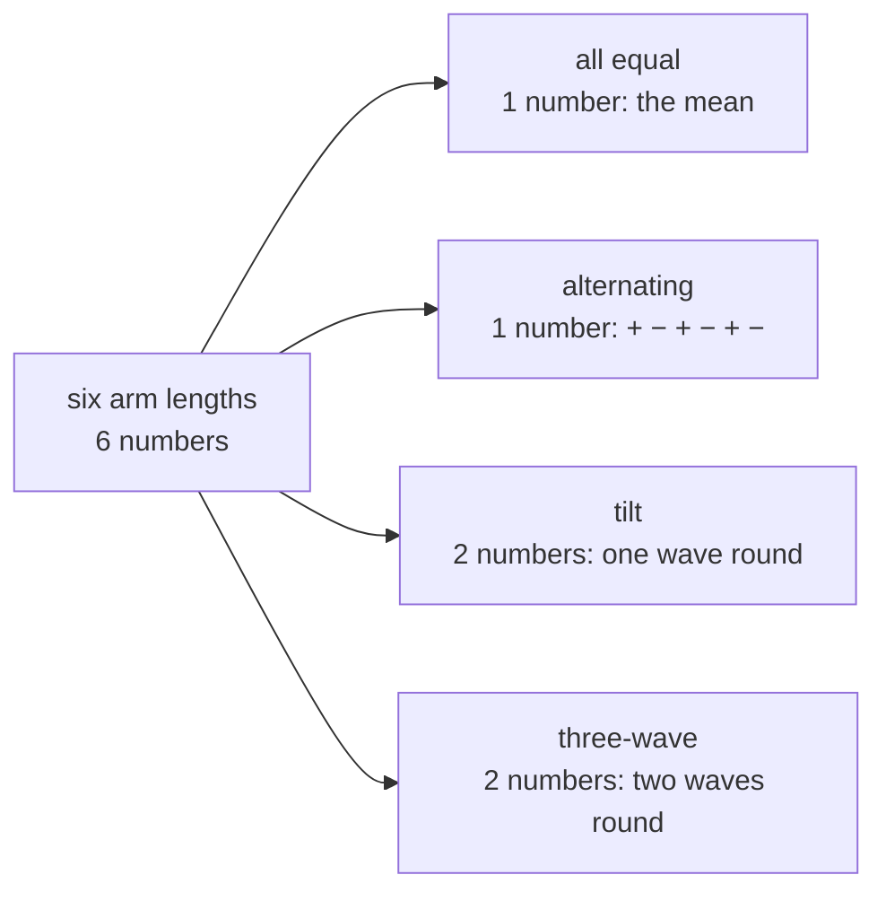

# Representation: a symmetry group written as matrices acting on a space

[Syllabus](../../../SYLLABUS.md) → [Differential geometry and Lie groups](../README.md) → [Lie Groups](../README.md#s06) → Representation

---

## General Overview

A snow crystal has six arms, each about 1 mm long. Its twelve symmetry moves (six turns by multiples of 60° and six flips) already have matrices: the 2 by 2 turn and flip matrices of [Symmetry](../../05-Geometry%20and%20trig/06-Beyond%20Euclid/04-symmetry-and-tilings.md), which move points of the flat picture.

Now measure something attached to the arms instead. A photograph gives six arm lengths, in millimetres:

1.12, 0.96, 1.08, 0.92, 1.04, 0.88.

Every symmetry move carries arms to arms, so it also shuffles this list of six numbers. A shuffle of a list is a 6 by 6 matrix. So the same twelve moves now act on a second space, the space of all six-number lists, as twelve new matrices. A group written as matrices like this is a **representation**.

The payoff is a split that no move can mix. The list breaks into four pieces:

- the average length, 1.00 mm on every arm;
- an alternating part, +0.08 and −0.08 mm by turns, a lean toward a triangle;
- a "tilt", longer on one side and shorter on the other;
- a "three-wave", a small pattern that repeats every three arms.

Whatever arm is called number 0, and whichever way round the arms are counted, each piece keeps its size (the square root of the sum of its six squared entries). The sizes of the last three pieces, 0.1960, 0.0693 and 0.0400 mm, are facts about the crystal, not about the labels.

**A representation writes each member of a symmetry group as a matrix acting on a space, so that combining moves matches multiplying matrices; a subspace that every one of those matrices maps into itself is a piece of the space that the symmetry never mixes with the rest.**

**What kind of fact this is:** representation and invariant subspace are definitions. That the arm space splits into four such pieces, and that each piece's size ignores the labels, are theorems proved on this card in Why it works. The general rule that counts the pieces from traces is stated with a named source, not proved.

### The picture: six numbers, four pieces



Six numbers in, 1 + 1 + 2 + 2 out. No symmetry move sends any part of one box into another.

---

## The formula

Notation first, in words. $`G`$ is the snowflake's group of twelve moves, called $`D_6`$ on the symmetry card; $`g`$ and $`h`$ are two of its moves. $`V`$ is a space of lists, here $`\mathbb{R}^6`$: all lists of six real numbers. $`GL(V)`$ is the set of invertible linear maps of $`V`$ to itself, written as matrices. It is the group $`GL(6,\mathbb{R})`$ of [Lie group](01-lie-groups-and-matrix-groups.md).

A **representation** of $`G`$ on $`V`$ is a rule $`\rho`$ (the Greek letter rho) that gives every move $`g`$ a matrix $`\rho(g)`$ and respects combining:

```math
\rho : G \to GL(V), \qquad \rho(g\,h) = \rho(g)\,\rho(h) \ \text{ for all } g, h \text{ in } G
```

**Read it aloud:** doing move $`h`$ and then move $`g`$, and writing the result as a matrix, gives the same matrix as multiplying the two moves' matrices.

That is a homomorphism into a matrix group, as in [Homomorphisms and isomorphisms](../../03-Algebra/08-Groups/05-homomorphisms-and-isomorphisms.md). For the arms, write $`x = (x_0, \dots, x_5)`$ for the six lengths and $`g(i)`$ for the arm that move $`g`$ sends arm $`i`$ to. The length at arm $`i`$ travels with the arm:

```math
\big(\rho(g)\,x\big)_{g(i)} = x_i
```

**Read it aloud:** after the move, the number written on arm $`g(i)`$ is the number arm $`i`$ had before.

A subspace $`W`$ of $`V`$ (a flat slice through zero, such as a line or a plane) is **invariant** when every matrix maps it into itself: $`\rho(g)\,w`$ lies in $`W`$ for every move $`g`$ and every $`w`$ in $`W`$. A representation with no invariant subspace except zero and the whole space is **irreducible**: it cannot be split further. The arm space splits into four irreducible pieces:

```math
\mathbb{R}^6 = W_{\mathrm{eq}} \oplus W_{\mathrm{alt}} \oplus W_{\mathrm{tilt}} \oplus W_{\mathrm{3}}, \qquad 6 = 1 + 1 + 2 + 2
```

**Read it aloud:** every list of six lengths is, in exactly one way, an all-equal list plus an alternating list plus a tilt plus a three-wave.

The piece of $`x`$ in each $`W`$ comes from averaging over the group:

```math
\pi_W\,x = \frac{d_W}{12}\sum_{g \text{ in } G} \chi_W(g)\,\rho(g)\,x
```

**Read it aloud:** move the list by each of the twelve moves, weight each result by that move's trace on the piece, add, and scale by the piece's dimension over twelve.

| Symbol | Plain meaning | In our example | Push it up and the answer… |
| --- | --- | --- | --- |
| $`G`$, $`D_6`$; $`g`$, $`h`$ | the group of symmetry moves; two of its moves | 12 moves: R0 to R300, F0 to F150 | more moves, fewer invariant pieces |
| $`V`$, $`\mathbb{R}^6`$ | the space the group acts on | all lists of six arm lengths | more arms, more pieces |
| $`x`$, $`x_i`$ | one list; the length of arm $`i`$, in mm | 1.12, 0.96, 1.08, 0.92, 1.04, 0.88 | a longer arm 0 raises the mean and the alternating part |
| $`g(i)`$ | the arm that move $`g`$ sends arm $`i`$ to | R60 sends arm 0 to arm 1 | — |
| $`\rho(g)`$ | the matrix of move $`g`$ on $`V`$ | a 6 by 6 shuffle, one 1 in each row and column | — |
| $`GL(V)`$ | all invertible linear maps of $`V`$ | $`GL(6,\mathbb{R})`$ | — |
| $`W`$ | an invariant subspace | $`W_{\mathrm{eq}}`$, $`W_{\mathrm{alt}}`$, $`W_{\mathrm{tilt}}`$, $`W_{\mathrm{3}}`$ | a bigger piece holds more patterns |
| $`\oplus`$ | "direct sum": each list splits one way only into one part from each piece | 6 = 1 + 1 + 2 + 2 | — |
| $`\chi(g)`$, $`\chi_W(g)`$ | the trace of $`\rho(g)`$: its diagonal entries added; on a piece, the trace there | on the arms, the count of arms a move leaves in place: 6, 0 or 2 | — |
| $`d_W`$ | the dimension of the piece | 1, 1, 2, 2 | — |
| $`\theta_i`$; $`B`$ | arm $`i`$'s angle; the matrix whose columns are the six waves, each scaled to length 1 | 30°, 90°, …, 330°; 6 by 6 | — |
| $`\pi_W\,x`$ | the part of $`x`$ lying in $`W`$ | alternating part ±0.08 mm | a lopsided crystal has a bigger tilt part |

The Greek letter χ (chi) is, on this card, the trace of a representation, called its **character**. Elsewhere in this wing, including [Hairy ball theorem](09-vector-field-zeros-and-the-hairy-ball.md), χ is the Euler characteristic; the two never meet on this card.

### When it holds

- **The rule must respect combining.** Read the index the wrong way round, taking the new entry at arm $`i`$ to be $`x_{g(i)}`$, and the matrices multiply in the reverse order. Then $`\rho(gh) = \rho(g)\rho(h)`$ fails for 72 of the 144 pairs of moves.
- **The maps must be linear.** Shuffling two crystals' lists and then adding them gives the same as adding and then shuffling. That is what lets each move be a matrix. Centre the snowflake away from the origin, and its turns about its own centre move the origin, which no matrix does, so those turns are not a representation on the plane.
- **Splitting is guaranteed for a finite group, or a compact one such as $`SO(3)`$; without that it can fail.** The shears $`\begin{pmatrix}1 & t\\ 0 & 1\end{pmatrix}`$, for every real $`t`$, form a group that keeps the x-axis. No second line is kept: of 201 lines tried, 0 survive. The group runs off to infinity, so there is nothing to average over.
- **Real numbers.** The card stays real. The trace count of Step 5 is a theorem over the complex numbers, and it applies here because the four real pieces stay unsplit there too.

---

## Why it works

### Step 0: moving the shape moves anything written on it

A move of the snowflake carries arms to arms, and any number written on an arm goes with it. So the list is shuffled. Shuffling is linear, and two moves in a row shuffle twice. The abstract group of twelve moves becomes twelve matrices, combined by matrix multiplication.

### Step 1: build the twelve matrices from the turns and flips

Number the arms 0 to 5 anticlockwise, with arm $`i`$ at angle $`30° + 60° \cdot i`$, so arm 1 points straight up. Apply each 2 by 2 matrix of the symmetry card to the six arm tips and see where each tip lands.

| Move | Arm 0, 1, 2, 3, 4, 5 goes to | Arms left in place |
| --- | --- | --- |
| R60, turn by 60° | 1, 2, 3, 4, 5, 0 | 0 |
| F30, flip in the line through arm 0 | 0, 5, 4, 3, 2, 1 | 2 (arms 0 and 3) |
| F0, flip in the line between arms 0 and 5 | 5, 4, 3, 2, 1, 0 | 0 |

Each shuffle gives a matrix with a 1 in row $`g(i)`$, column $`i`$, and 0 elsewhere. To check the representation rule, the code works out every product $`gh`$ in the 2 by 2 matrices, where the group really lives. It then compares $`\rho(gh)`$ with $`\rho(g)\rho(h)`$. All 144 pairs agree.

### Step 2: two pieces are visible at once

Two subspaces are kept by every shuffle, for plain reasons:

- **The all-equal line**, lists like 1, 1, 1, 1, 1, 1. Shuffling equal numbers changes nothing.
- **The sum-zero space**, lists whose six entries add to 0. Shuffling never changes a total.

Every list splits into these two. The lengths add to 6.00 mm, so the mean is 1.00 mm, and the rest is

0.12, −0.04, 0.08, −0.08, 0.04, −0.12 mm,

which adds to zero. The first piece is the average size of the crystal. The second holds every way it falls short of perfect.

### Step 3: averaging over the group finds the pieces

Average the twelve shuffled copies of a list, $`\tfrac{1}{12}\sum_g \rho(g)\,x`$. Moving the average by any move only reorders the twelve copies, so the average is kept by every move: it is the mean list. This is the projection formula with $`\chi = 1`$ and $`d = 1`$.

The same trick gives every other piece. Weighting each copy by the move's trace on a piece picks out that piece and cancels the rest (proved in Serre, Chapter 2; Sources). A complement can always be found too: the shuffles keep lengths and angles between lists, so the part at right angles to a kept subspace is also kept.

<details>
<summary>Detailed proof: the part at right angles to a kept subspace is kept</summary>

Write $`u \cdot w`$ for the dot product of two lists. A shuffle only reorders entries, so $`\rho(g)u \cdot \rho(g)w = u \cdot w`$.

Let $`W`$ be kept by every move, and let $`w`$ be at right angles to all of $`W`$. Take any $`u`$ in $`W`$. Then $`\rho(g^{-1})u`$ is also in $`W`$, so

$`\displaystyle \rho(g)w \cdot u = \rho(g)w \cdot \rho(g)\rho(g^{-1})u = w \cdot \rho(g^{-1})u = 0.`$

So $`\rho(g)w`$ is at right angles to $`W`$ as well. For a group whose matrices do not keep the dot product, average the dot product over the group first; it then is kept. This is Maschke's theorem, proved on [Representations](../../03-Algebra/12-Group%20Representations/01-representations-and-maschkes-theorem.md) and in Serre, Chapter 1 (Sources). The shear group has no finite average, which is why it fails.

</details>

### Step 4: the sum-zero space splits into three

Inside the sum-zero space:

- **The alternating line**, lists like +1, −1, +1, −1, +1, −1. Every move either keeps the triangle of arms 0, 2, 4 or swaps it with the triangle 1, 3, 5. So the line goes to itself, multiplied by +1 or −1. Our crystal has 0.08 mm of it: the alternating sum, 0.48 mm, over 6.
- **The tilt plane**, waves that go once round the crystal: $`\cos\theta_i`$ and $`\sin\theta_i`$, where $`\theta_i`$ is arm $`i`$'s angle. Our crystal's tilt is 0.02, 0.04, 0.02, −0.02, −0.04, −0.02 mm: longest at the top arm, shortest at the bottom.
- **The three-wave plane**, waves that go twice round: $`\cos 2\theta_i`$ and $`\sin 2\theta_i`$. Ours is 0.02, 0, −0.02, 0.02, 0, −0.02 mm.

R60 turns the tilt plane by exactly the symmetry card's 60° turn matrix, with entries 0.5000 and ±0.8660. So the flat picture of the snowflake reappears inside the arm picture, as one of its pieces. On the three-wave plane R60 turns by 120°.

Neither plane splits further over the real numbers. A line kept by R60 would be a direction R60 only stretches. The stretch factor is a root of a quadratic built from the 2 by 2 block's trace (tr) and determinant (det), and that quadratic has a real root only when $`\mathrm{tr}^2 - 4\det`$ is zero or more.

On the tilt plane R60 has trace 1 and determinant 1; on the three-wave plane, trace −1 and determinant 1. Both give $`\mathrm{tr}^2 - 4\det = -3`$, which is negative, so neither plane has such a line.

### Step 5: the traces count the pieces

A second road needs no pieces at all, only traces. The trace of a shuffle counts the arms it leaves in place. Over the twelve moves: 6 for doing nothing, 0 for the five turns, 2 for the three flips through arms, 0 for the three flips between arms.

- Average trace: (6 + 2 + 2 + 2) / 12 = 1. The all-equal piece appears once.
- Average squared trace: (36 + 4 + 4 + 4) / 12 = 48 / 12 = 4.

The theorem behind this, stated here and proved in Serre, Chapter 2 (Sources): for a finite group, the average squared trace equals the sum of the squares of how often each irreducible piece appears. The 4 could be 2² (one piece twice) or 1 + 1 + 1 + 1. The all-equal piece appears once, so it uses 1, and the remaining 3 can only be 1 + 1 + 1. So there are four different pieces, each once, which matches Step 4 without looking inside.

### Step 6: in the right basis every matrix is in blocks

Put the six waves of Step 4, scaled to length 1, as the columns of a matrix $`B`$. That is a change of basis: lists are now written as amounts of each wave. Every $`\rho(g)`$ becomes $`B^{T}\rho(g)\,B`$; here the transpose $`B^{T}`$ equals $`B^{-1}`$, because the columns have length 1 and meet at right angles. All twelve come out in blocks of size 1, 1, 2 and 2 down the diagonal, with zeros elsewhere. The largest entry outside the blocks, over all twelve moves, is 0.0000.

That is what "the representation splits" means: in a good basis, every matrix is blocks with zeros between them.

The blocks also prove the label claim of the overview. Relabelling the arms replaces $`x`$ by $`\rho(g)\,x`$ for some move $`g`$. In the new basis that turns each piece by its own block and never mixes pieces. Each block keeps lengths, because $`\rho(g)`$ only reorders entries and $`B`$ keeps lengths too, so each piece keeps its size.

---

## Worked numbers, by hand

| Step | Arithmetic | Value |
| --- | --- | --- |
| total length | 1.12 + 0.96 + 1.08 + 0.92 + 1.04 + 0.88 | 6.00 mm |
| mean | 6.00 / 6 | **1.00 mm on every arm** |
| alternating sum | 1.12 − 0.96 + 1.08 − 0.92 + 1.04 − 0.88 | 0.48 mm |
| alternating part | 0.48 / 6 | **±0.08 mm** |
| split into waves once and twice round | tilt plus three-wave | 0.02, 0.04, 0.02, −0.02, −0.04, −0.02 and 0.02, 0, −0.02, 0.02, 0, −0.02 |
| sizes, as square root of sum of squares | 0.08 × √6; √0.0048; √0.0016 | 0.1960, 0.0693, 0.0400 mm |
| Pythagoras | 0.0384 + 0.0048 + 0.0016 = 0.0448, square root | **0.2117 mm**, the size of 0.12, −0.04, 0.08, −0.08, 0.04, −0.12 |

The crystal is 1.00 mm on average. Most of its imperfection, 0.1960 of 0.2117 mm, is the alternating, triangle-like part.

The sizes as bars, one `#` per 0.01 mm:

```
alternating   ####################  0.1960 mm
tilt          #######               0.0693 mm
three-wave    ####                  0.0400 mm
```

### What breaks if you drop a piece

| Mistake | Comes out at | What went wrong |
| --- | --- | --- |
| Reading the shuffle backwards: new entry at arm $`i`$ taken as $`x_{g(i)}`$ | 72 of 144 pairs break $`\rho(gh) = \rho(g)\rho(h)`$ | the matrices compose in the reverse order |
| Treating one arm's excess as a property of the crystal | arm 0's excess ranges from −0.12 to +0.12 mm over the 12 relabellings | a single coordinate is not an invariant piece |
| Splitting the tilt plane into two lines | $`\mathrm{tr}^2 - 4\det = -3`$ for R60 there | a 60° turn fixes no real direction |
| Expecting a complement for every group | the shear keeps the x-axis; 0 of 201 other lines kept | the shear group is not finite or compact |

The code prints all four.

---

## Code, from first principles, and it actually runs

The code builds the twelve 6 by 6 matrices by tracking where the 2 by 2 matrices send each arm tip, and checks the rule on all 144 pairs. It then reaches the four pieces by three independent roads: averaging over the group with traces, projecting onto an explicit basis of waves, and counting the pieces from traces alone, with Pythagoras on the sizes. Each size is checked under all twelve relabellings.

### Python

```python
# Representation in outline -- the check behind the card.  Standard library
# only.  The snowflake's twelve moves (wing 05's 2-by-2 turns and flips) act
# on its six arms: each move shuffles a list of six arm lengths, and that
# shuffle is a 6-by-6 matrix.  The list then splits into pieces no move mixes.
from math import cos, sin, radians, sqrt

ARM = [30 + 60 * i for i in range(6)]                 # arm i points this way, degrees
TIP = [(cos(radians(a)), sin(radians(a))) for a in ARM]
X = [1.12, 0.96, 1.08, 0.92, 1.04, 0.88]              # one crystal's arm lengths, mm

def turn(t):
    c, s = cos(radians(t)), sin(radians(t))
    return [[c, -s], [s, c]]

def flip(p):
    c, s = cos(radians(2 * p)), sin(radians(2 * p))
    return [[c, s], [s, -c]]

def mul(A, B):
    return [[sum(A[i][k] * B[k][j] for k in range(len(B))) for j in range(len(B[0]))]
            for i in range(len(A))]

def close(A, B, tol=1e-9):
    return all(abs(a - b) < tol for ra, rb in zip(A, B) for a, b in zip(ra, rb))

def f(v):                                             # 4 decimals, never "-0.0000"
    return f"{0.0 if abs(v) < 5e-5 else v:.4f}"

def fl(vs):
    return "[" + ", ".join(f(v) for v in vs) + "]"

NAME = [f"R{60 * k}" for k in range(6)] + [f"F{30 * m}" for m in range(6)]
M2 = [turn(60 * k) for k in range(6)] + [flip(30 * m) for m in range(6)]
M2X2 = [turn(120 * k) for k in range(6)] + [flip(60 * m) for m in range(6)]  # angles doubled

def lands(M, i):                                      # which tip does arm i's tip land on?
    x, y = TIP[i]
    u, v = M[0][0] * x + M[0][1] * y, M[1][0] * x + M[1][1] * y
    return min(range(6), key=lambda j: (TIP[j][0] - u) ** 2 + (TIP[j][1] - v) ** 2)

PERM = [[lands(M, i) for i in range(6)] for M in M2]
RHO = [[[1.0 if p[j] == i else 0.0 for j in range(6)] for i in range(6)] for p in PERM]
WRONG = [[[1.0 if p[i] == j else 0.0 for j in range(6)] for i in range(6)] for p in PERM]
which = lambda M: next(k for k in range(12) if close(M2[k], M))

good = bad = 0
for g in range(12):
    for h in range(12):
        gh = which(mul(M2[g], M2[h]))                 # the group's own product, in 2x2
        good += close(RHO[gh], mul(RHO[g], RHO[h]))
        bad += not close(WRONG[gh], mul(WRONG[g], WRONG[h]))
chi = [sum(R[i][i] for i in range(6)) for R in RHO]   # trace = arms left in place
print(f"moves: {' '.join(NAME)}")
print(f"arm i goes to, under R60: {PERM[1]}; under F30: {PERM[7]}; under F0: {PERM[6]}")
print(f"pairs (g, h) with rho(gh) = rho(g) rho(h): {good} of 144")
print(f"trace of rho(g), arms left in place: {[int(c) for c in chi]}")
print(f"copies of the all-equal piece, sum of traces / 12: {f(sum(chi) / 12)}")
print(f"pieces counted by traces, sum of squares {int(sum(c * c for c in chi))} / 12 = "
      f"{f(sum(c * c for c in chi) / 12)}")

# Road 1: projectors built by averaging over the group, weighted by a trace.
alt = [1.0 if sorted(p[i] for i in (0, 2, 4)) == [0, 2, 4] else -1.0 for p in PERM]
char = {"all equal": ([1.0] * 12, 1), "alternating": (alt, 1),
        "tilt (once round)": ([M[0][0] + M[1][1] for M in M2], 2),
        "three-wave (twice round)": ([M[0][0] + M[1][1] for M in M2X2], 2)}
PROJ = {}
for name, (ch, d) in char.items():
    PROJ[name] = [[d / 12 * sum(ch[g] * RHO[g][i][j] for g in range(12)) for j in range(6)]
                  for i in range(6)]
road1 = {n: [sum(P[i][j] * X[j] for j in range(6)) for i in range(6)] for n, P in PROJ.items()}

# Road 2: an explicit basis of waves round the arms, and dot products.
def wave(fn, m):
    return [fn(radians(m * a)) for a in ARM]
BASIS = {"all equal": [[1.0] * 6], "alternating": [[(-1.0) ** i for i in range(6)]],
         "tilt (once round)": [wave(cos, 1), wave(sin, 1)],
         "three-wave (twice round)": [wave(cos, 2), wave(sin, 2)]}
dot = lambda a, b: sum(p * q for p, q in zip(a, b))
road2 = {}
for n, vs in BASIS.items():
    coeff = [dot(X, v) / dot(v, v) for v in vs]
    road2[n] = [sum(c * v[i] for c, v in zip(coeff, vs)) for i in range(6)]
size = lambda v: sqrt(dot(v, v))
alt_sum = sum((-1) ** i * X[i] for i in range(6))
print(f"arm lengths x, mm: {fl(X)}")
print(f"sum {f(sum(X))}, mean {f(sum(X) / 6)}; alternating sum {f(alt_sum)}, / 6 = {f(alt_sum / 6)}")
print(f"x minus the mean: {fl([v - sum(X) / 6 for v in X])}")
for n in char:
    sizes = [size([sum(PROJ[n][i][j] * sum(RHO[g][j][k] * X[k] for k in range(6))
                       for j in range(6)) for i in range(6)]) for g in range(12)]
    print(f"{n}: {fl(road1[n])}  size {f(size(road1[n]))} mm, "
          f"same after all 12 relabellings: {'yes' if max(sizes) - min(sizes) < 1e-12 else 'no'}")
    assert all(abs(a - b) < 1e-12 for a, b in zip(road1[n], road2[n]))   # two roads agree
    assert max(sizes) - min(sizes) < 1e-12                                # size ignores the labels
dev = size([v - sum(X) / 6 for v in X])
parts = [size(road1[n]) for n in list(char)[1:]]
print(f"squared sizes: {' + '.join(f(p * p) for p in parts)} = {f(sum(p * p for p in parts))}")
print(f"deviation from the mean, mm: {f(dev)}; from the pieces by Pythagoras: "
      f"{f(sqrt(sum(p * p for p in parts)))}")

# Change of basis: every rho(g) becomes blocks of size 1, 1, 2, 2.
cols = [[c / size(v) for c in v] for vs in BASIS.values() for v in vs]
B = [[cols[j][i] for j in range(6)] for i in range(6)]
Bt = [list(r) for r in zip(*B)]
block = [0, 1, 2, 2, 3, 3]
leak = max(abs(mul(mul(Bt, RHO[g]), B)[i][j]) for g in range(12)
           for i in range(6) for j in range(6) if block[i] != block[j])
T = mul(mul(Bt, RHO[1]), B)
print(f"largest entry outside the 1,1,2,2 blocks, over all 12 moves: {f(leak)}")
print(f"R60 on the tilt plane: [[{f(T[2][2])}, {f(T[2][3])}], [{f(T[3][2])}, {f(T[3][3])}]]")
print(f"R60 on the three-wave plane: [[{f(T[4][4])}, {f(T[4][5])}], [{f(T[5][4])}, {f(T[5][5])}]]")

# What breaks.
arm0 = [sum(RHO[g][0][k] * X[k] for k in range(6)) - sum(X) / 6 for g in range(12)]
disc = lambda a: (T[a][a] + T[a + 1][a + 1]) ** 2 - 4 * (T[a][a] * T[a + 1][a + 1] - T[a][a + 1] * T[a + 1][a])
S = [[1.0, 1.0], [0.0, 1.0]]                          # a shear: the group of all S^t, t real
on_line = lambda v: abs(v[0][0] * mul(S, v)[1][0] - v[1][0] * mul(S, v)[0][0]) < 1e-12
kept = sum(on_line([[a / 10], [1.0]]) for a in range(-100, 101))
print(f"mistake 1, indices read backwards: rho(gh) = rho(g) rho(h) fails for {bad} of 144 pairs")
print(f"mistake 2, arm 0's own excess over relabellings: from {f(min(arm0))} to {f(max(arm0))} mm")
print(f"mistake 3, R60 on the tilt plane: tr^2 - 4 det = {f(disc(2))}; on the three-wave plane: {f(disc(4))}; no real axis")
print(f"mistake 4, shear [[1, 1], [0, 1]]: x-axis kept: {'yes' if on_line([[1.0], [0.0]]) else 'no'}; lines through (a, 1) kept: {kept} of 201")
assert good == 144 and bad == 72 and kept == 0       # a representation; its mirror and the shear fail
assert [int(c) for c in chi] == [6, 0, 0, 0, 0, 0, 0, 2, 0, 2, 0, 2]   # independent count of fixed arms
assert abs(sum(c * c for c in chi) / 12 - 4) < 1e-12 and leak < 1e-12
assert abs(alt_sum / 6 - road1["alternating"][0]) < 1e-12 and max(abs(disc(a) + 3) for a in (2, 4)) < 1e-12
assert abs(dev - sqrt(sum(p * p for p in parts))) < 1e-12 and abs(parts[0] - 0.08 * sqrt(6)) < 1e-12
print("ALL CHECKS PASS")
```

**Ran 2026-11-19 on macOS, Python 3.14.10, standard library only. All checks passed. Output, pasted from the run:**

```
moves: R0 R60 R120 R180 R240 R300 F0 F30 F60 F90 F120 F150
arm i goes to, under R60: [1, 2, 3, 4, 5, 0]; under F30: [0, 5, 4, 3, 2, 1]; under F0: [5, 4, 3, 2, 1, 0]
pairs (g, h) with rho(gh) = rho(g) rho(h): 144 of 144
trace of rho(g), arms left in place: [6, 0, 0, 0, 0, 0, 0, 2, 0, 2, 0, 2]
copies of the all-equal piece, sum of traces / 12: 1.0000
pieces counted by traces, sum of squares 48 / 12 = 4.0000
arm lengths x, mm: [1.1200, 0.9600, 1.0800, 0.9200, 1.0400, 0.8800]
sum 6.0000, mean 1.0000; alternating sum 0.4800, / 6 = 0.0800
x minus the mean: [0.1200, -0.0400, 0.0800, -0.0800, 0.0400, -0.1200]
all equal: [1.0000, 1.0000, 1.0000, 1.0000, 1.0000, 1.0000]  size 2.4495 mm, same after all 12 relabellings: yes
alternating: [0.0800, -0.0800, 0.0800, -0.0800, 0.0800, -0.0800]  size 0.1960 mm, same after all 12 relabellings: yes
tilt (once round): [0.0200, 0.0400, 0.0200, -0.0200, -0.0400, -0.0200]  size 0.0693 mm, same after all 12 relabellings: yes
three-wave (twice round): [0.0200, 0.0000, -0.0200, 0.0200, 0.0000, -0.0200]  size 0.0400 mm, same after all 12 relabellings: yes
squared sizes: 0.0384 + 0.0048 + 0.0016 = 0.0448
deviation from the mean, mm: 0.2117; from the pieces by Pythagoras: 0.2117
largest entry outside the 1,1,2,2 blocks, over all 12 moves: 0.0000
R60 on the tilt plane: [[0.5000, -0.8660], [0.8660, 0.5000]]
R60 on the three-wave plane: [[-0.5000, -0.8660], [0.8660, -0.5000]]
mistake 1, indices read backwards: rho(gh) = rho(g) rho(h) fails for 72 of 144 pairs
mistake 2, arm 0's own excess over relabellings: from -0.1200 to 0.1200 mm
mistake 3, R60 on the tilt plane: tr^2 - 4 det = -3.0000; on the three-wave plane: -3.0000; no real axis
mistake 4, shear [[1, 1], [0, 1]]: x-axis kept: yes; lines through (a, 1) kept: 0 of 201
ALL CHECKS PASS
```

### Rust

Same numbers, same labels, built with `rustc --edition 2021 -O`.

```rust
// Representation in outline -- the same check as the Python, in Rust.  No
// crates.  The snowflake's twelve moves (wing 05's 2-by-2 turns and flips) act
// on its six arms: each move shuffles a list of six arm lengths, and that
// shuffle is a 6-by-6 matrix.  The list then splits into pieces no move mixes.
type M = Vec<Vec<f64>>;
const X: [f64; 6] = [1.12, 0.96, 1.08, 0.92, 1.04, 0.88]; // one crystal's arm lengths, mm

fn rad(d: f64) -> f64 { d.to_radians() }
fn arm(i: usize) -> f64 { 30.0 + 60.0 * i as f64 }            // arm i points this way, degrees
fn tip(i: usize) -> (f64, f64) { (rad(arm(i)).cos(), rad(arm(i)).sin()) }
fn turn(t: f64) -> M { let (c, s) = (rad(t).cos(), rad(t).sin()); vec![vec![c, -s], vec![s, c]] }
fn flip(p: f64) -> M { let (c, s) = (rad(2.0 * p).cos(), rad(2.0 * p).sin()); vec![vec![c, s], vec![s, -c]] }

fn mul(a: &M, b: &M) -> M {
    (0..a.len()).map(|i| (0..b[0].len()).map(|j| (0..b.len()).map(|k| a[i][k] * b[k][j]).sum()).collect()).collect()
}
fn close(a: &M, b: &M) -> bool {
    a.iter().zip(b).all(|(ra, rb)| ra.iter().zip(rb).all(|(x, y)| (x - y).abs() < 1e-9))
}
fn f(v: f64) -> String { format!("{:.4}", if v.abs() < 5e-5 { 0.0 } else { v }) } // never "-0.0000"
fn fl(vs: &[f64]) -> String { format!("[{}]", vs.iter().map(|&v| f(v)).collect::<Vec<_>>().join(", ")) }
fn dot(a: &[f64], b: &[f64]) -> f64 { a.iter().zip(b).map(|(p, q)| p * q).sum() }
fn size(v: &[f64]) -> f64 { dot(v, v).sqrt() }
fn apply(a: &M, v: &[f64]) -> Vec<f64> { a.iter().map(|r| dot(r, v)).collect() }

fn lands(m: &M, i: usize) -> usize {                          // which tip does arm i's tip land on?
    let (x, y) = tip(i);
    let (u, v) = (m[0][0] * x + m[0][1] * y, m[1][0] * x + m[1][1] * y);
    let d = |j: usize| (tip(j).0 - u).powi(2) + (tip(j).1 - v).powi(2);
    (0..6).fold(0, |b, j| if d(j) < d(b) { j } else { b })
}

fn main() {
    let name: Vec<String> = (0..6).map(|k| format!("R{}", 60 * k)).chain((0..6).map(|m| format!("F{}", 30 * m))).collect();
    let m2: Vec<M> = (0..6).map(|k| turn(60.0 * k as f64)).chain((0..6).map(|m| flip(30.0 * m as f64))).collect();
    let m2x2: Vec<M> = (0..6).map(|k| turn(120.0 * k as f64)).chain((0..6).map(|m| flip(60.0 * m as f64))).collect();
    let perm: Vec<Vec<usize>> = m2.iter().map(|m| (0..6).map(|i| lands(m, i)).collect()).collect();
    let rho: Vec<M> = perm.iter().map(|p| (0..6).map(|i| (0..6).map(|j| if p[j] == i { 1.0 } else { 0.0 }).collect()).collect()).collect();
    let wrong: Vec<M> = perm.iter().map(|p| (0..6).map(|i| (0..6).map(|j| if p[i] == j { 1.0 } else { 0.0 }).collect()).collect()).collect();
    let which = |m: &M| (0..12).find(|&k| close(&m2[k], m)).unwrap();
    let (mut good, mut bad) = (0, 0);
    for g in 0..12 {
        for h in 0..12 {
            let gh = which(&mul(&m2[g], &m2[h]));             // the group's own product, in 2x2
            if close(&rho[gh], &mul(&rho[g], &rho[h])) { good += 1 }
            if !close(&wrong[gh], &mul(&wrong[g], &wrong[h])) { bad += 1 }
        }
    }
    let chi: Vec<f64> = rho.iter().map(|r| (0..6).map(|i| r[i][i]).sum()).collect(); // arms left in place
    let chi_int: Vec<i64> = chi.iter().map(|&c| c as i64).collect();
    let n_pieces = chi.iter().map(|c| c * c).sum::<f64>() / 12.0;
    println!("moves: {}", name.join(" "));
    println!("arm i goes to, under R60: {:?}; under F30: {:?}; under F0: {:?}", perm[1], perm[7], perm[6]);
    println!("pairs (g, h) with rho(gh) = rho(g) rho(h): {} of 144", good);
    println!("trace of rho(g), arms left in place: {:?}", chi_int);
    println!("copies of the all-equal piece, sum of traces / 12: {}", f(chi.iter().sum::<f64>() / 12.0));
    println!("pieces counted by traces, sum of squares {} / 12 = {}", (n_pieces * 12.0).round() as i64, f(n_pieces));

    // Road 1: projectors built by averaging over the group, weighted by a trace.
    let alt: Vec<f64> = perm.iter().map(|p| {
        let mut t = vec![p[0], p[2], p[4]]; t.sort(); if t == vec![0, 2, 4] { 1.0 } else { -1.0 } }).collect();
    let tr = |m: &M| m[0][0] + m[1][1];
    let names = ["all equal", "alternating", "tilt (once round)", "three-wave (twice round)"];
    let chars: Vec<(Vec<f64>, f64)> = vec![(vec![1.0; 12], 1.0), (alt, 1.0),
        (m2.iter().map(|m| tr(m)).collect(), 2.0), (m2x2.iter().map(|m| tr(m)).collect(), 2.0)];
    let proj: Vec<M> = chars.iter().map(|(ch, d)| (0..6).map(|i| (0..6).map(|j|
        d / 12.0 * (0..12).map(|g| ch[g] * rho[g][i][j]).sum::<f64>()).collect()).collect()).collect();
    let road1: Vec<Vec<f64>> = proj.iter().map(|p| apply(p, &X)).collect();

    // Road 2: an explicit basis of waves round the arms, and dot products.
    let wave = |cosine: bool, m: f64| -> Vec<f64> { (0..6).map(|i| { let a = rad(m * arm(i)); if cosine { a.cos() } else { a.sin() } }).collect() };
    let basis: Vec<Vec<Vec<f64>>> = vec![vec![vec![1.0; 6]], vec![(0..6).map(|i| if i % 2 == 0 { 1.0 } else { -1.0 }).collect()],
        vec![wave(true, 1.0), wave(false, 1.0)], vec![wave(true, 2.0), wave(false, 2.0)]];
    let alt_sum: f64 = (0..6).map(|i| if i % 2 == 0 { X[i] } else { -X[i] }).sum();
    let total: f64 = X.iter().sum();
    println!("arm lengths x, mm: {}", fl(&X));
    println!("sum {}, mean {}; alternating sum {}, / 6 = {}", f(total), f(total / 6.0), f(alt_sum), f(alt_sum / 6.0));
    println!("x minus the mean: {}", fl(&X.iter().map(|v| v - total / 6.0).collect::<Vec<f64>>()));
    for n in 0..4 {
        let coeff: Vec<f64> = basis[n].iter().map(|v| dot(&X, v) / dot(v, v)).collect();
        let road2: Vec<f64> = (0..6).map(|i| coeff.iter().zip(&basis[n]).map(|(c, v)| c * v[i]).sum()).collect();
        let sizes: Vec<f64> = (0..12).map(|g| size(&apply(&proj[n], &apply(&rho[g], &X)))).collect();
        let spread = sizes.iter().cloned().fold(f64::MIN, f64::max) - sizes.iter().cloned().fold(f64::MAX, f64::min);
        println!("{}: {}  size {} mm, same after all 12 relabellings: {}", names[n], fl(&road1[n]), f(size(&road1[n])),
                 if spread < 1e-12 { "yes" } else { "no" });
        assert!(road1[n].iter().zip(&road2).all(|(a, b)| (a - b).abs() < 1e-12)); // two roads agree
        assert!(spread < 1e-12);                                  // size ignores the labels
    }
    let dev = size(&X.iter().map(|v| v - total / 6.0).collect::<Vec<f64>>());
    let parts: Vec<f64> = (1..4).map(|n| size(&road1[n])).collect();
    let pyth = parts.iter().map(|p| p * p).sum::<f64>().sqrt();
    println!("squared sizes: {} = {}", parts.iter().map(|p| f(p * p)).collect::<Vec<_>>().join(" + "), f(pyth * pyth));
    println!("deviation from the mean, mm: {}; from the pieces by Pythagoras: {}", f(dev), f(pyth));

    // Change of basis: every rho(g) becomes blocks of size 1, 1, 2, 2.
    let cols: Vec<Vec<f64>> = basis.iter().flatten().map(|v| v.iter().map(|c| c / size(v)).collect()).collect();
    let b: M = (0..6).map(|i| (0..6).map(|j| cols[j][i]).collect()).collect();
    let bt: M = cols.clone();
    let block = [0, 1, 2, 2, 3, 3];
    let mut leak: f64 = 0.0;
    for g in 0..12 {
        let t = mul(&mul(&bt, &rho[g]), &b);
        for i in 0..6 { for j in 0..6 { if block[i] != block[j] { leak = leak.max(t[i][j].abs()) } } }
    }
    let t = mul(&mul(&bt, &rho[1]), &b);
    println!("largest entry outside the 1,1,2,2 blocks, over all 12 moves: {}", f(leak));
    println!("R60 on the tilt plane: [[{}, {}], [{}, {}]]", f(t[2][2]), f(t[2][3]), f(t[3][2]), f(t[3][3]));
    println!("R60 on the three-wave plane: [[{}, {}], [{}, {}]]", f(t[4][4]), f(t[4][5]), f(t[5][4]), f(t[5][5]));

    // What breaks.
    let arm0: Vec<f64> = (0..12).map(|g| dot(&rho[g][0], &X) - total / 6.0).collect();
    let disc = |a: usize| (t[a][a] + t[a + 1][a + 1]).powi(2) - 4.0 * (t[a][a] * t[a + 1][a + 1] - t[a][a + 1] * t[a + 1][a]);
    let s: M = vec![vec![1.0, 1.0], vec![0.0, 1.0]];          // a shear: the group of all S^t, t real
    let on_line = |v: &M| { let w = mul(&s, v); (v[0][0] * w[1][0] - v[1][0] * w[0][0]).abs() < 1e-12 };
    let kept = (-100..=100).filter(|&a| on_line(&vec![vec![a as f64 / 10.0], vec![1.0]])).count();
    println!("mistake 1, indices read backwards: rho(gh) = rho(g) rho(h) fails for {} of 144 pairs", bad);
    println!("mistake 2, arm 0's own excess over relabellings: from {} to {} mm",
             f(arm0.iter().cloned().fold(f64::MAX, f64::min)), f(arm0.iter().cloned().fold(f64::MIN, f64::max)));
    println!("mistake 3, R60 on the tilt plane: tr^2 - 4 det = {}; on the three-wave plane: {}; no real axis", f(disc(2)), f(disc(4)));
    println!("mistake 4, shear [[1, 1], [0, 1]]: x-axis kept: {}; lines through (a, 1) kept: {} of 201",
             if on_line(&vec![vec![1.0], vec![0.0]]) { "yes" } else { "no" }, kept);
    assert!(good == 144 && bad == 72 && kept == 0);           // a representation; its mirror and the shear fail
    assert!(chi_int == vec![6, 0, 0, 0, 0, 0, 0, 2, 0, 2, 0, 2]); // independent count of fixed arms
    assert!((n_pieces - 4.0).abs() < 1e-12 && leak < 1e-12);
    assert!((alt_sum / 6.0 - road1[1][0]).abs() < 1e-12 && (disc(2) + 3.0).abs().max((disc(4) + 3.0).abs()) < 1e-12);
    assert!((dev - pyth).abs() < 1e-12 && (parts[0] - 0.08 * 6f64.sqrt()).abs() < 1e-12);
    println!("ALL CHECKS PASS");
}
```

**Ran 2026-11-19 on macOS, rustc 1.98.1, no crates. All checks passed. Output, pasted from the run:**

```
moves: R0 R60 R120 R180 R240 R300 F0 F30 F60 F90 F120 F150
arm i goes to, under R60: [1, 2, 3, 4, 5, 0]; under F30: [0, 5, 4, 3, 2, 1]; under F0: [5, 4, 3, 2, 1, 0]
pairs (g, h) with rho(gh) = rho(g) rho(h): 144 of 144
trace of rho(g), arms left in place: [6, 0, 0, 0, 0, 0, 0, 2, 0, 2, 0, 2]
copies of the all-equal piece, sum of traces / 12: 1.0000
pieces counted by traces, sum of squares 48 / 12 = 4.0000
arm lengths x, mm: [1.1200, 0.9600, 1.0800, 0.9200, 1.0400, 0.8800]
sum 6.0000, mean 1.0000; alternating sum 0.4800, / 6 = 0.0800
x minus the mean: [0.1200, -0.0400, 0.0800, -0.0800, 0.0400, -0.1200]
all equal: [1.0000, 1.0000, 1.0000, 1.0000, 1.0000, 1.0000]  size 2.4495 mm, same after all 12 relabellings: yes
alternating: [0.0800, -0.0800, 0.0800, -0.0800, 0.0800, -0.0800]  size 0.1960 mm, same after all 12 relabellings: yes
tilt (once round): [0.0200, 0.0400, 0.0200, -0.0200, -0.0400, -0.0200]  size 0.0693 mm, same after all 12 relabellings: yes
three-wave (twice round): [0.0200, 0.0000, -0.0200, 0.0200, 0.0000, -0.0200]  size 0.0400 mm, same after all 12 relabellings: yes
squared sizes: 0.0384 + 0.0048 + 0.0016 = 0.0448
deviation from the mean, mm: 0.2117; from the pieces by Pythagoras: 0.2117
largest entry outside the 1,1,2,2 blocks, over all 12 moves: 0.0000
R60 on the tilt plane: [[0.5000, -0.8660], [0.8660, 0.5000]]
R60 on the three-wave plane: [[-0.5000, -0.8660], [0.8660, -0.5000]]
mistake 1, indices read backwards: rho(gh) = rho(g) rho(h) fails for 72 of 144 pairs
mistake 2, arm 0's own excess over relabellings: from -0.1200 to 0.1200 mm
mistake 3, R60 on the tilt plane: tr^2 - 4 det = -3.0000; on the three-wave plane: -3.0000; no real axis
mistake 4, shear [[1, 1], [0, 1]]: x-axis kept: yes; lines through (a, 1) kept: 0 of 201
ALL CHECKS PASS
```

The two outputs match line for line.

### Lean

Lean proves splitting for every finite group, and proves the snowflake's representation and its four pieces exactly.

- Take any finite group, written as matrices on a real space, and an invariant subspace. Then a second invariant subspace exists, and every member of the space splits one way only between them.
- Take any two moves $`g`$ and $`h`$. Then $`\rho(g\,h) = \rho(g)\,\rho(h)`$, so the arm shuffles are a representation of the twelve moves.
- Take any move $`g`$, list $`x`$ and arm $`i`$. Then $`\big(\rho(g)\,x\big)_{g(i)} = x_i`$: the length on each arm travels with the arm.
- The all-equal line, the alternating line, the tilt plane and the three-wave plane are each invariant, and irreducible over the real numbers.
- Every list of six lengths is, in exactly one way, a sum of one list from each piece. The dimensions are 1, 1, 2 and 2.
- Lean also checks Step 1's table, the 72 of 144 pairs that fail when the shuffle is read backwards, and the trace sums 12 and 48.
- Take lengths in hundredths of a millimetre. Then the worked sums 600 and 48, and the Pythagoras check 384 + 48 + 16 = 448, come out exactly.

The decimal sizes, the averaging formula, the shear and the blocks of Step 6 are left to the Python and Rust checks.

```lean
-- Representation: a finite group's kept subspace always has a kept complement, and the snowflake's twelve moves shuffle its six arm lengths as a representation that splits into four unsplittable kept pieces of sizes 1, 1, 2 and 2.
import Mathlib.GroupTheory.SpecificGroups.Dihedral
import Mathlib.RepresentationTheory.Basic
import Mathlib.Algebra.DirectSum.Module
import Mathlib.LinearAlgebra.Dimension.Finrank
import Mathlib.LinearAlgebra.Span.Defs
import Mathlib.Algebra.Module.Equiv.Basic
import Mathlib.Data.ZMod.Defs
import Mathlib.Basic.Real.Basic
import Mathlib.LinearAlgebra.DirectSum.Finite
import Mathlib.LinearAlgebra.FiniteDimensional.Lemmas

open DihedralGroup

namespace RepresentationsInOutline

/-- Where the snowflake move `g` sends arm `i`. The arms are numbered 0 to 5 anticlockwise,
as `ZMod 6`. `r k` is the turn by `60° · k`, so `r 1` is R60; `sr k` is a flip, so `sr 0` is
F30 (the flip through arm 0) and `sr 1` is F0 (the flip between arms 0 and 5). -/
def armMove : DihedralGroup 6 → ZMod 6 → ZMod 6
  | r k, i => i + k
  | sr k, i => -k - i

/-- The arm shuffle `ρ(g)`: the number written on an arm travels with the arm, so the new
list has at arm `j` the number the old list had at the arm that `g` sends to `j`. -/
def rho (g : DihedralGroup 6) : (ZMod 6 → ℝ) →ₗ[ℝ] (ZMod 6 → ℝ) :=
  LinearMap.funLeft ℝ ℝ (armMove g⁻¹)

/-- A subspace of the arm space is kept when every move's matrix maps it into itself. -/
def Kept (W : Submodule ℝ (ZMod 6 → ℝ)) : Prop :=
  ∀ g : DihedralGroup 6, ∀ w ∈ W, rho g w ∈ W

/-- A kept piece is unsplittable (irreducible) when it is not zero and its only kept
subspaces are zero and itself. -/
def Unsplittable (W : Submodule ℝ (ZMod 6 → ℝ)) : Prop :=
  W ≠ ⊥ ∧ ∀ U : Submodule ℝ (ZMod 6 → ℝ), U ≤ W → Kept U → U = ⊥ ∨ U = W

/-- A list of six arm lengths, given arm by arm. -/
def armList (a b c d e f : ℝ) : ZMod 6 → ℝ :=
  fun i => ![a, b, c, d, e, f] (i : Fin 6)

/-- The all-equal line: lists like 1, 1, 1, 1, 1, 1. -/
def Weq : Submodule ℝ (ZMod 6 → ℝ) := Submodule.span ℝ {armList 1 1 1 1 1 1}

/-- The alternating line: lists like +1, −1, +1, −1, +1, −1. -/
def Walt : Submodule ℝ (ZMod 6 → ℝ) := Submodule.span ℝ {armList 1 (-1) 1 (-1) 1 (-1)}

/-- The tilt plane, the waves once round. With arm `i` at angle `θ_i = 30° + 60° · i`,
`sin θ_i = ½ · (1, 2, 1, −1, −2, −1)` and `cos θ_i = (√3/2) · (1, 0, −1, −1, 0, 1)`, so these
two whole-number lists span the same plane as `cos θ_i` and `sin θ_i`. -/
def Wtilt : Submodule ℝ (ZMod 6 → ℝ) :=
  Submodule.span ℝ {armList 1 2 1 (-1) (-2) (-1), armList 1 0 (-1) (-1) 0 1}

/-- The three-wave plane, the waves twice round:
`cos 2θ_i = ½ · (1, −2, 1, 1, −2, 1)` and `sin 2θ_i = (√3/2) · (1, 0, −1, 1, 0, −1)`. -/
def W3 : Submodule ℝ (ZMod 6 → ℝ) :=
  Submodule.span ℝ {armList 1 (-2) 1 1 (-2) 1, armList 1 0 (-1) 1 0 (-1)}

/-! ### Helper lemmas -/

lemma rho_r1 (a b c d e f : ℝ) :
    rho (r 1) (armList a b c d e f) = armList f a b c d e := by
  funext j; fin_cases j <;> rfl

lemma rho_sr0 (a b c d e f : ℝ) :
    rho (sr 0) (armList a b c d e f) = armList a f e d c b := by
  funext j; fin_cases j <;> rfl

lemma armList_add (a b c d e f a' b' c' d' e' f' : ℝ) :
    armList a b c d e f + armList a' b' c' d' e' f' =
      armList (a + a') (b + b') (c + c') (d + d') (e + e') (f + f') := by
  funext j; fin_cases j <;> rfl

lemma armList_smul (t a b c d e f : ℝ) :
    t • armList a b c d e f = armList (t * a) (t * b) (t * c) (t * d) (t * e) (t * f) := by
  funext j; fin_cases j <;> rfl

lemma armList_eq_iff {a b c d e f a' b' c' d' e' f' : ℝ} :
    armList a b c d e f = armList a' b' c' d' e' f' ↔
      a = a' ∧ b = b' ∧ c = c' ∧ d = d' ∧ e = e' ∧ f = f' := by
  constructor
  · intro h
    exact ⟨congrFun h 0, congrFun h 1, congrFun h 2, congrFun h 3, congrFun h 4, congrFun h 5⟩
  · rintro ⟨rfl, rfl, rfl, rfl, rfl, rfl⟩; rfl

lemma eq_armList (x : ZMod 6 → ℝ) : x = armList (x 0) (x 1) (x 2) (x 3) (x 4) (x 5) := by
  funext j; fin_cases j <;> rfl

lemma zero_eq_armList : (0 : ZMod 6 → ℝ) = armList 0 0 0 0 0 0 := by
  funext j; fin_cases j <;> rfl

lemma armMove_inv_one : ∀ i : ZMod 6, armMove (1 : DihedralGroup 6)⁻¹ i = i := by decide

lemma armMove_inv_mul : ∀ g h : DihedralGroup 6, ∀ i : ZMod 6,
    armMove (g * h)⁻¹ i = armMove h⁻¹ (armMove g⁻¹ i) := by decide

lemma armMove_inv_cancel : ∀ g : DihedralGroup 6, ∀ i : ZMod 6,
    armMove g⁻¹ (armMove g i) = i := by decide

lemma rho_one : rho 1 = LinearMap.id := by
  apply LinearMap.ext; intro x; funext i
  show x (armMove 1⁻¹ i) = x i
  rw [armMove_inv_one]

lemma rho_mul (g h : DihedralGroup 6) : rho (g * h) = rho g ∘ₗ rho h := by
  apply LinearMap.ext; intro x; funext i
  show x (armMove (g * h)⁻¹ i) = x (armMove h⁻¹ (armMove g⁻¹ i))
  rw [armMove_inv_mul]

lemma kept_of_gen (W : Submodule ℝ (ZMod 6 → ℝ))
    (h1 : ∀ w ∈ W, rho (r 1) w ∈ W) (h2 : ∀ w ∈ W, rho (sr 0) w ∈ W) : Kept W := by
  have hpow : ∀ n : ℕ, ∀ w ∈ W, rho ((r 1) ^ n) w ∈ W := by
    intro n
    induction n with
    | zero => intro w hw; simpa [rho_one] using hw
    | succ n ih =>
      intro w hw
      rw [pow_succ, rho_mul, LinearMap.comp_apply]
      exact ih _ (h1 w hw)
  have hr : ∀ k : ZMod 6, ∀ w ∈ W, rho (r k) w ∈ W := by
    intro k w hw
    rw [← ZMod.natCast_zmod_val k, ← r_one_pow]
    exact hpow _ w hw
  intro g w hw
  cases g with
  | r k => exact hr k w hw
  | sr k =>
    have : (sr k : DihedralGroup 6) = sr 0 * r k := by rw [sr_mul_r, zero_add]
    rw [this, rho_mul, LinearMap.comp_apply]
    exact h2 _ (hr k w hw)

lemma kept_span (s : Set (ZMod 6 → ℝ))
    (h1 : ∀ v ∈ s, rho (r 1) v ∈ Submodule.span ℝ s)
    (h2 : ∀ v ∈ s, rho (sr 0) v ∈ Submodule.span ℝ s) : Kept (Submodule.span ℝ s) := by
  apply kept_of_gen
  · intro w hw
    have : Submodule.span ℝ s ≤ (Submodule.span ℝ s).comap (rho (r 1)) :=
      Submodule.span_le.mpr h1
    exact this hw
  · intro w hw
    have : Submodule.span ℝ s ≤ (Submodule.span ℝ s).comap (rho (sr 0)) :=
      Submodule.span_le.mpr h2
    exact this hw

lemma unsplittable_line (W : Submodule ℝ (ZMod 6 → ℝ)) (hdim : Module.finrank ℝ W = 1) :
    Unsplittable W := by
  refine ⟨?_, ?_⟩
  · intro h; rw [h, finrank_bot] at hdim; exact absurd hdim (by norm_num)
  · intro U hUW _
    by_cases hbot : U = ⊥
    · exact Or.inl hbot
    right
    apply Submodule.eq_of_le_of_finrank_eq hUW
    have h1 := Submodule.finrank_mono hUW
    have h0 : Module.finrank ℝ U ≠ 0 := fun h => hbot (Submodule.finrank_eq_zero.mp h)
    omega

lemma unsplittable_plane (W : Submodule ℝ (ZMod 6 → ℝ)) (hdim : Module.finrank ℝ W = 2)
    (s : ℝ) (hs : ∀ c : ℝ, c * c + s * c + 1 ≠ 0)
    (hT : ∀ w ∈ W, rho (r 1) (rho (r 1) w) + s • rho (r 1) w + w = 0) :
    Unsplittable W := by
  refine ⟨?_, ?_⟩
  · intro h; rw [h, finrank_bot] at hdim; exact absurd hdim (by norm_num)
  · intro U hUW hU
    by_cases hbot : U = ⊥
    · exact Or.inl hbot
    right
    by_contra hne
    have hlt : U < W := lt_of_le_of_ne hUW hne
    have h1 := Submodule.finrank_lt_finrank_of_lt hlt
    have h0 : Module.finrank ℝ U ≠ 0 := fun h => hbot (Submodule.finrank_eq_zero.mp h)
    have hU1 : Module.finrank ℝ U = 1 := by omega
    obtain ⟨v, hv0, hv⟩ := finrank_eq_one_iff'.mp hU1
    obtain ⟨c, hc⟩ := hv ⟨rho (r 1) v, hU (r 1) v v.2⟩
    have hc' : c • (v : ZMod 6 → ℝ) = rho (r 1) v := congrArg Subtype.val hc
    have key := hT v (hUW v.2)
    rw [← hc', map_smul, ← hc'] at key
    have hz : (c * c + s * c + 1) • (v : ZMod 6 → ℝ) = 0 := by
      rw [add_smul, add_smul, mul_smul, mul_smul, one_smul]; exact key
    rcases smul_eq_zero.mp hz with h | h
    · exact hs c h
    · exact hv0 (Subtype.ext h)

lemma finrank_pair (v w : ZMod 6 → ℝ)
    (h : ∀ s t : ℝ, s • v + t • w = 0 → s = 0 ∧ t = 0) :
    Module.finrank ℝ (Submodule.span ℝ {v, w}) = 2 := by
  rw [← Matrix.range_cons_cons_empty v w ![], finrank_span_eq_card]
  · simp
  · exact LinearIndependent.pair_iff.mpr h

lemma finrank_Weq : Module.finrank ℝ Weq = 1 := by
  apply finrank_span_singleton
  intro h
  have := congrFun h 0
  exact one_ne_zero this

lemma finrank_Walt : Module.finrank ℝ Walt = 1 := by
  apply finrank_span_singleton
  intro h
  have := congrFun h 0
  exact one_ne_zero this

lemma finrank_Wtilt : Module.finrank ℝ Wtilt = 2 := by
  apply finrank_pair
  intro s t h
  rw [armList_smul, armList_smul, armList_add, zero_eq_armList, armList_eq_iff] at h
  obtain ⟨h0, h1, -, -, -, -⟩ := h
  constructor <;> linarith

lemma finrank_W3 : Module.finrank ℝ W3 = 2 := by
  apply finrank_pair
  intro s t h
  rw [armList_smul, armList_smul, armList_add, zero_eq_armList, armList_eq_iff] at h
  obtain ⟨h0, h1, -, -, -, -⟩ := h
  constructor <;> linarith

lemma kept_Weq : Kept Weq := by
  apply kept_span
  · intro v hv; rw [Set.mem_singleton_iff] at hv; subst hv
    rw [rho_r1]; exact Submodule.subset_span rfl
  · intro v hv; rw [Set.mem_singleton_iff] at hv; subst hv
    rw [rho_sr0]; exact Submodule.subset_span rfl

lemma kept_Walt : Kept Walt := by
  apply kept_span
  · intro v hv; rw [Set.mem_singleton_iff] at hv; subst hv
    rw [rho_r1]
    refine Submodule.mem_span_singleton.mpr ⟨-1, ?_⟩
    rw [armList_smul, armList_eq_iff]; norm_num
  · intro v hv; rw [Set.mem_singleton_iff] at hv; subst hv
    rw [rho_sr0]; exact Submodule.subset_span rfl

lemma kept_Wtilt : Kept Wtilt := by
  apply kept_span
  · intro v hv
    rcases hv with rfl | hv
    · rw [rho_r1]
      refine Submodule.mem_span_pair.mpr ⟨1/2, -3/2, ?_⟩
      rw [armList_smul, armList_smul, armList_add, armList_eq_iff]; norm_num
    · rw [Set.mem_singleton_iff] at hv; subst hv
      rw [rho_r1]
      refine Submodule.mem_span_pair.mpr ⟨1/2, 1/2, ?_⟩
      rw [armList_smul, armList_smul, armList_add, armList_eq_iff]; norm_num
  · intro v hv
    rcases hv with rfl | hv
    · rw [rho_sr0]
      refine Submodule.mem_span_pair.mpr ⟨-1/2, 3/2, ?_⟩
      rw [armList_smul, armList_smul, armList_add, armList_eq_iff]; norm_num
    · rw [Set.mem_singleton_iff] at hv; subst hv
      rw [rho_sr0]
      refine Submodule.mem_span_pair.mpr ⟨1/2, 1/2, ?_⟩
      rw [armList_smul, armList_smul, armList_add, armList_eq_iff]; norm_num

lemma kept_W3 : Kept W3 := by
  apply kept_span
  · intro v hv
    rcases hv with rfl | hv
    · rw [rho_r1]
      refine Submodule.mem_span_pair.mpr ⟨-1/2, 3/2, ?_⟩
      rw [armList_smul, armList_smul, armList_add, armList_eq_iff]; norm_num
    · rw [Set.mem_singleton_iff] at hv; subst hv
      rw [rho_r1]
      refine Submodule.mem_span_pair.mpr ⟨-1/2, -1/2, ?_⟩
      rw [armList_smul, armList_smul, armList_add, armList_eq_iff]; norm_num
  · intro v hv
    rcases hv with rfl | hv
    · rw [rho_sr0]
      refine Submodule.mem_span_pair.mpr ⟨-1/2, 3/2, ?_⟩
      rw [armList_smul, armList_smul, armList_add, armList_eq_iff]; norm_num
    · rw [Set.mem_singleton_iff] at hv; subst hv
      rw [rho_sr0]
      refine Submodule.mem_span_pair.mpr ⟨1/2, 1/2, ?_⟩
      rw [armList_smul, armList_smul, armList_add, armList_eq_iff]; norm_num

lemma rot_Wtilt : ∀ w ∈ Wtilt, rho (r 1) (rho (r 1) w) + (-1 : ℝ) • rho (r 1) w + w = 0 := by
  intro w hw
  obtain ⟨a, b, rfl⟩ := Submodule.mem_span_pair.mp hw
  rw [armList_smul, armList_smul, armList_add, rho_r1, rho_r1, armList_smul, armList_add,
    armList_add, zero_eq_armList, armList_eq_iff]
  refine ⟨?_, ?_, ?_, ?_, ?_, ?_⟩ <;> ring

lemma rot_W3 : ∀ w ∈ W3, rho (r 1) (rho (r 1) w) + (1 : ℝ) • rho (r 1) w + w = 0 := by
  intro w hw
  obtain ⟨a, b, rfl⟩ := Submodule.mem_span_pair.mp hw
  rw [armList_smul, armList_smul, armList_add, rho_r1, rho_r1, armList_smul, armList_add,
    armList_add, zero_eq_armList, armList_eq_iff]
  refine ⟨?_, ?_, ?_, ?_, ?_, ?_⟩ <;> ring

lemma isInternal_four : DirectSum.IsInternal ![Weq, Walt, Wtilt, W3] := by
  classical
  set A := ![Weq, Walt, Wtilt, W3] with hA
  have hsurj : Function.Surjective (DirectSum.coeLinearMap A) := by
    intro x
    set α : ℝ := (x 0 + x 1 + x 2 + x 3 + x 4 + x 5) / 6
    set β : ℝ := (x 0 - x 1 + x 2 - x 3 + x 4 - x 5) / 6
    set a : ℝ := (x 0 + 2 * x 1 + x 2 - x 3 - 2 * x 4 - x 5) / 12
    set b : ℝ := (x 0 - x 2 - x 3 + x 5) / 4
    set c : ℝ := (x 0 - 2 * x 1 + x 2 + x 3 - 2 * x 4 + x 5) / 12
    set d : ℝ := (x 0 - x 2 + x 3 - x 5) / 4
    have m0 : α • armList 1 1 1 1 1 1 ∈ A 0 :=
      Submodule.smul_mem _ _ (Submodule.subset_span rfl)
    have m1 : β • armList 1 (-1) 1 (-1) 1 (-1) ∈ A 1 :=
      Submodule.smul_mem _ _ (Submodule.subset_span rfl)
    have m2 : a • armList 1 2 1 (-1) (-2) (-1) + b • armList 1 0 (-1) (-1) 0 1 ∈ A 2 :=
      Submodule.mem_span_pair.mpr ⟨a, b, rfl⟩
    have m3 : c • armList 1 (-2) 1 1 (-2) 1 + d • armList 1 0 (-1) 1 0 (-1) ∈ A 3 :=
      Submodule.mem_span_pair.mpr ⟨c, d, rfl⟩
    refine ⟨DirectSum.of (fun i => A i) 0 ⟨_, m0⟩ + DirectSum.of (fun i => A i) 1 ⟨_, m1⟩ +
      DirectSum.of (fun i => A i) 2 ⟨_, m2⟩ + DirectSum.of (fun i => A i) 3 ⟨_, m3⟩, ?_⟩
    simp only [map_add, DirectSum.coeLinearMap_of]
    rw [armList_smul, armList_smul, armList_smul, armList_smul, armList_smul, armList_smul,
      armList_add, armList_add, armList_add, armList_add, armList_add]
    conv_rhs => rw [eq_armList x]
    rw [armList_eq_iff]
    simp only [α, β, a, b, c, d]
    refine ⟨?_, ?_, ?_, ?_, ?_, ?_⟩ <;> ring
  have hdim : Module.finrank ℝ (DirectSum _ fun i => ↥(A i)) =
      Module.finrank ℝ (ZMod 6 → ℝ) := by
    rw [Module.finrank_directSum, Fin.sum_univ_four, Module.finrank_fintype_fun_eq_card,
      ZMod.card]
    show Module.finrank ℝ Weq + Module.finrank ℝ Walt + Module.finrank ℝ Wtilt +
      Module.finrank ℝ W3 = 6
    rw [finrank_Weq, finrank_Walt, finrank_Wtilt, finrank_W3]
  have hinj : Function.Injective (DirectSum.coeLinearMap A) := by
    exact (LinearMap.injective_iff_surjective_of_finrank_eq_finrank (K := ℝ)
      (V := DirectSum _ fun i => ↥(A i)) (V₂ := ZMod 6 → ℝ) hdim).mpr hsurj
  exact ⟨hinj, hsurj⟩


/-- Splitting is guaranteed for a finite group: for a representation `ρ : G → GL(V)` of a
finite group on a real vector space, every subspace that all the matrices `ρ(g)` map into
itself has a complement that all the `ρ(g)` also map into itself, so the symmetry never
mixes the kept piece with the rest. -/
theorem kept_subspace_has_kept_complement {G V : Type*} [Group G] [Finite G]
    [AddCommGroup V] [Module ℝ V] (ρ : Representation ℝ G V) (W : Submodule ℝ V)
    (hW : ∀ g : G, ∀ w ∈ W, ρ g w ∈ W) :
    ∃ W' : Submodule ℝ V, IsCompl W W' ∧ ∀ g : G, ∀ w ∈ W', ρ g w ∈ W' := by
  classical
  have := Fintype.ofFinite G
  obtain ⟨q, hq⟩ := Submodule.exists_isCompl W
  set π : V →ₗ[ℝ] W := Submodule.projectionOnto W q hq with hπ
  set P : V →ₗ[ℝ] V := (Fintype.card G : ℝ)⁻¹ • ∑ g : G, ρ g⁻¹ ∘ₗ W.subtype ∘ₗ π ∘ₗ ρ g
    with hP
  have hPapp : ∀ v, P v = (Fintype.card G : ℝ)⁻¹ • ∑ g : G, ρ g⁻¹ (π (ρ g v) : V) := by
    intro v
    simp [hP, LinearMap.sum_apply]
  have hinv : ∀ (g : G) (x : V), ρ g⁻¹ (ρ g x) = x := by
    intro g x
    rw [← Module.End.mul_apply, ← map_mul, inv_mul_cancel, map_one, Module.End.one_apply]
  have hPW : ∀ v, P v ∈ W := by
    intro v
    rw [hPapp]
    exact W.smul_mem _ (W.sum_mem fun g _ => hW g⁻¹ _ (π (ρ g v)).2)
  have hPid : ∀ w ∈ W, P w = w := by
    intro w hw
    have hterm : ∀ g : G, ρ g⁻¹ (π (ρ g w) : V) = w := by
      intro g
      have h1 : π (ρ g w) = ⟨ρ g w, hW g w hw⟩ :=
        Submodule.projectionOnto_apply_left hq ⟨ρ g w, hW g w hw⟩
      rw [h1]
      exact hinv g w
    rw [hPapp]
    simp only [hterm, Finset.sum_const, Finset.card_univ]
    rw [← Nat.cast_smul_eq_nsmul ℝ, smul_smul, inv_mul_cancel₀, one_smul]
    exact Nat.cast_ne_zero.mpr Fintype.card_ne_zero
  have hequiv : ∀ h v, P (ρ h v) = ρ h (P v) := by
    intro h v
    rw [hPapp, hPapp, map_smul, map_sum]
    congr 1
    refine Fintype.sum_equiv (Equiv.mulRight h) _ _ ?_
    intro g
    simp only [Equiv.coe_mulRight]
    rw [mul_inv_rev, map_mul ρ h⁻¹ g⁻¹, map_mul ρ g h, Module.End.mul_apply,
      Module.End.mul_apply, ← Module.End.mul_apply (ρ h), ← map_mul, mul_inv_cancel, map_one,
      Module.End.one_apply]
  set f : V →ₗ[ℝ] W := P.codRestrict W hPW with hf
  have hfx : ∀ x : W, f x = x := fun x => Subtype.ext (hPid x x.2)
  refine ⟨LinearMap.ker f, LinearMap.isCompl_of_proj hfx, ?_⟩
  intro g w hw
  rw [LinearMap.mem_ker] at hw ⊢
  have hw' : P w = 0 := congrArg Subtype.val hw
  apply Subtype.ext
  show P (ρ g w) = 0
  rw [hequiv, hw', map_zero]

/-- The arm shuffles are a representation of the snowflake's group of twelve moves on the
space of six-number lists: they respect combining, `ρ(gh) = ρ(g) ρ(h)` for all moves `g` and
`h`, and the number on arm `i` travels to arm `g(i)`, `(ρ(g) x)_{g(i)} = x_i`. -/
theorem arm_shuffle_is_representation :
    (∃ ρ : Representation ℝ (DihedralGroup 6) (ZMod 6 → ℝ), ∀ g, ρ g = rho g) ∧
    (∀ g h : DihedralGroup 6, rho (g * h) = rho g ∘ₗ rho h) ∧
    (∀ (g : DihedralGroup 6) (x : ZMod 6 → ℝ) (i : ZMod 6), rho g x (armMove g i) = x i) := by
  refine ⟨⟨{ toFun := rho, map_one' := rho_one, map_mul' := rho_mul }, fun g => rfl⟩,
    rho_mul, ?_⟩
  intro g x i
  simp [rho, LinearMap.funLeft_apply, armMove_inv_cancel]

/-- The arm space splits into four pieces that no move mixes: the all-equal line, the
alternating line, the tilt plane and the three-wave plane are each kept by every move and
cannot be split further, every list is in exactly one way a sum of one list from each, and
their dimensions are `6 = 1 + 1 + 2 + 2`. -/
theorem arm_space_splits_into_four_kept_pieces :
    (Kept Weq ∧ Kept Walt ∧ Kept Wtilt ∧ Kept W3) ∧
    (Unsplittable Weq ∧ Unsplittable Walt ∧ Unsplittable Wtilt ∧ Unsplittable W3) ∧
    DirectSum.IsInternal ![Weq, Walt, Wtilt, W3] ∧
    (Module.finrank ℝ Weq = 1 ∧ Module.finrank ℝ Walt = 1 ∧
      Module.finrank ℝ Wtilt = 2 ∧ Module.finrank ℝ W3 = 2) := by
  refine ⟨⟨kept_Weq, kept_Walt, kept_Wtilt, kept_W3⟩,
    ⟨unsplittable_line _ finrank_Weq, unsplittable_line _ finrank_Walt,
      unsplittable_plane _ finrank_Wtilt (-1) ?_ rot_Wtilt,
      unsplittable_plane _ finrank_W3 1 ?_ rot_W3⟩, ?_,
    ⟨finrank_Weq, finrank_Walt, finrank_Wtilt, finrank_W3⟩⟩
  · intro c h; nlinarith [sq_nonneg (c - 1/2)]
  · intro c h; nlinarith [sq_nonneg (c + 1/2)]
  · exact isInternal_four

-- Step 1's table: where R60, F30 and F0 send arms 0, 1, 2, 3, 4, 5.
example : [0, 1, 2, 3, 4, 5].map (armMove (r 1)) = [1, 2, 3, 4, 5, 0] := by decide
example : [0, 1, 2, 3, 4, 5].map (armMove (sr 0)) = [0, 5, 4, 3, 2, 1] := by decide
example : [0, 1, 2, 3, 4, 5].map (armMove (sr 1)) = [5, 4, 3, 2, 1, 0] := by decide

-- Moving arms respects combining on all 144 pairs of moves.
example : ∀ g h : DihedralGroup 6, ∀ i : ZMod 6, armMove (g * h) i = armMove g (armMove h i) := by
  decide

-- Mistake 1: reading the shuffle backwards composes in reverse order and fails for 72 of 144 pairs.
example : (Finset.univ.filter (fun p : DihedralGroup 6 × DihedralGroup 6 =>
    ∃ i : ZMod 6, armMove (p.1 * p.2) i ≠ armMove p.2 (armMove p.1 i))).card = 72 := by
  decide

-- Step 5: arms left in place, summed over the 12 moves, is 12 (average 1),
-- and their squares sum to 48 (average 4).
example : ∑ g : DihedralGroup 6, (Finset.univ.filter (fun i : ZMod 6 => armMove g i = i)).card
    = 12 := by decide
example : ∑ g : DihedralGroup 6, (Finset.univ.filter (fun i : ZMod 6 => armMove g i = i)).card ^ 2
    = 48 := by decide

-- Worked numbers in hundredths of a millimetre: total 600, alternating sum 48, alternating part 8.
example : (112 + 96 + 108 + 92 + 104 + 88 : ℤ) = 600 := by norm_num
example : (112 - 96 + 108 - 92 + 104 - 88 : ℤ) = 48 ∧ (48 : ℤ) / 6 = 8 := by norm_num

-- The deviation 12, −4, 8, −8, 4, −12 is 8 · alternating + 2 · tilt + 2 · three-wave.
example : (![12, -4, 8, -8, 4, -12] : Fin 6 → ℤ)
    = 8 • ![1, -1, 1, -1, 1, -1] + 2 • ![1, 2, 1, -1, -2, -1] + 2 • ![1, 0, -1, 1, 0, -1] := by
  decide

-- Pythagoras on the sizes, in units of 0.0001 mm²: 384 + 48 + 16 = 448, the squared deviation.
example : (6 * 8 ^ 2 : ℤ) = 384 ∧ (2 ^ 2 + 4 ^ 2 + 2 ^ 2 + 2 ^ 2 + 4 ^ 2 + 2 ^ 2 : ℤ) = 48 ∧
    (4 * 2 ^ 2 : ℤ) = 16 ∧ (384 + 48 + 16 : ℤ) = 448 ∧
    (12 ^ 2 + 4 ^ 2 + 8 ^ 2 + 8 ^ 2 + 4 ^ 2 + 12 ^ 2 : ℤ) = 448 := by norm_num

-- R60 on the tilt plane (trace 1, det 1) and on the three-wave plane (trace −1, det 1):
-- tr² − 4 det = −3 both times, so no real kept line.
example : ((1 : ℤ) ^ 2 - 4 * 1 = -3) ∧ ((-1 : ℤ) ^ 2 - 4 * 1 = -3) := by norm_num

#print axioms rho_r1
#print axioms rho_sr0
#print axioms armList_add
#print axioms armList_smul
#print axioms armList_eq_iff
#print axioms eq_armList
#print axioms zero_eq_armList
#print axioms armMove_inv_one
#print axioms armMove_inv_mul
#print axioms armMove_inv_cancel
#print axioms rho_one
#print axioms rho_mul
#print axioms kept_of_gen
#print axioms kept_span
#print axioms unsplittable_line
#print axioms unsplittable_plane
#print axioms finrank_pair
#print axioms finrank_Weq
#print axioms finrank_Walt
#print axioms finrank_Wtilt
#print axioms finrank_W3
#print axioms kept_Weq
#print axioms kept_Walt
#print axioms kept_Wtilt
#print axioms kept_W3
#print axioms rot_Wtilt
#print axioms rot_W3
#print axioms isInternal_four
#print axioms kept_subspace_has_kept_complement
#print axioms arm_shuffle_is_representation
#print axioms arm_space_splits_into_four_kept_pieces

end RepresentationsInOutline
```

**Checked 2026-11-19 on macOS, Lean 4.36.0-rc2, Mathlib v4.36.0-rc2. Every proof is complete and uses only Lean's standard axioms. Output, pasted from the run:**

```
'RepresentationsInOutline.rho_r1' depends on axioms: [propext, Classical.choice, Quot.sound]
'RepresentationsInOutline.rho_sr0' depends on axioms: [propext, Classical.choice, Quot.sound]
'RepresentationsInOutline.armList_add' depends on axioms: [propext, Classical.choice, Quot.sound]
'RepresentationsInOutline.armList_smul' depends on axioms: [propext, Classical.choice, Quot.sound]
'RepresentationsInOutline.armList_eq_iff' depends on axioms: [propext, Classical.choice, Quot.sound]
'RepresentationsInOutline.eq_armList' depends on axioms: [propext, Classical.choice, Quot.sound]
'RepresentationsInOutline.zero_eq_armList' depends on axioms: [propext, Classical.choice, Quot.sound]
'RepresentationsInOutline.armMove_inv_one' depends on axioms: [propext, Classical.choice, Quot.sound]
'RepresentationsInOutline.armMove_inv_mul' depends on axioms: [propext, Classical.choice, Quot.sound]
'RepresentationsInOutline.armMove_inv_cancel' depends on axioms: [propext, Classical.choice, Quot.sound]
'RepresentationsInOutline.rho_one' depends on axioms: [propext, Classical.choice, Quot.sound]
'RepresentationsInOutline.rho_mul' depends on axioms: [propext, Classical.choice, Quot.sound]
'RepresentationsInOutline.kept_of_gen' depends on axioms: [propext, Classical.choice, Quot.sound]
'RepresentationsInOutline.kept_span' depends on axioms: [propext, Classical.choice, Quot.sound]
'RepresentationsInOutline.unsplittable_line' depends on axioms: [propext, Classical.choice, Quot.sound]
'RepresentationsInOutline.unsplittable_plane' depends on axioms: [propext, Classical.choice, Quot.sound]
'RepresentationsInOutline.finrank_pair' depends on axioms: [propext, Classical.choice, Quot.sound]
'RepresentationsInOutline.finrank_Weq' depends on axioms: [propext, Classical.choice, Quot.sound]
'RepresentationsInOutline.finrank_Walt' depends on axioms: [propext, Classical.choice, Quot.sound]
'RepresentationsInOutline.finrank_Wtilt' depends on axioms: [propext, Classical.choice, Quot.sound]
'RepresentationsInOutline.finrank_W3' depends on axioms: [propext, Classical.choice, Quot.sound]
'RepresentationsInOutline.kept_Weq' depends on axioms: [propext, Classical.choice, Quot.sound]
'RepresentationsInOutline.kept_Walt' depends on axioms: [propext, Classical.choice, Quot.sound]
'RepresentationsInOutline.kept_Wtilt' depends on axioms: [propext, Classical.choice, Quot.sound]
'RepresentationsInOutline.kept_W3' depends on axioms: [propext, Classical.choice, Quot.sound]
'RepresentationsInOutline.rot_Wtilt' depends on axioms: [propext, Classical.choice, Quot.sound]
'RepresentationsInOutline.rot_W3' depends on axioms: [propext, Classical.choice, Quot.sound]
'RepresentationsInOutline.isInternal_four' depends on axioms: [propext, Classical.choice, Quot.sound]
'RepresentationsInOutline.kept_subspace_has_kept_complement' depends on axioms: [propext, Classical.choice, Quot.sound]
'RepresentationsInOutline.arm_shuffle_is_representation' depends on axioms: [propext, Classical.choice, Quot.sound]
'RepresentationsInOutline.arm_space_splits_into_four_kept_pieces' depends on axioms: [propext, Classical.choice, Quot.sound]
```

> [!TIP]
> **Try changing**
> - **A perfect crystal.** Guess first: what are the three imperfection sizes? Set `X` to `[1.0] * 6`. All three print 0.0000, and the last assert stops the run, since it expects 0.08 mm of alternation.
> - **One arm grows.** Guess first: which piece takes the change? Change the second entry of `X` from `0.96` to `1.06`. All three change, to 0.1551, 0.1270 and 0.0702 mm, because one arm alone is a mix of every wave. Pythagoras still holds, 0.2124 mm both ways; the last assert stops the run on the alternation.
> - **Turn the labels.** Guess first: does it matter where arm 0 points? Change `30 + 60 * i` in `ARM` to `60 * i`, so arm 0 points right. Every size stays the same. The trace list reorders, because the flips through arms are now F0, F60 and F120, so the fixed-arm assert stops the run.

---

## The usual mistake

> [!warning]
> **Calling a coordinate a property of the shape.** "Arm 0 is 0.12 mm too long" depends on which arm was called 0: over the twelve relabellings that number runs from −0.12 to +0.12 mm. Only a piece that every move keeps, such as the alternating part of size 0.1960 mm, is a fact about the crystal.
>
> - **Composing in the wrong order.** Writing $`x_{g(i)}`$ for the new entry at arm $`i`$ gives matrices that multiply backwards: 72 of 144 pairs fail.
> - **Splitting too far.** The tilt plane looks like two lines, cosine and sine, but R60 mixes them: $`\mathrm{tr}^2 - 4\det = -3`$, so no real line is kept.
> - **Assuming a complement always exists.** The shears keep the x-axis and no other line, 0 of 201 tried. Averaging needs a finite or compact group (for a compact group, the average is over [Haar measure](../../20-Harmonic%20analysis/08-Harmonic%20Analysis%20on%20Groups/02-haar-measure.md)).

---

## Where you meet it in real life

- **Chemistry: a ring of six atoms.** Benzene's six carbon atoms sit at a hexagon's corners. The same split of six numbers into 1 + 1 + 2 + 2 sorts its ring electron states, and each 2-dimensional piece gives a pair of states with equal energy.
- **Drones and camera gimbals.** The drone's 3 by 3 orientation matrices are a representation of the turns of space on 3-dimensional space ([Rotation group](04-rotations-so3-and-quaternions.md)). Yaw turns alone keep the vertical line and the level plane. So in a basis of up, north and east, every yaw matrix is a 1 by 1 block for the vertical, untouched, and a 2 by 2 turn of the level plane.
- **Signal processing.** Turns alone (no flips) acting on six samples round a circle give the discrete Fourier waves: the tilt and three-wave planes are Fourier frequencies 1 and 2.
- **Quantum physics.** The energy levels of atoms are sorted by representations of the turns of space. Spin needs the unit quaternions of [Rotation group](04-rotations-so3-and-quaternions.md), which cover the turns twice: a quaternion and its negative give the same turn. Sending each unit quaternion to its turn of space is their 3-dimensional representation; an electron's spin uses a 2-dimensional complex one that gives a quaternion and its negative different matrices, so it is not a representation of the turns themselves.

> **Say it back**
> A representation writes each symmetry move as a matrix acting on some space, so that doing two moves matches multiplying their matrices. The snowflake's twelve moves act on its six arm lengths as twelve 6 by 6 shuffle matrices. A subspace every matrix maps into itself is a piece the symmetry never mixes with the rest. The arm space splits into an all-equal line, an alternating line and two planes, 1 + 1 + 2 + 2. Each piece's size, such as the 0.1960 mm alternating part, stays the same however the arms are labelled.

---

## What this builds on

- [Lie group](01-lie-groups-and-matrix-groups.md): the matrix group $`GL(n,\mathbb{R})`$ that a representation lands in.
- [Homomorphisms and isomorphisms](../../03-Algebra/08-Groups/05-homomorphisms-and-isomorphisms.md): a map that respects combining, which is what a representation is.
- [Change of basis](../../03-Algebra/07-Eigenvalues%20and%20Symmetric%20Matrices/01-change-of-basis.md): rewriting each matrix as $`B^{-1}\rho(g)B`$, which shows the blocks.
- [Symmetry](../../05-Geometry%20and%20trig/06-Beyond%20Euclid/04-symmetry-and-tilings.md): the snowflake's twelve moves and their 2 by 2 matrices.

## Where this goes next

- [Group action and homogeneous space](06-homogeneous-spaces-and-group-actions.md): a group moving the points of a curved space, not only a flat space of lists.
- [Lie's theorems](11-lies-theorems-and-covering-groups.md): the Lie algebra decides the group, up to a covering.
- [Representations of sl(2)](../08-Roots%2C%20Weights%20and%20Representations/01-representations-of-sl2.md): every one is a ladder of weights that steps by two.

For a continuous group such as the turns of space, the twelve-term average becomes an integral over the group; how the functions on a sphere then split into pieces is the question this card leaves open.

---

## Sources

Verified 2026-11-19: every link below resolves to the publisher's page.

- Serre, Jean-Pierre. *Linear Representations of Finite Groups*. Springer, 1977. [doi:10.1007/978-1-4684-9458-7](https://doi.org/10.1007/978-1-4684-9458-7). Chapter 1 proves that every representation of a finite group splits; Chapter 2 proves the trace count.
- Fulton, William, and Joe Harris. *Representation Theory: A First Course*. Springer, 1991. [doi:10.1007/978-1-4612-0979-9](https://doi.org/10.1007/978-1-4612-0979-9). Representations of small groups worked by hand, then of Lie groups.
- Libbrecht, Kenneth G. "The physics of snow crystals." *Reports on Progress in Physics* 68 (2005) 855–895. [doi:10.1088/0034-4885/68/4/R03](https://doi.org/10.1088/0034-4885/68/4/R03). How six-armed crystals grow from hexagonal ice.
