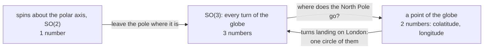

# Group action and homogeneous space: a space that looks the same from everywhere

[Syllabus](../../../SYLLABUS.md) → [Differential geometry and Lie groups](../README.md) → [Lie Groups](../README.md#s06) → Group action and homogeneous space

---

## General Overview

Take a globe of radius 6371 km, a model of the Earth. Turn it about its centre and London can end up where the North Pole was; turn it another way and New York does. Any city can be brought to the top, and the turned globe looks exactly as before.

The turns of space, the rotation group $`SO(3)`$ from [Lie group](01-lie-groups-and-matrix-groups.md), move the points of the globe. No point is special, because some turn carries it onto any other. A space like that is **homogeneous**: it looks the same from everywhere.

The turn that brings the pole to London is not unique. Spin the globe about London's own axis afterwards and London stays put. So each place matches a whole circle of turns, and the globe is the 3-dimensional rotation group with a 1-dimensional circle of spins divided out.

The same split runs a camera drone. Its orientation needs 3 numbers. Where its camera points needs only 2, because rolling about the camera's own axis changes the picture's tilt, not its aim.

**A space is homogeneous for a group when the group can carry any point to any other; then each point is the set of turns that bring one base point there, so the globe is the rotation group divided by the spins that fix the North Pole, 3 − 1 = 2 dimensions.**

**What kind of fact this is:** a theorem. That the globe matches the cosets of the spins one for one is proved on this card in Why it works. That the match is smooth both ways is a theorem stated with its source (Lee, chapter 21), not proved here. The result is global: it holds at every point, not only near London.

### The picture: three numbers in, two numbers out



Each point of the globe pulls back to a whole circle of turns. Dividing out that circle leaves the globe.

---

## The formula

Notation first, in words.

- A **group action** of a group $`G`$ on a space $`M`$ moves each point $`p`$ by each member $`g`$ to a point $`g \cdot p`$. Doing nothing leaves every point put, and $`h`$ then $`g`$ equals the combined member $`gh`$ ([Group actions](../../03-Algebra/08-Groups/08-group-actions-and-counting.md)).
- The **orbit** of $`p`$ is every point it can reach. Its **stabiliser** $`H = \mathrm{Stab}(p)`$ is the subgroup of members that leave $`p`$ put.
- The action is **transitive** when there is one orbit: every point reaches every other. $`M`$ is then a **homogeneous space** of $`G`$.
- A **coset** $`gH`$ is the subgroup $`H`$ slid by $`g`$: every $`gh`$ with $`h`$ in $`H`$ ([Cosets and Lagrange's theorem](../../03-Algebra/08-Groups/04-cosets-and-lagranges-theorem.md)). $`G/H`$ is the set of all cosets.

Here $`G = SO(3)`$, the 3 by 3 rotation matrices, and $`M = S^2`$, the globe's surface as unit vectors. The axes run from the centre: $`x`$ through 0° longitude on the equator, $`y`$ through 90° east, $`z`$ through the North Pole $`n = (0, 0, 1)`$. A point has colatitude $`\varphi`$, measured down from the North Pole, and longitude $`\theta`$, east positive. $`Z(\alpha)`$ is a turn by angle $`\alpha`$ about the $`z`$ axis, and $`Y(\varphi)`$ a turn about the $`y`$ axis.

The theorem, for the globe:

```math
SO(3)/SO(2) \;\longleftrightarrow\; S^2, \qquad gH \;\mapsto\; g \cdot n, \qquad H = \{\, Z(\alpha) \,\} = \mathrm{Stab}(n)
```

**Read it aloud:** a point of the globe is the same thing as a coset of the polar spins; the coset $`gH`$ names the point where $`g`$ sends the North Pole.

Every turn splits into a spin about the pole, done first, and a turn that aims the pole:

```math
g = Z(\theta)\,Y(\varphi)\,Z(\alpha), \qquad g \cdot n = (\sin\varphi\cos\theta,\ \sin\varphi\sin\theta,\ \cos\varphi)
```

**Read it aloud:** first spin by $`\alpha`$, which leaves the pole alone, then tip the pole down by the colatitude $`\varphi`$, then swing it east by the longitude $`\theta`$.

The algebra card's count, orbit size times stabiliser size equals group size, becomes a count of free directions:

```math
\dim S^2 = \dim SO(3) - \dim SO(2) = 3 - 1 = 2
```

**Read it aloud:** the globe has the turns' three free directions minus the one spin that leaves the pole put, so two.

| Symbol | Plain meaning | In our example | Push it up and the answer… |
| --- | --- | --- | --- |
| $`G`$, $`SO(3)`$ | the group doing the moving | every turn of the globe | a bigger group can only merge orbits |
| $`M`$, $`S^2`$ | the space being moved | the globe's surface, unit vectors | — |
| $`g`$, $`h`$, $`g \cdot p`$ | members of $`G`$; point $`p`$ after turn $`g`$ | $`g_L`$, $`g_Y`$, $`g_v`$: Step 1's chosen turns taking the pole to London, New York, any point $`v`$ | — |
| $`p`$, $`n`$, $`L`$ | a point; the base point; London's unit vector | London; the North Pole $`(0, 0, 1)`$; London | — |
| $`H`$, $`SO(2)`$ | the stabiliser of $`n`$: the spins $`Z(\alpha)`$ | a circle of turns | a bigger stabiliser, a smaller orbit |
| $`gH`$, $`G/H`$ | a coset; the set of all cosets | the circle $`g_L Z(\alpha)`$; the globe | — |
| $`Z(\alpha)`$, $`Y(\varphi)`$ | a turn about the polar axis; about the 90° east axis | $`Z(-0.1278°)`$, $`Y(38.4926°)`$ | — |
| $`\varphi`$, $`\theta`$ | colatitude down from the pole; longitude east | London: 38.4926°, −0.1278° | — |
| $`\alpha`$, $`\psi`$ | the spin angle, the free number in a coset; any turn's angle | 0° to 359°; 50.0942° | the pole stays put |
| $`R`$ | the globe's radius | 6371 km | every distance scales with it |
| $`\omega`$ | an angular velocity: axis times turning rate | the three axes, one at a time | — |
| $`\dim`$, $`\mathrm{Stab}`$, $`\mathrm{Orb}`$ | number of free directions; stabiliser; orbit | 3, 1 and 2 | — |

The drone in Step 6 uses the aircraft axes of [Lie group](01-lie-groups-and-matrix-groups.md), $`x`$ north, $`y`$ east, $`z`$ down, so there $`Z`$ turns about the down axis and $`Y`$ about the right wing.

### When it holds

- **The action must be transitive.** If only the polar spins act, London's orbit is its circle of latitude, 24915.3 km round, and New York sits 1200.3 km off it. Points split into one orbit per colatitude.
- **Divide on the right.** The coset is $`gH`$, spin first and aim second. Spinning after aiming, $`Z(90°)\,g_L`$, sends the pole 5806.8 km from London.
- **The action must be smooth** for the match to be smooth both ways (a diffeomorphism). A merely continuous action still has a closed stabiliser, so $`G/H`$ is still a smooth manifold, and the match is still continuous both ways, but it need not be smooth.
- **A point is a coset, not one turn.** Each point matches a whole circle of turns, and no smooth choice of one turn per point exists on the globe, as the usual mistake shows.

---

## Why it works

### Step 0: name a point by the turns that bring the pole there

Fix one base point, the North Pole, and group the turns by where they send it: all turns landing on London form one bundle, all landing on New York another.

Two turns land in the same place exactly when they differ by a turn that keeps the pole still. So the bundles are cosets of the pole's stabiliser, matching points one for one. This is the orbit-stabiliser match of [Group actions](../../03-Algebra/08-Groups/08-group-actions-and-counting.md), with counting replaced by dimension.

### Step 1: one turn reaches every point

The tip $`Y(\varphi)`$ moves the pole $`n`$ down the 0° meridian to $`(\sin\varphi, 0, \cos\varphi)`$. The spin $`Z(\theta)`$ then swings it east to longitude $`\theta`$, giving the point formula above.

London sits at latitude 51.5074° N, longitude 0.1278° W, so colatitude 90° − 51.5074° = 38.4926° and longitude −0.1278°. The turn $`g_L = Z(-0.1278°)\,Y(38.4926°)`$ carries the pole to London. Every point is reached the same way, so the action is transitive.

### Step 2: the turns that fix the pole are the spins

A turn keeps lengths and angles. If it keeps the pole still, it must keep the equator's plane, the plane at right angles to the pole, as a whole. Inside that plane it is a turn of the plane by some angle $`\alpha`$, so it is $`Z(\alpha)`$.

<details>
<summary>Detailed proof: the stabiliser of the pole is exactly the spins</summary>

Let $`g`$ be in $`SO(3)`$ with $`g\,n = n`$. Its third column is $`g\,n = n = (0, 0, 1)`$.

The columns of $`g`$ have length 1 and meet at right angles. So the first two columns are unit vectors at right angles to $`(0, 0, 1)`$: their third entries are 0. The top-left 2 by 2 block therefore has columns of length 1 at right angles.

Expanding the determinant along the last row shows that block has determinant $`\det g = 1`$. A 2 by 2 block like that is a plane turn by some angle $`\alpha`$, so

$`\displaystyle g = \begin{pmatrix} \cos\alpha & -\sin\alpha & 0 \\ \sin\alpha & \cos\alpha & 0 \\ 0 & 0 & 1 \end{pmatrix} = Z(\alpha).`$

Conversely every $`Z(\alpha)`$ fixes $`n`$. The stabiliser is the circle group $`SO(2)`$.

</details>

### Step 3: same landing point means same coset

Suppose $`g\,n = g'\,n`$. Undo $`g`$ on both sides: $`g^{-1}g'\,n = n`$. So $`g^{-1}g'`$ is a spin $`Z(\alpha)`$, and $`g' = g\,Z(\alpha)`$ lies in the coset $`gH`$. The steps run backwards too. So the rule $`gH \mapsto g\,n`$ is well defined (every member of a coset gives the same point), one-to-one, and, by Step 1, reaches every point.

The code tests both directions. All 360 turns $`g_L Z(\alpha)`$, one per degree, land on London. And for 1000 random turns $`g`$, with Step 1's chosen turn $`g_v`$ to the point $`v = g\,n`$, the turn $`g_v^{-1}g`$ is always a spin about the pole.

Let $`g_Y`$ be Step 1's chosen turn from the pole to New York. The turns carrying London to New York form a circle too: $`g_Y\,Z(\alpha)\,g_L^{-1}`$, one for each $`\alpha`$: undo $`g_L`$, spin, then aim at New York. Scanning that circle in steps of 0.01°, the smallest turning angle is 50.0942°.

That is the central angle between the cities: the arccosine of their unit vectors' dot product 0.6415, 50.0942° or 0.8743 rad, a great-circle distance of 0.8743 × 6371 = 5570.2 km. The reason: A turn by angle $`\psi`$ moves no point through more than $`\psi`$ of arc, so no turn shorter than 50.0942° gets London to New York. The turn about the axis at right angles to both cities does it in exactly that angle.

### Step 4: the match is smooth, and the dimensions add up

Spin the globe with angular velocity $`\omega`$, a vector along the axis whose length is the rate. A point $`p`$ then moves with velocity $`\omega \times p`$: the derivative of the orbit map $`g \mapsto g \cdot p`$ at the identity, the skew matrix of [Lie algebra](02-lie-algebras-and-the-exponential-map.md) written as a cross product.

At London the three axis directions give velocities of rank 2. The lost direction is $`\omega`$ along London's unit vector $`L`$, since $`\lvert L \times L \rvert = 0`$: spinning about London's axis does not move London. That direction is London's 1-dimensional stabiliser, and 3 = 2 + 1. The latitude-longitude chart gives rank 2 as well, a second road.

Rank 2 at every point, by homogeneity, is what makes the match smooth. The theorem: if a Lie group $`G`$ acts smoothly and transitively on a manifold $`M`$, and $`H`$ is the stabiliser of a point, then $`G/H`$ is a smooth manifold and $`gH \mapsto g \cdot p`$ is a diffeomorphism, a smooth match with a smooth inverse. It is stated here, not proved; Lee proves it in chapter 21.

### Step 5: the globe looks the same from everywhere

Turns keep dot products, so they keep distances. Carry Paris along with the smallest turn from London to New York: London to Paris is 343.6 km, and New York to the turned Paris is 343.6 km. Whatever is measured near London is measured the same near New York.

The group also spreads evenly. A fair random turn, drawn from a uniform unit quaternion ([Rotation group](04-rotations-so3-and-quaternions.md)), stays fair after any fixed turn. So it sends the pole near London as often as near New York, and that chance is the region's share of the globe's area. The code checks this with 200000 random turns and a cap of radius 2000 km, an angle of 2000 / 6371 = 0.3139 rad.

- The cap's area is $`2\pi R^2(1 - \cos 0.3139)`$ = 12463511 km², a share of 0.024435 of the globe.
- The expected count is 200000 × 0.024435 = 4887.0, with a standard error of 69.0.
- The pole landed within 2000 km of London 4809 times and of New York 4888 times, both within 2 standard errors.

### Step 6: the drone's camera, where aiming needs two numbers

The drone of [Lie group](01-lie-groups-and-matrix-groups.md) heads 30°, pitches 10° up and rolls 5°, and its gimbal tilts the camera 30° down from the nose. The camera's orientation, the gimbal's tilt inside the drone's frame followed by the drone's turn, is a member of $`SO(3)`$: 3 numbers.

Its aim is one point on the sphere of directions: 19.8858° below the horizon, heading 27.3439°. A two-motor pan-and-tilt mount on a level base, pan 27.3439° and tilt 19.8858° down, aims the same way.

What is left over is a roll of 5.2369° about the camera's own axis. It lies in the aim's stabiliser: it tilts the picture, not the view. So 3 numbers of orientation are 2 of aim plus 1 of roll, the globe's 3 = 2 + 1 again.

### Step 7: a smaller group has many orbits, and they can be counted

Keep only the 24 turns that carry a cube, centred where the globe is, to itself. The code builds them from two quarter turns by multiplying until no new turn appears. Orbit times stabiliser is now a plain count, 24 every time:

| Point on the sphere | Orbit | Stabiliser | Product |
| --- | ---: | ---: | ---: |
| face centre | 6 | 4 | 24 |
| corner | 8 | 3 | 24 |
| edge midpoint | 12 | 2 | 24 |
| a general point, such as the direction (1, 2, 3) | 24 | 1 | 24 |

A point on no turning axis has stabiliser 1 and orbit 24. So there are infinitely many orbits, but only 3 special ones, holding 6 + 8 + 12 = 26 points. Two counts of the pairs (a turn other than "do nothing", a point it fixes) confirm that list is complete:

- **By points:** each special point is fixed by its stabiliser minus the identity: 6 × 3 + 8 × 2 + 12 × 1 = 46.
- **By turns:** each of the 23 turns other than "do nothing" has one axis, which pierces the sphere at 2 points: 23 × 2 = 46.

The cube's turns leave infinitely many orbits; all of $`SO(3)`$ leaves one, which is what makes the globe homogeneous.

---

## Worked numbers, by hand

| Step | Arithmetic | Value |
| --- | --- | --- |
| London's colatitude | 90° − 51.5074° | 38.4926° |
| the turn to London | $`g_L = Z(-0.1278°)\,Y(38.4926°)`$ | pole lands on London |
| the stabiliser's dimension | 3 − rank 2 | 1 |
| the globe's dimension | 3 − 1 | **2** |
| central angle, London to New York | arccosine of 0.6415 | 50.0942° = 0.8743 rad |
| great-circle distance | 0.8743 × 6371 | 5570.2 km |
| smallest turn carrying one to the other | scan of the circle of turns | **50.0942°** |
| cap of 2000 km, share of the globe | $`(1 - \cos 0.3139)/2`$ | 0.024435 |
| pole landings expected in it | 200000 × 0.024435 | 4887.0 |
| pole landings counted | near London, near New York | 4809, 4888 |

Three turning directions lose one to the spin that leaves a point still, so the globe is 2-dimensional; the shortest turn between two cities is their central angle.

### What breaks if you drop a piece

| Mistake | Comes out at | What went wrong |
| --- | --- | --- |
| Spin on the wrong side, $`Z(90°)\,g_L`$ | the pole lands 5806.8 km from London | the spin moves London around the polar axis; only $`g_L Z(\alpha)`$ keeps it |
| Orbit dimension taken as the group's | 3, but the orbit map has rank 2 | the stabiliser's direction moves nothing |
| Spins only, not all turns | London's orbit is a 24915.3 km circle; New York is 1200.3 km off it | not transitive, so not homogeneous |
| Images counted without the stabiliser | 24 images of a face centre, 6 distinct | each face centre is hit by its 4 stabilising turns |

The code prints all four. The third row is the theorem's hypothesis, transitivity, failing.

---

## Code, from first principles, and it actually runs

The code builds every turn as a 3 by 3 matrix of sines and cosines, with no imported geometry, and takes four independent roads. A scan of 36000 turns is checked against the arccosine. The cross-product rank is checked against the chart. Fair random turns (SplitMix64, seed 2026) are counted against the cap's area. Cube orbits times stabilisers are checked against fixed points counted two ways.

### Python

```python
# Group action and homogeneous space -- the check behind the card.  Standard
# library only.  The rotation group SO(3) turns a globe of radius 6371 km.  Any
# point can be carried to any other, and the turns that fix the North Pole are
# the spins about the polar axis, so the globe is SO(3) / SO(2).  Roads: a
# formula against a scan, a rank against a chart, random turns against area,
# and orbit times stabiliser against fixed points.
import math
D, RAD, N = math.pi / 180, 6371.0, [0.0, 0.0, 1.0]

def mul(A, B):
    return [[sum(A[i][k] * B[k][j] for k in range(3)) for j in range(3)] for i in range(3)]
def tp(A):
    return [list(r) for r in zip(*A)]
def act(A, v):
    return [sum(A[i][k] * v[k] for k in range(3)) for i in range(3)]
def turn(a, i, j):                     # turn by a in the plane of axes i and j
    M = [[float(r == c) for c in range(3)] for r in range(3)]
    M[i][i] = M[j][j] = math.cos(a)
    M[i][j], M[j][i] = -math.sin(a), math.sin(a)
    return M
def Z(a): return turn(a, 0, 1)         # spin about the polar axis (or, for the drone, the down axis)
def Y(a): return turn(a, 2, 0)         # tip about the axis through 90 deg east (or the right wing)
def dot(u, v): return sum(a * b for a, b in zip(u, v))
def cross(u, v): return [u[1] * v[2] - u[2] * v[1], u[2] * v[0] - u[0] * v[2], u[0] * v[1] - u[1] * v[0]]
def gap(u, v): return max(abs(a - b) for a, b in zip(u, v))
def arc(u, v): return math.acos(max(-1.0, min(1.0, dot(u, v))))
def angle(A): return math.acos(max(-1.0, min(1.0, (A[0][0] + A[1][1] + A[2][2] - 1) / 2)))
def point(lat, lon):                   # unit vector from latitude and longitude in degrees
    p, t = (90 - lat) * D, lon * D
    return [math.sin(p) * math.cos(t), math.sin(p) * math.sin(t), math.cos(p)]
def to_pole(v):                        # the chosen turn Z(theta) Y(phi), carrying n to v
    return mul(Z(math.atan2(v[1], v[0])), Y(math.acos(v[2])))
def rank(rows, tol=1e-9):              # Gaussian elimination with row swaps
    m, r = [list(x) for x in rows], 0
    for c in range(3):
        if r == len(m): break
        piv = max(range(r, len(m)), key=lambda i: abs(m[i][c]))
        if abs(m[piv][c]) < tol: continue
        m[r], m[piv] = m[piv], m[r]
        for i in range(r + 1, len(m)):
            f = m[i][c] / m[r][c]
            m[i] = [a - f * b for a, b in zip(m[i], m[r])]
        r += 1
    return r
state = 2026
def rnd():                             # SplitMix64, seed 2026, uniform in [0, 1)
    global state
    state = (state + 0x9E3779B97F4A7C15) & 0xFFFFFFFFFFFFFFFF
    z = state
    z = ((z ^ (z >> 30)) * 0xBF58476D1CE4E5B9) & 0xFFFFFFFFFFFFFFFF
    z = ((z ^ (z >> 27)) * 0x94D049BB133111EB) & 0xFFFFFFFFFFFFFFFF
    return ((z ^ (z >> 31)) >> 11) / 2.0 ** 53
def random_turn():                     # a fair random turn, from a uniform unit quaternion
    u1, u2, u3 = rnd(), rnd(), rnd()
    a, b = math.sqrt(1 - u1), math.sqrt(u1)
    x, y, z, w = a * math.sin(2 * math.pi * u2), a * math.cos(2 * math.pi * u2), b * math.sin(2 * math.pi * u3), b * math.cos(2 * math.pi * u3)
    return [[1 - 2 * (y * y + z * z), 2 * (x * y - w * z), 2 * (x * z + w * y)],
            [2 * (x * y + w * z), 1 - 2 * (x * x + z * z), 2 * (y * z - w * x)],
            [2 * (x * z - w * y), 2 * (y * z + w * x), 1 - 2 * (x * x + y * y)]]
def yn(c): return "yes" if c else "no"

L, NY, PA = point(51.5074, -0.1278), point(40.7128, -74.0060), point(48.8566, 2.3522)
gL, gY = to_pole(L), to_pole(NY)
print(f"globe radius {RAD:.0f} km; London colatitude {math.acos(L[2]) / D:.4f} deg, longitude {math.atan2(L[1], L[0]) / D:.4f} deg")
fib = max(gap(act(mul(gL, Z(a * D)), N), L) for a in range(360))
print(f"g_L = Z(theta) Y(phi) and all 360 turns g_L Z(alpha), alpha = 0..359 deg, land on London: {yn(fib < 1e-12)}")
worst = 0.0
for _ in range(1000):                  # every turn = (chosen turn to its point) x (a spin)
    g = random_turn()
    s = mul(tp(to_pole(act(g, N))), g)
    worst = max(worst, gap(act(s, N), N), abs(s[0][2]), abs(s[1][2]))
print(f"1000 random turns g: g_v^T g is a spin about the pole, worst miss below 1e-12: {yn(worst < 1e-12)}")
best = min((angle(mul(mul(gY, Z(k * D / 100)), tp(gL))), k) for k in range(36000))
T = mul(mul(gY, Z(best[1] * D / 100)), tp(gL))
c = arc(L, NY)
print(f"smallest turn carrying London to New York, by scanning the circle of them: {best[0] / D:.4f} deg")
print(f"central angle London-New York, acos of {dot(L, NY):.4f}: {c / D:.4f} deg = {c:.4f} rad = {c * RAD:.1f} km")
print(f"London-Paris {arc(L, PA) * RAD:.1f} km; New York to the turned Paris {arc(NY, act(T, PA)) * RAD:.1f} km")
orbit_rows = [cross(e, L) for e in ([1.0, 0, 0], [0, 1.0, 0], [0, 0, 1.0])]
h = 1e-6
chart_rows = [[(a - b) / (2 * h) for a, b in zip(point(51.5074 + h, -0.1278), point(51.5074 - h, -0.1278))],
              [(a - b) / (2 * h) for a, b in zip(point(51.5074, -0.1278 + h), point(51.5074, -0.1278 - h))]]
ro, rc = rank(orbit_rows), rank(chart_rows, 1e-6)
print(f"rank of omega -> omega x London: {ro}; |London x London| = {math.sqrt(dot(cross(L, L), cross(L, L))):.4f}")
print(f"rank of the latitude-longitude chart at London: {rc}; stabiliser dimension 3 - {ro} = {3 - ro}")
rho, M = 2000 / RAD, 200000
share = (1 - math.cos(rho)) / 2
hits = [0, 0]
for _ in range(M):
    v = act(random_turn(), N)
    hits[0] += arc(v, L) <= rho
    hits[1] += arc(v, NY) <= rho
se = math.sqrt(M * share * (1 - share))
print(f"cap of 2000 km = {rho:.4f} rad: area {2 * math.pi * RAD * RAD * (1 - math.cos(rho)):.0f} km^2, share of globe {share:.6f}")
print(f"{M} fair random turns of the pole: within 2000 km of London {hits[0]}, of New York {hits[1]}")
print(f"expected from area {M * share:.1f}, standard error {se:.1f}")
R0 = mul(mul(Z(30 * D), Y(10 * D)), turn(5 * D, 1, 2))
cam = mul(R0, Y(-30 * D))
dep, head = math.asin(cam[2][0]) / D, math.atan2(cam[1][0], cam[0][0]) / D
pan = mul(Z(head * D), Y(-dep * D))
roll = mul(tp(pan), cam)
print(f"camera axis {dep:.4f} deg below the horizon, heading {head:.4f} deg")
print(f"pan {head:.4f} deg, tilt {-dep:.4f} deg aims the same way: {yn(gap([r[0] for r in pan], [r[0] for r in cam]) < 1e-12)}")
print(f"what is left is a roll about the camera axis: {yn(gap([r[0] for r in roll], [1.0, 0, 0]) < 1e-12)}, of {math.atan2(roll[2][1], roll[1][1]) / D:.4f} deg")
s1, s2 = point(-89.99, 0.0), point(-89.99, 90.0)
print(f"chosen turns near the South Pole: points {arc(s1, s2) * RAD:.2f} km apart, turns {angle(mul(tp(to_pole(s1)), to_pole(s2))) / D:.4f} deg apart")
I3 = [[int(r == c) for c in range(3)] for r in range(3)]
cube, todo = [I3], [I3]
while todo:
    a = todo.pop()
    for g in ([[0, -1, 0], [1, 0, 0], [0, 0, 1]], [[1, 0, 0], [0, 0, -1], [0, 1, 0]]):
        b = mul(g, a)
        if b not in cube:
            cube.append(b)
            todo.append(b)
print(f"turns of a cube, built from two quarter turns: {len(cube)}")
special, prods, sizes = [], [], []
for name, v in (("face centre", [0, 0, 1]), ("corner", [1, 1, 1]), ("edge midpoint", [1, 1, 0]), ("general point", [1, 2, 3])):
    orb = sorted({tuple(act(g, v)) for g in cube})
    stab = sum(act(g, v) == v for g in cube)
    prods.append(len(orb) * stab)
    sizes.append(len(orb))
    special += [(list(p), stab) for p in orb if stab > 1]
    print(f"{name} {v}: orbit {len(orb)} x stabiliser {stab} = {len(orb) * stab}")
by_points = sum(s - 1 for _, s in special)
per_turn = [sum(act(g, p) == p for p, _ in special) for g in cube if g != I3]
print(f"turn-and-fixed-point pairs: by points {by_points}, by turns {len(per_turn)} x 2 = {sum(per_turn)}")
print(f"mistake 1, spin on the wrong side: Z(90 deg) g_L sends the pole {arc(L, act(Z(90 * D), L)) * RAD:.1f} km from London")
print(f"mistake 2, orbit dimension taken as 3: the orbit map has rank {ro}, the globe dimension 2")
print(f"mistake 3, spins only: London's orbit is a circle of {2 * math.pi * RAD * math.sqrt(1 - L[2] * L[2]):.1f} km; New York is {abs(math.acos(L[2]) - math.acos(NY[2])) * RAD:.1f} km off it")
print(f"mistake 4, images counted without the stabiliser: {len(cube)} images of a face centre, {sizes[0]} distinct")
assert abs(best[0] - c) < 1e-6 and gap(act(T, L), NY) < 1e-12        # scan against acos
assert abs(arc(L, PA) - arc(NY, act(T, PA))) < 1e-12                  # distances kept
assert ro == 2 and rc == 2 and fib < 1e-12 and worst < 1e-12          # 3 = 2 + 1, two roads
assert all(abs(k - M * share) < 4 * se for k in hits)                 # random turns against area
assert len(cube) == 24 and prods == [24] * 4                          # orbit x stabiliser
assert by_points == sum(per_turn) == 46 and set(per_turn) == {2}      # two counts of pairs
assert gap([r[0] for r in roll], [1.0, 0.0, 0.0]) < 1e-12
print("ALL CHECKS PASS")
```

**Ran 2026-11-19 on macOS, Python 3.14.10, standard library only. All checks passed. Output, pasted from the run:**

```
globe radius 6371 km; London colatitude 38.4926 deg, longitude -0.1278 deg
g_L = Z(theta) Y(phi) and all 360 turns g_L Z(alpha), alpha = 0..359 deg, land on London: yes
1000 random turns g: g_v^T g is a spin about the pole, worst miss below 1e-12: yes
smallest turn carrying London to New York, by scanning the circle of them: 50.0942 deg
central angle London-New York, acos of 0.6415: 50.0942 deg = 0.8743 rad = 5570.2 km
London-Paris 343.6 km; New York to the turned Paris 343.6 km
rank of omega -> omega x London: 2; |London x London| = 0.0000
rank of the latitude-longitude chart at London: 2; stabiliser dimension 3 - 2 = 1
cap of 2000 km = 0.3139 rad: area 12463511 km^2, share of globe 0.024435
200000 fair random turns of the pole: within 2000 km of London 4809, of New York 4888
expected from area 4887.0, standard error 69.0
camera axis 19.8858 deg below the horizon, heading 27.3439 deg
pan 27.3439 deg, tilt -19.8858 deg aims the same way: yes
what is left is a roll about the camera axis: yes, of 5.2369 deg
chosen turns near the South Pole: points 1.57 km apart, turns 90.0000 deg apart
turns of a cube, built from two quarter turns: 24
face centre [0, 0, 1]: orbit 6 x stabiliser 4 = 24
corner [1, 1, 1]: orbit 8 x stabiliser 3 = 24
edge midpoint [1, 1, 0]: orbit 12 x stabiliser 2 = 24
general point [1, 2, 3]: orbit 24 x stabiliser 1 = 24
turn-and-fixed-point pairs: by points 46, by turns 23 x 2 = 46
mistake 1, spin on the wrong side: Z(90 deg) g_L sends the pole 5806.8 km from London
mistake 2, orbit dimension taken as 3: the orbit map has rank 2, the globe dimension 2
mistake 3, spins only: London's orbit is a circle of 24915.3 km; New York is 1200.3 km off it
mistake 4, images counted without the stabiliser: 24 images of a face centre, 6 distinct
ALL CHECKS PASS
```

### Rust

Same numbers, same labels, built with `rustc --edition 2021 -O`.

```rust
// Group action and homogeneous space -- the same check as the Python, in Rust.
// No crates.  The rotation group SO(3) turns a globe of radius 6371 km.  Any
// point can be carried to any other, and the turns that fix the North Pole are
// the spins about the polar axis, so the globe is SO(3) / SO(2).  Roads: a
// formula against a scan, a rank against a chart, random turns against area,
// and orbit times stabiliser against fixed points.
use std::f64::consts::PI;
type M3 = [[f64; 3]; 3];
type V3 = [f64; 3];
const D: f64 = PI / 180.0;
const RAD: f64 = 6371.0;
const N: V3 = [0.0, 0.0, 1.0];

fn mul(a: &M3, b: &M3) -> M3 {
    let mut c = [[0.0; 3]; 3];
    for i in 0..3 { for j in 0..3 { let mut s = 0.0; for k in 0..3 { s += a[i][k] * b[k][j] } c[i][j] = s } }
    c
}
fn tp(a: &M3) -> M3 { let mut c = [[0.0; 3]; 3]; for i in 0..3 { for j in 0..3 { c[i][j] = a[j][i] } } c }
fn act(a: &M3, v: &V3) -> V3 { let mut o = [0.0; 3]; for i in 0..3 { o[i] = dot(&a[i], v) } o }
fn turn(a: f64, i: usize, j: usize) -> M3 {       // turn by a in the plane of axes i and j
    let mut m = [[1.0, 0.0, 0.0], [0.0, 1.0, 0.0], [0.0, 0.0, 1.0]];
    (m[i][i], m[j][j], m[i][j], m[j][i]) = (a.cos(), a.cos(), -a.sin(), a.sin());
    m
}
fn zt(a: f64) -> M3 { turn(a, 0, 1) }               // spin about the polar axis (or the drone's down axis)
fn yt(a: f64) -> M3 { turn(a, 2, 0) }               // tip about the axis through 90 deg east (or the right wing)
fn dot(u: &V3, v: &V3) -> f64 { let mut s = 0.0; for k in 0..3 { s += u[k] * v[k] } s }
fn cross(u: &V3, v: &V3) -> V3 { [u[1] * v[2] - u[2] * v[1], u[2] * v[0] - u[0] * v[2], u[0] * v[1] - u[1] * v[0]] }
fn gap(u: &V3, v: &V3) -> f64 { (0..3).map(|k| (u[k] - v[k]).abs()).fold(0.0, f64::max) }
fn arc(u: &V3, v: &V3) -> f64 { dot(u, v).max(-1.0).min(1.0).acos() }
fn angle(a: &M3) -> f64 { ((a[0][0] + a[1][1] + a[2][2] - 1.0) / 2.0).max(-1.0).min(1.0).acos() }
fn point(lat: f64, lon: f64) -> V3 {                // unit vector from latitude and longitude in degrees
    let (p, t) = ((90.0 - lat) * D, lon * D);
    [p.sin() * t.cos(), p.sin() * t.sin(), p.cos()]
}
fn to_pole(v: &V3) -> M3 { mul(&zt(v[1].atan2(v[0])), &yt(v[2].acos())) }   // the chosen turn Z(theta) Y(phi)
fn col0(a: &M3) -> V3 { [a[0][0], a[1][0], a[2][0]] }
fn rank(rows: &[V3], tol: f64) -> usize {           // Gaussian elimination with row swaps
    let (mut m, mut r): (Vec<V3>, usize) = (rows.to_vec(), 0);
    for c in 0..3 {
        if r == m.len() { break }
        let mut piv = r;
        for i in r..m.len() { if m[i][c].abs() > m[piv][c].abs() { piv = i } }
        if m[piv][c].abs() < tol { continue }
        m.swap(r, piv);
        for i in r + 1..m.len() { let f = m[i][c] / m[r][c]; for k in 0..3 { m[i][k] -= f * m[r][k] } }
        r += 1;
    }
    r
}
struct Rng(u64);
impl Rng {                                          // SplitMix64, seed 2026, uniform in [0, 1)
    fn next(&mut self) -> f64 {
        self.0 = self.0.wrapping_add(0x9E3779B97F4A7C15);
        let mut z = (self.0 ^ (self.0 >> 30)).wrapping_mul(0xBF58476D1CE4E5B9);
        z = (z ^ (z >> 27)).wrapping_mul(0x94D049BB133111EB);
        ((z ^ (z >> 31)) >> 11) as f64 / 9007199254740992.0
    }
    fn turn(&mut self) -> M3 {                      // a fair random turn, from a uniform unit quaternion
        let (u1, u2, u3) = (self.next(), self.next(), self.next());
        let (a, b) = ((1.0 - u1).sqrt(), u1.sqrt());
        let (x, y, z, w) = (a * (2.0 * PI * u2).sin(), a * (2.0 * PI * u2).cos(), b * (2.0 * PI * u3).sin(), b * (2.0 * PI * u3).cos());
        [[1.0 - 2.0 * (y * y + z * z), 2.0 * (x * y - w * z), 2.0 * (x * z + w * y)],
         [2.0 * (x * y + w * z), 1.0 - 2.0 * (x * x + z * z), 2.0 * (y * z - w * x)],
         [2.0 * (x * z - w * y), 2.0 * (y * z + w * x), 1.0 - 2.0 * (x * x + y * y)]]
    }
}
type I3 = [[i64; 3]; 3];
fn imul(a: &I3, b: &I3) -> I3 { let mut c = [[0; 3]; 3]; for i in 0..3 { for j in 0..3 { for k in 0..3 { c[i][j] += a[i][k] * b[k][j] } } } c }
fn iact(a: &I3, v: &[i64; 3]) -> [i64; 3] { let mut o = [0; 3]; for i in 0..3 { for k in 0..3 { o[i] += a[i][k] * v[k] } } o }
fn yn(c: bool) -> &'static str { if c { "yes" } else { "no" } }

fn main() {
    let (l, ny, pa) = (point(51.5074, -0.1278), point(40.7128, -74.0060), point(48.8566, 2.3522));
    let (gl, gy) = (to_pole(&l), to_pole(&ny));
    println!("globe radius {:.0} km; London colatitude {:.4} deg, longitude {:.4} deg", RAD, l[2].acos() / D, l[1].atan2(l[0]) / D);
    let fib = (0..360).map(|a| gap(&act(&mul(&gl, &zt(a as f64 * D)), &N), &l)).fold(0.0, f64::max);
    println!("g_L = Z(theta) Y(phi) and all 360 turns g_L Z(alpha), alpha = 0..359 deg, land on London: {}", yn(fib < 1e-12));
    let mut rng = Rng(2026);
    let mut worst: f64 = 0.0;
    for _ in 0..1000 {                              // every turn = (chosen turn to its point) x (a spin)
        let g = rng.turn();
        let s = mul(&tp(&to_pole(&act(&g, &N))), &g);
        worst = worst.max(gap(&act(&s, &N), &N)).max(s[0][2].abs()).max(s[1][2].abs());
    }
    println!("1000 random turns g: g_v^T g is a spin about the pole, worst miss below 1e-12: {}", yn(worst < 1e-12));
    let (mut best, mut bk) = (f64::INFINITY, 0);
    for k in 0..36000 {
        let a = angle(&mul(&mul(&gy, &zt(k as f64 * D / 100.0)), &tp(&gl)));
        if a < best { (best, bk) = (a, k) }
    }
    let t = mul(&mul(&gy, &zt(bk as f64 * D / 100.0)), &tp(&gl));
    let c = arc(&l, &ny);
    println!("smallest turn carrying London to New York, by scanning the circle of them: {:.4} deg", best / D);
    println!("central angle London-New York, acos of {:.4}: {:.4} deg = {:.4} rad = {:.1} km", dot(&l, &ny), c / D, c, c * RAD);
    println!("London-Paris {:.1} km; New York to the turned Paris {:.1} km", arc(&l, &pa) * RAD, arc(&ny, &act(&t, &pa)) * RAD);
    let orbit_rows = [cross(&[1.0, 0.0, 0.0], &l), cross(&[0.0, 1.0, 0.0], &l), cross(&[0.0, 0.0, 1.0], &l)];
    let h = 1e-6;
    let diff = |p: V3, q: V3| -> V3 { [(p[0] - q[0]) / (2.0 * h), (p[1] - q[1]) / (2.0 * h), (p[2] - q[2]) / (2.0 * h)] };
    let chart_rows = [diff(point(51.5074 + h, -0.1278), point(51.5074 - h, -0.1278)),
                      diff(point(51.5074, -0.1278 + h), point(51.5074, -0.1278 - h))];
    let (ro, rc) = (rank(&orbit_rows, 1e-9), rank(&chart_rows, 1e-6));
    println!("rank of omega -> omega x London: {}; |London x London| = {:.4}", ro, dot(&cross(&l, &l), &cross(&l, &l)).sqrt());
    println!("rank of the latitude-longitude chart at London: {}; stabiliser dimension 3 - {} = {}", rc, ro, 3 - ro);
    let (rho, m) = (2000.0 / RAD, 200000usize);
    let share = (1.0 - rho.cos()) / 2.0;
    let mut hits = [0usize; 2];
    for _ in 0..m {
        let v = act(&rng.turn(), &N);
        if arc(&v, &l) <= rho { hits[0] += 1 }
        if arc(&v, &ny) <= rho { hits[1] += 1 }
    }
    let se = (m as f64 * share * (1.0 - share)).sqrt();
    println!("cap of 2000 km = {:.4} rad: area {:.0} km^2, share of globe {:.6}", rho, 2.0 * PI * RAD * RAD * (1.0 - rho.cos()), share);
    println!("{} fair random turns of the pole: within 2000 km of London {}, of New York {}", m, hits[0], hits[1]);
    println!("expected from area {:.1}, standard error {:.1}", m as f64 * share, se);
    let r0 = mul(&mul(&zt(30.0 * D), &yt(10.0 * D)), &turn(5.0 * D, 1, 2));
    let cam = mul(&r0, &yt(-30.0 * D));
    let (dep, head) = (cam[2][0].asin() / D, cam[1][0].atan2(cam[0][0]) / D);
    let pan = mul(&zt(head * D), &yt(-dep * D));
    let roll = mul(&tp(&pan), &cam);
    println!("camera axis {:.4} deg below the horizon, heading {:.4} deg", dep, head);
    println!("pan {:.4} deg, tilt {:.4} deg aims the same way: {}", head, -dep, yn(gap(&col0(&pan), &col0(&cam)) < 1e-12));
    println!("what is left is a roll about the camera axis: {}, of {:.4} deg", yn(gap(&col0(&roll), &[1.0, 0.0, 0.0]) < 1e-12), roll[2][1].atan2(roll[1][1]) / D);
    let (s1, s2) = (point(-89.99, 0.0), point(-89.99, 90.0));
    println!("chosen turns near the South Pole: points {:.2} km apart, turns {:.4} deg apart", arc(&s1, &s2) * RAD, angle(&mul(&tp(&to_pole(&s1)), &to_pole(&s2))) / D);
    let id: I3 = [[1, 0, 0], [0, 1, 0], [0, 0, 1]];
    let gens: [I3; 2] = [[[0, -1, 0], [1, 0, 0], [0, 0, 1]], [[1, 0, 0], [0, 0, -1], [0, 1, 0]]];
    let (mut cube, mut todo) = (vec![id], vec![id]);
    while let Some(a) = todo.pop() {
        for g in &gens {
            let b = imul(g, &a);
            if !cube.contains(&b) { cube.push(b); todo.push(b) }
        }
    }
    println!("turns of a cube, built from two quarter turns: {}", cube.len());
    let (mut special, mut prods, mut sizes): (Vec<([i64; 3], usize)>, Vec<usize>, Vec<usize>) = (vec![], vec![], vec![]);
    for (name, v) in [("face centre", [0, 0, 1]), ("corner", [1, 1, 1]), ("edge midpoint", [1, 1, 0]), ("general point", [1, 2, 3])] {
        let mut orb: Vec<[i64; 3]> = cube.iter().map(|g| iact(g, &v)).collect();
        orb.sort(); orb.dedup();
        let stab = cube.iter().filter(|g| iact(g, &v) == v).count();
        prods.push(orb.len() * stab);
        sizes.push(orb.len());
        if stab > 1 { for p in &orb { special.push((*p, stab)) } }
        println!("{} {:?}: orbit {} x stabiliser {} = {}", name, v, orb.len(), stab, orb.len() * stab);
    }
    let by_points: usize = special.iter().map(|(_, s)| s - 1).sum();
    let per_turn: Vec<usize> = cube.iter().filter(|g| **g != id).map(|g| special.iter().filter(|(p, _)| iact(g, p) == *p).count()).collect();
    println!("turn-and-fixed-point pairs: by points {}, by turns {} x 2 = {}", by_points, per_turn.len(), per_turn.iter().sum::<usize>());
    println!("mistake 1, spin on the wrong side: Z(90 deg) g_L sends the pole {:.1} km from London", arc(&l, &act(&zt(90.0 * D), &l)) * RAD);
    println!("mistake 2, orbit dimension taken as 3: the orbit map has rank {}, the globe dimension 2", ro);
    println!("mistake 3, spins only: London's orbit is a circle of {:.1} km; New York is {:.1} km off it",
             2.0 * PI * RAD * (1.0 - l[2] * l[2]).sqrt(), (l[2].acos() - ny[2].acos()).abs() * RAD);
    println!("mistake 4, images counted without the stabiliser: {} images of a face centre, {} distinct", cube.len(), sizes[0]);
    assert!((best - c).abs() < 1e-6 && gap(&act(&t, &l), &ny) < 1e-12);       // scan against acos
    assert!((arc(&l, &pa) - arc(&ny, &act(&t, &pa))).abs() < 1e-12);           // distances kept
    assert!(ro == 2 && rc == 2 && fib < 1e-12 && worst < 1e-12);                // 3 = 2 + 1, two roads
    assert!(hits.iter().all(|&k| (k as f64 - m as f64 * share).abs() < 4.0 * se)); // random turns against area
    assert!(cube.len() == 24 && prods == vec![24; 4]);                          // orbit x stabiliser
    assert!(by_points == 46 && per_turn.iter().sum::<usize>() == 46 && per_turn.iter().all(|&k| k == 2));
    assert!(gap(&col0(&roll), &[1.0, 0.0, 0.0]) < 1e-12);
    println!("ALL CHECKS PASS");
}
```

**Ran 2026-11-19 on macOS, rustc 1.98.1, no crates. All checks passed. Output, pasted from the run:**

```
globe radius 6371 km; London colatitude 38.4926 deg, longitude -0.1278 deg
g_L = Z(theta) Y(phi) and all 360 turns g_L Z(alpha), alpha = 0..359 deg, land on London: yes
1000 random turns g: g_v^T g is a spin about the pole, worst miss below 1e-12: yes
smallest turn carrying London to New York, by scanning the circle of them: 50.0942 deg
central angle London-New York, acos of 0.6415: 50.0942 deg = 0.8743 rad = 5570.2 km
London-Paris 343.6 km; New York to the turned Paris 343.6 km
rank of omega -> omega x London: 2; |London x London| = 0.0000
rank of the latitude-longitude chart at London: 2; stabiliser dimension 3 - 2 = 1
cap of 2000 km = 0.3139 rad: area 12463511 km^2, share of globe 0.024435
200000 fair random turns of the pole: within 2000 km of London 4809, of New York 4888
expected from area 4887.0, standard error 69.0
camera axis 19.8858 deg below the horizon, heading 27.3439 deg
pan 27.3439 deg, tilt -19.8858 deg aims the same way: yes
what is left is a roll about the camera axis: yes, of 5.2369 deg
chosen turns near the South Pole: points 1.57 km apart, turns 90.0000 deg apart
turns of a cube, built from two quarter turns: 24
face centre [0, 0, 1]: orbit 6 x stabiliser 4 = 24
corner [1, 1, 1]: orbit 8 x stabiliser 3 = 24
edge midpoint [1, 1, 0]: orbit 12 x stabiliser 2 = 24
general point [1, 2, 3]: orbit 24 x stabiliser 1 = 24
turn-and-fixed-point pairs: by points 46, by turns 23 x 2 = 46
mistake 1, spin on the wrong side: Z(90 deg) g_L sends the pole 5806.8 km from London
mistake 2, orbit dimension taken as 3: the orbit map has rank 2, the globe dimension 2
mistake 3, spins only: London's orbit is a circle of 24915.3 km; New York is 1200.3 km off it
mistake 4, images counted without the stabiliser: 24 images of a face centre, 6 distinct
ALL CHECKS PASS
```

The two outputs match line for line.

### Lean

Lean proves the coset match for every transitive action and for the globe, but not that the match is smooth.

- Suppose $`G`$ acts transitively on $`M`$, and $`H`$ is the stabiliser of a point $`p`$. Then $`gH \mapsto g \cdot p`$ matches $`G/H`$ with $`M`$ one for one.
- Suppose $`g`$ is in $`SO(3)`$. Then $`g\,n = n`$ exactly when $`g = Z(\alpha)`$ for some angle $`\alpha`$.
- Take any $`g`$ in $`SO(3)`$. Then $`g\,n`$ is a unit vector, and every unit vector is $`g\,n`$ for some such $`g`$.
- Suppose $`g`$ and $`g'`$ are in $`SO(3)`$. Then $`g\,n = g'\,n`$ exactly when $`g' = g\,Z(\alpha)`$ for some angle $`\alpha`$.
- Lean also checks the arithmetic $`3 - 1 = 2`$, the cube's four products of 24, its 26 special points and both counts of 46.

The distances, the rank, the random turns, the drone and building the cube's 24 turns are left to the Python and Rust checks.

```lean
-- Group action and homogeneous space: a transitive group's cosets of a stabiliser match the space's points one for one, and the globe is SO(3) with the polar spins divided out.
import Mathlib.GroupTheory.GroupAction.Quotient
import Mathlib.LinearAlgebra.UnitaryGroup
import Mathlib.LinearAlgebra.Matrix.Notation
import Mathlib.Analysis.SpecialFunctions.Trigonometric.Basic
import Mathlib.Analysis.SpecialFunctions.Complex.Arg

open Matrix

/-- The spin `Z(α)` of the globe by angle `α` about the polar (`z`) axis. -/
noncomputable def spinZ (α : ℝ) : Matrix (Fin 3) (Fin 3) ℝ :=
  !![Real.cos α, -Real.sin α, 0; Real.sin α, Real.cos α, 0; 0, 0, 1]

/-- The North Pole `n = (0, 0, 1)`. -/
def northPole : Fin 3 → ℝ := ![0, 0, 1]

lemma exists_angle_of_sq_add_sq (a b : ℝ) (h : a ^ 2 + b ^ 2 = 1) :
    ∃ α : ℝ, Real.cos α = a ∧ Real.sin α = b := by
  set z : ℂ := ⟨a, b⟩ with hzdef
  have hn : ‖z‖ = 1 := by
    rw [Complex.norm_def, Complex.normSq_mk, ← sq, ← sq, h, Real.sqrt_one]
  have hz : z ≠ 0 := by
    intro h0; rw [h0, norm_zero] at hn; exact zero_ne_one hn
  exact ⟨Complex.arg z, by rw [Complex.cos_arg hz, hn, div_one],
    by rw [Complex.sin_arg, hn, div_one]⟩

lemma spinZ_mulVec_northPole (α : ℝ) : spinZ α *ᵥ northPole = northPole := by
  ext i; fin_cases i <;> simp [spinZ, northPole, mulVec, dotProduct, Fin.sum_univ_three]

lemma mem_SO3_mk (A : Matrix (Fin 3) (Fin 3) ℝ) (ho : A * Aᵀ = 1) (hd : A.det = 1) :
    A ∈ specialOrthogonalGroup (Fin 3) ℝ :=
  ⟨(mem_orthogonalGroup_iff (Fin 3) ℝ).mpr ho, hd⟩

#print axioms exists_angle_of_sq_add_sq
#print axioms spinZ_mulVec_northPole
#print axioms mem_SO3_mk

/-- If a group `G` can carry any point of `M` to any other (the action is transitive, so `M` is
a homogeneous space of `G`), and `H` is the stabiliser of a base point `p`, then the cosets `gH`
match the points of `M` one for one, by the rule `gH ↦ g • p`: `G / H ↔ M`. -/
theorem quotient_by_stabilizer_equiv_homogeneous_space
    {G M : Type*} [Group G] [MulAction G M] [MulAction.IsPretransitive G M] (p : M) :
    ∃ e : G ⧸ MulAction.stabilizer G p ≃ M,
      ∀ g : G, e (g : G ⧸ MulAction.stabilizer G p) = g • p := by
  refine ⟨Equiv.ofBijective (MulAction.ofQuotientStabilizer G p)
    ⟨MulAction.injective_ofQuotientStabilizer G p, fun m => ?_⟩, fun g => ?_⟩
  · obtain ⟨g, hg⟩ := MulAction.exists_smul_eq G p m
    exact ⟨(g : G ⧸ MulAction.stabilizer G p), by rw [MulAction.ofQuotientStabilizer_mk, hg]⟩
  · exact MulAction.ofQuotientStabilizer_mk G p g

/-- The turns in `SO(3)` that keep the North Pole still are exactly the spins `Z(α)` about the
polar axis: the stabiliser of the pole is the circle group `SO(2)`. -/
theorem stabilizer_of_north_pole_eq_spins (g : Matrix (Fin 3) (Fin 3) ℝ)
    (hg : g ∈ specialOrthogonalGroup (Fin 3) ℝ) :
    g *ᵥ northPole = northPole ↔ ∃ α : ℝ, g = spinZ α := by
  constructor
  · intro h
    obtain ⟨ho, hd⟩ := hg
    have ho' : g * gᵀ = 1 := (mem_orthogonalGroup_iff (Fin 3) ℝ).mp ho
    have e : ∀ i j, (g * gᵀ) i j = (1 : Matrix (Fin 3) (Fin 3) ℝ) i j := fun i j => by rw [ho']
    have hv : ∀ i, (g *ᵥ northPole) i = northPole i := fun i => by rw [h]
    have e00 := e 0 0
    have e11 := e 1 1
    have e01 := e 0 1
    have e22 := e 2 2
    have v0 := hv 0
    have v1 := hv 1
    have v2 := hv 2
    have hd' : g.det = 1 := hd
    rw [Matrix.det_fin_three] at hd'
    simp [Matrix.mul_apply, Fin.sum_univ_three, mulVec, dotProduct, northPole] at e00 e11 e01 e22 v0 v1 v2
    simp only [v0, v1, v2] at hd' e00 e11 e01 e22
    have h20 : g 2 0 = 0 := by nlinarith [sq_nonneg (g 2 0), sq_nonneg (g 2 1)]
    have h21 : g 2 1 = 0 := by nlinarith [sq_nonneg (g 2 0), sq_nonneg (g 2 1)]
    have hd2 : g 0 0 * g 1 1 - g 0 1 * g 1 0 = 1 := by linear_combination hd'
    have hsq : (g 1 1 - g 0 0) ^ 2 + (g 1 0 + g 0 1) ^ 2 = 0 := by
      linear_combination e00 + e11 - 2 * hd2
    have h1 : (g 1 1 - g 0 0) ^ 2 = 0 := by
      nlinarith [sq_nonneg (g 1 1 - g 0 0), sq_nonneg (g 1 0 + g 0 1)]
    have h2 : (g 1 0 + g 0 1) ^ 2 = 0 := by
      nlinarith [sq_nonneg (g 1 1 - g 0 0), sq_nonneg (g 1 0 + g 0 1)]
    have ha : g 1 1 = g 0 0 := sub_eq_zero.mp (pow_eq_zero_iff two_ne_zero |>.mp h1)
    have hb : g 0 1 = -g 1 0 := by
      have := pow_eq_zero_iff two_ne_zero |>.mp h2
      linarith
    obtain ⟨α, hc, hs⟩ := exists_angle_of_sq_add_sq (g 0 0) (g 1 0)
      (by rw [hb] at e00; linear_combination e00)
    refine ⟨α, ?_⟩
    ext i j
    fin_cases i <;> fin_cases j <;> simp [spinZ, hc, hs, ha, hb, v0, v1, v2, h20, h21]
  · rintro ⟨α, rfl⟩
    exact spinZ_mulVec_northPole α

/-- The globe is the rotation group divided by the polar spins, `SO(3)/SO(2) ↔ S²`, by
`gH ↦ g • n`: every turn sends the North Pole to a point of the unit sphere, every point of the
unit sphere is reached by some turn, and two turns send the pole to the same point exactly when
the second is the first followed on the right by a spin, `g' = g Z(α)`. -/
theorem sphere_eq_rotations_mod_polar_spins :
    (∀ g ∈ specialOrthogonalGroup (Fin 3) ℝ, (g *ᵥ northPole) ⬝ᵥ (g *ᵥ northPole) = 1) ∧
    (∀ v : Fin 3 → ℝ, v ⬝ᵥ v = 1 →
      ∃ g ∈ specialOrthogonalGroup (Fin 3) ℝ, g *ᵥ northPole = v) ∧
    (∀ g ∈ specialOrthogonalGroup (Fin 3) ℝ, ∀ g' ∈ specialOrthogonalGroup (Fin 3) ℝ,
      g *ᵥ northPole = g' *ᵥ northPole ↔ ∃ α : ℝ, g' = g * spinZ α) := by
  refine ⟨?_, ?_, ?_⟩
  · intro g hg
    have ho' : gᵀ * g = 1 := (mem_orthogonalGroup_iff' (Fin 3) ℝ).mp hg.1
    have e22 : (gᵀ * g) 2 2 = (1 : Matrix (Fin 3) (Fin 3) ℝ) 2 2 := by rw [ho']
    simp [Matrix.mul_apply, Fin.sum_univ_three, mulVec, dotProduct, northPole] at e22 ⊢
    linear_combination e22
  · intro v hv
    simp [dotProduct, Fin.sum_univ_three] at hv
    by_cases hz : v 2 = -1
    · have hx : v 0 = 0 := by nlinarith [sq_nonneg (v 0), sq_nonneg (v 1)]
      have hy : v 1 = 0 := by nlinarith [sq_nonneg (v 0), sq_nonneg (v 1)]
      refine ⟨!![1, 0, 0; 0, -1, 0; 0, 0, -1], mem_SO3_mk _ ?_ ?_, ?_⟩
      · ext i j; fin_cases i <;> fin_cases j <;> simp [Matrix.mul_apply, Fin.sum_univ_three]
      · simp [Matrix.det_fin_three]
      · ext i; fin_cases i <;> simp [mulVec, dotProduct, Fin.sum_univ_three, northPole, hx, hy, hz]
    · have hw : 1 + v 2 ≠ 0 := by intro h; apply hz; linarith
      set x := v 0
      set y := v 1
      set z := v 2
      refine ⟨!![1 - x ^ 2 / (1 + z), -(x * y) / (1 + z), x;
                 -(x * y) / (1 + z), 1 - y ^ 2 / (1 + z), y;
                 -x, -y, z], mem_SO3_mk _ ?_ ?_, ?_⟩
      · ext i j; fin_cases i <;> fin_cases j <;>
          simp [Matrix.mul_apply, Fin.sum_univ_three] <;> field_simp
        · linear_combination x ^ 2 * hv
        · linear_combination x * y * hv
        · linear_combination x * hv
        · linear_combination x * y * hv
        · linear_combination y ^ 2 * hv
        · linear_combination y * hv
        · linear_combination x * hv
        · linear_combination y * hv
        · linear_combination hv
      · simp [Matrix.det_fin_three]; field_simp; linear_combination (1 + z) * hv
      · ext i; fin_cases i <;> simp [mulVec, dotProduct, Fin.sum_univ_three, northPole, x, y, z]
  · intro g hg g' hg'
    have hgo : g * gᵀ = 1 := (mem_orthogonalGroup_iff (Fin 3) ℝ).mp hg.1
    have hgo' : gᵀ * g = 1 := (mem_orthogonalGroup_iff' (Fin 3) ℝ).mp hg.1
    have hg'o : g' * g'ᵀ = 1 := (mem_orthogonalGroup_iff (Fin 3) ℝ).mp hg'.1
    have hgd : g.det = 1 := hg.2
    have hg'd : g'.det = 1 := hg'.2
    have hk : gᵀ * g' ∈ specialOrthogonalGroup (Fin 3) ℝ := by
      refine mem_SO3_mk _ ?_ ?_
      · rw [Matrix.transpose_mul, Matrix.transpose_transpose, Matrix.mul_assoc,
          ← Matrix.mul_assoc g', hg'o, Matrix.one_mul, hgo']
      · rw [Matrix.det_mul, Matrix.det_transpose, hgd, hg'd, one_mul]
    constructor
    · intro h
      have hkn : (gᵀ * g') *ᵥ northPole = northPole := by
        rw [← Matrix.mulVec_mulVec, ← h, Matrix.mulVec_mulVec, hgo', Matrix.one_mulVec]
      obtain ⟨α, hα⟩ := (stabilizer_of_north_pole_eq_spins _ hk).mp hkn
      refine ⟨α, ?_⟩
      rw [← hα, ← Matrix.mul_assoc, hgo, Matrix.one_mul]
    · rintro ⟨α, rfl⟩
      rw [← Matrix.mulVec_mulVec, spinZ_mulVec_northPole]

-- The globe's dimension: three turning directions minus the one spin that leaves a point still.
example : 3 - 1 = 2 := by decide

-- The cube's 24 turns: orbit times stabiliser is 24 for a face centre, a corner,
-- an edge midpoint and a general point.
example : 6 * 4 = 24 ∧ 8 * 3 = 24 ∧ 12 * 2 = 24 ∧ 24 * 1 = 24 := by decide

-- The 3 special orbits hold 6 + 8 + 12 = 26 points.
example : 6 + 8 + 12 = 26 := by decide

-- Turn-and-fixed-point pairs counted two ways: by points 46, by turns 23 x 2 = 46.
example : 6 * (4 - 1) + 8 * (3 - 1) + 12 * (2 - 1) = 46 ∧ (24 - 1) * 2 = 46 := by decide

#print axioms quotient_by_stabilizer_equiv_homogeneous_space
#print axioms stabilizer_of_north_pole_eq_spins
#print axioms sphere_eq_rotations_mod_polar_spins
```

**Checked 2026-11-19 on macOS, Lean 4.36.0-rc2, Mathlib v4.36.0-rc2. Every proof is complete and uses only Lean's standard axioms. Output, pasted from the run:**

```
'exists_angle_of_sq_add_sq' depends on axioms: [propext, Classical.choice, Quot.sound]
'spinZ_mulVec_northPole' depends on axioms: [propext, Classical.choice, Quot.sound]
'mem_SO3_mk' depends on axioms: [propext, Classical.choice, Quot.sound]
'quotient_by_stabilizer_equiv_homogeneous_space' depends on axioms: [propext, Classical.choice, Quot.sound]
'stabilizer_of_north_pole_eq_spins' depends on axioms: [propext, Classical.choice, Quot.sound]
'sphere_eq_rotations_mod_polar_spins' depends on axioms: [propext, Classical.choice, Quot.sound]
```

> [!TIP]
> **Try changing**
> - **Guess first: point the camera along the nose.** Change the gimbal's `-30` to `-0`. The aim is the nose, heading 30.0000° and tilt 10.0000° up, and the left-over roll is the drone's own 5.0000°.
> - **Guess first: another seed.** Set `state = 7`. The counts become 4971 and 4834, still within 2 standard errors of 4887.0.
> - **Guess first: a weaker cube group.** Replace the second quarter turn with the half turn `[[-1, 0, 0], [0, -1, 0], [0, 0, 1]]`. Only 4 turns appear, the face centre's orbit shrinks to 1, and an assert stops the run.
> - **Guess first: a coarser scan.** Scan the circle of turns from London to New York in 10° steps: `k * D * 10` over `range(36)` in the scan, and `* D * 10` where `T` is built. The smallest angle found is 50.1718°, too big, and the scan-against-arccosine assert stops the run.

---

## The usual mistake

> [!warning]
> **Treating a point of the globe as a turn.** Each point matches a whole circle of turns, not one. Picking one turn per point, as Step 1's $`Z(\theta)\,Y(\varphi)`$ does, works almost everywhere but cannot be done smoothly over the whole globe. Near the South Pole, two points 1.57 km apart get chosen turns 90.0000° apart. No better recipe exists: a smooth choice would turn the $`x`$ axis into an arrow along the globe that is never zero, which the [Hairy ball theorem](09-vector-field-zeros-and-the-hairy-ball.md) forbids.
>
> - **Spinning on the wrong side.** $`Z(90°)\,g_L`$ is not in London's coset. It sends the pole 5806.8 km from London.
> - **Giving the orbit the group's dimension.** The orbit map has rank 2, not 3. One turning direction, the spin about the point itself, moves nothing.
> - **Calling a space homogeneous for the wrong group.** Under the polar spins alone, London cannot reach New York, which is 1200.3 km off London's circle of latitude.
> - **Counting images instead of points.** The 24 cube turns give 24 images of a face centre but only 6 distinct points.

---

## Where you meet it in real life

- **Camera gimbals.** Pan and tilt motors aim a camera anywhere, since directions form a 2-dimensional sphere. A third motor only levels the picture, moving within the stabiliser.
- **Weather and climate models.** The cubed-sphere grid splits the globe into six matching panels, the cube's face orbit, so every panel runs the same calculation.
- **Graphics and simulation.** Fair random directions come from fair random turns applied to one direction, as in Step 5.
- **Navigation.** Two pairs of cities can be turned onto each other exactly when their great-circle distances match.
- **Physics.** Space with no special place or direction is homogeneous, and its symmetries carry conserved quantities ([Noether](08-noethers-theorem.md)).

> **Say it back**
> A group acts on a space when its members move the points, doing nothing leaves them put, and two moves in a row make one move. The space is homogeneous when one orbit covers it, so every point looks like every other. The turns that keep the North Pole still are the spins about the polar axis, so each point of the globe is one coset of those spins, and the globe is SO(3)/SO(2), 3 − 1 = 2 dimensions. Turns keep distances, so anything measured near London is measured the same near New York. A smaller group, such as the cube's 24 turns, leaves many orbits, counted by orbit times stabiliser.

---

## What this builds on

- [Representation](05-representations-in-outline.md): a group acting on a space by matrices. The globe's action is the 3 by 3 action of $`SO(3)`$ on space, kept to unit vectors.
- [Group actions](../../03-Algebra/08-Groups/08-group-actions-and-counting.md): action, orbit and stabiliser, and orbit size times stabiliser size equals group size, used here in Steps 0 and 7.
- [Cosets and Lagrange's theorem](../../03-Algebra/08-Groups/04-cosets-and-lagranges-theorem.md): cosets as equal blocks that never overlap, the points of $`G/H`$.

## Where this goes next

- [Killing field](07-killing-fields-and-symmetries-of-a-metric.md): the velocity field $`\omega \times p`$ of Step 4, seen as a direction in which the globe's geometry does not change.

The globe matches its circles of turns one for one but not smoothly as a single choice; how a whole group can sit over a space, one copy at each point, is the question this card leaves open, taken up in [Principal bundle and connection](10-principal-bundles-and-connections-in-outline.md).

---

## Sources

Verified 2026-11-19: every link below resolves to the publisher's page.

- Lee, John M. *Introduction to Smooth Manifolds*, 2nd ed. Springer, 2012. [doi:10.1007/978-1-4419-9982-5](https://doi.org/10.1007/978-1-4419-9982-5). Smooth actions, quotient manifolds, and the smooth match of $`G/H`$ with a homogeneous space (chapter 21).
- Stillwell, John. *Naive Lie Theory*. Springer, 2008. [doi:10.1007/978-0-387-78214-0](https://doi.org/10.1007/978-0-387-78214-0). Rotations of space and the sphere at this card's level, including quaternions as turns.
- Shoemake, Ken. "Uniform Random Rotations." In *Graphics Gems III*, Academic Press, 1992. [doi:10.1016/B978-0-08-050755-2.50036-1](https://doi.org/10.1016/B978-0-08-050755-2.50036-1). The three-number recipe for a fair random turn used in the code.
- Ronchi, C., R. Iacono, and P. S. Paolucci. "The 'Cubed Sphere': A New Method for the Solution of Partial Differential Equations in Spherical Geometry." *Journal of Computational Physics* 124, no. 1 (1996): 93–114. [doi:10.1006/jcph.1996.0047](https://doi.org/10.1006/jcph.1996.0047). The six-panel grid on the globe.
