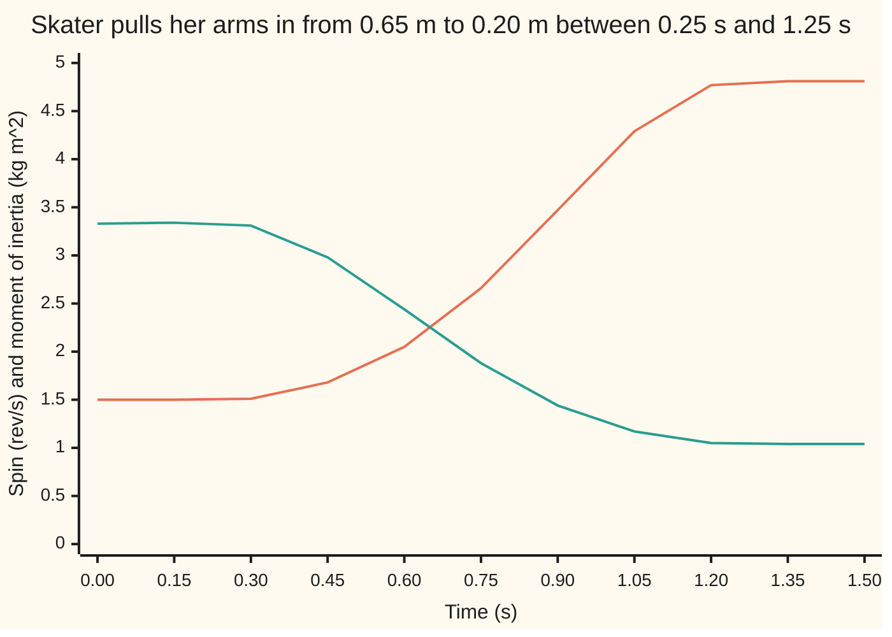

# Noether: every continuous symmetry hands you a conserved quantity

[Syllabus](../../../SYLLABUS.md) → [Differential geometry and Lie groups](../README.md) → [Lie Groups](../README.md#s06) → Noether

---

## General Overview

A figure skater spins on one blade at 1.5 turns a second (1.5 rev/s), arms held out. Over one second she pulls her arms in, from 0.65 m off her spin axis to 0.20 m. She ends up spinning at 4.81 turns a second, more than three times faster. Nothing pushed her round.

The number that stays fixed is her **angular momentum** about the vertical axis: 31.4316 kg m²/s, before, during and after the pull. Her energy does not stay fixed. It climbs from 148.1 J to 475.0 J, because her arm muscles do 326.9 J of work pulling the arms in.

Why that number, and not energy? Turn the whole skater, body and arms together, by any angle about the vertical. The ice is flat and the same in every direction, so nothing in the rules of her motion notices. That smooth family of moves that changes nothing is a **continuous symmetry**. Noether's theorem says each one hands over a quantity that the motion cannot change. Her pull is timed, so the rules change from moment to moment and energy is not kept. The turning symmetry survives the pull, and so does its quantity.

This card says the same thing in geometry. The skater's possible poses form a space with a distance built from kinetic energy. The symmetry is a flow on that space that keeps distances: the flow of a **Killing field** (a vector field whose flow keeps the metric unchanged). The kept quantity is the skater's velocity paired with that field.

**If the flow of a Killing field of the kinetic-energy metric also leaves the potential energy unchanged, then the velocity paired with that field through the metric is constant along every motion: a continuous symmetry hands over a conserved quantity, whether or not any coordinate is missing from the Lagrangian.**

**What kind of fact this is:** a theorem, proved on this card in Why it works. It is local: it needs the two conditions only at the poses the motion passes through, and no global hypothesis. The skater is a model: a turning body of 0.80 kg m² plus two arms, each lumped as 3.0 kg at one point and held by a stiff spring, with no ice friction.

### The picture: the spin rises exactly as the turning mass falls



Orange: spin rate in turns a second, from a step-by-step simulation of all five coordinates. Teal: moment of inertia (how hard the skater is to turn, in kg m²). Spin times inertia times 2π is close to the angular momentum, and equal to it only while the arms turn rigidly with the body. The same run prints the kept quantity itself, the velocity paired with the turning field, as 31.43 kg m²/s at every one of the eleven times.

---

## The formula

Reminders first, in words. A **configuration space** $`Q`$ is a manifold whose points are the poses of a system; $`q`$ is the current pose and $`q'`$ its velocity, a tangent vector. The **kinetic-energy metric** $`g`$ is the Riemannian metric with kinetic energy $`\tfrac12 g(q', q')`$. The **Lagrangian** is $`L = \tfrac12 g(q', q') - V(q, t)`$, kinetic minus potential energy, from [Lagrangian mechanics](../../08-Differential%20equations%20and%20dynamics/12-Calculus%20of%20Variations%20and%20Optimal%20Control/04-lagrangian-mechanics.md). A **Killing field** $`X`$ has $`\mathcal{L}_X g = 0`$: sliding along its flow changes no lengths, from [Killing field](07-killing-fields-and-symmetries-of-a-metric.md). $`XV`$ is the rate $`V`$ changes along $`X`$.

**Noether's theorem**, in the form this card proves:

```math
\mathcal{L}_X g = 0 \quad\text{and}\quad XV = 0 \ \text{ at every time} \qquad\Longrightarrow\qquad J_X = g(q', X) \ \text{ is constant along every motion.}
```

**Read it aloud:** if sliding along $`X`$ keeps the kinetic-energy metric and the potential energy the same, then the velocity measured against $`X`$ never changes.

In coordinates, with momenta $`p_i = \partial L/\partial q_i'`$, the same quantity is $`J_X = \sum_i p_i X^i`$: the momentum covector applied to the field. Here $`X^i`$ are the field's components, with upper indices as labels, not powers. The coordinates are written $`q_i`$ rather than the wing's $`x^i`$, to leave room for the prime; on this card every index is only a label, and every sum is written out.

For the skater, the pose is five numbers: the body's turning angle $`\psi`$, and the points $`(x_1, y_1)`$ and $`(x_2, y_2)`$ where the two lumped arms sit. The symmetry turns all of them together:

```math
g = I_0\,d\psi^2 + m\left(dx_1^2 + dy_1^2 + dx_2^2 + dy_2^2\right), \qquad X = \partial_\psi + \sum_{h=1}^{2}\left(-y_h\,\partial_{x_h} + x_h\,\partial_{y_h}\right), \qquad J = I_0\,\psi' + m\sum_{h=1}^{2}\left(x_h y_h' - y_h x_h'\right)
```

**Read it aloud:** kinetic energy counts the body's turning and each arm's movement; the symmetry turns the body and swings each arm point round the axis; the kept quantity is the body's angular momentum plus each arm's.

When the arms turn rigidly with the body at radius $`r`$, this collapses to the textbook form, with $`\omega = \psi'`$:

```math
J = I\,\omega, \qquad I = I_0 + 2\,m\,r^2 \qquad\Longrightarrow\qquad \omega_{\text{in}} = \omega_{\text{out}}\,\frac{I_{\text{out}}}{I_{\text{in}}}
```

**Read it aloud:** angular momentum is turning mass times spin rate; since it cannot change, the spin rate rises by the same factor the turning mass falls.

| Symbol | Plain meaning | In our example | Push it up and the answer… |
| --- | --- | --- | --- |
| $`Q`$, $`q`$, $`q'`$ | configuration space (all poses); the current pose; its velocity | 5 numbers: $`\psi, x_1, y_1, x_2, y_2`$ | — |
| $`g`$ | kinetic-energy metric: $`\tfrac12 g(q', q')`$ is kinetic energy | $`I_0\,d\psi^2 + m(dx^2 + dy^2)`$ per arm | heavier parts carry more momentum at the same speed |
| $`L`$, $`V`$, $`t`$ | Lagrangian $`\tfrac12 g(q',q') - V`$; potential energy, J; time, s | $`V`$: the arm springs, timed by the pull | — |
| $`X`$, $`X^i`$, $`XV`$, $`\mathcal{L}_X g`$ | Killing field: the symmetry's direction at each pose; its components; the rate $`V`$ changes along it; the change of $`g`$ along its flow | turn everything about the vertical; on the sphere $`X_x, X_y, X_z`$, turns about three axes, spanning $`\mathfrak{so}(3)`$ | — |
| $`J`$, $`J_X`$ | momentum paired with $`X`$: $`g(q', X)`$, kg m²/s | 31.4316 kg m²/s | faster spin at the same inertia |
| $`p_i`$ | momentum belonging to coordinate $`q_i`$: $`\partial L/\partial q_i'`$ | $`I_0\psi'`$ for the body | — |
| $`\psi`$, $`\omega`$ | body's turning angle, rad; spin rate $`\psi'`$, rad/s (turns a second is $`\omega/2\pi`$) | 9.4248 rad/s = 1.5 rev/s at the start | — |
| $`I`$, $`I_0`$ | moment of inertia (turning mass), kg m²: whole skater; body alone | 3.3350 → 1.0400; 0.80 | spin falls for the same $`J`$ |
| $`m`$, $`r`$, $`h`$ | each arm's lumped mass, kg; its distance from the axis, m; which arm, 1 or 2 | 3.0 kg; 0.65 → 0.20 m | $`I`$ rises, spin falls |
| $`k`$, $`r_0(t)`$, $`a_h`$, $`s`$ | each arm spring's stiffness, N/m; how far out the body holds the arms, m; the holding point; a turn angle, rad | $`10^7`$ N/m; 0.65 → 0.20 m | arms follow the pull more exactly |
| $`E`$ | energy $`\tfrac12 g(q',q') + V`$, J | 148.1 → 474.9 J in the simulation | — |
| $`\varphi`$, $`\theta`$, $`R`$, $`\mathbf{r}`$, $`\mathbf{v}`$ | on the globe: angle down from the North Pole; longitude east; radius; position from the centre; velocity | $`R`$ = 6371 km; 900 km/h | — |

Clashes, said once: $`\varphi`$ here is the globe's polar angle, as everywhere in this wing, so the skater's angle is $`\psi`$. $`J`$ here is a momentum, not a Jacobi field or a Jacobian.

### When it holds

- **$`X`$ must be a Killing field of the kinetic-energy metric.** The stretch field $`X = (x, y)`$, pushing the arms straight out, is not one, and its paired momentum is not kept.
- **The potential must be unchanged along $`X`$ at each instant.** It may change with time, as the timed pull does. Turning the body alone, without the arms, is not a symmetry.
- **Every force must come from $`L`$.** Blade drag on the ice is an outside torque and drains $`J`$.
- **The symmetry must be continuous.** A mirror flip has no small version to differentiate, and the theorem says nothing about it.
- **Energy needs its own symmetry.** Energy is kept only if $`L`$ does not change with time. The pull is timed, so the energy rises from 148.1 J to 474.9 J while $`J`$ holds.

---

## Why it works

### Step 0: two reasons a momentum could change, and a Killing field removes both

The quantity $`g(q', X)`$ can change for two reasons. The velocity $`q'`$ can change, because forces push it. Or the field $`X`$ can change from pose to pose as the motion carries the system along.

The first is zero because the only forces come from $`V`$, which does not change along $`X`$. The second is zero because a Killing field's change along any velocity is always at right angles to that velocity in the metric $`g`$. Nothing is left to change $`J_X`$.

### Step 1: what earlier cards already proved

[Symmetry and conservation](../../13-Engineering%20mathematics/09-Quantum%20Mechanics%20in%20Outline/08-symmetry-and-conserved-quantities.md) proves Noether's theorem in coordinates: if a small move of the coordinates leaves $`L`$ unchanged, the momentum along that move is constant. [Lagrangian mechanics](../../08-Differential%20equations%20and%20dynamics/12-Calculus%20of%20Variations%20and%20Optimal%20Control/04-lagrangian-mechanics.md) covers the easiest case, a coordinate missing from $`L`$.

This card asks how to find a symmetry when no coordinate is missing.

### Step 2: no coordinate is missing, yet a symmetry is there

Write the skater's arm springs out. Arm $`h`$ (1 or 2) is held at the point $`a_h`$ on the body, at distance $`r_0(t)`$ from the axis and at angle $`\psi + (h-1)\pi`$, so the arms point opposite ways. The distance $`r_0(t)`$ shrinks smoothly from 0.65 m to 0.20 m between 0.25 s and 1.25 s. Then

```math
V = \tfrac12\,k\sum_{h=1}^{2}\left|\,(x_h, y_h) - a_h(\psi, t)\,\right|^2, \qquad a_h = r_0(t)\,\big(\cos(\psi + (h-1)\pi),\ \sin(\psi + (h-1)\pi)\big).
```

Here $`k`$ is the spring stiffness. Every one of the five coordinates appears in $`L`$: $`\psi`$ through the anchor points, and each $`x_h`$ and $`y_h`$ directly. The Lagrangian mechanics card's test finds nothing.

But turn the body by $`s`$ and turn each arm point round the axis by the same $`s`$. The anchors turn by $`s`$ and so do the arm points, so every spring keeps its length and $`V`$ is unchanged. The speeds keep their sizes, so the kinetic energy is unchanged too. The code checks this at 0.60 s, early in the pull: turning everything changes $`L`$ at 0.0000 J per radian, and turning the body alone changes it at 15.5 J per radian.

The symmetry mixes all five coordinates at once. It is the flow of the field $`X`$ in the formula, not a shift of any one coordinate.

### Step 3: the Killing test, in coordinates

For a metric with constant components, as here, $`\mathcal{L}_X g`$ has components $`\partial_i X_j + \partial_j X_i`$, scaled by the mass. For the turn of one arm point, $`X = (-y, x)`$:

```math
\partial_x X_x = 0, \quad \partial_y X_x = -1, \quad \partial_x X_y = 1, \quad \partial_y X_y = 0 \qquad\Longrightarrow\qquad \partial_i X_j + \partial_j X_i = \begin{pmatrix} 0 & 0 \\ 0 & 0 \end{pmatrix}.
```

For the stretch $`X = (x, y)`$ the same sum is $`\begin{pmatrix} 2 & 0 \\ 0 & 2 \end{pmatrix}`$. The code takes these derivatives by central differences and prints 0, 0, 0, 0 for the turn and 2, 0, 0, 2 for the stretch. The body's part $`\partial_\psi`$ has constant components, so it passes the test too.

### Step 4: the proof, for any metric and any Killing field

Write $`J = \sum_i p_i X^i`$ with $`p_i = \sum_j g_{ij}\,q_j'`$. Differentiate along a motion. Lagrange's equation replaces $`p_i'`$ by $`\partial L/\partial q_i`$. The terms then regroup into two pieces:

```math
\frac{dJ}{dt} = \tfrac12\sum_{i,j}\left(\mathcal{L}_X g\right)_{ij}\,q_i'\,q_j' \; - \; XV.
```

**Read it aloud:** the rate of change of the paired momentum is half the Lie derivative of the metric, fed the velocity twice, minus the change of the potential along the field.

Both pieces vanish under the theorem's two conditions, so $`J`$ is constant. Time can appear in $`V`$ freely: the proof never differentiates $`L`$ in time. The fold gives every line.

<details>
<summary>Detailed proof: the rate of J is the Lie derivative of g, fed the velocity twice, minus XV</summary>

Sums over repeated indices are written out. Start from $`L = \tfrac12\sum_{a,b} g_{ab}(q)\,q_a' q_b' - V(q, t)`$, so $`p_i = \sum_j g_{ij}\,q_j'`$.

By the product rule,

$`\displaystyle \frac{dJ}{dt} = \sum_i p_i'\,X^i + \sum_{i,j} p_i\,\frac{\partial X^i}{\partial q_j}\,q_j'.`$

Lagrange's equation says $`p_i' = \partial L/\partial q_i`$. So the first sum is

$`\displaystyle \sum_i \frac{\partial L}{\partial q_i}\,X^i = \tfrac12\sum_{a,b}\Big(\sum_i X^i\,\frac{\partial g_{ab}}{\partial q_i}\Big)\,q_a' q_b' - XV.`$

Put $`p_i = \sum_b g_{ib}\,q_b'`$ in the second sum and rename the indices:

$`\displaystyle \sum_{a,b}\Big(\sum_i g_{ib}\,\frac{\partial X^i}{\partial q_a}\Big)\,q_a' q_b' = \tfrac12\sum_{a,b}\Big(\sum_i g_{ib}\,\frac{\partial X^i}{\partial q_a} + \sum_i g_{ai}\,\frac{\partial X^i}{\partial q_b}\Big)\,q_a' q_b'.`$

The second form splits the sum into two equal halves, swapping $`a`$ and $`b`$ in one.

The three terms inside the brackets are exactly the coordinate formula for the Lie derivative of the metric:

$`\displaystyle (\mathcal{L}_X g)_{ab} = \sum_i\Big(X^i\,\frac{\partial g_{ab}}{\partial q_i} + g_{ib}\,\frac{\partial X^i}{\partial q_a} + g_{ai}\,\frac{\partial X^i}{\partial q_b}\Big).`$

Adding the two sums gives $`dJ/dt = \tfrac12\sum_{a,b}(\mathcal{L}_X g)_{ab}\,q_a' q_b' - XV`$. A Killing field makes the first term zero for every velocity, and $`XV = 0`$ removes the second.

The same proof in the language of the Levi-Civita connection $`\nabla`$: Lagrange's equation reads $`\nabla_{q'}q' = -\mathrm{grad}\,V`$, and $`\nabla`$ keeps the metric, so $`dJ/dt = g(\nabla_{q'}q', X) + g(q', \nabla_{q'}X)`$. The first term is $`-XV`$. The second is $`\tfrac12(\mathcal{L}_X g)(q', q')`$, which vanishes for a Killing field.

</details>

### Step 5: the skater, by the closed form

With the arms carried round rigidly at radius $`r`$, $`J = I\omega`$ and $`I = I_0 + 2mr^2`$. Arms out, $`I`$ = 3.3350 kg m²; arms in, $`I`$ = 1.0400 kg m². Since $`J`$ cannot change, the spin rises by the ratio 3.2067, from 1.5 to 4.8101 rev/s.

The kinetic energy $`J^2/(2I)`$ rises as $`I`$ falls, from 148.1 J to 475.0 J. The arms supply the 326.9 J: each arm tends to fly outward, and pulling it in against that is work.

The five-coordinate simulation assumes none of this and lands at 4.8091 rev/s. Halving its step gives 4.8091 again, 0.000001 rev/s away, so the value holds to four decimals. The small gap from 4.8101 is not the stepping: it comes from the springs stretching a hair under the pull.

### Step 6: a whole group of symmetries, most of them hidden

An aircraft flying straight ahead over a round Earth follows a geodesic (a locally shortest path on the surface). Every rotation of the sphere about its centre keeps the metric, so the sphere has three independent Killing fields, one per axis, forming the rotation algebra $`\mathfrak{so}(3)`$ of [Lie algebra](02-lie-algebras-and-the-exponential-map.md).

In the globe's chart $`(\varphi, \theta)`$ the metric is $`R^2(d\varphi^2 + \sin^2\varphi\,d\theta^2)`$. Only $`\theta`$ is missing from it, which gives one kept quantity, the turning about the polar axis, $`X_z = \partial_\theta`$. The other two fields mix both coordinates:

```math
X_x = -\sin\theta\,\partial_\varphi - \cot\varphi\cos\theta\,\partial_\theta, \qquad X_y = \cos\theta\,\partial_\varphi - \cot\varphi\sin\theta\,\partial_\theta, \qquad X_z = \partial_\theta
```

**Read it aloud:** the turns about the two axes in the equator's plane push a point both north-south and east-west.

[Killing field](07-killing-fields-and-symmetries-of-a-metric.md) already showed one such kept number, Clairaut's, from the polar spin along the London–New York great circle. No chart makes all three missing at once, yet Noether keeps all three paired momenta. Together they form the vector $`J = \mathbf{r} \times \mathbf{v}`$ per unit mass, where $`\mathbf{r}`$ is the position from Earth's centre and $`\mathbf{v}`$ the velocity: one number per direction in $`\mathfrak{so}(3)`$. A fixed $`J`$ means the path stays in the plane through the centre at right angles to $`J`$: a great circle.

The code flies from London (51.5074° N, 0.1278° W) on a heading of 288° at 900 km/h for 6 hours, stepping the geodesic equations in the chart. It lands at 41.47° N, 72.21° W, in Connecticut, near the New England coast; a second run at half the step lands at the same point to six decimals of a degree. The direction of $`J`$, computed in the chart from the three Killing fields, reads 0.743690, −0.310677, −0.591950 at the start and after 6 hours. Computed instead from $`\mathbf{r} \times \mathbf{v}`$ in $`x, y, z`$ coordinates, it reads the same. Its size, 5733900.0 km²/h, is the radius times the speed.

---

## Worked numbers, by hand

The skater: a 0.80 kg m² body, two arms lumped at 3.0 kg each, spin 1.5 rev/s, arms pulled from 0.65 m to 0.20 m.

| Step | Arithmetic | Value |
| --- | --- | --- |
| starting spin rate | 2π × 1.5 | 9.4248 rad/s |
| inertia, arms out | 0.80 + 2 × 3.0 × 0.65² | 3.3350 kg m² |
| inertia, arms in | 0.80 + 2 × 3.0 × 0.20² | 1.0400 kg m² |
| angular momentum, kept | 3.3350 × 9.4248 | 31.4316 kg m²/s |
| ratio of inertias | 3.3350 ÷ 1.0400 | 3.2067 |
| energy, arms out | ½ × 3.3350 × 9.4248² | 148.1 J |
| energy, arms in | 31.4316² ÷ (2 × 1.0400) | 475.0 J |
| work done by the arms | 475.0 − 148.1 | 326.9 J |
| **final spin** | 1.5 × 3.2067 | **4.8101 rev/s** |

Pulling the arms from 0.65 m to 0.20 m makes her spin 4.81 times a second, because the turning mass falls by a factor of 3.2067 and the angular momentum cannot change.

### What breaks if you drop a piece

| Mistake | Comes out at | What went wrong |
| --- | --- | --- |
| Keep energy instead of angular momentum | 2.6861 rev/s | The pull is timed, so $`L`$ changes with time and energy is not kept; the arms add 326.9 J |
| Keep only the body's own spin, $`I_0\psi'`$ | 7.54 → 24.17 kg m²/s, not constant | Turning the body alone stretches the springs: 15.5 J per radian. The symmetry must turn the arms too |
| Pair the velocity with the stretch field $`X = (x, y)`$ | swings from 0.0320 to −1.8523 kg m²/s | Not a Killing field: $`\mathcal{L}_X g/m`$ = 2 on the diagonal |
| Forget blade drag of 0.05 N m | $`J`$ 31.4316 → 31.3566; spin 4.7977 rev/s at 1.50 s | The drag is an outside torque, not part of $`L`$, so the symmetry fails |

---

## Code, from first principles, and it actually runs

The code reaches the skater's answer two independent ways and tests the theorem two more. Road 1 is the closed form $`J = I\omega`$. Road 2 steps all five coordinates with [Runge-Kutta four](../../08-Differential%20equations%20and%20dynamics/05-Numerical%20Evolution/04-runge-kutta-four.md) at 0.05 ms, and again at 0.025 ms to measure the stepping error, using only the springs and Lagrange's equation, and watches $`g(q', X)`$. Road 3 is Noether's test: move the state along the flow of $`X`$ and see whether $`L`$ changes, then test the Killing equation by differences. Road 4 flies a geodesic on the globe, in steps of 3.6 s and again 1.8 s, and compares the three Killing momenta in the chart with $`\mathbf{r} \times \mathbf{v}`$ in $`x, y, z`$.

### Python

```python
# Noether's theorem -- the check behind the card.  Standard library only.
# A skater spins at 1.5 rev/s and pulls her arms in. Model: a body that turns (angle psi,
# inertia I0) and two 3 kg arm masses at Cartesian points (x, y), each held by a stiff spring to
# a point on the body that is pulled from 0.65 m to 0.20 m. No coordinate is missing from L.
# Road 1: the closed form J = I w.  Road 2: RK4 on all five coordinates, J = g(q', X) watched.
# Road 3: Noether's test: flow the state along X and see whether L notices.
# Road 4: free flight on a sphere, three Killing fields, chart (phi, theta) against r x v.
from math import pi, sin, cos, sqrt, radians, degrees
I0, M, K = 0.80, 3.0, 1.0e7        # body kg m^2; each arm kg; arm spring N/m
R_OUT, R_IN, REV0 = 0.65, 0.20, 1.5  # arm radius out and in, m; starting spin, rev/s
DT, T_END, DRAG = 5e-5, 1.5, 0.0   # step s; run s; ice drag torque N m (0: none)

def r0(t):                         # where the body holds the arms: smooth pull from 0.25 s to 1.25 s
    u = min(max((t - 0.25) / 1.0, 0.0), 1.0)
    return R_OUT + (R_IN - R_OUT) * (3*u*u - 2*u*u*u)
def anchors(psi, t):               # arm k is held at angle psi + k pi on the body
    return [(r0(t)*cos(psi + k*pi), r0(t)*sin(psi + k*pi)) for k in (0, 1)]
def V(q, t):                       # spring energy, J
    psi, pts = q[0], [(q[1], q[2]), (q[3], q[4])]
    return sum(0.5*K*((x - a)**2 + (y - b)**2) for (x, y), (a, b) in zip(pts, anchors(psi, t)))
def L(q, v, t):                    # kinetic metric: I0 dpsi^2 + M (dx^2 + dy^2) per arm
    return 0.5*I0*v[0]**2 + 0.5*M*sum(c*c for c in v[1:]) - V(q, t)
def accel(q, v, t, drag):          # Euler-Lagrange: metric times acceleration = -grad V
    psi, f = q[0], [0.0]*5
    for k, (a, b) in enumerate(anchors(psi, t)):
        dx, dy = q[1+2*k] - a, q[2+2*k] - b
        f[1+2*k], f[2+2*k] = -K*dx, -K*dy
        f[0] += K*(dx*(-b) + dy*a)          # -dV/dpsi; d(anchor)/dpsi = (-b, a)
    return [(f[0] - drag) / I0] + [c / M for c in f[1:]]
def J(q, v):                       # g(q', X), X = turn everything about the vertical axis
    return I0*v[0] + M*sum(q[1+2*k]*v[2+2*k] - q[2+2*k]*v[1+2*k] for k in (0, 1))
def D(q, v):                       # g(q', X) for X = stretch the arms outward: not Killing
    return M*sum(q[1+2*k]*v[1+2*k] + q[2+2*k]*v[2+2*k] for k in (0, 1))
def inertia(q): return I0 + M*sum(q[1+2*k]**2 + q[2+2*k]**2 for k in (0, 1))
def rk4(q, v, t, h, drag):         # classical RK4 on the state (q, q')
    ad = lambda y, k, s: [a + s*b for a, b in zip(y, k)]
    a1 = accel(q, v, t, drag); v1 = v
    v2 = ad(v, a1, h/2); a2 = accel(ad(q, v1, h/2), v2, t + h/2, drag)
    v3 = ad(v, a2, h/2); a3 = accel(ad(q, v2, h/2), v3, t + h/2, drag)
    v4 = ad(v, a3, h); a4 = accel(ad(q, v3, h), v4, t + h, drag)
    q2 = [q[i] + h/6*(v1[i] + 2*v2[i] + 2*v3[i] + v4[i]) for i in range(5)]
    v2n = [v[i] + h/6*(a1[i] + 2*a2[i] + 2*a3[i] + a4[i]) for i in range(5)]
    return q2, v2n
def run(drag, dt=DT):
    w = 2*pi*REV0
    q, v, t, out = [0.0, R_OUT, 0.0, -R_OUT, 0.0], [w, 0.0, w*R_OUT, 0.0, -w*R_OUT], 0.0, []
    n = round(T_END / dt)
    for i in range(n + 1):
        if i % (n // 10) == 0: out.append((t, q[:], v[:]))
        if i < n: q, v = rk4(q, v, t, dt, drag); t = (i + 1)*dt
    return out

# Road 1: the closed form
I_out, I_in = I0 + 2*M*R_OUT**2, I0 + 2*M*R_IN**2
w0 = 2*pi*REV0; J0 = I_out*w0; rev_in = REV0*I_out/I_in
KE0, KE1 = 0.5*I_out*w0**2, 0.5*I_in*(J0/I_in)**2
print("inertia out %.4f kg m^2, in %.4f kg m^2, ratio %.4f" % (I_out, I_in, I_out/I_in))
print("closed form: w0 = %.4f rad/s, J = %.4f kg m^2/s; spin %.2f -> %.4f rev/s" % (w0, J0, REV0, rev_in))
print("spin energy %.1f J -> %.1f J; her arms supply %.1f J" % (KE0, KE1, KE1 - KE0))
# Road 2: all five coordinates stepped, no symmetry assumed by the code
snaps, half = run(DRAG), run(DRAG, DT/2)       # the second run checks the step size
Js = [J(q, v) for _, q, v in snaps]
print("chart t (s):       " + " ".join("%.2f" % t for t, _, _ in snaps))
print("chart spin (rev/s): " + " ".join("%.2f" % (v[0]/(2*pi)) for _, _, v in snaps))
print("chart I (kg m^2):  " + " ".join("%.2f" % inertia(q) for _, q, _ in snaps))
print("chart J (kg m^2/s): " + " ".join("%.2f" % j for j in Js))
tq, qe, ve = snaps[-1]
rev_sim, rev2 = ve[0]/(2*pi), half[-1][2][0]/(2*pi); jdrift = max(abs(j - Js[0]) for j in Js)/Js[0]
E0 = 0.5*sum(c*c for c in snaps[0][2][1:])*M + 0.5*I0*snaps[0][2][0]**2 + V(snaps[0][1], 0)
E1 = 0.5*sum(c*c for c in ve[1:])*M + 0.5*I0*ve[0]**2 + V(qe, tq)
print("stepped: spin at %.2f s = %.4f rev/s, at half the step %.4f (gap %.6f); J drift %.1e of J"
      % (tq, rev_sim, rev2, abs(rev2 - rev_sim), jdrift))
print("stepped: energy %.1f J -> %.1f J (the pull changes L with time)" % (E0, E1))
print("body alone I0 psi': %.2f -> %.2f kg m^2/s" % (I0*snaps[0][2][0], I0*ve[0]))
Ds = [D(q, v) for _, q, v in snaps]
print("stretch field X = (x, y): its momentum runs %.4f to %.4f kg m^2/s" % (max(Ds), min(Ds)))
# Road 3: Noether's test at t = 0.6 s, early in the pull
t3, q3, v3 = snaps[4]; e = 1e-6
def turn_all(q, v, s):             # the flow of X: every part turned by angle s
    c, z = cos(s), sin(s); out_q, out_v = [q[0] + s], [v[0]]
    for k in (0, 1):
        x, y, vx, vy = q[1+2*k], q[2+2*k], v[1+2*k], v[2+2*k]
        out_q += [c*x - z*y, z*x + c*y]; out_v += [c*vx - z*vy, z*vx + c*vy]
    return out_q, out_v
dL_all = (L(*turn_all(q3, v3, e), t3) - L(*turn_all(q3, v3, -e), t3)) / (2*e)
qb, qa = q3[:], q3[:]; qb[0] += e; qa[0] -= e
dL_body = (L(qb, v3, t3) - L(qa, v3, t3)) / (2*e)
print("Noether test at %.2f s: turn everything dL/ds = %.4f J/rad; turn body only %.1f J/rad"
      % (t3, dL_all + 0.0, dL_body))
def lie(X, x, y, d=1e-6):          # (L_X g)/m = d_i X_j + d_j X_i, by central differences
    G = [[(X(x + d, y)[j] - X(x - d, y)[j]) / (2*d) for j in (0, 1)],
         [(X(x, y + d)[j] - X(x, y - d)[j]) / (2*d) for j in (0, 1)]]
    return [[round(G[i][j] + G[j][i], 6) + 0.0 for j in (0, 1)] for i in (0, 1)]
lie_rot, lie_str = lie(lambda x, y: (-y, x), 0.3, 0.5), lie(lambda x, y: (x, y), 0.3, 0.5)
flat = lambda G: " ".join("%.1f" % c for r in G for c in r)
print("Killing test, (L_X g)/m entries: turn %s; stretch %s" % (flat(lie_rot), flat(lie_str)))
# What breaks: energy kept instead of J; drag on the blade
rev_energy, sd = REV0*sqrt(I_out/I_in), run(0.05); Jd = J(sd[-1][1], sd[-1][2])
print("energy kept by mistake: %.4f rev/s" % rev_energy)
print("blade drag 0.05 N m: J %.4f -> %.4f, spin at %.2f s %.4f rev/s"
      % (J(sd[0][1], sd[0][2]), Jd, sd[-1][0], sd[-1][2][0]/(2*pi)))
# Road 4: free flight on a sphere of radius 6371 km, London heading 288 deg at 900 km/h
RE, SPD, p, th, hd = 6371.0, 900.0, radians(90 - 51.5074), radians(-0.1278), radians(288)
dp, dth = -SPD*cos(hd)/RE, SPD*sin(hd)/(RE*sin(p))   # north is -phi; east is +theta
def kill(p, th, dp, dth):          # J_i = g(q', X_i), g = RE^2 (dphi^2 + sin^2 phi dtheta^2)
    X = [(-sin(th), -cos(p)/sin(p)*cos(th)), (cos(th), -cos(p)/sin(p)*sin(th)), (0.0, 1.0)]
    return [RE*RE*(dp*a + sin(p)**2*dth*b) for a, b in X]
def cart(p, th, dp, dth):          # the same from r x v in x, y, z
    r = [RE*sin(p)*cos(th), RE*sin(p)*sin(th), RE*cos(p)]
    u = [RE*(cos(p)*cos(th)*dp - sin(p)*sin(th)*dth), RE*(cos(p)*sin(th)*dp + sin(p)*cos(th)*dth),
         -RE*sin(p)*dp]
    return [r[1]*u[2] - r[2]*u[1], r[2]*u[0] - r[0]*u[2], r[0]*u[1] - r[1]*u[0]]
def geo(y):                        # geodesic equations of the sphere in the (phi, theta) chart
    return [y[2], y[3], sin(y[0])*cos(y[0])*y[3]**2, -2*cos(y[0])/sin(y[0])*y[2]*y[3]]
def fly(y, h):                     # RK4 on the geodesic equations for 6 hours, step h hours
    for _ in range(round(6 / h)):
        k1 = geo(y); k2 = geo([a + h/2*b for a, b in zip(y, k1)])
        k3 = geo([a + h/2*b for a, b in zip(y, k2)]); k4 = geo([a + h*b for a, b in zip(y, k3)])
        y = [a + h/6*(b + 2*c + 2*d + f) for a, b, c, d, f in zip(y, k1, k2, k3, k4)]
    return y
y, y2 = fly([p, th, dp, dth], 0.001), fly([p, th, dp, dth], 0.0005)   # steps of 3.6 s and 1.8 s
Ja, Jb, Jc = kill(p, th, dp, dth), kill(*y), cart(*y)
unit = lambda v: " ".join("%.6f" % (c / sqrt(sum(d*d for d in v)) + 0.0) for c in v)
print("sphere J/|J| start, chart: %s" % unit(Ja))
print("sphere J/|J| 6 h, chart:   %s" % unit(Jb))
print("sphere J/|J| 6 h, r x v:   %s" % unit(Jc))
print("after 6 h: %.2f N, %.2f W, %.6f deg from the half-step landing; |J| = RE x speed = %.1f km^2/h"
      % (90 - degrees(y[0]), -degrees(y[1]), degrees(max(abs(y[i] - y2[i]) for i in (0, 1))), sqrt(sum(j*j for j in Jb))))

assert abs(rev_sim - rev_in) < 2e-3 and abs(rev2 - rev_sim) < 1e-5   # road 2 against road 1; half step
assert jdrift < 1e-6 and abs(Js[0] - J0) < 1e-9             # J = g(q', X) kept by the stepper
assert abs(E1 - E0 - (KE1 - KE0)) < 0.5                     # energy rises by the arms' work
assert abs(dL_all) < 1e-6 and abs(dL_body) > 1.0            # X is a symmetry; body-only is not
assert lie_rot == [[0.0, 0.0], [0.0, 0.0]] and lie_str == [[2.0, 0.0], [0.0, 2.0]]
assert max(Ds) - min(Ds) > 0.1                              # stretch momentum is not kept
assert abs(Jd - (J0 - 0.05*T_END)) < 1e-4                   # drag drains exactly torque x time
assert max(abs(a - b) for a, b in zip(Ja, Jb)) < 1e-6 * RE*SPD    # three Killing fields: kept
assert max(abs(a - b) for a, b in zip(Jb, Jc)) < 1e-6 * RE*SPD    # chart against r x v
assert abs(sqrt(sum(j*j for j in Ja)) - RE*SPD) < 1e-6 and max(abs(a - b) for a, b in zip(y, y2)) < 1e-9
print("ALL CHECKS PASS")
```

**Ran 2026-11-19 on macOS, Python 3.14.10, standard library only. All checks passed. Output, pasted from the run:**

```
inertia out 3.3350 kg m^2, in 1.0400 kg m^2, ratio 3.2067
closed form: w0 = 9.4248 rad/s, J = 31.4316 kg m^2/s; spin 1.50 -> 4.8101 rev/s
spin energy 148.1 J -> 475.0 J; her arms supply 326.9 J
chart t (s):       0.00 0.15 0.30 0.45 0.60 0.75 0.90 1.05 1.20 1.35 1.50
chart spin (rev/s): 1.50 1.50 1.51 1.68 2.05 2.66 3.47 4.29 4.77 4.81 4.81
chart I (kg m^2):  3.33 3.34 3.31 2.98 2.44 1.88 1.44 1.17 1.05 1.04 1.04
chart J (kg m^2/s): 31.43 31.43 31.43 31.43 31.43 31.43 31.43 31.43 31.43 31.43 31.43
stepped: spin at 1.50 s = 4.8091 rev/s, at half the step 4.8091 (gap 0.000001); J drift 7.8e-11 of J
stepped: energy 148.1 J -> 474.9 J (the pull changes L with time)
body alone I0 psi': 7.54 -> 24.17 kg m^2/s
stretch field X = (x, y): its momentum runs 0.0320 to -1.8523 kg m^2/s
Noether test at 0.60 s: turn everything dL/ds = 0.0000 J/rad; turn body only 15.5 J/rad
Killing test, (L_X g)/m entries: turn 0.0 0.0 0.0 0.0; stretch 2.0 0.0 0.0 2.0
energy kept by mistake: 2.6861 rev/s
blade drag 0.05 N m: J 31.4316 -> 31.3566, spin at 1.50 s 4.7977 rev/s
sphere J/|J| start, chart: 0.743690 -0.310677 -0.591950
sphere J/|J| 6 h, chart:   0.743690 -0.310677 -0.591950
sphere J/|J| 6 h, r x v:   0.743690 -0.310677 -0.591950
after 6 h: 41.47 N, 72.21 W, 0.000000 deg from the half-step landing; |J| = RE x speed = 5733900.0 km^2/h
ALL CHECKS PASS
```

### Rust

```rust
// Noether's theorem -- the check behind the card.  Rust std only.
// The same four roads as the Python: the closed form J = I w; RK4 on all five coordinates of
// the skater (body angle psi and two Cartesian arm masses) with J = g(q', X) watched; Noether's
// test along the flow of X; and free flight on a sphere, three Killing fields, two charts.
use std::f64::consts::PI;
const I0: f64 = 0.80; const M: f64 = 3.0; const K: f64 = 1.0e7; // body kg m^2; each arm kg; spring N/m
const R_OUT: f64 = 0.65; const R_IN: f64 = 0.20; const REV0: f64 = 1.5; // arm radius out, in, m; rev/s
const DT: f64 = 5e-5; const T_END: f64 = 1.5; const DRAG: f64 = 0.0; // step s; run s; ice drag N m
type S = [f64; 5];
type Snap = (f64, S, S);

fn r0(t: f64) -> f64 { // where the body holds the arms: smooth pull from 0.25 s to 1.25 s
    let u = ((t - 0.25) / 1.0).max(0.0).min(1.0);
    R_OUT + (R_IN - R_OUT) * (3.0 * u * u - 2.0 * u * u * u)
}
fn anchors(psi: f64, t: f64) -> [(f64, f64); 2] { // arm k is held at angle psi + k pi
    [0.0, 1.0].map(|k| (r0(t) * (psi + k * PI).cos(), r0(t) * (psi + k * PI).sin()))
}
fn pot(q: &S, t: f64) -> f64 { // spring energy, J
    let a = anchors(q[0], t);
    (0..2).map(|k| 0.5 * K * ((q[1 + 2 * k] - a[k].0).powi(2) + (q[2 + 2 * k] - a[k].1).powi(2))).sum()
}
fn lag(q: &S, v: &S, t: f64) -> f64 { // kinetic metric: I0 dpsi^2 + M (dx^2 + dy^2) per arm
    0.5 * I0 * v[0] * v[0] + 0.5 * M * v[1..].iter().map(|c| c * c).sum::<f64>() - pot(q, t)
}
fn accel(q: &S, _v: &S, t: f64, drag: f64) -> S { // Euler-Lagrange: metric x accel = -grad V
    let mut f = [0.0; 5];
    for (k, &(a, b)) in anchors(q[0], t).iter().enumerate() {
        let (dx, dy) = (q[1 + 2 * k] - a, q[2 + 2 * k] - b);
        f[1 + 2 * k] = -K * dx; f[2 + 2 * k] = -K * dy;
        f[0] += K * (dx * (-b) + dy * a); // -dV/dpsi; d(anchor)/dpsi = (-b, a)
    }
    [(f[0] - drag) / I0, f[1] / M, f[2] / M, f[3] / M, f[4] / M]
}
fn jx(q: &S, v: &S) -> f64 { // g(q', X), X = turn everything about the vertical axis
    I0 * v[0] + M * (0..2).map(|k| q[1 + 2 * k] * v[2 + 2 * k] - q[2 + 2 * k] * v[1 + 2 * k]).sum::<f64>()
}
fn dx_mom(q: &S, v: &S) -> f64 { // g(q', X) for X = stretch the arms outward: not Killing
    M * (0..2).map(|k| q[1 + 2 * k] * v[1 + 2 * k] + q[2 + 2 * k] * v[2 + 2 * k]).sum::<f64>()
}
fn inertia(q: &S) -> f64 { I0 + M * (0..2).map(|k| q[1 + 2 * k].powi(2) + q[2 + 2 * k].powi(2)).sum::<f64>() }
fn ad(y: &S, k: &S, s: f64) -> S { [0, 1, 2, 3, 4].map(|i| y[i] + s * k[i]) }
fn rk4(q: &S, v: &S, t: f64, h: f64, drag: f64) -> (S, S) { // classical RK4 on (q, q')
    let a1 = accel(q, v, t, drag); let v1 = *v;
    let v2 = ad(v, &a1, h / 2.0); let a2 = accel(&ad(q, &v1, h / 2.0), &v2, t + h / 2.0, drag);
    let v3 = ad(v, &a2, h / 2.0); let a3 = accel(&ad(q, &v2, h / 2.0), &v3, t + h / 2.0, drag);
    let v4 = ad(v, &a3, h); let a4 = accel(&ad(q, &v3, h), &v4, t + h, drag);
    ([0, 1, 2, 3, 4].map(|i| q[i] + h / 6.0 * (v1[i] + 2.0 * v2[i] + 2.0 * v3[i] + v4[i])),
     [0, 1, 2, 3, 4].map(|i| v[i] + h / 6.0 * (a1[i] + 2.0 * a2[i] + 2.0 * a3[i] + a4[i])))
}
fn run(drag: f64, dt: f64) -> Vec<Snap> {
    let w = 2.0 * PI * REV0; let (mut q, mut v, mut t) = ([0.0, R_OUT, 0.0, -R_OUT, 0.0], [w, 0.0, w * R_OUT, 0.0, -w * R_OUT], 0.0);
    let (n, mut out) = ((T_END / dt).round() as usize, Vec::new());
    for i in 0..=n {
        if i % (n / 10) == 0 { out.push((t, q, v)); }
        if i < n { let r = rk4(&q, &v, t, dt, drag); q = r.0; v = r.1; t = (i + 1) as f64 * dt; }
    }
    out
}
fn row(xs: Vec<f64>) -> String { xs.iter().map(|x| format!("{:.2}", x)).collect::<Vec<_>>().join(" ") }
fn lie(x_of: &dyn Fn(f64, f64) -> [f64; 2], x: f64, y: f64) -> [f64; 4] { // d_i X_j + d_j X_i
    let d = 1e-6;
    let g = [[0, 1].map(|j| (x_of(x + d, y)[j] - x_of(x - d, y)[j]) / (2.0 * d)),
             [0, 1].map(|j| (x_of(x, y + d)[j] - x_of(x, y - d)[j]) / (2.0 * d))];
    [(0, 0), (0, 1), (1, 0), (1, 1)].map(|(i, j)| ((g[i][j] + g[j][i]) * 1e6).round() / 1e6 + 0.0)
}
const RE: f64 = 6371.0; const SPD: f64 = 900.0; // sphere radius, km; speed, km/h
fn kill(y: &[f64; 4]) -> [f64; 3] { // J_i = g(q', X_i), g = RE^2 (dphi^2 + sin^2 phi dtheta^2)
    let (p, th, dp, dth) = (y[0], y[1], y[2], y[3]);
    let cot = p.cos() / p.sin();
    let xs = [(-th.sin(), -cot * th.cos()), (th.cos(), -cot * th.sin()), (0.0, 1.0)];
    xs.map(|(a, b)| RE * RE * (dp * a + p.sin().powi(2) * dth * b))
}
fn cart(y: &[f64; 4]) -> [f64; 3] { // the same from r x v in x, y, z
    let (p, th, dp, dth) = (y[0], y[1], y[2], y[3]);
    let r = [RE * p.sin() * th.cos(), RE * p.sin() * th.sin(), RE * p.cos()];
    let u = [RE * (p.cos() * th.cos() * dp - p.sin() * th.sin() * dth),
             RE * (p.cos() * th.sin() * dp + p.sin() * th.cos() * dth), -RE * p.sin() * dp];
    [r[1] * u[2] - r[2] * u[1], r[2] * u[0] - r[0] * u[2], r[0] * u[1] - r[1] * u[0]]
}
fn geo(y: &[f64; 4]) -> [f64; 4] { // geodesic equations of the sphere in the (phi, theta) chart
    [y[2], y[3], y[0].sin() * y[0].cos() * y[3] * y[3], -2.0 * y[0].cos() / y[0].sin() * y[2] * y[3]]
}
fn unit(v: &[f64; 3]) -> String {
    let n = v.iter().map(|c| c * c).sum::<f64>().sqrt();
    v.iter().map(|c| format!("{:.6}", c / n + 0.0)).collect::<Vec<_>>().join(" ")
}
fn main() {
    // Road 1: the closed form
    let (i_out, i_in) = (I0 + 2.0 * M * R_OUT * R_OUT, I0 + 2.0 * M * R_IN * R_IN);
    let w0 = 2.0 * PI * REV0; let j0 = i_out * w0; let rev_in = REV0 * i_out / i_in;
    let (ke0, ke1) = (0.5 * i_out * w0 * w0, 0.5 * i_in * (j0 / i_in).powi(2));
    println!("inertia out {:.4} kg m^2, in {:.4} kg m^2, ratio {:.4}", i_out, i_in, i_out / i_in);
    println!("closed form: w0 = {:.4} rad/s, J = {:.4} kg m^2/s; spin {:.2} -> {:.4} rev/s", w0, j0, REV0, rev_in);
    println!("spin energy {:.1} J -> {:.1} J; her arms supply {:.1} J", ke0, ke1, ke1 - ke0);
    // Road 2: all five coordinates stepped, no symmetry assumed by the code
    let (snaps, half) = (run(DRAG, DT), run(DRAG, DT / 2.0)); // the second run checks the step size
    let js: Vec<f64> = snaps.iter().map(|(_, q, v)| jx(q, v)).collect();
    println!("chart t (s):       {}", row(snaps.iter().map(|s| s.0).collect()));
    println!("chart spin (rev/s): {}", row(snaps.iter().map(|s| s.2[0] / (2.0 * PI)).collect()));
    println!("chart I (kg m^2):  {}", row(snaps.iter().map(|s| inertia(&s.1)).collect()));
    println!("chart J (kg m^2/s): {}", row(js.clone()));
    let (tq, qe, ve) = snaps[snaps.len() - 1]; let (rev_sim, rev2) = (ve[0] / (2.0 * PI), half[half.len() - 1].2[0] / (2.0 * PI));
    let jdrift = js.iter().map(|j| (j - js[0]).abs()).fold(0.0, f64::max) / js[0];
    let (_, qs, vs) = snaps[0]; // the start
    let e0 = 0.5 * vs[1..].iter().map(|c| c * c).sum::<f64>() * M + 0.5 * I0 * vs[0] * vs[0] + pot(&qs, 0.0);
    let e1 = 0.5 * ve[1..].iter().map(|c| c * c).sum::<f64>() * M + 0.5 * I0 * ve[0] * ve[0] + pot(&qe, tq);
    println!("stepped: spin at {:.2} s = {:.4} rev/s, at half the step {:.4} (gap {:.6}); J drift {:.1e} of J",
             tq, rev_sim, rev2, (rev2 - rev_sim).abs(), jdrift);
    println!("stepped: energy {:.1} J -> {:.1} J (the pull changes L with time)", e0, e1);
    println!("body alone I0 psi': {:.2} -> {:.2} kg m^2/s", I0 * vs[0], I0 * ve[0]);
    let ds: Vec<f64> = snaps.iter().map(|(_, q, v)| dx_mom(q, v)).collect();
    let (dmax, dmin) = (ds.iter().cloned().fold(f64::MIN, f64::max), ds.iter().cloned().fold(f64::MAX, f64::min));
    println!("stretch field X = (x, y): its momentum runs {:.4} to {:.4} kg m^2/s", dmax, dmin);
    // Road 3: Noether's test at t = 0.6 s, early in the pull
    let (t3, q3, v3) = snaps[4]; let e = 1e-6;
    let turn_all = |s: f64| -> (S, S) { // the flow of X: every part turned by angle s
        let (c, z) = (s.cos(), s.sin());
        let (mut oq, mut ov) = ([q3[0] + s, 0.0, 0.0, 0.0, 0.0], [v3[0], 0.0, 0.0, 0.0, 0.0]);
        for k in 0..2 {
            let (x, y, vx, vy) = (q3[1 + 2 * k], q3[2 + 2 * k], v3[1 + 2 * k], v3[2 + 2 * k]);
            oq[1 + 2 * k] = c * x - z * y; oq[2 + 2 * k] = z * x + c * y;
            ov[1 + 2 * k] = c * vx - z * vy; ov[2 + 2 * k] = z * vx + c * vy;
        }
        (oq, ov)
    };
    let ((pq, pv), (mq, mv)) = (turn_all(e), turn_all(-e));
    let dl_all = (lag(&pq, &pv, t3) - lag(&mq, &mv, t3)) / (2.0 * e);
    let (mut qb, mut qa) = (q3, q3); qb[0] += e; qa[0] -= e;
    let dl_body = (lag(&qb, &v3, t3) - lag(&qa, &v3, t3)) / (2.0 * e);
    println!("Noether test at {:.2} s: turn everything dL/ds = {:.4} J/rad; turn body only {:.1} J/rad",
             t3, dl_all + 0.0, dl_body);
    let (lie_rot, lie_str) = (lie(&|x, y| [-y, x], 0.3, 0.5), lie(&|x, y| [x, y], 0.3, 0.5));
    let flat = |g: [f64; 4]| g.iter().map(|c| format!("{:.1}", c)).collect::<Vec<_>>().join(" ");
    println!("Killing test, (L_X g)/m entries: turn {}; stretch {}", flat(lie_rot), flat(lie_str));
    // What breaks: energy kept instead of J; drag on the blade
    let (rev_energy, sd) = (REV0 * (i_out / i_in).sqrt(), run(0.05, DT));
    let (tde, qde, vde) = sd[sd.len() - 1]; let jd = jx(&qde, &vde);
    println!("energy kept by mistake: {:.4} rev/s", rev_energy);
    println!("blade drag 0.05 N m: J {:.4} -> {:.4}, spin at {:.2} s {:.4} rev/s",
             jx(&sd[0].1, &sd[0].2), jd, tde, vde[0] / (2.0 * PI));
    // Road 4: free flight on a sphere of radius 6371 km, London heading 288 deg at 900 km/h
    let (p, th, hd) = ((90.0f64 - 51.5074).to_radians(), (-0.1278f64).to_radians(), 288f64.to_radians());
    let (dp, dth) = (-SPD * hd.cos() / RE, SPD * hd.sin() / (RE * p.sin())); // north is -phi
    let fly = |h: f64| -> [f64; 4] { let mut y = [p, th, dp, dth]; // RK4 for 6 hours, step h hours
        for _ in 0..(6.0 / h).round() as usize {
            let st = |y: &[f64; 4], k: &[f64; 4], s: f64| [0, 1, 2, 3].map(|i| y[i] + s * k[i]);
            let k1 = geo(&y); let k2 = geo(&st(&y, &k1, h / 2.0));
            let k3 = geo(&st(&y, &k2, h / 2.0)); let k4 = geo(&st(&y, &k3, h));
            y = [0, 1, 2, 3].map(|i| y[i] + h / 6.0 * (k1[i] + 2.0 * k2[i] + 2.0 * k3[i] + k4[i]));
        } y };
    let (y, y2) = (fly(0.001), fly(0.0005)); let (ja, jb, jc) = (kill(&[p, th, dp, dth]), kill(&y), cart(&y));
    let norm = |v: &[f64; 3]| v.iter().map(|c| c * c).sum::<f64>().sqrt();
    println!("sphere J/|J| start, chart: {}", unit(&ja));
    println!("sphere J/|J| 6 h, chart:   {}", unit(&jb));
    println!("sphere J/|J| 6 h, r x v:   {}", unit(&jc));
    println!("after 6 h: {:.2} N, {:.2} W, {:.6} deg from the half-step landing; |J| = RE x speed = {:.1} km^2/h",
             90.0 - y[0].to_degrees(), -y[1].to_degrees(), (y[0] - y2[0]).abs().max((y[1] - y2[1]).abs()).to_degrees(), norm(&jb));
    assert!((rev_sim - rev_in).abs() < 2e-3 && (rev2 - rev_sim).abs() < 1e-5); // road 2 against road 1; half step
    assert!(jdrift < 1e-6 && (js[0] - j0).abs() < 1e-9); // J = g(q', X) kept by the stepper
    assert!((e1 - e0 - (ke1 - ke0)).abs() < 0.5); // energy rises by the arms' work
    assert!(dl_all.abs() < 1e-6 && dl_body.abs() > 1.0); // X is a symmetry; body-only is not
    assert!(lie_rot == [0.0, 0.0, 0.0, 0.0] && lie_str == [2.0, 0.0, 0.0, 2.0]);
    assert!(dmax - dmin > 0.1); // stretch momentum is not kept
    assert!((jd - (j0 - 0.05 * T_END)).abs() < 1e-4); // drag drains exactly torque x time
    assert!((0..3).all(|i| (ja[i] - jb[i]).abs() < 1e-6 * RE * SPD)); // three Killing fields: kept
    assert!((0..3).all(|i| (jb[i] - jc[i]).abs() < 1e-6 * RE * SPD)); // chart against r x v
    assert!((norm(&ja) - RE * SPD).abs() < 1e-6 && (0..4).all(|i| (y[i] - y2[i]).abs() < 1e-9));
    println!("ALL CHECKS PASS");
}
```

**Ran 2026-11-19 on macOS, rustc 1.98.1, no crates. All checks passed. Output, pasted from the run:**

```
inertia out 3.3350 kg m^2, in 1.0400 kg m^2, ratio 3.2067
closed form: w0 = 9.4248 rad/s, J = 31.4316 kg m^2/s; spin 1.50 -> 4.8101 rev/s
spin energy 148.1 J -> 475.0 J; her arms supply 326.9 J
chart t (s):       0.00 0.15 0.30 0.45 0.60 0.75 0.90 1.05 1.20 1.35 1.50
chart spin (rev/s): 1.50 1.50 1.51 1.68 2.05 2.66 3.47 4.29 4.77 4.81 4.81
chart I (kg m^2):  3.33 3.34 3.31 2.98 2.44 1.88 1.44 1.17 1.05 1.04 1.04
chart J (kg m^2/s): 31.43 31.43 31.43 31.43 31.43 31.43 31.43 31.43 31.43 31.43 31.43
stepped: spin at 1.50 s = 4.8091 rev/s, at half the step 4.8091 (gap 0.000001); J drift 7.8e-11 of J
stepped: energy 148.1 J -> 474.9 J (the pull changes L with time)
body alone I0 psi': 7.54 -> 24.17 kg m^2/s
stretch field X = (x, y): its momentum runs 0.0320 to -1.8523 kg m^2/s
Noether test at 0.60 s: turn everything dL/ds = 0.0000 J/rad; turn body only 15.5 J/rad
Killing test, (L_X g)/m entries: turn 0.0 0.0 0.0 0.0; stretch 2.0 0.0 0.0 2.0
energy kept by mistake: 2.6861 rev/s
blade drag 0.05 N m: J 31.4316 -> 31.3566, spin at 1.50 s 4.7977 rev/s
sphere J/|J| start, chart: 0.743690 -0.310677 -0.591950
sphere J/|J| 6 h, chart:   0.743690 -0.310677 -0.591950
sphere J/|J| 6 h, r x v:   0.743690 -0.310677 -0.591950
after 6 h: 41.47 N, 72.21 W, 0.000000 deg from the half-step landing; |J| = RE x speed = 5733900.0 km^2/h
ALL CHECKS PASS
```

The two outputs match line for line.

### Lean

Lean proves Noether's theorem in one chart with any number of coordinates, the rate formula of Step 4, and the skater's closed form.

- Suppose a motion obeys Lagrange's equation, and $`X`$ is a Killing field with $`XV = 0`$ at every pose it passes. Then $`J_X = g(q', X)`$ takes the same value at every time, even when $`V`$ changes with time.
- Take any field $`X`$, Killing or not, along a motion that obeys Lagrange's equation. Then $`dJ/dt`$ is half of $`\mathcal{L}_X g`$ fed the velocity twice, minus $`XV`$, as in Step 4.
- Suppose both arms turn rigidly with the body at radius $`r`$, with spin rate $`\omega = \psi'`$. Then $`J`$ equals $`I\omega`$, with $`I = I_0 + 2mr^2`$.
- Take the card's skater: a 0.80 kg m² body and 3.0 kg arms, pulled from 0.65 m to 0.20 m. Then $`I`$ falls exactly from 3.3350 to 1.0400 kg m², and the final spin is 2001/416 rev/s, about 4.8101.

The stepped simulation, the Killing tests, blade drag, energy and the flight on the sphere are left to the Python and Rust checks.

```lean
-- Noether: in coordinates on a configuration space, if a field X keeps the kinetic-energy metric (Killing equation) and the potential (XV = 0) at the poses a motion passes through, the momentum g(q', X) paired with X stays constant along that motion.
import Mathlib.Analysis.Calculus.FDeriv.Basic
import Mathlib.Analysis.Calculus.Deriv.Basic
import Mathlib.Analysis.Calculus.MeanValue
import Mathlib.Analysis.SpecialFunctions.Trigonometric.Deriv
import Mathlib.Analysis.SpecialFunctions.Trigonometric.Basic

open Real

theorem noether_rate_algebra {n : ℕ} (G : Fin n → Fin n → ℝ) (hG : ∀ a b, G a b = G b a)
    (dg : Fin n → Fin n → Fin n → ℝ) (dX : Fin n → Fin n → ℝ) (x w dV : Fin n → ℝ) :
    ∑ i, (((1 / 2) * ∑ a, ∑ b, dg a b i * w a * w b - dV i) * x i
        + (∑ j, G i j * w j) * ∑ a, w a * dX i a)
      = (1 / 2) * ∑ a, ∑ b, (∑ i, (x i * dg a b i + G i b * dX i a + G a i * dX i b)) * w a * w b
        - ∑ i, x i * dV i := by
  have h1 : ∑ a, ∑ b, (∑ i, x i * dg a b i) * w a * w b
      = ∑ i, x i * ∑ a, ∑ b, dg a b i * w a * w b := by
    simp only [Finset.sum_mul, Finset.mul_sum]
    conv_lhs => arg 2; ext a; rw [Finset.sum_comm]
    conv_lhs => rw [Finset.sum_comm]
    refine Finset.sum_congr rfl fun i _ => Finset.sum_congr rfl fun a _ =>
      Finset.sum_congr rfl fun b _ => ?_
    ring
  have h2 : ∑ a, ∑ b, (∑ i, G i b * dX i a) * w a * w b
      = ∑ i, (∑ j, G i j * w j) * ∑ a, w a * dX i a := by
    simp only [Finset.sum_mul, Finset.mul_sum]
    conv_lhs => arg 2; ext a; rw [Finset.sum_comm]
    conv_lhs => rw [Finset.sum_comm]
    refine Finset.sum_congr rfl fun i _ => Finset.sum_congr rfl fun a _ =>
      Finset.sum_congr rfl fun b _ => ?_
    ring
  have h3 : ∑ a, ∑ b, (∑ i, G a i * dX i b) * w a * w b
      = ∑ i, (∑ j, G i j * w j) * ∑ a, w a * dX i a := by
    simp only [Finset.sum_mul, Finset.mul_sum]
    conv_lhs => arg 2; ext a; rw [Finset.sum_comm]
    conv_lhs => rw [Finset.sum_comm]
    refine Finset.sum_congr rfl fun i _ => ?_
    rw [Finset.sum_comm]
    refine Finset.sum_congr rfl fun a _ => Finset.sum_congr rfl fun b _ => ?_
    rw [hG b i]
    ring
  have hsplit : ∑ a, ∑ b, (∑ i, (x i * dg a b i + G i b * dX i a + G a i * dX i b)) * w a * w b
      = ∑ a, ∑ b, (∑ i, x i * dg a b i) * w a * w b
        + ∑ a, ∑ b, (∑ i, G i b * dX i a) * w a * w b
        + ∑ a, ∑ b, (∑ i, G a i * dX i b) * w a * w b := by
    simp only [Finset.sum_add_distrib, add_mul]
  rw [hsplit, h1, h2, h3, ← Finset.sum_add_distrib, ← Finset.sum_add_distrib, Finset.mul_sum,
    ← Finset.sum_sub_distrib]
  refine Finset.sum_congr rfl fun i _ => ?_
  ring

theorem noether_clm_apply_eq_sum {n : ℕ} (L : (Fin n → ℝ) →L[ℝ] ℝ) (w : Fin n → ℝ) :
    L w = ∑ a, w a * L (Pi.single a 1) := by
  conv_lhs => rw [← Finset.univ_sum_single w]
  rw [map_sum]
  refine Finset.sum_congr rfl fun a _ => ?_
  rw [show (Pi.single a (w a) : Fin n → ℝ) = w a • Pi.single a 1 by
    rw [← Pi.single_smul, smul_eq_mul, mul_one], map_smul, smul_eq_mul]

theorem noether_rate_helper {n : ℕ}
    (g : Fin n → Fin n → (Fin n → ℝ) → ℝ) (X : Fin n → (Fin n → ℝ) → ℝ)
    (V : (Fin n → ℝ) → ℝ → ℝ) (q v : ℝ → Fin n → ℝ)
    (hsymm : ∀ a b x, g a b x = g b a x)
    (hX : ∀ i t, DifferentiableAt ℝ (X i) (q t))
    (hq : ∀ t, HasDerivAt q (v t) t)
    (hEL : ∀ t i, HasDerivAt (fun s => ∑ j, g i j (q s) * v s j)
      ((1 / 2) * ∑ a, ∑ b, fderiv ℝ (g a b) (q t) (Pi.single i 1) * v t a * v t b
        - fderiv ℝ (fun x => V x t) (q t) (Pi.single i 1)) t)
    (t : ℝ) :
    HasDerivAt (fun s => ∑ i, ∑ j, g i j (q s) * v s j * X i (q s))
      ((1 / 2) * ∑ a, ∑ b,
          (∑ i, (X i (q t) * fderiv ℝ (g a b) (q t) (Pi.single i 1)
            + g i b (q t) * fderiv ℝ (X i) (q t) (Pi.single a 1)
            + g a i (q t) * fderiv ℝ (X i) (q t) (Pi.single b 1))) * v t a * v t b
        - ∑ i, X i (q t) * fderiv ℝ (fun x => V x t) (q t) (Pi.single i 1)) t := by
  have hXq : ∀ i, HasDerivAt (fun s => X i (q s)) (fderiv ℝ (X i) (q t) (v t)) t :=
    fun i => (hX i t).hasFDerivAt.comp_hasDerivAt t (hq t)
  have hsum := HasDerivAt.sum (u := Finset.univ) (fun i _ => (hEL t i).mul (hXq i))
  convert hsum using 1
  · funext s
    simp only [Finset.sum_apply, Pi.mul_apply, Finset.sum_mul]
  · simp only [noether_clm_apply_eq_sum (fderiv ℝ (X _) (q t)) (v t)]
    exact (noether_rate_algebra (fun a b => g a b (q t)) (fun a b => hsymm a b (q t))
      (fun a b i => fderiv ℝ (g a b) (q t) (Pi.single i 1))
      (fun i a => fderiv ℝ (X i) (q t) (Pi.single a 1)) (fun i => X i (q t)) (v t)
      (fun i => fderiv ℝ (fun x => V x t) (q t) (Pi.single i 1))).symm

theorem noether_sin_deriv (r : ℝ) (ψ : ℝ → ℝ) (ω t c : ℝ) (hψ : HasDerivAt ψ ω t) :
    deriv (fun s => r * sin (ψ s + c)) t = r * (cos (ψ t + c) * ω) :=
  (((hψ.add_const c).sin).const_mul r).deriv

theorem noether_cos_deriv (r : ℝ) (ψ : ℝ → ℝ) (ω t c : ℝ) (hψ : HasDerivAt ψ ω t) :
    deriv (fun s => r * cos (ψ s + c)) t = r * (-sin (ψ t + c) * ω) :=
  (((hψ.add_const c).cos).const_mul r).deriv

#print axioms noether_rate_algebra
#print axioms noether_clm_apply_eq_sum
#print axioms noether_rate_helper
#print axioms noether_sin_deriv
#print axioms noether_cos_deriv

/-- Noether's theorem, geometric form. Work in a chart with coordinates q = (q_1, ..., q_n).
The kinetic-energy metric has components g_ab(q): symmetric and positive definite, so the kinetic
energy is ½ ∑ g_ab q_a' q_b'. The potential V(q, t) may change with time. A motion q(t), with
velocity v(t), obeys Lagrange's equation: the momentum p_i = ∑_j g_ij q_j' changes at the rate
∂L/∂q_i = ½ ∑ ∂_i g_ab q_a' q_b' − ∂_i V, so every force comes from L.
If, at every pose the motion passes through, the field X (components X^i) satisfies the Killing
equation (ℒ_X g)_ab = ∑_i (X^i ∂_i g_ab + g_ib ∂_a X^i + g_ai ∂_b X^i) = 0, and the potential does
not change along X (XV = ∑_i X^i ∂_i V = 0 at each instant), then the paired momentum
J_X = g(q', X) = ∑_i ∑_j g_ij q_j' X^i takes the same value at every time. No coordinate needs to be
missing from L. -/
theorem noether_killing_momentum_conserved {n : ℕ}
    (g : Fin n → Fin n → (Fin n → ℝ) → ℝ) (X : Fin n → (Fin n → ℝ) → ℝ)
    (V : (Fin n → ℝ) → ℝ → ℝ) (q v : ℝ → Fin n → ℝ)
    (hsymm : ∀ a b x, g a b x = g b a x)
    (hpos : ∀ x (w : Fin n → ℝ), w ≠ 0 → 0 < ∑ a, ∑ b, g a b x * w a * w b)
    (hX : ∀ i t, DifferentiableAt ℝ (X i) (q t))
    (hq : ∀ t, HasDerivAt q (v t) t)
    (hEL : ∀ t i, HasDerivAt (fun s => ∑ j, g i j (q s) * v s j)
      ((1 / 2) * ∑ a, ∑ b, fderiv ℝ (g a b) (q t) (Pi.single i 1) * v t a * v t b
        - fderiv ℝ (fun x => V x t) (q t) (Pi.single i 1)) t)
    (hKilling : ∀ t a b, ∑ i, (X i (q t) * fderiv ℝ (g a b) (q t) (Pi.single i 1)
      + g i b (q t) * fderiv ℝ (X i) (q t) (Pi.single a 1)
      + g a i (q t) * fderiv ℝ (X i) (q t) (Pi.single b 1)) = 0)
    (hXV : ∀ t, ∑ i, X i (q t) * fderiv ℝ (fun x => V x t) (q t) (Pi.single i 1) = 0) :
    ∀ t₁ t₂, (∑ i, ∑ j, g i j (q t₁) * v t₁ j * X i (q t₁))
      = ∑ i, ∑ j, g i j (q t₂) * v t₂ j * X i (q t₂) := by
  have hd := noether_rate_helper g X V q v hsymm hX hq hEL
  have hzero : ∀ t, HasDerivAt (fun s => ∑ i, ∑ j, g i j (q s) * v s j * X i (q s)) 0 t := by
    intro t
    have := hd t
    simp only [hKilling, hXV, zero_mul, Finset.sum_const_zero, mul_zero, sub_zero] at this
    exact this
  exact is_const_of_deriv_eq_zero (fun t => (hzero t).differentiableAt)
    (fun t => (hzero t).deriv)

/-- The rate formula behind Noether's theorem (the card's Step 4), with no symmetry assumed.
Along any motion obeying Lagrange's equation, for a symmetric metric g and any field X
differentiable at the motion's poses, the paired momentum J = ∑_i ∑_j g_ij q_j' X^i changes at
the rate dJ/dt = ½ ∑_ab (ℒ_X g)_ab q_a' q_b' − XV: half the Lie derivative of the metric fed the
velocity twice, minus the change of the potential along the field. -/
theorem noether_momentum_rate {n : ℕ}
    (g : Fin n → Fin n → (Fin n → ℝ) → ℝ) (X : Fin n → (Fin n → ℝ) → ℝ)
    (V : (Fin n → ℝ) → ℝ → ℝ) (q v : ℝ → Fin n → ℝ)
    (hsymm : ∀ a b x, g a b x = g b a x)
    (hX : ∀ i t, DifferentiableAt ℝ (X i) (q t))
    (hq : ∀ t, HasDerivAt q (v t) t)
    (hEL : ∀ t i, HasDerivAt (fun s => ∑ j, g i j (q s) * v s j)
      ((1 / 2) * ∑ a, ∑ b, fderiv ℝ (g a b) (q t) (Pi.single i 1) * v t a * v t b
        - fderiv ℝ (fun x => V x t) (q t) (Pi.single i 1)) t)
    (t : ℝ) :
    HasDerivAt (fun s => ∑ i, ∑ j, g i j (q s) * v s j * X i (q s))
      ((1 / 2) * ∑ a, ∑ b,
          (∑ i, (X i (q t) * fderiv ℝ (g a b) (q t) (Pi.single i 1)
            + g i b (q t) * fderiv ℝ (X i) (q t) (Pi.single a 1)
            + g a i (q t) * fderiv ℝ (X i) (q t) (Pi.single b 1))) * v t a * v t b
        - ∑ i, X i (q t) * fderiv ℝ (fun x => V x t) (q t) (Pi.single i 1)) t := by
  exact noether_rate_helper g X V q v hsymm hX hq hEL t

/-- The skater with her arms carried round rigidly. The body has moment of inertia I_0 and turns
by the angle ψ(t) with spin rate ω = ψ'(t). Arm h (h = 1, 2, here indexed 0, 1) is a point mass m at
radius r and angle ψ + (h − 1)π, at (x_h, y_h) = (r cos, r sin) of that angle. Then the paired
momentum J = I_0 ψ' + m ∑_h (x_h y_h' − y_h x_h') equals I ω with I = I_0 + 2 m r². -/
theorem skater_rigid_momentum (I₀ m r : ℝ) (ψ : ℝ → ℝ) (ω t : ℝ) (hψ : HasDerivAt ψ ω t) :
    I₀ * ω + m * ∑ h : Fin 2,
        (r * cos (ψ t + (h : ℕ) * π) * deriv (fun s => r * sin (ψ s + (h : ℕ) * π)) t
          - r * sin (ψ t + (h : ℕ) * π) * deriv (fun s => r * cos (ψ s + (h : ℕ) * π)) t)
      = (I₀ + 2 * m * r ^ 2) * ω := by
  have hterm : ∀ h : Fin 2,
      r * cos (ψ t + (h : ℕ) * π) * deriv (fun s => r * sin (ψ s + (h : ℕ) * π)) t
        - r * sin (ψ t + (h : ℕ) * π) * deriv (fun s => r * cos (ψ s + (h : ℕ) * π)) t
        = r ^ 2 * ω := by
    intro h
    rw [noether_sin_deriv r ψ ω t _ hψ, noether_cos_deriv r ψ ω t _ hψ]
    have := sin_sq_add_cos_sq (ψ t + (h : ℕ) * π)
    linear_combination (r ^ 2 * ω) * this
  rw [Finset.sum_congr rfl fun h _ => hterm h]
  simp
  ring

-- Worked numbers: body 4/5 kg m², arms 3 kg each, pulled from 13/20 m to 1/5 m.
-- Inertia arms out: 0.80 + 2 × 3.0 × 0.65² = 3.3350 kg m².
example : (4 / 5 : ℚ) + 2 * 3 * (13 / 20) ^ 2 = 667 / 200 := by norm_num
-- Inertia arms in: 0.80 + 2 × 3.0 × 0.20² = 1.0400 kg m².
example : (4 / 5 : ℚ) + 2 * 3 * (1 / 5) ^ 2 = 26 / 25 := by norm_num
-- Ratio of inertias 3.3350 ÷ 1.0400 = 667/208 (about 3.2067).
example : (667 / 200 : ℚ) / (26 / 25) = 667 / 208 := by norm_num
-- Final spin 1.5 × 667/208 = 2001/416 rev/s (about 4.8101), from J = I ω kept fixed.
example : (3 / 2 : ℚ) * (667 / 200) / (26 / 25) = 2001 / 416 := by norm_num

#print axioms noether_killing_momentum_conserved
#print axioms noether_momentum_rate
#print axioms skater_rigid_momentum
```

**Checked 2026-11-19 on macOS, Lean 4.36.0-rc2, Mathlib v4.36.0-rc2. Every proof is complete and uses only Lean's standard axioms. Output, pasted from the run:**

```
'noether_rate_algebra' depends on axioms: [propext, Classical.choice, Quot.sound]
'noether_clm_apply_eq_sum' depends on axioms: [propext, Classical.choice, Quot.sound]
'noether_rate_helper' depends on axioms: [propext, Classical.choice, Quot.sound]
'noether_sin_deriv' depends on axioms: [propext, Classical.choice, Quot.sound]
'noether_cos_deriv' depends on axioms: [propext, Classical.choice, Quot.sound]
'noether_killing_momentum_conserved' depends on axioms: [propext, Classical.choice, Quot.sound]
'noether_momentum_rate' depends on axioms: [propext, Classical.choice, Quot.sound]
'skater_rigid_momentum' depends on axioms: [propext, Classical.choice, Quot.sound]
```

> [!TIP]
> **Try changing**
> - **Guess first: what if she only pulls her arms halfway in?** Set `R_IN` to `0.40`. The closed form gives 2.8423 rev/s and the simulation 2.8422 rev/s; the arms do less work, and energy ends at 280.7 J. Every check passes.
> - **Guess first: does blade drag show up in the momentum?** Set `DRAG` to `0.05` in the main run. The chart's $`J`$ row slides from 31.43 to 31.36, the drift reads 2.4e-03 of $`J`$, and the spin ends at 4.7977 rev/s. The first assert, simulation against closed form, stops the script: drag is not a symmetry.
> - **Guess first: what does doubling the starting spin do?** Set `REV0` to `3.0`. $`J`$ doubles to 62.8633 kg m²/s, the final spin to 9.6202 rev/s, and the arms' work rises four times, to 1307.4 J.
> - **Guess first: does a slower aircraft fly a different route?** Set `SPD` to `450.0`. The direction of $`J`$ is the same 0.743690, −0.310677, −0.591950, so the great circle is the same; after 6 hours the aircraft is only at 52.42° N, 40.02° W.

---

## The usual mistake

> [!warning]
> **Looking for a symmetry only as a missing coordinate.** In the skater's five coordinates every coordinate appears in $`L`$, yet turning everything together is a symmetry and $`J`$ holds at 31.4316 kg m²/s. On the sphere no chart hides more than one of the three rotations, yet all three momenta are kept. Test the flow, $`\mathcal{L}_X g = 0`$ and $`XV = 0`$, not the list of coordinates.
>
> - Keeping energy instead: the pull is timed, so energy rises, and assuming it fixed gives 2.6861 rev/s, not 4.8101.
> - Turning part of the system: the body alone is not a symmetry, and its own momentum runs from 7.54 to 24.17 kg m²/s.
> - Pairing with a field that is not Killing: the stretch field's momentum swings from 0.0320 to −1.8523 kg m²/s.
> - Mixing rad/s and rev/s: $`J = I\omega`$ needs $`\omega`$ in rad/s, 9.4248, not 1.5 rev/s; with 1.5 the momentum comes out 2π times too small.

---

## Where you meet it in real life

- **Figure skating and diving.** A spin speeds up when the arms come in, and a diver tucks to turn faster, for the same reason: the turning mass falls and the angular momentum stays.
- **Drones and camera gimbals.** A quadcopter yaws (turns about the vertical) by speeding up two rotors and slowing the other two; the body turns opposite to the change in rotor spin. A gimbal turning the camera nudges the drone the other way for the same reason.
- **Satellites.** Reaction wheels turn a spacecraft without fuel: spin a wheel one way and the body turns the other, because no outside torque acts.
- **Flight routes.** A free path on a round Earth keeps all three rotation momenta, so it is a great circle, as Step 6 shows.
- **Simulation codes.** A drifting conserved quantity flags a bug: the skater code keeps $`J`$ to 7.8e-11 of its size.

> **Say it back**
> A continuous symmetry is the flow of a Killing field that also leaves the potential energy unchanged. The velocity paired with that field through the metric then never changes. Its rate is half the Lie derivative of the metric, fed the velocity twice, minus the change of the potential along the field, and both vanish. A skater who pulls her arms in from 0.65 m to 0.20 m keeps 31.4316 kg m²/s and speeds up from 1.5 to 4.81 rev/s, while her energy rises. No coordinate needs to be missing: the sphere keeps all three rotation momenta, and that is why free paths there are great circles.

---

## What this builds on

- [Killing field](07-killing-fields-and-symmetries-of-a-metric.md): the definition $`\mathcal{L}_X g = 0`$ and the test for it, which decides here whether a flow is a symmetry.
- [Lagrangian mechanics](../../08-Differential%20equations%20and%20dynamics/12-Calculus%20of%20Variations%20and%20Optimal%20Control/04-lagrangian-mechanics.md): kinetic minus potential energy, the momenta, and a missing coordinate as the simplest conserved momentum.
- [The Euler-Lagrange equation](../../08-Differential%20equations%20and%20dynamics/12-Calculus%20of%20Variations%20and%20Optimal%20Control/01-functionals-and-the-euler-lagrange-equation.md): the equation $`p_i' = \partial L/\partial q_i`$ that the proof uses in Step 4.
- [Symmetry and conservation](../../13-Engineering%20mathematics/09-Quantum%20Mechanics%20in%20Outline/08-symmetry-and-conserved-quantities.md): Noether's theorem in coordinates, with energy and the Poisson bracket.
- [Rotation group](04-rotations-so3-and-quaternions.md): the group whose three Killing fields Step 6 uses, written as matrices and quaternions.

## Where this goes next

- [Hairy ball theorem](09-vector-field-zeros-and-the-hairy-ball.md): every Killing field on the sphere must vanish somewhere, as each rotation field does at its two poles.
- [Principal bundle and connection](10-principal-bundles-and-connections-in-outline.md): symmetries that may act differently at every point of space, with a connection to compare them from point to point.

Left open: when a symmetry acts on a field spread through space, rather than on a few coordinates, what flows in place of a single conserved number?

---

## Sources

Verified 2026-11-19: every link below resolves to the publisher's page.

- Noether, E. "Invariant Variation Problems," translated by M. A. Tavel. *Transport Theory and Statistical Physics* 1, no. 3 (1971). [doi:10.1080/00411457108231446](https://doi.org/10.1080/00411457108231446). The 1918 theorem in English: each continuous symmetry of a variational problem gives a conserved quantity.
- Arnold, V. I. *Mathematical Methods of Classical Mechanics*, 2nd ed. Springer (1989). [doi:10.1007/978-1-4757-2063-1](https://doi.org/10.1007/978-1-4757-2063-1). Noether's theorem for a one-parameter group of maps of the configuration manifold that keep the Lagrangian.
- Marsden, J. E., and T. S. Ratiu. *Introduction to Mechanics and Symmetry*, 2nd ed. Springer (1999). [doi:10.1007/978-0-387-21792-5](https://doi.org/10.1007/978-0-387-21792-5). The geometric view: a symmetry group acting on configuration space and the momentum it conserves, a vector in the dual of the Lie algebra.
- Kosmann-Schwarzbach, Y. *The Noether Theorems*. Springer (2011). [doi:10.1007/978-0-387-87868-3](https://doi.org/10.1007/978-0-387-87868-3). The history of the theorem and a modern account of what it does and does not claim.
