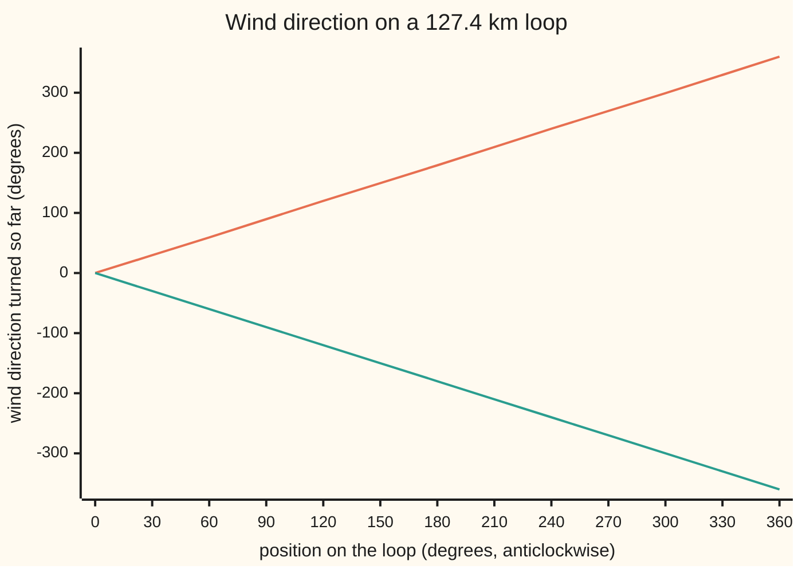

# Hairy ball theorem: a field on a sphere must stand still somewhere

[Syllabus](../../../SYLLABUS.md) → [Differential geometry and Lie groups](../README.md) → [Lie Groups](../README.md#s06) → Hairy ball theorem

---

## General Overview

At every point of the Earth's surface the wind has a speed and a direction. Draw it as an arrow lying flat on the ground. The arrows form a **vector field** on the globe: one arrow at every point, changing smoothly from place to place.

Try to make the wind blow everywhere at once. A steady wind blowing eastward at 10 m/s along the equator looks like a candidate. At London it blows at 6.23 m/s. But as you go north, the circles of latitude shrink, and at the North Pole there is no "east" left. The wind must die to zero at both poles.

The **hairy ball theorem** says every smooth wind on a sphere has at least one **calm spot**, a point where the arrow has length zero. The name comes from combing a hairy ball flat: there is always a crown where the hair stands up or swirls.

This card goes further. Each calm spot carries a whole number, its **index**: walk a small loop round it and count how many times the wind's arrow turns. A high-pressure centre counts +1. A low counts +1. A **col**, the weather map's saddle between two highs and two lows, counts −1. On any wind over the whole globe, the indices add to 2.

Our worked map has 4 highs, 4 lows and 6 cols: 14 calm spots, but 4 + 4 − 6 = 2. A doughnut-shaped planet would give 0, and there the wind can blow everywhere.

**Add the turning numbers of a field's zeros over a closed surface and the total is always the surface's Euler characteristic, 2 − 2g for g holes; on a sphere that is 2, so every field on a sphere stops somewhere.**

**What kind of fact this is:** a theorem, the Poincaré–Hopf theorem, proved on this card in Why it works, with one step (that every closed surface can be cut into triangles) used and cited, not proved. The hairy ball theorem is its sphere case. Both are global: they need the whole closed surface.

### The picture: the wind's direction, walked round a high and round a col



The rising line is the loop round the high at 35.26° N, 45° E: the wind turns once forward, index +1. The falling line is the loop round the col at the North Pole: the wind turns once backward, index −1. Both checks print every point.

---

## The formula

The words first, one sentence each.

- A **closed surface** $`M`$ is a surface with no rim, built from finitely many triangles, in one piece ([Closed surfaces classified](../../17-Topology/03-Surfaces%20and%20Manifolds/02-surfaces-and-the-classification-theorem.md)). The globe is one; so is a doughnut.
- A **vector field** $`X`$ on $`M`$ puts one arrow $`X(q)`$ at each point $`q`$, lying along the surface (tangent to it) and changing smoothly. [Vector field and its flow](../03-Manifolds/07-vector-fields-and-flows.md) builds it in full.
- A **zero** of $`X`$ is a point $`p`$ where $`X(p) = 0`$: a calm spot. It is **isolated** if a small disc round it holds no other zero.
- The **index** $`\mathrm{ind}_p X`$ is the net number of turns the arrow makes while you walk once anticlockwise round a small loop $`C`$ about $`p`$. Anticlockwise is as seen from outside the globe. The arrow's angle is measured against fixed directions on that small patch.
- The **Euler characteristic** $`\chi(M) = V - E + F`$ counts vertices minus edges plus faces of any cutting of $`M`$ into polygons. For a two-sided closed surface (one with an inside and an outside, unlike a Möbius strip) with $`g`$ holes, $`\chi = 2 - 2g`$.

The index is the turning of the arrow, in whole turns:

```math
\mathrm{ind}_p X = \frac{\Delta_C \arg X}{2\pi}
```

**Read it aloud:** the index of X at p is the total change in the arrow's angle round a small loop, divided by one full turn.

The theorem adds them up:

```math
\sum_{X(p) = 0} \mathrm{ind}_p X \;=\; \chi(M) \;=\; 2 - 2g
```

**Read it aloud:** the indices of all the zeros add up to the Euler characteristic, two minus twice the number of holes.

At most zeros the field looks like a linear map nearby. Then the index is a sign:

```math
\mathrm{ind}_p X = \mathrm{sign}\,\det DX(p) \quad\text{when } \det DX(p) \neq 0
```

**Read it aloud:** the index is plus one when the field's linear part keeps orientation, and minus one when it flips it.

For the globe, $`g = 0`$, so the total is 2. The worked map gives 4 highs + 4 lows − 6 cols = 2.

| Symbol | Plain meaning | In our example | Push it up and the answer… |
| --- | --- | --- | --- |
| $`M`$, $`R`$ | a closed surface; the globe's radius | the Earth, a sphere of radius $`R = 6371`$ km (a model) | — |
| $`X`$, $`Y`$, $`W`$ | vector fields; the wind field, $`W = -\mathrm{grad}\, P`$ | air flowing from high to low pressure | — |
| $`P`$, $`s`$, $`(x, y, z)`$ | sea-level pressure in hPa; its pattern, from −1 to +1; a point on the globe scaled to radius 1 | 1033 at a high, 993 at a low, 1013 at a col | a stronger pattern deepens highs and lows, same indices |
| $`p`$, $`q`$ | a zero of the field; any point | the col at the North Pole | — |
| $`C`$, $`\partial c`$ | a small loop round $`p`$, walked anticlockwise from outside; the edge of a cell $`c`$ | radius 127.4 km | too big a loop holds other zeros |
| $`\Delta_C \arg X`$, $`t`$ | total change in the arrow's angle round $`C`$; position on the loop, as an angle | +360° at a high, −360° at a col | — |
| $`\mathrm{ind}_p X`$ | the index: net turns of the arrow | +1 high or low, −1 col | — |
| $`DX(p)`$, $`(u, v)`$ | the field's linear part at $`p`$: a 2 by 2 matrix in flat coordinates $`(u, v)`$ on the patch | a multiple of the identity at a high | — |
| $`\det`$, $`\mathrm{sign}`$ | determinant; its sign, +1 or −1 | positive at highs and lows, negative at cols | — |
| $`\chi`$, $`g`$ | Euler characteristic, $`V - E + F`$; genus, the number of holes | 2 and 0 for the globe; 0 and 1 for the doughnut | each hole lowers $`\chi`$ by 2 |
| $`V`$, $`E`$, $`F`$ | vertices, edges, faces of a grid on $`M`$ | 488, 972, 486 for the code's globe grid | all grow with the grid; $`\chi`$ does not |
| $`e_c`$, $`\alpha_c`$, $`\beta`$; $`x_1`$ to $`x_4`$ | the proof's fixed directions on cell $`c`$, turns against them, and angle from $`Y`$ to $`X`$; coordinates on the 3-sphere | — | — |

Here $`\mathrm{grad}\, P`$ is the gradient along the surface: the arrow pointing uphill in pressure, as steep as the slope. The minus sign sends air downhill, from high to low.

### When it holds

- **The surface is closed.** On the flat plane a steady wind never stops. On a disc with a rim, wind can blow straight across. Drop "no rim" or "bounded" and the count says nothing.
- **The field lies along the surface.** An arrow pointing straight up out of the globe is never zero. The theorem is about arrows tangent to the surface.
- **The field is continuous.** "Blow due east at 10 m/s" has no zero, but it has no value at the poles at all: there it jumps. Continuity is what forces the speed down to 0 there.
- **The zeros are isolated.** If the wind is calm along a whole line, no small loop surrounds just one calm spot, and the index is not defined. Nudge the field and the line breaks into isolated zeros whose indices still add to $`\chi`$.
- **The loop holds one zero.** A loop of radius 60° round the North Pole holds the col and 2 highs and 2 lows. Its count is 3, the sum of all five, not the col's −1.

---

## Why it works

### Step 0: a whole number that cannot jump

A turning number is a whole number, and a whole number that changes continuously cannot change at all. That one idea makes the index independent of the loop, makes indices add over regions, and makes the total the same for every field. One well-chosen field then shows the total is $`V - E + F`$.

### Step 1: the index is a whole number, the same for every small loop

Walk round the loop and come back to the start. The arrow is back where it was, so its angle has changed by a whole number of full turns. That is the index.

Shrink or stretch the loop without crossing a zero. The arrow never vanishes on the way, so the count changes continuously. A whole number that changes continuously stays fixed.

This is the compass-needle argument of [The argument principle](../../07-Complex%20analysis/06-Real%20Integrals%20and%20Counting%20Zeros/06-the-argument-principle.md). There, the needle counts zeros of a complex function, always positive. Here the field is any field, and the count can be negative.

### Step 2: read the index from the linear part

Near an isolated zero $`p`$, put flat coordinates $`(u, v)`$ on a small patch, with $`p`$ at the origin. If $`\det DX(p) \neq 0`$, the field looks like its linear part. Four pictures cover the cases.

| Pattern near the zero | Field | $`\det DX(p)`$ | Index |
| --- | --- | --- | --- |
| source: air pours out (a high) | $`(u, v)`$ | +1 | +1 |
| sink: air pours in (a low) | $`(-u, -v)`$ | +1 | +1 |
| vortex: air circles | $`(-v, u)`$ | +1 | +1 |
| saddle: in from two sides, out the other two (a col) | $`(u, -v)`$ | −1 | −1 |

Walk the source's loop: at angle $`t`$ the arrow points at angle $`t`$, so it turns once forward. Walk the saddle's loop: the arrow points at angle $`-t`$, so it turns once backward.

A linear map with positive determinant can be slid to the identity through maps that never collapse. A negative one can be slid to the mirror $`(u, -v)`$. The arrow never vanishes on the loop during a slide, so the same whole-number argument as Step 1 shows the count survives it. So the index is the sign of the determinant.

Real winds blow mostly along the isobars (lines of equal pressure), circling highs and lows. That is the downhill wind given a quarter turn. A quarter turn has determinant +1, so no sign changes. The code checks it: the turned wind's indices still add to +2.

### Step 3: indices add over a region

Cut a region into small cells. Walk each cell's edge anticlockwise and count the arrow's turns. A cell holding one zero gives that zero's index; a cell holding none gives 0.

Now add the cells. Every inside edge is walked twice, once each way, so its turning cancels. What is left is the turning along the region's outer edge. So the turns round a big loop equal the sum of the indices inside.

The 60° loop round the North Pole shows it: −1 + 1 + 1 + 1 + 1 = 3, and the code walks the loop and gets 3.

### Step 4: on a closed surface the total is the same for every field

Take two fields, $`X`$ and $`Y`$, with no zeros on the cell edges. At each edge point, measure the angle from $`Y`$'s arrow to $`X`$'s arrow. That angle needs no fixed directions, only the surface's sense of anticlockwise.

Round each cell, X's turns minus Y's turns equals the turning of that angle. Add over all cells. A closed surface has no outer edge: every edge is shared by two cells and walked both ways. So the sum is 0, and the two totals agree.

<details>
<summary>Detailed proof: the total index does not depend on the field</summary>

Fix a cutting of $`M`$ into cells $`c`$, each a small disc, with no zero of $`X`$ or $`Y`$ on any edge. On each cell choose a field of fixed directions, $`e_c`$, which a disc always allows.

Let $`\alpha_c(X)`$ be the turning of $`X`$ against $`e_c`$ round the edge of $`c`$, in turns. By Steps 1 and 3, $`\alpha_c(X)`$ is the sum of the indices of $`X`$ in $`c`$. Summing over cells:

$`\displaystyle \sum_{X(p) = 0} \mathrm{ind}_p X = \sum_c \alpha_c(X)`$

Let $`\beta(q)`$ be the angle from $`Y(q)`$ to $`X(q)`$, measured anticlockwise. It is defined at every edge point and does not involve $`e_c`$. The angle of $`X`$ against $`e_c`$ is the angle of $`Y`$ against $`e_c`$ plus $`\beta`$, so

$`\displaystyle \alpha_c(X) - \alpha_c(Y) = \frac{1}{2\pi}\, \Delta_{\partial c}\, \beta`$

Here $`\partial c`$ is the edge of $`c`$, walked anticlockwise. Each edge of the cutting lies on exactly two cells. Two-sidedness makes their anticlockwise walks run along it in opposite directions, so the changes of $`\beta`$ along it cancel. Summing over all cells gives $`\sum_c \alpha_c(X) = \sum_c \alpha_c(Y)`$.

For a one-sided surface, run the same argument on its two-sided double cover (a two-sided surface that wraps it twice, like the sphere over the projective plane); the result still holds, with $`\chi`$ of the one-sided surface. Milnor (Sources) gives the general proof in every dimension.

</details>

### Step 5: one special field gives V − E + F

Cut the surface into triangles. Build a field that flows from each vertex, along the edges, into the middle of each face:

- a source at each vertex: index +1, $`V`$ of them;
- a saddle at the middle of each edge, with flow in from the two vertices and out to the two faces: index −1, $`E`$ of them;
- a sink at the middle of each face: index +1, $`F`$ of them.

Its total is $`V - E + F = \chi(M)`$. By Step 4, every field has this total. That is the Poincaré–Hopf theorem. The classification of [Closed surfaces classified](../../17-Topology/03-Surfaces%20and%20Manifolds/02-surfaces-and-the-classification-theorem.md) then gives $`\chi = 2 - 2g`$ for two-sided surfaces.

### Step 6: the hairy ball theorem

For the sphere, $`\chi = 2`$. A field with no zero would have total 0. So every field on the sphere has a zero.

For the doughnut, $`\chi = 0`$, and a wind round the tube never stops. [Gauss-Bonnet](../02-Surfaces/10-gauss-bonnet-theorem.md) reaches the same number from the other side: the total curvature of a closed surface is $`2\pi\chi`$.

The idea reaches beyond surfaces. Count a sphere's dimension as its own, not the space around it: the globe's surface is 2-dimensional. A sphere of even dimension has $`\chi = 2`$ and every field on it stops. A sphere of odd dimension has $`\chi = 0`$. The 3-sphere is the set of points $`(x_1, x_2, x_3, x_4)`$ at distance 1 from the origin in four-dimensional space; the field $`(-x_2, x_1, -x_4, x_3)`$ on it has length 1 everywhere and never stops.

---

## Worked numbers, by hand

The model pressure map is $`P = 1013 + 20\,s`$ hPa, with $`s = 3\sqrt{3}\,xyz`$. Here $`(x, y, z)`$ is a point on the globe scaled to radius 1, with $`x`$ towards 0° N 0° E, $`y`$ towards 0° N 90° E and $`z`$ towards the North Pole. The number $`s`$ runs from −1 to +1. This is a model chosen for its clean pattern, not a real day's weather.

| Step | Arithmetic | Value |
| --- | --- | --- |
| highs: $`s = +1`$ where an even number of $`x, y, z`$ are negative | 1013 + 20 | 1033 hPa, 4 of them |
| their positions | latitude $`\pm 35.2644°`$, longitude $`\pm 45°`$ or $`\pm 135°`$ | e.g. 35.2644° N, 45° E |
| lows: $`s = -1`$ | 1013 − 20 | 993 hPa, 4 of them |
| cols: on the axes, where $`xyz = 0`$ and the slope is flat | 1013 + 0 | 1013 hPa, 6 of them |
| index of each high and low | air pours out of a high, into a low | +1 each |
| index of each col | in from two sides, out the other two | −1 each |
| total | 4 + 4 − 6 | **+2** |
| check against the globe | $`\chi = 2 - 2 \times 0`$ | 2 |

The pattern has 14 calm spots, yet the globe only asks for a total of 2: every extra high or low must come with a col to pay for it.

### What breaks if you drop a piece

| Mistake | Comes out at | What went wrong |
| --- | --- | --- |
| Counting every calm spot as +1 | +14 | a col turns the arrow backward: −1 |
| Walking every loop clockwise | −2 | every index flips sign; the convention is anticlockwise from outside |
| A 60° loop round the North Pole | +3, not the col's −1 | the loop holds 2 highs and 2 lows as well |
| Expecting a calm spot on a doughnut world | indices +1 +1 −1 −1, sum 0 | $`\chi = 0`$: wind round the tube never stops |

The code prints all four.

---

## Code, from first principles, and it actually runs

The code builds the model pressure map on the globe and its downhill wind, checks by differences that the wind is minus the slope of the pressure, then finds the total index by four independent roads. Road 1 walks a 127.4 km loop round each of the 14 calm spots and counts the wind's turns. Road 2 takes the sign of the determinant of the wind's linear part at each spot. Road 3 covers the globe with a grid of 486 cells, tilted so no calm spot sits on an edge, and counts turns round every cell without being told where the calm spots are. Road 4 counts the same grid's $`V - E + F`$. All four give 2. Then it repeats the count on a doughnut world and gets 0.

### Python

```python
# Hairy ball theorem: a field on a sphere must stand still somewhere -- the check behind the card.
# Standard library only.  The Earth is a sphere of radius 6371 km.  A model pressure map
# p = 1013 + 20 s hPa, with s = 3 sqrt(3) x y z, has 4 highs, 4 lows and 6 cols (saddles).
# The surface wind is W = -grad p.  Roads to the total index 2 = chi(sphere):
# 1 walk a small loop round each calm spot and count the wind's turns;
# 2 the sign of the determinant of the wind's linear part at each calm spot;
# 3 sweep the whole globe in 486 cells, never told where the calm spots are;
# 4 V - E + F of that same grid.  Then a doughnut world, where the total is 0.
import math
TAU, RKM, DEG = 2 * math.pi, 6371.0, 180 / math.pi
A = 20 * 3 * math.sqrt(3)

def dot(a, b): return sum(x * y for x, y in zip(a, b))
def cross(a, b): return (a[1]*b[2] - a[2]*b[1], a[2]*b[0] - a[0]*b[2], a[0]*b[1] - a[1]*b[0])
def unit(a): n = math.sqrt(dot(a, a)); return tuple(x / n for x in a)
def pressure(r): return 1013 + A * r[0] * r[1] * r[2]
def wind(r):                                   # -grad p, tangent to the globe, hPa per Earth radius
    g = (A * r[1] * r[2], A * r[0] * r[2], A * r[0] * r[1])
    k = dot(g, r)
    return tuple(-(gi - k * ri) for gi, ri in zip(g, r))
def turned(r): return cross(r, wind(r))        # every arrow given a quarter turn: wind along isobars
def east(r): return (-10 * r[1], 10 * r[0], 0.0)   # steady east wind, 10 m/s at the equator
def frame(p):                                  # e1, e2 tangent at p, with e1 x e2 = p (outward)
    e1 = unit(cross((0.0, 0.0, 1.0) if abs(p[2]) < 0.9 else (1.0, 0.0, 0.0), p))
    return e1, cross(p, e1)
def angle(F, q, e1, e2): w = F(q); return math.atan2(dot(w, e2), dot(w, e1))
def walk(F, pts, e1, e2):                      # total turning of F along a list of points, in turns
    tot, a0 = 0.0, angle(F, pts[0], e1, e2)
    for q in pts[1:]:
        a1 = angle(F, q, e1, e2)
        step = (a1 - a0 + math.pi) % TAU - math.pi
        assert abs(step) < 1.0, "steps too coarse to follow the wind"
        tot, a0 = tot + step, a1
    return tot / TAU
def circle(p, rad, n=360, sense=1):            # loop of angular radius rad round p, anticlockwise from outside
    e1, e2 = frame(p)
    return [tuple(math.cos(rad) * p[i] + math.sin(rad) * (math.cos(sense * TAU * k / n) * e1[i]
            + math.sin(sense * TAU * k / n) * e2[i]) for i in range(3)) for k in range(n + 1)]
def loop_index(F, p, rad=0.02, sense=1): return walk(F, circle(p, rad, sense=sense), *frame(p))
def det_sign(F, p, h=1e-5):                    # linear part of F in p's tangent coordinates
    e1, e2 = frame(p)
    def comp(s, t):
        q = unit(tuple(p[i] + s * e1[i] + t * e2[i] for i in range(3))); w = F(q)
        return dot(w, e1), dot(w, e2)
    (a, c), (a_, c_) = comp(h, 0), comp(-h, 0)
    (b, d), (b_, d_) = comp(0, h), comp(0, -h)
    det = ((a - a_) * (d - d_) - (b - b_) * (c - c_)) / (4 * h * h)
    return 1 if det > 0 else -1
def latlon(r): return 90 - math.acos(r[2]) * DEG, math.atan2(r[1], r[0]) * DEG

s3 = 1 / math.sqrt(3)
zeros = [(sx * s3, sy * s3, sz * s3) for sx in (1, -1) for sy in (1, -1) for sz in (1, -1)]
zeros += [tuple(float(s if i == j else 0) for i in range(3)) for j in range(3) for s in (1, -1)]
rp, hd = unit((0.3, 0.5, 0.8)), 1e-5              # W = -grad p, checked against differences of p
for e in frame(rp):
    ph = [pressure(unit(tuple(rp[i] + s * e[i] for i in range(3)))) for s in (hd, -hd)]
    assert abs((ph[0] - ph[1]) / (2 * hd) + dot(wind(rp), e)) < 1e-6, "wind is not -grad p"
print("calm spot      lat        lon   p hPa  loop  det")
tot1 = tot2 = tot_t = 0
for z in zeros:
    assert math.sqrt(dot(wind(z), wind(z))) < 1e-12, "a listed calm spot is not calm"
    i1, i2 = round(loop_index(wind, z)), det_sign(wind, z)
    assert abs(loop_index(wind, z) - i1) < 1e-9 and i1 == i2, "loop and determinant disagree"
    it = round(loop_index(turned, z)); tot_t += it
    assert it == i1, "a quarter turn changed an index"
    p = pressure(z); kind = "high" if p > 1013.5 else "low" if p < 1012.5 else "col"
    tot1, tot2 = tot1 + i1, tot2 + i2
    print(f"{kind:>9} {latlon(z)[0]:8.4f} {latlon(z)[1]:10.4f} {p:7.2f} {i1:+5d} {i2:+4d}")
nk = [sum(1 for z in zeros if pressure(z) > 1013.5), sum(1 for z in zeros if pressure(z) < 1012.5)]
assert nk == [4, 4], "the map should have 4 highs and 4 lows"
print(f"highs {nk[0]}, lows {nk[1]}, cols {14 - sum(nk)}: {nk[0]} + {nk[1]} - {14 - sum(nk)} = {nk[0] + nk[1] - (14 - sum(nk)):+d}")
print(f"road 1 sum of loop indices          {tot1:+d}")
print(f"road 2 sum of determinant signs     {tot2:+d}")
print(f"quarter-turned wind, sum of loop indices {tot_t:+d}")
print(f"loop radius 0.02 rad = {0.02 * RKM:.1f} km")

ta, tb = 0.75, 0.3                             # the grid is tilted, so no calm spot sits on a cell edge
Q = [(math.cos(ta), -math.sin(ta), 0.0), (math.sin(ta) * math.cos(tb), math.cos(ta) * math.cos(tb),
     -math.sin(tb)), (math.sin(ta) * math.sin(tb), math.cos(ta) * math.sin(tb), math.cos(tb))]
def onsphere(c): return unit(tuple(dot(row, c) for row in Q))
n, m = 9, 12
cells, tot3, found, V, E = 0, 0, 0, set(), set()
for ax in range(3):
    for sg in (1, -1):
        def pt(i, j):                          # grid point (i, j) of this cube face, integers -n..n
            c = [0, 0, 0]; c[ax] = sg * n; c[(ax + 1) % 3] = i; c[(ax + 2) % 3] = j; return tuple(c)
        for i in range(-n, n, 2):
            for j in range(-n, n, 2):
                cor = [pt(i, j), pt(i + 2, j), pt(i + 2, j + 2), pt(i, j + 2), pt(i, j)]
                if sg < 0: cor.reverse()       # keep every cell anticlockwise from outside
                bd = [onsphere(tuple(a + (b - a) * k / m for a, b in zip(cor[e], cor[e + 1])))
                      for e in range(4) for k in range(m)] + [onsphere(cor[0])]
                k = walk(wind, bd, *frame(onsphere(tuple(sum(c[t] for c in cor[:4]) / 4 for t in range(3)))))
                assert abs(k - round(k)) < 1e-9
                cells += 1; tot3 += round(k); found += round(k) != 0
                V.update(cor[:4]); E.update(frozenset(cor[e:e + 2]) for e in range(4))
F = cells
print(f"road 3 cells {cells}, cells holding a calm spot {found}, sum {tot3:+d}")
print(f"road 4 grid V {len(V)}  E {len(E)}  F {F}  V - E + F = {len(V) - len(E) + F}")
assert tot1 == tot2 == tot3 == len(V) - len(E) + F == 2 and found == 14, "the four roads disagree"

poles = [loop_index(east, (0.0, 0.0, s)) for s in (1.0, -1.0)]
assert [round(x) for x in poles] == [1, 1]
ldn = math.radians(90 - 51.5)
print(f"east wind: London {10 * math.sin(ldn):.2f} m/s, pole indices {round(poles[0]):+d} {round(poles[1]):+d}")

hi, col = zeros[0], zeros[12]
print("chart, loop position  " + "".join(f"{30 * k:7d}" for k in range(13)))
for name, z in (("high 35N 45E", hi), ("col North Pole", col)):
    e1, e2 = frame(z); pts = circle(z, 0.02)
    vals = [walk(wind, pts[:30 * k + 1], e1, e2) * 360 for k in range(13)]
    print(f"chart, {name:15}" + "".join(f"{v:7.1f}" for v in vals))

counted = len(zeros); cw = sum(round(loop_index(wind, z, sense=-1)) for z in zeros)
big = loop_index(wind, (0.0, 0.0, 1.0), rad=math.radians(60))
print(f"wrong: every calm spot counted +1     {counted:+d}")
print(f"wrong: loops walked clockwise         {cw:+d}")
print(f"wrong: 60 deg loop round North Pole   {round(big):+d}  (1 col, 2 highs, 2 lows inside)")
assert cw == -2 and round(big) == 3

def tor(u, v): return (math.sin(u), math.sin(v))   # doughnut world: wind -grad(cos u + cos v)
def tor_index(F, u0, v0, r=0.05, k=360):
    t = 0.0; a0 = math.atan2(*reversed(F(u0 + r, v0)))
    for s in range(1, k + 1):
        a1 = math.atan2(*reversed(F(u0 + r * math.cos(TAU * s / k), v0 + r * math.sin(TAU * s / k))))
        t += (a1 - a0 + math.pi) % TAU - math.pi; a0 = a1
    return round(t / TAU)
ti = [tor_index(tor, u, v) for u, v in ((0, 0), (math.pi, math.pi), (0, math.pi), (math.pi, 0))]
nt = 6; tV, tE, tF = set(), set(), 0                 # a 6 by 6 grid glued edge to edge into a doughnut
for i in range(nt):
    for j in range(nt):
        c = [(i, j), ((i + 1) % nt, j), ((i + 1) % nt, (j + 1) % nt), (i, (j + 1) % nt)]
        tV.update(c); tE.update(frozenset((c[e], c[(e + 1) % 4])) for e in range(4)); tF += 1
tchi = len(tV) - len(tE) + tF
print(f"doughnut: indices {ti[0]:+d} {ti[1]:+d} {ti[2]:+d} {ti[3]:+d}, sum {sum(ti)}; grid V {len(tV)} E {len(tE)} F {tF}, V - E + F = {tchi}")
print("doughnut: wind round the tube (1, 0) has speed 1 everywhere, no calm spot")
assert sum(ti) == tchi == 0 and ti == [1, 1, -1, -1]
print("ALL CHECKS PASS")
```

**Ran 2026-11-19 on macOS, Python 3.14.10, standard library only. All checks passed. Output, pasted from the run:**

```
calm spot      lat        lon   p hPa  loop  det
     high  35.2644    45.0000 1033.00    +1   +1
      low -35.2644    45.0000  993.00    +1   +1
      low  35.2644   -45.0000  993.00    +1   +1
     high -35.2644   -45.0000 1033.00    +1   +1
      low  35.2644   135.0000  993.00    +1   +1
     high -35.2644   135.0000 1033.00    +1   +1
     high  35.2644  -135.0000 1033.00    +1   +1
      low -35.2644  -135.0000  993.00    +1   +1
      col   0.0000     0.0000 1013.00    -1   -1
      col   0.0000   180.0000 1013.00    -1   -1
      col   0.0000    90.0000 1013.00    -1   -1
      col   0.0000   -90.0000 1013.00    -1   -1
      col  90.0000     0.0000 1013.00    -1   -1
      col -90.0000     0.0000 1013.00    -1   -1
highs 4, lows 4, cols 6: 4 + 4 - 6 = +2
road 1 sum of loop indices          +2
road 2 sum of determinant signs     +2
quarter-turned wind, sum of loop indices +2
loop radius 0.02 rad = 127.4 km
road 3 cells 486, cells holding a calm spot 14, sum +2
road 4 grid V 488  E 972  F 486  V - E + F = 2
east wind: London 6.23 m/s, pole indices +1 +1
chart, loop position        0     30     60     90    120    150    180    210    240    270    300    330    360
chart, high 35N 45E       0.0   29.6   59.2   89.6  120.0  149.6  179.2  209.6  240.0  269.6  299.2  329.6  360.0
chart, col North Pole     0.0  -30.0  -60.0  -90.0 -120.0 -150.0 -180.0 -210.0 -240.0 -270.0 -300.0 -330.0 -360.0
wrong: every calm spot counted +1     +14
wrong: loops walked clockwise         -2
wrong: 60 deg loop round North Pole   +3  (1 col, 2 highs, 2 lows inside)
doughnut: indices +1 +1 -1 -1, sum 0; grid V 36 E 72 F 36, V - E + F = 0
doughnut: wind round the tube (1, 0) has speed 1 everywhere, no calm spot
ALL CHECKS PASS
```

Four roads, one number. The cell sweep, never told where the calm spots are, finds exactly 14.

### Rust

The same checks and inputs, with identical output. No crates.

```rust
// Hairy ball theorem -- the same check as vector_field_zeros_and_the_hairy_ball_check.py, in Rust.
// Standard library only, no crates.  Model pressure p = 1013 + 20 s hPa, s = 3 sqrt(3) x y z,
// on the Earth as a sphere of radius 6371 km; wind W = -grad p.  Four roads to the total index 2.
use std::collections::HashSet;
use std::f64::consts::PI;
type V3 = [f64; 3];
const TAU: f64 = 2.0 * PI;

fn dot(a: V3, b: V3) -> f64 { a[0] * b[0] + a[1] * b[1] + a[2] * b[2] }
fn cross(a: V3, b: V3) -> V3 { [a[1]*b[2] - a[2]*b[1], a[2]*b[0] - a[0]*b[2], a[0]*b[1] - a[1]*b[0]] }
fn unit(a: V3) -> V3 { let n = dot(a, a).sqrt(); [a[0] / n, a[1] / n, a[2] / n] }
fn amp() -> f64 { 20.0 * 3.0 * 3f64.sqrt() }
fn pressure(r: V3) -> f64 { 1013.0 + amp() * r[0] * r[1] * r[2] }
fn wind(r: V3) -> V3 {                          // -grad p, tangent to the globe, hPa per Earth radius
    let a = amp();
    let g = [a * r[1] * r[2], a * r[0] * r[2], a * r[0] * r[1]];
    let k = dot(g, r); [-(g[0] - k * r[0]), -(g[1] - k * r[1]), -(g[2] - k * r[2])]
}
fn turned(r: V3) -> V3 { cross(r, wind(r)) }   // every arrow given a quarter turn
fn east(r: V3) -> V3 { [-10.0 * r[1], 10.0 * r[0], 0.0] }
fn frame(p: V3) -> (V3, V3) {                   // e1, e2 tangent at p, with e1 x e2 = p
    let a = if p[2].abs() < 0.9 { [0.0, 0.0, 1.0] } else { [1.0, 0.0, 0.0] };
    let e1 = unit(cross(a, p)); (e1, cross(p, e1))
}
fn angle(f: fn(V3) -> V3, q: V3, e1: V3, e2: V3) -> f64 { let w = f(q); dot(w, e2).atan2(dot(w, e1)) }
fn walk(f: fn(V3) -> V3, pts: &[V3], e1: V3, e2: V3) -> f64 {
    let (mut tot, mut a0) = (0.0, angle(f, pts[0], e1, e2));
    for q in &pts[1..] {
        let a1 = angle(f, *q, e1, e2); let step = (a1 - a0 + PI).rem_euclid(TAU) - PI;
        assert!(step.abs() < 1.0, "steps too coarse to follow the wind");
        tot += step; a0 = a1;
    }
    tot / TAU
}
fn circle(p: V3, rad: f64, n: usize, sense: f64) -> Vec<V3> {
    let (e1, e2) = frame(p);
    (0..=n).map(|k| {
        let t = sense * TAU * k as f64 / n as f64;
        let mut q = [0.0; 3];
        for i in 0..3 { q[i] = rad.cos() * p[i] + rad.sin() * (t.cos() * e1[i] + t.sin() * e2[i]); } q
    }).collect()
}
fn loop_index(f: fn(V3) -> V3, p: V3, rad: f64, sense: f64) -> f64 {
    let (e1, e2) = frame(p); walk(f, &circle(p, rad, 360, sense), e1, e2)
}
fn det_sign(f: fn(V3) -> V3, p: V3) -> i64 {
    let (h, (e1, e2)) = (1e-5, frame(p));
    let comp = |s: f64, t: f64| {
        let q = unit([p[0] + s * e1[0] + t * e2[0], p[1] + s * e1[1] + t * e2[1], p[2] + s * e1[2] + t * e2[2]]);
        let w = f(q); (dot(w, e1), dot(w, e2))
    };
    let ((a, c), (a_, c_)) = (comp(h, 0.0), comp(-h, 0.0));
    let ((b, d), (b_, d_)) = (comp(0.0, h), comp(0.0, -h));
    let det = ((a - a_) * (d - d_) - (b - b_) * (c - c_)) / (4.0 * h * h);
    if det > 0.0 { 1 } else { -1 }
}
fn latlon(r: V3) -> (f64, f64) { let d = 180.0 / PI; (90.0 - r[2].acos() * d, r[1].atan2(r[0]) * d) }
fn rnd(x: f64) -> i64 { x.round() as i64 }

fn main() {
    let (s3, mut zeros) = (1.0 / 3f64.sqrt(), Vec::<V3>::new());
    for sx in [1.0, -1.0] { for sy in [1.0, -1.0] { for sz in [1.0, -1.0] { zeros.push([sx * s3, sy * s3, sz * s3]); } } }
    for j in 0..3 { for s in [1.0, -1.0] { let mut z = [0.0; 3]; z[j] = s; zeros.push(z); } }
    let rp = unit([0.3, 0.5, 0.8]); // W = -grad p, checked against differences of p
    for e in [frame(rp).0, frame(rp).1] { let ph = |s: f64| pressure(unit([rp[0] + s * e[0], rp[1] + s * e[1], rp[2] + s * e[2]]));
        assert!(((ph(1e-5) - ph(-1e-5)) / 2e-5 + dot(wind(rp), e)).abs() < 1e-6, "wind is not -grad p"); }
    println!("calm spot      lat        lon   p hPa  loop  det");
    let (mut tot1, mut tot2, mut tot_t) = (0, 0, 0);
    for &z in &zeros {
        assert!(dot(wind(z), wind(z)).sqrt() < 1e-12, "a listed calm spot is not calm");
        let raw = loop_index(wind, z, 0.02, 1.0);
        let (i1, i2) = (rnd(raw), det_sign(wind, z));
        assert!((raw - i1 as f64).abs() < 1e-9 && i1 == i2, "loop and determinant disagree");
        let it = rnd(loop_index(turned, z, 0.02, 1.0)); tot_t += it;
        assert!(it == i1, "a quarter turn changed an index");
        let p = pressure(z);
        let kind = if p > 1013.5 { "high" } else if p < 1012.5 { "low" } else { "col" };
        tot1 += i1; tot2 += i2;
        let (la, lo) = latlon(z);
        println!("{:>9} {:8.4} {:10.4} {:7.2} {:+5} {:+4}", kind, la, lo, p, i1, i2);
    }
    let count = |up: bool| zeros.iter().filter(|&&z| if up { pressure(z) > 1013.5 } else { pressure(z) < 1012.5 }).count() as i64;
    let (hi, lo) = (count(true), count(false)); assert!(hi == 4 && lo == 4, "the map should have 4 highs and 4 lows");
    println!("highs {}, lows {}, cols {}: {} + {} - {} = {:+}", hi, lo, 14 - hi - lo, hi, lo, 14 - hi - lo, hi + lo - (14 - hi - lo));
    println!("road 1 sum of loop indices          {:+}", tot1);
    println!("road 2 sum of determinant signs     {:+}", tot2);
    println!("quarter-turned wind, sum of loop indices {:+}", tot_t);
    println!("loop radius 0.02 rad = {:.1} km", 0.02 * 6371.0);

    let (ta, tb) = (0.75f64, 0.3f64);           // the grid is tilted, so no calm spot sits on a cell edge
    let q = [[ta.cos(), -ta.sin(), 0.0], [ta.sin() * tb.cos(), ta.cos() * tb.cos(), -tb.sin()],
             [ta.sin() * tb.sin(), ta.cos() * tb.sin(), tb.cos()]];
    let onsphere = |c: V3| unit([dot(q[0], c), dot(q[1], c), dot(q[2], c)]);
    let (n, m) = (9i64, 12i64);
    let (mut cells, mut tot3, mut found) = (0i64, 0i64, 0i64);
    let mut vs: HashSet<[i64; 3]> = HashSet::new();
    let mut es: HashSet<([i64; 3], [i64; 3])> = HashSet::new();
    for ax in 0..3 { for sg in [1i64, -1] {
        let pt = |i: i64, j: i64| { let mut c = [0i64; 3]; c[ax] = sg * n; c[(ax + 1) % 3] = i; c[(ax + 2) % 3] = j; c };
        let mut i = -n;
        while i < n { let mut j = -n; while j < n {
            let mut cor = vec![pt(i, j), pt(i + 2, j), pt(i + 2, j + 2), pt(i, j + 2), pt(i, j)];
            if sg < 0 { cor.reverse(); }
            let mut bd: Vec<V3> = Vec::new();
            for e in 0..4 { for k in 0..m {
                let mut c = [0.0; 3];
                for t in 0..3 { c[t] = cor[e][t] as f64 + ((cor[e + 1][t] - cor[e][t]) * k) as f64 / m as f64; }
                bd.push(onsphere(c));
            } }
            bd.push(onsphere([cor[0][0] as f64, cor[0][1] as f64, cor[0][2] as f64]));
            let mut ctr = [0.0; 3];
            for t in 0..3 { ctr[t] = (cor[0][t] + cor[1][t] + cor[2][t] + cor[3][t]) as f64 / 4.0; }
            let (e1, e2) = frame(onsphere(ctr)); let k = walk(wind, &bd, e1, e2);
            assert!((k - k.round()).abs() < 1e-9);
            cells += 1; tot3 += rnd(k); if rnd(k) != 0 { found += 1; }
            for e in 0..4 { vs.insert(cor[e]); let (a, b) = (cor[e], cor[e + 1]); es.insert(if a < b { (a, b) } else { (b, a) }); }
            j += 2; } i += 2; }
    } }
    let (nv, ne, nf) = (vs.len() as i64, es.len() as i64, cells);
    println!("road 3 cells {}, cells holding a calm spot {}, sum {:+}", cells, found, tot3);
    println!("road 4 grid V {}  E {}  F {}  V - E + F = {}", nv, ne, nf, nv - ne + nf);
    assert!(tot1 == 2 && tot2 == 2 && tot3 == 2 && nv - ne + nf == 2 && found == 14, "the four roads disagree");

    let poles = [loop_index(east, [0.0, 0.0, 1.0], 0.02, 1.0), loop_index(east, [0.0, 0.0, -1.0], 0.02, 1.0)]; assert!(rnd(poles[0]) == 1 && rnd(poles[1]) == 1);
    let ldn = (90.0f64 - 51.5).to_radians();
    println!("east wind: London {:.2} m/s, pole indices {:+} {:+}", 10.0 * ldn.sin(), rnd(poles[0]), rnd(poles[1]));

    let mut head = String::from("chart, loop position  ");
    for k in 0..13 { head += &format!("{:7}", 30 * k); }
    println!("{}", head);
    for (name, z) in [("high 35N 45E", zeros[0]), ("col North Pole", zeros[12])] {
        let ((e1, e2), pts) = (frame(z), circle(z, 0.02, 360, 1.0));
        let mut line = format!("chart, {:15}", name);
        for k in 0..13 { line += &format!("{:7.1}", walk(wind, &pts[..30 * k + 1], e1, e2) * 360.0); }
        println!("{}", line);
    }

    let (counted, cw) = (zeros.len() as i64, zeros.iter().map(|&z| rnd(loop_index(wind, z, 0.02, -1.0))).sum::<i64>());
    let big = loop_index(wind, [0.0, 0.0, 1.0], 60f64.to_radians(), 1.0);
    println!("wrong: every calm spot counted +1     {:+}", counted);
    println!("wrong: loops walked clockwise         {:+}", cw);
    println!("wrong: 60 deg loop round North Pole   {:+}  (1 col, 2 highs, 2 lows inside)", rnd(big));
    assert!(cw == -2 && rnd(big) == 3);

    let tor = |u: f64, v: f64| (u.sin(), v.sin());   // doughnut world: wind -grad(cos u + cos v)
    let tor_index = |u0: f64, v0: f64| {
        let (r, k) = (0.05, 360);
        let (x, y) = tor(u0 + r, v0); let (mut t, mut a0) = (0.0, y.atan2(x));
        for s in 1..=k {
            let (x, y) = tor(u0 + r * (TAU * s as f64 / k as f64).cos(), v0 + r * (TAU * s as f64 / k as f64).sin());
            let a1 = y.atan2(x);
            t += (a1 - a0 + PI).rem_euclid(TAU) - PI; a0 = a1;
        }
        rnd(t / TAU)
    };
    let ti: Vec<i64> = [(0.0, 0.0), (PI, PI), (0.0, PI), (PI, 0.0)].iter().map(|&(u, v)| tor_index(u, v)).collect();
    let nt = 6usize;
    let (mut tv, mut te, mut tf) = (HashSet::new(), HashSet::new(), 0i64);
    for i in 0..nt { for j in 0..nt {
        let c = [(i, j), ((i + 1) % nt, j), ((i + 1) % nt, (j + 1) % nt), (i, (j + 1) % nt)];
        for e in 0..4 { tv.insert(c[e]); let (a, b) = (c[e], c[(e + 1) % 4]); te.insert(if a < b { (a, b) } else { (b, a) }); }
        tf += 1;
    } }
    let (tchi, tsum) = (tv.len() as i64 - te.len() as i64 + tf, ti.iter().sum::<i64>());
    println!("doughnut: indices {:+} {:+} {:+} {:+}, sum {}; grid V {} E {} F {}, V - E + F = {}",
             ti[0], ti[1], ti[2], ti[3], tsum, tv.len(), te.len(), tf, tchi);
    println!("doughnut: wind round the tube (1, 0) has speed 1 everywhere, no calm spot");
    assert!(tsum == 0 && tchi == 0 && ti == vec![1, 1, -1, -1]);
    println!("ALL CHECKS PASS");
}
```

**Ran 2026-11-19 on macOS, rustc 1.98.1, no crates. All checks passed. Output, pasted from the run:**

```
calm spot      lat        lon   p hPa  loop  det
     high  35.2644    45.0000 1033.00    +1   +1
      low -35.2644    45.0000  993.00    +1   +1
      low  35.2644   -45.0000  993.00    +1   +1
     high -35.2644   -45.0000 1033.00    +1   +1
      low  35.2644   135.0000  993.00    +1   +1
     high -35.2644   135.0000 1033.00    +1   +1
     high  35.2644  -135.0000 1033.00    +1   +1
      low -35.2644  -135.0000  993.00    +1   +1
      col   0.0000     0.0000 1013.00    -1   -1
      col   0.0000   180.0000 1013.00    -1   -1
      col   0.0000    90.0000 1013.00    -1   -1
      col   0.0000   -90.0000 1013.00    -1   -1
      col  90.0000     0.0000 1013.00    -1   -1
      col -90.0000     0.0000 1013.00    -1   -1
highs 4, lows 4, cols 6: 4 + 4 - 6 = +2
road 1 sum of loop indices          +2
road 2 sum of determinant signs     +2
quarter-turned wind, sum of loop indices +2
loop radius 0.02 rad = 127.4 km
road 3 cells 486, cells holding a calm spot 14, sum +2
road 4 grid V 488  E 972  F 486  V - E + F = 2
east wind: London 6.23 m/s, pole indices +1 +1
chart, loop position        0     30     60     90    120    150    180    210    240    270    300    330    360
chart, high 35N 45E       0.0   29.6   59.2   89.6  120.0  149.6  179.2  209.6  240.0  269.6  299.2  329.6  360.0
chart, col North Pole     0.0  -30.0  -60.0  -90.0 -120.0 -150.0 -180.0 -210.0 -240.0 -270.0 -300.0 -330.0 -360.0
wrong: every calm spot counted +1     +14
wrong: loops walked clockwise         -2
wrong: 60 deg loop round North Pole   +3  (1 col, 2 highs, 2 lows inside)
doughnut: indices +1 +1 -1 -1, sum 0; grid V 36 E 72 F 36, V - E + F = 0
doughnut: wind round the tube (1, 0) has speed 1 everywhere, no calm spot
ALL CHECKS PASS
```

### Lean

Lean proves the hairy ball theorem in full, for the globe and for every sphere of even dimension, and checks the worked numbers.

- Take a continuous field on the globe that lies along the surface. Then it has a calm spot.
- Take a sphere of even dimension and a continuous field lying along it. Then the field stops somewhere.
- Take a point $`(x_1, x_2, x_3, x_4)`$ on the 3-sphere. Then $`(-x_2, x_1, -x_4, x_3)`$ lies along the sphere and has length 1.
- The worked map's 4 highs, 4 lows and 6 cols give 4 + 4 − 6 = 2.
- The globe has $`\chi = 2`$ and the doughnut $`\chi = 0`$. The code's grids give 488 − 972 + 486 = 2 and 36 − 72 + 36 = 0.
- The doughnut world's indices +1, +1, −1, −1 add to 0.
- The source, sink and vortex have determinant +1. The saddle has determinant −1.
- The wrong counts come out at +14, −2 and +3, as in What breaks.

The index sum itself, with each index found by walking a loop, is left to the Python and Rust checks.

```lean
-- Hairy ball theorem: every continuous field of arrows tangent to the round globe has a calm spot, the same holds on every even-dimensional sphere, and the 3-sphere carries a field that never stops.
import Mathlib.Analysis.InnerProductSpace.PiL2
import Mathlib.LinearAlgebra.Matrix.Determinant.Basic
import Mathlib.Geometry.Manifold.SmoothApprox
import Mathlib.MeasureTheory.Function.Jacobian
import Mathlib.Analysis.SpecialFunctions.SmoothTransition
import Mathlib.LinearAlgebra.Lagrange
import Mathlib.LinearAlgebra.Matrix.Polynomial
import Mathlib.Analysis.Complex.Tietze
import Mathlib.Analysis.Calculus.InverseFunctionTheorem.ApproximatesLinearOn
import Mathlib.Analysis.Calculus.ContDiff.RCLike
import Mathlib.Analysis.InnerProductSpace.Calculus
import Mathlib.Analysis.SpecialFunctions.Pow.Real

open RealInnerProductSpace Matrix
open Polynomial in
/-- A real polynomial squared is never a nonzero constant times `(1 + X²)^d` with `d` odd. -/
theorem hb_sq_ne_C_mul_pow {d : ℕ} (hd : Odd d) {a : ℝ} (ha : a ≠ 0) (P : ℝ[X]) :
    P ^ 2 ≠ C a * (1 + X ^ 2) ^ d := by
  intro h
  have h' := congrArg (Polynomial.map (algebraMap ℝ ℂ)) h
  simp only [Polynomial.map_pow, Polynomial.map_mul, Polynomial.map_C, Polynomial.map_add,
    Polynomial.map_one, Polynomial.map_X] at h'
  have hQ : (1 + X ^ 2 : ℂ[X]) = (X - C Complex.I) * (X - C (-Complex.I)) := by
    have : (C Complex.I) * C Complex.I = (-1 : ℂ[X]) := by
      rw [← C_mul, Complex.I_mul_I, C_neg, C_1]
    rw [C_neg]; linear_combination this
  have ha' : (algebraMap ℝ ℂ a) ≠ 0 := by simpa using ha
  have hne : (C (algebraMap ℝ ℂ a) * (1 + X ^ 2) ^ d : ℂ[X]) ≠ 0 := by
    rw [hQ]
    refine mul_ne_zero (by simpa using ha') (pow_ne_zero _ (mul_ne_zero (X_sub_C_ne_zero _)
      (X_sub_C_ne_zero _)))
  have hc := congrArg (fun p : ℂ[X] => p.roots.count Complex.I) h'
  simp only [roots_pow, roots_C_mul _ ha', hQ] at hc
  rw [roots_mul (by
      exact mul_ne_zero (X_sub_C_ne_zero _) (X_sub_C_ne_zero _))] at hc
  simp only [roots_X_sub_C, Multiset.count_nsmul, Multiset.count_add,
    Multiset.count_singleton] at hc
  have hI : Complex.I ≠ -Complex.I := by
    intro hI; have := congrArg Complex.im hI; simp at this; norm_num at this
  simp [hI] at hc
  obtain ⟨k, rfl⟩ := hd
  omega

#print axioms hb_sq_ne_C_mul_pow

open Polynomial in
theorem hb_not_poly {d : ℕ} (hd : Odd d) {a t₀ : ℝ} (ha : 0 < a) (ht₀ : 0 < t₀) (P : ℝ[X])
    (h : ∀ t ∈ Set.Icc 0 t₀, P.eval t = a * Real.sqrt (1 + t ^ 2) ^ d) : False := by
  apply hb_sq_ne_C_mul_pow hd (pow_ne_zero 2 ha.ne') P
  apply Polynomial.eq_of_infinite_eval_eq
  apply Set.Infinite.mono _ (Set.Icc_infinite ht₀)
  intro t ht
  simp only [Set.mem_ofPred_eq, eval_pow, h t ht, eval_mul, eval_C, eval_add, eval_one, eval_X]
  rw [mul_pow, ← pow_mul, mul_comm d 2, pow_mul, Real.sq_sqrt (by positivity)]

#print axioms hb_not_poly

open Polynomial in
/-- `t ↦ det (id + t • L)` is a polynomial of degree at most the dimension. -/
theorem hb_det_poly {E : Type*} [NormedAddCommGroup E] [NormedSpace ℝ E] [FiniteDimensional ℝ E]
    (L : E →L[ℝ] E) : ∃ Q : ℝ[X], Q.natDegree ≤ Module.finrank ℝ E ∧
      ∀ t : ℝ, Q.eval t = (ContinuousLinearMap.id ℝ E + t • L).det := by
  classical
  let b := Module.finBasis ℝ E
  let M := LinearMap.toMatrix b b (L : E →ₗ[ℝ] E)
  refine ⟨Matrix.det ((X : ℝ[X]) • M.map C + (1 : Matrix (Fin _) (Fin _) ℝ).map C), ?_, ?_⟩
  · simpa using natDegree_det_X_add_C_le M (1 : Matrix (Fin _) (Fin _) ℝ)
  · intro t
    rw [ContinuousLinearMap.det, ← LinearMap.det_toMatrix b]
    have h1 : eval t (Matrix.det ((X : ℝ[X]) • M.map C + (1 : Matrix (Fin _) (Fin _) ℝ).map C))
        = Matrix.det (((X : ℝ[X]) • M.map C + (1 : Matrix (Fin _) (Fin _) ℝ).map C).map (eval t)) :=
      by simpa using RingHom.map_det (Polynomial.evalRingHom t) _
    rw [h1]
    congr 1
    ext i j
    by_cases hij : i = j
    · subst hij; simp [M, LinearMap.toMatrix_apply]; ring
    · simp [M, LinearMap.toMatrix_apply, hij]
      ring

#print axioms hb_det_poly

open Polynomial in
/-- Integrating a family of polynomials of bounded degree gives a polynomial. -/
theorem hb_integral_poly {E : Type*} [MeasurableSpace E] (μ : MeasureTheory.Measure E) (A : Set E)
    (d : ℕ) (g : E → ℝ → ℝ)
    (hg : ∀ x, ∃ Q : ℝ[X], Q.natDegree ≤ d ∧ ∀ t, Q.eval t = g x t)
    (hint : ∀ t, MeasureTheory.IntegrableOn (fun x => g x t) A μ) :
    ∃ P : ℝ[X], ∀ t, ∫ x in A, g x t ∂μ = P.eval t := by
  classical
  let s : Finset (Fin (d + 1)) := Finset.univ
  let v : Fin (d + 1) → ℝ := fun i => ((i : ℕ) : ℝ)
  have hv : Set.InjOn v s := fun i _ j _ hij => Fin.ext (by simpa [v] using hij)
  have key : ∀ x t, g x t = ∑ i ∈ s, g x (v i) * (Lagrange.basis s v i).eval t := by
    intro x t
    obtain ⟨Q, hQd, hQ⟩ := hg x
    have hdeg : Q.degree < s.card := by
      refine lt_of_le_of_lt degree_le_natDegree ?_
      simp only [s, Finset.card_univ, Fintype.card_fin]
      exact_mod_cast Nat.lt_succ_of_le hQd
    rw [← hQ t, Lagrange.eq_interpolate hv hdeg, Lagrange.interpolate_apply, eval_finsetSum]
    refine Finset.sum_congr rfl fun i _ => ?_
    rw [eval_mul, eval_C, hQ]
  refine ⟨∑ i ∈ s, C (∫ x in A, g x (v i) ∂μ) * Lagrange.basis s v i, fun t => ?_⟩
  rw [eval_finsetSum]
  simp_rw [key _ t]
  rw [MeasureTheory.integral_finsetSum _ (fun i _ => (hint (v i)).mul_const _)]
  refine Finset.sum_congr rfl fun i _ => ?_
  rw [MeasureTheory.integral_mul_const, eval_mul, eval_C]

#print axioms hb_integral_poly

open RealInnerProductSpace in
/-- A nowhere-zero continuous tangent field on the unit sphere can be replaced by a smooth map on
the whole space that is tangent and nonzero at every point of the sphere. -/
theorem hb_smooth_tangent {E : Type*} [NormedAddCommGroup E] [InnerProductSpace ℝ E]
    [FiniteDimensional ℝ E]
    (X : Metric.sphere (0 : E) 1 → E) (hcont : Continuous X)
    (htangent : ∀ x : Metric.sphere (0 : E) 1, ⟪(x : E), X x⟫ = 0) (hne : ∀ x, X x ≠ 0) :
    ∃ w : E → E, ContDiff ℝ 1 w ∧ ∀ y : E, ‖y‖ = 1 → ⟪y, w y⟫ = 0 ∧ w y ≠ 0 := by
  let v : C(Metric.sphere (0 : E) 1, E) :=
    ⟨fun x => ‖X x‖⁻¹ • X x, (hcont.norm.inv₀ fun x => norm_ne_zero_iff.mpr (hne x)).smul hcont⟩
  obtain ⟨V, hV⟩ := ContinuousMap.exists_extension
    (Metric.isClosed_sphere.isClosedEmbedding_subtypeVal) v
  have hVv : ∀ p : Metric.sphere (0 : E) 1, V p = v p := fun p => DFunLike.congr_fun hV p
  obtain ⟨G, hG, hGV, -⟩ := Continuous.exists_contDiff_approx (f := V) 1 V.continuous
    continuous_const (fun _ => (by norm_num : (0 : ℝ) < 1 / 4))
  have hG1 : ContDiff ℝ 1 G := by exact_mod_cast hG
  refine ⟨fun y => G y - ⟪G y, y⟫ • y, hG1.sub ((hG1.inner ℝ contDiff_id).smul contDiff_id), ?_⟩
  intro y hy
  have hyy : ⟪y, y⟫ = 1 := by rw [real_inner_self_eq_norm_sq, hy]; norm_num
  refine ⟨?_, ?_⟩
  · rw [inner_sub_right, inner_smul_right, hyy, real_inner_comm]; ring
  · let p : Metric.sphere (0 : E) 1 := ⟨y, by simpa using hy⟩
    have hVy : V y = v p := hVv p
    have hv1 : ‖v p‖ = 1 := by
      simp only [v, ContinuousMap.coe_mk, norm_smul, norm_inv, norm_norm]
      exact inv_mul_cancel₀ (norm_ne_zero_iff.mpr (hne p))
    have hvt : ⟪v p, y⟫ = 0 := by
      simp only [v, ContinuousMap.coe_mk, inner_smul_left]
      rw [real_inner_comm, htangent p]; simp
    set e := G y - V y with he
    have he' : ‖e‖ < 1 / 4 := by rw [← dist_eq_norm]; exact hGV y
    have hGy : G y = V y + e := by rw [he]; abel
    have hw : G y - ⟪G y, y⟫ • y - V y = e - ⟪e, y⟫ • y := by
      rw [hGy, inner_add_left, hVy, hvt, zero_add]; abel
    have hb : ‖G y - ⟪G y, y⟫ • y - V y‖ < 1 / 2 := by
      rw [hw]
      calc ‖e - ⟪e, y⟫ • y‖ ≤ ‖e‖ + ‖⟪e, y⟫ • y‖ := norm_sub_le _ _
        _ ≤ ‖e‖ + ‖e‖ := by
          gcongr
          rw [norm_smul, hy, mul_one, Real.norm_eq_abs]
          simpa [hy] using abs_real_inner_le_norm e y
        _ < 1 / 2 := by linarith
    intro h0
    simp only at h0
    rw [h0, zero_sub, norm_neg, hVy, hv1] at hb
    norm_num at hb

#print axioms hb_smooth_tangent

open RealInnerProductSpace in
/-- From a smooth map that is tangent and nonzero on the unit sphere, build a smooth, compactly
supported field `U` that is tangent to every sphere about `0`, never longer than `‖x‖`, and of
length exactly `‖x‖` when `1/4 ≤ ‖x‖ ≤ 2`. -/
theorem hb_radial_field {E : Type*} [NormedAddCommGroup E] [InnerProductSpace ℝ E]
    [FiniteDimensional ℝ E]
    (w : E → E) (hw : ContDiff ℝ 1 w) (hwt : ∀ y : E, ‖y‖ = 1 → ⟪y, w y⟫ = 0 ∧ w y ≠ 0) :
    ∃ U : E → E, ContDiff ℝ 1 U ∧ HasCompactSupport U ∧ (∀ x, ⟪x, U x⟫ = 0) ∧
      (∀ x, ‖U x‖ ≤ ‖x‖) ∧ (∀ x, 1 / 4 ≤ ‖x‖ → ‖x‖ ≤ 2 → ‖U x‖ = ‖x‖) := by
  let φ : ℝ → ℝ := fun s => Real.smoothTransition (32 * s - 1) * Real.smoothTransition (5 - s)
  have hφ0 : ∀ s, 0 ≤ φ s := fun s =>
    mul_nonneg (Real.smoothTransition.nonneg _) (Real.smoothTransition.nonneg _)
  have hφ1 : ∀ s, φ s ≤ 1 := fun s => by
    simp only [φ]
    nlinarith [Real.smoothTransition.le_one (32 * s - 1), Real.smoothTransition.nonneg (32 * s - 1),
      Real.smoothTransition.le_one (5 - s), Real.smoothTransition.nonneg (5 - s)]
  have hφc : ContDiff ℝ 1 φ := by
    have h := (Real.smoothTransition.contDiff (n := 1))
    exact (h.comp ((contDiff_const.mul contDiff_id).sub contDiff_const)).mul
      (h.comp (contDiff_const.sub contDiff_id))
  have hunit : ∀ x : E, x ≠ 0 → ‖‖x‖⁻¹ • x‖ = 1 := fun x hx => by
    rw [norm_smul, norm_inv, norm_norm, inv_mul_cancel₀ (norm_ne_zero_iff.mpr hx)]
  let U : E → E := fun x => (φ (‖x‖ ^ 2) * ‖x‖ * ‖w (‖x‖⁻¹ • x)‖⁻¹) • w (‖x‖⁻¹ • x)
  have hUn : ∀ x : E, x ≠ 0 → ‖U x‖ = φ (‖x‖ ^ 2) * ‖x‖ := by
    intro x hx
    have hne : ‖w (‖x‖⁻¹ • x)‖ ≠ 0 := norm_ne_zero_iff.mpr (hwt _ (hunit x hx)).2
    simp only [U, norm_smul, Real.norm_eq_abs]
    rw [abs_of_nonneg (by have := hφ0 (‖x‖ ^ 2); positivity), mul_assoc, inv_mul_cancel₀ hne,
      mul_one]
  refine ⟨U, ?_, ?_, ?_, ?_, ?_⟩
  · rw [contDiff_iff_contDiffAt]
    intro x
    by_cases hx : ‖x‖ ^ 2 < 1 / 32
    · apply contDiffAt_const (c := (0 : E)).congr_of_eventuallyEq
      have ho : IsOpen {y : E | ‖y‖ ^ 2 < 1 / 32} :=
        isOpen_lt (continuous_norm.pow 2) continuous_const
      filter_upwards [ho.mem_nhds hx] with y hy
      have : φ (‖y‖ ^ 2) = 0 := by
        simp only [φ]
        rw [Real.smoothTransition.zero_of_nonpos (by linarith),
          zero_mul]
      simp [U, this]
    · have hx0 : x ≠ 0 := by
        rintro rfl; norm_num at hx
      have hn : ContDiffAt ℝ 1 (fun y : E => ‖y‖) x := contDiffAt_norm ℝ hx0
      have hu : ContDiffAt ℝ 1 (fun y : E => ‖y‖⁻¹ • y) x :=
        (hn.inv (norm_ne_zero_iff.mpr hx0)).smul contDiffAt_id
      have hwu : ContDiffAt ℝ 1 (fun y : E => w (‖y‖⁻¹ • y)) x := hw.contDiffAt.comp x hu
      have hne : w (‖x‖⁻¹ • x) ≠ 0 := (hwt _ (hunit x hx0)).2
      have hwn : ContDiffAt ℝ 1 (fun y : E => ‖w (‖y‖⁻¹ • y)‖) x := ContDiffAt.norm ℝ hwu hne
      have hφx : ContDiffAt ℝ 1 (fun y : E => φ (‖y‖ ^ 2)) x :=
        (hφc.comp (contDiff_norm_sq ℝ)).contDiffAt
      exact ((hφx.mul hn).mul (hwn.inv (norm_ne_zero_iff.mpr hne))).smul hwu
  · refine HasCompactSupport.intro (isCompact_closedBall (0 : E) 3) fun x hx => ?_
    have h3 : 3 < ‖x‖ := by simpa using hx
    have : φ (‖x‖ ^ 2) = 0 := by
      simp only [φ]
      rw [Real.smoothTransition.zero_of_nonpos (x := 5 - ‖x‖ ^ 2) (by nlinarith), mul_zero]
    simp [U, this]
  · intro x
    by_cases hx : x = 0
    · simp [hx]
    · simp only [U, inner_smul_right]
      have h := (hwt _ (hunit x hx)).1
      rw [inner_smul_left] at h
      have : ⟪x, w (‖x‖⁻¹ • x)⟫ = 0 := by
        simpa [norm_ne_zero_iff.mpr hx] using h
      rw [this, mul_zero]
  · intro x
    by_cases hx : x = 0
    · simp [hx, U]
    · rw [hUn x hx]
      exact mul_le_of_le_one_left (norm_nonneg _) (hφ1 _)
  · intro x h1 h2
    have hx : x ≠ 0 := by rintro rfl; norm_num at h1
    rw [hUn x hx]
    have : φ (‖x‖ ^ 2) = 1 := by
      simp only [φ]
      rw [Real.smoothTransition.one_of_one_le (by nlinarith),
        Real.smoothTransition.one_of_one_le (by nlinarith), mul_one]
    rw [this, one_mul]

#print axioms hb_radial_field

/-- If `‖t • M‖ < 1` then `id + t • M` has positive determinant. -/
theorem hb_det_pos {E : Type*} [NormedAddCommGroup E] [NormedSpace ℝ E] [FiniteDimensional ℝ E]
    (M : E →L[ℝ] E) {L t : ℝ} (hM : ‖M‖ ≤ L) (ht : 0 ≤ t) (htL : t * L < 1) :
    0 < (ContinuousLinearMap.id ℝ E + t • M).det := by
  have hne : ∀ s ∈ Set.Icc (0 : ℝ) t, (ContinuousLinearMap.id ℝ E + s • M).det ≠ 0 := by
    intro s hs
    have hsL : s * L < 1 := by
      have hL0 : 0 ≤ L := (norm_nonneg _).trans hM
      nlinarith [hs.1, hs.2]
    have hker : LinearMap.ker ((ContinuousLinearMap.id ℝ E + s • M : E →L[ℝ] E) : E →ₗ[ℝ] E)
        = ⊥ := by
      rw [LinearMap.ker_eq_bot']
      intro v hv
      simp only [ContinuousLinearMap.coe_coe, add_apply,
        ContinuousLinearMap.coe_id', id_eq, FunLike.coe_smul, Pi.smul_apply] at hv
      have hv' : v = -(s • M v) := eq_neg_of_add_eq_zero_left hv
      have h1 : ‖v‖ ≤ s * (L * ‖v‖) := by
        have hvn : ‖v‖ = ‖s • M v‖ := by
          have := congrArg norm hv'
          rwa [norm_neg] at this
        calc ‖v‖ = ‖s • M v‖ := hvn
          _ = s * ‖M v‖ := by rw [norm_smul, Real.norm_of_nonneg hs.1]
          _ ≤ s * (L * ‖v‖) := by
            gcongr
            · exact hs.1
            · exact (M.le_opNorm v).trans (by gcongr)
      have : ‖v‖ ≤ 0 := by nlinarith [norm_nonneg v, hs.1]
      exact norm_le_zero_iff.mp this
    have hu := (LinearMap.isUnit_iff_isUnit_det _).1 ((LinearMap.isUnit_iff_ker_eq_bot _).2 hker)
    exact hu.ne_zero
  by_contra hneg
  replace hneg := not_lt.mp hneg
  have hlt : (ContinuousLinearMap.id ℝ E + t • M).det < 0 :=
    lt_of_le_of_ne hneg (hne t ⟨ht, le_rfl⟩)
  have hcont : ContinuousOn (fun s : ℝ => (ContinuousLinearMap.id ℝ E + s • M).det)
      (Set.Icc 0 t) :=
    (ContinuousLinearMap.continuous_det.comp
      (continuous_const.add (continuous_id.smul continuous_const))).continuousOn
  obtain ⟨s, hs, hs0⟩ := intermediate_value_Icc' ht hcont
    (show (0 : ℝ) ∈ Set.Icc _ _ from ⟨hlt.le, by simp [ContinuousLinearMap.det]⟩)
  exact hne s hs hs0

#print axioms hb_det_pos

open RealInnerProductSpace MeasureTheory Pointwise in
/-- Milnor's volume argument: in odd dimension there is no smooth compactly supported field `U`
tangent to the spheres about `0` with `‖U x‖ = ‖x‖` on the shell `1/4 ≤ ‖x‖ ≤ 2`. -/
theorem hb_no_radial_field {E : Type*} [NormedAddCommGroup E] [InnerProductSpace ℝ E]
    [FiniteDimensional ℝ E] [MeasurableSpace E] [BorelSpace E] (μ : Measure E)
    [μ.IsAddHaarMeasure] (hd : Odd (Module.finrank ℝ E))
    (U : E → E) (hU : ContDiff ℝ 1 U) (hUc : HasCompactSupport U)
    (horth : ∀ x, ⟪x, U x⟫ = 0) (hle : ∀ x, ‖U x‖ ≤ ‖x‖)
    (heq : ∀ x, 1 / 4 ≤ ‖x‖ → ‖x‖ ≤ 2 → ‖U x‖ = ‖x‖) : False := by
  set d := Module.finrank ℝ E with hd_def
  have : Nontrivial E := Module.finrank_pos_iff.mp hd.pos
  obtain ⟨L, hL⟩ := ContDiff.lipschitzWith_of_hasCompactSupport hUc hU one_ne_zero
  have hL0 : (0 : ℝ) ≤ L := L.2
  set t₀ : ℝ := 1 / ((L : ℝ) + 2) with ht₀_def
  have ht₀ : 0 < t₀ := by positivity
  have ht₀h : t₀ ≤ 1 / 2 := by
    rw [ht₀_def]; exact one_div_le_one_div_of_le (by norm_num) (by linarith)
  have ht₀L : t₀ * L < 1 := by
    rw [ht₀_def, one_div_mul_eq_div, div_lt_one (by positivity)]; linarith
  -- the shell `A`
  set A : Set E := Metric.closedBall (0 : E) 1 \ Metric.ball 0 (1 / 2) with hA_def
  have hmemA : ∀ x, x ∈ A ↔ 1 / 2 ≤ ‖x‖ ∧ ‖x‖ ≤ 1 := by
    intro x; simp [hA_def, and_comm]
  have hAc : IsCompact A := (isCompact_closedBall _ _).diff Metric.isOpen_ball
  have hAm : MeasurableSet A := measurableSet_closedBall.diff measurableSet_ball
  have hAfin : μ A ≠ ⊤ := hAc.measure_lt_top.ne
  have hApos : 0 < μ A := by
    obtain ⟨z, hz⟩ := exists_norm_eq E (show (0 : ℝ) ≤ 3 / 4 by norm_num)
    refine lt_of_lt_of_le (Metric.measure_ball_pos μ z (show (0 : ℝ) < 1 / 4 by norm_num))
      (measure_mono fun y hy => ?_)
    rw [Metric.mem_ball, dist_eq_norm] at hy
    rw [hmemA]
    have h1 := norm_sub_norm_le y z
    have h2 := norm_sub_norm_le z y
    rw [norm_sub_rev z y] at h2
    constructor <;> linarith
  set a := (μ A).toReal with ha_def
  have ha : 0 < a := ENNReal.toReal_pos hApos.ne' hAfin
  -- derivatives
  set M : E → E →L[ℝ] E := fun x => fderiv ℝ U x with hM_def
  have hMc : Continuous M := hU.continuous_fderiv one_ne_zero
  have hML : ∀ x, ‖M x‖ ≤ L := fun x => norm_fderiv_le_of_lipschitz ℝ hL
  set g : E → ℝ → ℝ := fun x t => (ContinuousLinearMap.id ℝ E + t • M x).det with hg_def
  have hgc : ∀ t, Continuous fun x => g x t := fun t =>
    ContinuousLinearMap.continuous_det.comp (continuous_const.add (hMc.const_smul t))
  have hint : ∀ t, IntegrableOn (fun x => g x t) A μ := fun t =>
    (hgc t).continuousOn.integrableOn_compact hAc
  obtain ⟨P, hP⟩ := hb_integral_poly μ A d g (fun x => hb_det_poly (M x)) hint
  apply hb_not_poly hd ha ht₀ P
  intro t ht
  obtain ⟨ht0, htt⟩ := ht
  have htL : t * L < 1 := lt_of_le_of_lt (by gcongr) ht₀L
  have ht1 : t ≤ 1 / 2 := htt.trans ht₀h
  set f : E → E := fun x => x + t • U x with hf_def
  have hf' : ∀ x, HasFDerivAt f (ContinuousLinearMap.id ℝ E + t • M x) x := fun x =>
    (hasFDerivAt_id x).add (((hU.differentiable one_ne_zero) x).hasFDerivAt.const_smul t)
  have happrox : ApproximatesLinearOn f
      ((ContinuousLinearEquiv.refl ℝ E : E ≃L[ℝ] E) : E →L[ℝ] E) Set.univ (Real.toNNReal t * L) := by
    intro x _ y _
    have : f x - f y - ((ContinuousLinearEquiv.refl ℝ E : E ≃L[ℝ] E) : E →L[ℝ] E) (x - y)
        = t • (U x - U y) := by
      simp only [hf_def, ContinuousLinearEquiv.coe_coe, ContinuousLinearEquiv.coe_refl',
        id_eq, smul_sub]
      abel
    rw [this, norm_smul, Real.norm_of_nonneg ht0, NNReal.coe_mul, Real.coe_toNNReal _ ht0,
      mul_assoc]
    gcongr
    exact hL.norm_sub_le x y
  have hc : Subsingleton E ∨ Real.toNNReal t * L <
      ‖(((ContinuousLinearEquiv.refl ℝ E).symm : E ≃L[ℝ] E) : E →L[ℝ] E)‖₊⁻¹ := by
    right
    have h1 : (((ContinuousLinearEquiv.refl ℝ E).symm : E ≃L[ℝ] E) : E →L[ℝ] E)
        = ContinuousLinearMap.id ℝ E := rfl
    rw [h1, ContinuousLinearMap.nnnorm_id, inv_one, ← NNReal.coe_lt_coe, NNReal.coe_mul,
      Real.coe_toNNReal _ ht0, NNReal.coe_one]
    exact htL
  have hinj : Set.InjOn f A := (happrox.injOn hc).mono (Set.subset_univ _)
  have hsurj : Function.Surjective f := happrox.surjective hc
  -- norms along `f`
  have hnormf : ∀ x, ‖f x‖ ^ 2 = ‖x‖ ^ 2 + t ^ 2 * ‖U x‖ ^ 2 := by
    intro x
    simp only [hf_def]
    rw [norm_add_sq_real, inner_smul_right, horth, norm_smul, Real.norm_of_nonneg ht0]
    ring
  set s := Real.sqrt (1 + t ^ 2) with hs_def
  have hs0 : 0 < s := Real.sqrt_pos.mpr (by positivity)
  have hs2 : s ^ 2 = 1 + t ^ 2 := Real.sq_sqrt (by positivity)
  have hs1 : 1 ≤ s := by nlinarith
  have hs2' : s ≤ 2 := by nlinarith
  have hfeq : ∀ x, 1 / 4 ≤ ‖x‖ → ‖x‖ ≤ 2 → ‖f x‖ = s * ‖x‖ := by
    intro x h1 h2
    refine (sq_eq_sq₀ (norm_nonneg _) (by positivity)).1 ?_
    rw [hnormf, heq x h1 h2, mul_pow, hs2]; ring
  have himage : f '' A = s • A := by
    ext y
    constructor
    · rintro ⟨x, hx, rfl⟩
      rw [hmemA] at hx
      have hfx := hfeq x (by linarith [hx.1]) (by linarith [hx.2])
      refine Set.mem_smul_set.2 ⟨s⁻¹ • f x, ?_, ?_⟩
      · rw [hmemA, norm_smul, norm_inv, Real.norm_of_nonneg hs0.le, hfx, ← mul_assoc,
          inv_mul_cancel₀ hs0.ne', one_mul]
        exact hx
      · rw [smul_smul, mul_inv_cancel₀ hs0.ne', one_smul]
    · rintro ⟨z, hz, rfl⟩
      rw [hmemA] at hz
      obtain ⟨x, hx⟩ := hsurj (s • z)
      have hy : ‖f x‖ = s * ‖z‖ := by rw [hx, norm_smul, Real.norm_of_nonneg hs0.le]
      have hfx2 := hnormf x
      have hUx := hle x
      have hUx0 := norm_nonneg (U x)
      have hx0 := norm_nonneg x
      have hxle : ‖x‖ ≤ 2 := by
        have : ‖x‖ ^ 2 ≤ ‖f x‖ ^ 2 := by rw [hfx2]; nlinarith
        have h' : ‖x‖ ≤ ‖f x‖ := by nlinarith [norm_nonneg (f x)]
        rw [hy] at h'
        nlinarith [hz.2]
      have hxge : 1 / 4 ≤ ‖x‖ := by
        have : ‖f x‖ ^ 2 ≤ (s * ‖x‖) ^ 2 := by
          rw [hfx2, mul_pow, hs2]; nlinarith [mul_le_mul hUx hUx hUx0 hx0]
        have h' : ‖f x‖ ≤ s * ‖x‖ :=
          (pow_le_pow_iff_left₀ (norm_nonneg _) (by positivity) two_ne_zero).1 this
        rw [hy] at h'
        have : ‖z‖ ≤ ‖x‖ := le_of_mul_le_mul_left h' hs0
        linarith [hz.1]
      have hfx := hfeq x hxge hxle
      rw [hy] at hfx
      have hxz : ‖x‖ = ‖z‖ := (mul_left_cancel₀ hs0.ne' hfx).symm
      exact ⟨x, by rw [hmemA, hxz]; exact hz, hx⟩
  -- change of variables
  have hcov := lintegral_abs_det_fderiv_eq_addHaar_image μ hAm
    (fun x _ => (hf' x).hasFDerivWithinAt) hinj
  rw [himage, Measure.addHaar_smul, ← ENNReal.ofReal_toReal hAfin, ← ha_def,
    ← ENNReal.ofReal_mul (abs_nonneg _)] at hcov
  have hpos : ∀ x, 0 < g x t := fun x => hb_det_pos (M x) (hML x) ht0 htL
  have hlin : ∫⁻ x in A, ENNReal.ofReal |(ContinuousLinearMap.id ℝ E + t • M x).det| ∂μ
      = ENNReal.ofReal (∫ x in A, g x t ∂μ) := by
    rw [ofReal_integral_eq_lintegral_ofReal (hint t)
      (Filter.Eventually.of_forall fun x => (hpos x).le)]
    refine lintegral_congr fun x => ?_
    rw [abs_of_pos (hpos x)]
  rw [hlin, ENNReal.ofReal_eq_ofReal_iff (setIntegral_nonneg hAm fun x _ => (hpos x).le)
    (by positivity)] at hcov
  rw [← hP t, hcov, abs_of_nonneg (by positivity)]
  ring

#print axioms hb_no_radial_field

open RealInnerProductSpace in
/-- The general form: on the unit sphere of an odd-dimensional real inner product space, every
continuous tangent field has a zero. -/
theorem hb_odd_dim_field_has_zero {E : Type*} [NormedAddCommGroup E] [InnerProductSpace ℝ E]
    [FiniteDimensional ℝ E] [MeasurableSpace E] [BorelSpace E]
    (hd : Odd (Module.finrank ℝ E))
    (X : Metric.sphere (0 : E) 1 → E) (hcont : Continuous X)
    (htangent : ∀ x : Metric.sphere (0 : E) 1, ⟪(x : E), X x⟫ = 0) :
    ∃ x, X x = 0 := by
  by_contra h
  have hne : ∀ x, X x ≠ 0 := fun x hx => h ⟨x, hx⟩
  obtain ⟨w, hw, hwt⟩ := hb_smooth_tangent X hcont htangent hne
  obtain ⟨U, hU, hUc, horth, hle, heq⟩ := hb_radial_field w hw hwt
  exact hb_no_radial_field MeasureTheory.Measure.addHaar hd U hU hUc horth hle heq

#print axioms hb_odd_dim_field_has_zero


/-- The hairy ball theorem, the globe's case of Poincaré–Hopf. Take the globe as the unit sphere
in three-dimensional space. A field `X` that puts an arrow `X x` at each point `x` of the globe,
changing continuously and lying along the surface (perpendicular to the radius `x`), has at least
one calm spot: a point where the arrow has length zero. -/
theorem hairy_ball_field_on_sphere_has_zero
    (X : Metric.sphere (0 : EuclideanSpace ℝ (Fin 3)) 1 → EuclideanSpace ℝ (Fin 3))
    (hcont : Continuous X)
    (htangent : ∀ x : Metric.sphere (0 : EuclideanSpace ℝ (Fin 3)) 1,
      ⟪(x : EuclideanSpace ℝ (Fin 3)), X x⟫ = 0) :
    ∃ x, X x = 0 := by
  exact hb_odd_dim_field_has_zero (by simp only [finrank_euclideanSpace_fin]; exact ⟨1, rfl⟩) X
    hcont htangent

/-- Beyond surfaces: on a sphere of even dimension `n` (the unit sphere in `n + 1`-dimensional
space), every continuous tangent field stops somewhere. -/
theorem even_sphere_field_has_zero (n : ℕ) (heven : Even n)
    (X : Metric.sphere (0 : EuclideanSpace ℝ (Fin (n + 1))) 1 → EuclideanSpace ℝ (Fin (n + 1)))
    (hcont : Continuous X)
    (htangent : ∀ x : Metric.sphere (0 : EuclideanSpace ℝ (Fin (n + 1))) 1,
      ⟪(x : EuclideanSpace ℝ (Fin (n + 1))), X x⟫ = 0) :
    ∃ x, X x = 0 := by
  exact hb_odd_dim_field_has_zero (by simpa using heven.add_one) X hcont htangent

/-- On the 3-sphere, the points `(x₁, x₂, x₃, x₄)` at distance 1 from the origin in
four-dimensional space, the field `(−x₂, x₁, −x₄, x₃)` lies along the sphere and has length 1
everywhere, so it never stops: an odd-dimensional sphere needs no calm spot. -/
theorem three_sphere_field_never_stops (x : EuclideanSpace ℝ (Fin 4))
    (hx : x ∈ Metric.sphere (0 : EuclideanSpace ℝ (Fin 4)) 1) :
    ⟪x, !₂[-x 1, x 0, -x 3, x 2]⟫ = 0 ∧ ‖(!₂[-x 1, x 0, -x 3, x 2] : EuclideanSpace ℝ (Fin 4))‖ = 1 := by
  have hx1 : ‖x‖ = 1 := by simpa using hx
  constructor
  · simp [PiLp.inner_apply, Fin.sum_univ_four]
    ring
  · rw [EuclideanSpace.norm_eq] at hx1 ⊢
    rw [← hx1]
    congr 1
    simp [Fin.sum_univ_four]
    ring

/-- The worked map: 4 highs and 4 lows (index +1 each) and 6 cols (index −1 each) add to 2. -/
example : (4 : ℤ) * 1 + 4 * 1 + 6 * (-1) = 2 := by norm_num

/-- The globe has no holes: `χ = 2 − 2g` with `g = 0` is 2. -/
example : (2 : ℤ) - 2 * 0 = 2 := by norm_num

/-- The doughnut has one hole: `χ = 2 − 2 · 1 = 0`. -/
example : (2 : ℤ) - 2 * 1 = 0 := by norm_num

/-- The code's globe grid: `V − E + F = 488 − 972 + 486 = 2`. -/
example : (488 : ℤ) - 972 + 486 = 2 := by norm_num

/-- The doughnut grid, 6 by 6 glued edge to edge: `V − E + F = 36 − 72 + 36 = 0`. -/
example : (36 : ℤ) - 72 + 36 = 0 := by norm_num

/-- The doughnut world's indices `+1, +1, −1, −1` add to 0. -/
example : (1 : ℤ) + 1 + (-1) + (-1) = 0 := by norm_num

/-- Counting every calm spot as +1 gives 14, not 2. -/
example : (4 : ℤ) + 4 + 6 = 14 := by norm_num

/-- Walking every loop clockwise flips each index: the total becomes −2. -/
example : (4 : ℤ) * (-1) + 4 * (-1) + 6 * 1 = -2 := by norm_num

/-- The 60° loop round the North Pole holds the col and 2 highs and 2 lows: −1 + 1 + 1 + 1 + 1 = 3. -/
example : (-1 : ℤ) + 1 + 1 + 1 + 1 = 3 := by norm_num

/-- Source `(u, v)`: the linear part has determinant +1. -/
example : det !![(1 : ℤ), 0; 0, 1] = 1 := by simp [det_fin_two_of]

/-- Sink `(−u, −v)`: determinant +1. -/
example : det !![(-1 : ℤ), 0; 0, -1] = 1 := by simp [det_fin_two_of]

/-- Vortex `(−v, u)`, the quarter turn: determinant +1. -/
example : det !![(0 : ℤ), -1; 1, 0] = 1 := by simp [det_fin_two_of]

/-- Saddle `(u, −v)`, a col: determinant −1. -/
example : det !![(1 : ℤ), 0; 0, -1] = -1 := by simp [det_fin_two_of]

#print axioms hairy_ball_field_on_sphere_has_zero
#print axioms even_sphere_field_has_zero
#print axioms three_sphere_field_never_stops
```

**Checked 2026-11-19 on macOS, Lean 4.36.0-rc2, Mathlib v4.36.0-rc2. Every proof is complete and uses only Lean's standard axioms. Output, pasted from the run:**

```
'hb_sq_ne_C_mul_pow' depends on axioms: [propext, Classical.choice, Quot.sound]
'hb_not_poly' depends on axioms: [propext, Classical.choice, Quot.sound]
'hb_det_poly' depends on axioms: [propext, Classical.choice, Quot.sound]
'hb_integral_poly' depends on axioms: [propext, Classical.choice, Quot.sound]
'hb_smooth_tangent' depends on axioms: [propext, Classical.choice, Quot.sound]
'hb_radial_field' depends on axioms: [propext, Classical.choice, Quot.sound]
'hb_det_pos' depends on axioms: [propext, Classical.choice, Quot.sound]
'hb_no_radial_field' depends on axioms: [propext, Classical.choice, Quot.sound]
'hb_odd_dim_field_has_zero' depends on axioms: [propext, Classical.choice, Quot.sound]
'hairy_ball_field_on_sphere_has_zero' depends on axioms: [propext, Classical.choice, Quot.sound]
'even_sphere_field_has_zero' depends on axioms: [propext, Classical.choice, Quot.sound]
'three_sphere_field_never_stops' depends on axioms: [propext, Classical.choice, Quot.sound]
```

> [!TIP]
> **Try changing**
> - Guess first: walk every loop clockwise (`sense=-1` in `loop_index`). The total becomes −2: orientation is part of the definition.
> - Guess first: give every wind arrow a quarter turn, so air circles the highs and lows. Every index stays the same and the total stays +2.
> - Guess first: widen the loop round the North Pole to 60°. It returns +3, the col plus 2 highs and 2 lows.
> - Guess first: set the grid tilt `ta, tb` to `0.0, 0.0`. The highs and lows then sit exactly on grid corners, and the walk stops with "steps too coarse to follow the wind": a cell count needs every zero off the edges.

---

## The usual mistake

> [!warning]
> **The biggest trap is counting calm spots instead of adding their indices.** The theorem does not say the globe has two calm spots. Our map has 14. Each col turns the wind backward and counts −1, so 4 + 4 − 6 = 2, while a plain count gives 14.
>
> Smaller traps:
> - **Walking the loop the wrong way.** Clockwise loops flip every sign: the total comes out −2.
> - **Using too big a loop.** A 60° loop round the polar col holds five calm spots and reads +3, not −1.
> - **Thinking circulation changes the count.** Wind circling a low, rather than pouring in, still has index +1; the turned field's total is +2.
> - **Carrying the conclusion to the wrong shape.** A doughnut world needs no calm spot: its indices sum to 0.

---

## Where you meet it in real life

- **Weather maps.** Forecasters mark highs, lows and cols on every chart. On the whole globe, highs plus lows minus cols (counting only simple ones: a clean dome, bowl or saddle in the pressure, not a flat plateau) is always 2, so a new high must come with a new col.
- **Cameras on drones and gimbals.** A camera that points anywhere needs a rule for which way is "up" in the image. "Up" is an arrow on the sphere of pointing directions, so every rule fails somewhere. Point straight down and the horizon vanishes. The [Rotation group](04-rotations-so3-and-quaternions.md) card stores orientations without such a rule.
- **Hair, fur and textures in computer graphics.** A direction field painted on a closed 3D model must have singular points unless the model's Euler characteristic is 0, as for a ring, and their indices must add to it. Design tools place them by that budget.
- **Lie groups.** A compact [Lie group](01-lie-groups-and-matrix-groups.md) of dimension 1 or more carries an arrow at its identity copied to every point by the group, a field with no zero. So its Euler characteristic is 0, and the ordinary sphere cannot be a Lie group. The circle and the 3-sphere can.

> **Say it back**
> A calm spot of a field carries an index: the net turns of the arrow round a small loop. Highs, lows and swirls count +1 and saddles count −1, the sign of the field's linear part. Because turning numbers are whole numbers, the indices add over regions and their total over a closed surface is the same for every field. One field built from triangles shows the total is V − E + F, which is 2 for a sphere. So wind over the globe must be calm somewhere: on our map, 4 + 4 − 6 = 2.

---

## What this builds on

- [Vector field and its flow](../03-Manifolds/07-vector-fields-and-flows.md): fields on a manifold and the motion they generate.
- [Gauss-Bonnet](../02-Surfaces/10-gauss-bonnet-theorem.md): the same $`\chi`$ reached from curvature, total curvature $`2\pi\chi`$.
- [Closed surfaces classified](../../17-Topology/03-Surfaces%20and%20Manifolds/02-surfaces-and-the-classification-theorem.md): what a closed surface is, $`V - E + F`$, and $`\chi = 2 - 2g`$.
- [The argument principle](../../07-Complex%20analysis/06-Real%20Integrals%20and%20Counting%20Zeros/06-the-argument-principle.md): walking a loop and counting the output's turns, for complex functions.
- [Lie algebra](02-lie-algebras-and-the-exponential-map.md): one arrow at the identity spreads to a field with no zero on a whole Lie group, the fact behind the Lie groups bullet.

## Where this goes next

- [Principal bundle and connection](10-principal-bundles-and-connections-in-outline.md): the tangent arrows of a sphere form a twisted bundle; the Euler characteristic measures the twist.
- [Chern-Weil](13-chern-weil-theory-and-characteristic-classes.md): whole numbers from curvature that no connection can change.
- [Caratheodory's conjecture](../../25-Frontier/04-Geometry%20and%20Combinatorics/09-caratheodory-conjecture.md): does every smooth convex surface have two round points, and the competing 2026 claims.

The count fixes the sum of the indices, but not where the calm spots sit or how many there are; what decides that for a given field is the question this card leaves open.

---

## Sources

Verified 2026-11-19: every link below resolves to the publisher's page.

- Milnor, John. *Topology from the Differentiable Viewpoint*. Princeton University Press, 1997. [Publisher page](https://press.princeton.edu/books/paperback/9780691048338/topology-from-the-differentiable-viewpoint). Defines the index of a zero and proves the Poincaré–Hopf theorem in every dimension.
- Hopf, Heinz. "Vektorfelder in n-dimensionalen Mannigfaltigkeiten." *Mathematische Annalen* 96 (1927), 225–249. [doi:10.1007/BF01209164](https://doi.org/10.1007/BF01209164). Proves that the indices add to the Euler characteristic on any closed manifold.
- Brouwer, L. E. J. "Über Abbildung von Mannigfaltigkeiten." *Mathematische Annalen* 71 (1911), 97–115. [doi:10.1007/BF01456931](https://doi.org/10.1007/BF01456931). The first proof that every field on an even-dimensional sphere has a zero.
- Milnor, John. "Analytic Proofs of the 'Hairy Ball Theorem' and the Brouwer Fixed Point Theorem." *The American Mathematical Monthly* 85 (1978), 521–524. [doi:10.1080/00029890.1978.11994635](https://doi.org/10.1080/00029890.1978.11994635). A short proof of the hairy ball theorem by measuring volume.
