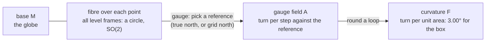
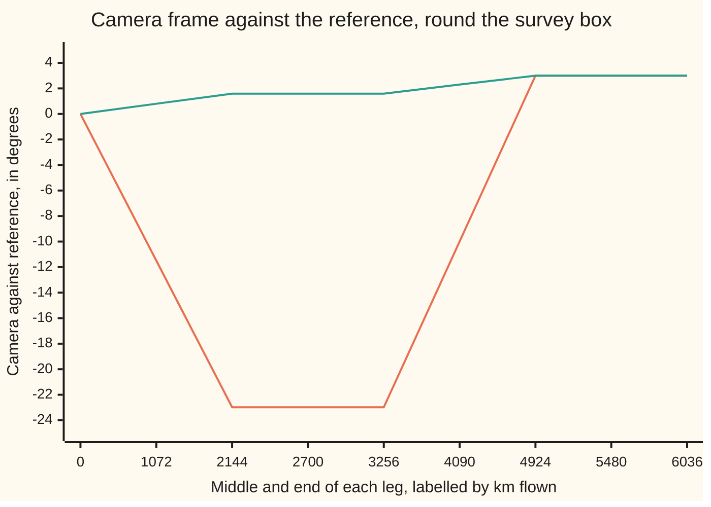

# Principal bundle and connection: a symmetry group attached at every point

[Syllabus](../../../SYLLABUS.md) → [Differential geometry and Lie groups](../README.md) → [Lie Groups](../README.md#s06) → Principal bundle and connection

---

## General Overview

A long-range survey drone flies a box over the North Atlantic. It goes east along 50°N from 30°W to the Greenwich meridian (2144.2 km), north to 60°N (1111.9 km), west along 60°N back to 30°W (1667.9 km), and south home (1111.9 km). That is 6036 km in all.

Its camera sits on a gyro-stabilised gimbal. The gimbal keeps the camera level and never turns it about the local vertical. It also cancels the Earth's own daily spin, which its gyros feel, so only the route turns the camera. At take-off the camera points due north. Back home it points at heading 357.0°: **3.00° west of north**. No motor turned it. The compass frame (north and east at each place) and the carried camera frame have drifted apart.

At every point of the globe sits the set of all level frames, one per heading. Nothing marks one as heading zero; "north" is a choice. The rotation group turns any frame into any other. One copy of a group at every point, like this, is a **principal bundle**.

A **connection** is the rule for carrying a frame along a route. Written against chosen reference frames, such as the compass frames, it becomes a **gauge field** $`A`$: how fast the carried frame turns against the reference, per step. What a closed loop leaves, whatever the references, is set by the **curvature** $`F`$: turn per unit area. The gauge fields of physics, such as the electromagnetic potential, are connections of exactly this kind.

**A principal bundle attaches a copy of a symmetry group at every point; a connection says how to carry an element along a path, a gauge field A writes that rule against chosen reference frames, and its curvature F = dA + A∧A measures the turn a small loop leaves behind, a quantity no choice of reference can remove.**

**What kind of fact this is:** definitions (principal bundle, gauge, connection, curvature), with theorems proved on this card in Why it works: the gauge-change law for A, the small-loop holonomy (no turn plus area times curvature), the rule that a gauge change only turns F, and Stokes' rule for a one-dimensional group, which applies Stokes' theorem from [Stokes on manifolds](../04-Differential%20Forms/06-stokes-theorem-on-manifolds.md) (used, not proved). All are local. The global fact that the sphere's total curvature is exactly 2 turns is [Gauss-Bonnet](../02-Surfaces/10-gauss-bonnet-theorem.md), used here and not proved. The Earth as a sphere of radius 6371 km is a model.

### The picture: what is attached where



Schematic, not to scale. The fibre is the set of choices at one point; the gauge is one choice at every point; the connection compares neighbouring fibres.

---

## The formula

Notation first, in words. The **base** $`M`$ is the space we move over: the globe, or a gimbal's control-stick plane. The **structure group** $`G`$ is the symmetry at each point: $`SO(2)`$, turns in a plane, for the level camera; $`SO(3)`$, all turns in space, for a free gimbal ([Lie group](01-lie-groups-and-matrix-groups.md)). A **gauge** is a choice of reference frame at every point of a patch. Against it, a carried frame is one element $`u`$ of $`G`$.

The **gauge field** $`A`$ is a **one-form** (a rule that eats a velocity and returns a number, here a member of the Lie algebra $`\mathfrak{g}`$, a turn rate). Moving along a route $`\gamma(t)`$ with velocity $`\dot\gamma`$, the carried frame turns, about its own axes, at the rate $`A(\dot\gamma)`$:

```math
u'(t) = u(t)\, A(\dot\gamma(t)), \qquad A = A_x\,dx + A_y\,dy
```

**Read it aloud:** the carried frame changes at the rate the gauge field assigns to the direction of travel; $`A_x`$ is the turn rate per unit move along x, $`A_y`$ along y.

The **curvature** is a **two-form** (a rule that eats a small oriented patch and returns a turn), written with the wedge $`\wedge`$, which marks an oriented area: $`dx \wedge dy`$ is a unit square traversed x first, then y.

```math
F = dA + A \wedge A, \qquad F_{xy} = \partial_x A_y - \partial_y A_x + [A_x, A_y]
```

**Read it aloud:** the curvature is how much A changes across the patch, plus the bracket of A's two parts; the bracket is zero when the group is commutative.

Here $`dA`$ is the **exterior derivative** of $`A`$ (the curl-like part $`\partial_x A_y - \partial_y A_x`$, from [Exterior derivative](../04-Differential%20Forms/03-exterior-derivative.md)), and $`[X, Y] = XY - YX`$ is the bracket from [Lie algebra](02-lie-algebras-and-the-exponential-map.md). Round a small loop enclosing area $`\mathcal{A}`$, measured in the coordinates $`x, y`$, anticlockwise, the carried frame comes back turned by the **holonomy** $`H`$. Here $`I`$ is the identity, no turn:

```math
H \approx I + \mathcal{A}\, F_{xy}
```

**Read it aloud:** a small loop's net turn is the identity plus the area times the curvature.

Changing gauge re-expresses every frame through new references, $`u \mapsto u\,g(x)`$, with $`g(x)`$ in $`G`$ varying from point to point:

```math
A' = g^{-1} A\, g + g^{-1} dg, \qquad F' = g^{-1} F g
```

**Read it aloud:** the gauge field picks up an extra piece from how fast the references twist, but the curvature is only turned, never changed in size.

For the level camera on the globe, in the compass gauge, with $`\varphi`$ the angle down from the North Pole and $`\theta`$ the longitude east:

```math
A = -\cos\varphi\, d\theta, \qquad F = dA = \sin\varphi\, d\varphi \wedge d\theta
```

**Read it aloud:** going east, the camera turns against the compass by minus cosine phi per radian of longitude; the curvature is the globe's area element divided by R squared, so a patch's F is its area times $`K = 1/R^2`$.

| Symbol | Plain meaning | In our example | Push it up and the answer… |
| --- | --- | --- | --- |
| $`M`$, $`G`$, $`\mathfrak{g}`$, $`P`$ | base; structure group; its Lie algebra of turn rates; the bundle, a copy of $`G`$ over each point | globe, $`SO(2)`$; stick plane, $`SO(3)`$ | — |
| $`\varphi`$, $`\theta`$, $`R`$ | angle down from the North Pole; longitude east; Earth radius | box 30° to 40° (60°N to 50°N), 30°W to 0; 6371 km | — |
| $`\gamma`$, $`t`$, $`\dot\gamma`$, $`u`$ | the route; time along it; its velocity; the carried frame against the reference | the 6036 km box | — |
| $`A`$; $`A_\varphi`$, $`A_\theta`$; $`A_x`$, $`A_y`$ | gauge field; its parts per unit move, in rad per rad or per stick unit | $`A_\theta = -0.819152`$ at 55°N (compass) | carried frame turns faster |
| $`dA`$, $`\wedge`$ | exterior derivative; wedge, an oriented area | $`dA = 0`$ for the gimbal | — |
| $`F`$; $`F_{\varphi\theta}`$, $`F_{xy}`$ | curvature two-form; its one part in two dimensions | $`\sin 35^\circ = 0.573576`$; $`0.01\,L_x`$ | bigger loop turn per area |
| $`g`$, $`\alpha`$, $`c`$ | gauge change; for $`SO(2)`$ its angle; grid chart's constant $`\sin 55^\circ`$ | $`\alpha = c(\theta - \theta_m)`$, $`c = 0.819152`$ | changes A, never F's size |
| $`H`$, $`h`$ | holonomy; side of a square loop | 0.009992 rad at $`h = 1`$ | grows as $`h^2`$ |
| $`L_x`$, $`L_y`$, $`L_z`$, $`a`$, $`[X, Y]`$ | unit roll, pitch, yaw rates; gimbal's turn per stick unit; bracket $`XY - YX`$ | $`a = 0.1`$ rad; $`[L_y, L_z] = L_x`$ | holonomy grows as $`a^2`$ |
| $`x`$, $`y`$, $`\theta_m`$, $`I`$ | stick coordinates; the grid chart's central meridian; the identity, no turn | unit square; 15°W | — |
| $`K`$, $`\mathcal{A}`$, $`D`$ | Gaussian curvature $`1/R^2`$; enclosed area in the coordinates; the region inside a loop | 2.463683e-8 per km²; 100 for the 10 by 10 stick square (on the globe the turn is the box's 2124864 km² times $`K`$) | turn grows in step |

Clash said once: $`c`$ here is a chart constant, not the speed of light; $`\mathcal{A}`$ is an area, $`A`$ the gauge field; $`H`$ is the holonomy, not mean curvature or a Hamiltonian; $`F`$ is the curvature two-form, not the first fundamental form's $`F`$.

### When it holds

- **A gauge exists only on a patch.** The compass gauge fails at the poles. Round the pole at 89°N, $`\oint A = -359.945170°`$ but $`\iint F = 0.054830°`$: one whole turn apart.
- **Stokes needs a commutative group.** For $`SO(2)`$, $`\oint A = \iint F`$ exactly. For $`SO(3)`$ on a 10 by 10 square, $`\exp(\mathcal{A}F)`$ predicts 57.2958°; the real loop gives 53.1527°.
- **Small loops for the area rule.** In $`H \approx I + \mathcal{A}F`$, the error per unit area, $`(H - I)/\mathcal{A} - F`$, halves with the side: 0.000501 at $`h = 1`$, 0.000250 at $`h = 0.5`$.
- **A smooth connection.** $`A`$ must be differentiable for $`dA`$ to exist. A reference field with a kink or a jump has no curvature formula there.

---

## Why it works

### Step 0: there is no zero heading, so compare by carrying

A frame on its own has no number; it gets one only once a reference is chosen. Frames at different places can be compared only by carrying one to the other. Changing the references changes $`A`$. But a closed loop starts and ends at the same place, so the turn it leaves cannot depend on the references. That loop turn, per unit area, is the curvature.

### Step 1: the bundle, and a gauge as a choice on a patch

A **principal bundle** with group $`G`$ over $`M`$ is a space $`P`$ with a map down to $`M`$ such that:

- over each point sits a **fibre**, a copy of $`G`$ with no marked identity;
- $`G`$ acts on each fibre, turning any element into any other in exactly one way;
- near each point, $`P`$ looks like (patch of $`M`$) × $`G`$.

For the level camera, $`P`$ is all pairs (place, level frame), and $`G = SO(2)`$. A gauge is a smooth choice of one frame over each point of a patch: true north, or grid north on a chart.

A gauge on the whole globe would be a level arrow at every point, never zero. [Hairy ball theorem](09-vector-field-zeros-and-the-hairy-ball.md) proves no such field exists. So every gauge on the globe fails somewhere; the compass gauge fails at the poles.

### Step 2: the compass gauge field on the globe

Fly east by a small longitude $`d\theta`$ at angle $`\varphi`$ from the pole. The compass frame at the new place is the old one turned about the Earth's axis by $`d\theta`$. At the drone, the Earth's axis has a vertical part $`\cos\varphi`$ and a northward part $`\sin\varphi`$.

So the compass frame turns by $`\cos\varphi\, d\theta`$ about the local vertical and tilts by $`\sin\varphi\, d\theta`$ about north. The gyro gimbal makes the same tilt, to stay level, but no turn about the vertical. Against the compass, the camera therefore turns by $`-\cos\varphi\, d\theta`$. Flying along a meridian, the compass frame only tilts about east, so nothing turns. Hence:

```math
A = -\cos\varphi\, d\theta, \qquad A_\varphi = 0, \quad A_\theta = -\cos\varphi
```

On the box this gives the leg-by-leg turn of the camera against true north:

- east along 50°N: $`-\cos 40^\circ \times 0.523599 = -0.401100`$ rad, that is −22.98°;
- north along 0°: 0;
- west along 60°N: $`+\cos 30^\circ \times 0.523599 = +0.453450`$ rad;
- south along 30°W: 0.

The net is 0.052350 rad, or 3.00° anticlockwise seen from above. That is why the camera ends 3.00° west of north. [Parallel transport](../05-Riemannian%20Geometry/03-parallel-transport-and-holonomy.md) finds the same kind of turn by carrying an arrow in space; this card writes it as a one-form.

### Step 3: changing gauge changes A by a known rule

Re-choose the reference frames so that the same carried frame reads $`u g`$ instead of $`u`$, with $`g(x)`$ in $`G`$ varying from point to point. Differentiate along the route:

```math
(ug)' = uAg + ug' = (ug)\,(g^{-1}Ag + g^{-1}g')
```

So the new gauge field is $`A' = g^{-1}Ag + g^{-1}dg`$. For $`SO(2)`$ everything commutes, and with $`g`$ a turn by angle $`\alpha`$ the rule becomes $`A' = A + d\alpha`$.

A conic aviation chart centred on 55°N, 15°W, draws meridians as straight lines that meet at a point. Its **grid north** differs from true north by the convergence angle $`\alpha = c(\theta - \theta_m)`$, with $`c = \sin 55^\circ = 0.819152`$ ([Snyder 1987](https://doi.org/10.3133/pp1395)). So in the grid gauge

```math
A'_\theta = -\cos\varphi + c
```

At the box centre, 55°N, the compass gauge has $`A_\theta = -0.819152`$ and the grid gauge has $`A'_\theta = 0.000000`$. A gauge can make $`A`$ vanish at a point. The leg turns become 0.027807, 0, 0.024543 and 0 rad. The total is again 0.052350 rad.



Orange: against true north (compass gauge). Teal: against grid north (grid gauge). The marks are the middle and end of each leg, evenly spaced here although the legs differ in length, so the slopes are not to scale in distance. The paths differ; the endpoints agree at 3.00°. That end value is the holonomy, and it belongs to the route, not to the chart.

### Step 4: curvature is what a small loop leaves

Carry a frame anticlockwise round a square of side $`h`$: along x, along y, back along x, back along y. If $`A`$ were constant, the net turn would be

```math
H = e^{hA_x}\, e^{hA_y}\, e^{-hA_x}\, e^{-hA_y} = I + h^2 [A_x, A_y] + (\text{terms of size } h^3)
```

That is the gimbal loop of [Lie algebra](02-lie-algebras-and-the-exponential-map.md). If $`A`$ also varies, the return leg along x runs at height $`y + h`$, where $`A_x`$ has changed by about $`h\,\partial_y A_x`$. The second leg runs at $`x + h`$, where $`A_y`$ has changed by $`h\,\partial_x A_y`$. These add $`h^2(\partial_x A_y - \partial_y A_x)`$. Together:

```math
H = I + h^2 \big(\partial_x A_y - \partial_y A_x + [A_x, A_y]\big) + \cdots = I + h^2 F_{xy} + \cdots
```

<details>
<summary>Detailed proof: the square expands to dA plus the bracket</summary>

Put the square's corner at the origin and write $`A_x`$, $`A_y`$ and their derivatives at the origin. To second order, each leg contributes the exponential of its integrated $`A`$:

$`\displaystyle e^{hA_x + \frac12 h^2 \partial_x A_x},\quad e^{hA_y + h^2\partial_x A_y + \frac12 h^2 \partial_y A_y},\quad e^{-hA_x - h^2\partial_y A_x - \frac12 h^2 \partial_x A_x},\quad e^{-hA_y - \frac12 h^2 \partial_y A_y}.`$

Multiply, keeping terms up to $`h^2`$. The first-order terms cancel. The half-derivative terms cancel in pairs. What remains of the derivatives is $`h^2(\partial_x A_y - \partial_y A_x)`$. The products of first-order terms give $`h^2[A_x, A_y]`$, exactly as in the gimbal loop. So $`H = I + h^2 F_{xy} + O(h^3)`$.

</details>

The gimbal makes this concrete. Push the stick east and the camera pitches 0.1 rad per unit; push it north and the camera yaws 0.1 rad per unit, each about its own axes. So $`A = 0.1\,L_y\,dx + 0.1\,L_z\,dy`$. It is constant, so $`dA = 0`$. Yet

```math
F_{xy} = [0.1\,L_y,\ 0.1\,L_z] = 0.01\,L_x
```

a roll. Run the stick round the unit square: the camera comes back rolled 0.009992 rad (0.572°). A half-size square gives 0.002499 rad, a quarter, as the $`h^2`$ predicts. All of this curvature is the $`A \wedge A`$ term.

### Step 5: a gauge change only turns the curvature

Under $`A' = g^{-1}Ag + g^{-1}dg`$ the curvature becomes $`F' = g^{-1}Fg`$: the same turn, seen from turned references. Its size, and the angle of any loop's holonomy, cannot change.

<details>
<summary>Detailed proof: F' = g⁻¹Fg</summary>

Write $`B = g^{-1}dg`$, so $`dg = gB`$ and $`d(g^{-1}) = -Bg^{-1}`$. Differentiating $`g^{-1}g = I`$ gives the second rule; differentiating $`B`$ gives $`dB = -B \wedge B`$.

Then $`d(g^{-1}Ag) = g^{-1}(dA)g - B \wedge g^{-1}Ag - g^{-1}Ag \wedge B`$. Expanding the square,

$`\displaystyle A' \wedge A' = g^{-1}(A \wedge A)g + g^{-1}Ag \wedge B + B \wedge g^{-1}Ag + B \wedge B.`$

Add $`dA' = d(g^{-1}Ag) + dB`$ to it. The cross terms cancel, and $`B \wedge B`$ cancels $`dB`$. What remains is $`g^{-1}(dA + A \wedge A)g`$.

</details>

For $`SO(2)`$, $`g^{-1}Fg = F`$: the curvature itself is geometric. The check finds $`F_{\varphi\theta} = 0.573576 = \sin 35^\circ`$ at the box centre in both gauges.

For the gimbal, take the new gauge $`g = \exp(0.5\,xy\,L_z)`$. At the stick point (0.5, 0.5), as rotation vectors, $`dA'`$ is (−0.024805, 0.003117, 0) and $`A' \wedge A'`$ is (0.034727, −0.004364, 0). So $`dA = 0`$ was only a choice of gauge. The sum (0.009922, −0.001247, 0) equals $`g^{-1}Fg`$, size 0.010000. The holonomy stepped in the new gauge still turns 0.009992 rad.

### Step 6: Stokes for a circle group, and what the whole sphere counts

For $`SO(2)`$ there is no bracket, so $`F = dA`$, and Stokes' theorem ([Stokes on manifolds](../04-Differential%20Forms/06-stokes-theorem-on-manifolds.md)) gives

```math
\oint_{\partial D} A = \iint_D F
```

for any region $`D`$ on which the gauge is smooth. For the box, both sides are 0.052350 rad. That equals the area 2124864 km² times $`K = 1/R^2`$, so curvature here is Gaussian curvature.

The rule fails where the gauge fails. Round the North Pole at 89°N, the compass gauge gives $`\oint A = -359.945170°`$, but the cap holds $`\iint F = 0.054830°`$. They differ by exactly one turn: true north spins once round the pole. Over the whole sphere,

```math
\iint_{S^2} F = 4\pi = 2 \text{ turns}
```

That integer is the Euler characteristic of the sphere, the content of [Gauss-Bonnet](../02-Surfaces/10-gauss-bonnet-theorem.md). It is the first example of a **characteristic number**: the integral of a **characteristic class** (a closed form built from $`F`$, counted up to exact forms), a whole number that no smooth change of connection can alter. For a circle bundle over a closed surface it is zero exactly when a global gauge exists ([Nakahara](https://doi.org/10.1201/9781315275826), chapter 11).

---

## Worked numbers, by hand

The survey box: 50°N to 60°N, 30°W to 0°, flown anticlockwise seen from above, in the compass gauge.

| Step | Arithmetic | Value |
| --- | --- | --- |
| width in longitude | 30° in radians | 0.523599 rad |
| east leg, at $`\varphi = 40^\circ`$ | $`-\cos 40^\circ \times 0.523599 = -0.766044 \times 0.523599`$ | −0.401100 rad |
| west leg, at $`\varphi = 30^\circ`$ | $`+\cos 30^\circ \times 0.523599 = 0.866025 \times 0.523599`$ | +0.453450 rad |
| north and south legs | $`A_\varphi = 0`$ | 0 |
| loop integral of $`A`$ | $`-0.401100 + 0.453450`$ | 0.052350 rad |
| in degrees | $`0.052350 \times 180/\pi`$ | 2.999429° |
| area of the box | $`0.052350 \times 6371^2`$ km² | 2124864 km² |
| camera heading at home | $`360^\circ - 2.999429^\circ`$ | **357.001°** |

The camera ends 3.00° west of north: the curvature enclosed by 2124864 km² of the Earth, the same in every gauge.

### What breaks if you drop a piece

| Mistake | Comes out at | What went wrong |
| --- | --- | --- |
| drop $`A \wedge A`$ for the gimbal | roll 0.000000 rad; real 0.009992 rad | $`dA = 0`$, but the bracket of the two parts is not |
| Stokes round the pole in the compass gauge | $`\oint A = -359.945170°`$; $`\iint F = 0.054830°`$ | the gauge is undefined at the pole, inside the loop |
| read $`A_\theta`$ at 55°N as a fact about the Earth | −0.819152 (compass), 0.000000 (grid) | $`A`$ depends on the gauge; $`F = 0.573576`$ in both |
| $`\exp(\mathcal{A}F)`$ on a 10 by 10 gimbal square | 57.2958°; real 53.1527° | Stokes needs commuting turns |

The code prints all four.

---

## Code, from first principles, and it actually runs

The programs import only square roots and trigonometry. Part 1 finds the box's holonomy by four independent roads: $`\oint A`$ in the compass gauge, $`\oint A`$ in the grid gauge, $`\iint F`$ on two grids, and a gauge-free carry of the frame in 3D space at two step sizes. Part 2 builds the gimbal's $`SO(3)`$ connection, checks $`H \approx I + h^2F`$ at two sizes, then changes gauge and checks $`F' = g^{-1}Fg`$ and the stepped holonomy.

### Python

```python
# Principal bundle and connection -- the check behind the card.  Nothing is imported but math.
# Part 1, the circle group SO(2) at every point of the globe: a survey drone flies a
# latitude-longitude box; its gyro-held camera frame comes back turned against the compass.
# The turn is found four ways: the line integral of A in two gauges, the area integral
# of F = dA, and a gauge-free carry of the frame in 3D.  Part 2, the group SO(3): a gimbal
# whose connection has dA = 0, so all of its curvature F = dA + A^A is the bracket term.
from math import sin, cos, acos, atan2, sqrt, radians, degrees, pi

R = 6371.0                                           # Earth radius, km (a sphere: a model)
p1, p2, t0, t1 = radians(30), radians(40), radians(-30), 0.0   # 60N, 50N; 30W to 0
c = sin(radians(55))                                 # grid gauge: alpha = c (theta - th_mid)
def A(ph, th, gauge):                                # (A_phi, A_theta) in rad per rad
    return (0.0, -cos(ph) + (c if gauge == "grid" else 0.0))
def f(x): return 0.0 if abs(x) < 5e-9 else x
def legs(n):                                         # the route as (phi, theta) points
    pts = [(p2, t0 + (t1 - t0) * k / n) for k in range(n)] + [(p2 - (p2 - p1) * k / n, t1) for k in range(n)]
    pts += [(p1, t1 - (t1 - t0) * k / n) for k in range(n)] + [(p1 + (p2 - p1) * k / n, t0) for k in range(n)]
    return pts + [(p2, t0)]
def line(gauge, pts):                                # road 1: integral of A along the route, midpoint rule
    out = [0.0]
    for (a, b), (u, v) in zip(pts, pts[1:]):
        Ap, At = A((a + u) / 2, (b + v) / 2, gauge)
        out.append(out[-1] + Ap * (u - a) + At * (v - b))
    return out
def area_F(n, pa, pb, ta, tb):                       # road 2: F = dA = sin(phi) dphi^dtheta, midpoint grid
    hp, ht = (pb - pa) / n, (tb - ta) / n
    return sum(sin(pa + (i + 0.5) * hp) * hp * ht for i in range(n) for j in range(n))
def cap_F(n, pb): return sum(sin((i + 0.5) * pb / n) * pb / n for i in range(n)) * 2 * pi   # F has no theta in it
def xyz(ph, th): return [sin(ph) * cos(th), sin(ph) * sin(th), cos(ph)]
def cross(a, b): return [a[1] * b[2] - a[2] * b[1], a[2] * b[0] - a[0] * b[2], a[0] * b[1] - a[1] * b[0]]
def dot(a, b): return sum(x * y for x, y in zip(a, b))
def unit(a): return [x / sqrt(dot(a, a)) for x in a]
def turn(v, n, t): return [v[i] * cos(t) + cross(n, v)[i] * sin(t) + n[i] * dot(n, v) * (1 - cos(t)) for i in range(3)]
def carry(n):                                        # road 3: gyro frame carried in 3D, no chart, no gauge
    P = [xyz(*q) for q in legs(n)]
    north = [-cos(p2) * cos(t0), -cos(p2) * sin(t0), sin(p2)]
    v = north[:]
    for a, b in zip(P, P[1:]): v = turn(v, unit(cross(a, b)), acos(min(1.0, dot(a, b))))
    return atan2(dot(cross(north, v), P[0]), dot(north, v))

d = t1 - t0
exact = d * (cos(p1) - cos(p2))
print(f"box 50N-60N, 30W-0: legs {R * sin(p2) * d:.1f}, {R * (p2 - p1):.1f}, {R * sin(p1) * d:.1f}, {R * (p2 - p1):.1f} km; area {R * R * exact:.0f} km^2")
pm, tm = (p1 + p2) / 2, (t0 + t1) / 2
print(f"A_theta at the box centre 55N: compass gauge {A(pm, tm, 'compass')[1]:.6f}, grid gauge {f(A(pm, tm, 'grid')[1]):.6f}")
for g in ("compass", "grid"):
    s = line(g, legs(400))
    print(f"{g:7} gauge, integral of A by leg: {s[400]:.6f}, {s[800] - s[400]:.6f}, {s[1200] - s[800]:.6f}, {s[1600] - s[1200]:.6f}; total {s[1600]:.6f} rad")
print(f"closed form d theta (cos 30 - cos 40) = {exact:.6f} rad = {degrees(exact):.6f} deg")
print(f"by hand: d theta {d:.6f} rad, cos 30 deg {cos(p1):.6f}, cos 40 deg {cos(p2):.6f}, c = sin 55 deg {c:.6f}, K = {1e8 / R ** 2:.6f}e-8 per km^2; camera heading {360 - degrees(exact):.3f} deg")
F20, F40 = area_F(20, p1, p2, t0, t1), area_F(40, p1, p2, t0, t1)
print(f"area integral of F: 20x20 grid {F20:.9f}, 40x40 {F40:.9f}; error ratio {(F20 - exact) / (F40 - exact):.2f}")
c50, c100 = carry(50), carry(100)
print(f"3D carry: 50 steps a leg {c50:.9f}, 100 steps {c100:.9f}; error ratio {(c50 - exact) / (c100 - exact):.2f}")
e = 1e-5                                             # F_phi_theta = d_phi A_theta - d_theta A_phi, both gauges
Fd = [(A(pm + e, tm, g)[1] - A(pm - e, tm, g)[1] - A(pm, tm + e, g)[0] + A(pm, tm - e, g)[0]) / (2 * e) for g in ("compass", "grid")]
print(f"F at the centre by differences: compass {Fd[0]:.6f}, grid {Fd[1]:.6f}; sin 35 deg = {sin(pm):.6f}")
pts = legs(400)
sc, sg = line("compass", pts), line("grid", pts)
km = [0.0]
for (a, b), (u, v) in zip(pts, pts[1:]): km.append(km[-1] + R * sqrt((u - a) ** 2 + (sin((a + u) / 2) * (v - b)) ** 2))
idx = list(range(0, 1601, 200))
print("chart, km     " + " ".join(f"{km[i]:6.0f}" for i in idx))
print("chart, compass" + " ".join(f"{degrees(sc[i]):7.2f}" for i in idx))
print("chart, grid   " + " ".join(f"{degrees(sg[i]):7.2f}" for i in idx))
q = radians(1)                                       # a loop round the pole at 89N
cap_line, cap_area = -2 * pi * cos(q), cap_F(1000, q)
print(f"loop at 89N: integral of A (compass) {degrees(cap_line):.6f} deg; area integral of F {degrees(cap_area):.6f} deg; gap {degrees(cap_line - cap_area):.6f}")
whole = cap_F(2000, pi)
print(f"whole sphere: integral of F = {whole:.6f} = {whole / (2 * pi):.6f} turns")

I = [[float(i == j) for j in range(3)] for i in range(3)]
def mul(a, b): return [[sum(a[i][k] * b[k][j] for k in range(3)) for j in range(3)] for i in range(3)]
def lin(a, b, s): return [[a[i][j] + s * b[i][j] for j in range(3)] for i in range(3)]
def sm(a, s): return lin([[0.0] * 3 for _ in range(3)], a, s)
def tr(a): return [[a[j][i] for j in range(3)] for i in range(3)]
def hat(w): return [[0.0, -w[2], w[1]], [w[2], 0.0, -w[0]], [-w[1], w[0], 0.0]]
def vee(m): return (m[2][1], m[0][2], m[1][0])
def br(x, y): return lin(mul(x, y), mul(y, x), -1.0)
def gap(a, b): return max(abs(a[i][j] - b[i][j]) for i in range(3) for j in range(3))
def ang(r): return acos(max(-1.0, min(1.0, (r[0][0] + r[1][1] + r[2][2] - 1) / 2)))
def expm(x):
    s, t = [r[:] for r in I], [r[:] for r in I]
    for k in range(1, 40): t = sm(mul(t, x), 1.0 / k); s = lin(s, t, 1.0)
    return s
def fv(v): return "(" + ", ".join(f"{f(x):.6f}" for x in v) + ")"
Ly, Lz, a = hat((0, 1, 0)), hat((0, 0, 1)), 0.1
Ax, Ay = sm(Ly, a), sm(Lz, a)                        # stick east pitches, stick north yaws, 0.1 rad per unit
F = br(Ax, Ay)                                       # dA = 0 here, so F = [A_x, A_y]
print(f"gimbal: A_x = 0.1 Ly, A_y = 0.1 Lz; dA = 0; F_xy = [A_x, A_y] = {fv(vee(F))} (a roll)")
def square(h): return mul(mul(expm(sm(Ax, h)), expm(sm(Ay, h))), mul(expm(sm(Ax, -h)), expm(sm(Ay, -h))))
gs = []
for h in (1.0, 0.5):
    C = square(h)
    gs.append(gap(sm(lin(C, I, -1.0), 1 / h ** 2), F))
    print(f"square of side {h}: holonomy turn {ang(C):.6f} rad = {degrees(ang(C)):.6f} deg; I + h^2 F predicts {h * h * a * a:.6f}; (H - I)/h^2 - F {gs[-1]:.6f}")
print(f"error ratio {gs[0] / gs[1]:.2f}")
b = 0.5                                              # gauge change g = exp(0.5 x y Lz)
def Ap(x, y):
    g = expm(sm(Lz, b * x * y)); gi = tr(g)                     # g^-1 A g + g^-1 dg
    return lin(mul(mul(gi, Ax), g), Lz, b * y), lin(mul(mul(gi, Ay), g), Lz, b * x)    # g^-1 A g + g^-1 dg
x0, y0, e = 0.5, 0.5, 1e-5
dAp = lin(lin(Ap(x0 + e, y0)[1], Ap(x0 - e, y0)[1], -1.0), lin(Ap(x0, y0 + e)[0], Ap(x0, y0 - e)[0], -1.0), -1.0)
dAp = sm(dAp, 1 / (2 * e))
AAp = br(*Ap(x0, y0))
Fp = lin(dAp, AAp, 1.0)
g0 = expm(sm(Lz, b * x0 * y0))
print(f"new gauge at (0.5, 0.5): A'_y = {fv(vee(Ap(x0, y0)[1]))}; dA' part {fv(vee(dAp))}, A'^A' part {fv(vee(AAp))}")
print(f"F' = {fv(vee(Fp))}; g^-1 F g = {fv(vee(mul(mul(tr(g0), F), g0)))}; size {sqrt(sum(x * x for x in vee(Fp))):.6f}")
def stepped(n):                                      # holonomy in the new gauge, path-ordered, midpoint steps
    H, h = [r[:] for r in I], 1.0 / n
    for (dx, dy, x, y) in [(1, 0, 0, 0), (0, 1, 1, 0), (-1, 0, 1, 1), (0, -1, 0, 1)]:
        for k in range(n):
            ax, ay = Ap(x + dx * (k + 0.5) * h, y + dy * (k + 0.5) * h)
            H = mul(H, expm(lin(sm(ax, dx * h), ay, dy * h)))
    return H
C1 = square(1.0)
H50, H100 = stepped(50), stepped(100)
print(f"new gauge, stepped holonomy: 50 steps a side off by {gap(H50, C1):.9f}, 100 off by {gap(H100, C1):.9f}; ratio {gap(H50, C1) / gap(H100, C1):.2f}; turn {ang(H100):.6f} rad")
big = square(10.0)
print(f"mistake, drop A^A: predicted roll 0.000000 rad; real {ang(C1):.6f} rad")
print(f"mistake, exp(area x F) on a 10 x 10 square: {degrees(ang(expm(sm(F, 100.0)))):.4f} deg; real holonomy {degrees(ang(big)):.4f} deg")
Ax, Ay = sm(Ly, 0.2), sm(Lz, 0.2)
print(f"try, a = 0.2: square of side 1 turns {ang(square(1.0)):.6f} rad")
print(f"try, box 0N-10N: {degrees(d * (cos(radians(80)) - cos(radians(90)))):.6f} deg; box 60 deg wide: {degrees(2 * exact):.6f} deg")

assert abs(line("compass", legs(400))[-1] - exact) < 1e-6 and abs(line("grid", legs(400))[-1] - exact) < 1e-6
assert 3.9 < (F20 - exact) / (F40 - exact) < 4.1 and abs(F40 - exact) < 1e-5     # Stokes, by area
assert 3.9 < (c50 - exact) / (c100 - exact) < 4.1 and abs(c100 - exact) < 1e-6   # gauge-free carry
assert abs(Fd[0] - sin(pm)) < 1e-8 and abs(Fd[1] - sin(pm)) < 1e-8 and abs(A(pm, tm, "grid")[1]) < 1e-12   # grid A = 0 at 55N
assert abs(abs(cap_line - cap_area) - 2 * pi) < 1e-6 and abs(whole - 4 * pi) < 1e-5
assert 1.95 < gs[0] / gs[1] < 2.05 and abs(ang(C1) - 0.01) < 1e-4               # holonomy -> I + h^2 F
assert gap(Fp, mul(mul(tr(g0), F), g0)) < 1e-8 and gap(H100, C1) < 1e-5
print("ALL CHECKS PASS")
```

**Ran 2026-11-19 on macOS, Python 3.14.10, standard library only. All checks passed. Output, pasted from the run:**

```
box 50N-60N, 30W-0: legs 2144.2, 1111.9, 1667.9, 1111.9 km; area 2124864 km^2
A_theta at the box centre 55N: compass gauge -0.819152, grid gauge 0.000000
compass gauge, integral of A by leg: -0.401100, 0.000000, 0.453450, 0.000000; total 0.052350 rad
grid    gauge, integral of A by leg: 0.027807, 0.000000, 0.024543, 0.000000; total 0.052350 rad
closed form d theta (cos 30 - cos 40) = 0.052350 rad = 2.999429 deg
by hand: d theta 0.523599 rad, cos 30 deg 0.866025, cos 40 deg 0.766044, c = sin 55 deg 0.819152, K = 2.463683e-8 per km^2; camera heading 357.001 deg
area integral of F: 20x20 grid 0.052350075, 40x40 0.052349950; error ratio 4.00
3D carry: 50 steps a leg 0.052349430, 100 steps 0.052349789; error ratio 4.00
F at the centre by differences: compass 0.573576, grid 0.573576; sin 35 deg = 0.573576
chart, km          0   1072   2144   2700   3256   4090   4924   5480   6036
chart, compass   0.00  -11.49  -22.98  -22.98  -22.98   -9.99    3.00    3.00    3.00
chart, grid      0.00    0.80    1.59    1.59    1.59    2.30    3.00    3.00    3.00
loop at 89N: integral of A (compass) -359.945170 deg; area integral of F 0.054830 deg; gap -360.000000
whole sphere: integral of F = 12.566372 = 2.000000 turns
gimbal: A_x = 0.1 Ly, A_y = 0.1 Lz; dA = 0; F_xy = [A_x, A_y] = (0.010000, 0.000000, 0.000000) (a roll)
square of side 1.0: holonomy turn 0.009992 rad = 0.572481 deg; I + h^2 F predicts 0.010000; (H - I)/h^2 - F 0.000501
square of side 0.5: holonomy turn 0.002499 rad = 0.143210 deg; I + h^2 F predicts 0.002500; (H - I)/h^2 - F 0.000250
error ratio 2.00
new gauge at (0.5, 0.5): A'_y = (0.000000, 0.000000, 0.350000); dA' part (-0.024805, 0.003117, 0.000000), A'^A' part (0.034727, -0.004364, 0.000000)
F' = (0.009922, -0.001247, 0.000000); g^-1 F g = (0.009922, -0.001247, 0.000000); size 0.010000
new gauge, stepped holonomy: 50 steps a side off by 0.000000415, 100 off by 0.000000104; ratio 4.00; turn 0.009992 rad
mistake, drop A^A: predicted roll 0.000000 rad; real 0.009992 rad
mistake, exp(area x F) on a 10 x 10 square: 57.2958 deg; real holonomy 53.1527 deg
try, a = 0.2: square of side 1 turns 0.039868 rad
try, box 0N-10N: 5.209445 deg; box 60 deg wide: 5.998858 deg
ALL CHECKS PASS
```

### Rust

Same numbers, same labels, built with `rustc --edition 2021 -O`.

```rust
// Principal bundle and connection -- the same check as the Python, in Rust.  No crates.
// Part 1, the circle group SO(2) at every point of the globe: a survey drone flies a
// latitude-longitude box; its gyro-held camera frame comes back turned against the compass.
// The turn is found four ways: the line integral of A in two gauges, the area integral
// of F = dA, and a gauge-free carry of the frame in 3D.  Part 2, the group SO(3): a gimbal
// whose connection has dA = 0, so all of its curvature F = dA + A^A is the bracket term.
use std::f64::consts::PI;
type V = [f64; 3];
type M = [[f64; 3]; 3];
const R: f64 = 6371.0; // Earth radius, km (a sphere: a model)

fn f(x: f64) -> f64 { if x.abs() < 5e-9 { 0.0 } else { x } }
fn a_sph(ph: f64, _th: f64, grid: bool, c: f64) -> (f64, f64) { (0.0, -ph.cos() + if grid { c } else { 0.0 }) }
fn legs(n: usize, p1: f64, p2: f64, t0: f64, t1: f64) -> Vec<(f64, f64)> {
    let k = |i: usize| i as f64 / n as f64;
    let mut v = Vec::new();
    for i in 0..n { v.push((p2, t0 + (t1 - t0) * k(i))) }
    for i in 0..n { v.push((p2 - (p2 - p1) * k(i), t1)) }
    for i in 0..n { v.push((p1, t1 - (t1 - t0) * k(i))) }
    for i in 0..n { v.push((p1 + (p2 - p1) * k(i), t0)) }
    v.push((p2, t0));
    v
}
fn line(grid: bool, c: f64, pts: &[(f64, f64)]) -> Vec<f64> { // road 1: integral of A, midpoint rule
    let mut out = vec![0.0];
    for w in pts.windows(2) {
        let ((a, b), (u, v)) = (w[0], w[1]);
        let (ap, at) = a_sph((a + u) / 2.0, (b + v) / 2.0, grid, c);
        let last = out[out.len() - 1];
        out.push(last + ap * (u - a) + at * (v - b));
    }
    out
}
fn area_f(n: usize, pa: f64, pb: f64, ta: f64, tb: f64) -> f64 { // road 2: F = sin(phi) dphi^dtheta
    let (hp, ht) = ((pb - pa) / n as f64, (tb - ta) / n as f64);
    let mut s = 0.0;
    for i in 0..n { for _j in 0..n { s += (pa + (i as f64 + 0.5) * hp).sin() * hp * ht } }
    s
}
fn cap_f(n: usize, pb: f64) -> f64 { (0..n).map(|i| ((i as f64 + 0.5) * pb / n as f64).sin() * pb / n as f64).sum::<f64>() * 2.0 * PI }
fn xyz(ph: f64, th: f64) -> V { [ph.sin() * th.cos(), ph.sin() * th.sin(), ph.cos()] }
fn cross(a: V, b: V) -> V { [a[1] * b[2] - a[2] * b[1], a[2] * b[0] - a[0] * b[2], a[0] * b[1] - a[1] * b[0]] }
fn dot(a: V, b: V) -> f64 { a[0] * b[0] + a[1] * b[1] + a[2] * b[2] }
fn unit(a: V) -> V { let n = dot(a, a).sqrt(); [a[0] / n, a[1] / n, a[2] / n] }
fn turn(v: V, n: V, t: f64) -> V {
    let (cv, d) = (cross(n, v), dot(n, v));
    [0, 1, 2].map(|i| v[i] * t.cos() + cv[i] * t.sin() + n[i] * d * (1.0 - t.cos()))
}
fn carry(n: usize, p1: f64, p2: f64, t0: f64, t1: f64) -> f64 { // road 3: gyro frame carried in 3D
    let pts: Vec<V> = legs(n, p1, p2, t0, t1).iter().map(|&(a, b)| xyz(a, b)).collect();
    let north = [-p2.cos() * t0.cos(), -p2.cos() * t0.sin(), p2.sin()];
    let mut v = north;
    for w in pts.windows(2) { v = turn(v, unit(cross(w[0], w[1])), dot(w[0], w[1]).min(1.0).acos()) }
    dot(cross(north, v), pts[0]).atan2(dot(north, v))
}
const I3: M = [[1.0, 0.0, 0.0], [0.0, 1.0, 0.0], [0.0, 0.0, 1.0]];
fn mul(a: &M, b: &M) -> M { let mut z = [[0.0; 3]; 3]; for i in 0..3 { for j in 0..3 { for k in 0..3 { z[i][j] += a[i][k] * b[k][j] } } } z }
fn lin(a: &M, b: &M, s: f64) -> M { let mut z = *a; for i in 0..3 { for j in 0..3 { z[i][j] += s * b[i][j] } } z }
fn sm(a: &M, s: f64) -> M { lin(&[[0.0; 3]; 3], a, s) }
fn tr(a: &M) -> M { let mut z = *a; for i in 0..3 { for j in 0..3 { z[i][j] = a[j][i] } } z }
fn hat(w: V) -> M { [[0.0, -w[2], w[1]], [w[2], 0.0, -w[0]], [-w[1], w[0], 0.0]] }
fn vee(m: &M) -> V { [m[2][1], m[0][2], m[1][0]] }
fn br(x: &M, y: &M) -> M { lin(&mul(x, y), &mul(y, x), -1.0) }
fn gap(a: &M, b: &M) -> f64 { let mut g: f64 = 0.0; for i in 0..3 { for j in 0..3 { g = g.max((a[i][j] - b[i][j]).abs()) } } g }
fn ang(r: &M) -> f64 { ((r[0][0] + r[1][1] + r[2][2] - 1.0) / 2.0).max(-1.0).min(1.0).acos() }
fn expm(x: &M) -> M { let (mut s, mut t) = (I3, I3); for k in 1..40 { t = sm(&mul(&t, x), 1.0 / k as f64); s = lin(&s, &t, 1.0) } s }
fn fv(v: V) -> String { format!("({:.6}, {:.6}, {:.6})", f(v[0]), f(v[1]), f(v[2])) }
fn square(ax: &M, ay: &M, h: f64) -> M {
    mul(&mul(&expm(&sm(ax, h)), &expm(&sm(ay, h))), &mul(&expm(&sm(ax, -h)), &expm(&sm(ay, -h))))
}
fn ap(ax: &M, ay: &M, lz: &M, b: f64, x: f64, y: f64) -> (M, M) { // g^-1 A g + g^-1 dg, g = exp(b x y Lz)
    let g = expm(&sm(lz, b * x * y));
    let gi = tr(&g);
    (lin(&mul(&mul(&gi, ax), &g), lz, b * y), lin(&mul(&mul(&gi, ay), &g), lz, b * x))
}

fn main() {
    let (p1, p2, t0, t1) = (30f64.to_radians(), 40f64.to_radians(), (-30f64).to_radians(), 0.0);
    let c = 55f64.to_radians().sin();
    let d = t1 - t0;
    let exact = d * (p1.cos() - p2.cos());
    println!("box 50N-60N, 30W-0: legs {:.1}, {:.1}, {:.1}, {:.1} km; area {:.0} km^2", R * p2.sin() * d, R * (p2 - p1), R * p1.sin() * d, R * (p2 - p1), R * R * exact);
    let (pm, tm) = ((p1 + p2) / 2.0, (t0 + t1) / 2.0);
    println!("A_theta at the box centre 55N: compass gauge {:.6}, grid gauge {:.6}", a_sph(pm, tm, false, c).1, f(a_sph(pm, tm, true, c).1));
    let pts = legs(400, p1, p2, t0, t1);
    let (sc, sg) = (line(false, c, &pts), line(true, c, &pts));
    for (name, s) in [("compass", &sc), ("grid", &sg)] {
        println!("{:7} gauge, integral of A by leg: {:.6}, {:.6}, {:.6}, {:.6}; total {:.6} rad", name, s[400], s[800] - s[400], s[1200] - s[800], s[1600] - s[1200], s[1600]);
    }
    println!("closed form d theta (cos 30 - cos 40) = {:.6} rad = {:.6} deg", exact, exact.to_degrees());
    println!("by hand: d theta {:.6} rad, cos 30 deg {:.6}, cos 40 deg {:.6}, c = sin 55 deg {:.6}, K = {:.6}e-8 per km^2; camera heading {:.3} deg", d, p1.cos(), p2.cos(), c, 1e8 / (R * R), 360.0 - exact.to_degrees());
    let (f20, f40) = (area_f(20, p1, p2, t0, t1), area_f(40, p1, p2, t0, t1));
    println!("area integral of F: 20x20 grid {:.9}, 40x40 {:.9}; error ratio {:.2}", f20, f40, (f20 - exact) / (f40 - exact));
    let (c50, c100) = (carry(50, p1, p2, t0, t1), carry(100, p1, p2, t0, t1));
    println!("3D carry: 50 steps a leg {:.9}, 100 steps {:.9}; error ratio {:.2}", c50, c100, (c50 - exact) / (c100 - exact));
    let e = 1e-5;
    let fd: Vec<f64> = [false, true].iter().map(|&g| (a_sph(pm + e, tm, g, c).1 - a_sph(pm - e, tm, g, c).1 - a_sph(pm, tm + e, g, c).0 + a_sph(pm, tm - e, g, c).0) / (2.0 * e)).collect();
    println!("F at the centre by differences: compass {:.6}, grid {:.6}; sin 35 deg = {:.6}", fd[0], fd[1], pm.sin());
    let mut km = vec![0.0];
    for w in pts.windows(2) {
        let ((a, b), (u, v)) = (w[0], w[1]);
        let last = km[km.len() - 1];
        km.push(last + R * ((u - a).powi(2) + (((a + u) / 2.0).sin() * (v - b)).powi(2)).sqrt());
    }
    let idx: Vec<usize> = (0..=1600).step_by(200).collect();
    println!("chart, km     {}", idx.iter().map(|&i| format!("{:6.0}", km[i])).collect::<Vec<_>>().join(" "));
    println!("chart, compass{}", idx.iter().map(|&i| format!("{:7.2}", sc[i].to_degrees())).collect::<Vec<_>>().join(" "));
    println!("chart, grid   {}", idx.iter().map(|&i| format!("{:7.2}", sg[i].to_degrees())).collect::<Vec<_>>().join(" "));
    let q = 1f64.to_radians();
    let (cap_line, cap_area) = (-2.0 * PI * q.cos(), cap_f(1000, q));
    println!("loop at 89N: integral of A (compass) {:.6} deg; area integral of F {:.6} deg; gap {:.6}", cap_line.to_degrees(), cap_area.to_degrees(), (cap_line - cap_area).to_degrees());
    let whole = cap_f(2000, PI);
    println!("whole sphere: integral of F = {:.6} = {:.6} turns", whole, whole / (2.0 * PI));

    let (ly, lz, a) = (hat([0.0, 1.0, 0.0]), hat([0.0, 0.0, 1.0]), 0.1);
    let (ax, ay) = (sm(&ly, a), sm(&lz, a)); // stick east pitches, stick north yaws, 0.1 rad per unit
    let fm = br(&ax, &ay); // dA = 0 here, so F = [A_x, A_y]
    println!("gimbal: A_x = 0.1 Ly, A_y = 0.1 Lz; dA = 0; F_xy = [A_x, A_y] = {} (a roll)", fv(vee(&fm)));
    let mut gs = Vec::new();
    for h in [1.0f64, 0.5] {
        let cc = square(&ax, &ay, h);
        gs.push(gap(&sm(&lin(&cc, &I3, -1.0), 1.0 / (h * h)), &fm));
        println!("square of side {:.1}: holonomy turn {:.6} rad = {:.6} deg; I + h^2 F predicts {:.6}; (H - I)/h^2 - F {:.6}", h, ang(&cc), ang(&cc).to_degrees(), h * h * a * a, gs[gs.len() - 1]);
    }
    println!("error ratio {:.2}", gs[0] / gs[1]);
    let b = 0.5; // gauge change g = exp(0.5 x y Lz)
    let (x0, y0) = (0.5, 0.5);
    let apf = |x: f64, y: f64| ap(&ax, &ay, &lz, b, x, y);
    let dap = sm(&lin(&lin(&apf(x0 + e, y0).1, &apf(x0 - e, y0).1, -1.0), &lin(&apf(x0, y0 + e).0, &apf(x0, y0 - e).0, -1.0), -1.0), 1.0 / (2.0 * e));
    let (a0x, a0y) = apf(x0, y0);
    let aap = br(&a0x, &a0y);
    let fp = lin(&dap, &aap, 1.0);
    let g0 = expm(&sm(&lz, b * x0 * y0));
    let gfg = mul(&mul(&tr(&g0), &fm), &g0);
    let fpv = vee(&fp);
    println!("new gauge at (0.5, 0.5): A'_y = {}; dA' part {}, A'^A' part {}", fv(vee(&a0y)), fv(vee(&dap)), fv(vee(&aap)));
    println!("F' = {}; g^-1 F g = {}; size {:.6}", fv(fpv), fv(vee(&gfg)), dot(fpv, fpv).sqrt());
    let stepped = |n: usize| -> M { // holonomy in the new gauge, path-ordered, midpoint steps
        let (mut hm, h) = (I3, 1.0 / n as f64);
        for (dx, dy, x, y) in [(1.0, 0.0, 0.0, 0.0), (0.0, 1.0, 1.0, 0.0), (-1.0, 0.0, 1.0, 1.0), (0.0, -1.0, 0.0, 1.0)] {
            for k in 0..n {
                let (bx, by) = apf(x + dx * (k as f64 + 0.5) * h, y + dy * (k as f64 + 0.5) * h);
                hm = mul(&hm, &expm(&lin(&sm(&bx, dx * h), &by, dy * h)));
            }
        }
        hm
    };
    let c1 = square(&ax, &ay, 1.0);
    let (h50, h100) = (stepped(50), stepped(100));
    println!("new gauge, stepped holonomy: 50 steps a side off by {:.9}, 100 off by {:.9}; ratio {:.2}; turn {:.6} rad", gap(&h50, &c1), gap(&h100, &c1), gap(&h50, &c1) / gap(&h100, &c1), ang(&h100));
    let big = square(&ax, &ay, 10.0);
    println!("mistake, drop A^A: predicted roll 0.000000 rad; real {:.6} rad", ang(&c1));
    println!("mistake, exp(area x F) on a 10 x 10 square: {:.4} deg; real holonomy {:.4} deg", ang(&expm(&sm(&fm, 100.0))).to_degrees(), ang(&big).to_degrees());
    println!("try, a = 0.2: square of side 1 turns {:.6} rad", ang(&square(&sm(&ly, 0.2), &sm(&lz, 0.2), 1.0)));
    println!("try, box 0N-10N: {:.6} deg; box 60 deg wide: {:.6} deg", (d * (80f64.to_radians().cos() - 90f64.to_radians().cos())).to_degrees(), (2.0 * exact).to_degrees());

    assert!((sc[1600] - exact).abs() < 1e-6 && (sg[1600] - exact).abs() < 1e-6);
    let r2 = (f20 - exact) / (f40 - exact);
    assert!(3.9 < r2 && r2 < 4.1 && (f40 - exact).abs() < 1e-5); // Stokes, by area
    let r3 = (c50 - exact) / (c100 - exact);
    assert!(3.9 < r3 && r3 < 4.1 && (c100 - exact).abs() < 1e-6); // gauge-free carry
    assert!((fd[0] - pm.sin()).abs() < 1e-8 && (fd[1] - pm.sin()).abs() < 1e-8 && a_sph(pm, tm, true, c).1.abs() < 1e-12); // grid A = 0 at 55N
    assert!(((cap_line - cap_area).abs() - 2.0 * PI).abs() < 1e-6 && (whole - 4.0 * PI).abs() < 1e-5);
    assert!(1.95 < gs[0] / gs[1] && gs[0] / gs[1] < 2.05 && (ang(&c1) - 0.01).abs() < 1e-4); // holonomy -> I + h^2 F
    assert!(gap(&fp, &gfg) < 1e-8 && gap(&h100, &c1) < 1e-5);
    println!("ALL CHECKS PASS");
}
```

**Ran 2026-11-19 on macOS, rustc 1.98.1, no crates. All checks passed. Output, pasted from the run:**

```
box 50N-60N, 30W-0: legs 2144.2, 1111.9, 1667.9, 1111.9 km; area 2124864 km^2
A_theta at the box centre 55N: compass gauge -0.819152, grid gauge 0.000000
compass gauge, integral of A by leg: -0.401100, 0.000000, 0.453450, 0.000000; total 0.052350 rad
grid    gauge, integral of A by leg: 0.027807, 0.000000, 0.024543, 0.000000; total 0.052350 rad
closed form d theta (cos 30 - cos 40) = 0.052350 rad = 2.999429 deg
by hand: d theta 0.523599 rad, cos 30 deg 0.866025, cos 40 deg 0.766044, c = sin 55 deg 0.819152, K = 2.463683e-8 per km^2; camera heading 357.001 deg
area integral of F: 20x20 grid 0.052350075, 40x40 0.052349950; error ratio 4.00
3D carry: 50 steps a leg 0.052349430, 100 steps 0.052349789; error ratio 4.00
F at the centre by differences: compass 0.573576, grid 0.573576; sin 35 deg = 0.573576
chart, km          0   1072   2144   2700   3256   4090   4924   5480   6036
chart, compass   0.00  -11.49  -22.98  -22.98  -22.98   -9.99    3.00    3.00    3.00
chart, grid      0.00    0.80    1.59    1.59    1.59    2.30    3.00    3.00    3.00
loop at 89N: integral of A (compass) -359.945170 deg; area integral of F 0.054830 deg; gap -360.000000
whole sphere: integral of F = 12.566372 = 2.000000 turns
gimbal: A_x = 0.1 Ly, A_y = 0.1 Lz; dA = 0; F_xy = [A_x, A_y] = (0.010000, 0.000000, 0.000000) (a roll)
square of side 1.0: holonomy turn 0.009992 rad = 0.572481 deg; I + h^2 F predicts 0.010000; (H - I)/h^2 - F 0.000501
square of side 0.5: holonomy turn 0.002499 rad = 0.143210 deg; I + h^2 F predicts 0.002500; (H - I)/h^2 - F 0.000250
error ratio 2.00
new gauge at (0.5, 0.5): A'_y = (0.000000, 0.000000, 0.350000); dA' part (-0.024805, 0.003117, 0.000000), A'^A' part (0.034727, -0.004364, 0.000000)
F' = (0.009922, -0.001247, 0.000000); g^-1 F g = (0.009922, -0.001247, 0.000000); size 0.010000
new gauge, stepped holonomy: 50 steps a side off by 0.000000415, 100 off by 0.000000104; ratio 4.00; turn 0.009992 rad
mistake, drop A^A: predicted roll 0.000000 rad; real 0.009992 rad
mistake, exp(area x F) on a 10 x 10 square: 57.2958 deg; real holonomy 53.1527 deg
try, a = 0.2: square of side 1 turns 0.039868 rad
try, box 0N-10N: 5.209445 deg; box 60 deg wide: 5.998858 deg
ALL CHECKS PASS
```

The two outputs match line for line.

### Lean

Lean proves the gauge-change rule for curvature, the small-loop rule for a constant gauge field, and Stokes for a circle group on a rectangle.

- Take a smooth gauge field $`A`$ and a smooth gauge change $`g`$ on a patch, in any matrix group. Then $`A' = g^{-1}Ag + g^{-1}dg`$ has curvature $`F' = g^{-1}Fg`$.
- Take a constant gauge field, and carry a frame round a square of side $`h`$. Then the turn is $`I + h^2 [A_x, A_y]`$ plus terms of size $`h^3`$.
- Take a circle group, such as $`SO(2)`$, and a smooth gauge field on a rectangle in the coordinates. Then $`\oint A = \iint F`$, going round the rectangle anticlockwise.
- Take the unit rates $`L_y`$ and $`L_z`$. Then $`[L_y, L_z] = L_x`$ exactly: pitch then yaw leaves a roll.
- Take the gimbal, with $`A_x = 0.1\,L_y`$ and $`A_y = 0.1\,L_z`$. Then $`[A_x, A_y] = 0.01\,L_x`$ exactly, a roll.

The globe's numbers, the loop round the pole and small loops with a varying $`A`$ are left to the Python and Rust checks.

```lean
-- Principal bundle and connection: on a coordinate patch, a gauge change turns the curvature F = dA + A ∧ A into g⁻¹ F g, a small square loop leaves I + h² [A_x, A_y], and for a circle group the loop integral of A equals the area integral of F.
import Mathlib.Analysis.Calculus.FDeriv.Basic
import Mathlib.Analysis.Calculus.ContDiff.Defs
import Mathlib.Analysis.Matrix.Normed
import Mathlib.Analysis.Normed.Algebra.MatrixExponential
import Mathlib.MeasureTheory.Integral.DivergenceTheorem
import Mathlib.LinearAlgebra.Matrix.Notation
import Mathlib.Tactic.FinCases
import Mathlib.Analysis.Calculus.FDeriv.Mul
import Mathlib.Analysis.Calculus.FDeriv.CompCLM
import Mathlib.Analysis.Calculus.FDeriv.Symmetric
import Mathlib.Analysis.Calculus.ContDiff.Comp

open Filter Topology NormedSpace


/- Matrices get the operator norm, so that derivatives and the matrix exponential make sense.
Any of Mathlib's matrix norms gives the same topology, so nothing below depends on this choice. -/
attribute [local instance] Matrix.linftyOpNormedRing Matrix.linftyOpNormedAlgebra

variable {n : ℕ}

/-- Partial derivative along the first coordinate x of the patch. -/
noncomputable def dX {E : Type*} [NormedAddCommGroup E] [NormedSpace ℝ E]
    (f : ℝ × ℝ → E) (p : ℝ × ℝ) : E :=
  fderiv ℝ f p (1, 0)

/-- Partial derivative along the second coordinate y of the patch. -/
noncomputable def dY {E : Type*} [NormedAddCommGroup E] [NormedSpace ℝ E]
    (f : ℝ × ℝ → E) (p : ℝ × ℝ) : E :=
  fderiv ℝ f p (0, 1)

/-- The one part of the curvature two-form on a two-dimensional patch:
`F_xy = ∂_x A_y - ∂_y A_x + [A_x, A_y]`, with the bracket `[X, Y] = XY - YX`. -/
noncomputable def curvatureXY (Ax Ay : ℝ × ℝ → Matrix (Fin n) (Fin n) ℝ) (p : ℝ × ℝ) :
    Matrix (Fin n) (Fin n) ℝ :=
  dX Ay p - dY Ax p + (Ax p * Ay p - Ay p * Ax p)

/-- The x part of the gauge field after the gauge change `g`: `A'_x = g⁻¹ A_x g + g⁻¹ ∂_x g`. -/
noncomputable def gaugeX (g Ax : ℝ × ℝ → Matrix (Fin n) (Fin n) ℝ) (p : ℝ × ℝ) :
    Matrix (Fin n) (Fin n) ℝ :=
  (g p)⁻¹ * Ax p * g p + (g p)⁻¹ * dX g p

/-- The y part of the gauge field after the gauge change `g`: `A'_y = g⁻¹ A_y g + g⁻¹ ∂_y g`. -/
noncomputable def gaugeY (g Ay : ℝ × ℝ → Matrix (Fin n) (Fin n) ℝ) (p : ℝ × ℝ) :
    Matrix (Fin n) (Fin n) ℝ :=
  (g p)⁻¹ * Ay p * g p + (g p)⁻¹ * dY g p

lemma dX_mul' {a b : ℝ × ℝ → Matrix (Fin n) (Fin n) ℝ} {p : ℝ × ℝ}
    (ha : DifferentiableAt ℝ a p) (hb : DifferentiableAt ℝ b p) :
    dX (fun q => a q * b q) p = a p * dX b p + dX a p * b p := by
  unfold dX
  erw [fderiv_fun_mul' ha hb]
  rfl

lemma dY_mul' {a b : ℝ × ℝ → Matrix (Fin n) (Fin n) ℝ} {p : ℝ × ℝ}
    (ha : DifferentiableAt ℝ a p) (hb : DifferentiableAt ℝ b p) :
    dY (fun q => a q * b q) p = a p * dY b p + dY a p * b p := by
  unfold dY
  erw [fderiv_fun_mul' ha hb]
  rfl

lemma dX_add' {a b : ℝ × ℝ → Matrix (Fin n) (Fin n) ℝ} {p : ℝ × ℝ}
    (ha : DifferentiableAt ℝ a p) (hb : DifferentiableAt ℝ b p) :
    dX (fun q => a q + b q) p = dX a p + dX b p := by
  unfold dX
  erw [fderiv_add ha hb]
  rfl

lemma dY_add' {a b : ℝ × ℝ → Matrix (Fin n) (Fin n) ℝ} {p : ℝ × ℝ}
    (ha : DifferentiableAt ℝ a p) (hb : DifferentiableAt ℝ b p) :
    dY (fun q => a q + b q) p = dY a p + dY b p := by
  unfold dY
  erw [fderiv_add ha hb]
  rfl

lemma hasFDerivAt_matrix_inv' {g : ℝ × ℝ → Matrix (Fin n) (Fin n) ℝ} {p : ℝ × ℝ}
    (hg : DifferentiableAt ℝ g p) (hu : IsUnit (g p)) :
    HasFDerivAt (fun q => (g q)⁻¹)
      ((-ContinuousLinearMap.mulLeftRight ℝ (Matrix (Fin n) (Fin n) ℝ) (g p)⁻¹ (g p)⁻¹).comp
        (fderiv ℝ g p)) p := by
  obtain ⟨u, hu⟩ := hu
  have hfun : (fun q => (g q)⁻¹) = Ring.inverse ∘ g :=
    funext fun q => Matrix.nonsing_inv_eq_ringInverse _
  have h1 : HasFDerivAt (Ring.inverse)
      (-ContinuousLinearMap.mulLeftRight ℝ (Matrix (Fin n) (Fin n) ℝ) (g p)⁻¹ (g p)⁻¹) (g p) := by
    rw [← hu, ← Matrix.coe_units_inv]
    exact hasFDerivAt_ringInverse u
  rw [hfun]
  exact h1.comp p hg.hasFDerivAt

lemma differentiableAt_matrix_inv' {g : ℝ × ℝ → Matrix (Fin n) (Fin n) ℝ} {p : ℝ × ℝ}
    (hg : DifferentiableAt ℝ g p) (hu : IsUnit (g p)) :
    DifferentiableAt ℝ (fun q => (g q)⁻¹) p :=
  (hasFDerivAt_matrix_inv' hg hu).differentiableAt

lemma dX_inv' {g : ℝ × ℝ → Matrix (Fin n) (Fin n) ℝ} {p : ℝ × ℝ}
    (hg : DifferentiableAt ℝ g p) (hu : IsUnit (g p)) :
    dX (fun q => (g q)⁻¹) p = -((g p)⁻¹ * dX g p * (g p)⁻¹) := by
  unfold dX
  erw [(hasFDerivAt_matrix_inv' hg hu).fderiv]
  rfl

lemma dY_inv' {g : ℝ × ℝ → Matrix (Fin n) (Fin n) ℝ} {p : ℝ × ℝ}
    (hg : DifferentiableAt ℝ g p) (hu : IsUnit (g p)) :
    dY (fun q => (g q)⁻¹) p = -((g p)⁻¹ * dY g p * (g p)⁻¹) := by
  unfold dY
  erw [(hasFDerivAt_matrix_inv' hg hu).fderiv]
  rfl

lemma fderiv_fderiv_apply' {g : ℝ × ℝ → Matrix (Fin n) (Fin n) ℝ} {p : ℝ × ℝ}
    (h : DifferentiableAt ℝ (fderiv ℝ g) p) (v w : ℝ × ℝ) :
    fderiv ℝ (fun q => fderiv ℝ g q w) p v = fderiv ℝ (fderiv ℝ g) p v w := by
  erw [fderiv_clm_apply h (differentiableAt_const w), fderiv_const]
  exact (congrArg (· + fderiv ℝ (fderiv ℝ g) p v w) (map_zero (fderiv ℝ g p))).trans (zero_add _)

lemma dX_dY_symm' {g : ℝ × ℝ → Matrix (Fin n) (Fin n) ℝ} {p : ℝ × ℝ}
    (hgp : ContDiffAt ℝ 2 g p) : dX (dY g) p = dY (dX g) p := by
  have hg2 : DifferentiableAt ℝ (fderiv ℝ g) p :=
    (hgp.fderiv_right (m := 1) (by norm_num)).differentiableAt (by norm_num)
  unfold dX dY
  erw [fderiv_fderiv_apply' hg2, fderiv_fderiv_apply' hg2]
  exact hgp.isSymmSndFDerivAt (by simp) (1, 0) (0, 1)

lemma exp_second_order (A : Matrix (Fin n) (Fin n) ℝ) :
    (fun h : ℝ => exp (h • A) - (1 + h • A + h ^ 2 • ((1/2 : ℝ) • (A * A))))
      =O[𝓝 0] (fun h : ℝ => h ^ 3) := by
  have H := (exp_hasFPowerSeriesAt_zero (𝕂 := ℝ) (𝔸 := Matrix (Fin n) (Fin n) ℝ)).isBigO_sub_partialSum_pow 3
  have ht : Tendsto (fun h : ℝ => h • A) (𝓝 0) (𝓝 0) := by
    have : Continuous (fun h : ℝ => h • A) := by fun_prop
    simpa using this.tendsto 0
  have H2 := H.comp_tendsto ht
  have H3 : (fun h : ℝ => ‖h • A‖ ^ 3) =O[𝓝 0] (fun h : ℝ => h ^ 3) := by
    refine Asymptotics.IsBigO.of_bound (‖A‖ ^ 3) (Filter.Eventually.of_forall fun h => ?_)
    rw [norm_smul, mul_pow]; simp [mul_comm, norm_pow]
  refine (H2.trans H3).congr_left (fun h => ?_)
  simp [FormalMultilinearSeries.partialSum, Finset.sum_range_succ, expSeries_apply_eq, smul_smul,
    pow_two, mul_comm (2⁻¹ : ℝ)]
  rfl

lemma pow_smul_isBigO_cube (X : Matrix (Fin n) (Fin n) ℝ) (k : ℕ) (hk : 3 ≤ k) :
    (fun h : ℝ => h ^ k • X) =O[𝓝 0] (fun h : ℝ => h ^ 3) := by
  have h1 : (fun h : ℝ => h ^ k • X) =O[𝓝 0] (fun h : ℝ => h ^ k) :=
    Asymptotics.IsBigO.of_bound ‖X‖ (Filter.Eventually.of_forall fun h => by
      rw [norm_smul, mul_comm])
  rcases hk.lt_or_eq with hk | hk
  · exact h1.trans (Asymptotics.isLittleO_pow_pow hk).isBigO
  · subst hk; exact h1

lemma mul_second_order {f g : ℝ → Matrix (Fin n) (Fin n) ℝ} {a b c a' b' c' : Matrix (Fin n) (Fin n) ℝ}
    (hf : (fun h : ℝ => f h - (a + h • b + h ^ 2 • c)) =O[𝓝 0] (fun h : ℝ => h ^ 3))
    (hg : (fun h : ℝ => g h - (a' + h • b' + h ^ 2 • c')) =O[𝓝 0] (fun h : ℝ => h ^ 3)) :
    (fun h : ℝ => f h * g h - (a * a' + h • (a * b' + b * a') + h ^ 2 • (a * c' + b * b' + c * a')))
      =O[𝓝 0] (fun h : ℝ => h ^ 3) := by
  set P : ℝ → Matrix (Fin n) (Fin n) ℝ := fun h => a + h • b + h ^ 2 • c with hP
  set Q : ℝ → Matrix (Fin n) (Fin n) ℝ := fun h => a' + h • b' + h ^ 2 • c' with hQ
  have hPc : Continuous P := by rw [hP]; fun_prop
  have hQc : Continuous Q := by rw [hQ]; fun_prop
  have hP1 : P =O[𝓝 0] (fun _ => (1 : ℝ)) := (hPc.tendsto 0).isBigO_one ℝ
  have hQ1 : Q =O[𝓝 0] (fun _ => (1 : ℝ)) := (hQc.tendsto 0).isBigO_one ℝ
  have hc3 : (fun h : ℝ => h ^ 3) =O[𝓝 0] (fun _ => (1 : ℝ)) :=
    ((continuous_pow 3).tendsto 0).isBigO_one ℝ
  have hR := hf
  have hS := hg
  have t1 : (fun h : ℝ => P h * Q h - (a * a' + h • (a * b' + b * a') + h ^ 2 • (a * c' + b * b' + c * a')))
      =O[𝓝 0] (fun h : ℝ => h ^ 3) := by
    have : (fun h : ℝ => P h * Q h - (a * a' + h • (a * b' + b * a') + h ^ 2 • (a * c' + b * b' + c * a')))
        = fun h : ℝ => h ^ 3 • (b * c' + c * b') + h ^ 4 • (c * c') := by
      funext h
      simp only [hP, hQ, mul_add, add_mul, smul_mul_assoc, mul_smul_comm, smul_smul, smul_add]
      ring_nf
      module
    rw [this]
    exact (pow_smul_isBigO_cube _ 3 le_rfl).add (pow_smul_isBigO_cube _ 4 (by norm_num))
  have t2 := (hP1.mul hS).congr_right (fun h => one_mul (h ^ 3))
  have t3 := (hR.mul hQ1).congr_right (fun h => mul_one (h ^ 3))
  have t4 := (hR.mul (hS.trans hc3)).congr_right (fun h => mul_one (h ^ 3))
  refine (((t1.add t2).add t3).add t4).congr_left (fun h => ?_)
  simp only [hP, hQ]
  noncomm_ring

/-- A gauge change only turns the curvature. On a patch `U` of the base, let the gauge field
`A = A_x dx + A_y dy` (matrix-valued) be smooth, and let the gauge change `g` be a smooth choice of
invertible matrix at each point. Then the new gauge field `A' = g⁻¹ A g + g⁻¹ dg` has curvature
`F' = g⁻¹ F g`, where `F = dA + A ∧ A`. -/
theorem curvature_gauge_change (U : Set (ℝ × ℝ)) (hU : IsOpen U)
    (Ax Ay g : ℝ × ℝ → Matrix (Fin n) (Fin n) ℝ)
    (hAx : ContDiffOn ℝ 1 Ax U) (hAy : ContDiffOn ℝ 1 Ay U)
    (hg : ContDiffOn ℝ 2 g U) (hginv : ∀ p ∈ U, IsUnit (g p).det)
    (p : ℝ × ℝ) (hp : p ∈ U) :
    curvatureXY (gaugeX g Ax) (gaugeY g Ay) p = (g p)⁻¹ * curvatureXY Ax Ay p * g p := by
  have hgp : ContDiffAt ℝ 2 g p := hg.contDiffAt (hU.mem_nhds hp)
  have hgd : DifferentiableAt ℝ g p := hgp.differentiableAt (by norm_num)
  have hg2 : DifferentiableAt ℝ (fderiv ℝ g) p :=
    (hgp.fderiv_right (m := 1) (by norm_num)).differentiableAt (by norm_num)
  have hAxd : DifferentiableAt ℝ Ax p :=
    (hAx.contDiffAt (hU.mem_nhds hp)).differentiableAt one_ne_zero
  have hAyd : DifferentiableAt ℝ Ay p :=
    (hAy.contDiffAt (hU.mem_nhds hp)).differentiableAt one_ne_zero
  have hu : IsUnit (g p) := (Matrix.isUnit_iff_isUnit_det _).mpr (hginv p hp)
  have hid := differentiableAt_matrix_inv' hgd hu
  have hdXg : DifferentiableAt ℝ (dX g) p := hg2.clm_apply (differentiableAt_const _)
  have hdYg : DifferentiableAt ℝ (dY g) p := hg2.clm_apply (differentiableAt_const _)
  have hGG : g p * (g p)⁻¹ = 1 := Matrix.mul_nonsing_inv _ (hginv p hp)
  have e1 : dX (gaugeY g Ay) p =
      -((g p)⁻¹ * dX g p * (g p)⁻¹) * Ay p * g p + (g p)⁻¹ * dX Ay p * g p
        + (g p)⁻¹ * Ay p * dX g p
        + (-((g p)⁻¹ * dX g p * (g p)⁻¹) * dY g p + (g p)⁻¹ * dX (dY g) p) := by
    show dX (fun q => (g q)⁻¹ * Ay q * g q + (g q)⁻¹ * dY g q) p = _
    rw [dX_add' (a := fun q => (g q)⁻¹ * Ay q * g q) (b := fun q => (g q)⁻¹ * dY g q)
        ((hid.mul hAyd).mul hgd) (hid.mul hdYg),
      dX_mul' (a := fun q => (g q)⁻¹ * Ay q) (b := g) (hid.mul hAyd) hgd,
      dX_mul' (a := fun q => (g q)⁻¹) (b := Ay) hid hAyd,
      dX_mul' (a := fun q => (g q)⁻¹) (b := dY g) hid hdYg,
      dX_inv' hgd hu]
    noncomm_ring
  have e2 : dY (gaugeX g Ax) p =
      -((g p)⁻¹ * dY g p * (g p)⁻¹) * Ax p * g p + (g p)⁻¹ * dY Ax p * g p
        + (g p)⁻¹ * Ax p * dY g p
        + (-((g p)⁻¹ * dY g p * (g p)⁻¹) * dX g p + (g p)⁻¹ * dY (dX g) p) := by
    show dY (fun q => (g q)⁻¹ * Ax q * g q + (g q)⁻¹ * dX g q) p = _
    rw [dY_add' (a := fun q => (g q)⁻¹ * Ax q * g q) (b := fun q => (g q)⁻¹ * dX g q)
        ((hid.mul hAxd).mul hgd) (hid.mul hdXg),
      dY_mul' (a := fun q => (g q)⁻¹ * Ax q) (b := g) (hid.mul hAxd) hgd,
      dY_mul' (a := fun q => (g q)⁻¹) (b := Ax) hid hAxd,
      dY_mul' (a := fun q => (g q)⁻¹) (b := dX g) hid hdXg,
      dY_inv' hgd hu]
    noncomm_ring
  unfold curvatureXY
  rw [e1, e2, dX_dY_symm' hgp]
  simp only [gaugeX, gaugeY]
  have hGG' : ∀ X : Matrix (Fin n) (Fin n) ℝ, g p * ((g p)⁻¹ * X) = X := fun X => by
    rw [← mul_assoc, hGG, one_mul]
  simp only [mul_add, add_mul, mul_sub, sub_mul, neg_mul, mul_assoc, hGG']
  abel

/-- The small-loop rule for a constant gauge field (the gimbal loop): carrying a frame round a
square of side `h`, along x, along y, back along x, back along y, leaves the turn
`e^{hA_x} e^{hA_y} e^{-hA_x} e^{-hA_y} = I + h² [A_x, A_y] + (terms of size h³)`. -/
theorem small_square_holonomy (Ax Ay : Matrix (Fin n) (Fin n) ℝ) :
    (fun h : ℝ => exp (h • Ax) * exp (h • Ay) * exp (-(h • Ax)) * exp (-(h • Ay))
        - 1 - h ^ 2 • (Ax * Ay - Ay * Ax)) =O[𝓝 0] (fun h : ℝ => h ^ 3) := by
  have e1 := exp_second_order Ax
  have e2 := exp_second_order Ay
  have e3 : (fun h : ℝ => exp (-(h • Ax)) - (1 + h • (-Ax) + h ^ 2 • ((1/2 : ℝ) • (-Ax * -Ax))))
      =O[𝓝 0] (fun h : ℝ => h ^ 3) := by
    simpa only [smul_neg] using exp_second_order (-Ax)
  have e4 : (fun h : ℝ => exp (-(h • Ay)) - (1 + h • (-Ay) + h ^ 2 • ((1/2 : ℝ) • (-Ay * -Ay))))
      =O[𝓝 0] (fun h : ℝ => h ^ 3) := by
    simpa only [smul_neg] using exp_second_order (-Ay)
  refine (mul_second_order (mul_second_order (mul_second_order e1 e2) e3) e4).congr_left
    (fun h => ?_)
  rw [sub_sub]
  congr 1
  simp only [one_mul, mul_one, neg_mul, mul_neg, neg_neg, add_mul,
    mul_smul_comm, smul_neg, smul_add]
  module

/-- Stokes' rule for a circle group, where `F = dA`: for a smooth real-valued gauge field
`A = A_x dx + A_y dy` on a patch `U` containing the rectangle `[a₁, b₁] × [a₂, b₂]`, the turn
`∮ A` round the rectangle (anticlockwise: along x, along y, back along x, back along y) equals the
area integral `∬ F` of `F_xy = ∂_x A_y - ∂_y A_x`. -/
theorem stokes_circle_group (U : Set (ℝ × ℝ)) (hU : IsOpen U)
    (Ax Ay : ℝ × ℝ → ℝ) (hAx : ContDiffOn ℝ 1 Ax U) (hAy : ContDiffOn ℝ 1 Ay U)
    (a₁ b₁ a₂ b₂ : ℝ) (h₁ : a₁ ≤ b₁) (h₂ : a₂ ≤ b₂)
    (hR : Set.Icc a₁ b₁ ×ˢ Set.Icc a₂ b₂ ⊆ U) :
    ((∫ x in a₁..b₁, Ax (x, a₂)) + (∫ y in a₂..b₂, Ay (b₁, y))
        - (∫ x in a₁..b₁, Ax (x, b₂)) - (∫ y in a₂..b₂, Ay (a₁, y)))
      = ∫ x in a₁..b₁, ∫ y in a₂..b₂, (dX Ay (x, y) - dY Ax (x, y)) := by
  have hR' : Set.uIcc a₁ b₁ ×ˢ Set.uIcc a₂ b₂ ⊆ U := by
    rwa [Set.uIcc_of_le h₁, Set.uIcc_of_le h₂]
  have hIoo : Set.Ioo (min a₁ b₁) (max a₁ b₁) ×ˢ Set.Ioo (min a₂ b₂) (max a₂ b₂) ⊆ U := by
    rw [min_eq_left h₁, max_eq_right h₁, min_eq_left h₂, max_eq_right h₂]
    exact (Set.prod_mono Set.Ioo_subset_Icc_self Set.Ioo_subset_Icc_self).trans hR
  have dAx : ∀ q ∈ U, HasFDerivAt Ax (fderiv ℝ Ax q) q := fun q hq =>
    ((hAx.contDiffAt (hU.mem_nhds hq)).differentiableAt one_ne_zero).hasFDerivAt
  have dAy : ∀ q ∈ U, HasFDerivAt Ay (fderiv ℝ Ay q) q := fun q hq =>
    ((hAy.contDiffAt (hU.mem_nhds hq)).differentiableAt one_ne_zero).hasFDerivAt
  have cAx : ContinuousOn (fderiv ℝ Ax) U := hAx.continuousOn_fderiv_of_isOpen hU le_rfl
  have cAy : ContinuousOn (fderiv ℝ Ay) U := hAy.continuousOn_fderiv_of_isOpen hU le_rfl
  have key := MeasureTheory.integral2_divergence_prod_of_hasFDerivAt Ay (fun q => -Ax q)
    (fderiv ℝ Ay) (fun q => -fderiv ℝ Ax q) a₁ a₂ b₁ b₂
    (hAy.continuousOn.mono hR') (hAx.continuousOn.neg.mono hR')
    (fun q hq => dAy q (hIoo hq)) (fun q hq => (dAx q (hIoo hq)).neg) ?_
  · simp only [neg_apply, intervalIntegral.integral_neg] at key
    simp only [dX, dY, ← sub_eq_add_neg] at key ⊢
    rw [key]; ring
  · have hc : ContinuousOn (fun q => fderiv ℝ Ay q (1, 0) + (-fderiv ℝ Ax q) (0, 1)) U := by
      have h1 : ContinuousOn (fun q => fderiv ℝ Ay q (1, 0)) U :=
        (ContinuousLinearMap.apply ℝ ℝ ((1 : ℝ), (0 : ℝ))).continuous.comp_continuousOn cAy
      have h2 : ContinuousOn (fun q => fderiv ℝ Ax q (0, 1)) U :=
        (ContinuousLinearMap.apply ℝ ℝ ((0 : ℝ), (1 : ℝ))).continuous.comp_continuousOn cAx
      simp only [neg_apply, ← sub_eq_add_neg]
      exact h1.sub h2
    exact (hc.mono hR').integrableOn_compact (isCompact_uIcc.prod isCompact_uIcc)

/-- Unit roll, pitch and yaw rates `L_x`, `L_y`, `L_z` (rotation generators about x, y, z). -/
def Lx : Matrix (Fin 3) (Fin 3) ℤ := !![0, 0, 0; 0, 0, -1; 0, 1, 0]
def Ly : Matrix (Fin 3) (Fin 3) ℤ := !![0, 0, 1; 0, 0, 0; -1, 0, 0]
def Lz : Matrix (Fin 3) (Fin 3) ℤ := !![0, -1, 0; 1, 0, 0; 0, 0, 0]

-- The card's bracket: [L_y, L_z] = L_x, pitch then yaw leaves a roll.
example : Ly * Lz - Lz * Ly = Lx := by decide

-- The gimbal: A_x = (1/10) L_y and A_y = (1/10) L_z, so F_xy = [A_x, A_y] = (1/100) L_x, a roll.
example : (!![0, 0, 1/10; 0, 0, 0; -1/10, 0, 0] : Matrix (Fin 3) (Fin 3) ℚ)
        * !![0, -1/10, 0; 1/10, 0, 0; 0, 0, 0]
      - !![0, -1/10, 0; 1/10, 0, 0; 0, 0, 0] * !![0, 0, 1/10; 0, 0, 0; -1/10, 0, 0]
      = !![0, 0, 0; 0, 0, -1/100; 0, 1/100, 0] := by
  ext i j; fin_cases i <;> fin_cases j <;> norm_num [Matrix.mul_apply, Fin.sum_univ_three]


#print axioms curvature_gauge_change
#print axioms small_square_holonomy
#print axioms stokes_circle_group
#print axioms dX_mul'
#print axioms dY_mul'
#print axioms dX_add'
#print axioms dY_add'
#print axioms hasFDerivAt_matrix_inv'
#print axioms differentiableAt_matrix_inv'
#print axioms dX_inv'
#print axioms dY_inv'
#print axioms fderiv_fderiv_apply'
#print axioms dX_dY_symm'
#print axioms exp_second_order
#print axioms pow_smul_isBigO_cube
#print axioms mul_second_order
```

**Checked 2026-11-19 on macOS, Lean 4.36.0-rc2, Mathlib v4.36.0-rc2. Every proof is complete and uses only Lean's standard axioms. Output, pasted from the run:**

```
'curvature_gauge_change' depends on axioms: [propext, Classical.choice, Quot.sound]
'small_square_holonomy' depends on axioms: [propext, Classical.choice, Quot.sound]
'stokes_circle_group' depends on axioms: [propext, Classical.choice, Quot.sound]
'dX_mul'' depends on axioms: [propext, Classical.choice, Quot.sound]
'dY_mul'' depends on axioms: [propext, Classical.choice, Quot.sound]
'dX_add'' depends on axioms: [propext, Classical.choice, Quot.sound]
'dY_add'' depends on axioms: [propext, Classical.choice, Quot.sound]
'hasFDerivAt_matrix_inv'' depends on axioms: [propext, Classical.choice, Quot.sound]
'differentiableAt_matrix_inv'' depends on axioms: [propext, Classical.choice, Quot.sound]
'dX_inv'' depends on axioms: [propext, Classical.choice, Quot.sound]
'dY_inv'' depends on axioms: [propext, Classical.choice, Quot.sound]
'fderiv_fderiv_apply'' depends on axioms: [propext, Classical.choice, Quot.sound]
'dX_dY_symm'' depends on axioms: [propext, Classical.choice, Quot.sound]
'exp_second_order' depends on axioms: [propext, Classical.choice, Quot.sound]
'pow_smul_isBigO_cube' depends on axioms: [propext, Classical.choice, Quot.sound]
'mul_second_order' depends on axioms: [propext, Classical.choice, Quot.sound]
```

> [!TIP]
> **Try changing**
> - **Move the box south.** Guess first: the same 10° by 30° box at 0°N to 10°N encloses more area. Change `p1, p2` to `radians(80), radians(90)`. The camera ends 5.209445° off.
> - **Widen the box.** Guess first: what does 60° of longitude do? Set `t0 = radians(-60)`. The turn doubles to 5.998858°.
> - **Stiffen the gimbal.** Guess first: what does $`a = 0.2`$ rad per stick unit do to the roll? Set `a = 0.2`. The unit square now rolls the camera 0.039868 rad, four times as much, since $`F`$ grows as $`a^2`$.

---

## The usual mistake

> [!warning]
> **Treating the gauge field as the physics.** $`A`$ changes with the choice of references: at 55°N it is −0.819152 against true north and 0 against grid north. Only what survives a closed loop is geometric: the holonomy, 3.00° for the box, and the curvature $`F`$, up to a turn.
>
> - **Forgetting $`A \wedge A`$.** The gimbal's $`A`$ is constant, so $`dA = 0`$, yet the stick loop rolls the camera 0.009992 rad.
> - **Using Stokes across a hole in the gauge.** Round the pole at 89°N, the compass gauge gives $`\oint A = -359.945170°`$; the enclosed curvature is 0.054830°.
> - **Adding up curvature over a big non-commutative loop.** On a 10 by 10 gimbal square, $`\exp(\mathcal{A}F)`$ predicts 57.2958°; the real loop gives 53.1527°.
> - **Expecting one gauge to cover the sphere.** The total curvature, 2 turns, forbids it.

---

## Where you meet it in real life

- **Polar air navigation.** Near the poles true north swings fast, so the compass gauge field is large. Crews steer by grid north and a directional gyro, a gauge in which $`A`$ is small.
- **Electromagnetism.** The electromagnetic potential is a connection with group $`U(1)`$, the unit complex numbers. Its curvature $`F = dA`$ holds the electric and magnetic fields ([Maxwell's equations](../../13-Engineering%20mathematics/06-Circuits%20and%20Electromagnetism/07-maxwells-equations.md)). The phase an electron picks up round a loop is the holonomy $`\oint A`$; Wu and Yang made this dictionary exact in 1975.
- **The strong and weak forces.** These are built on the groups $`SU(3)`$ and $`SU(2)`$. Their curvature includes $`A \wedge A`$, so their force carriers act on each other, as Yang and Mills found in 1954. Gluons couple directly to gluons; photons carry no charge and do not couple directly to photons.
- **Gimbals and attitude control.** A gimbal or spacecraft driven by body-axis commands round a closed loop of inputs ends up turned: the holonomy of the command connection.

> **Say it back**
> A principal bundle attaches a copy of a symmetry group at every point, with no element marked as zero. A connection says how to carry an element along a route; written against chosen references, it is a gauge field A. Changing references changes A by $`A' = g^{-1}Ag + g^{-1}dg`$, but the curvature $`F = dA + A \wedge A`$ only turns, and a loop's net turn is fixed. A survey drone's camera, carried round a 6036 km box, ends 3.00° west of north in every gauge. A gimbal with constant A still rolls 0.009992 rad round a stick loop, all from the $`A \wedge A`$ term.

---

## What this builds on

- [Lie algebra](02-lie-algebras-and-the-exponential-map.md): turn rates as the values of $`A`$, exp to turn them into finished turns, and the bracket that becomes $`A \wedge A`$.
- [Exterior derivative](../04-Differential%20Forms/03-exterior-derivative.md): $`dA`$, the curl-like part of the curvature, and the wedge product of forms.
- [Parallel transport](../05-Riemannian%20Geometry/03-parallel-transport-and-holonomy.md): carrying an arrow without turning it, and the holonomy of a loop on the globe.
- [Levi-Civita connection](../05-Riemannian%20Geometry/02-levi-civita-connection-and-christoffel-symbols.md): the connection a metric forces, which this card's globe example writes in a frame.
- [Gauss-Bonnet](../02-Surfaces/10-gauss-bonnet-theorem.md): the proof that total curvature over a closed surface counts its shape, the 2 turns used in Step 6.

## Where this goes next

- [Yang-Mills](../07-Geometric%20Analysis%20and%20Physics/03-yang-mills-fields-and-gauge-theory.md): give the curvature an energy, the integral of $`\lvert F\rvert^2`$, and ask which connections make it least.
- [Chern-Weil](13-chern-weil-theory-and-characteristic-classes.md): whole numbers from curvature that no connection can change.

The curvature is now a local quantity, but which whole numbers built from it can tell two bundles apart?

---

## Sources

Verified 2026-11-19: every link below resolves to the publisher's page.

- Wu, Tai Tsun, and Chen Ning Yang. "Concept of nonintegrable phase factors and global formulation of gauge fields." *Physical Review D* 12, no. 12 (1975): 3845–3857. [doi:10.1103/PhysRevD.12.3845](https://doi.org/10.1103/PhysRevD.12.3845). Gauge fields as connections on principal bundles; holonomy as the measurable phase.
- Yang, Chen Ning, and Robert L. Mills. "Conservation of Isotopic Spin and Isotopic Gauge Invariance." *Physical Review* 96, no. 1 (1954): 191–195. [doi:10.1103/PhysRev.96.191](https://doi.org/10.1103/PhysRev.96.191). The non-commutative field strength with its bracket term.
- Nakahara, Mikio. *Geometry, Topology and Physics*, 2nd ed. CRC Press, 2003; reissued 2018. [doi:10.1201/9781315275826](https://doi.org/10.1201/9781315275826). Principal bundles, $`F = dA + A \wedge A`$ and characteristic classes.
- Hamilton, Mark J. D. *Mathematical Gauge Theory*. Springer, 2017. [doi:10.1007/978-3-319-68439-0](https://doi.org/10.1007/978-3-319-68439-0). Local gauges, $`F' = g^{-1}Fg`$ and holonomy.
- Snyder, John P. *Map Projections: A Working Manual*. US Geological Survey Professional Paper 1395, 1987. [doi:10.3133/pp1395](https://doi.org/10.3133/pp1395). The conic chart's convergence angle between grid north and true north.
