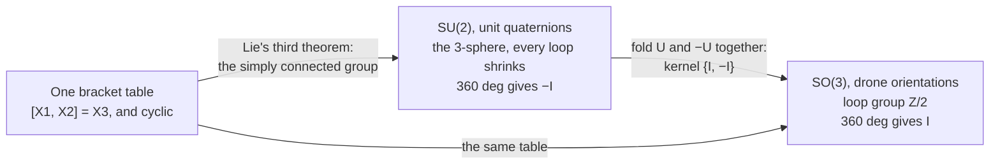
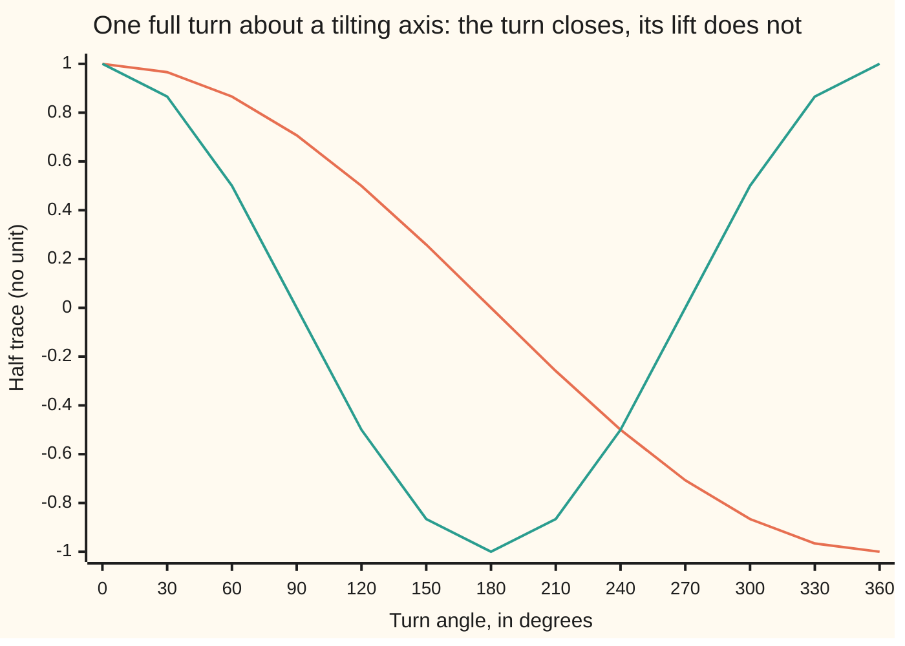

# Lie's theorems: the Lie algebra decides the group, up to a covering

[Syllabus](../../../SYLLABUS.md) → [Differential geometry and Lie groups](../README.md) → [Lie Groups](../README.md#s06) → Lie's theorems

---

## General Overview

A camera drone's flight computer tracks the camera's orientation in two ways at once. The guidance code keeps a 3 by 3 rotation matrix, a member of $`SO(3)`$. The attitude filter keeps a unit quaternion, written here as a 2 by 2 complex matrix, a member of $`SU(2)`$.

Both have the same **Lie algebra**: the same space of turn rates, with the same bracket table. For three basic rates $`X_1, X_2, X_3`$ it reads $`[X_1, X_2] = X_3`$ and its cyclic turns. The bracket of two rates $`X`$ and $`Y`$ is $`XY - YX`$, the leftover when two small turns are swapped ([Lie algebra](02-lie-algebras-and-the-exponential-map.md)).

Now spin the gimbal's yaw motor through one full turn, 360°. The rotation matrix comes back to the identity $`I`$. The quaternion matrix comes back to $`-I`$. Only a second full turn, 720° in all, brings it home. Same rates, same brackets, two different groups.

Lie's theorems say how much the bracket table decides:

- **Subgroups.** Every subalgebra (a set of rates closed under the bracket) is the algebra of exactly one connected subgroup. That subgroup can be dense, like a line of slope $`\sqrt{2}`$ on the torus of the gimbal's two motor angles.
- **Maps.** A bracket-keeping map of algebras becomes a map of groups when the starting group is **simply connected**: every loop in it shrinks to a point.
- **Existence.** Every bracket table belongs to one simply connected group. Every other connected group with that table is it, with a discrete central subgroup (isolated points that commute with everything) folded to a point. $`SO(3)`$ is $`SU(2)`$ with $`U`$ and $`-U`$ folded together.

**The Lie algebra fixes a connected Lie group near the identity; globally it fixes one simply connected group, and every other connected group with that algebra is that group divided by a discrete central subgroup, which is its fundamental group.**

**What kind of fact this is:** theorems, all global and each with a named hypothesis. The closed subgroup theorem, the subgroup-subalgebra match and the homomorphism theorem are proved on this card in outline, with the key steps in folds. Two results they use are cited, not proved: the global Frobenius theorem (Lee, chapter 19), and the existence of a universal cover (a simply connected cover) for every connected Lie group, which holds because a manifold is locally simply connected (Hall, chapter 5). Lie's third theorem is stated and cited, not proved, because its proof rests on Ado's theorem (Hall, chapter 5).

### The picture: one bracket table, two groups



The arrow from $`SU(2)`$ to $`SO(3)`$ is the double cover from [Rotation group](04-rotations-so3-and-quaternions.md). No arrow runs back: Why it works shows none can.

---

## The formula

Notation first, in words. $`G`$ and $`H`$ are Lie groups ([Lie group](01-lie-groups-and-matrix-groups.md)); here $`H`$ is a group, not a curvature or a Hamiltonian. $`\mathfrak{g}`$ and $`\mathfrak{h}`$ (Gothic g and h) are their Lie algebras. $`\pi_1(G)`$ is the fundamental group: loops at the identity, counted the same when one slides into the other ([The fundamental group](../../17-Topology/04-Homotopy/03-the-fundamental-group.md)).

A **Lie algebra homomorphism** is a linear map $`\varphi: \mathfrak{g} \to \mathfrak{h}`$ that keeps brackets: $`\varphi([X, Y]) = [\varphi X, \varphi Y]`$. On this card $`\varphi`$ is such a map, not the globe's polar angle.

The homomorphism theorem: if $`G`$ is connected and simply connected, every such $`\varphi`$ comes from exactly one group map $`\Phi`$.

```math
G \text{ connected and } \pi_1(G) = 1 \implies \text{there is exactly one smooth homomorphism } \Phi: G \to H \text{ with } \Phi(\exp X) = \exp(\varphi X) \text{ for every } X \in \mathfrak{g}
```

**Read it aloud:** when G is connected and every loop in G shrinks, any bracket-keeping map of rates is the derivative of exactly one map of groups, which sends the turn produced by a rate to the turn produced by the image rate.

The classification that follows from it: let $`\tilde G`$ be the simply connected group with algebra $`\mathfrak{g}`$. Every connected $`G`$ with that algebra is

```math
G \cong \tilde G / \Gamma, \qquad \Gamma \text{ a discrete subgroup in the centre of } \tilde G, \qquad \Gamma \cong \pi_1(G); \qquad SO(3) \cong SU(2) / \{I, -I\}, \quad \pi_1(SO(3)) \cong \mathbb{Z}/2
```

**Read it aloud:** every connected group with this algebra is the simply connected one with a discrete set of central points folded to the identity, and the folded set is the group's loop group; for the drone, SU(2) with plus and minus folded together, whose loop group has two members.

Here **discrete** means every point of $`\Gamma`$ has a neighbourhood holding no other point of $`\Gamma`$. **Central** means each member commutes with the whole group.

Two companions complete the set:

- **Closed subgroup theorem (Cartan).** A subgroup $`H`$ of a Lie group that is a closed set is an embedded Lie subgroup, with $`\mathfrak{h} = \{X : \exp(tX) \in H \text{ for every real } t\}`$. [Lie group](01-lie-groups-and-matrix-groups.md) states it; this card sketches the proof.
- **Lie's third theorem.** Every finite-dimensional real Lie algebra is the Lie algebra of some simply connected Lie group.

| Symbol | Plain meaning | In our example | Push it up and the answer… |
| --- | --- | --- | --- |
| $`G`$, $`H`$; $`K`$, $`V`$, $`A_k`$, $`B_k`$, $`\mathrm{pr}`$ | Lie groups, $`H`$ often a subgroup; helper letters in the proofs, such as these, each defined where it appears | $`SU(2)`$, $`SO(3)`$; the torus line | — |
| $`\mathfrak{g}`$, $`\mathfrak{h}`$, $`\mathfrak{so}(3)`$, $`\mathfrak{su}(2)`$ | Lie algebras: rates at the identity, with the bracket | 3-dimensional, one bracket table | — |
| $`[X, Y]`$; $`X`$, $`Y`$ | the bracket $`XY - YX`$; algebra members | $`[X_1, X_2] = X_3`$ | — |
| $`L_x`$, $`L_y`$, $`L_z`$ | unit roll, pitch and yaw rates in $`\mathfrak{so}(3)`$, as 3 by 3 skew matrices | $`[L_x, L_y] = L_z`$ | — |
| $`X_1`$, $`X_2`$, $`X_3`$; $`\mathrm{diag}`$ | the matching rates in $`\mathfrak{su}(2)`$: $`-\tfrac{i}{2}`$ times the Pauli matrices; a matrix with the listed diagonal and zeros elsewhere | $`X_3 = \mathrm{diag}(-\tfrac{i}{2}, \tfrac{i}{2})`$ | — |
| $`\exp`$, $`\theta`$, $`N`$ | hold a rate for unit time; the turn angle in radians; the number of split steps in the limit formulas | $`\theta = 2\pi`$, 360°; $`N`$ = 1, 10, 100 | $`-I`$ at 360°, $`I`$ at 720° in $`SU(2)`$; the gap shrinks like $`1/N`$ |
| $`U`$, $`R`$, $`I`$, $`i`$; $`U^{*}`$, $`\mathrm{tr}`$ | a member of $`SU(2)`$; a rotation in $`SO(3)`$; the identity; $`\sqrt{-1}`$; conjugate transpose, the inverse in $`SU(2)`$; trace, the sum of the diagonal | the lifted loop ends at $`U = -I`$ | — |
| $`\varphi`$, $`\Phi`$ | a bracket-keeping map of algebras; the group map it comes from | $`L_k \mapsto X_k`$; no $`\Phi`$ exists from $`SO(3)`$ | — |
| $`\tilde G`$, $`p`$ | the simply connected cover of $`G`$; its covering map | $`SU(2)`$; the two-to-one map onto $`SO(3)`$ | — |
| $`\Gamma`$ | the kernel of $`p`$: the points over $`I`$ | $`\{I, -I\}`$, 2 points | more points, more loop classes |
| $`\pi_1`$, $`\mathbb{Z}/2`$ | the loop group; the group with two members | $`\pi_1(SO(3)) = \mathbb{Z}/2`$ | — |
| $`T^2`$, $`\alpha`$, $`n`$ | the torus of two motor angles in turns; the speed ratio of the motors; full turns of motor 1 | $`\alpha = \sqrt{2}`$; $`n = 12`$ misses by 0.029437 turns | a rational $`\alpha`$ closes up |

### When it holds

- **Connected groups.** The algebra sees only the piece of the group through $`I`$. $`O(3)`$, with mirror images, has the same algebra as $`SO(3)`$ but two pieces.
- **Simply connected, for maps.** Drop it and a bracket-keeping map may have no group map behind it. The map $`L_k \mapsto X_k`$ from $`\mathfrak{so}(3)`$ to $`\mathfrak{su}(2)`$ has none: it would send the one rotation $`I`$ to both $`I`$ and $`-I`$.
- **Closed, for embedded.** A subalgebra always gives a subgroup, but not always a closed one. The slope-$`\sqrt{2}`$ line on the torus comes within 0.000359 turns of its start after 985 turns and never returns. It is an immersed subgroup (a one-to-one smooth copy of a line), not an embedded one: its own topology is not the torus's.
- **Local against global.** Near $`I`$, the bracket alone fixes the product ([Baker-Campbell-Hausdorff](03-baker-campbell-hausdorff-in-outline.md)). The global differences live entirely in $`\pi_1`$.

---

## Why it works

### Step 0: the algebra fixes a neighbourhood; loops decide the rest

Baker-Campbell-Hausdorff writes $`\log(e^X e^Y)`$ as $`X + Y + \tfrac12[X, Y] + \cdots`$, every term a nested bracket. So two groups with the same bracket table multiply the same way near $`I`$.

In a connected group every member is a product of small steps. To build a group map, follow a path of small steps and map each step. Two paths to one member could give two answers; they agree when one path slides into the other. In a simply connected group any two paths with the same ends do. Steps 1 to 5 make this precise.

### Step 1: a closed subgroup is a Lie group

Take a closed subgroup $`H`$ and collect the rates $`X`$ with $`\exp(tX)`$ in $`H`$ for every $`t`$. Two limit formulas, over $`N`$ split steps, show this set $`\mathfrak{h}`$ is a Lie subalgebra:

```math
e^{X + Y} = \lim_{N \to \infty} \left(e^{X/N} e^{Y/N}\right)^N, \qquad e^{[X, Y]} = \lim_{N \to \infty} \left(e^{X/N} e^{Y/N} e^{-X/N} e^{-Y/N}\right)^{N^2}
```

**Read it aloud:** alternating many small steps of two rates gives the turn of their sum; looping many tiny swaps gives the turn of their bracket.

Every factor on the right lies in $`H`$, and $`H`$ is closed, so the limits lie in $`H`$. Take the drone's pitch rate 0.4 rad/s and yaw rate 1.2 rad/s, held 1 s. The **gap** from $`e^{X+Y}`$, the square root of the summed squared entry differences, is 0.324071 at $`N = 1`$, 0.031730 at $`N = 10`$ and 0.003172 at $`N = 100`$. The commutator formula misses by 0.042492 and 0.004252. Both gaps shrink tenfold for ten times the steps: first-order convergence.

A last step, in the fold, shows $`H`$ has no extra points near $`I`$ outside $`\exp(\mathfrak{h})`$, so $`\exp`$ gives $`H`$ a chart there.

<details>
<summary>Detailed proof: no points of H hide near I</summary>

Split $`\mathfrak{g} = \mathfrak{h} \oplus V`$, with $`V`$ any complement. The map $`(A, B) \mapsto e^A e^B`$, from $`\mathfrak{h} \times V`$, has derivative the identity at $`(0, 0)`$. By the inverse function theorem it is a smooth one-to-one match of a small neighbourhood of $`(0, 0)`$ with a neighbourhood of $`I`$.

Suppose points $`h_k`$ of $`H`$ tend to $`I`$ but lie outside $`\exp(\mathfrak{h})`$. Write $`h_k = e^{A_k} e^{B_k}`$, with $`A_k`$ in $`\mathfrak{h}`$ and $`B_k`$ in $`V`$, nonzero, tending to 0. Then $`e^{B_k} = e^{-A_k} h_k`$ lies in $`H`$.

The unit vectors $`B_k / \lvert B_k \rvert`$ have a limit point $`B`$ in $`V`$, of length 1; keep only the $`k`$ that approach it. Fix $`t`$ and let $`m_k`$ be the whole number part of $`t / \lvert B_k \rvert`$. Then $`(e^{B_k})^{m_k} = e^{m_k B_k}`$ lies in $`H`$ and tends to $`e^{tB}`$. As $`H`$ is closed, $`e^{tB}`$ lies in $`H`$ for every $`t`$.

So $`B`$ lies in $`\mathfrak{h}`$ and in $`V`$, which meet only at 0. That contradicts $`\lvert B \rvert = 1`$. So near $`I`$, $`H`$ is exactly $`\exp`$ of a small piece of $`\mathfrak{h}`$, a smooth chart. Left multiplication by members of $`H`$ carries this chart to every point of $`H`$.

</details>

### Step 2: subalgebras and connected subgroups match one for one

Start from a subalgebra $`\mathfrak{h}`$. Copy its rates to every point $`g`$ of $`G`$ by left multiplication: the plane $`g\,\mathfrak{h}`$. This is a **distribution**, a smooth field of planes ([Lie bracket](../03-Manifolds/08-lie-brackets-and-frobenius-theorem.md)).

The bracket of two copied fields is the copied field of their bracket. So the planes are **involutive** (brackets of fields in the planes stay in the planes) exactly when $`\mathfrak{h}`$ is a subalgebra. Frobenius then gives a surface through every point, a **leaf**, tangent to the planes. [Lie bracket](../03-Manifolds/08-lie-brackets-and-frobenius-theorem.md) proves this near each point only; the global Frobenius theorem, cited and not proved here (Lee, chapter 19), glues the pieces into maximal connected leaves.

The leaf through $`I`$ is the subgroup. Left multiplication by any $`h`$ on it maps leaves to leaves and sends $`I`$ to $`h`$, so it maps this leaf onto itself: products and inverses stay inside. It is the only connected subgroup with algebra $`\mathfrak{h}`$, since $`\exp(\mathfrak{h})`$ generates it.

The gimbal's two motor angles, each in turns, form the torus $`T^2`$. Its algebra is the plane of motor-speed pairs, with every bracket zero. So every line of speeds is a subalgebra. Run motor 2 at $`\alpha = \sqrt{2}`$ times motor 1's speed.

The leaf is the path $`t \mapsto (t, \sqrt{2}\,t)`$, with both angles counted modulo one turn. Each time motor 1 finishes a full turn $`n`$, motor 2 sits $`n\sqrt{2}`$ turns round, off the nearest whole number by a **miss**:

| Full turns $`n`$ | 1 | 2 | 5 | 12 | 29 | 70 | 169 | 408 | 985 |
| --- | ---: | ---: | ---: | ---: | ---: | ---: | ---: | ---: | ---: |
| Miss, turns | 0.414214 | 0.171573 | 0.071068 | 0.029437 | 0.012193 | 0.005051 | 0.002092 | 0.000867 | 0.000359 |
| Miss, degrees | 149.117 | 61.766 | 25.584 | 10.597 | 4.390 | 1.818 | 0.753 | 0.312 | 0.129 |

These are the record returns up to 1,000 turns, each closer than every earlier one. The record times follow the Pell rule: each is twice the last plus the one before. And $`n`$ times the miss approaches $`1/(2\sqrt{2}) = 0.353553`$.

The miss is never 0, because $`\sqrt{2}`$ is not a fraction. So the line never closes, and its records creep towards the start without reaching it. Repeating a return with miss $`d`$ walks motor 2 round in steps of $`d`$, so the line passes within $`d`$ of every pair of motor angles: it is dense. A subgroup that is dense but not everything is not closed. With $`\alpha = 3/2`$ the line closes after 2 turns, a closed circle.

### Step 3: simply connected groups let algebra maps become group maps

Given $`\varphi`$, the idea of Step 0 is carried out by a trick: build the graph of $`\Phi`$ before $`\Phi`$ exists. The pairs $`(X, \varphi X)`$ form a subalgebra of $`\mathfrak{g} \oplus \mathfrak{h}`$, because $`\varphi`$ keeps brackets. Step 2 gives its connected subgroup $`K`$ in $`G \times H`$.

Projection from $`K`$ to $`G`$ has derivative $`(X, \varphi X) \mapsto X`$, an isomorphism of algebras. So it is a covering map. A connected cover of a simply connected space has one sheet, so the projection is one-to-one. Then $`K`$ is the graph of a map $`\Phi`$.

<details>
<summary>Detailed proof: the graph's projection is a one-sheeted cover</summary>

Let $`\mathrm{pr}: K \to G`$ be the projection, a smooth homomorphism. Its derivative is an isomorphism of algebras, so by the inverse function theorem $`\mathrm{pr}`$ matches a neighbourhood $`W`$ of the identity in $`K`$ with a neighbourhood of $`I`$ in $`G`$. The image of $`\mathrm{pr}`$ is a subgroup containing a neighbourhood of $`I`$, so it is all of the connected $`G`$.

The kernel $`\mathrm{pr}^{-1}(I)`$ meets $`W`$ only at the identity, so it is discrete. Over a small neighbourhood $`N`$ of a point $`\mathrm{pr}(k)`$, the pre-image is the disjoint union of the sets $`k\,c\,W'`$, one for each $`c`$ in the kernel, with $`W'`$ a smaller piece of $`W`$. Each set maps onto $`N`$ one for one. That is a covering map.

$`G`$ is simply connected, so the lifting criterion of [Covering spaces](../../17-Topology/04-Homotopy/05-covering-spaces.md) lifts the identity map of $`G`$ to a map $`s: G \to K`$ with $`\mathrm{pr} \circ s`$ the identity and $`s(I)`$ the identity of $`K`$. Its image is open and closed in the connected $`K`$, so it is all of $`K`$, and $`\mathrm{pr}`$ is one-to-one.

Set $`\Phi`$ as $`s`$ followed by projection to $`H`$. It is a homomorphism because $`K`$ is a subgroup, and its derivative is $`\varphi`$. Any other $`\Phi'`$ with derivative $`\varphi`$ agrees with $`\Phi`$ on $`\exp(\mathfrak{g})`$, which generates $`G`$.

</details>

The map from $`\mathfrak{su}(2)`$ to $`\mathfrak{so}(3)`$ does come from a group map. $`SU(2)`$ is the 3-sphere, simply connected by the argument [Contractible and simply connected](../../17-Topology/04-Homotopy/02-contractible-and-simply-connected.md) gives for the 2-sphere. So $`X_k \mapsto L_k`$ comes from a group map. It is the double cover $`p`$. The code differentiates $`p`$ at $`I`$ and finds exactly $`X_1, X_2, X_3 \mapsto L_x, L_y, L_z`$.

### Step 4: SO(3) fails the hypothesis, and the lift shows why

Try the reverse map, $`\Phi(\exp(\theta L_z)) = \exp(\theta X_3)`$, the spin-1/2 guess. At $`\theta = 0`$ it gives $`I`$. At $`\theta = 2\pi`$ the rotation is again $`I`$, but

```math
\exp(2\pi X_3) = \begin{pmatrix} e^{-i\pi} & 0 \\ 0 & e^{i\pi} \end{pmatrix} = -I
```

**Read it aloud:** holding the spin-1/2 yaw rate for a full turn multiplies both entries by minus one.

The guess sends $`I`$ to two places, 2.828427 apart: the square root of the summed squared entry differences, $`\sqrt{8}`$. Step 3 would have prevented this. So $`SO(3)`$ is not simply connected: some loop in it cannot shrink.

The covering card's path lifting shows which loop: the full turn. Take a harder loop: a full 360° turn about an axis that tilts 50° away from vertical during the turn. Sample it at 360 points. Over each rotation sit two matrices, $`\pm U`$, read off the rotation through its quaternion. Keep the one nearer the last step.

The lift starts at $`I`$ and ends at $`-I`$. A loop whose lift does not close cannot shrink, since sliding a loop slides its lift and keeps both ends. Run the loop twice and the lift closes at $`+I`$.



Orange: half the trace of the lift $`U`$ in $`SU(2)`$, which is $`\cos(\theta/2)`$, ending at −1. Teal: $`(\mathrm{tr}\, R - 1)/2 = \cos\theta`$ for the turn in $`SO(3)`$, back at 1. The tilt changes neither curve, because conjugating a matrix keeps its trace.

### Step 5: every connected group is a simply connected one, folded

Let $`G`$ be connected. A manifold is locally simply connected, so $`G`$ has a **universal cover**, a simply connected cover; this existence result is cited, not proved here (Hall, chapter 5). Call it $`\tilde G`$, with covering map $`p`$. Pick a point over $`I`$ as the identity of $`\tilde G`$. The map $`(a, b) \mapsto p(a)\,p(b)`$ lifts to $`\tilde G \times \tilde G \to \tilde G`$, by the lifting criterion, and that lift is the product. Uniqueness of lifts gives the group rules.

The kernel $`\Gamma = p^{-1}(I)`$ is a normal subgroup and discrete. For $`\gamma`$ in $`\Gamma`$, the map $`g \mapsto g\gamma g^{-1}`$ is continuous from the connected $`\tilde G`$ into the discrete $`\Gamma`$. So it is constant, equal to $`\gamma`$: $`\Gamma`$ is central.

The points over $`I`$ match the loop classes one for one, as sheets match loops on [Covering spaces](../../17-Topology/04-Homotopy/05-covering-spaces.md). So $`G = \tilde G / \Gamma`$ with $`\Gamma \cong \pi_1(G)`$.

The cover is the same group for every $`G`$ with this algebra. Two simply connected groups with one algebra are isomorphic: by Step 3 the identity map of the algebra lifts both ways, and the two lifts undo each other. For the drone, $`\Gamma = \{I, -I\}`$ and $`\pi_1(SO(3)) = \mathbb{Z}/2`$: the one-turn loop and the shrinkable loop.

### Step 6: Lie's third theorem, stated

Ado's theorem: every finite-dimensional real Lie algebra is a subalgebra of the real square matrices of some size. Step 2 then gives a connected subgroup of the invertible matrices of that size with that algebra, and Step 5 its simply connected cover. Ado's proof is long; Hall (chapter 5) treats Lie's third theorem through it.

Together with Steps 3 and 5 this gives the full match. Lie algebras and simply connected Lie groups correspond one to one, and so do their maps. The subgroup Ado's route produces need not be closed, which is why Step 2 allows dense subgroups.

---

## Worked numbers, by hand

| Step | Arithmetic | Value |
| --- | --- | --- |
| bracket in $`\mathfrak{su}(2)`$ | $`X_1X_2 = \mathrm{diag}(-\tfrac{i}{4}, \tfrac{i}{4})`$, $`X_2X_1 = \mathrm{diag}(\tfrac{i}{4}, -\tfrac{i}{4})`$, subtract | $`X_3`$ |
| bracket in $`\mathfrak{so}(3)`$ | $`L_xL_y - L_yL_x`$, entry by entry | $`L_z`$ |
| full yaw turn in $`SO(3)`$ | Rodrigues with $`\sin 2\pi = 0`$, $`\cos 2\pi = 1`$ | $`I`$ |
| full yaw turn in $`SU(2)`$ | $`e^{-i\pi} = e^{i\pi} = -1`$ | $`-I`$ |
| two full turns in $`SU(2)`$ | $`e^{\mp 2\pi i} = 1`$ | $`I`$ |
| points over the rotation $`I`$ | $`I`$ and $`-I`$ | $`\Gamma`$ has 2 |
| torus, 12 turns of motor 1 | $`12\sqrt{2}`$ falls just short of 17: $`17 - 12\sqrt{2}`$ | 0.029437 turns, 10.597° |
| loop group of the drone's turns | $`\Gamma \cong \pi_1(SO(3))`$ | $`\mathbf{\mathbb{Z}/2}`$ |

The drone's orientations have one loop that cannot shrink, the full turn, and running it twice makes it shrinkable: $`SU(2)`$ covers $`SO(3)`$ exactly twice.

### What breaks if you drop a piece

| Mistake | Comes out at | What went wrong |
| --- | --- | --- |
| Same brackets, so same group | 360° gives $`I`$ in $`SO(3)`$, $`-I`$ in $`SU(2)`$: gap 2.828427 | The algebra fixes the group only near $`I`$ |
| Map $`SO(3) \to SU(2)`$ by $`\exp(\theta L_z) \mapsto \exp(\theta X_3)`$ | the rotation $`I`$ sent to $`I`$ and to $`-I`$ | $`SO(3)`$ is not simply connected |
| Treat the slope-$`\sqrt{2}`$ line as closed | within 0.000359 turns at $`n = 985`$, never back | A subalgebra's subgroup can be dense |
| Take $`e^X e^Y = e^{X+Y}`$ | gap 0.324071; 0.003172 with 100 split steps | Rates combine only in the limit of small steps |

The code prints all four.

---

## Code, from first principles, and it actually runs

The code writes complex matrices, the bracket and the exponential series from scratch. The double cover $`p`$ is `ad`, which reads off the $`X_j`$ part of $`U X_k U^{*}`$. The full-turn sign $`-I`$ is reached by three roads: the series, the closed form $`e^{\mp i\pi}`$, and path lifting from rotation matrices alone, through the quaternion of each rotation. The torus records are found by a search and again by the Pell rule. The limit formulas are checked at two step counts.

### Python

```python
# Lie's theorems and covering groups -- the check behind the card.  Standard library only.
# Matrices are lists of rows of complex numbers; exp is its power series, written out.
import math

def mul(a, b):
    return [[sum(a[i][k] * b[k][j] for k in range(len(b))) for j in range(len(b[0]))] for i in range(len(a))]

def add(a, b, s=1.0):
    return [[x + s * y for x, y in zip(r, q)] for r, q in zip(a, b)]

def scale(a, s):
    return [[s * x for x in r] for r in a]

def eye(n):
    return [[complex(i == j) for j in range(n)] for i in range(n)]

def dag(a):                                  # conjugate transpose, the inverse in SU(2)
    return [[a[j][i].conjugate() for j in range(len(a))] for i in range(len(a))]

def gap(a, b):                               # Frobenius size of a - b
    return math.sqrt(sum(abs(x - y) ** 2 for r, q in zip(a, b) for x, y in zip(r, q)))

def expm(a):                                 # I + a + a^2/2! + ..., 60 terms
    out, term = eye(len(a)), eye(len(a))
    for k in range(1, 60):
        term = scale(mul(term, a), 1.0 / k)
        out = add(out, term)
    return out

def br(a, b):                                # the bracket [a, b] = ab - ba
    return add(mul(a, b), mul(b, a), -1.0)

def power(a, n):
    out = eye(len(a))
    for _ in range(n):
        out = mul(out, a)
    return out

def f(v, d=6):                               # fixed decimals, never a "-0"
    return f"{0.0 if abs(v) < 0.5 * 10 ** -d else v:.{d}f}"

def cx(m):
    return [[complex(x) for x in r] for r in m]

L = [cx([[0, 0, 0], [0, 0, -1], [0, 1, 0]]), cx([[0, 0, 1], [0, 0, 0], [-1, 0, 0]]),
     cx([[0, -1, 0], [1, 0, 0], [0, 0, 0]])]                 # so(3): unit roll, pitch, yaw rates
X = [[[0j, -0.5j], [-0.5j, 0j]], [[0j, -0.5 + 0j], [0.5 + 0j, 0j]],
     [[-0.5j, 0j], [0j, 0.5j]]]                                # su(2): -i/2 times the Pauli matrices
I2, I3, TAU = eye(2), eye(3), 2 * math.pi

def table(g):                                # largest miss in [g1,g2] = g3 and its cyclic turns
    return max(gap(br(g[k], g[(k + 1) % 3]), g[(k + 2) % 3]) for k in range(3))

def ad(u):                                   # the double cover: X_j-part of u X_k u^-1
    return [[(-2 * sum(mul(X[j], mul(u, mul(X[k], dag(u))))[i][i] for i in range(2))).real
             for k in range(3)] for j in range(3)]

def preimage(r):                             # one of the two U over a rotation r, via its quaternion
    t = r[0][0] + r[1][1] + r[2][2]
    c = [1 + t, 1 + 2 * r[0][0] - t, 1 + 2 * r[1][1] - t, 1 + 2 * r[2][2] - t]
    m, s = c.index(max(c)), math.sqrt(max(c)) / 2
    p = [r[2][1] - r[1][2], r[0][2] - r[2][0], r[1][0] - r[0][1]]          # pairs with w
    o = [r[0][1] + r[1][0], r[0][2] + r[2][0], r[1][2] + r[2][1]]          # xy, xz, yz
    q = {0: [s, p[0] / (4 * s), p[1] / (4 * s), p[2] / (4 * s)],
         1: [p[0] / (4 * s), s, o[0] / (4 * s), o[1] / (4 * s)],
         2: [p[1] / (4 * s), o[0] / (4 * s), s, o[2] / (4 * s)],
         3: [p[2] / (4 * s), o[1] / (4 * s), o[2] / (4 * s), s]}[m]
    return add(scale(I2, q[0]), add(scale(X[0], 2 * q[1]), add(scale(X[1], 2 * q[2]), scale(X[2], 2 * q[3]))))

def lift(steps, laps):                       # follow the tilted full-turn loop up into SU(2)
    u, worst, half = I2, 0.0, []
    for s in range(1, steps * laps + 1):
        t = s / steps
        a = expm(scale(L[0], (t % 1) * 50 * math.pi / 180))
        r = [[z.real for z in row] for row in mul(a, mul(expm(scale(L[2], TAU * (t % 1))), dag(a)))]
        v = preimage(r)
        u = v if gap(v, u) < gap(scale(v, -1), u) else scale(v, -1)        # the nearer sign
        worst = max(worst, gap(cx(ad(u)), cx(r)))
        if s % 30 == 0 and s <= steps:
            half.append((u[0][0] + u[1][1]).real / 2)
    return u, worst, half

print(f"so(3) brackets [Lx,Ly] = Lz and cyclic: {'yes' if table(L) < 1e-12 else 'no'}")
print(f"su(2) brackets [X1,X2] = X3 and cyclic: {'yes' if table(X) < 1e-12 else 'no'}")
h = 1e-4
dgap = max(gap(cx(add(ad(expm(scale(X[m], h))), ad(expm(scale(X[m], -h))), -1.0)), scale(L[m], 2 * h)) / (2 * h)
           for m in range(3))
print(f"derivative of the double cover sends X1, X2, X3 to Lx, Ly, Lz: {'yes' if dgap < 1e-8 else 'no'}")
z360, s360, s720 = expm(scale(L[2], TAU)), expm(scale(X[2], TAU)), expm(scale(X[2], 2 * TAU))
closed = [math.cos(-math.pi), math.cos(math.pi)]
print(f"exp(360 deg yaw) in SO(3) is I: {'yes' if gap(z360, I3) < 1e-9 else 'no'}")
print(f"exp(360 deg yaw) in SU(2), series: diagonal {f(s360[0][0].real)}, {f(s360[1][1].real)}")
print(f"exp(360 deg yaw) in SU(2), closed form e^(-i pi), e^(i pi): {f(closed[0])}, {f(closed[1])}")
print(f"exp(720 deg yaw) in SU(2) is I: {'yes' if gap(s720, I2) < 1e-9 else 'no'}")
u1, w1, half = lift(360, 1)
u2, w2, _ = lift(360, 2)
print(f"lift of the tilted 360 deg loop, 360 steps: ends at -I: {'yes' if gap(u1, scale(I2, -1)) < 1e-9 else 'no'}")
print(f"lift of the same loop run twice, 720 steps: ends at +I: {'yes' if gap(u2, I2) < 1e-9 else 'no'}")
print(f"every lifted step lies over its rotation: {'yes' if max(w1, w2) < 1e-9 else 'no'}")
ang = list(range(30, 361, 30))
print("chart, turn angle in deg: 0, " + ", ".join(str(a) for a in ang))
print("chart, half trace of the lift in SU(2): 1.000, " + ", ".join(f(v, 3) for v in half))
print("chart, (trace - 1)/2 of the turn in SO(3): 1.000, " + ", ".join(f(math.cos(a * math.pi / 180), 3) for a in ang))
print(f"spin-1/2 guess Phi(exp(theta Lz)) = exp(theta X3): theta 0 gives +I, theta 360 deg gives "
      f"{'-I' if gap(s360, scale(I2, -1)) < 1e-9 else '?'}, gap {f(gap(I2, s360))}, same rotation I")
A, B = scale(L[1], 0.4), scale(L[2], 1.2)
prod = {n: gap(power(mul(expm(scale(A, 1 / n)), expm(scale(B, 1 / n))), n), expm(add(A, B))) for n in (1, 10, 100)}
print(f"Lie product formula, pitch 0.4, yaw 1.2: gap N = 1 {f(prod[1])}, N = 10 {f(prod[10])}, N = 100 {f(prod[100])}")
comm = {}
for n in (10, 100):
    a, b = expm(scale(A, 1 / n)), expm(scale(B, 1 / n))
    comm[n] = gap(power(mul(mul(a, b), mul(dag(a), dag(b))), n * n), expm(br(A, B)))
print(f"commutator formula, same rates: gap N = 10 {f(comm[10])}, N = 100 {f(comm[100])}")
R2 = math.sqrt(2)
def miss(n, slope):                          # second motor's distance from 0 when the first is back at 0
    return abs(n * slope - round(n * slope))
best, rec = 1.0, []
for n in range(1, 1001):
    if miss(n, R2) < best - 1e-12:
        best = miss(n, R2)
        rec.append(n)
pell = [1, 2]
while 2 * pell[-1] + pell[-2] <= 1000:
    pell.append(2 * pell[-1] + pell[-2])
print(f"slope sqrt 2 on the motor torus, record returns by search, n <= 1000: {rec}")
print(f"the same list from the Pell rule q -> 2q + q_prev: {'yes' if rec == pell else 'no'}")
print("miss at each record, in turns: " + ", ".join(f(miss(n, R2)) for n in rec))
print("miss at each record, in degrees: " + ", ".join(f(360 * miss(n, R2), 3) for n in rec))
print(f"n times miss at n = 985: {f(985 * miss(985, R2))}; 1/(2 sqrt 2) = {f(1 / (2 * R2))}")
print(f"slope 3/2 closes exactly at n = 2: {'yes' if miss(2, 1.5) == 0 else 'no'}")
assert table(L) < 1e-12 and table(X) < 1e-12                      # one bracket table, two algebras
assert dgap < 1e-8                                                # the double cover's derivative matches them
assert gap(s360, scale(I2, -1)) < 1e-9 and abs(closed[0] - s360[0][0].real) < 1e-9 and gap(z360, I3) < 1e-9
assert gap(u1, scale(I2, -1)) < 1e-9 and gap(u2, I2) < 1e-9        # lifting road, from rotations alone
assert all(abs(v - math.cos(a * math.pi / 360)) < 1e-9 for v, a in zip(half, ang))
assert 8 < prod[10] / prod[100] < 12 and 8 < comm[10] / comm[100] < 12   # errors shrink like 1/n
assert rec == pell and abs(985 * miss(985, R2) - 1 / (2 * R2)) < 1e-3
print("ALL CHECKS PASS")
```

**Ran 2026-11-24 on macOS, Python 3.14.10, standard library only. All checks passed. Output, pasted from the run:**

```
so(3) brackets [Lx,Ly] = Lz and cyclic: yes
su(2) brackets [X1,X2] = X3 and cyclic: yes
derivative of the double cover sends X1, X2, X3 to Lx, Ly, Lz: yes
exp(360 deg yaw) in SO(3) is I: yes
exp(360 deg yaw) in SU(2), series: diagonal -1.000000, -1.000000
exp(360 deg yaw) in SU(2), closed form e^(-i pi), e^(i pi): -1.000000, -1.000000
exp(720 deg yaw) in SU(2) is I: yes
lift of the tilted 360 deg loop, 360 steps: ends at -I: yes
lift of the same loop run twice, 720 steps: ends at +I: yes
every lifted step lies over its rotation: yes
chart, turn angle in deg: 0, 30, 60, 90, 120, 150, 180, 210, 240, 270, 300, 330, 360
chart, half trace of the lift in SU(2): 1.000, 0.966, 0.866, 0.707, 0.500, 0.259, 0.000, -0.259, -0.500, -0.707, -0.866, -0.966, -1.000
chart, (trace - 1)/2 of the turn in SO(3): 1.000, 0.866, 0.500, 0.000, -0.500, -0.866, -1.000, -0.866, -0.500, 0.000, 0.500, 0.866, 1.000
spin-1/2 guess Phi(exp(theta Lz)) = exp(theta X3): theta 0 gives +I, theta 360 deg gives -I, gap 2.828427, same rotation I
Lie product formula, pitch 0.4, yaw 1.2: gap N = 1 0.324071, N = 10 0.031730, N = 100 0.003172
commutator formula, same rates: gap N = 10 0.042492, N = 100 0.004252
slope sqrt 2 on the motor torus, record returns by search, n <= 1000: [1, 2, 5, 12, 29, 70, 169, 408, 985]
the same list from the Pell rule q -> 2q + q_prev: yes
miss at each record, in turns: 0.414214, 0.171573, 0.071068, 0.029437, 0.012193, 0.005051, 0.002092, 0.000867, 0.000359
miss at each record, in degrees: 149.117, 61.766, 25.584, 10.597, 4.390, 1.818, 0.753, 0.312, 0.129
n times miss at n = 985: 0.353553; 1/(2 sqrt 2) = 0.353553
slope 3/2 closes exactly at n = 2: yes
ALL CHECKS PASS
```

### Rust

Same numbers, same labels, built with `rustc --edition 2021 -O`.

```rust
// Lie's theorems and covering groups -- the same check as the Python, in Rust.  No crates.
// Matrices are rows of complex numbers, a struct written here; exp is its power series.
use std::f64::consts::PI;

#[derive(Clone, Copy)]
struct C { re: f64, im: f64 }
fn c(re: f64, im: f64) -> C { C { re, im } }
fn cmul(a: C, b: C) -> C { c(a.re * b.re - a.im * b.im, a.re * b.im + a.im * b.re) }
type M = Vec<Vec<C>>;

fn mul(a: &M, b: &M) -> M {
    (0..a.len()).map(|i| (0..b[0].len()).map(|j| (0..b.len()).fold(c(0.0, 0.0), |s, k| {
        let p = cmul(a[i][k], b[k][j]); c(s.re + p.re, s.im + p.im) })).collect()).collect()
}
fn add(a: &M, b: &M, s: f64) -> M {
    a.iter().zip(b).map(|(r, q)| r.iter().zip(q).map(|(x, y)| c(x.re + s * y.re, x.im + s * y.im)).collect()).collect()
}
fn scale(a: &M, s: f64) -> M { a.iter().map(|r| r.iter().map(|x| c(s * x.re, s * x.im)).collect()).collect() }
fn eye(n: usize) -> M { (0..n).map(|i| (0..n).map(|j| c(if i == j { 1.0 } else { 0.0 }, 0.0)).collect()).collect() }
fn dag(a: &M) -> M {                          // conjugate transpose, the inverse in SU(2)
    (0..a.len()).map(|i| (0..a.len()).map(|j| c(a[j][i].re, -a[j][i].im)).collect()).collect()
}
fn gap(a: &M, b: &M) -> f64 {                 // Frobenius size of a - b
    let mut s = 0.0;
    for (r, q) in a.iter().zip(b) { for (x, y) in r.iter().zip(q) { s += (x.re - y.re).powi(2) + (x.im - y.im).powi(2) } }
    s.sqrt()
}
fn expm(a: &M) -> M {                         // I + a + a^2/2! + ..., 60 terms
    let (mut out, mut term) = (eye(a.len()), eye(a.len()));
    for k in 1..60 { term = scale(&mul(&term, a), 1.0 / k as f64); out = add(&out, &term, 1.0) }
    out
}
fn br(a: &M, b: &M) -> M { add(&mul(a, b), &mul(b, a), -1.0) }
fn power(a: &M, n: usize) -> M { let mut o = eye(a.len()); for _ in 0..n { o = mul(&o, a) } o }
fn f(v: f64, d: usize) -> String { format!("{:.*}", d, if v.abs() < 0.5 * 10f64.powi(-(d as i32)) { 0.0 } else { v }) }
fn yn(b: bool) -> &'static str { if b { "yes" } else { "no" } }
fn cx(m: &[[f64; 3]; 3]) -> M { m.iter().map(|r| r.iter().map(|&x| c(x, 0.0)).collect()).collect() }
fn real(m: &M) -> [[f64; 3]; 3] { let mut r = [[0.0; 3]; 3]; for i in 0..3 { for j in 0..3 { r[i][j] = m[i][j].re } } r }

struct G { l: Vec<M>, x: Vec<M> }

fn table(g: &[M]) -> f64 {                    // largest miss in [g1,g2] = g3 and its cyclic turns
    (0..3).map(|k| gap(&br(&g[k], &g[(k + 1) % 3]), &g[(k + 2) % 3])).fold(0.0, f64::max)
}
fn ad(g: &G, u: &M) -> [[f64; 3]; 3] {        // the double cover: X_j-part of u X_k u^-1
    let mut r = [[0.0; 3]; 3];
    for j in 0..3 { for k in 0..3 {
        let p = mul(&g.x[j], &mul(u, &mul(&g.x[k], &dag(u))));
        r[j][k] = -2.0 * (p[0][0].re + p[1][1].re);
    } }
    r
}
fn preimage(g: &G, r: &[[f64; 3]; 3]) -> M {   // one of the two U over a rotation r, via its quaternion
    let t = r[0][0] + r[1][1] + r[2][2];
    let cs = [1.0 + t, 1.0 + 2.0 * r[0][0] - t, 1.0 + 2.0 * r[1][1] - t, 1.0 + 2.0 * r[2][2] - t];
    let mut m = 0;
    for i in 1..4 { if cs[i] > cs[m] { m = i } }
    let s = cs[m].sqrt() / 2.0;
    let p = [r[2][1] - r[1][2], r[0][2] - r[2][0], r[1][0] - r[0][1]];       // pairs with w
    let o = [r[0][1] + r[1][0], r[0][2] + r[2][0], r[1][2] + r[2][1]];       // xy, xz, yz
    let d = 4.0 * s;
    let q = match m {
        0 => [s, p[0] / d, p[1] / d, p[2] / d],
        1 => [p[0] / d, s, o[0] / d, o[1] / d],
        2 => [p[1] / d, o[0] / d, s, o[2] / d],
        _ => [p[2] / d, o[1] / d, o[2] / d, s],
    };
    add(&scale(&eye(2), q[0]), &add(&scale(&g.x[0], 2.0 * q[1]), &add(&scale(&g.x[1], 2.0 * q[2]), &scale(&g.x[2], 2.0 * q[3]), 1.0), 1.0), 1.0)
}
fn lift(g: &G, steps: usize, laps: usize) -> (M, f64, Vec<f64>) {   // follow the tilted loop into SU(2)
    let (mut u, mut worst, mut half) = (eye(2), 0.0f64, Vec::new());
    for s in 1..=steps * laps {
        let t = s as f64 / steps as f64;
        let a = expm(&scale(&g.l[0], (t % 1.0) * 50.0 * PI / 180.0));
        let r = real(&mul(&a, &mul(&expm(&scale(&g.l[2], 2.0 * PI * (t % 1.0))), &dag(&a))));
        let v = preimage(g, &r);
        u = if gap(&v, &u) < gap(&scale(&v, -1.0), &u) { v } else { scale(&v, -1.0) };   // the nearer sign
        worst = worst.max(gap(&cx(&ad(g, &u)), &cx(&r)));
        if s % 30 == 0 && s <= steps { half.push((u[0][0].re + u[1][1].re) / 2.0) }
    }
    (u, worst, half)
}
fn miss(n: usize, slope: f64) -> f64 { let v = n as f64 * slope; (v - v.round()).abs() }

fn main() {
    let z = c(0.0, 0.0);
    let l = vec![cx(&[[0.0, 0.0, 0.0], [0.0, 0.0, -1.0], [0.0, 1.0, 0.0]]), cx(&[[0.0, 0.0, 1.0], [0.0, 0.0, 0.0], [-1.0, 0.0, 0.0]]),
                 cx(&[[0.0, -1.0, 0.0], [1.0, 0.0, 0.0], [0.0, 0.0, 0.0]])];           // so(3): unit roll, pitch, yaw rates
    let x = vec![vec![vec![z, c(0.0, -0.5)], vec![c(0.0, -0.5), z]], vec![vec![z, c(-0.5, 0.0)], vec![c(0.5, 0.0), z]],
                 vec![vec![c(0.0, -0.5), z], vec![z, c(0.0, 0.5)]]];                     // su(2): -i/2 times the Pauli matrices
    let g = G { l, x };
    let (i2, i3, tau) = (eye(2), eye(3), 2.0 * PI);
    let neg = scale(&i2, -1.0);
    println!("so(3) brackets [Lx,Ly] = Lz and cyclic: {}", yn(table(&g.l) < 1e-12));
    println!("su(2) brackets [X1,X2] = X3 and cyclic: {}", yn(table(&g.x) < 1e-12));
    let h = 1e-4;
    let dgap = (0..3).map(|m| gap(&add(&cx(&ad(&g, &expm(&scale(&g.x[m], h)))), &cx(&ad(&g, &expm(&scale(&g.x[m], -h)))), -1.0),
                                  &scale(&g.l[m], 2.0 * h)) / (2.0 * h)).fold(0.0, f64::max);
    println!("derivative of the double cover sends X1, X2, X3 to Lx, Ly, Lz: {}", yn(dgap < 1e-8));
    let (z360, s360, s720) = (expm(&scale(&g.l[2], tau)), expm(&scale(&g.x[2], tau)), expm(&scale(&g.x[2], 2.0 * tau)));
    let closed = [(-PI).cos(), PI.cos()];
    println!("exp(360 deg yaw) in SO(3) is I: {}", yn(gap(&z360, &i3) < 1e-9));
    println!("exp(360 deg yaw) in SU(2), series: diagonal {}, {}", f(s360[0][0].re, 6), f(s360[1][1].re, 6));
    println!("exp(360 deg yaw) in SU(2), closed form e^(-i pi), e^(i pi): {}, {}", f(closed[0], 6), f(closed[1], 6));
    println!("exp(720 deg yaw) in SU(2) is I: {}", yn(gap(&s720, &i2) < 1e-9));
    let (u1, w1, half) = lift(&g, 360, 1);
    let (u2, w2, _) = lift(&g, 360, 2);
    println!("lift of the tilted 360 deg loop, 360 steps: ends at -I: {}", yn(gap(&u1, &neg) < 1e-9));
    println!("lift of the same loop run twice, 720 steps: ends at +I: {}", yn(gap(&u2, &i2) < 1e-9));
    println!("every lifted step lies over its rotation: {}", yn(w1.max(w2) < 1e-9));
    let ang: Vec<usize> = (30..=360).step_by(30).collect();
    let join = |v: Vec<String>| v.join(", ");
    println!("chart, turn angle in deg: 0, {}", join(ang.iter().map(|a| a.to_string()).collect()));
    println!("chart, half trace of the lift in SU(2): 1.000, {}", join(half.iter().map(|&v| f(v, 3)).collect()));
    println!("chart, (trace - 1)/2 of the turn in SO(3): 1.000, {}", join(ang.iter().map(|&a| f((a as f64 * PI / 180.0).cos(), 3)).collect()));
    println!("spin-1/2 guess Phi(exp(theta Lz)) = exp(theta X3): theta 0 gives +I, theta 360 deg gives {}, gap {}, same rotation I",
             if gap(&s360, &neg) < 1e-9 { "-I" } else { "?" }, f(gap(&i2, &s360), 6));
    let (a, b) = (scale(&g.l[1], 0.4), scale(&g.l[2], 1.2));
    let prod: Vec<f64> = [1usize, 10, 100].iter().map(|&n| gap(&power(&mul(&expm(&scale(&a, 1.0 / n as f64)), &expm(&scale(&b, 1.0 / n as f64))), n),
                                                         &expm(&add(&a, &b, 1.0)))).collect();
    println!("Lie product formula, pitch 0.4, yaw 1.2: gap N = 1 {}, N = 10 {}, N = 100 {}", f(prod[0], 6), f(prod[1], 6), f(prod[2], 6));
    let comm: Vec<f64> = [10usize, 100].iter().map(|&n| {
        let (ea, eb) = (expm(&scale(&a, 1.0 / n as f64)), expm(&scale(&b, 1.0 / n as f64)));
        gap(&power(&mul(&mul(&ea, &eb), &mul(&dag(&ea), &dag(&eb))), n * n), &expm(&br(&a, &b)))
    }).collect();
    println!("commutator formula, same rates: gap N = 10 {}, N = 100 {}", f(comm[0], 6), f(comm[1], 6));
    let r2 = 2f64.sqrt();
    let (mut best, mut rec) = (1.0, Vec::new());
    for n in 1..=1000 { if miss(n, r2) < best - 1e-12 { best = miss(n, r2); rec.push(n) } }
    let mut pell = vec![1usize, 2];
    while 2 * pell[pell.len() - 1] + pell[pell.len() - 2] <= 1000 { let k = pell.len(); pell.push(2 * pell[k - 1] + pell[k - 2]) }
    println!("slope sqrt 2 on the motor torus, record returns by search, n <= 1000: {:?}", rec);
    println!("the same list from the Pell rule q -> 2q + q_prev: {}", yn(rec == pell));
    println!("miss at each record, in turns: {}", join(rec.iter().map(|&n| f(miss(n, r2), 6)).collect()));
    println!("miss at each record, in degrees: {}", join(rec.iter().map(|&n| f(360.0 * miss(n, r2), 3)).collect()));
    println!("n times miss at n = 985: {}; 1/(2 sqrt 2) = {}", f(985.0 * miss(985, r2), 6), f(1.0 / (2.0 * r2), 6));
    println!("slope 3/2 closes exactly at n = 2: {}", yn(miss(2, 1.5) == 0.0));
    assert!(table(&g.l) < 1e-12 && table(&g.x) < 1e-12);                 // one bracket table, two algebras
    assert!(dgap < 1e-8);                                                // the double cover's derivative matches them
    assert!(gap(&s360, &neg) < 1e-9 && (closed[0] - s360[0][0].re).abs() < 1e-9 && gap(&z360, &i3) < 1e-9);
    assert!(gap(&u1, &neg) < 1e-9 && gap(&u2, &i2) < 1e-9);               // lifting road, from rotations alone
    assert!(half.iter().zip(&ang).all(|(v, &a)| (v - (a as f64 * PI / 360.0).cos()).abs() < 1e-9));
    assert!(8.0 < prod[1] / prod[2] && prod[1] / prod[2] < 12.0 && 8.0 < comm[0] / comm[1] && comm[0] / comm[1] < 12.0);
    assert!(rec == pell && (985.0 * miss(985, r2) - 1.0 / (2.0 * r2)).abs() < 1e-3);
    println!("ALL CHECKS PASS");
}
```

**Ran 2026-11-24 on macOS, rustc 1.98.1, no crates. All checks passed. Output, pasted from the run:**

```
so(3) brackets [Lx,Ly] = Lz and cyclic: yes
su(2) brackets [X1,X2] = X3 and cyclic: yes
derivative of the double cover sends X1, X2, X3 to Lx, Ly, Lz: yes
exp(360 deg yaw) in SO(3) is I: yes
exp(360 deg yaw) in SU(2), series: diagonal -1.000000, -1.000000
exp(360 deg yaw) in SU(2), closed form e^(-i pi), e^(i pi): -1.000000, -1.000000
exp(720 deg yaw) in SU(2) is I: yes
lift of the tilted 360 deg loop, 360 steps: ends at -I: yes
lift of the same loop run twice, 720 steps: ends at +I: yes
every lifted step lies over its rotation: yes
chart, turn angle in deg: 0, 30, 60, 90, 120, 150, 180, 210, 240, 270, 300, 330, 360
chart, half trace of the lift in SU(2): 1.000, 0.966, 0.866, 0.707, 0.500, 0.259, 0.000, -0.259, -0.500, -0.707, -0.866, -0.966, -1.000
chart, (trace - 1)/2 of the turn in SO(3): 1.000, 0.866, 0.500, 0.000, -0.500, -0.866, -1.000, -0.866, -0.500, 0.000, 0.500, 0.866, 1.000
spin-1/2 guess Phi(exp(theta Lz)) = exp(theta X3): theta 0 gives +I, theta 360 deg gives -I, gap 2.828427, same rotation I
Lie product formula, pitch 0.4, yaw 1.2: gap N = 1 0.324071, N = 10 0.031730, N = 100 0.003172
commutator formula, same rates: gap N = 10 0.042492, N = 100 0.004252
slope sqrt 2 on the motor torus, record returns by search, n <= 1000: [1, 2, 5, 12, 29, 70, 169, 408, 985]
the same list from the Pell rule q -> 2q + q_prev: yes
miss at each record, in turns: 0.414214, 0.171573, 0.071068, 0.029437, 0.012193, 0.005051, 0.002092, 0.000867, 0.000359
miss at each record, in degrees: 149.117, 61.766, 25.584, 10.597, 4.390, 1.818, 0.753, 0.312, 0.129
n times miss at n = 985: 0.353553; 1/(2 sqrt 2) = 0.353553
slope 3/2 closes exactly at n = 2: yes
ALL CHECKS PASS
```

The two outputs match line for line.

### Lean

Lean proves the card's three drone and torus facts and its worked numbers, not the general theorems of Steps 1 to 6.

- Take any map from 3 by 3 real matrices to 2 by 2 complex matrices. Then it cannot send $`\exp(\theta L_z)`$ to $`\exp(\theta X_3)`$ for every $`\theta`$.
- Take a member $`U`$ of $`SU(2)`$. Then conjugation by $`U`$ fixes $`X_1`$, $`X_2`$ and $`X_3`$ exactly when $`U`$ is $`I`$ or $`-I`$. So $`\Gamma = \{I, -I\}`$.
- Take the slope-$`\sqrt{2}`$ line on the torus, angles in turns. Then it is one-to-one and dense, but not a closed set.
- The bracket tables $`[L_x, L_y] = L_z`$ and $`[X_1, X_2] = X_3`$ hold, with their cyclic turns.
- A full yaw turn is $`I`$ in $`SO(3)`$ and $`-I`$ in $`SU(2)`$. Two full turns are $`I`$ in $`SU(2)`$.
- The listed record times, 1 to 985, follow the Pell rule. And $`12\sqrt{2}`$ lies between 16 and 17.

The misses, the lifted loop, the double cover's derivative and the limit-formula gaps are left to the Python and Rust checks.

```lean
-- Lie's theorems: SO(3) and SU(2) share one bracket table, yet no map from rotations to SU(2) can send each yaw turn exp(θ Lz) to the spin-1/2 turn exp(θ X3), the members of SU(2) lying over the rotation I are exactly I and -I, and the slope-√2 line on the torus is one-to-one and dense but not closed.
import Mathlib.Analysis.Normed.Algebra.MatrixExponential
import Mathlib.LinearAlgebra.UnitaryGroup
import Mathlib.Algebra.Lie.OfAssociative
import Mathlib.Analysis.SpecialFunctions.Trigonometric.Basic
import Mathlib.Analysis.Complex.Basic
import Mathlib.Data.Real.Sqrt
import Mathlib.Topology.Instances.AddCircle.DenseSubgroup
import Mathlib.Analysis.SpecialFunctions.Exponential

open Matrix

namespace LiesTheorems

/-- The unit roll rate `Lx` in so(3), a 3 by 3 skew matrix. -/
def Lx : Matrix (Fin 3) (Fin 3) ℝ := !![0, 0, 0; 0, 0, -1; 0, 1, 0]

/-- The unit pitch rate `Ly` in so(3). -/
def Ly : Matrix (Fin 3) (Fin 3) ℝ := !![0, 0, 1; 0, 0, 0; -1, 0, 0]

/-- The unit yaw rate `Lz` in so(3). -/
def Lz : Matrix (Fin 3) (Fin 3) ℝ := !![0, -1, 0; 1, 0, 0; 0, 0, 0]

/-- The rate `X1` in su(2): `-i/2` times the first Pauli matrix. -/
noncomputable def X1 : Matrix (Fin 2) (Fin 2) ℂ := !![0, -Complex.I / 2; -Complex.I / 2, 0]

/-- The rate `X2` in su(2): `-i/2` times the second Pauli matrix. -/
noncomputable def X2 : Matrix (Fin 2) (Fin 2) ℂ := !![0, -1 / 2; 1 / 2, 0]

/-- The rate `X3` in su(2): `-i/2` times the third Pauli matrix, `diag(-i/2, i/2)`. -/
noncomputable def X3 : Matrix (Fin 2) (Fin 2) ℂ := !![-Complex.I / 2, 0; 0, Complex.I / 2]

/-- The line of slope `√2` on the torus of the gimbal's two motor angles, each counted in
turns (modulo one): at time `t` motor 1 is at `t` and motor 2 at `√2 t`. -/
noncomputable def torusLine (t : ℝ) : AddCircle (1 : ℝ) × AddCircle (1 : ℝ) :=
  ((t : AddCircle (1 : ℝ)), ((Real.sqrt 2 * t : ℝ) : AddCircle (1 : ℝ)))

/-! ### Helper lemmas -/

theorem X3_smul_eq_diagonal (z : ℂ) :
    z • X3 = diagonal ![-(z * Complex.I / 2), z * Complex.I / 2] := by
  ext i j; fin_cases i <;> fin_cases j <;> simp [X3] <;> ring

theorem exp_smul_X3 (z : ℂ) :
    NormedSpace.exp (z • X3) =
      diagonal ![Complex.exp (-(z * Complex.I / 2)), Complex.exp (z * Complex.I / 2)] := by
  rw [X3_smul_eq_diagonal, Matrix.exp_diagonal]
  congr 1
  ext i; fin_cases i <;> simp [← Complex.exp_eq_exp_ℂ]

theorem exp_two_pi_X3 : NormedSpace.exp (((2 * Real.pi : ℝ) : ℂ) • X3) = -1 := by
  rw [exp_smul_X3]
  have h1 : Complex.exp (-(((2 * Real.pi : ℝ) : ℂ) * Complex.I / 2)) = -1 := by
    have : -(((2 * Real.pi : ℝ) : ℂ) * Complex.I / 2) = -(Real.pi * Complex.I) := by
      push_cast; ring
    rw [this, Complex.exp_neg, Complex.exp_pi_mul_I]; norm_num
  have h2 : Complex.exp (((2 * Real.pi : ℝ) : ℂ) * Complex.I / 2) = -1 := by
    have : (((2 * Real.pi : ℝ) : ℂ) * Complex.I / 2) = (Real.pi * Complex.I) := by
      push_cast; ring
    rw [this, Complex.exp_pi_mul_I]
  rw [h1, h2]
  ext i j; fin_cases i <;> fin_cases j <;> simp

theorem exp_four_pi_X3 : NormedSpace.exp (((4 * Real.pi : ℝ) : ℂ) • X3) = 1 := by
  rw [exp_smul_X3]
  have h1 : Complex.exp (-(((4 * Real.pi : ℝ) : ℂ) * Complex.I / 2)) = 1 := by
    have : -(((4 * Real.pi : ℝ) : ℂ) * Complex.I / 2) = ((-1 : ℤ) : ℂ) * (2 * Real.pi * Complex.I) := by
      push_cast; ring
    rw [this, Complex.exp_int_mul_two_pi_mul_I]
  have h2 : Complex.exp (((4 * Real.pi : ℝ) : ℂ) * Complex.I / 2) = 1 := by
    have : (((4 * Real.pi : ℝ) : ℂ) * Complex.I / 2) = ((1 : ℤ) : ℂ) * (2 * Real.pi * Complex.I) := by
      push_cast; ring
    rw [this, Complex.exp_int_mul_two_pi_mul_I]
  rw [h1, h2]
  ext i j; fin_cases i <;> fin_cases j <;> simp

noncomputable def P : Matrix (Fin 3) (Fin 3) ℂ := !![1, 1, 0; -Complex.I, Complex.I, 0; 0, 0, 1]
noncomputable def Q : Matrix (Fin 3) (Fin 3) ℂ :=
  !![1/2, Complex.I/2, 0; 1/2, -Complex.I/2, 0; 0, 0, 1]

theorem PQ : P * Q = 1 := by
  ext i j; fin_cases i <;> fin_cases j <;> simp [P, Q, Matrix.mul_apply, Fin.sum_univ_three] <;> ring_nf <;> simp

theorem Lz_conj (t : ℝ) :
    (Complex.ofRealHom.mapMatrix (t • Lz) : Matrix (Fin 3) (Fin 3) ℂ) =
      P * diagonal ![t * Complex.I, -(t * Complex.I), 0] * P⁻¹ := by
  rw [Matrix.inv_eq_right_inv PQ]
  ext i j
  simp only [Matrix.mul_apply, Fin.sum_univ_three, Matrix.diagonal_apply]
  fin_cases i <;> fin_cases j <;> simp [P, Q, Lz] <;> ring_nf <;> simp

theorem exp_two_pi_Lz : NormedSpace.exp ((2 * Real.pi) • Lz) = 1 := by
  have hc : Continuous (Complex.ofRealHom.mapMatrix : Matrix (Fin 3) (Fin 3) ℝ →+* _) :=
    continuous_id.matrix_map Complex.continuous_ofReal
  apply Matrix.map_injective Complex.ofReal_injective
  show Complex.ofRealHom.mapMatrix _ = Complex.ofRealHom.mapMatrix _
  have hm : ∀ x : Matrix (Fin 3) (Fin 3) ℝ, Complex.ofRealHom.mapMatrix (NormedSpace.exp x) =
      NormedSpace.exp (Complex.ofRealHom.mapMatrix x) := fun x => by
    open scoped Norms.Operator in
    exact NormedSpace.map_exp (Complex.ofRealHom.mapMatrix : Matrix (Fin 3) (Fin 3) ℝ →+* _) hc x
  rw [hm, Lz_conj, Matrix.exp_conj _ _ (IsUnit.of_mul_eq_one _ PQ),
    Matrix.exp_diagonal, map_one, Matrix.inv_eq_right_inv PQ]
  have : NormedSpace.exp (![((2 * Real.pi : ℝ) : ℂ) * Complex.I, -(((2 * Real.pi : ℝ) : ℂ) * Complex.I), 0]) = (1 : Fin 3 → ℂ) := by
    ext i; fin_cases i <;> simp [← Complex.exp_eq_exp_ℂ, Complex.exp_neg]
  rw [this, Matrix.diagonal_one', Matrix.mul_one, PQ]

theorem neg_one_mem_su2 : (-1 : Matrix (Fin 2) (Fin 2) ℂ) ∈ specialUnitaryGroup (Fin 2) ℂ := by
  rw [mem_specialUnitaryGroup_iff, mem_unitaryGroup_iff']
  refine ⟨by simp, ?_⟩
  simp [Matrix.det_neg]

theorem commute_of_conj_eq {U X : Matrix (Fin 2) (Fin 2) ℂ}
    (hU : U ∈ unitaryGroup (Fin 2) ℂ) (h : U * X * star U = X) : U * X = X * U := by
  rw [mem_unitaryGroup_iff'] at hU
  calc U * X = U * X * (star U * U) := by rw [hU, Matrix.mul_one]
    _ = (U * X * star U) * U := by simp only [Matrix.mul_assoc]
    _ = X * U := by rw [h]

theorem circle_coe_eq_iff {x y : ℝ} :
    ((x : AddCircle (1 : ℝ)) = y) ↔ ∃ n : ℤ, (n : ℝ) = x - y := by
  rw [← sub_eq_zero, ← AddCircle.coe_sub, AddCircle.coe_eq_zero_iff]
  simp

theorem sqrt_two_mul_int_ne_rat (n : ℤ) (q : ℚ) (hn : n ≠ 0) :
    Real.sqrt 2 * n ≠ q := by
  intro h
  apply irrational_sqrt_two
  refine ⟨q / n, ?_⟩
  have hn' : (n : ℝ) ≠ 0 := by exact_mod_cast hn
  push_cast
  rw [← h]
  field_simp

/-- The spin-1/2 guess fails: there is no map at all (let alone a group map) from 3 by 3 real
matrices, and so none from SO(3), to 2 by 2 complex matrices that sends the yaw turn
`exp(θ Lz)` to the spin-1/2 turn `exp(θ X3)` for every angle `θ`. The full turn `θ = 2π`
gives the rotation `I` again, which the guess would have to send to both `I` and `-I`;
so the bracket-keeping map `Lz ↦ X3` has no group map behind it, because SO(3) is not
simply connected. -/
theorem no_map_from_rotations_to_su2_for_spin_half :
    ¬ ∃ Φ : Matrix (Fin 3) (Fin 3) ℝ → Matrix (Fin 2) (Fin 2) ℂ,
      ∀ θ : ℝ, Φ (NormedSpace.exp (θ • Lz)) = NormedSpace.exp ((θ : ℂ) • X3) := by
  rintro ⟨Φ, hΦ⟩
  have h0 := hΦ 0
  have h2 := hΦ (2 * Real.pi)
  simp only [zero_smul, Complex.ofReal_zero, NormedSpace.exp_zero] at h0
  rw [exp_two_pi_Lz, exp_two_pi_X3, h0] at h2
  have := congrFun (congrFun h2 0) 0
  norm_num at this

/-- The kernel of the double cover has two points: a member `U` of SU(2) lies over the
rotation `I` (conjugation by `U` fixes each of the rates `X1, X2, X3`) exactly when
`U = I` or `U = -I`. So `Γ = {I, -I}` and SO(3) is SU(2) with `U` and `-U` folded. -/
theorem su2_over_identity_rotation_eq_pm_one :
    {U : Matrix (Fin 2) (Fin 2) ℂ | U ∈ specialUnitaryGroup (Fin 2) ℂ ∧
        U * X1 * star U = X1 ∧ U * X2 * star U = X2 ∧ U * X3 * star U = X3} =
      {1, -1} := by
  ext U
  simp only [Set.mem_ofPred_eq, Set.mem_insert_iff, Set.mem_singleton_iff]
  constructor
  · rintro ⟨hU, h1, -, h3⟩
    have hU' := hU
    rw [mem_specialUnitaryGroup_iff] at hU'
    obtain ⟨hu, hdet⟩ := hU'
    have c1 := commute_of_conj_eq hu h1
    have c3 := commute_of_conj_eq hu h3
    have e01 := congrFun (congrFun c3 0) 1
    have e10 := congrFun (congrFun c3 1) 0
    have f01 := congrFun (congrFun c1 0) 1
    simp [X1, X3, Matrix.mul_apply, Fin.sum_univ_two] at e01 e10 f01
    rw [Matrix.det_fin_two] at hdet
    have hb : U 0 1 = 0 := by
      have : U 0 1 * Complex.I = 0 := by linear_combination e01
      simpa [Complex.I_ne_zero] using this
    have hc : U 1 0 = 0 := by
      have : U 1 0 * Complex.I = 0 := by linear_combination -e10
      simpa [Complex.I_ne_zero] using this
    have hd : U 1 1 = U 0 0 := by
      have : (U 1 1 - U 0 0) * Complex.I = 0 := by linear_combination 2 * f01
      simpa [Complex.I_ne_zero, sub_eq_zero] using this
    rw [hb, hc, hd] at hdet
    have : (U 0 0 - 1) * (U 0 0 + 1) = 0 := by linear_combination hdet
    rcases mul_eq_zero.mp this with h | h
    · left
      ext i j; fin_cases i <;> fin_cases j <;> simp [hb, hc, hd] <;> linear_combination h
    · right
      ext i j; fin_cases i <;> fin_cases j <;> simp [hb, hc, hd] <;> linear_combination h
  · rintro (rfl | rfl)
    · exact ⟨one_mem _, by simp, by simp, by simp⟩
    · exact ⟨neg_one_mem_su2, by simp, by simp, by simp⟩

/-- The slope-`√2` line on the torus is a one-to-one copy of the real line that comes
back near every pair of motor angles (dense) but never closes up, and it is not a closed
subset of the torus, so it is not an embedded Lie subgroup. -/
theorem sqrt_two_torus_line_injective_dense_not_closed :
    Function.Injective torusLine ∧ Dense (Set.range torusLine) ∧
      ¬ IsClosed (Set.range torusLine) := by
  have hdense : Dense (Set.range torusLine) := by
    intro x
    obtain ⟨A, B⟩ := x
    obtain ⟨a, rfl⟩ := QuotientAddGroup.mk_surjective A
    let g : AddCircle (1 : ℝ) → AddCircle (1 : ℝ) × AddCircle (1 : ℝ) :=
      fun y => (((a : ℝ) : AddCircle (1 : ℝ)), ((Real.sqrt 2 * a : ℝ) : AddCircle (1 : ℝ)) + y)
    have hg : Continuous g := by fun_prop
    have hD : Dense (Set.range (· • ((Real.sqrt 2 : ℝ) : AddCircle (1 : ℝ)) : ℤ → AddCircle (1 : ℝ))) :=
      AddCircle.denseRange_zsmul_coe_iff (a := Real.sqrt 2) (p := 1) |>.mpr (by simpa using irrational_sqrt_two)
    have hsub : g '' Set.range (· • ((Real.sqrt 2 : ℝ) : AddCircle (1 : ℝ)) : ℤ → AddCircle (1 : ℝ))
        ⊆ Set.range torusLine := by
      rintro _ ⟨_, ⟨n, rfl⟩, rfl⟩
      refine ⟨a + n, ?_⟩
      simp only [torusLine, g, Prod.mk.injEq]
      constructor
      · exact circle_coe_eq_iff.mpr ⟨n, by ring⟩
      · rw [← AddCircle.coe_zsmul, ← AddCircle.coe_add, zsmul_eq_mul]
        congr 1; ring
    have hx : ((a : AddCircle (1 : ℝ)), B) ∈ Set.range g :=
      ⟨B - ((Real.sqrt 2 * a : ℝ) : AddCircle (1 : ℝ)), by simp [g]⟩
    exact closure_mono hsub (hg.range_subset_closure_image_dense hD hx)
  refine ⟨?_, hdense, ?_⟩
  · intro t s h
    simp only [torusLine, Prod.mk.injEq] at h
    obtain ⟨⟨n, hn⟩, ⟨m, hm⟩⟩ := And.intro (circle_coe_eq_iff.mp h.1) (circle_coe_eq_iff.mp h.2)
    by_cases h0 : n = 0
    · subst h0; simp at hn; linarith
    · exfalso
      apply sqrt_two_mul_int_ne_rat n m h0
      rw [hn]; push_cast; linarith
  · intro hcl
    have huniv : Set.range torusLine = Set.univ := by
      rw [← hcl.closure_eq, hdense.closure_eq]
    have hmem : ((0 : AddCircle (1 : ℝ)), (((1 / 2 : ℝ)) : AddCircle (1 : ℝ))) ∈ Set.range torusLine := by
      rw [huniv]; trivial
    obtain ⟨t, ht⟩ := hmem
    simp only [torusLine, Prod.mk.injEq] at ht
    obtain ⟨n, hn⟩ := circle_coe_eq_iff.mp (ht.1.trans (AddCircle.coe_zero (1 : ℝ)).symm)
    rw [sub_zero] at hn
    subst hn
    obtain ⟨m, hm⟩ := circle_coe_eq_iff.mp ht.2
    by_cases h0 : n = 0
    · subst h0
      have : (2 * m + 1 : ℝ) = 0 := by simp at hm; linarith
      have : (2 * m + 1 : ℤ) = 0 := by exact_mod_cast this
      omega
    · apply sqrt_two_mul_int_ne_rat n ((m : ℚ) + 1 / 2) h0
      push_cast; linarith

/-! ### The card's worked numbers -/

/-- `[X1, X2] = X3` and its cyclic turns in su(2). -/
example : ⁅X1, X2⁆ = X3 ∧ ⁅X2, X3⁆ = X1 ∧ ⁅X3, X1⁆ = X2 := by
  simp only [Ring.lie_def]
  refine ⟨?_, ?_, ?_⟩ <;> ext i j <;> fin_cases i <;> fin_cases j <;>
    simp [X1, X2, X3] <;> ring_nf <;> simp [Complex.I_sq] <;> ring

/-- `[Lx, Ly] = Lz` and its cyclic turns in so(3): the same bracket table. -/
example : ⁅Lx, Ly⁆ = Lz ∧ ⁅Ly, Lz⁆ = Lx ∧ ⁅Lz, Lx⁆ = Ly := by
  simp only [Ring.lie_def]
  refine ⟨?_, ?_, ?_⟩ <;> ext i j <;> fin_cases i <;> fin_cases j <;>
    simp [Lx, Ly, Lz]

/-- A full yaw turn, 360°, is `I` in SO(3). -/
example : NormedSpace.exp ((2 * Real.pi) • Lz) = 1 := exp_two_pi_Lz

/-- A full yaw turn, 360°, is `-I` in SU(2). -/
example : NormedSpace.exp (((2 * Real.pi : ℝ) : ℂ) • X3) = -1 := exp_two_pi_X3

/-- Two full yaw turns, 720°, are `I` in SU(2). -/
example : NormedSpace.exp (((4 * Real.pi : ℝ) : ℂ) • X3) = 1 := exp_four_pi_X3

/-- The record return times of the slope-`√2` line up to 1,000 turns follow the Pell rule:
each is twice the last plus the one before, and the next, 2378, passes 1,000. -/
example :
    let r : List ℕ := [1, 2, 5, 12, 29, 70, 169, 408, 985]
    (List.range 7).all (fun i => r[i + 2]! == 2 * r[i + 1]! + r[i]!) = true ∧
      2 * 985 + 408 = 2378 := by
  decide

/-- After 12 turns of motor 1, motor 2 at `12√2` turns falls just short of 17. -/
example : 16 < 12 * Real.sqrt 2 ∧ 12 * Real.sqrt 2 < 17 := by
  have h := Real.sq_sqrt (show (0 : ℝ) ≤ 2 by norm_num)
  have h0 := Real.sqrt_nonneg 2
  constructor <;> nlinarith

/-- The Pell identity behind the 12-turn miss `17 - 12√2`: `17² - 2·12² = 1`. -/
example : (17 : ℤ) ^ 2 - 2 * 12 ^ 2 = 1 := by norm_num

/-- Slope 3/2 closes exactly after 2 turns: `2 · 3/2 = 3`, a whole number. -/
example : (2 : ℚ) * (3 / 2) = 3 := by norm_num

#print axioms X3_smul_eq_diagonal
#print axioms exp_smul_X3
#print axioms exp_two_pi_X3
#print axioms exp_four_pi_X3
#print axioms PQ
#print axioms Lz_conj
#print axioms exp_two_pi_Lz
#print axioms neg_one_mem_su2
#print axioms commute_of_conj_eq
#print axioms circle_coe_eq_iff
#print axioms sqrt_two_mul_int_ne_rat
#print axioms no_map_from_rotations_to_su2_for_spin_half
#print axioms su2_over_identity_rotation_eq_pm_one
#print axioms sqrt_two_torus_line_injective_dense_not_closed

end LiesTheorems
```

**Checked 2026-11-24 on macOS, Lean 4.36.0-rc2, Mathlib v4.36.0-rc2. Every proof is complete and uses only Lean's standard axioms. Output, pasted from the run:**

```
'LiesTheorems.X3_smul_eq_diagonal' depends on axioms: [propext, Classical.choice, Quot.sound]
'LiesTheorems.exp_smul_X3' depends on axioms: [propext, Classical.choice, Quot.sound]
'LiesTheorems.exp_two_pi_X3' depends on axioms: [propext, Classical.choice, Quot.sound]
'LiesTheorems.exp_four_pi_X3' depends on axioms: [propext, Classical.choice, Quot.sound]
'LiesTheorems.PQ' depends on axioms: [propext, Classical.choice, Quot.sound]
'LiesTheorems.Lz_conj' depends on axioms: [propext, Classical.choice, Quot.sound]
'LiesTheorems.exp_two_pi_Lz' depends on axioms: [propext, Classical.choice, Quot.sound]
'LiesTheorems.neg_one_mem_su2' depends on axioms: [propext, Classical.choice, Quot.sound]
'LiesTheorems.commute_of_conj_eq' depends on axioms: [propext, Classical.choice, Quot.sound]
'LiesTheorems.circle_coe_eq_iff' depends on axioms: [propext, Classical.choice, Quot.sound]
'LiesTheorems.sqrt_two_mul_int_ne_rat' depends on axioms: [propext, Classical.choice, Quot.sound]
'LiesTheorems.no_map_from_rotations_to_su2_for_spin_half' depends on axioms: [propext, Classical.choice, Quot.sound]
'LiesTheorems.su2_over_identity_rotation_eq_pm_one' depends on axioms: [propext, Classical.choice, Quot.sound]
'LiesTheorems.sqrt_two_torus_line_injective_dense_not_closed' depends on axioms: [propext, Classical.choice, Quot.sound]
```

> [!TIP]
> **Try changing**
> Guess first, then run it.
> - **Tilt the axis further.** In `lift`, change `50` to `90`. Guess first: does the lift still end at $`-I`$? It does. Every full-turn loop slides into every other, so the tilt cannot matter.
> - **Three laps.** Change `lift(360, 2)` to `lift(360, 3)`. Guess first: $`+I`$ or $`-I`$? The lift ends at $`-I`$, the "run twice" line says no, and the fourth assert stops the run. Odd lap counts never shrink.
> - **A different slope.** Set `R2 = (1 + math.sqrt(5)) / 2`, the golden ratio. Guess first: which record times? The Fibonacci numbers, 1, 2, 3, 5, 8, up to 987, with misses down to 0.000453 turns. The Pell assert stops the run.
> - **More split steps.** Add `1000` to the product-formula list, and print `prod[1000]` beside the other three gaps. Guess first: the gap is 0.000317, ten times smaller again.

---

## The usual mistake

> [!warning]
> **Reading "same Lie algebra" as "same group".** $`SU(2)`$ and $`SO(3)`$ share one bracket table, yet a full turn is $`-I`$ in one and $`I`$ in the other, 2.828427 apart. The algebra decides the group only up to a covering: name the simply connected group, then say what is folded.
>
> - **Exponentiating the algebra's matrices as if they were the group's.** The spin-1/2 rates $`X_k`$ give a map on $`SU(2)`$ only; on $`SO(3)`$ the rotation $`I`$ would go to both $`I`$ and $`-I`$, 2.828427 apart.
> - **Calling every subgroup from a subalgebra closed.** The slope-$`\sqrt{2}`$ line misses its start by 0.029437 turns after 12 turns and by 0.000359 after 985, and never hits it. It is dense in the torus.
> - **Adding rates instead of alternating them.** $`e^X e^Y`$ misses $`e^{X+Y}`$ by 0.324071 for the drone's pitch and yaw; the limit formula needs many small steps.

---

## Where you meet it in real life

- **Drone and spacecraft attitude control.** $`U`$ and $`-U`$ name the same attitude. A controller that stores attitude as a quaternion and treats them as different targets can turn the craft a needless full turn, the "unwinding" problem. Bhat and Bernstein proved that no continuous feedback brings every attitude to one target, a consequence of the topology of $`SO(3)`$.
- **Spin in physics.** An electron or neutron state turns by the spin-1/2 matrices $`\exp(\theta X_k)`$, so a 360° turn flips its sign, invisible alone but visible against an unturned copy. Neutron interferometry confirmed the sign flip in 1975 (Rauch and colleagues). The physics is on [Spin one-half](../../13-Engineering%20mathematics/09-Quantum%20Mechanics%20in%20Outline/06-spin-and-two-state-systems.md).
- **Camera cables on a gimbal.** A camera wired by a flat cable and turned once leaves a twist no repositioning of the cable removes; turned twice, the cable can be untwisted without turning the camera back. This is the "belt trick", $`\pi_1(SO(3)) = \mathbb{Z}/2`$ in a cable.

> **Say it back**
> The Lie algebra fixes a Lie group near the identity, because the bracket fixes the product there. Subalgebras match connected subgroups one for one, through Frobenius, but those subgroups can be dense, like the slope-root-two line on the torus. A bracket-keeping map becomes a group map when the starting group is simply connected. $`SU(2)`$ and $`SO(3)`$ share one bracket table, but a full turn is $`-I`$ in $`SU(2)`$, so the full-turn loop in $`SO(3)`$ cannot shrink. Every connected group is the simply connected one divided by its loop group, here $`\mathbb{Z}/2`$.

---

## What this builds on

- [Lie algebra](02-lie-algebras-and-the-exponential-map.md): rates as skew matrices, $`\exp`$, the bracket and one-parameter subgroups.
- [Baker-Campbell-Hausdorff](03-baker-campbell-hausdorff-in-outline.md): the bracket fixes the product near the identity, the local half of this card.
- [Rotation group](04-rotations-so3-and-quaternions.md): the unit quaternions, the two-to-one map onto $`SO(3)`$, and $`q`$ against $`-q`$.
- [Lie group](01-lie-groups-and-matrix-groups.md): matrix groups and the closed subgroup theorem, stated there and sketched here.
- [Representation](05-representations-in-outline.md): a group written as matrices; the spin-1/2 representation is one that exists on $`SU(2)`$ only.
- [Lie bracket](../03-Manifolds/08-lie-brackets-and-frobenius-theorem.md): distributions and Frobenius's theorem, which build subgroups from subalgebras.
- [Covering spaces](../../17-Topology/04-Homotopy/05-covering-spaces.md): path lifting, the lifting criterion, and the points over the base that match loops.
- [The fundamental group](../../17-Topology/04-Homotopy/03-the-fundamental-group.md): loops up to sliding, the group that $`\Gamma`$ matches.
- [Spin one-half](../../13-Engineering%20mathematics/09-Quantum%20Mechanics%20in%20Outline/06-spin-and-two-state-systems.md): the Pauli matrices behind $`X_1, X_2, X_3`$.

## Where this goes next

- [Moment maps](12-moment-maps-and-symplectic-reduction.md): each direction of a symmetry group turned into a conserved function, and a system reduced by its symmetry.
- [Chern-Weil](13-chern-weil-theory-and-characteristic-classes.md): polynomials on the Lie algebra that turn curvature into global invariants.
- [Representations of sl(2)](../08-Roots%2C%20Weights%20and%20Representations/01-representations-of-sl2.md): the first card of the shelf that sorts bracket tables by roots and representations by weights.
- [Spinors and the Dirac operator](../07-Geometric%20Analysis%20and%20Physics/12-spinors-dirac-operators-and-the-index-theorem.md): the simply connected cover of $`SO(n)`$ for every $`n`$, and the fields that need it.

The question this card leaves open: the bracket table decides the simply connected group, so which bracket tables are there, and can they all be listed?

---

## Sources

Verified 2026-11-24: every link below resolves to the publisher's page.

- Hall, Brian C. *Lie Groups, Lie Algebras, and Representations*, 2nd ed. Springer, 2015. [doi:10.1007/978-3-319-13467-3](https://doi.org/10.1007/978-3-319-13467-3). Chapters 3 and 5: the closed subgroup theorem, the homomorphism theorem for simply connected groups, the universal cover, and Lie's third theorem through Ado.
- Lee, John M. *Introduction to Smooth Manifolds*, 2nd ed. Springer, 2012. [doi:10.1007/978-1-4419-9982-5](https://doi.org/10.1007/978-1-4419-9982-5). Frobenius and Lie subgroups from subalgebras; the exponential map and the closed subgroup theorem.
- Warner, Frank W. *Foundations of Differentiable Manifolds and Lie Groups*. Springer, 1983. [doi:10.1007/978-1-4757-1799-0](https://doi.org/10.1007/978-1-4757-1799-0). Chapter 3: Lie subgroups, homomorphisms and coverings from the group side.
- Bhat, Sanjay P., and Dennis S. Bernstein. "A topological obstruction to continuous global stabilization of rotational motion and the unwinding phenomenon." *Systems & Control Letters* 39 (2000), 63–70. [doi:10.1016/S0167-6911(99)00090-0](https://doi.org/10.1016/S0167-6911(99)00090-0). The topology of $`SO(3)`$ in attitude control.
- Rauch, H., A. Zeilinger, G. Badurek, A. Wilfing, W. Bauspiess and U. Bonse. "Verification of coherent spinor rotation of fermions." *Physics Letters A* 54 (1975), 425–427. [doi:10.1016/0375-9601(75)90798-7](https://doi.org/10.1016/0375-9601(75)90798-7). The measured sign flip of a neutron turned 360°.
