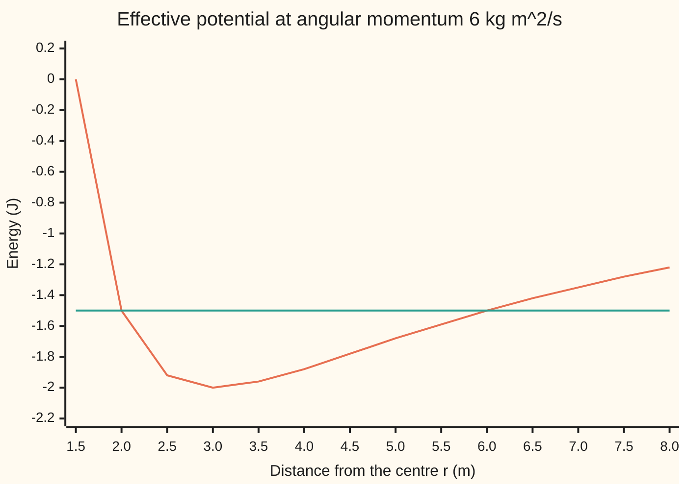
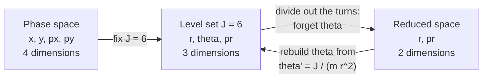

# Moment maps: Noether's conserved quantities as one map, and reducing a system by its symmetry

[Syllabus](../../../SYLLABUS.md) → [Differential geometry and Lie groups](../README.md) → [Lie Groups](../README.md#s06) → Moment maps

---

## General Overview

A drone yaws when it turns about its vertical axis. All the yaw turns together form the circle group $`SO(2)`$. The same turns also turn the whole horizontal plane about that axis, and with it anything that moves in the plane.

Take a 1 kg body in a horizontal plane, pulled toward a fixed centre by a force of $`12/r^2`$ newtons at distance $`r`$ metres. It is a scaled model of an orbit, small enough to follow by hand. The body starts 2 m east of the centre, moving north with momentum 3 kg m/s. Its angular momentum about the centre is $`2 \times 3 = 6`$ kg m²/s.

The turning symmetry does two jobs here:

- **It keeps a number.** The angular momentum stays at 6 kg m²/s for the whole motion.
- **It removes two numbers.** The state needs four numbers, two for position and two for momentum. Fix the angular momentum at 6 and the angle stops mattering. Two numbers are left: the distance $`r`$ and its momentum. The body rocks between 2 m and 6 m in a one-dimensional well, once every 14.510395 s.

The **moment map** is the tool behind both jobs. For each direction a symmetry group can move, it gives a function, unique up to an added constant, whose Hamiltonian flow (the motion Hamilton's equations build from that function) is that move. For yaw, that function is the angular momentum. For all turns of space, it is the vector $`\mathbf{r} \times \mathbf{p}`$, and it keeps a tumbling drone's angular momentum on a sphere.

**A moment map turns each direction of a symmetry group into a function whose Hamiltonian flow is that motion; any energy the group leaves unchanged keeps that function constant, and fixing its value and then dividing out the group leaves a smaller symplectic system, here two numbers in place of four.**

**What kind of fact this is:** two definitions (the moment map and the reduced space) and three theorems. That the moment map is conserved is proved on this card, for any group. Reduction is proved on this card for the turning plane. The general reduction theorem (Marsden and Weinstein, 1974) and the convexity theorem (Atiyah, and Guillemin and Sternberg, 1982) are stated with their sources, not proved. All three are global. Reduction needs the group to move every state on the chosen level freely. The pulled body is a model.

### The picture: the well the reduced system lives in



Orange: the effective potential $`V_{\mathrm{eff}}(r) = 36/(2r^2) - 12/r`$ in joules, the energy left to the distance alone once the angular momentum is fixed. Teal: the body's energy, −1.5 J. The body can only be where orange is below teal, from 2 m to 6 m. The bottom of the well, −2 J at 3 m, is the circular orbit.

---

## The formula

Notation first, in words.

- The **phase space** $`M`$ is the space of states $`z = (x, y, p_x, p_y)`$: position in m, momentum in kg m/s.
- The **symplectic form** $`\omega = dx \wedge dp_x + dy \wedge dp_y`$ measures phase-space area ([Symplectic form](../04-Differential%20Forms/10-symplectic-form-and-hamiltonian-flow.md)). The interior product $`\iota_X \omega`$ puts $`X`$ in its first slot. The field $`X_H`$ with $`\iota_{X_H} \omega = dH`$ is the **Hamiltonian flow** of a function $`H`$.
- A Lie group $`G`$ acts on $`M`$ and keeps $`\omega`$. Its **Lie algebra** $`\mathfrak{g}`$ holds its directions $`\xi`$ at the identity ([Lie algebra](02-lie-algebras-and-the-exponential-map.md)); for yaw, a turn rate in rad/s. The **generating field** $`X_\xi`$ is every state's velocity when the group moves at rate $`\xi`$.
- The **dual** $`\mathfrak{g}^{*}`$ holds the linear readouts of directions. The pairing $`\langle \mu, \xi \rangle`$ is readout $`\mu`$ applied to $`\xi`$.

A **moment map** is a map $`J: M \to \mathfrak{g}^{*}`$ with, for every direction $`\xi`$:

```math
\iota_{X_\xi}\,\omega = d\,\langle J, \xi \rangle, \qquad J(g \cdot z) = g \cdot J(z)
```

**Read it aloud:** the field that moves states along direction xi, fed into omega, is the exterior derivative of J read along xi; and moving a state by g moves its moment the same way.

The second condition is **equivariance**; $`g \cdot J`$ there is the **coadjoint action**, how the group moves readouts. For yaw it does nothing, so any constant may be added to $`J`$; for turns of space it turns the vector, which forces the constant to zero.

For yaw on the plane, the moment map is the angular momentum:

```math
J(x, y, p_x, p_y) = x\,p_y - y\,p_x, \qquad X = (-y,\ x,\ -p_y,\ p_x)
```

**Read it aloud:** J is x times the north momentum minus y times the east momentum; the turn moves position and momentum round together.

**Conservation.** If $`H(g \cdot z) = H(z)`$ for every $`g`$ in $`G`$, then along the flow of $`H`$:

```math
\frac{dJ}{dt} = \{J, H\} = 0
```

**Read it aloud:** the rate of J along the motion, the **Poisson bracket** $`\{J, H\} = dJ(X_H)`$, is zero.

**Reduction.** Fix a value $`c`$ of $`J`$. Keep only the states on the level set $`J^{-1}(c)`$, then treat states that differ by a group move as one:

```math
M_c = J^{-1}(c) \,/\, G_c, \qquad \dim M_c = \dim M - \dim G - \dim G_c
```

**Read it aloud:** the reduced space is the level set at c with the stabiliser of c divided out. The **stabiliser** $`G_c`$ is the members of $`G`$ whose coadjoint action leaves $`c`$ fixed.

For the pulled body at $`c = 6`$ kg m²/s, with polar coordinates $`r`$, $`\theta`$ and radial momentum $`p_r = (x p_x + y p_y)/r`$:

```math
H_c(r, p_r) = \frac{p_r^2}{2m} + \frac{c^2}{2 m r^2} - \frac{k}{r}, \qquad \omega_c = dr \wedge dp_r, \qquad \theta' = \frac{c}{m r^2}
```

**Read it aloud:** the reduced energy is radial kinetic energy plus turning energy plus the pull; the reduced form is area in the plane of r and its momentum; the angle is rebuilt from its rate. The last two terms of $`H_c`$ are the **effective potential** $`V_{\mathrm{eff}}(r)`$.

| Symbol | Plain meaning | In our example | Push it up and the answer… |
| --- | --- | --- | --- |
| $`M`$, $`z`$, $`\omega`$ | phase space; a state; the symplectic form, J s | positions off the centre, any momenta; $`(2, 0, 0, 3)`$; $`dx \wedge dp_x + dy \wedge dp_y`$ | — |
| $`x, y`$; $`p_x, p_y`$; $`m`$ | position, m; momentum, kg m/s; mass, kg | start $`(2, 0)`$ and $`(0, 3)`$; 1 kg | — |
| $`G`$, $`\mathfrak{g}`$, $`\xi`$, $`g`$ | the group; its Lie algebra; a direction (turn rate, rad/s); a member | yaw $`SO(2)`$; all turns $`SO(3)`$ with $`\mathfrak{so}(3)`$ | a bigger group keeps more numbers and leaves a smaller reduced space |
| $`X_\xi`$, $`X_H`$, $`\iota_X`$, $`s`$, $`\alpha`$ | generating field; Hamiltonian flow of $`H`$; interior product; a small turn angle, rad; a one-form | $`X = (-y, x, -p_y, p_x)`$ for one unit of yaw | — |
| $`\mathfrak{g}^{*}`$, $`\langle \mu, \xi \rangle`$, $`g \cdot \mu`$ | readouts of directions; the pairing; the coadjoint action | for $`SO(3)`$: vectors, the dot product, turning the vector | — |
| $`J`$, $`c`$ | moment map, kg m²/s; its chosen value | angular momentum; 6 | well bottom moves out, as $`c^2/(mk)`$ |
| $`H`$, $`E`$, $`\{f, H\}`$ | Hamiltonian, J; its value; Poisson bracket, rate of $`f`$ along $`X_H`$ | $`E`$ = −1.5 J; $`\{J, H\}`$ = 0 | — |
| $`k`$, $`F`$ | pull strength, N m² (force $`k/r^2`$); a steady wind push, N | 12; 0.05 in What breaks | stronger pull: smaller, faster orbit |
| $`r`$, $`\theta`$, $`p_r`$, $`r_0`$; $`u`$, $`v`$ | distance, m; angle from east, rad; radial momentum, kg m/s; a starting distance; two small changes of state | $`r`$ from 2 to 6 m | — |
| $`J^{-1}(c)`$, $`G_c`$, $`M_c`$, $`\omega_c`$, $`H_c`$, $`V_{\mathrm{eff}}`$ | level set; stabiliser of $`c`$; reduced space, form and energy; effective potential, J | 3, 1 and 2 dimensions; $`V_{\mathrm{eff}}`$ lowest −2 J at 3 m | — |
| $`a`$, $`P`$ | half the longest width of the orbit, m; period, s | 4 m; 14.510395 s | longer period, as $`a^{3/2}`$ |
| $`\mathbf{r}, \mathbf{p}`$, $`R`$; $`\Pi`$, $`\Omega`$, $`I_1, I_2, I_3`$ | 3D position and momentum, a turn matrix; drone body momentum, g m²/s, body turn rate, rad/s, principal moments of inertia, kg m² | $`\lvert \Pi \rvert`$ = 36.017357; inertias 0.010, 0.012, 0.020 | — |

Clashes, said once: $`J`$ is not a Jacobi field or a Jacobian; $`H`$ is not mean curvature; the drone's turn rate is $`\Omega`$, since $`\omega`$ is the form; $`R`$ is a turn matrix, not the globe's radius.

### When it holds

- **The action must keep $`\omega`$.** Turning the positions alone, and not the momenta, does not keep it. Then $`\iota_X \omega`$ is not closed, its exterior derivative has an entry of 1.000000, and no moment map exists.
- **Conservation needs $`H`$ unchanged by the group.** A steady 0.05 N wind along east breaks the symmetry, and $`J`$ falls from 6 to 4.694608 kg m²/s in one period.
- **The symmetry must be continuous.** A mirror flip has no direction to differentiate, so it gives no moment map.
- **Reduction needs a free action on the level set.** Every turn must move every state of $`J^{-1}(c)`$. With the centre removed this holds at every $`c`$. On all of $`\mathbb{R}^4`$ the state at rest at the centre is fixed by every turn, so $`c = 0`$ gives a reduced space with a cone point, not a smooth one.
- **Divide by the group as well as fixing the value.** The level set alone has 3 dimensions, an odd number, so it cannot carry a symplectic form.

---

## Why it works

### Step 0: a symplectic form turns functions into flows, and a moment map runs it backwards

Hamilton's equations turn a function into a flow. A symmetry hands over the flow first, the turn; the moment map is the function it came from.

Conservation comes from one swap: $`\omega`$ changes sign when its slots swap, so "H is unchanged along J's flow" means "J is unchanged along H's flow". Reduction comes from a blind spot: inside the level set, $`\omega`$ cannot see the turn direction, and dividing it out leaves a form that sees everything.

### Step 1: the moment map of yaw

Turn a state by a small angle $`s`$. Momentum is an arrow in the plane, so it turns with position. The turn's velocity at $`s = 0`$ is $`X = (-y, x, -p_y, p_x)`$. Feed it into $`\omega`$, using $`\iota_X(dx \wedge dp_x) = X_x\,dp_x - X_{p_x}\,dx`$:

```math
\iota_X \omega = -y\,dp_x + p_y\,dx + x\,dp_y - p_x\,dy = d\,(x\,p_y - y\,p_x)
```

**Read it aloud:** feeding the turn into omega gives exactly the exterior derivative of x p_y minus y p_x.

So $`J = x\,p_y - y\,p_x`$, the angular momentum: 6 kg m²/s at the start. The code finds $`X`$ by turning states through ±0.000001 rad and $`dJ`$ by nudging coordinates; the sides agree to 2.0e-10.

Turning positions alone has field $`(-y, x, 0, 0)`$ and gives $`\alpha = \iota_X \omega = -y\,dp_x + x\,dp_y`$. Its exterior derivative $`d\alpha = -dy \wedge dp_x + dx \wedge dp_y`$ is not zero. A form with $`d\alpha \neq 0`$ is not the slope of any function ([Exterior derivative](../04-Differential%20Forms/03-exterior-derivative.md)), so this move has no moment map. The code prints the largest entry of $`d\alpha`$: 1.000000, against 0.000000 for the true turn.

### Step 2: J is conserved by every energy the turns leave unchanged

Let $`H`$ be any energy with $`H(g \cdot z) = H(z)`$ for every turn. The rate of $`J`$ along the flow of $`H`$ is

```math
\frac{dJ}{dt} = dJ(X_H) = \omega(X_J, X_H) = -\,\omega(X_H, X_J) = -\,dH(X_J) = 0
```

**Read it aloud:** the rate of J is omega of J's field and H's field; swapping the slots flips the sign and gives the rate of H along the turn, which is zero because H does not change when the state turns.

The steps are the chain rule, the definition $`\iota_{X_f}\omega = df`$, antisymmetry, the definition again, and the symmetry of $`H`$. Nothing used that $`G`$ is a circle: for any group, each $`\langle J, \xi \rangle`$ is conserved.

This is [Noether](08-noethers-theorem.md) in Hamiltonian form. Noether's card gets the kept quantity from a Killing field of a metric; here it comes from $`\omega`$ alone.

The pulled body's $`H = (p_x^2 + p_y^2)/(2m) - k/r`$ depends only on lengths, so turns leave it alone. The code computes $`\{J, H\}`$ by differences at a test state: 2.3e-10, rounding error. With a wind push $`F`$ added, $`H`$ gains $`-F x`$ and $`\{J, H\} = -yF`$. At the test state, $`y = -0.7`$ m, this is 0.035000 kg m²/s². Summed over the windy run, this rate gives its whole drop in $`J`$.

The four-coordinate run steps Hamilton's equations by [Runge-Kutta four](../../08-Differential%20equations%20and%20dynamics/05-Numerical%20Evolution/04-runge-kutta-four.md) for one period: $`J`$ drifts 8.6e-12 at 2000 steps, 2.8e-13 at 4000.

### Step 3: many directions at once, and the sphere of moments

Let all turns of space, $`SO(3)`$, act on a body in three dimensions, state $`(\mathbf{r}, \mathbf{p})`$. A direction is a turn-rate vector $`\xi`$, and readouts are vectors paired by the dot product. Repeating Step 1 for each axis gives

```math
J(\mathbf{r}, \mathbf{p}) = \mathbf{r} \times \mathbf{p}, \qquad \langle J, \xi \rangle = \xi \cdot (\mathbf{r} \times \mathbf{p}), \qquad J(R\mathbf{r}, R\mathbf{p}) = R\,J(\mathbf{r}, \mathbf{p})
```

**Read it aloud:** the moment map of all turns is the angular-momentum vector; read along a turn axis it is the angular momentum about that axis; turning the state turns the vector.

The third formula is equivariance: the coadjoint action of a turn turns the vector. The code takes $`\mathbf{r} = (2, 0, 0.5)`$ m and $`\mathbf{p} = (0, 3, 0.4)`$ kg m/s, so $`J = (-1.5, -0.8, 6)`$. It turns both by 0.7 rad about the axis $`(1, 2, 2)/3`$ with [Rotation group](04-rotations-so3-and-quaternions.md)'s Rodrigues formula. $`R J`$ and $`J(R\mathbf{r}, R\mathbf{p})`$ both come out $`(2.005735, -2.079437, 5.526569)`$. So does a separate quaternion turn.

So the **coadjoint orbits**, the sets one readout can be turned to, are spheres about the origin; this one has radius $`\lvert J \rvert`$ = 6.236185 kg m²/s before and after.

### Step 4: reducing the turning plane, proved

The proof is a change to polar coordinates, $`x = r\cos\theta`$, $`y = r\sin\theta`$. The momentum one-form splits:

```math
p_x\,dx + p_y\,dy = p_r\,dr + J\,d\theta, \qquad p_x^2 + p_y^2 = p_r^2 + \frac{J^2}{r^2}
```

**Read it aloud:** momentum times displacement is radial momentum times radial step plus angular momentum times angle step; the squared momentum splits the same way.

Since $`\omega = -d(p_x\,dx + p_y\,dy)`$, it follows that $`\omega = dr \wedge dp_r + d\theta \wedge dJ`$. The fold gives the line-by-line check.

On the level set $`J = c`$, $`dJ = 0`$ and $`\omega`$ becomes $`dr \wedge dp_r`$. The turn direction $`\partial_\theta`$ (change $`\theta`$ alone) is the blind direction: $`\omega`$ gives it zero against everything in the level set. Dividing out the turns forgets $`\theta`$ and leaves the plane of $`(r, p_r)`$ with $`\omega_c = dr \wedge dp_r`$, a true symplectic form.

The turn-invariant energy loses $`\theta`$ too, giving $`H_c`$. Upstairs, Hamilton's equation for $`\theta`$ still holds, $`\theta' = \partial H/\partial J = J/(mr^2)`$, so the angle is rebuilt after the reduced motion is solved: **reconstruction**.



<details>
<summary>Detailed proof: in polar coordinates, omega splits into a radial part and an angular part</summary>

With $`x = r\cos\theta`$ and $`y = r\sin\theta`$:

$`\displaystyle dx = \cos\theta\,dr - r\sin\theta\,d\theta, \qquad dy = \sin\theta\,dr + r\cos\theta\,d\theta.`$

So

$`\displaystyle p_x\,dx + p_y\,dy = (p_x\cos\theta + p_y\sin\theta)\,dr + r\,(p_y\cos\theta - p_x\sin\theta)\,d\theta.`$

The first bracket is $`(x p_x + y p_y)/r = p_r`$. The second, times $`r`$, is $`x p_y - y p_x = J`$.

Take $`d`$ of both sides. On the left, $`d(p_x\,dx) = dp_x \wedge dx = -dx \wedge dp_x`$, so the left becomes $`-\omega`$. On the right, $`d(p_r\,dr + J\,d\theta) = dp_r \wedge dr + dJ \wedge d\theta`$. Hence

$`\displaystyle \omega = dr \wedge dp_r + d\theta \wedge dJ.`$

For the energy, the momentum vector has radial part $`p_r`$ and sideways part $`J/r`$, at right angles, so $`p_x^2 + p_y^2 = p_r^2 + J^2/r^2`$.

On the level set $`J = c`$, the tangent vectors have no $`dJ`$ part. For two of them, $`u`$ and $`v`$, $`\omega(u, v) = u_r v_{p_r} - u_{p_r} v_r`$, and $`\omega(\partial_\theta, v) = dJ(v) = 0`$. So the restricted form is $`dr \wedge dp_r`$, it ignores $`\theta`$, and it descends to the quotient, the plane of $`(r, p_r)`$, where it is nondegenerate.

</details>

### Step 5: the reduced orbit, solved

At the start, $`r = 2`$ m and $`p_r = 0`$, so $`E = V_{\mathrm{eff}}(2) = 36/8 - 12/2 = -1.5`$ J. The body turns round where $`V_{\mathrm{eff}}(r) = E`$. Multiply $`18/r^2 - 12/r = -1.5`$ through by $`r^2`$ and divide by 1.5: $`r^2 - 8r + 12 = 0`$, so $`r`$ = 2 m or 6 m.

The well's bottom is where its slope $`-c^2/(mr^3) + k/r^2`$ is zero: $`r = c^2/(mk) = 3`$ m, with $`V_{\mathrm{eff}}`$ = −2 J. A body started there with $`p_r = 0`$ circles at 3 m.

For the period, Kepler's third law gives $`P = 2\pi\sqrt{m a^3/k}`$. Here $`a = (2 + 6)/2 = 4`$ m is half the orbit's longest width, so $`P = 2\pi\sqrt{64/12}`$ = 14.510395 s.

The code checks this. The four-coordinate run reaches $`x`$ = −6.000000 m at half the period, the far point, due west. The reduced run reaches 6.000000 m at $`P/2`$ and 2.000000 m at $`P`$, passing 4.870262 m at both quarter points. The runs differ in $`r`$ by at most 1.4e-10 m at 4000 steps. The rebuilt angle is 3.141593 rad at $`P/2`$ and 6.283185 rad at $`P`$: the orbit closes after exactly one turn.

### Step 6: the general theorem, and a drone that flips

**Marsden–Weinstein reduction**, stated (Marsden and Weinstein 1974; Cannas da Silva, the chapter on symplectic reduction). Let $`G`$ act on $`(M, \omega)`$, keeping $`\omega`$, with an equivariant moment map $`J`$. Suppose $`c`$ is a **regular value** of $`J`$ (the slope of $`J`$ has full rank at every state of $`J^{-1}(c)`$), and $`G_c`$ acts freely (no member but the identity fixes a state) and properly (automatic for a compact group such as a circle or $`SO(3)`$) on $`J^{-1}(c)`$. Then:

- $`M_c = J^{-1}(c)/G_c`$ is a manifold with one symplectic form $`\omega_c`$ that matches $`\omega`$ on the level set.
- A $`G`$-invariant energy $`H`$ gives an energy $`H_c`$ on $`M_c`$, and the flow of $`H_c`$ is the flow of $`H`$ seen through the quotient.

The dimension count, for the card's three examples:

| System | $`\dim M`$ | $`\dim G`$ | $`\dim G_c`$ | $`\dim M_c`$ |
| --- | ---: | ---: | ---: | ---: |
| body in the plane, yaw $`SO(2)`$ | 4 | 1 | 1 | 2 |
| body in space, all turns $`SO(3)`$, $`c \neq 0`$ | 6 | 3 | 1 | 2 |
| tumbling drone, orientation and spin, $`SO(3)`$ | 6 | 3 | 1 | 2 |

In the last two rows $`G_c`$ is the turns about the axis of $`c`$. For the drone, the reduced space is Step 3's coadjoint sphere. Its angular momentum seen from its own body, $`\Pi`$, moves by Euler's equations:

```math
\Pi' = \Pi \times \Omega, \qquad \Omega_i = \frac{\Pi_i}{I_i}, \qquad \lvert \Pi \rvert = \text{constant}, \qquad E = \sum_{i=1}^{3} \frac{\Pi_i^2}{2 I_i}
```

**Read it aloud:** the body momentum turns at right angles to itself and to the body rate, so its length never changes; the energy is kept too.

A drone with a camera gimbal, modelled with inertias 0.010, 0.012 and 0.020 kg m², is tossed spinning at 3 rad/s about its middle axis, with a wobble of 0.05 rad/s about the other two. The code steps Euler's equations for 20 s. $`\lvert \Pi \rvert`$ stays at 36.017357 g m²/s (grams for readability) to within 3.3e-13 g m²/s, and the energy at 54.037500 mJ. Yet $`\Pi_y`$ goes from 36.000000 to −36.005208 g m²/s: the drone flips end over end, as $`\Pi`$ runs across the sphere along a curve of equal energy.

### Step 7: the convexity theorem, stated

**Atiyah–Guillemin–Sternberg convexity**, stated without proof (Atiyah 1982; Guillemin and Sternberg 1982). Let a torus, several circles turning independently, act on a compact connected symplectic manifold, keeping $`\omega`$, with moment map $`J`$. Then the image of $`J`$ is the **convex hull** (the smallest set that contains every straight segment between its points) of the images of the fixed points. That image is a convex **polytope**, a flat-sided shape.

The smallest case: yaw turning the unit sphere, with $`\omega`$ its area form. The moment map is the height; the fixed points are the poles; the image is the segment from −1 to 1. The code does not check this theorem.

---

## Worked numbers, by hand

The pulled body: 1 kg, pull 12 N m², start 2 m east, momentum 3 kg m/s north.

| Step | Arithmetic | Value |
| --- | --- | --- |
| moment map, $`J = x p_y - y p_x`$ | 2 × 3 − 0 × 0 | 6 kg m²/s |
| kinetic energy | (0² + 3²) ÷ (2 × 1) | 4.5 J |
| pull's energy, $`k/r`$ | 12 ÷ 2 | 6 J |
| energy $`E`$ | 4.5 − 6 | −1.5 J |
| turning points, $`V_{\mathrm{eff}}(r) = E`$ | $`r^2 - 8r + 12 = 0`$ | 2 m and 6 m |
| well bottom | 6² ÷ (1 × 12) | 3 m, $`V_{\mathrm{eff}}`$ −2 J |
| half the longest width, $`a`$ | (2 + 6) ÷ 2 | 4 m |
| period | 2π × √(1 × 4³ ÷ 12) | 14.510395 s |
| **reduced motion** | one radial swing in the well | **2 m to 6 m and back, every 14.510395 s** |

With angular momentum fixed at 6 kg m²/s, the four-number orbit is one number rocking in a well, while the angle is rebuilt from $`\theta' = 6/r^2`$.

### What breaks if you drop a piece

| Mistake | Comes out at | What went wrong |
| --- | --- | --- |
| Turn the positions but not the momenta | $`d(\iota_X \omega)`$ has entry 1.000000; no moment map | The move does not keep $`\omega`$, so its field is not Hamiltonian |
| Add a 0.05 N wind along east | $`\{J, H\}`$ = 0.035000 at the test state; $`J`$ = 4.694608 kg m²/s after one period | $`H`$ changes when the state turns, so $`J`$ is not kept |
| Drop the turning energy $`c^2/(2mr^2)`$ from $`H_c`$ | falls from 2 m to the centre in 0.9069 s | Reduction moved the angular motion into that term; without it the body falls straight in |
| Fix $`J = 6`$ but do not divide out the turns | 3 dimensions, an odd number | A symplectic form needs an even number; the turn direction must go too |

The fall time is $`(\pi/2)\sqrt{m r_0^3/(2k)}`$ from $`r_0`$ = 2 m; stepping the fall to 0.05 m gives 0.9054 s, as the closed form does.

---

## Code, from first principles, and it actually runs

The code takes four roads. Road 1 builds the moment map from its definition, by turning states and nudging coordinates. Road 2 steps the body in all four coordinates by RK4 at two step sizes and watches $`J`$ and $`H`$. Road 3 steps the reduced system in $`(r, p_r)`$ alone, against Road 2 and the closed forms. Road 4 checks equivariance of $`\mathbf{r} \times \mathbf{p}`$ and steps the tumbling drone.

### Python

```python
# Moment maps and symplectic reduction -- the check behind the card.  Standard library only.
# Yaw turns (the circle group SO(2)) act on the plane's phase space z = (x, y, px, py).
# Road 1: the moment map from its definition, iota_X omega = dJ, by finite differences.
# Road 2: the planar Kepler problem stepped in all four coordinates (RK4): J and H stay put.
# Road 3: the reduced system at J = 6, one radial degree of freedom, against the full run
#         and against the closed-form turning points and period.
# Road 4: SO(3): the moment map r x p is equivariant; a tumbling drone's body momentum
#         stays on a sphere, its coadjoint orbit.
from math import pi, sin, cos, sqrt, asin
M, K, WIND = 1.0, 12.0, 0.05       # mass kg; pull k in N m^2 (force k/r^2); wind push N
Z0 = [2.0, 0.0, 0.0, 3.0]          # x m, y m, px kg m/s, py kg m/s
ZT = [1.3, -0.7, 0.4, 2.1]         # a second test point, nothing special about it

def dot(a, b):                     # plain left-to-right sum, so Rust matches it bit for bit
    t = 0.0
    for u, v in zip(a, b): t += u*v
    return t
def J(z): return z[0]*z[3] - z[1]*z[2]
def H(z, f=0.0): return (z[2]**2 + z[3]**2)/(2*M) - K/sqrt(z[0]**2 + z[1]**2) - f*z[0]
def turn(z, s, momenta=True):      # yaw by angle s; the momenta turn too unless told not to
    c, n = cos(s), sin(s)
    px, py = (c*z[2] - n*z[3], n*z[2] + c*z[3]) if momenta else (z[2], z[3])
    return [c*z[0] - n*z[1], n*z[0] + c*z[1], px, py]
def grad(f, z, h=1e-5):            # central differences
    out = []
    for i in range(4):
        a, b = list(z), list(z); a[i] += h; b[i] -= h
        out.append((f(a) - f(b))/(2*h))
    return out
def gen(z, momenta=True, h=1e-6):  # the generating field X: velocity of the turn at s = 0
    a, b = turn(z, h, momenta), turn(z, -h, momenta)
    return [(a[i] - b[i])/(2*h) for i in range(4)]
def iota(X): return [-X[2], -X[3], X[0], X[1]]   # iota_X omega in (dx, dy, dpx, dpy) parts
def curl(alpha, z, h=1e-4):        # largest entry of d(alpha) for a one-form field alpha
    g = [[(alpha([z[k] + h*(k == i) for k in range(4)])[j] - alpha([z[k] - h*(k == i) for k in range(4)])[j])/(2*h)
          for j in range(4)] for i in range(4)]
    return max(abs(g[i][j] - g[j][i]) for i in range(4) for j in range(4))
def rk4(F, z, dt):
    k1 = F(z); k2 = F([a + dt/2*b for a, b in zip(z, k1)])
    k3 = F([a + dt/2*b for a, b in zip(z, k2)]); k4 = F([a + dt*b for a, b in zip(z, k3)])
    return [a + dt/6*(b + 2*c + 2*d + e) for a, b, c, d, e in zip(z, k1, k2, k3, k4)]
def full(f):                       # Hamilton's equations in x, y, px, py
    def F(z):
        r = sqrt(z[0]**2 + z[1]**2); r3 = r*r*r
        return [z[2]/M, z[3]/M, -K*z[0]/r3 + f, -K*z[1]/r3]
    return F
def reduced(c):                    # (r, pr, theta): one radial freedom plus the angle rebuilt
    return lambda s: [s[1]/M, c*c/(M*s[0]**3) - K/s[0]**2, c/(M*s[0]**2)]
def veff(r, c): return c*c/(2*M*r*r) - K/r

# Road 1: the moment map from its definition
c = J(Z0)
gap = max(abs(a - b) for z in (Z0, ZT) for a, b in zip(iota(gen(z)), grad(J, z)))
d_full, d_pos = curl(lambda z: iota(gen(z)), ZT), curl(lambda z: iota(gen(z, False)), ZT)
XH = lambda z, f: (lambda g: [g[2], g[3], -g[0], -g[1]])(grad(lambda w: H(w, f), z))
pb0 = dot(grad(J, ZT), XH(ZT, 0.0))
pbw = dot(grad(J, ZT), XH(ZT, WIND))
print(f"moment map J at the start: {c:.6f} kg m^2/s")
print(f"iota_X omega minus dJ, largest gap at two points: {gap:.1e}")
print(f"d(iota_X omega): turn x and p {d_full:.6f}; turn x only {d_pos:.6f}")
print(f"dJ/dt = {{J, H}} at test point: no wind {abs(pb0):.1e}, wind 0.05 N {pbw:.6f}")
assert gap < 1e-6
assert d_full < 1e-5 and abs(d_pos - 1.0) < 1e-5 and abs(pbw - 0.035) < 1e-6

# closed forms for the reduced orbit at J = 6
E = H(Z0); disc = sqrt(K*K + 2*E*c*c/M)
r_lo, r_hi = (-K + disc)/(2*E), (-K - disc)/(2*E)
a = -K/(2*E); P = 2*pi*sqrt(M*a**3/K); rc = c*c/(M*K)
print(f"energy E {E:.6f} J; Veff(2) {veff(2.0, c):.6f} J; well bottom r {rc:.6f} m, Veff {veff(rc, c):.6f} J")
print(f"kinetic {(Z0[2]**2 + Z0[3]**2)/(2*M):.6f} J, pull {K/Z0[0]:.6f} J; turning points {r_lo:.6f} m and {r_hi:.6f} m")
print(f"semi-major axis {a:.6f} m; period {P:.6f} s")
print("chart Veff r=1.5..8:", " ".join(f"{veff(1.5 + 0.5*i, c):.2f}" for i in range(14)))

# Road 2 (full, four coordinates) against Road 3 (reduced, one radial freedom), at two steps
for N in (2000, 4000):
    dt, z, s = P/N, list(Z0), [Z0[0], Z0[2], 0.0]   # start on the x axis: r = x, pr = px
    jd = hd = gr = 0.0; rq = []
    for i in range(1, N + 1):
        z, s = rk4(full(0.0), z, dt), rk4(reduced(c), s, dt)
        jd, hd = max(jd, abs(J(z) - c)), max(hd, abs(H(z) - E))
        gr = max(gr, abs(sqrt(z[0]**2 + z[1]**2) - s[0]))
        if i % (N//4) == 0: rq.append(s[0])
        if i == N//2: xh, th = z[0], s[2]
    print(f"N={N}: J drift {jd:.1e}, H drift {hd:.1e}, full x at P/2 {xh:.6f}, reduced r gap {gr:.1e}")
print(f"reduced r at P/4, P/2, 3P/4, P: {' '.join(f'{v:.6f}' for v in rq)}")
print(f"angle rebuilt from theta' = J/(m r^2): {th:.6f} rad at P/2, {s[2]:.6f} rad at P")
far = r_lo + r_hi - Z0[0]          # the turning point opposite the start
assert abs(xh + far) < 1e-6 and jd < 1e-9 and gr < 1e-6
assert abs(rq[1] - far) < 1e-6 and abs(rq[3] - Z0[0]) < 1e-6 and abs(s[2] - 2*pi) < 1e-6

# What breaks: a wind push breaks the symmetry; dropping J^2/(2 m r^2) lets the body fall in
z, tq = list(Z0), 0.0              # tq: the wind's torque -y F summed over time, trapezoid rule
for i in range(4000):
    y_ = z[1]; z = rk4(full(WIND), z, P/4000); tq -= WIND*(y_ + z[1])/2*P/4000
s, t = [2.0, 0.0, 0.0], 0.0
while s[0] > 0.05: s, t = rk4(reduced(0.0), s, 1e-5), t + 1e-5
u = asin(sqrt(0.05/2.0)); tf = sqrt(M*2.0**3/(2*K))*(pi/2 - u + sin(u)*cos(u))
print(f"wind 0.05 N: J after one period {J(z):.6f} kg m^2/s; 6 plus the torque's time integral {c + tq:.6f}")
print(f"no J^2/(2 m r^2) term: reaches r = 0.05 m at {t:.4f} s (closed form {tf:.4f} s), r = 0 at {pi/2*sqrt(M*8/(2*K)):.4f} s")
print("dimensions: phase space 4, level set J = 6 is 3, reduced 3 - 1 = 2; SO(3) on 6: 6 - 3 - 1 = 2")
assert abs(J(z) - c) > 0.01 and abs(J(z) - (c + tq)) < 1e-5 and abs(t - tf) < 1e-4

# Road 4: SO(3). J = r x p is equivariant: J(R r, R p) = R J(r, p)
def cross(a, b): return [a[1]*b[2] - a[2]*b[1], a[2]*b[0] - a[0]*b[2], a[0]*b[1] - a[1]*b[0]]
def rot(v, n, t):                  # Rodrigues: turn v by angle t about unit axis n
    w = cross(n, v); d = dot(n, v)
    return [v[i]*cos(t) + w[i]*sin(t) + n[i]*d*(1 - cos(t)) for i in range(3)]
def qrot(v, n, t):                 # the same turn by the unit quaternion (cos t/2, n sin t/2)
    q0, q = cos(t/2), [x*sin(t/2) for x in n]; w = cross(q, v); u = cross(q, w)
    return [v[i] + 2*q0*w[i] + 2*u[i] for i in range(3)]
rv, pv, ax = [2.0, 0.0, 0.5], [0.0, 3.0, 0.4], [1/3, 2/3, 2/3]
J3 = cross(rv, pv); RJ = rot(J3, ax, 0.7); JR = cross(rot(rv, ax, 0.7), rot(pv, ax, 0.7))
QJ = qrot(J3, ax, 0.7)
f3 = lambda v: " ".join(f"{x:.6f}" for x in v)
print(f"J(r, p) = {f3(J3)}; R J = {f3(RJ)}; J(R r, R p) = {f3(JR)}")
print(f"R J by a unit quaternion instead: {f3(QJ)}")
print(f"|J| before and after the turn: {sqrt(dot(J3, J3)):.6f} {sqrt(dot(JR, JR)):.6f}")
assert max(abs(a - b) for a, b in zip(RJ, JR)) < 1e-12 and max(abs(a - b) for a, b in zip(RJ, QJ)) < 1e-12

# A drone tossed spinning about its middle axis: Euler's equations Pi' = Pi x Omega
I = [0.010, 0.012, 0.020]          # principal moments of inertia, kg m^2
ke = lambda P_: dot([x/(2*w) for x, w in zip(P_, I)], P_)   # kinetic energy, J
body = lambda P_: cross(P_, [P_[i]/I[i] for i in range(3)])
Pi = [I[0]*0.05, I[1]*3.0, I[2]*0.05]; L0 = sqrt(dot(Pi, Pi))
E0 = ke(Pi); y0 = ymin = Pi[1]; ld = ed = 0.0
for i in range(20000):
    Pi = rk4(body, Pi, 1e-3); ymin = min(ymin, Pi[1])
    ld = max(ld, abs(sqrt(dot(Pi, Pi)) - L0))
    ed = max(ed, abs(ke(Pi) - E0))
print(f"tumbling drone: |Pi| {1000*L0:.6f} g m^2/s, drift {1000*ld:.1e}; energy {1000*E0:.6f} mJ, drift {1000*ed:.1e}")
print(f"Pi_y starts {1000*y0:.6f}, lowest {1000*ymin:.6f} g m^2/s; a flip sends it near -|Pi|")
assert ld < 1e-9 and ed < 1e-9 and ymin < -0.9*L0
print("ALL CHECKS PASS")
```

**Ran 2026-11-24 on macOS, Python 3.14.10, standard library only. All checks passed. Output, pasted from the run:**

```
moment map J at the start: 6.000000 kg m^2/s
iota_X omega minus dJ, largest gap at two points: 2.0e-10
d(iota_X omega): turn x and p 0.000000; turn x only 1.000000
dJ/dt = {J, H} at test point: no wind 2.3e-10, wind 0.05 N 0.035000
energy E -1.500000 J; Veff(2) -1.500000 J; well bottom r 3.000000 m, Veff -2.000000 J
kinetic 4.500000 J, pull 6.000000 J; turning points 2.000000 m and 6.000000 m
semi-major axis 4.000000 m; period 14.510395 s
chart Veff r=1.5..8: 0.00 -1.50 -1.92 -2.00 -1.96 -1.88 -1.78 -1.68 -1.59 -1.50 -1.42 -1.35 -1.28 -1.22
N=2000: J drift 8.6e-12, H drift 1.8e-10, full x at P/2 -6.000000, reduced r gap 2.3e-09
N=4000: J drift 2.8e-13, H drift 1.1e-11, full x at P/2 -6.000000, reduced r gap 1.4e-10
reduced r at P/4, P/2, 3P/4, P: 4.870262 6.000000 4.870262 2.000000
angle rebuilt from theta' = J/(m r^2): 3.141593 rad at P/2, 6.283185 rad at P
wind 0.05 N: J after one period 4.694608 kg m^2/s; 6 plus the torque's time integral 4.694608
no J^2/(2 m r^2) term: reaches r = 0.05 m at 0.9054 s (closed form 0.9054 s), r = 0 at 0.9069 s
dimensions: phase space 4, level set J = 6 is 3, reduced 3 - 1 = 2; SO(3) on 6: 6 - 3 - 1 = 2
J(r, p) = -1.500000 -0.800000 6.000000; R J = 2.005735 -2.079437 5.526569; J(R r, R p) = 2.005735 -2.079437 5.526569
R J by a unit quaternion instead: 2.005735 -2.079437 5.526569
|J| before and after the turn: 6.236185 6.236185
tumbling drone: |Pi| 36.017357 g m^2/s, drift 3.3e-13; energy 54.037500 mJ, drift 1.0e-12
Pi_y starts 36.000000, lowest -36.005208 g m^2/s; a flip sends it near -|Pi|
ALL CHECKS PASS
```

### Rust

```rust
// Moment maps and symplectic reduction -- the check behind the card.  std only.
// Yaw turns (the circle group SO(2)) act on the plane's phase space z = (x, y, px, py).
// Road 1: the moment map from its definition, iota_X omega = dJ, by finite differences.
// Road 2: the planar Kepler problem stepped in all four coordinates (RK4): J and H stay put.
// Road 3: the reduced system at J = 6, one radial degree of freedom, against the full run
//         and against the closed-form turning points and period.
// Road 4: SO(3): the moment map r x p is equivariant; a tumbling drone's body momentum
//         stays on a sphere, its coadjoint orbit.
use std::f64::consts::PI;
const M: f64 = 1.0; const K: f64 = 12.0; const WIND: f64 = 0.05; // kg; N m^2; N
const Z0: [f64; 4] = [2.0, 0.0, 0.0, 3.0]; // x m, y m, px kg m/s, py kg m/s
const ZT: [f64; 4] = [1.3, -0.7, 0.4, 2.1]; // a second test point, nothing special about it
type V4 = [f64; 4];
type V3 = [f64; 3];

fn dot(a: &[f64], b: &[f64]) -> f64 { let mut t = 0.0; for i in 0..a.len() { t += a[i] * b[i]; } t }
fn jm(z: &V4) -> f64 { z[0] * z[3] - z[1] * z[2] }
fn ham(z: &V4, f: f64) -> f64 {
    (z[2].powf(2.0) + z[3].powf(2.0)) / (2.0 * M) - K / (z[0].powf(2.0) + z[1].powf(2.0)).sqrt() - f * z[0]
}
fn turn(z: &V4, s: f64, momenta: bool) -> V4 { // yaw by angle s; the momenta turn too unless told not to
    let (c, n) = (s.cos(), s.sin());
    let (px, py) = if momenta { (c * z[2] - n * z[3], n * z[2] + c * z[3]) } else { (z[2], z[3]) };
    [c * z[0] - n * z[1], n * z[0] + c * z[1], px, py]
}
fn grad(f: &dyn Fn(&V4) -> f64, z: &V4) -> V4 { // central differences
    let h = 1e-5; let mut out = [0.0; 4];
    for i in 0..4 { let (mut a, mut b) = (*z, *z); a[i] += h; b[i] -= h; out[i] = (f(&a) - f(&b)) / (2.0 * h); }
    out
}
fn gen(z: &V4, momenta: bool) -> V4 { // the generating field X: velocity of the turn at s = 0
    let h = 1e-6; let (a, b) = (turn(z, h, momenta), turn(z, -h, momenta));
    let mut out = [0.0; 4]; for i in 0..4 { out[i] = (a[i] - b[i]) / (2.0 * h); } out
}
fn iota(x: &V4) -> V4 { [-x[2], -x[3], x[0], x[1]] } // iota_X omega in (dx, dy, dpx, dpy) parts
fn curl(alpha: &dyn Fn(&V4) -> V4, z: &V4) -> f64 { // largest entry of d(alpha)
    let h = 1e-4; let mut g = [[0.0; 4]; 4];
    for i in 0..4 {
        let (mut a, mut b) = (*z, *z); a[i] = z[i] + h; b[i] = z[i] - h;
        let (fa, fb) = (alpha(&a), alpha(&b));
        for j in 0..4 { g[i][j] = (fa[j] - fb[j]) / (2.0 * h); }
    }
    let mut m: f64 = 0.0;
    for i in 0..4 { for j in 0..4 { m = m.max((g[i][j] - g[j][i]).abs()); } }
    m
}
fn rk4<const N: usize>(f: &dyn Fn(&[f64; N]) -> [f64; N], z: &[f64; N], dt: f64) -> [f64; N] {
    let step = |k: &[f64; N], w: f64| { let mut o = *z; for i in 0..N { o[i] = z[i] + w * k[i]; } o };
    let k1 = f(z); let k2 = f(&step(&k1, dt / 2.0)); let k3 = f(&step(&k2, dt / 2.0)); let k4 = f(&step(&k3, dt));
    let mut o = *z;
    for i in 0..N { o[i] = z[i] + dt / 6.0 * (k1[i] + 2.0 * k2[i] + 2.0 * k3[i] + k4[i]); }
    o
}
fn full(f: f64) -> impl Fn(&V4) -> V4 { // Hamilton's equations in x, y, px, py
    move |z: &V4| { let r = (z[0].powf(2.0) + z[1].powf(2.0)).sqrt(); let r3 = r * r * r;
        [z[2] / M, z[3] / M, -K * z[0] / r3 + f, -K * z[1] / r3] }
}
fn reduced(c: f64) -> impl Fn(&V3) -> V3 { // (r, pr, theta): one radial freedom plus the angle rebuilt
    move |s: &V3| [s[1] / M, c * c / (M * s[0].powf(3.0)) - K / s[0].powf(2.0), c / (M * s[0].powf(2.0))]
}
fn veff(r: f64, c: f64) -> f64 { c * c / (2.0 * M * r * r) - K / r }
fn cross(a: &V3, b: &V3) -> V3 { [a[1] * b[2] - a[2] * b[1], a[2] * b[0] - a[0] * b[2], a[0] * b[1] - a[1] * b[0]] }
fn rot(v: &V3, n: &V3, t: f64) -> V3 { // Rodrigues: turn v by angle t about unit axis n
    let w = cross(n, v); let d = dot(n, v); let mut o = [0.0; 3];
    for i in 0..3 { o[i] = v[i] * t.cos() + w[i] * t.sin() + n[i] * d * (1.0 - t.cos()); } o
}
fn qrot(v: &V3, n: &V3, t: f64) -> V3 { // the same turn by the unit quaternion (cos t/2, n sin t/2)
    let q0 = (t / 2.0).cos(); let q = [n[0] * (t / 2.0).sin(), n[1] * (t / 2.0).sin(), n[2] * (t / 2.0).sin()];
    let w = cross(&q, v); let u = cross(&q, &w); [v[0] + 2.0 * q0 * w[0] + 2.0 * u[0], v[1] + 2.0 * q0 * w[1] + 2.0 * u[1], v[2] + 2.0 * q0 * w[2] + 2.0 * u[2]]
}
fn sci(x: f64) -> String { // Python's {:.1e}: two-digit exponent with a sign
    let t = format!("{:.1e}", x); let (m, e) = t.split_once('e').unwrap(); let v: i32 = e.parse().unwrap();
    format!("{}e{}{:02}", m, if v < 0 { '-' } else { '+' }, v.abs())
}
fn f3(v: &V3) -> String { format!("{:.6} {:.6} {:.6}", v[0], v[1], v[2]) }

fn main() {
    // Road 1: the moment map from its definition
    let c = jm(&Z0);
    let mut gap: f64 = 0.0;
    for z in [Z0, ZT] { let (a, b) = (iota(&gen(&z, true)), grad(&jm, &z)); for i in 0..4 { gap = gap.max((a[i] - b[i]).abs()); } }
    let d_full = curl(&|z: &V4| iota(&gen(z, true)), &ZT);
    let d_pos = curl(&|z: &V4| iota(&gen(z, false)), &ZT);
    let xh = |z: &V4, f: f64| { let g = grad(&|w: &V4| ham(w, f), z); [g[2], g[3], -g[0], -g[1]] };
    let pb0 = dot(&grad(&jm, &ZT), &xh(&ZT, 0.0));
    let pbw = dot(&grad(&jm, &ZT), &xh(&ZT, WIND));
    println!("moment map J at the start: {:.6} kg m^2/s", c);
    println!("iota_X omega minus dJ, largest gap at two points: {}", sci(gap));
    println!("d(iota_X omega): turn x and p {:.6}; turn x only {:.6}", d_full, d_pos);
    println!("dJ/dt = {{J, H}} at test point: no wind {}, wind 0.05 N {:.6}", sci(pb0.abs()), pbw);
    assert!(gap < 1e-6);
    assert!(d_full < 1e-5 && (d_pos - 1.0).abs() < 1e-5 && (pbw - 0.035).abs() < 1e-6);

    // closed forms for the reduced orbit at J = 6
    let e = ham(&Z0, 0.0); let disc = (K * K + 2.0 * e * c * c / M).sqrt();
    let (r_lo, r_hi) = ((-K + disc) / (2.0 * e), (-K - disc) / (2.0 * e));
    let a = -K / (2.0 * e); let p = 2.0 * PI * (M * a.powf(3.0) / K).sqrt(); let rc = c * c / (M * K);
    println!("energy E {:.6} J; Veff(2) {:.6} J; well bottom r {:.6} m, Veff {:.6} J", e, veff(2.0, c), rc, veff(rc, c));
    println!("kinetic {:.6} J, pull {:.6} J; turning points {:.6} m and {:.6} m",
        (Z0[2].powf(2.0) + Z0[3].powf(2.0)) / (2.0 * M), K / Z0[0], r_lo, r_hi);
    println!("semi-major axis {:.6} m; period {:.6} s", a, p);
    let ch: Vec<String> = (0..14).map(|i| format!("{:.2}", veff(1.5 + 0.5 * i as f64, c))).collect();
    println!("chart Veff r=1.5..8: {}", ch.join(" "));

    // Road 2 (full, four coordinates) against Road 3 (reduced, one radial freedom), at two steps
    let (fl, rd) = (full(0.0), reduced(c));
    let (mut rq, mut xhalf, mut th, mut s) = (Vec::new(), 0.0, 0.0, [2.0, 0.0, 0.0]);
    let (mut jd, mut gr): (f64, f64) = (0.0, 0.0);
    for n in [2000usize, 4000] {
        let dt = p / n as f64; let mut z = Z0; s = [Z0[0], Z0[2], 0.0]; // start on the x axis
        jd = 0.0; gr = 0.0; let mut hd: f64 = 0.0; rq.clear();
        for i in 1..=n {
            z = rk4(&fl, &z, dt); s = rk4(&rd, &s, dt);
            jd = jd.max((jm(&z) - c).abs()); hd = hd.max((ham(&z, 0.0) - e).abs());
            gr = gr.max(((z[0].powf(2.0) + z[1].powf(2.0)).sqrt() - s[0]).abs());
            if i % (n / 4) == 0 { rq.push(s[0]); }
            if i == n / 2 { xhalf = z[0]; th = s[2]; }
        }
        println!("N={}: J drift {}, H drift {}, full x at P/2 {:.6}, reduced r gap {}", n, sci(jd), sci(hd), xhalf, sci(gr));
    }
    let rs: Vec<String> = rq.iter().map(|v| format!("{:.6}", v)).collect();
    println!("reduced r at P/4, P/2, 3P/4, P: {}", rs.join(" "));
    println!("angle rebuilt from theta' = J/(m r^2): {:.6} rad at P/2, {:.6} rad at P", th, s[2]);
    let far = r_lo + r_hi - Z0[0]; // the turning point opposite the start
    assert!((xhalf + far).abs() < 1e-6 && jd < 1e-9 && gr < 1e-6);
    assert!((rq[1] - far).abs() < 1e-6 && (rq[3] - Z0[0]).abs() < 1e-6 && (s[2] - 2.0 * PI).abs() < 1e-6);

    // What breaks: a wind push breaks the symmetry; dropping J^2/(2 m r^2) lets the body fall in
    let fw = full(WIND); let (mut z, mut tq) = (Z0, 0.0); // tq: the wind's torque -y F summed over time, trapezoid rule
    for _ in 0..4000 { let y_ = z[1]; z = rk4(&fw, &z, p / 4000.0); tq -= WIND * (y_ + z[1]) / 2.0 * p / 4000.0; }
    let r0 = reduced(0.0); let (mut s, mut t) = ([2.0, 0.0, 0.0], 0.0);
    while s[0] > 0.05 { s = rk4(&r0, &s, 1e-5); t = t + 1e-5; }
    let u = (0.05f64 / 2.0).sqrt().asin();
    let tf = (M * 2.0f64.powf(3.0) / (2.0 * K)).sqrt() * (PI / 2.0 - u + u.sin() * u.cos());
    println!("wind 0.05 N: J after one period {:.6} kg m^2/s; 6 plus the torque's time integral {:.6}", jm(&z), c + tq);
    println!("no J^2/(2 m r^2) term: reaches r = 0.05 m at {:.4} s (closed form {:.4} s), r = 0 at {:.4} s",
        t, tf, PI / 2.0 * (M * 8.0 / (2.0 * K)).sqrt());
    println!("dimensions: phase space 4, level set J = 6 is 3, reduced 3 - 1 = 2; SO(3) on 6: 6 - 3 - 1 = 2");
    assert!((jm(&z) - c).abs() > 0.01 && (jm(&z) - (c + tq)).abs() < 1e-5 && (t - tf).abs() < 1e-4);

    // Road 4: SO(3). J = r x p is equivariant: J(R r, R p) = R J(r, p)
    let (rv, pv, ax): (V3, V3, V3) = ([2.0, 0.0, 0.5], [0.0, 3.0, 0.4], [1.0 / 3.0, 2.0 / 3.0, 2.0 / 3.0]);
    let j3 = cross(&rv, &pv); let rj = rot(&j3, &ax, 0.7); let jr = cross(&rot(&rv, &ax, 0.7), &rot(&pv, &ax, 0.7));
    println!("J(r, p) = {}; R J = {}; J(R r, R p) = {}", f3(&j3), f3(&rj), f3(&jr));
    let qj = qrot(&j3, &ax, 0.7);
    println!("R J by a unit quaternion instead: {}", f3(&qj));
    println!("|J| before and after the turn: {:.6} {:.6}", dot(&j3, &j3).sqrt(), dot(&jr, &jr).sqrt());
    assert!((0..3).map(|i| (rj[i] - jr[i]).abs()).fold(0.0, f64::max) < 1e-12 && (0..3).map(|i| (rj[i] - qj[i]).abs()).fold(0.0, f64::max) < 1e-12);

    // A drone tossed spinning about its middle axis: Euler's equations Pi' = Pi x Omega
    let im: V3 = [0.010, 0.012, 0.020]; // principal moments of inertia, kg m^2
    let ke = |q: &V3| dot(&[q[0] / (2.0 * im[0]), q[1] / (2.0 * im[1]), q[2] / (2.0 * im[2])], q); // J
    let body = |q: &V3| cross(q, &[q[0] / im[0], q[1] / im[1], q[2] / im[2]]);
    let mut pi = [im[0] * 0.05, im[1] * 3.0, im[2] * 0.05]; let l0 = dot(&pi, &pi).sqrt();
    let e0 = ke(&pi); let y0 = pi[1]; let mut ymin = pi[1]; let (mut ld, mut ed): (f64, f64) = (0.0, 0.0);
    for _ in 0..20000 {
        pi = rk4(&body, &pi, 1e-3); ymin = ymin.min(pi[1]);
        ld = ld.max((dot(&pi, &pi).sqrt() - l0).abs());
        ed = ed.max((ke(&pi) - e0).abs());
    }
    println!("tumbling drone: |Pi| {:.6} g m^2/s, drift {}; energy {:.6} mJ, drift {}", 1000.0 * l0, sci(1000.0 * ld), 1000.0 * e0, sci(1000.0 * ed));
    println!("Pi_y starts {:.6}, lowest {:.6} g m^2/s; a flip sends it near -|Pi|", 1000.0 * y0, 1000.0 * ymin);
    assert!(ld < 1e-9 && ed < 1e-9 && ymin < -0.9 * l0);
    println!("ALL CHECKS PASS");
}
```

**Ran 2026-11-24 on macOS, rustc 1.98.1, no crates. All checks passed. Output, pasted from the run:**

```
moment map J at the start: 6.000000 kg m^2/s
iota_X omega minus dJ, largest gap at two points: 2.0e-10
d(iota_X omega): turn x and p 0.000000; turn x only 1.000000
dJ/dt = {J, H} at test point: no wind 2.3e-10, wind 0.05 N 0.035000
energy E -1.500000 J; Veff(2) -1.500000 J; well bottom r 3.000000 m, Veff -2.000000 J
kinetic 4.500000 J, pull 6.000000 J; turning points 2.000000 m and 6.000000 m
semi-major axis 4.000000 m; period 14.510395 s
chart Veff r=1.5..8: 0.00 -1.50 -1.92 -2.00 -1.96 -1.88 -1.78 -1.68 -1.59 -1.50 -1.42 -1.35 -1.28 -1.22
N=2000: J drift 8.6e-12, H drift 1.8e-10, full x at P/2 -6.000000, reduced r gap 2.3e-09
N=4000: J drift 2.8e-13, H drift 1.1e-11, full x at P/2 -6.000000, reduced r gap 1.4e-10
reduced r at P/4, P/2, 3P/4, P: 4.870262 6.000000 4.870262 2.000000
angle rebuilt from theta' = J/(m r^2): 3.141593 rad at P/2, 6.283185 rad at P
wind 0.05 N: J after one period 4.694608 kg m^2/s; 6 plus the torque's time integral 4.694608
no J^2/(2 m r^2) term: reaches r = 0.05 m at 0.9054 s (closed form 0.9054 s), r = 0 at 0.9069 s
dimensions: phase space 4, level set J = 6 is 3, reduced 3 - 1 = 2; SO(3) on 6: 6 - 3 - 1 = 2
J(r, p) = -1.500000 -0.800000 6.000000; R J = 2.005735 -2.079437 5.526569; J(R r, R p) = 2.005735 -2.079437 5.526569
R J by a unit quaternion instead: 2.005735 -2.079437 5.526569
|J| before and after the turn: 6.236185 6.236185
tumbling drone: |Pi| 36.017357 g m^2/s, drift 3.3e-13; energy 54.037500 mJ, drift 1.0e-12
Pi_y starts 36.000000, lowest -36.005208 g m^2/s; a flip sends it near -|Pi|
ALL CHECKS PASS
```

### Lean

Lean proves the moment map, conservation and reduction facts for yaw on the plane, and checks the worked numbers.

- Take $`J = x p_y - y p_x`$. Then its Hamiltonian flow is the velocity of a yaw turn at angle zero.
- That velocity is $`(-y, x, -p_y, p_x)`$ at every state. So $`J`$ is the moment map of yaw.
- Suppose $`H`$ is unchanged by every yaw turn, has a slope at each state passed, and the motion follows Hamilton's equations. Then $`J`$ keeps its starting value at every time.
- Take a state off the centre with $`J = c`$, in a pull of strength $`k`$. Then the energy $`H`$ equals the reduced energy $`H_c(r, p_r)`$.
- Lean checks $`J = 6`$, $`E = -1.5`$ J and the turning points 2 m and 6 m.
- It also checks the well bottom at 3 m, the half width 4 m, the wind rate 0.035 and the dimension counts.
- It checks Step 3's $`J = (-1.5, -0.8, 6)`$ as a cross product.

The stepped orbits, the period, the $`SO(3)`$ turns, the drone's flip and $`\omega_c`$ are left to the Python and Rust checks.

```lean
-- Moment maps: for yaw turning the plane's phase space, the angular momentum J = x p_y − y p_x is the moment map, it stays constant along the flow of every energy the turns leave unchanged, and on the level J = c the energy reduces to the one-freedom energy p_r²/(2m) + c²/(2 m r²) − k/r.
import Mathlib.Analysis.Calculus.FDeriv.Basic
import Mathlib.Analysis.Calculus.Deriv.Basic
import Mathlib.Analysis.SpecialFunctions.Trigonometric.Deriv
import Mathlib.Analysis.SpecialFunctions.Sqrt
import Mathlib.LinearAlgebra.CrossProduct
import Mathlib.Data.Fin.VecNotation
import Mathlib.Tactic.NormNum
import Mathlib.Analysis.Calculus.MeanValue
import Mathlib.Analysis.Calculus.FDeriv.Mul
import Mathlib.Analysis.Calculus.Deriv.Prod

namespace MomentMaps

/-! A state of a body in the plane is `z = (x, y, p_x, p_y)`, stored as `z : Fin 4 → ℝ` with
`z 0 = x`, `z 1 = y`, `z 2 = p_x`, `z 3 = p_y`. The symplectic form is
`ω = dx ∧ dp_x + dy ∧ dp_y`, so the Hamiltonian flow of a function `H` is the field
`X_H = (∂H/∂p_x, ∂H/∂p_y, −∂H/∂x, −∂H/∂y)`, the one with `ι_{X_H} ω = dH`. -/

/-- The angular momentum `J = x p_y − y p_x`. -/
def angMom (z : Fin 4 → ℝ) : ℝ := z 0 * z 3 - z 1 * z 2

/-- Yaw by the angle `s`: position and momentum turn together. -/
noncomputable def yaw (s : ℝ) (z : Fin 4 → ℝ) : Fin 4 → ℝ :=
  ![Real.cos s * z 0 - Real.sin s * z 1, Real.sin s * z 0 + Real.cos s * z 1,
    Real.cos s * z 2 - Real.sin s * z 3, Real.sin s * z 2 + Real.cos s * z 3]

/-- The partial derivative of `H` along coordinate `i` at the state `z`. -/
noncomputable def pd (H : (Fin 4 → ℝ) → ℝ) (z : Fin 4 → ℝ) (i : Fin 4) : ℝ :=
  fderiv ℝ H z (Pi.single i 1)

/-- The Hamiltonian flow of `H` for `ω = dx ∧ dp_x + dy ∧ dp_y`:
`X_H = (∂H/∂p_x, ∂H/∂p_y, −∂H/∂x, −∂H/∂y)`. -/
noncomputable def hamField (H : (Fin 4 → ℝ) → ℝ) (z : Fin 4 → ℝ) : Fin 4 → ℝ :=
  ![pd H z 2, pd H z 3, -pd H z 0, -pd H z 1]

/-- The derivative of the yaw turn at angle zero. -/
theorem yaw_hasDerivAt_zero (z : Fin 4 → ℝ) :
    HasDerivAt (fun s => yaw s z) ![-z 1, z 0, -z 3, z 2] 0 := by
  rw [hasDerivAt_pi]
  intro i
  fin_cases i
  · have := (((Real.hasDerivAt_cos 0).mul_const (z 0)).sub ((Real.hasDerivAt_sin 0).mul_const (z 1)))
    convert this using 1 <;> simp [yaw]; rfl
  · have := (((Real.hasDerivAt_sin 0).mul_const (z 0)).add ((Real.hasDerivAt_cos 0).mul_const (z 1)))
    convert this using 1 <;> simp [yaw]; rfl
  · have := (((Real.hasDerivAt_cos 0).mul_const (z 2)).sub ((Real.hasDerivAt_sin 0).mul_const (z 3)))
    convert this using 1 <;> simp [yaw]; rfl
  · have := (((Real.hasDerivAt_sin 0).mul_const (z 2)).add ((Real.hasDerivAt_cos 0).mul_const (z 3)))
    convert this using 1 <;> simp [yaw]; rfl

/-- A vector of `Fin 4 → ℝ` as a sum of the coordinate vectors. -/
theorem vec_eq_sum_single (v : Fin 4 → ℝ) :
    v = v 0 • Pi.single 0 1 + v 1 • Pi.single 1 1 + v 2 • Pi.single 2 1 + v 3 • Pi.single 3 1 := by
  ext i; fin_cases i <;> simp

/-- The derivative of the angular momentum. -/
theorem angMom_hasFDerivAt (z : Fin 4 → ℝ) :
    HasFDerivAt angMom
      ((z 0 • ContinuousLinearMap.proj 3 + z 3 • ContinuousLinearMap.proj 0) -
        (z 1 • ContinuousLinearMap.proj 2 + z 2 • ContinuousLinearMap.proj 1) :
          (Fin 4 → ℝ) →L[ℝ] ℝ) z := by
  have h0 := hasFDerivAt_apply (𝕜 := ℝ) (0 : Fin 4) z
  have h1 := hasFDerivAt_apply (𝕜 := ℝ) (1 : Fin 4) z
  have h2 := hasFDerivAt_apply (𝕜 := ℝ) (2 : Fin 4) z
  have h3 := hasFDerivAt_apply (𝕜 := ℝ) (3 : Fin 4) z
  exact (h0.mul h3).sub (h1.mul h2)

theorem angMom_pd (z : Fin 4 → ℝ) :
    pd angMom z 0 = z 3 ∧ pd angMom z 1 = -z 2 ∧ pd angMom z 2 = -z 1 ∧ pd angMom z 3 = z 0 := by
  simp only [pd, (angMom_hasFDerivAt z).fderiv]
  simp

/-- **The moment map is conserved.** Let `H` be an energy that yaw leaves unchanged,
`H(g · z) = H(z)` for every turn `g`. Along any motion that follows Hamilton's equations for
`H` (with `H` differentiable at the states it passes through), the moment map of yaw, the
angular momentum `J = x p_y − y p_x`, keeps its starting value: `dJ/dt = {J, H} = 0`. -/
theorem moment_map_conserved_by_invariant_energy (H : (Fin 4 → ℝ) → ℝ)
    (hinv : ∀ s z, H (yaw s z) = H z)
    (γ : ℝ → Fin 4 → ℝ) (hdiff : ∀ t, DifferentiableAt ℝ H (γ t))
    (hflow : ∀ t, HasDerivAt γ (hamField H (γ t)) t) :
    ∀ t, angMom (γ t) = angMom (γ 0) := by
  have hderiv : ∀ t, HasDerivAt (fun t => angMom (γ t)) 0 t := by
    intro t
    set z := γ t with hz
    have hyaw0 : yaw 0 z = z := by
      ext i; fin_cases i <;> simp [yaw]
    have hH : HasFDerivAt H (fderiv ℝ H z) (yaw 0 z) := by
      rw [hyaw0]; exact (hdiff t).hasFDerivAt
    have hcomp := hH.comp_hasDerivAt (0 : ℝ) (yaw_hasDerivAt_zero z)
    have hconst : HasDerivAt (H ∘ fun s => yaw s z) 0 0 := by
      have : (H ∘ fun s => yaw s z) = fun _ => H z := by
        funext s; simp [hinv]
      rw [this]; exact hasDerivAt_const _ _
    have hzero := hcomp.unique hconst
    rw [vec_eq_sum_single ![-z 1, z 0, -z 3, z 2]] at hzero
    simp only [map_add, map_smul] at hzero
    have hJ := (angMom_hasFDerivAt z).comp_hasDerivAt t (hflow t)
    refine hJ.congr_deriv ?_
    simp [hamField, pd] at hzero ⊢
    linear_combination -hzero
  intro t
  have hd : Differentiable ℝ (fun t => angMom (γ t)) := fun t => (hderiv t).differentiableAt
  exact is_const_of_deriv_eq_zero hd (fun t => (hderiv t).deriv) t 0

/-- **Angular momentum is the moment map of yaw.** The Hamiltonian flow of
`J = x p_y − y p_x` is exactly the velocity of the turn at angle zero,
`X = (−y, x, −p_y, p_x)`; that is, `ι_X ω = dJ`. -/
theorem angular_momentum_is_moment_map_of_yaw (z : Fin 4 → ℝ) :
    hamField angMom z = deriv (fun s => yaw s z) 0 ∧
    hamField angMom z = ![-z 1, z 0, -z 3, z 2] := by
  have h2 : hamField angMom z = ![-z 1, z 0, -z 3, z 2] := by
    obtain ⟨a, b, c, d⟩ := angMom_pd z
    simp only [hamField, a, b, c, d, neg_neg]
  exact ⟨by rw [(yaw_hasDerivAt_zero z).deriv, h2], h2⟩

/-- **Reduction of the turning plane.** Away from the centre, write `r = √(x² + y²)` and the
radial momentum `p_r = (x p_x + y p_y)/r`. On the level set `J = c`, the energy of a body of
mass `m` pulled by `k/r²` equals the reduced energy of one radial freedom:
`(p_x² + p_y²)/(2m) − k/r = p_r²/(2m) + c²/(2 m r²) − k/r`. -/
theorem energy_reduces_on_level_set (m k c x y px py : ℝ) (hr : x ^ 2 + y ^ 2 ≠ 0)
    (hJ : x * py - y * px = c) :
    (px ^ 2 + py ^ 2) / (2 * m) - k / Real.sqrt (x ^ 2 + y ^ 2) =
      ((x * px + y * py) / Real.sqrt (x ^ 2 + y ^ 2)) ^ 2 / (2 * m)
        + c ^ 2 / (2 * m * Real.sqrt (x ^ 2 + y ^ 2) ^ 2) - k / Real.sqrt (x ^ 2 + y ^ 2) := by
  have hpos : 0 ≤ x ^ 2 + y ^ 2 := by positivity
  have hs2 : Real.sqrt (x ^ 2 + y ^ 2) ^ 2 = x ^ 2 + y ^ 2 := Real.sq_sqrt hpos
  have key : ((x * px + y * py) / Real.sqrt (x ^ 2 + y ^ 2)) ^ 2
      + c ^ 2 / Real.sqrt (x ^ 2 + y ^ 2) ^ 2 = px ^ 2 + py ^ 2 := by
    rw [div_pow, hs2, ← hJ, ← add_div, div_eq_iff hr]
    ring
  rw [← key, add_div, div_div, mul_comm (Real.sqrt (x ^ 2 + y ^ 2) ^ 2) (2 * m)]

/-! The card's exact worked numbers: mass 1 kg, pull 12 N m², start 2 m east with momentum
3 kg m/s north. -/

-- The moment map at the start: J = 2 × 3 − 0 × 0 = 6 kg m²/s.
example : angMom ![2, 0, 0, 3] = 6 := by norm_num [angMom]
-- Energy: kinetic (0² + 3²)/(2 × 1) = 9/2 J, pull 12/2 = 6 J, so E = −3/2 J.
example : ((0 : ℚ) ^ 2 + 3 ^ 2) / (2 * 1) = 9 / 2 ∧ (12 : ℚ) / 2 = 6 ∧
    (9 / 2 : ℚ) - 6 = -3 / 2 := by norm_num
-- Turning points: V_eff(r) = 36/(2r²) − 12/r equals −3/2 at r = 2 and r = 6, the roots of
-- r² − 8r + 12 = 0.
example : (36 : ℚ) / (2 * 2 ^ 2) - 12 / 2 = -3 / 2 ∧ (36 : ℚ) / (2 * 6 ^ 2) - 12 / 6 = -3 / 2 ∧
    (2 : ℚ) ^ 2 - 8 * 2 + 12 = 0 ∧ (6 : ℚ) ^ 2 - 8 * 6 + 12 = 0 := by norm_num
-- Well bottom: r = c²/(mk) = 36/12 = 3 m, where V_eff = 36/18 − 12/3 = −2 J.
example : (6 : ℚ) ^ 2 / (1 * 12) = 3 ∧ (36 : ℚ) / (2 * 3 ^ 2) - 12 / 3 = -2 := by norm_num
-- The chart's first point: V_eff(3/2) = 36/(2 × 9/4) − 12/(3/2) = 8 − 8 = 0 J.
example : (36 : ℚ) / (2 * (3 / 2) ^ 2) - 12 / (3 / 2) = 0 := by norm_num
-- Half the longest width a = (2 + 6)/2 = 4 m, and m a³/k = 64/12 = 16/3 under the period's root.
example : ((2 : ℚ) + 6) / 2 = 4 ∧ (1 * 4 ^ 3 : ℚ) / 12 = 16 / 3 := by norm_num
-- Wind 1/20 N at the test state y = −7/10 m: {J, H} = −y F = 7/200 = 0.035 kg m²/s².
example : -(-7 / 10 : ℚ) * (1 / 20) = 7 / 200 := by norm_num
-- All turns of space: r = (2, 0, 1/2), p = (0, 3, 2/5) give J = r × p = (−3/2, −4/5, 6).
example : crossProduct ![(2 : ℚ), 0, 1 / 2] ![0, 3, 2 / 5] = ![-3 / 2, -4 / 5, 6] := by
  ext i; fin_cases i <;> norm_num [cross_apply]
-- Dimension counts dim M − dim G − dim G_c: 4 − 1 − 1 = 2 (yaw on the plane) and
-- 6 − 3 − 1 = 2 (all turns of space).
example : (4 : ℤ) - 1 - 1 = 2 ∧ (6 : ℤ) - 3 - 1 = 2 := by norm_num

#print axioms yaw_hasDerivAt_zero
#print axioms vec_eq_sum_single
#print axioms angMom_hasFDerivAt
#print axioms angMom_pd
#print axioms moment_map_conserved_by_invariant_energy
#print axioms angular_momentum_is_moment_map_of_yaw
#print axioms energy_reduces_on_level_set

end MomentMaps
```

**Checked 2026-11-24 on macOS, Lean 4.36.0-rc2, Mathlib v4.36.0-rc2. Every proof is complete and uses only Lean's standard axioms. Output, pasted from the run:**

```
'MomentMaps.yaw_hasDerivAt_zero' depends on axioms: [propext, Classical.choice, Quot.sound]
'MomentMaps.vec_eq_sum_single' depends on axioms: [propext, Classical.choice, Quot.sound]
'MomentMaps.angMom_hasFDerivAt' depends on axioms: [propext, Classical.choice, Quot.sound]
'MomentMaps.angMom_pd' depends on axioms: [propext, Classical.choice, Quot.sound]
'MomentMaps.moment_map_conserved_by_invariant_energy' depends on axioms: [propext, Classical.choice, Quot.sound]
'MomentMaps.angular_momentum_is_moment_map_of_yaw' depends on axioms: [propext, Classical.choice, Quot.sound]
'MomentMaps.energy_reduces_on_level_set' depends on axioms: [propext, Classical.choice, Quot.sound]
```

> [!TIP]
> **Try changing**
> - **Guess first: what does less angular momentum do?** Set `Z0` to `[2.0, 0.0, 0.0, 2.0]`. $`J`$ becomes 4 kg m²/s, the energy −4 J, and the body now swings between 1 m and 2 m, with period 3.332162 s. Every check passes.
> - **Guess first: what pull makes the orbit a circle at 2 m?** Set `K` to `18.0`. Then $`c^2/(mk) = 2`$ m, both turning points are 2 m, the period is 4.188790 s, and the reduced $`r`$ stays at 2.000000. Every check passes.
> - **Guess first: does the drone flip if tossed about its smallest axis?** Set the first spin rate to 3.0 and the second to 0.05 in the `Pi` line. $`\lvert \Pi \rvert`$ is 30.022658 g m²/s and stays put, but $`\Pi_y`$ only wanders from 0.600000 to −1.833030 g m²/s. Spin about the smallest or largest axis is stable. The flip assert stops the script.

---

## The usual mistake

> [!warning]
> **Turning only the positions.** Momentum is an arrow in the same plane, so a turn of the plane turns it too. Turn positions alone and the move does not keep $`\omega`$: $`d(\iota_X \omega)`$ has entry 1.000000, no function generates the move, and nothing is conserved.
>
> - Reducing by the level set only: fixing $`J = 6`$ leaves 3 dimensions, which cannot carry a symplectic form. Divide out the turns as well, for 2.
> - Dropping the turning energy: without $`c^2/(2mr^2)`$ the reduced body falls to the centre in 0.9069 s, instead of turning round at 2 m.
> - Expecting $`J`$ to stay when the energy is not turn-invariant: a 0.05 N wind takes it from 6 to 4.694608 kg m²/s in one period.
> - Forgetting reconstruction: the reduced motion gives $`r(t)`$, not the orbit. The angle comes back from $`\theta' = J/(mr^2)`$: 3.141593 rad at half the period.

---

## Where you meet it in real life

- **Spacecraft and drone attitude.** With no outside torque, the body's angular momentum runs on a sphere, and a spin about the middle axis is unstable and flips (Marsden and Ratiu).
- **Orbit design.** A two-body orbit reduces to radial motion in the effective potential; the well's turning points are the orbit's closest and farthest points.
- **Molecular spectra.** A spinning molecule's bond feels the same turning energy $`J^2/(2mr^2)`$, which stretches it and shifts its spectral lines.
- **Simulation codes.** A drifting angular momentum flags a bug; this card's code keeps $`J`$ to 2.8e-13.

> **Say it back**
> A moment map turns each direction of a symmetry group into a function whose Hamiltonian flow is that motion. For yaw on the plane it is the angular momentum, $`x p_y - y p_x`$, which is 6 kg m²/s for the pulled body. Any energy the turns leave unchanged keeps it constant, because swapping the two slots of $`\omega`$ swaps "H along the turn" with "J along the motion". Fixing the value and dividing out the turns removes two dimensions: the body becomes one number in a well, rocking between 2 m and 6 m every 14.510395 s. For all turns of space the moment map is the vector $`\mathbf{r} \times \mathbf{p}`$, and its reduced spaces are spheres, which is why a tumbling drone's momentum stays on one.

---

## What this builds on

- [Symplectic form](../04-Differential%20Forms/10-symplectic-form-and-hamiltonian-flow.md): $`\omega`$, the interior product and the rule $`\iota_{X_H}\omega = dH`$, which the moment map's definition runs backwards.
- [Darboux's theorem](../04-Differential%20Forms/11-darboux-theorem-and-the-moser-trick.md): every symplectic form looks like $`dq \wedge dp`$ near a point, so the coordinate work of Steps 1 and 4 is the local picture on any symplectic manifold.
- [Group action and homogeneous space](06-homogeneous-spaces-and-group-actions.md): orbits, stabilisers and the quotient by a group, which reduction uses to build $`M_c`$.
- [Noether](08-noethers-theorem.md): the conserved momentum of one symmetry, which Step 2 rebuilds from $`\omega`$ and the moment map collects into one map for a whole group.
- [Lie algebra](02-lie-algebras-and-the-exponential-map.md): the directions $`\xi`$ that the moment map pairs with, and $`\mathfrak{so}(3)`$ as turn-rate vectors.
- [Rotation group](04-rotations-so3-and-quaternions.md): Rodrigues' formula for the turn in Step 3, and the drone's orientations.

## Where this goes next

- [Chern-Weil](13-chern-weil-theory-and-characteristic-classes.md): whole numbers from curvature that tell a twisted bundle from a plain one. Here the level set $`J^{-1}(c)`$ is a circle bundle over the reduced space, untwisted over the plane of $`(r, p_r)`$.

Left open: what does reduction give at a value where the group does not act freely, such as $`c = 0`$ with a state that every turn fixes?

---

## Sources

Verified 2026-11-24: every link below resolves to the publisher's page.

- Marsden, J., and A. Weinstein. "Reduction of symplectic manifolds with symmetry." *Reports on Mathematical Physics* 5, no. 1 (1974): 121–130. [doi:10.1016/0034-4877(74)90021-4](https://doi.org/10.1016/0034-4877(74)90021-4). The reduction theorem of Step 6.
- Cannas da Silva, A. *Lectures on Symplectic Geometry*. Lecture Notes in Mathematics 1764. Springer (2001; corrected printing 2008). [doi:10.1007/978-3-540-45330-7](https://doi.org/10.1007/978-3-540-45330-7). Moment maps, equivariance, reduction and convexity, in textbook form.
- Marsden, J. E., and T. S. Ratiu. *Introduction to Mechanics and Symmetry*, 2nd ed. Texts in Applied Mathematics 17. Springer (1999). [doi:10.1007/978-0-387-21792-5](https://doi.org/10.1007/978-0-387-21792-5). Momentum maps in mechanics, coadjoint orbits and the free rigid body.
- Atiyah, M. F. "Convexity and commuting Hamiltonians." *Bulletin of the London Mathematical Society* 14, no. 1 (1982): 1–15. [doi:10.1112/blms/14.1.1](https://doi.org/10.1112/blms/14.1.1). One of the two proofs of the convexity theorem of Step 7.
- Guillemin, V., and S. Sternberg. "Convexity properties of the moment mapping." *Inventiones Mathematicae* 67 (1982): 491–513. [doi:10.1007/BF01398933](https://doi.org/10.1007/BF01398933). The other proof of the convexity theorem, for torus actions.
