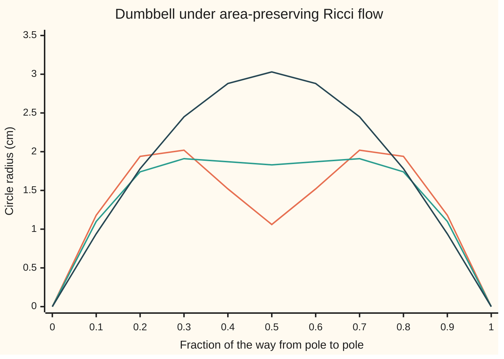

# Ricci flow: let curvature spread out like heat

[Syllabus](../../../SYLLABUS.md) → [Differential geometry and Lie groups](../README.md) → [Geometric Analysis and Physics](../README.md#s07) → Ricci flow

---

## General Overview

Take a closed skin shaped like a dumbbell: two balls of radius 2 cm, joined by a neck 1.063 cm in radius. The skin covers 115.27 cm². The balls curve like a sphere. The neck curves like a saddle, at −0.7596 per cm².

Ricci flow changes the skin's **metric** (the rule that gives every length and angle on it) a little at a time. Each patch shrinks in proportion to its curvature. A patch curved like a ball shrinks. A patch curved like a saddle grows. Lumps of curvature spread out, the way heat spreads along a rod.

Run it on the dumbbell. The neck fattens from 1.063 cm to 1.400 cm in one unit of flow time. The skin loses exactly 8π = 25.13 cm² of area per unit of time, whatever its shape. Rescaled to keep its area, it settles into a round ball of radius 3.029 cm.

In three dimensions the same flow does something new. A long, thin neck there shrinks and pinches off. Cutting out such pinches and continuing the flow is the route by which the Poincaré conjecture was proved in 2002–2003.

**Ricci flow moves a metric by minus twice its Ricci curvature, so curvature spreads out like heat; on a closed surface this rounds any shape, while in three dimensions thin necks pinch, and handling those pinches proves the Poincaré conjecture.**

**What kind of fact this is:** the flow is a definition, an equation chosen for the metric. The area law (8π lost per unit time on any sphere-shaped skin) is a theorem, proved on this card. That every surface rounds out is a theorem stated here with its source (Hamilton 1988, Chow 1991). The neck pinch in three dimensions and the Poincaré proof are theorems stated with sources, not proved here. All of these are global results about closed spaces.

### The picture: the dumbbell's waist fills in

The chart tracks the radius of the circle round the skin at each tenth of the way from one pole to the other. The flow here is rescaled to keep the area at 115.34 cm² (the 120-cell grid's value), so shapes at different times compare.



Orange: the dumbbell at the start, with its waist of 1.06 cm. Green: at flow time 2 cm², the waist has filled to 1.83 cm. Dark blue: at flow time 40 cm², a round ball of radius 3.03 cm. Flow time is measured in cm², for a reason given under The formula.

---

## The formula

Notation first, in words. This card introduces **Ricci flow**, $`\partial g/\partial t = -2\,\mathrm{Ric}`$: a family of metrics $`g(t)`$, one for each time $`t`$, changing at the rate shown. $`\mathrm{Ric}`$ is Ricci curvature, one number for each direction at a point: the plane curvatures through that direction, added ([Ricci and scalar curvature](../05-Riemannian%20Geometry/07-ricci-and-scalar-curvature.md)).

```math
\frac{\partial g}{\partial t} = -2\,\mathrm{Ric}
```

**Read it aloud:** the metric changes at a rate of minus twice its own Ricci curvature.

Where Ricci curvature in a direction is positive, lengths in that direction shrink. Where it is negative, they grow. Ricci curvature is a curvature (1/cm²) times the metric (cm²), so it has no units. For the metric (cm²) to change at that rate, $`t`$ must be in cm².

On a surface there is only one plane at each point, so $`\mathrm{Ric} = K g`$, with $`K`$ the Gaussian curvature. The flow becomes a stretch factor for each point. Write the metric as a round unit sphere stretched by $`e^{2u}`$, with $`u`$ a function on the sphere:

```math
g = e^{2u}\, g_{\mathrm{round}}, \qquad \frac{\partial u}{\partial t} = -K, \qquad K = e^{-2u}\left(1 - \Delta_{\mathrm{round}}\, u\right)
```

**Read it aloud:** the log of the stretch factor falls at the rate of the curvature, and the curvature is the stretch factor's inverse times one minus the round Laplacian of $`u`$.

Here $`\Delta_{\mathrm{round}}`$ is the Laplace-Beltrami operator of the unit sphere. It compares $`u`$ at a point with its average nearby ([Volume form and Laplace-Beltrami](../05-Riemannian%20Geometry/08-volume-form-and-the-laplace-beltrami-operator.md)). Two facts follow, proved in Why it works:

```math
\frac{\partial K}{\partial t} = \Delta_g K + 2K^2, \qquad \frac{dA}{dt} = -2\int K\, dA = -4\pi\chi
```

**Read it aloud:** curvature obeys a heat equation plus a term that feeds positive curvature; the area falls at minus four pi times the Euler characteristic.

For a sphere-shaped skin $`\chi = 2`$, so the area falls by $`8\pi`$ = 25.1327 cm² per unit of time. The dumbbell's exact area is 115.27 cm², so it vanishes at $`t = A_0/(8\pi)`$ = 4.5863 cm². On the 120-cell grid it starts at 115.34 cm² and vanishes at 4.5894 cm².

To watch the shape instead of the shrinking, use the **normalised flow**, $`\partial g/\partial t = -2(K - \bar K)\,g`$, where $`\bar K = 4\pi/A`$ is the average curvature. It keeps the area fixed and changes only the shape.

| Symbol | Plain meaning | In our example | Push it up and the answer… |
| --- | --- | --- | --- |
| $`g`$, $`t`$ | the metric, cm²; flow time, cm² | the dumbbell skin; $`t`$ from 0 to 40 | — |
| $`\mathrm{Ric}`$ | Ricci curvature: plane curvatures through one direction, added | $`K g`$ on a surface | that direction shrinks faster |
| $`K`$, $`\bar K`$ | Gaussian curvature, 1/cm², with a ball positive; its average, $`4\pi/A`$ | −0.7596 at the neck; 0.1089 at the end, on the grid | that patch shrinks faster |
| $`u`$ | log of the stretch factor over the round unit sphere | $`e^{u}`$ = 1.0634 at the neck, on the grid | that patch is bigger |
| $`\varphi`$, $`\theta`$ | polar angle down from the north pole; longitude, in rad | the neck at $`\varphi = \pi/2`$ | — |
| $`\Delta_g`$, $`\Delta_{\mathrm{round}}`$ | Laplace-Beltrami operator of $`g`$, and of the unit sphere | drives the spreading | — |
| $`\rho`$, $`\rho_0`$, $`s`$ | radius of the circle round the skin; the neck's radius at the start; distance along the skin from the north pole, cm | $`\rho_0`$ = 1.0632 cm; pole to pole 12.566 cm | — |
| $`A`$, $`A_0`$ | area, cm²; area at the start | 115.27 exact, 115.34 on the grid | longer life, $`A_0/(8\pi)`$ |
| $`\chi`$ | Euler characteristic, $`V - E + F`$ | 2 for any sphere-shaped skin | faster loss of area |
| $`R`$, $`D`$, $`x`$ | ball radius; how far apart the balls sit; the cylinder coordinate | 2 cm; 2; $`x = \ln\tan(\varphi/2)`$ | bigger balls; thinner neck |
| $`T`$ | the time the skin vanishes | 4.5863 cm² (4.5894 on the grid) | — |
| $`N`$, $`h`$ | grid cells from pole to pole; cell width $`\pi/N`$ | 60 and 120 | smaller grid error |

The dumbbell's circle radius, in the cylinder coordinate $`x`$, is the sum of two round balls' profiles: $`\rho(x) = R/\cosh(x - D) + R/\cosh(x + D)`$. Each term alone is a ball of radius $`R`$.

### When it holds

- **The space is closed: no rim, finite size.** The area law needs Gauss-Bonnet, $`\int K\, dA = 2\pi\chi`$. A disc with a rim loses a different amount, set by how its rim bends.
- **The metric is smooth.** Curvature takes second derivatives of the metric. A skin with a sharp crease has no defined curvature at the crease, so the formulas above cannot start there.
- **Time runs forward.** Run with $`+2\,\mathrm{Ric}`$ and the flow is a backward heat equation: lumps sharpen and the grid's small ripples grow without limit.
- **Rounding needs dimension two.** On a surface any metric rounds out. In three dimensions the same flow pinches thin necks (Step 4), and the rounding theorem needs positive Ricci curvature everywhere at the start.

---

## Why it works

### Step 0: Ricci curvature is a Laplacian of the metric

Curvature is built from second derivatives of the metric. In suitable coordinates the leading part of $`\mathrm{Ric}`$ is $`-\tfrac12`$ times the Laplacian of the metric's entries. So $`\partial g/\partial t = -2\,\mathrm{Ric}`$ reads, to leading order, "the metric changes at the rate of its own Laplacian". That is the heat equation ([The heat equation](../../08-Differential%20equations%20and%20dynamics/10-The%20Classical%20PDEs/03-the-heat-equation.md)): each point drifts toward the average of its neighbours, so bumps flatten. The factor 2 cancels the $`\tfrac12`$.

### Step 1: on a surface, the flow is a heat equation for $`u`$

Use a flat chart, here the cylinder chart $`(x, \theta)`$, and write $`g = e^{2u}(dx^2 + d\theta^2)`$. In this step $`u`$ measures the stretch over the flat cylinder, not over the round sphere. The two differ by a fixed function, so they change at the same rate. Then $`K = -\Delta_g u`$. The flow says $`\partial u/\partial t = -K`$, so $`\partial u/\partial t = \Delta_g u`$: the log of the stretch factor obeys the heat equation of its own metric.

In the round chart the same flow carries an extra term, $`-e^{-2u}`$, which shrinks a round ball evenly. A ball of radius 2 cm has $`K = 1/4`$, so $`R^2`$ falls at rate 2: at $`t = 1`$ it is $`4 - 2`$ = 2.000000 cm². The code's flow gives 2.000274.

<details>
<summary>Detailed proof: the heat equations for u and for K</summary>

In the flat chart, $`g = e^{2u}(dx^2 + d\theta^2)`$ has Gaussian curvature $`K = -e^{-2u}(u_{xx} + u_{\theta\theta})`$, and the Laplace-Beltrami operator is $`\Delta_g = e^{-2u}(\partial_x^2 + \partial_\theta^2)`$. So $`K = -\Delta_g u`$.

The flow gives $`\partial g/\partial t = 2u_t\, g = -2K g`$, so $`u_t = -K = \Delta_g u`$.

Now differentiate $`K = -e^{-2u}\,\Delta_{\mathrm{flat}} u`$ in time:

$`\displaystyle K_t = 2u_t\, e^{-2u}\Delta_{\mathrm{flat}} u - e^{-2u}\Delta_{\mathrm{flat}} u_t = -2u_t K - \Delta_g u_t .`$

Put in $`u_t = -K`$: $`K_t = 2K^2 + \Delta_g K`$. The Laplacian spreads curvature out. The $`2K^2`$ term makes positive curvature grow, which is why a ball shrinks to a point in finite time.

For the round chart, the unit sphere has $`g_{\mathrm{round}} = e^{2w}(dx^2 + d\theta^2)`$ with $`e^{w} = 1/\cosh x`$ and $`-\Delta_{\mathrm{flat}} w = e^{2w}`$. Adding exponents, $`K = e^{-2u}(1 - \Delta_{\mathrm{round}}\, u)`$, the formula the code steps.

</details>

### Step 2: topology fixes the loss of area

Each small patch of area changes at $`\partial(dA)/\partial t = 2u_t\, dA = -2K\, dA`$. Add over the whole skin: $`dA/dt = -2\int K\, dA`$. [Gauss-Bonnet](../02-Surfaces/10-gauss-bonnet-theorem.md) says the total curvature of a closed surface is $`2\pi\chi`$, whatever its shape ([Closed surfaces classified](../../17-Topology/03-Surfaces%20and%20Manifolds/02-surfaces-and-the-classification-theorem.md) gives $`\chi`$).

The code checks both sides. The integral of $`K\, dA`$ over the exact dumbbell is 12.566371. An octahedron, a sphere cut into triangles, counts $`6 - 12 + 8 = 2`$, and $`2\pi \times 2`$ = 12.566371. So the dumbbell loses 25.1327 cm² per unit time, and the flow on the grid agrees:

| $`t`$ (cm²) | area on the grid (cm²) | $`A_0 - 8\pi t`$ (cm²) | neck radius (cm) |
| ---: | ---: | ---: | ---: |
| 1 | 90.213948 | 90.211715 | 1.400371 |
| 2 | 65.083979 | 65.078974 | 1.490464 |
| 3 | 39.954413 | 39.946233 | 1.434761 |

The neck grows, then shrinks with everything else as the whole skin heads for zero area at 4.5894 cm² on the grid (4.5863 cm² for the exact shape).

### Step 3: the saddle fills, and the surface rounds

At the neck $`K`$ = −0.7596 per cm², so $`u_t = +0.7596`$: the neck circle grows. Its squared radius rises at $`-2\rho^2 K`$ = 1.717397 cm² per unit time. The flow, run for 0.001, gives 1.714598.

Under the normalised flow the area stays fixed and the shape moves toward constant curvature. Roundness here is pole-to-pole length over $`\pi`$ times the widest radius, which is 1 for a round ball. Every value in this table comes from the 120-cell grid.

| $`t`$ | neck $`\rho`$ | widest $`\rho`$ | $`K`$ min | $`K`$ max | roundness |
| ---: | ---: | ---: | ---: | ---: | ---: |
| 0 | 1.0634 | 2.0744 | −0.75938 | 0.23508 | 1.92829 |
| 1 | 1.5419 | 1.9028 | −0.10691 | 0.30934 | 2.08444 |
| 2 | 1.8308 | 1.9071 | −0.03174 | 0.37677 | 2.00801 |
| 5 | 2.4606 | 2.4604 | 0.04073 | 0.28332 | 1.36876 |
| 10 | 2.9377 | 2.9374 | 0.09607 | 0.13568 | 1.04753 |
| 20 | 3.0285 | 3.0283 | 0.10876 | 0.10930 | 1.00071 |
| 40 | 3.0298 | 3.0295 | 0.10894 | 0.10894 | 1.00009 |

The roundness first rises: the waist fills before the balls merge, so for a while the skin is a long sausage. Then both curvatures close on $`4\pi/A`$ = 0.108938 per cm², and the radius on $`\sqrt{A/4\pi}`$ = 3.029772 cm, with $`A`$ the grid's area. The exact area gives 3.028629 cm.

That every metric on a sphere-shaped surface does this is a theorem. Hamilton (1988) proved it when $`K`$ starts positive everywhere, and Chow (1991) removed that condition. The code shows one case; the theorem is stated here, not proved.

### Step 4: in three dimensions a neck has its own sphere

Spin the same profile in four-dimensional space, so each circle round the skin becomes a round 2-sphere of radius $`\rho`$. The neck is now a short tube whose cross-section is a 2-sphere. Ricci curvature along that 2-sphere gains the curvature of the 2-sphere itself, $`1/\rho^2`$:

```math
\mathrm{Ric}_{\text{neck sphere}} = K + \frac{1}{\rho^2}, \qquad \frac{d(\rho^2)}{dt} = -2\rho^2 K - 2
```

**Read it aloud:** in three dimensions the neck's rate is the surface rate minus 2, from the neck sphere's own curvature.

For the dumbbell's neck, 1.717397 − 2 = −0.282603: the neck now shrinks. On a surface the cross-section is a circle, which has no curvature of its own, so that −2 is missing. This term is why necks pinch in three dimensions. On a surface the only singularity is the whole skin shrinking to a round point at $`t = A_0/(8\pi)`$.

For a long thin neck, almost a cylinder, $`K`$ is near 0 and $`\rho^2`$ falls at exactly 2. A neck of radius 0.5 cm pinches at $`t = 0.5^2/2`$ = 0.125 cm². A round 3-sphere of radius $`R`$ has Ricci curvature $`2/R^2`$ in every direction, so $`R^2`$ falls at 4. Balls of radius 2 cm last until $`t`$ = 1.000000 cm². A neck this thin pinches long before the balls vanish. The example's own neck does not. Its curvature is $`K = -(1 - \rho^2/(2R^2))/\rho^2`$ (Worked numbers), so its 3D rate is exactly $`-\rho^2/R^2`$. At its starting rate of 0.2826 cm² per unit time, its 1.1304 cm² would take $`R^2`$ = 4.000000 cm² of flow time, longer than the balls' 1.0. That holds for every neck in this family. A thinner one is a sharper saddle, and its more negative $`K`$ cancels more of the −2, so it shrinks more slowly. What pinches first is a neck long and thin enough to be nearly a cylinder, with $`K`$ near 0, like the 0.5 cm one above. Angenent and Knopf (2004) proved that such neck pinches really happen for suitable dumbbell metrics on the 3-sphere.

### Step 5: the Poincaré proof, in outline

The Poincaré conjecture says: a closed 3-dimensional space in which every loop can shrink to a point is the 3-sphere. "Every loop can shrink" means its fundamental group is trivial ([The fundamental group](../../17-Topology/04-Homotopy/03-the-fundamental-group.md)). The proof runs the flow and reads the answer from what survives.

1. **Start the flow** from any metric on the space.
2. **If Ricci curvature starts positive,** the normalised flow converges to constant positive curvature (Hamilton 1982). The space is then a round 3-sphere, or a quotient of one, and trivial loops leave only the 3-sphere.
3. **In general, necks pinch** as in Step 4. Perelman showed how to cut each pinching neck, cap the two ends with round pieces, and restart the flow; this is surgery, outlined with its history on the frontier wing's card The Poincare conjecture, solved.
4. **With trivial loops the flow dies out** in finite time, and every piece left at the end is a round 3-sphere.
5. **Glue the record back.** The space was round 3-spheres joined by tubes, and that is the 3-sphere.

---

## Worked numbers, by hand

The dumbbell: two balls of radius $`R`$ = 2 cm, set apart by $`D`$ = 2 in the cylinder chart, $`\cosh 2`$ = 3.7622.

| Step | Arithmetic | Value |
| --- | --- | --- |
| neck radius | $`2R/\cosh D = 4/3.7622`$ | 1.0632 cm |
| neck radius squared | $`1.0632^2`$ | 1.1304 cm² |
| neck curvature | $`-(1 - \rho^2/(2R^2))/\rho^2 = -(1 - 0.1413)/1.1304`$ | −0.7596 1/cm² |
| 2D neck rate | $`-2\rho^2 K = 2 \times 1.1304 \times 0.7596`$ | +1.7174 cm² per unit time |
| 3D neck rate, same profile | $`1.7174 - 2`$ | −0.2826 cm² per unit time |
| total curvature | $`2\pi\chi = 2\pi \times 2`$ | 12.5664 |
| area lost per unit time | $`2 \times 12.5664`$ | 25.1327 cm² |
| area at $`t = 1`$ | $`115.3445 - 25.1327`$ | **90.2117 cm²** |
| vanishing time, grid start | $`115.3445 / 25.1327`$ | 4.5894 cm² |

After one unit of flow time the skin has lost 25.13 cm², the same as any other sphere-shaped skin would, and the flow on the grid gives 90.2139 cm². Its neck has widened, because a saddle grows under the flow.

### What breaks if you drop a piece

| Mistake | Comes out at | What went wrong |
| --- | --- | --- |
| Drop the 2: $`\partial g/\partial t = -\mathrm{Ric}`$ | area 102.78 cm² at $`t = 1`$, not 90.21 | the flow runs at half speed and loses only $`4\pi`$ per unit time |
| Flip the sign: $`+2\,\mathrm{Ric}`$ | the 2 cm ball grows to radius $`\sqrt{6}`$ = 2.4495 cm at $`t = 1`$ (2.4497 on the grid) | time runs backward; on a lumpy skin, ripples blow up |
| Use the 3D thin-neck rule, $`\rho^2`$ falls at 2, on the surface | neck "pinches" at $`t = 1.1304/2`$ = 0.5652 | a circle has no curvature of its own; the real neck widens to 1.4004 cm at $`t = 1`$ |
| Expect rounding in 3D (hypothesis: dimension 2) | a long 0.5 cm neck pinches at 0.125, balls last to 1.0 | the neck sphere's own curvature, $`1/\rho^2`$, wins |
| Expect a round ball from the unnormalised flow | the skin is gone at $`t`$ = 4.5863 | only the normalised flow keeps the area to show the round shape |

The code prints every number in this table.

---

## Code, from first principles, and it actually runs

The code builds the dumbbell, steps the flow on a grid of cells from pole to pole, and reads the answers back. It takes six independent roads. The exact profile, integrated by Simpson's rule, gives the area against the grid at 60 and 120 cells. The total curvature integral is checked against an octahedron's count $`V - E + F`$. The neck curvature's closed form is checked against the grid. A round ball's flow is checked against $`R^2 - 2t`$, and the backward flow against $`R^2 + 2t`$. The normalised flow is checked to keep the area and to end at the radius $`\sqrt{A_0/4\pi}`$. The area law is checked against $`A_0 - 8\pi t`$. The neck's widening rate is checked against a short run of the flow.

### Python

```python
# Ricci flow on a dumbbell surface -- the check behind the card.  Standard library only.
# The metric is g = e^(2u) (round unit sphere), u a function of the polar angle phi.
# On a surface Ric = K g, so the flow dg/dt = -2 Ric is du/dt = -K, stepped on a grid.
from math import pi, sin, cos, tan, log, exp, cosh, tanh, sqrt
R, D = 2.0, 2.0                        # two balls of radius 2 cm, joined; D sets the neck
def rho_x(x):                          # circle radius at cylinder coordinate x (exact profile)
    return R / cosh(x - D) + R / cosh(x + D)
def K_x(x):                            # Gaussian curvature of that profile, -rho''/rho in arc length
    a, b = 1 / cosh(x - D), 1 / cosh(x + D)
    r, r1 = R * (a + b), -R * (a * tanh(x - D) + b * tanh(x + D))
    r2 = R * (a * (1 - 2 * a * a) + b * (1 - 2 * b * b))
    return -(r2 / r - (r1 / r) ** 2) / (r * r)
def neck_rates(d):                    # neck radius, neck K, and d(rho^2)/dt at the neck in 2D and 3D
    r2 = (2 * R / cosh(d)) ** 2
    K = -(1 - r2 / (2 * R * R)) / r2      # closed form of K_x(0)
    return sqrt(r2), K, -2 * r2 * K, -2 * r2 * (K + 1 / r2)  # 3D adds the neck's own 2-sphere, 1/rho^2
def simpson(f, lo, hi, n=6000):        # road 1: integrals over the exact profile
    h = (hi - lo) / n
    s = f(lo) + f(hi) + sum((4 if i % 2 else 2) * f(lo + i * h) for i in range(1, n))
    return s * h / 3
def grid(n, u0=None):                  # road 2: n cells in phi, each of exact weight w
    h = pi / n
    phi = [(i + 0.5) * h for i in range(n)]
    w = [cos(i * h) - cos((i + 1) * h) for i in range(n)]
    f = [sin(i * h) / h for i in range(n + 1)]        # zero at both poles: nothing leaks out
    u = [log(rho_x(log(tan(p / 2))) / sin(p)) if u0 is None else u0 for p in phi]
    return [h, phi, w, f, u]
def curv(st):                          # K = e^(-2u) (1 - Laplacian_round u), cell by cell
    h, phi, w, f, u = st
    n, K = len(u), []
    for i in range(n):
        up = f[i + 1] * (u[i + 1] - u[i]) if i < n - 1 else 0.0
        dn = f[i] * (u[i] - u[i - 1]) if i > 0 else 0.0
        K.append(exp(-2 * u[i]) * (1 - (up - dn) / w[i]))
    return K
def area(st):
    return 2 * pi * sum(exp(2 * a) * b for a, b in zip(st[4], st[2]))
def flow(st, T, norm=False, c=2.0):    # dg/dt = -c Ric (c = 2 is Ricci flow); norm keeps the area
    h, t = st[0], 0.0
    while T - t > 1e-12:
        K, u = curv(st), st[4]
        dt = min(0.2 * h * h * exp(2 * min(u)), T - t)
        kbar = 4 * pi / area(st) if norm else 0.0
        st[4] = [a + dt * (c / 2) * (kbar - k) for a, k in zip(u, K)]
        t += dt
    return st
def neck(st):                          # the equator sits between the two middle cells
    m = len(st[4]) // 2
    return exp((st[4][m - 1] + st[4][m]) / 2)
def shape(st):                         # pole-to-pole length L, widest radius, roundness L/(pi*widest)
    h, phi, w, f, u = st
    L, rho = h * sum(exp(a) for a in u), [exp(a) * sin(p) for a, p in zip(u, phi)]
    return L, max(rho), L / (pi * max(rho))
def profile(st, k=10):                 # circle radius at each tenth of the way from pole to pole
    h, phi, w, f, u = st
    s, acc = [0.0], 0.0
    for a in u:
        s.append(acc + h * exp(a) / 2); acc += h * exp(a)
    s.append(acc)
    r = [0.0] + [exp(a) * sin(p) for a, p in zip(u, phi)] + [0.0]
    out, j = [], 0
    for q in range(k + 1):
        x = acc * q / k
        while j < len(s) - 2 and s[j + 1] < x: j += 1
        out.append(r[j] + (r[j + 1] - r[j]) * (x - s[j]) / (s[j + 1] - s[j]))
    return out
def show(label, v): print(f"{label:<44} {v:12.6f}")
# ---- the surface before the flow ----
A_ex = simpson(lambda x: 2 * pi * rho_x(x) ** 2, -40, 40)
L_ex = simpson(rho_x, -40, 40)
GB = simpson(lambda x: 2 * pi * K_x(x) * rho_x(x) ** 2, -40, 40)
chi = 6 - 12 + 8                       # octahedron: vertices - edges + faces
rho0, K0, rate2, rate3 = neck_rates(D)
show("area, exact profile (cm^2)", A_ex); show("pole-to-pole length (cm)", L_ex)
show("neck radius (cm)", rho0); show("bulb radius, widest (cm)", max(rho_x(i / 100) for i in range(400)))
show("total curvature, integral of K dA", GB); show("2 pi chi, chi = 6 - 12 + 8", 2 * pi * chi)
show("neck K, closed form (1/cm^2)", K0)
show("cosh D", cosh(D)); show("neck radius squared (cm^2)", rho0 ** 2)
show("rho^2 / (2 R^2)", rho0 ** 2 / (2 * R * R)); show("area lost per unit time, 8 pi (cm^2)", 8 * pi)
g60, g120 = grid(60), grid(120)
for n, g in ((60, g60), (120, g120)):
    Kg = curv(g)
    show(f"N={n}: area (cm^2)", area(g)); show(f"N={n}: neck K (1/cm^2)", (Kg[n // 2 - 1] + Kg[n // 2]) / 2)
A0 = area(g120)
# ---- the neck in 2D and in 3D: same profile, d(rho^2)/dt at the neck ----
early = flow(grid(120), 0.001)
rate_sim = (neck(early) ** 2 - neck(g120) ** 2) / 0.001
show("2D neck, d(rho^2)/dt, formula", rate2); show("2D neck, d(rho^2)/dt, flow to t=0.001", rate_sim)
show("3D neck, same profile, d(rho^2)/dt", rate3)
show("3D thin neck rho=0.5: pinch time (cm^2)", 0.5 ** 2 / 2); show("3D ball R=2: vanishing time (cm^2)", R * R / 4)
show("3D dumbbell neck at its start rate: t (cm^2)", rho0 ** 2 / -rate3)
# ---- the true flow: area falls by 8 pi per unit time, whatever the shape ----
ball = flow(grid(120, log(R)), 1.0)
show("round ball R=2 at t=1: radius^2, flow", exp(2 * ball[4][0])); show("  closed form R^2 - 2t", R * R - 2)
st = grid(120)
print("t     area        A0 - 8 pi t   neck radius")
for t in (1, 2, 3):
    st = flow(st, 1.0)
    print(f"{t}  {area(st):11.6f} {A0 - 8 * pi * t:11.6f} {neck(st):11.6f}")
show("vanishing time A0 / (8 pi) (cm^2)", A0 / (8 * pi)); show("  exact area: A / (8 pi) (cm^2)", A_ex / (8 * pi))
# ---- the normalised flow: same area, watch the shape go round ----
print("t   neck rho  widest    K min     K max   roundness")
st, prof, done = grid(120), {}, 0
for t in (0, 1, 2, 5, 10, 20, 40):
    st = flow(st, t - done, norm=True); done = t
    K, (L, wide, rnd) = curv(st), shape(st)
    print(f"{t:<3} {neck(st):8.4f} {wide:8.4f} {min(K):8.5f} {max(K):8.5f} {rnd:8.5f}")
    if t in (0, 2, 40): prof[t] = profile(st)
for t in (0, 2, 40):
    print(f"chart t={t:<2}", ", ".join(f"{v:.2f}" for v in prof[t]))
show("round limit: radius sqrt(A/4pi) (cm)", sqrt(area(st) / (4 * pi)))
show("round limit: K = 4 pi / A (1/cm^2)", 4 * pi / area(st))
show("  exact area: radius sqrt(A/4pi) (cm)", sqrt(A_ex / (4 * pi)))
lo = flow(grid(60), 40, norm=True)
show("N=60 at t=40: roundness", shape(lo)[2])
# ---- what breaks ----
show("drop the 2: area at t=1 (cm^2)", area(flow(grid(120), 1.0, c=1.0)))
flip = exp(flow(grid(60, log(R)), 1.0, c=-2.0)[4][0])
show("flip the sign: ball R=2 radius at t=1", flip); show("  closed form sqrt(R^2 + 2t)", sqrt(R * R + 2))
show("3D rule on the surface: pinch t (cm^2)", rho0 ** 2 / 2)
for d in (1.5, 2.5):                   # try changing: a fatter and a thinner neck
    r, k, a, b = neck_rates(d)
    print(f"try D={d}: neck {r:.6f} cm, K {k:.6f}, 2D rate {a:.6f}, 3D rate {b:.6f}")
assert abs(GB - 2 * pi * chi) < 1e-6                     # Gauss-Bonnet: integral against a count
assert abs(area(g120) - A_ex) < abs(area(g60) - A_ex) < 1.0 # grid area converges to the exact area
assert abs((curv(g120)[59] + curv(g120)[60]) / 2 - K0) < 2e-3
assert abs(rate_sim - rate2) < 0.02                     # neck rate: closed form against the flow
assert rate3 < 0 < rate2                                # widens in 2D, shrinks in 3D
assert abs(exp(2 * ball[4][0]) - (R * R - 2)) < 1e-3
assert abs(area(flow(grid(120), 1.0)) - (A0 - 8 * pi)) < 0.01
assert shape(st)[2] < 1.001 and max(curv(st)) / min(curv(st)) < 1.0001
assert abs(area(st) - A0) < 0.05                       # the normalised flow keeps the area
assert abs(shape(st)[1] - sqrt(A0 / (4 * pi))) < 2e-3  # widest radius against the round radius
assert abs(flip - sqrt(R * R + 2)) < 1e-3               # backward flow against R^2 + 2t
print("ALL CHECKS PASS")
```

**Ran 2026-11-19 on macOS, Python 3.14.10, standard library only. All checks passed. Output, pasted from the run:**

```
area, exact profile (cm^2)                     115.266219
pole-to-pole length (cm)                        12.566371
neck radius (cm)                                 1.063209
bulb radius, widest (cm)                         2.074626
total curvature, integral of K dA               12.566371
2 pi chi, chi = 6 - 12 + 8                      12.566371
neck K, closed form (1/cm^2)                    -0.759632
cosh D                                           3.762196
neck radius squared (cm^2)                       1.130413
rho^2 / (2 R^2)                                  0.141302
area lost per unit time, 8 pi (cm^2)            25.132741
N=60: area (cm^2)                              115.582357
N=60: neck K (1/cm^2)                           -0.758643
N=120: area (cm^2)                             115.344456
N=120: neck K (1/cm^2)                          -0.759385
2D neck, d(rho^2)/dt, formula                    1.717397
2D neck, d(rho^2)/dt, flow to t=0.001            1.714598
3D neck, same profile, d(rho^2)/dt              -0.282603
3D thin neck rho=0.5: pinch time (cm^2)          0.125000
3D ball R=2: vanishing time (cm^2)               1.000000
3D dumbbell neck at its start rate: t (cm^2)     4.000000
round ball R=2 at t=1: radius^2, flow            2.000274
  closed form R^2 - 2t                           2.000000
t     area        A0 - 8 pi t   neck radius
1    90.213948   90.211715    1.400371
2    65.083979   65.078974    1.490464
3    39.954413   39.946233    1.434761
vanishing time A0 / (8 pi) (cm^2)                4.589410
  exact area: A / (8 pi) (cm^2)                  4.586297
t   neck rho  widest    K min     K max   roundness
0     1.0634   2.0744 -0.75938  0.23508  1.92829
1     1.5419   1.9028 -0.10691  0.30934  2.08444
2     1.8308   1.9071 -0.03174  0.37677  2.00801
5     2.4606   2.4604  0.04073  0.28332  1.36876
10    2.9377   2.9374  0.09607  0.13568  1.04753
20    3.0285   3.0283  0.10876  0.10930  1.00071
40    3.0298   3.0295  0.10894  0.10894  1.00009
chart t=0  0.00, 1.18, 1.94, 2.02, 1.52, 1.06, 1.52, 2.02, 1.94, 1.18, 0.00
chart t=2  0.00, 1.10, 1.74, 1.91, 1.87, 1.83, 1.87, 1.91, 1.74, 1.10, 0.00
chart t=40 0.00, 0.94, 1.78, 2.45, 2.88, 3.03, 2.88, 2.45, 1.78, 0.94, 0.00
round limit: radius sqrt(A/4pi) (cm)             3.029772
round limit: K = 4 pi / A (1/cm^2)               0.108938
  exact area: radius sqrt(A/4pi) (cm)            3.028629
N=60 at t=40: roundness                          1.000343
drop the 2: area at t=1 (cm^2)                 102.778628
flip the sign: ball R=2 radius at t=1            2.449714
  closed form sqrt(R^2 + 2t)                     2.449490
3D rule on the surface: pinch t (cm^2)           0.565207
try D=1.5: neck 1.700384 cm, K -0.220864, 2D rate 1.277173, 3D rate -0.722827
try D=2.5: neck 0.652285 cm, K -2.225311, 2D rate 1.893631, 3D rate -0.106369
ALL CHECKS PASS
```

### Rust

```rust
// Ricci flow on a dumbbell surface -- the check behind the card.  Rust std only.
// The metric is g = e^(2u) (round unit sphere), u a function of the polar angle phi.
// On a surface Ric = K g, so the flow dg/dt = -2 Ric is du/dt = -K, stepped on a grid.
use std::f64::consts::PI;
const R: f64 = 2.0; // two balls of radius 2 cm, joined; D sets the neck
const D: f64 = 2.0;
fn rho_x(x: f64) -> f64 { R / (x - D).cosh() + R / (x + D).cosh() }
fn k_x(x: f64) -> f64 { // Gaussian curvature of the exact profile, -rho''/rho in arc length
    let (a, b) = (1.0 / (x - D).cosh(), 1.0 / (x + D).cosh());
    let r = R * (a + b);
    let r1 = -R * (a * (x - D).tanh() + b * (x + D).tanh());
    let r2 = R * (a * (1.0 - 2.0 * a * a) + b * (1.0 - 2.0 * b * b));
    -(r2 / r - (r1 / r) * (r1 / r)) / (r * r)
}
fn neck_rates(d: f64) -> (f64, f64, f64, f64) { // neck radius, K, d(rho^2)/dt in 2D and 3D
    let q = 2.0 * R / d.cosh();
    let r2 = q * q;
    let k = -(1.0 - r2 / (2.0 * R * R)) / r2;
    (r2.sqrt(), k, -2.0 * r2 * k, -2.0 * r2 * (k + 1.0 / r2))
}
fn simpson(f: &dyn Fn(f64) -> f64, lo: f64, hi: f64) -> f64 { // road 1: the exact profile
    let n = 6000;
    let h = (hi - lo) / n as f64;
    let mut acc = 0.0;
    for i in 1..n {
        acc += (if i % 2 == 1 { 4.0 } else { 2.0 }) * f(lo + i as f64 * h);
    }
    (f(lo) + f(hi) + acc) * h / 3.0
}
struct Grid { h: f64, phi: Vec<f64>, w: Vec<f64>, f: Vec<f64>, u: Vec<f64> }
fn grid(n: usize, u0: Option<f64>) -> Grid { // road 2: n cells in phi, each of exact weight w
    let h = PI / n as f64;
    let phi: Vec<f64> = (0..n).map(|i| (i as f64 + 0.5) * h).collect();
    let w = (0..n).map(|i| (i as f64 * h).cos() - ((i + 1) as f64 * h).cos()).collect();
    let f = (0..=n).map(|i| (i as f64 * h).sin() / h).collect(); // zero at both poles
    let u = phi.iter().map(|&p| match u0 {
        None => (rho_x((p / 2.0).tan().ln()) / p.sin()).ln(),
        Some(c) => c,
    }).collect();
    Grid { h, phi, w, f, u }
}
fn curv(g: &Grid) -> Vec<f64> { // K = e^(-2u) (1 - Laplacian_round u), cell by cell
    let n = g.u.len();
    (0..n).map(|i| {
        let up = if i < n - 1 { g.f[i + 1] * (g.u[i + 1] - g.u[i]) } else { 0.0 };
        let dn = if i > 0 { g.f[i] * (g.u[i] - g.u[i - 1]) } else { 0.0 };
        (-2.0 * g.u[i]).exp() * (1.0 - (up - dn) / g.w[i])
    }).collect()
}
fn area(g: &Grid) -> f64 {
    let mut s = 0.0;
    for i in 0..g.u.len() { s += (2.0 * g.u[i]).exp() * g.w[i]; }
    2.0 * PI * s
}
fn flow(mut g: Grid, tt: f64, norm: bool, c: f64) -> Grid { // dg/dt = -c Ric; norm keeps the area
    let mut t = 0.0;
    while tt - t > 1e-12 {
        let k = curv(&g);
        let umin = g.u.iter().cloned().fold(f64::INFINITY, f64::min);
        let dt = (0.2 * g.h * g.h * (2.0 * umin).exp()).min(tt - t);
        let kbar = if norm { 4.0 * PI / area(&g) } else { 0.0 };
        for i in 0..g.u.len() { g.u[i] = g.u[i] + dt * (c / 2.0) * (kbar - k[i]); }
        t += dt;
    }
    g
}
fn neck(g: &Grid) -> f64 { let m = g.u.len() / 2; ((g.u[m - 1] + g.u[m]) / 2.0).exp() }
fn shape(g: &Grid) -> (f64, f64, f64) { // pole-to-pole length, widest radius, roundness
    let mut l = 0.0;
    for a in &g.u { l += a.exp(); }
    l = g.h * l;
    let wide = (0..g.u.len()).map(|i| g.u[i].exp() * g.phi[i].sin()).fold(f64::NEG_INFINITY, f64::max);
    (l, wide, l / (PI * wide))
}
fn profile(g: &Grid) -> Vec<f64> { // circle radius at each tenth of the way from pole to pole
    let (mut s, mut acc) = (vec![0.0], 0.0);
    for a in &g.u { s.push(acc + g.h * a.exp() / 2.0); acc += g.h * a.exp(); }
    s.push(acc);
    let mut r = vec![0.0];
    for i in 0..g.u.len() { r.push(g.u[i].exp() * g.phi[i].sin()); }
    r.push(0.0);
    let (mut out, mut j) = (vec![], 0);
    for q in 0..=10 {
        let x = acc * q as f64 / 10.0;
        while j < s.len() - 2 && s[j + 1] < x { j += 1; }
        out.push(r[j] + (r[j + 1] - r[j]) * (x - s[j]) / (s[j + 1] - s[j]));
    }
    out
}
fn show(label: &str, v: f64) { println!("{:<44} {:12.6}", label, v); }
fn kmin(k: &[f64]) -> f64 { k.iter().cloned().fold(f64::INFINITY, f64::min) }
fn kmax(k: &[f64]) -> f64 { k.iter().cloned().fold(f64::NEG_INFINITY, f64::max) }
fn main() {
    // ---- the surface before the flow ----
    let a_ex = simpson(&|x| 2.0 * PI * (rho_x(x) * rho_x(x)), -40.0, 40.0);
    let l_ex = simpson(&rho_x, -40.0, 40.0);
    let gb = simpson(&|x| 2.0 * PI * k_x(x) * (rho_x(x) * rho_x(x)), -40.0, 40.0);
    let chi = 6.0 - 12.0 + 8.0; // octahedron: vertices - edges + faces
    let (rho0, k0, rate2, rate3) = neck_rates(D);
    show("area, exact profile (cm^2)", a_ex); show("pole-to-pole length (cm)", l_ex);
    show("neck radius (cm)", rho0);
    show("bulb radius, widest (cm)", (0..400).map(|i| rho_x(i as f64 / 100.0)).fold(f64::NEG_INFINITY, f64::max));
    show("total curvature, integral of K dA", gb); show("2 pi chi, chi = 6 - 12 + 8", 2.0 * PI * chi);
    show("neck K, closed form (1/cm^2)", k0);
    show("cosh D", D.cosh()); show("neck radius squared (cm^2)", rho0 * rho0);
    show("rho^2 / (2 R^2)", rho0 * rho0 / (2.0 * R * R)); show("area lost per unit time, 8 pi (cm^2)", 8.0 * PI);
    let (g60, g120) = (grid(60, None), grid(120, None));
    for (n, g) in [(60, &g60), (120, &g120)] {
        let kg = curv(g);
        show(&format!("N={}: area (cm^2)", n), area(g));
        show(&format!("N={}: neck K (1/cm^2)", n), (kg[n / 2 - 1] + kg[n / 2]) / 2.0);
    }
    let a0 = area(&g120);
    // ---- the neck in 2D and in 3D: same profile, d(rho^2)/dt at the neck ----
    let early = flow(grid(120, None), 0.001, false, 2.0);
    let rate_sim = (neck(&early) * neck(&early) - neck(&g120) * neck(&g120)) / 0.001;
    show("2D neck, d(rho^2)/dt, formula", rate2); show("2D neck, d(rho^2)/dt, flow to t=0.001", rate_sim);
    show("3D neck, same profile, d(rho^2)/dt", rate3);
    show("3D thin neck rho=0.5: pinch time (cm^2)", 0.5 * 0.5 / 2.0); show("3D ball R=2: vanishing time (cm^2)", R * R / 4.0);
    show("3D dumbbell neck at its start rate: t (cm^2)", rho0 * rho0 / -rate3);
    // ---- the true flow: area falls by 8 pi per unit time, whatever the shape ----
    let ball = flow(grid(120, Some(R.ln())), 1.0, false, 2.0);
    show("round ball R=2 at t=1: radius^2, flow", (2.0 * ball.u[0]).exp()); show("  closed form R^2 - 2t", R * R - 2.0);
    let mut st = grid(120, None);
    println!("t     area        A0 - 8 pi t   neck radius");
    for t in 1..=3 {
        st = flow(st, 1.0, false, 2.0);
        println!("{}  {:11.6} {:11.6} {:11.6}", t, area(&st), a0 - 8.0 * PI * t as f64, neck(&st));
    }
    show("vanishing time A0 / (8 pi) (cm^2)", a0 / (8.0 * PI)); show("  exact area: A / (8 pi) (cm^2)", a_ex / (8.0 * PI));
    // ---- the normalised flow: same area, watch the shape go round ----
    println!("t   neck rho  widest    K min     K max   roundness");
    let (mut st, mut prof, mut done) = (grid(120, None), vec![], 0);
    for t in [0, 1, 2, 5, 10, 20, 40] {
        st = flow(st, (t - done) as f64, true, 2.0); done = t;
        let (k, (_, wide, rnd)) = (curv(&st), shape(&st));
        println!("{:<3} {:8.4} {:8.4} {:8.5} {:8.5} {:8.5}", t, neck(&st), wide, kmin(&k), kmax(&k), rnd);
        if t == 0 || t == 2 || t == 40 { prof.push((t, profile(&st))); }
    }
    for (t, p) in &prof {
        let v: Vec<String> = p.iter().map(|x| format!("{:.2}", x)).collect();
        println!("chart t={:<2} {}", t, v.join(", "));
    }
    show("round limit: radius sqrt(A/4pi) (cm)", (area(&st) / (4.0 * PI)).sqrt());
    show("round limit: K = 4 pi / A (1/cm^2)", 4.0 * PI / area(&st)); show("  exact area: radius sqrt(A/4pi) (cm)", (a_ex / (4.0 * PI)).sqrt());
    let lo = flow(grid(60, None), 40.0, true, 2.0);
    show("N=60 at t=40: roundness", shape(&lo).2);
    // ---- what breaks ----
    show("drop the 2: area at t=1 (cm^2)", area(&flow(grid(120, None), 1.0, false, 1.0)));
    let flip = flow(grid(60, Some(R.ln())), 1.0, false, -2.0).u[0].exp();
    show("flip the sign: ball R=2 radius at t=1", flip); show("  closed form sqrt(R^2 + 2t)", (R * R + 2.0).sqrt());
    show("3D rule on the surface: pinch t (cm^2)", rho0 * rho0 / 2.0);
    for d in [1.5, 2.5] { // try changing: a fatter and a thinner neck
        let (r, k, a, b) = neck_rates(d);
        println!("try D={}: neck {:.6} cm, K {:.6}, 2D rate {:.6}, 3D rate {:.6}", d, r, k, a, b);
    }
    assert!((gb - 2.0 * PI * chi).abs() < 1e-6); // Gauss-Bonnet: integral against a count
    assert!((area(&g120) - a_ex).abs() < (area(&g60) - a_ex).abs() && (area(&g60) - a_ex).abs() < 1.0);
    let kg = curv(&g120);
    assert!(((kg[59] + kg[60]) / 2.0 - k0).abs() < 2e-3);
    assert!((rate_sim - rate2).abs() < 0.02); // neck rate: closed form against the flow
    assert!(rate3 < 0.0 && 0.0 < rate2); // widens in 2D, shrinks in 3D
    assert!(((2.0 * ball.u[0]).exp() - (R * R - 2.0)).abs() < 1e-3);
    assert!((area(&flow(grid(120, None), 1.0, false, 2.0)) - (a0 - 8.0 * PI)).abs() < 0.01);
    let kf = curv(&st);
    assert!(shape(&st).2 < 1.001 && kmax(&kf) / kmin(&kf) < 1.0001);
    assert!((area(&st) - a0).abs() < 0.05); // the normalised flow keeps the area
    assert!((shape(&st).1 - (a0 / (4.0 * PI)).sqrt()).abs() < 2e-3 && (flip - (R * R + 2.0).sqrt()).abs() < 1e-3);
    println!("ALL CHECKS PASS");
}
```

**Ran 2026-11-19 on macOS, rustc 1.98.1, no crates. All checks passed. Output, pasted from the run:**

```
area, exact profile (cm^2)                     115.266219
pole-to-pole length (cm)                        12.566371
neck radius (cm)                                 1.063209
bulb radius, widest (cm)                         2.074626
total curvature, integral of K dA               12.566371
2 pi chi, chi = 6 - 12 + 8                      12.566371
neck K, closed form (1/cm^2)                    -0.759632
cosh D                                           3.762196
neck radius squared (cm^2)                       1.130413
rho^2 / (2 R^2)                                  0.141302
area lost per unit time, 8 pi (cm^2)            25.132741
N=60: area (cm^2)                              115.582357
N=60: neck K (1/cm^2)                           -0.758643
N=120: area (cm^2)                             115.344456
N=120: neck K (1/cm^2)                          -0.759385
2D neck, d(rho^2)/dt, formula                    1.717397
2D neck, d(rho^2)/dt, flow to t=0.001            1.714598
3D neck, same profile, d(rho^2)/dt              -0.282603
3D thin neck rho=0.5: pinch time (cm^2)          0.125000
3D ball R=2: vanishing time (cm^2)               1.000000
3D dumbbell neck at its start rate: t (cm^2)     4.000000
round ball R=2 at t=1: radius^2, flow            2.000274
  closed form R^2 - 2t                           2.000000
t     area        A0 - 8 pi t   neck radius
1    90.213948   90.211715    1.400371
2    65.083979   65.078974    1.490464
3    39.954413   39.946233    1.434761
vanishing time A0 / (8 pi) (cm^2)                4.589410
  exact area: A / (8 pi) (cm^2)                  4.586297
t   neck rho  widest    K min     K max   roundness
0     1.0634   2.0744 -0.75938  0.23508  1.92829
1     1.5419   1.9028 -0.10691  0.30934  2.08444
2     1.8308   1.9071 -0.03174  0.37677  2.00801
5     2.4606   2.4604  0.04073  0.28332  1.36876
10    2.9377   2.9374  0.09607  0.13568  1.04753
20    3.0285   3.0283  0.10876  0.10930  1.00071
40    3.0298   3.0295  0.10894  0.10894  1.00009
chart t=0  0.00, 1.18, 1.94, 2.02, 1.52, 1.06, 1.52, 2.02, 1.94, 1.18, 0.00
chart t=2  0.00, 1.10, 1.74, 1.91, 1.87, 1.83, 1.87, 1.91, 1.74, 1.10, 0.00
chart t=40 0.00, 0.94, 1.78, 2.45, 2.88, 3.03, 2.88, 2.45, 1.78, 0.94, 0.00
round limit: radius sqrt(A/4pi) (cm)             3.029772
round limit: K = 4 pi / A (1/cm^2)               0.108938
  exact area: radius sqrt(A/4pi) (cm)            3.028629
N=60 at t=40: roundness                          1.000343
drop the 2: area at t=1 (cm^2)                 102.778628
flip the sign: ball R=2 radius at t=1            2.449714
  closed form sqrt(R^2 + 2t)                     2.449490
3D rule on the surface: pinch t (cm^2)           0.565207
try D=1.5: neck 1.700384 cm, K -0.220864, 2D rate 1.277173, 3D rate -0.722827
try D=2.5: neck 0.652285 cm, K -2.225311, 2D rate 1.893631, 3D rate -0.106369
ALL CHECKS PASS
```

### Lean

Lean proves Step 1's heat equations for any smooth flow in a flat chart, and the neck formulas for every dumbbell.

- Take a smooth family $`g = e^{2u}(dx^2 + d\theta^2)`$ moving by Ricci flow. Then $`\partial u/\partial t = \Delta_g u`$ and $`\partial K/\partial t = \Delta_g K + 2K^2`$.
- Take balls of radius $`R > 0`$ set $`D`$ apart, with $`\rho(x) = R/\cosh(x - D) + R/\cosh(x + D)`$. Then the neck curvature is $`K = -(1 - \rho_0^2/(2R^2))/\rho_0^2`$.
- Take the same neck on the surface, with Step 3's rate $`-2\rho_0^2 K`$. Then that rate equals $`2 - \rho_0^2/R^2`$.
- Take the same neck in three dimensions, with Step 4's rate $`-2\rho_0^2 (K + 1/\rho_0^2)`$. Then that rate equals $`-\rho_0^2/R^2`$, which is negative.
- Take the card's hand arithmetic, such as the octahedron's $`6 - 12 + 8 = 2`$ and Step 4's pinch time. Then each sum holds exactly.

The area law, the flow on the grid, the rounding and every decimal value are left to the Python and Rust checks.

```lean
-- Ricci flow: on a surface, Ricci flow makes the log of the stretch factor and the curvature obey heat equations, and the dumbbell's neck has curvature −(1 − ρ²/(2R²))/ρ², so its 3D rate is −ρ²/R² < 0.
import Mathlib.Analysis.SpecialFunctions.Trigonometric.DerivHyp
import Mathlib.Analysis.SpecialFunctions.Log.Deriv
import Mathlib.Analysis.Calculus.FDeriv.Symmetric

open Real
open scoped ContDiff

/-- The flat Laplacian `∂²f/∂x² + ∂²f/∂y²` of a function of two variables, at `(x, y)`. -/
noncomputable def flatLaplacian (f : ℝ → ℝ → ℝ) (x y : ℝ) : ℝ :=
  deriv (fun a => deriv (fun b => f b y) a) x + deriv (fun a => deriv (fun b => f x b) a) y

/-- The Laplace-Beltrami operator of the metric `g = e^(2u) (dx² + dy²)`:
`Δ_g f = e^(-2u) (∂²f/∂x² + ∂²f/∂y²)`. -/
noncomputable def conformalLaplacian (u f : ℝ → ℝ → ℝ) (x y : ℝ) : ℝ :=
  exp (-2 * u x y) * flatLaplacian f x y

/-- The Gaussian curvature of the metric `g = e^(2u) (dx² + dy²)` in a flat chart:
`K = -e^(-2u) (∂²u/∂x² + ∂²u/∂y²)`. -/
noncomputable def conformalCurvature (u : ℝ → ℝ → ℝ) (x y : ℝ) : ℝ :=
  -exp (-2 * u x y) * flatLaplacian u x y

lemma ricci_fderiv_apply_comm (G : ℝ × ℝ × ℝ → ℝ) (hG : ContDiff ℝ ∞ G)
    (a b p : ℝ × ℝ × ℝ) :
    fderiv ℝ (fun q => fderiv ℝ G q b) p a = fderiv ℝ (fun q => fderiv ℝ G q a) p b := by
  have h1 : ContDiff ℝ ∞ (fderiv ℝ G) := hG.fderiv_right (by simp)
  have hd : Differentiable ℝ (fderiv ℝ G) := h1.differentiable (by simp)
  have e : ∀ c d : ℝ × ℝ × ℝ,
      fderiv ℝ (fun q => fderiv ℝ G q c) p d = fderiv ℝ (fderiv ℝ G) p d c := by
    intro c d
    rw [((hd p).hasFDerivAt.clm_apply (hasFDerivAt_const c p)).fderiv]
    simp
  rw [e, e]
  exact (hG.contDiffAt.isSymmSndFDerivAt (by simp)).eq a b

lemma ricci_dir_smooth (G : ℝ × ℝ × ℝ → ℝ) (hG : ContDiff ℝ ∞ G) (v : ℝ × ℝ × ℝ) :
    ContDiff ℝ ∞ (fun q => fderiv ℝ G q v) :=
  (hG.fderiv_right (by simp)).clm_apply contDiff_const

lemma ricci_pd1 (G : ℝ × ℝ × ℝ → ℝ) (hG : ContDiff ℝ ∞ G) (t x y : ℝ) :
    HasDerivAt (fun s => G (s, x, y)) (fderiv ℝ G (t, x, y) (1, 0, 0)) t := by
  have h : HasDerivAt (fun s : ℝ => ((s, x, y) : ℝ × ℝ × ℝ)) (1, 0, 0) t :=
    (hasDerivAt_id t).prodMk ((hasDerivAt_const t x).prodMk (hasDerivAt_const t y))
  exact ((hG.differentiable (by simp)) _).hasFDerivAt.comp_hasDerivAt t h

lemma ricci_pd2 (G : ℝ × ℝ × ℝ → ℝ) (hG : ContDiff ℝ ∞ G) (t x y : ℝ) :
    deriv (fun b => G (t, b, y)) x = fderiv ℝ G (t, x, y) (0, 1, 0) := by
  have h : HasDerivAt (fun s : ℝ => ((t, s, y) : ℝ × ℝ × ℝ)) (0, 1, 0) x :=
    (hasDerivAt_const x t).prodMk ((hasDerivAt_id x).prodMk (hasDerivAt_const x y))
  exact (((hG.differentiable (by simp)) _).hasFDerivAt.comp_hasDerivAt x h).deriv

lemma ricci_pd3 (G : ℝ × ℝ × ℝ → ℝ) (hG : ContDiff ℝ ∞ G) (t x y : ℝ) :
    deriv (fun b => G (t, x, b)) y = fderiv ℝ G (t, x, y) (0, 0, 1) := by
  have h : HasDerivAt (fun s : ℝ => ((t, x, s) : ℝ × ℝ × ℝ)) (0, 0, 1) y :=
    (hasDerivAt_const y t).prodMk ((hasDerivAt_const y x).prodMk (hasDerivAt_id y))
  exact (((hG.differentiable (by simp)) _).hasFDerivAt.comp_hasDerivAt y h).deriv

lemma ricci_lap (G : ℝ × ℝ × ℝ → ℝ) (hG : ContDiff ℝ ∞ G) (t x y : ℝ) :
    flatLaplacian (fun a b => G (t, a, b)) x y =
      fderiv ℝ (fun q => fderiv ℝ G q (0, 1, 0)) (t, x, y) (0, 1, 0) +
      fderiv ℝ (fun q => fderiv ℝ G q (0, 0, 1)) (t, x, y) (0, 0, 1) := by
  unfold flatLaplacian
  simp only [ricci_pd2 G hG t, ricci_pd3 G hG t x]
  rw [ricci_pd2 _ (ricci_dir_smooth G hG _), ricci_pd3 _ (ricci_dir_smooth G hG _)]

lemma ricci_lap_neg (f : ℝ → ℝ → ℝ) (x y : ℝ) :
    flatLaplacian (fun a b => -f a b) x y = -flatLaplacian f x y := by
  simp [flatLaplacian]
  ring


lemma ricci_sech_hasDerivAt (R c x : ℝ) :
    HasDerivAt (fun x => R / cosh (x + c)) (-R * sinh (x + c) / cosh (x + c) ^ 2) x := by
  have h := ((hasDerivAt_id' x).add_const c).cosh
  convert (hasDerivAt_const x R).fun_div h (cosh_pos _).ne' using 1
  ring

lemma ricci_sech'_hasDerivAt (R c x : ℝ) :
    HasDerivAt (fun x => -R * sinh (x + c) / cosh (x + c) ^ 2)
      (R * (2 * sinh (x + c) ^ 2 - cosh (x + c) ^ 2) / cosh (x + c) ^ 3) x := by
  have hs := ((hasDerivAt_id' x).add_const c).sinh
  have hc := (((hasDerivAt_id' x).add_const c).cosh).fun_pow 2
  convert (hs.const_mul (-R)).fun_div hc (pow_pos (cosh_pos _) 2).ne' using 1
  have := (cosh_pos (x + c)).ne'
  field_simp
  ring

lemma ricci_dumbbell_aux (R D : ℝ) (hR : 0 < R) (θ : ℝ) :
    conformalCurvature (fun x _ => log (R / cosh (x - D) + R / cosh (x + D))) 0 θ =
      -(1 - (R / cosh (0 - D) + R / cosh (0 + D)) ^ 2 / (2 * R ^ 2)) /
        (R / cosh (0 - D) + R / cosh (0 + D)) ^ 2 := by
  simp only [sub_eq_add_neg]
  set ρ : ℝ → ℝ := fun x => R / cosh (x + -D) + R / cosh (x + D) with hρdef
  set ρ' : ℝ → ℝ := fun x => -R * sinh (x + -D) / cosh (x + -D) ^ 2 +
    -R * sinh (x + D) / cosh (x + D) ^ 2 with hρ'def
  have hpos : ∀ x, 0 < ρ x := fun x => by
    simp only [hρdef]; have := cosh_pos (x + -D); have := cosh_pos (x + D); positivity
  have hρ : ∀ x, HasDerivAt ρ (ρ' x) x := fun x =>
    (ricci_sech_hasDerivAt R (-D) x).add (ricci_sech_hasDerivAt R D x)
  have hρ' : HasDerivAt ρ' (R * (2 * sinh (0 + -D) ^ 2 - cosh (0 + -D) ^ 2) / cosh (0 + -D) ^ 3 +
      R * (2 * sinh (0 + D) ^ 2 - cosh (0 + D) ^ 2) / cosh (0 + D) ^ 3) 0 :=
    (ricci_sech'_hasDerivAt R (-D) 0).add (ricci_sech'_hasDerivAt R D 0)
  have hlogd : deriv (fun b => log (ρ b)) = fun a => ρ' a / ρ a :=
    funext fun a => ((hρ a).log (hpos a).ne').deriv
  have hsecond := (hρ'.fun_div (hρ 0) (hpos 0).ne').deriv
  have hlap : flatLaplacian (fun x _ => log (ρ x)) 0 θ =
      deriv (fun a => ρ' a / ρ a) 0 := by
    unfold flatLaplacian
    simp only [deriv_const]
    rw [show (fun a => deriv (fun b => log (ρ b)) a) = deriv (fun b => log (ρ b)) from rfl,
      hlogd]
    ring
  show -exp (-2 * log (ρ 0)) * flatLaplacian (fun x _ => log (ρ x)) 0 θ = _
  rw [hlap, hsecond]
  have hexp : exp (-2 * log (ρ 0)) = (ρ 0 ^ 2)⁻¹ := by
    rw [show -2 * log (ρ 0) = log ((ρ 0 ^ 2)⁻¹) by rw [log_inv, log_pow]; push_cast; ring,
      exp_log (by have := hpos 0; positivity)]
  rw [hexp]
  simp only [hρdef, hρ'def, zero_add, cosh_neg, sinh_neg]
  have hc := cosh_pos D
  have hs := sinh_sq D
  field_simp
  rw [hs]
  ring

#print axioms ricci_fderiv_apply_comm
#print axioms ricci_dir_smooth
#print axioms ricci_pd1
#print axioms ricci_pd2
#print axioms ricci_pd3
#print axioms ricci_lap
#print axioms ricci_lap_neg
#print axioms ricci_sech_hasDerivAt
#print axioms ricci_sech'_hasDerivAt
#print axioms ricci_dumbbell_aux

/-- On a surface, Ricci flow is a heat equation. Write a smooth family of metrics in a flat
chart as `g(t) = e^(2u(t)) (dx² + dy²)`. On a surface `Ric = K g`, so Ricci flow
`∂g/∂t = -2 Ric` says `∂(e^(2u))/∂t = -2 K e^(2u)`. Then the log of the stretch factor obeys the
heat equation of its own metric, `∂u/∂t = Δ_g u`, and the curvature obeys
`∂K/∂t = Δ_g K + 2K²`: the Laplacian spreads curvature out, and `2K²` feeds positive curvature. -/
theorem ricci_flow_surface_heat_equations (u : ℝ → ℝ → ℝ → ℝ)
    (hsmooth : ContDiff ℝ ∞ (fun p : ℝ × ℝ × ℝ => u p.1 p.2.1 p.2.2))
    (hflow : ∀ t x y, deriv (fun s => exp (2 * u s x y)) t =
      -2 * conformalCurvature (u t) x y * exp (2 * u t x y)) :
    (∀ t x y, deriv (fun s => u s x y) t = conformalLaplacian (u t) (u t) x y) ∧
    (∀ t x y, deriv (fun s => conformalCurvature (u s) x y) t =
      conformalLaplacian (u t) (fun a b => conformalCurvature (u t) a b) x y +
        2 * conformalCurvature (u t) x y ^ 2) := by
  set F : ℝ × ℝ × ℝ → ℝ := fun p => u p.1 p.2.1 p.2.2 with hF
  set D1 : ℝ × ℝ × ℝ → ℝ := fun q => fderiv ℝ F q (1, 0, 0) with hD1def
  set A0 : ℝ × ℝ × ℝ → ℝ := fun q => fderiv ℝ F q (0, 1, 0) with hA0def
  set B0 : ℝ × ℝ × ℝ → ℝ := fun q => fderiv ℝ F q (0, 0, 1) with hB0def
  set A : ℝ × ℝ × ℝ → ℝ := fun q => fderiv ℝ A0 q (0, 1, 0) with hAdef
  set B : ℝ × ℝ × ℝ → ℝ := fun q => fderiv ℝ B0 q (0, 0, 1) with hBdef
  have hA0 : ContDiff ℝ ∞ A0 := ricci_dir_smooth F hsmooth _
  have hB0 : ContDiff ℝ ∞ B0 := ricci_dir_smooth F hsmooth _
  have hA : ContDiff ℝ ∞ A := ricci_dir_smooth A0 hA0 _
  have hB : ContDiff ℝ ∞ B := ricci_dir_smooth B0 hB0 _
  have hD1s : ContDiff ℝ ∞ D1 := ricci_dir_smooth F hsmooth _
  have hL : ContDiff ℝ ∞ (fun q => A q + B q) := hA.add hB
  have hlapu : ∀ s x y, flatLaplacian (u s) x y = A (s, x, y) + B (s, x, y) :=
    fun s x y => ricci_lap F hsmooth s x y
  have hut : ∀ t x y, HasDerivAt (fun s => u s x y) (D1 (t, x, y)) t :=
    fun t x y => ricci_pd1 F hsmooth t x y
  have hD1 : ∀ t x y, D1 (t, x, y) = -conformalCurvature (u t) x y := by
    intro t x y
    have h := hflow t x y
    rw [(((hut t x y).const_mul 2).exp).deriv] at h
    have h2 : exp (2 * u t x y) * (2 * D1 (t, x, y)) =
        exp (2 * u t x y) * (-2 * conformalCurvature (u t) x y) := by rw [h]; ring
    have := mul_left_cancel₀ (exp_pos _).ne' h2
    linarith
  refine ⟨fun t x y => ?_, fun t x y => ?_⟩
  · rw [(hut t x y).deriv, hD1]
    unfold conformalCurvature conformalLaplacian
    ring
  · have hK : (fun s => conformalCurvature (u s) x y) =
        fun s => -exp (-2 * u s x y) * (A (s, x, y) + B (s, x, y)) := by
      funext s
      rw [conformalCurvature, hlapu]
    have hder := ((((hut t x y).const_mul (-2)).exp).fun_neg).fun_mul
      (ricci_pd1 (fun q => A q + B q) hL t x y)
    rw [hK, hder.deriv]
    rw [fderiv_fun_add (hA.differentiable (by simp) _) (hB.differentiable (by simp) _)]
    have hcA : fderiv ℝ A (t, x, y) (1, 0, 0) =
        fderiv ℝ (fun q => fderiv ℝ D1 q (0, 1, 0)) (t, x, y) (0, 1, 0) := by
      rw [hAdef, ricci_fderiv_apply_comm A0 hA0]
      have hfun : (fun q => fderiv ℝ A0 q (1, 0, 0)) = fun q => fderiv ℝ D1 q (0, 1, 0) :=
        funext fun q => ricci_fderiv_apply_comm F hsmooth _ _ q
      rw [hfun]
    have hcB : fderiv ℝ B (t, x, y) (1, 0, 0) =
        fderiv ℝ (fun q => fderiv ℝ D1 q (0, 0, 1)) (t, x, y) (0, 0, 1) := by
      rw [hBdef, ricci_fderiv_apply_comm B0 hB0]
      have hfun : (fun q => fderiv ℝ B0 q (1, 0, 0)) = fun q => fderiv ℝ D1 q (0, 0, 1) :=
        funext fun q => ricci_fderiv_apply_comm F hsmooth _ _ q
      rw [hfun]
    have hLD : fderiv ℝ (fun q => fderiv ℝ D1 q (0, 1, 0)) (t, x, y) (0, 1, 0) +
        fderiv ℝ (fun q => fderiv ℝ D1 q (0, 0, 1)) (t, x, y) (0, 0, 1) =
        -flatLaplacian (fun a b => conformalCurvature (u t) a b) x y := by
      rw [← ricci_lap D1 hD1s t x y, ← ricci_lap_neg]
      congr 1
      funext a b
      exact hD1 t a b
    have hKv : conformalCurvature (u t) x y =
        -exp (-2 * u t x y) * (A (t, x, y) + B (t, x, y)) := by
      rw [conformalCurvature, hlapu]
    simp only [add_apply, hcA, hcB]
    rw [hD1, conformalLaplacian]
    linear_combination (-exp (-2 * u t x y)) * hLD + (-2 * conformalCurvature (u t) x y) * hKv

/-- The dumbbell's neck curvature. Two balls of radius `R > 0`, set `D` apart in the cylinder
chart, give a skin whose circle radius at cylinder coordinate `x` is
`ρ(x) = R / cosh(x - D) + R / cosh(x + D)`, with metric `ρ(x)² (dx² + dθ²)`. At the neck
`x = 0` its Gaussian curvature is `K = -(1 - ρ₀² / (2R²)) / ρ₀²`, where `ρ₀ = ρ(0)`. -/
theorem dumbbell_neck_curvature (R D : ℝ) (hR : 0 < R) (θ : ℝ) :
    let ρ : ℝ → ℝ := fun x => R / cosh (x - D) + R / cosh (x + D)
    conformalCurvature (fun x _ => log (ρ x)) 0 θ = -(1 - ρ 0 ^ 2 / (2 * R ^ 2)) / ρ 0 ^ 2 := by
  intro ρ
  exact ricci_dumbbell_aux R D hR θ

/-- The dumbbell's neck under Ricci flow, on the surface and in three dimensions. On the
surface the neck circle's squared radius changes at `-2ρ₀²K = 2 - ρ₀²/R²`. In three
dimensions the neck sphere's own curvature `1/ρ₀²` adds `-2`, so the rate is exactly
`-ρ₀²/R²`, which is negative: every neck in this family shrinks in three dimensions. -/
theorem dumbbell_neck_rates (R D : ℝ) (hR : 0 < R) (θ : ℝ) :
    let ρ : ℝ → ℝ := fun x => R / cosh (x - D) + R / cosh (x + D)
    let K := conformalCurvature (fun x _ => log (ρ x)) 0 θ;
    -2 * ρ 0 ^ 2 * K = 2 - ρ 0 ^ 2 / R ^ 2 ∧
    -2 * ρ 0 ^ 2 * (K + 1 / ρ 0 ^ 2) = -(ρ 0 ^ 2 / R ^ 2) ∧
    -2 * ρ 0 ^ 2 * (K + 1 / ρ 0 ^ 2) < 0 := by
  intro ρ K
  have hK : K = -(1 - ρ 0 ^ 2 / (2 * R ^ 2)) / ρ 0 ^ 2 := dumbbell_neck_curvature R D hR θ
  have hρ0 : 0 < ρ 0 := by
    have := cosh_pos (0 - D); have := cosh_pos (0 + D)
    show 0 < R / cosh (0 - D) + R / cosh (0 + D)
    positivity
  have h2 : -2 * ρ 0 ^ 2 * (K + 1 / ρ 0 ^ 2) = -(ρ 0 ^ 2 / R ^ 2) := by
    rw [hK]; field_simp; ring
  refine ⟨?_, h2, ?_⟩
  · rw [hK]; field_simp
  · rw [h2]
    have : 0 < ρ 0 ^ 2 / R ^ 2 := by positivity
    linarith

-- An octahedron counts V - E + F = 6 - 12 + 8 = 2, so a sphere-shaped skin has χ = 2.
example : (6 : ℤ) - 12 + 8 = 2 := by norm_num
-- Area lost per unit time is 2 × 2πχ = 4πχ = 8π: the coefficient is 2 × 2 × 2 = 8.
example : (2 : ℕ) * (2 * 2) = 8 := by norm_num
-- A round ball of radius 2 cm on the surface: R² - 2t at t = 1 is 4 - 2 = 2 cm².
example : (2 : ℚ) ^ 2 - 2 * 1 = 2 := by norm_num
-- Flip the sign: R² + 2t at t = 1 is 6, so the ball grows to radius √6.
example : (2 : ℚ) ^ 2 + 2 * 1 = 6 := by norm_num
-- A round 3-sphere of radius 2 cm: R² falls at 4, so it vanishes at t = 4/4 = 1 cm².
example : (2 : ℚ) ^ 2 / 4 = 1 := by norm_num
-- A thin 3D neck of radius 1/2 cm: ρ² falls at 2, so it pinches at t = (1/2)²/2 = 1/8 cm².
example : ((1 : ℚ) / 2) ^ 2 / 2 = 1 / 8 := by norm_num
-- The dumbbell's 3D neck at its start rate ρ²/R² takes ρ² / (ρ²/R²) = R² = 4 cm² of flow time.
example (r : ℚ) (hr : r ≠ 0) : r / (r / 2 ^ 2) = 4 := by field_simp; norm_num

#print axioms ricci_flow_surface_heat_equations
#print axioms dumbbell_neck_curvature
#print axioms dumbbell_neck_rates
```

**Checked 2026-11-19 on macOS, Lean 4.36.0-rc2, Mathlib v4.36.0-rc2. Every proof is complete and uses only Lean's standard axioms. Output, pasted from the run:**

```
'ricci_fderiv_apply_comm' depends on axioms: [propext, Classical.choice, Quot.sound]
'ricci_dir_smooth' depends on axioms: [propext, Classical.choice, Quot.sound]
'ricci_pd1' depends on axioms: [propext, Classical.choice, Quot.sound]
'ricci_pd2' depends on axioms: [propext, Classical.choice, Quot.sound]
'ricci_pd3' depends on axioms: [propext, Classical.choice, Quot.sound]
'ricci_lap' depends on axioms: [propext, Classical.choice, Quot.sound]
'ricci_lap_neg' depends on axioms: [propext, Classical.choice, Quot.sound]
'ricci_sech_hasDerivAt' depends on axioms: [propext, Classical.choice, Quot.sound]
'ricci_sech'_hasDerivAt' depends on axioms: [propext, Classical.choice, Quot.sound]
'ricci_dumbbell_aux' depends on axioms: [propext, Classical.choice, Quot.sound]
'ricci_flow_surface_heat_equations' depends on axioms: [propext, Classical.choice, Quot.sound]
'dumbbell_neck_curvature' depends on axioms: [propext, Classical.choice, Quot.sound]
'dumbbell_neck_rates' depends on axioms: [propext, Classical.choice, Quot.sound]
```

> [!TIP]
> **Try changing**
> - Guess first: does a thinner neck widen faster or slower on the surface? Set `D = 2.5`. The neck starts at 0.652285 cm with $`K`$ = −2.225311, and its squared radius grows at 1.893631, faster than 1.717397. In 3D its squared radius falls at only 0.106369, slower than the example's 0.282603: in this family a thinner neck is a sharper saddle, so thin alone does not make it pinch.
> - Guess first: does a fatter neck still shrink in 3D? Set `D = 1.5`. The neck is 1.700384 cm, the surface rate is 1.277173 and the 3D rate is −0.722827. For this family the 3D rate is always the surface rate minus 2, which works out to $`-\rho^2/R^2`$: negative, and steepest for the fattest neck.
> - Guess first: how much does halving the grid cells cost? Use `grid(60)` in place of `grid(120)`. The area comes out 115.582357 against the exact 115.266219, an error four times the 120-cell error, and the roundness at $`t = 40`$ is 1.000343, not 1.00009.
> - Guess first: what does the area law care about? Change `c=2.0` to `c=1.0` in `flow`. The area at $`t = 1`$ is 102.778628: the loss is $`4\pi`$, still the same for every shape.

---

## The usual mistake

> [!warning]
> **Picturing the flow as pushing a solid object about.** The flow changes the metric, the rule for measuring lengths on the skin, not a shape sitting in space. The chart draws circle radii measured on the skin. A metric partway through the flow may not fit in ordinary space at all, and the flow does not care.
>
> Smaller traps:
> - **Dropping the factor 2.** Then the flow runs at half speed. The dumbbell keeps 102.78 cm² at $`t = 1`$, not 90.21 cm².
> - **Reading the round limit off the true flow.** The true flow shrinks the skin to a point at $`t`$ = 4.5863 cm². The round ball of radius 3.0286 cm belongs to the normalised flow.
> - **Carrying the 3D neck rule to surfaces.** The rule $`\rho^2 = \rho_0^2 - 2t`$, with $`\rho_0`$ the starting neck radius, predicts a pinch at 0.5652 cm². On the surface the neck widens instead, to 1.4004 cm at $`t = 1`$.

---

## Where you meet it in real life

- **The Poincaré conjecture.** The flow, with surgery at the pinches, proved in 2002–2003 that a closed 3-dimensional space with only shrinkable loops is the 3-sphere. The same work proved Thurston's geometrisation conjecture, which sorts every closed 3-dimensional space into standard geometric pieces.
- **Flattening scanned surfaces.** Discrete Ricci flow on triangle meshes maps a scanned surface, such as a brain's folded cortex or a face, onto a sphere or a plane while keeping angles. Medical imaging and computer graphics use it for this.
- **String theory.** In a 1980 calculation, the change of a string's background geometry with energy scale came out, to first order, as Ricci flow.

> **Say it back**
> Ricci flow changes a metric at minus twice its Ricci curvature, so lengths shrink where curvature is positive and grow where it is negative. On a surface this is a heat equation for the log of the stretch factor, and curvature spreads like heat. By Gauss-Bonnet a sphere-shaped skin loses exactly $`8\pi`$ of area per unit time: the dumbbell's 115.27 cm² is gone at 4.59 cm², while its saddle-shaped neck widens and, rescaled, the shape rounds into a ball of radius 3.03 cm. In three dimensions the neck's cross-section is a 2-sphere with curvature of its own, so thin necks pinch. Cutting those pinches and restarting the flow proves the Poincaré conjecture.

---

## What this builds on

- [Ricci and scalar curvature](../05-Riemannian%20Geometry/07-ricci-and-scalar-curvature.md): Ricci curvature, the velocity of this flow, and $`\mathrm{Ric} = K g`$ on a surface.
- [Volume form and Laplace-Beltrami](../05-Riemannian%20Geometry/08-volume-form-and-the-laplace-beltrami-operator.md): the Laplacian $`\Delta_g`$ that makes the flow a heat equation, and the area $`dA`$ that it shrinks.
- [The heat equation](../../08-Differential%20equations%20and%20dynamics/10-The%20Classical%20PDEs/03-the-heat-equation.md): why bumps flatten and never grow, the behaviour Ricci flow copies.
- [Closed surfaces classified](../../17-Topology/03-Surfaces%20and%20Manifolds/02-surfaces-and-the-classification-theorem.md): the Euler characteristic $`\chi`$ that fixes the area loss, and the surface list that the 3D question extends.
- [The fundamental group](../../17-Topology/04-Homotopy/03-the-fundamental-group.md): loops up to sliding, the hypothesis of the Poincaré conjecture.

## Where this goes next

- [The Poincare conjecture, solved](../../25-Frontier/02-The%20Millennium%20Problems/07-poincare-conjecture-solved.md): surgery at the pinches in full, the history of the proof and its status record.
- [Einstein equations](02-einstein-equations-in-outline.md): the next card, where Ricci curvature is set equal to matter and energy instead of a rate of change.

The question this card leaves open: when a 3-dimensional neck pinches, how can the flow be cut and restarted so that the cuts stop after finitely many?

---

## Sources

Verified 2026-11-19: every link below resolves to the publisher's page.

- Hamilton, Richard S. "Three-manifolds with positive Ricci curvature." *Journal of Differential Geometry* 17 (1982): 255–306. [doi:10.4310/jdg/1214436922](https://doi.org/10.4310/jdg/1214436922). Introduces the flow and proves Step 5's second point.
- Hamilton, Richard S. "The Ricci flow on surfaces." *Contemporary Mathematics* 71 (1988): 237–262. [doi:10.1090/conm/071/954419](https://doi.org/10.1090/conm/071/954419). The surface flow, the normalised flow and the equation $`K_t = \Delta_g K + 2K^2`$.
- Chow, Bennett. "The Ricci flow on the 2-sphere." *Journal of Differential Geometry* 33 (1991): 325–334. [doi:10.4310/jdg/1214446319](https://doi.org/10.4310/jdg/1214446319). Every metric on the 2-sphere rounds out, the theorem behind Step 3.
- Angenent, Sigurd, and Dan Knopf. "An example of neckpinching for Ricci flow on $`S^{n+1}`$." *Mathematical Research Letters* 11, no. 4 (2004): 493–518. [doi:10.4310/MRL.2004.v11.n4.a8](https://doi.org/10.4310/MRL.2004.v11.n4.a8). Proves that dumbbell metrics in three and more dimensions pinch at the neck, Step 4.
- Perelman, Grisha. "The entropy formula for the Ricci flow and its geometric applications." arXiv preprint, 2002. [doi:10.48550/arXiv.math/0211159](https://doi.org/10.48550/arXiv.math/0211159). The first of the papers that control the pinches and complete the proof outlined in Step 5.
