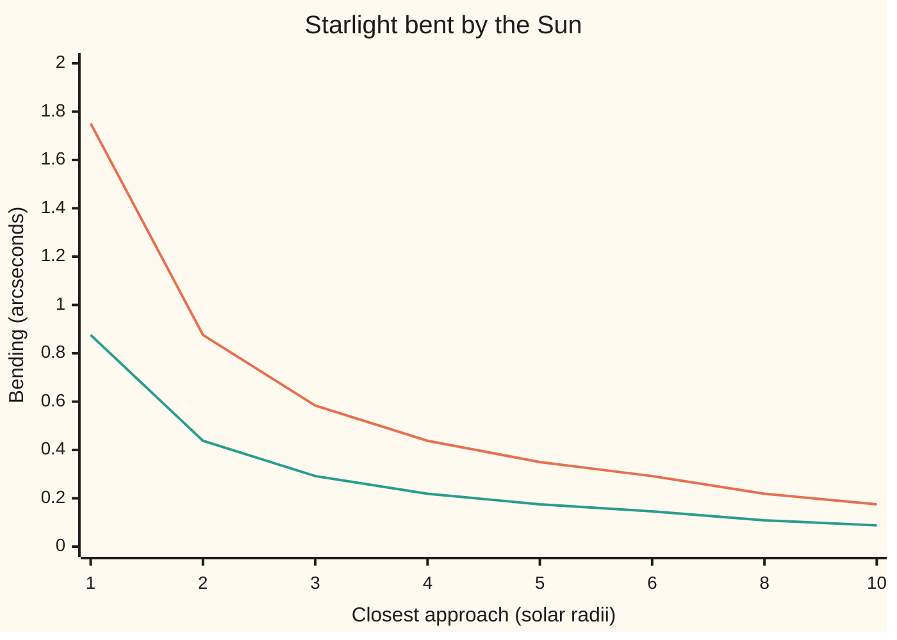
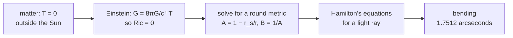

# Einstein equations: curvature on one side, matter on the other

[Syllabus](../../../SYLLABUS.md) → [Differential geometry and Lie groups](../README.md) → [Geometric Analysis and Physics](../README.md#s07) → Einstein equations

---

## General Overview

On 29 May 1919 the Moon covered the Sun, and astronomers photographed the stars around the dark disc. Months earlier they had photographed the same stars at night. On the eclipse plates the stars near the Sun's edge sat slightly further out from the Sun. Their light had bent on the way past.

Treat light as particles pulled by Newton's gravity, and a ray grazing the Sun turns by 0.8756 arcseconds (an arcsecond is 1/3600 of a degree). Einstein's theory of gravity says 1.7512 arcseconds, twice as much in a field as weak as the Sun's. The eclipse plates favoured Einstein. Radio telescopes, in a study published in 2004, measured γ = 0.99983, a parameter that is exactly 1 in Einstein's theory. That puts the bending at (1 + γ)/2 times 1.7512, which is 1.75104 arcseconds, standard error 0.00039.

Einstein's theory says gravity is not a force. It is the curvature of spacetime: four coordinates, one of time and three of space, measured with a metric (a rule for lengths and durations). His equations say how matter sets that curvature.

Outside the Sun there is no matter, so the equations shrink to one condition: the Ricci curvature (one average of the curvature) is zero. A metric found by Karl Schwarzschild in 1916 meets that condition. Light then follows the straightest paths of that metric, and tracing one past the Sun gives the 1.7512.

**Einstein's equations set one average of spacetime curvature, the Einstein tensor, equal to the density and flow of energy and momentum; in empty space they reduce to Ric = 0, and the Schwarzschild metric, which satisfies that, bends a ray grazing the Sun by 1.7512 arcseconds, twice Newton's value.**

**What kind of fact this is:** a physical law: a model of gravity that has passed every measurement so far, not a theorem. That the Schwarzschild metric satisfies Ric = 0 is a calculation, done on this card in Why it works. That it is the only round solution of empty space (Birkhoff's theorem) is stated with a source, not proved.

### The picture: bending against how close the ray passes



Orange line: the ray traced through the Schwarzschild metric. Green line: the same ray with only the clock part of the metric, which is Newton's answer. Both fall off as one over the closest distance, and while the field is this weak the full answer is twice Newton's.

---

## The formula

Reminders. Ric and the scalar curvature $`S`$ are the two traces of the curvature tensor ([Ricci and scalar curvature](../05-Riemannian%20Geometry/07-ricci-and-scalar-curvature.md)); Rm is that tensor ([Riemann curvature tensor](../05-Riemannian%20Geometry/06-riemann-curvature-tensor.md)). Flat spacetime has the Minkowski metric $`-c^2 dt^2 + dx^2 + dy^2 + dz^2`$, taught on [Hodge star](../04-Differential%20Forms/09-hodge-star-and-maxwell-in-forms.md). Its signature is $`(-, +, +, +)`$: one minus sign, for time. The indices $`\mu, \nu`$ run over the four coordinates, and a repeated upper and lower index is summed.

Einstein's equations, ten of them, one for each pair $`\mu \le \nu`$:

```math
G_{\mu\nu} = \mathrm{Ric}_{\mu\nu} - \tfrac{1}{2}\, S\, g_{\mu\nu} = \frac{8\pi G}{c^4}\, T_{\mu\nu}
```

**Read it aloud:** the Einstein tensor, Ricci curvature minus half the scalar curvature times the metric, equals eight pi G over c to the fourth times the energy-momentum tensor.

Where there is no matter, $`T_{\mu\nu} = 0`$ and the equations become $`\mathrm{Ric}_{\mu\nu} = 0`$ (Step 2). The Schwarzschild metric solves them outside a round, still mass $`M`$:

```math
ds^2 = -\left(1 - \frac{r_s}{r}\right) c^2 dt^2 + \frac{dr^2}{1 - r_s/r} + r^2\left(d\varphi^2 + \sin^2\varphi\, d\theta^2\right), \qquad r_s = \frac{2GM}{c^2}
```

**Read it aloud:** clock ticks at radius $`r`$ are scaled by the square root of one minus $`r_s`$ over $`r`$, and radial rulers by its inverse.

A ray whose closest approach is $`r_0`$ turns by

```math
\alpha \approx \frac{2 r_s}{r_0} = \frac{4GM}{c^2 r_0}
```

Said once: $`G`$ alone is Newton's constant, $`G_{\mu\nu}`$ the Einstein tensor; $`T`$ (kinetic energy elsewhere) and $`g`$ (gravity's pull elsewhere) here mean the energy-momentum tensor and the metric. The Sun's radius is $`R_\odot`$. On the spheres, $`\varphi`$ is measured from the pole and $`\theta`$ is longitude, as on the globe.

| Symbol | Plain meaning | In our example | Push it up and the answer… |
| --- | --- | --- | --- |
| $`g_{\mu\nu}`$, $`ds^2`$, $`\nabla`$, $`\Gamma`$ | spacetime metric; the squared interval it gives a small step; its covariant derivative; its Christoffel symbols | Schwarzschild, above | — (sets everything) |
| $`\mathrm{Ric}_{\mu\nu}`$, $`S`$ | Ricci and scalar curvature of spacetime, in 1/m² | 0 outside the Sun | — |
| $`G_{\mu\nu}`$ | Einstein tensor: $`\mathrm{Ric} - \tfrac12 S g`$ | 0 outside the Sun | — |
| $`T_{\mu\nu}`$, $`\rho`$ | energy-momentum tensor: density and flow of energy and momentum; mass density | 0 outside the Sun | more curvature |
| $`GM`$, $`c`$, $`\Phi`$ | Newton's constant times the Sun's mass, used as one number; speed of light; Newton's potential $`-GM/r`$ | 1.3271244 × 10²⁰ m³/s²; 299,792,458 m/s | bending grows with $`GM`$, falls as $`1/c^2`$ |
| $`r_s`$ | Schwarzschild radius, $`2GM/c^2`$ | 2953.25 m | bending grows in proportion |
| $`t, r, \varphi, \theta`$ | time; radius, defined by sphere area $`4\pi r^2`$; angle from the pole; longitude | ray in the plane $`\varphi = \pi/2`$ | — (chart labels) |
| $`A, B`$, $`a, b`$ | clock factor (on $`c^2 dt^2`$) and radial factor (on $`dr^2`$), with $`A = e^{2a}`$, $`B = e^{2b}`$ | $`1 - r_s/r`$ and its inverse | — |
| $`r_0`$, $`R_\odot`$, $`w`$, $`w_1`$, $`\delta`$ | closest approach; Sun's radius; $`r_0/r`$; first-order correction to $`w`$; extra sweep | $`r_0 = R_\odot`$ = 6.957 × 10⁸ m | bending falls as $`1/r_0`$ |
| $`\epsilon`$ | strength of the field at the ray, $`r_s/r_0`$ | 0.0000042450 | bending grows, faster than in proportion when large |
| $`\alpha`$, $`\gamma`$ | angle the ray turns through; measured bending parameter, 1 in Einstein's theory | 0.0000084900 rad = 1.7512 arcseconds; $`\gamma`$ = 0.99983 | — |
| $`H`$, $`p_\mu`$ | Hamiltonian of a free path; its momentum | $`H = 0`$ for light | — |

### When it holds

- **The ray stays outside matter.** $`\mathrm{Ric} = 0`$ only where $`T = 0`$. A ray through the Sun's interior needs a metric for the inside, where Ric is not zero.
- **The mass is round and still.** The Sun spins and is slightly flattened, which adds corrections far below the measured error. Birkhoff's theorem says any round region of empty space has the Schwarzschild metric, even if the mass inside pulses.
- **The field is weak, for the short formula.** $`2r_s/r_0`$ is the first term of a series in $`\epsilon`$. At the Sun the next term is 7.230 microarcseconds. At the surface of a neutron star (1.4 Suns in 12 km, $`\epsilon`$ = 0.3445) the formula gives 39.48° while the traced ray turns 61.27°.
- **One sign convention all the way through.** Here the round sphere has positive curvature and time carries the minus sign. Flip the sign of $`r_s`$ (a negative mass) and the ray turns away from the Sun: −1.7512 arcseconds.

---

## Why it works



### Step 0: falling feels like nothing, so gravity is what is left: tides

A person in a falling lift floats: falling removes gravity locally. What falling cannot remove is the difference between neighbours. Two dust grains falling side by side towards the Sun drift apart along the radius, because the nearer grain is pulled harder. That drift between neighbouring free paths is curvature: the [Riemann curvature tensor](../05-Riemannian%20Geometry/06-riemann-curvature-tensor.md) measures exactly how neighbouring straightest paths spread.

So Einstein made curvature the gravity. Matter cannot fix all of Rm. It fixes one trace of it, Ricci curvature, which measures how the volume of a small ball of falling dust changes ([Ricci and scalar curvature](../05-Riemannian%20Geometry/07-ricci-and-scalar-curvature.md)). The rest, the Weyl part, is free to carry tides through empty space.

### Step 1: why the Einstein tensor and not Ric alone

Matter conserves energy and momentum: $`\nabla^\mu T_{\mu\nu} = 0`$, where $`\nabla`$ is the covariant derivative. So the left side must have zero divergence (no net source or sink of energy and momentum at any point) for every metric. The contracted Bianchi identity says $`\mathrm{Ric} - \tfrac12 S g`$ does; Ricci alone does not. The identity is stated here, not proved; Carroll's book proves it.

The constant $`8\pi G/c^4`$ comes from matching Newton. For slow motion in a weak field, $`g_{tt} \approx -(1 + 2\Phi/c^2)`$, with $`\Phi`$ Newton's potential. Then the $`tt`$ equation becomes Newton's $`\nabla^2 \Phi = 4\pi G \rho`$, with $`\nabla^2`$ the ordinary Laplacian of flat space and $`\rho`$ the mass density, only for that constant.

The equations for empty space, $`\mathrm{Ric} = 0`$, also follow from making the total scalar curvature $`\int S\, dV_g`$ stationary ($`dV_g`$ is the metric's volume element), as mechanics makes an action stationary. With matter present, the matter's own action is added, and its change with the metric supplies $`T_{\mu\nu}`$.

### Step 2: empty space means Ric = 0

Take the trace: multiply both sides by $`g^{\mu\nu}`$ and sum. In four dimensions $`g^{\mu\nu} g_{\mu\nu} = 4`$, so the left side gives $`S - 2S = -S`$. With no matter the right side is zero, so $`S = 0`$. Put that back and $`\mathrm{Ric}_{\mu\nu} = 0`$.

So "empty" does not mean "flat". It means the Ricci part of the curvature is zero, while the Weyl part need not be.

### Step 3: solve Ric = 0 for a round, still metric

Try the most general round, unchanging metric:

```math
ds^2 = -A(r)\, c^2 dt^2 + B(r)\, dr^2 + r^2\left(d\varphi^2 + \sin^2\varphi\, d\theta^2\right)
```

Write $`A = e^{2a}`$ and $`B = e^{2b}`$, and a prime for the rate of change in $`r`$. Working out the Christoffel symbols $`\Gamma`$ (how the coordinate axes turn from point to point) and contracting (summing a repeated index), as on the Ricci card, leaves three different Ricci components. Two combinations of them do the work:

```math
\frac{B}{A}\,\mathrm{Ric}_{tt} + \mathrm{Ric}_{rr} = \frac{2\,(a' + b')}{r}, \qquad \mathrm{Ric}_{\varphi\varphi} = e^{-2b}\left(r(b' - a') - 1\right) + 1
```

1. The first must be zero, so $`a + b`$ is constant. Far away spacetime is flat, $`A`$ and $`B`$ tend to 1, so $`AB = 1`$.
2. With $`b = -a`$, the second becomes $`1 - A - rA' = 1 - (rA)'`$. Setting it to zero gives $`rA = r - r_s`$, for some constant $`r_s`$.
3. So $`A = 1 - r_s/r`$ and $`B = 1/A`$. Far away, $`A \approx 1 + 2\Phi/c^2`$ with $`\Phi = -GM/r`$, which names the constant: $`r_s = 2GM/c^2`$.

For the Sun, $`r_s`$ = 2953.25 m: the Sun's mass squeezed inside a ball of that radius would be a black hole. With $`M = 0`$ the metric is Minkowski's again.

<details>
<summary>Detailed proof: the three Ricci components of a round, still metric</summary>

Work out the Christoffel symbols of this metric, put them into $`\mathrm{Ric}_{jk} = \partial_i \Gamma^i_{jk} - \partial_j \Gamma^i_{ik} + \Gamma^i_{im}\Gamma^m_{jk} - \Gamma^i_{jm}\Gamma^m_{ik}`$, and collect:

$`\displaystyle \mathrm{Ric}_{tt} = e^{2(a-b)}\left(a'' + a'^2 - a'b' + \frac{2a'}{r}\right)`$

$`\displaystyle \mathrm{Ric}_{rr} = -a'' - a'^2 + a'b' + \frac{2b'}{r}`$

$`\displaystyle \mathrm{Ric}_{\varphi\varphi} = e^{-2b}\left(r(b' - a') - 1\right) + 1, \qquad \mathrm{Ric}_{\theta\theta} = \sin^2\varphi\, \mathrm{Ric}_{\varphi\varphi}`$

Multiply the first by $`e^{-2(a-b)} = B/A`$ and add the second: the $`a''`$, $`a'^2`$ and $`a'b'`$ terms cancel, leaving $`2(a' + b')/r`$. With $`b = -a`$ and $`A' = 2a'A`$, the third is $`1 - A(1 + 2ra') = 1 - A - rA'`$.

The check runs this both ways at $`r = 3 r_s`$: the closed forms give 0.000000000 for Schwarzschild, and the finite-difference tensor built from the metric alone agrees with them to eight decimals for the "clocks only" metric of Step 5.

</details>

### Step 4: empty but curved: the tides survive

Ricci is zero, but Rm is not. The code computes the radial tidal stretch, how fast two grains a unit apart along the radius accelerate apart. It is $`r_s c^2/r^3`$. At the Sun's surface that is 0.000000788271 per second squared, exactly Newton's tidal stretch $`2GM/R_\odot^3`$. In units of $`r_s`$, at $`r = 3 r_s`$ the code finds 0.037037039 against the closed form 1/27 = 0.037037037, while the largest Ricci component there is 0.000000030, finite-difference noise that falls from 0.000000928 when the step shrinks tenfold.

### Step 5: a light ray, by Hamilton's equations

Free paths in a metric are the motions of the Hamiltonian $`H = \tfrac12 g^{\mu\nu} p_\mu p_\nu`$, with $`p_\mu`$ the momentum ([Hamilton's equations](../../08-Differential%20equations%20and%20dynamics/12-Calculus%20of%20Variations%20and%20Optimal%20Control/05-hamiltons-equations.md)). Light has $`H = 0`$. The metric does not involve $`t`$ or $`\theta`$, so Hamilton's equations keep $`p_t`$ (the energy) and $`p_\theta`$ (the angular momentum) constant. With both fixed, one equation is left for the ray's shape. In $`w = r_0/r`$, with the angle $`\theta`$ as the clock and $`\epsilon = r_s/r_0`$:

```math
\frac{d^2 w}{d\theta^2} = -w + \tfrac{3}{2}\,\epsilon\, w^2, \qquad w = 1,\ \frac{dw}{d\theta} = 0 \text{ at closest approach}
```

With $`\epsilon = 0`$ the solution is $`w = \cos\theta`$: a straight line, which reaches infinity ($`w = 0`$) after a quarter turn. The extra term makes the ray sweep a little further. Twice the swept angle, minus $`\pi`$, is the bending.

<details>
<summary>Detailed proof: the bending to first order is 2ε</summary>

Write $`w = \cos\theta + \epsilon\, w_1`$ and keep terms in $`\epsilon`$. Then $`w_1'' + w_1 = \tfrac32 \cos^2\theta = \tfrac34(1 + \cos 2\theta)`$, with $`w_1(0) = w_1'(0) = 0`$. The solution is

$`\displaystyle w_1 = \tfrac34 - \tfrac14\cos 2\theta - \tfrac12\cos\theta`$

At $`\theta = \pi/2 + \delta`$, $`\cos\theta \approx -\delta`$ and $`w_1 \approx 1`$, so $`w = 0`$ when $`\delta = \epsilon`$. Each half of the ray sweeps $`\pi/2 + \epsilon`$, so the bending is

$`\displaystyle \alpha = 2\left(\frac{\pi}{2} + \epsilon\right) - \pi = 2\epsilon = \frac{2 r_s}{r_0}`$

With only the clock factor ($`B = 1`$), $`w_1'' + w_1 = \tfrac12`$, so $`w_1(\pi/2) = \tfrac12`$ and $`\alpha = \epsilon`$. With only the radial factor the answer is again $`\epsilon`$. To first order the halves add.

</details>

The clock factor and the radial stretch each give half: the code traces 0.8756 arcseconds for each alone. Newton's particle picture has only the clock half, because in slow motion only $`g_{tt}`$ matters. Light is fast, so space's curvature counts as much as time's.

---

## Worked numbers, by hand

| Step | Arithmetic | Value |
| --- | --- | --- |
| Schwarzschild radius | $`r_s = 2 \times 1.3271244 \times 10^{20} / 299{,}792{,}458^2`$ | 2953.25 m |
| field strength at the limb | $`\epsilon = 2953.25 / 6.957 \times 10^{8}`$ | 0.0000042450 |
| bending in radians | $`2\epsilon = 2 \times 0.0000042450`$ | 0.0000084900 rad |
| radians to arcseconds | $`\times\, 648000/\pi = \times\, 206264.806`$ | **1.7512 arcseconds** |

A star seen just past the Sun's edge appears 1.7512 arcseconds further out than its night-time position. The 2004 radio measurement of $`\gamma`$ puts it at 1.75104, with a standard error of 0.00039.

### What breaks if you drop a piece

| Mistake | Comes out at | What went wrong |
| --- | --- | --- |
| Bend only the clocks, leave space flat (Newton's light) | 0.8756 arcseconds | not a solution: at $`r = 3 r_s`$ its $`\mathrm{Ric}_{rr}`$ = 0.0625 per $`r_s^2`$, not 0 |
| Bend only space, leave the clocks | 0.8756 arcseconds | the other half; also not a solution |
| Flip the sign of $`r_s`$ | −1.7512 arcseconds | a negative mass; the ray turns away |
| Use $`2r_s/r_0`$ at a neutron star's surface | 39.48° | the field is not weak ($`\epsilon`$ = 0.3445); the traced ray turns 61.27° |

---

## Code, from first principles, and it actually runs

The code checks the solution and then uses it, taking **three independent roads**. First, it builds the Christoffel symbols and the curvature tensor from the metric alone by central differences, in four dimensions, at $`r`$ = 1.5, 3 and 6 Schwarzschild radii, and finds every Ricci component near zero at two step sizes while the tidal part matches $`1/r^3`$. Second, it evaluates the closed-form Ricci components of Step 3, which give exactly zero for Schwarzschild and agree with the first road on a metric that fails. Third, it traces the light ray with RK4 (a fourth-order step for differential equations) from the equation of Step 5 and compares the bending with the weak-field formula plus its known second-order term, $`(15\pi/16 - 1)\,\epsilon^2`$. Lengths in the curvature part are in units of $`r_s`$, so curvatures there are per $`r_s^2`$.

### Python

```python
# Einstein equations in outline: check that the Schwarzschild metric has Ric = 0 outside the Sun,
# then trace a grazing starlight ray through it and read off the bending.
from math import sin, log, exp, pi

GM = 1.3271244e20      # Sun's GM, m^3/s^2, IAU 2015 nominal
c = 299792458.0        # speed of light, m/s, exact
Rsun = 6.957e8         # Sun's radius, m, IAU 2015 nominal
ARCSEC = 648000 / pi   # arcseconds in one radian
rs = 2 * GM / c ** 2   # Schwarzschild radius, m

def show(label, v, d=6):
    print(f"{label:<44}{(0.0 if abs(v) < 5e-13 else v):>16.{d}f}")

# ---- road 1: Ricci tensor from the metric alone, by finite differences (units: r_s = 1, c = 1) ----
def schwarzschild(p):  # coordinates (t, r, phi, theta): phi down from the pole, theta round it
    A = 1 - 1 / p[1]
    return [-A, 1 / A, p[1] ** 2, (p[1] * sin(p[2])) ** 2]
def time_only(p):      # Newton's guess: slow the clocks, leave space flat
    return [-(1 - 1 / p[1]), 1.0, p[1] ** 2, (p[1] * sin(p[2])) ** 2]

def shift(p, i, s):
    q = list(p); q[i] += s; return q

def christoffel(metric, p, h):  # G[l][j][k] = 1/2 g^ll (d_j g_lk + d_k g_lj - d_l g_jk), g diagonal
    g = metric(p)
    dg = [[(a - b) / (2 * h) for a, b in zip(metric(shift(p, m, h)), metric(shift(p, m, -h)))] for m in range(4)]
    def d(m, i, j):
        return dg[m][i] if i == j else 0.0
    return [[[0.5 / g[l] * (d(j, l, k) + d(k, l, j) - d(l, j, k)) for k in range(4)] for j in range(4)] for l in range(4)]

def curvature(metric, p, h=1e-4):  # Rm(l,i,j,k) = R^l_kij, then Ric_jk = sum over i of R^i_jik
    G = christoffel(metric, p, h)
    dG = [[[[(a - b) / (2 * h) for a, b in zip(ra, rb)] for ra, rb in zip(A, B)]
           for A, B in zip(christoffel(metric, shift(p, i, h), h), christoffel(metric, shift(p, i, -h), h))]
          for i in range(4)]
    def Rm(l, i, j, k):
        return (dG[i][l][j][k] - dG[j][l][i][k]
                + sum(G[l][i][m] * G[m][j][k] - G[l][j][m] * G[m][i][k] for m in range(4)))
    Ric = [[sum(Rm(i, i, j, k) for i in range(4)) for k in range(4)] for j in range(4)]
    return Rm, Ric

def largest(Ric):
    return max(abs(Ric[j][k]) for j in range(4) for k in range(4))

# ---- road 2: closed forms for -A dt^2 + B dr^2 + r^2 dOmega^2, with A = e^(2a), B = e^(2b) ----
def ricci_closed(a1, a2, b1, a, b, r):  # a1 = a', a2 = a'', b1 = b'
    tt = (a2 + a1 * a1 - a1 * b1 + 2 * a1 / r) * exp(2 * (a - b))
    rr = -a2 - a1 * a1 + a1 * b1 + 2 * b1 / r
    pp = exp(-2 * b) * (r * (b1 - a1) - 1) + 1
    return tt, rr, pp

worst = []
for r in (1.5, 3.0, 6.0):
    Rm, Ric = curvature(schwarzschild, [0.0, r, 1.0, 0.5])
    worst.append(largest(Ric))
    show(f"r = {r:3.1f} r_s: largest |Ric|, step 1e-4", worst[-1], 9)
    show(f"  radial tidal stretch -R^r_trt/A", -Rm(1, 1, 0, 0) / (1 - 1 / r), 9)
    show(f"  closed form 1/r^3", 1 / r ** 3, 9)
    if r == 3.0:
        st3, coarse = -Rm(1, 1, 0, 0) / (1 - 1 / r), largest(curvature(schwarzschild, [0.0, r, 1.0, 0.5], 1e-3)[1])
        show(f"  largest |Ric|, step 1e-3", coarse, 9)
A = 1 - 1 / 3.0
a1, a2 = 1 / (2 * 9 * A), -5 / (2 * 81 * A * A)          # a = (1/2) ln(1 - 1/r) at r = 3
closed = ricci_closed(a1, a2, -a1, 0.5 * log(A), -0.5 * log(A), 3.0)
show("closed form, Schwarzschild, largest |Ric|", max(abs(v) for v in closed), 9)
Rm0, Ric0 = curvature(time_only, [0.0, 3.0, 1.0, 0.5])
c0 = ricci_closed(a1, a2, 0.0, 0.5 * log(A), 0.0, 3.0)
for j, n in enumerate(["tt", "rr", "phiphi"]):
    show(f"time-only metric, r = 3: Ric_{n}", Ric0[j][j], 9)
    show(f"  closed form", c0[j], 9)

# ---- the ray: Hamilton's equations for light give w'' = F'(w)/2, w = r0/r, the angle as clock ----
def bend(eps, kind, N=40000):  # from closest approach (w = 1) out to infinity (w = 0), RK4
    def acc(w):
        if kind == "full":
            return -w + 1.5 * eps * w * w
        if kind == "time":
            return (1 - eps) * eps / (2 * (1 - eps * w) ** 2) - w
        return -0.5 * eps * (1 - w * w) - w * (1 - eps * w)   # space part only
    h, n, w, v = 2.0 / N, 0, 1.0, 0.0
    while True:
        k1w, k1v = v, acc(w)
        k2w, k2v = v + h / 2 * k1v, acc(w + h / 2 * k1w)
        k3w, k3v = v + h / 2 * k2v, acc(w + h / 2 * k2w)
        k4w, k4v = v + h * k3v, acc(w + h * k3w)
        nw, nv = w + h / 6 * (k1w + 2 * k2w + 2 * k3w + k4w), v + h / 6 * (k1v + 2 * k2v + 2 * k3v + k4v)
        if nw < 0:
            return 2 * h * (n + w / (w - nw)) - pi   # twice the swept angle, minus a straight line
        n, w, v = n + 1, nw, nv

eps = rs / Rsun
show("Schwarzschild radius of the Sun r_s, m", rs, 2)
show("r_s / R_sun", eps, 10)
weak = 2 * eps
full, tpart, spart = bend(eps, "full"), bend(eps, "time"), bend(eps, "space")
show("arcseconds in one radian", ARCSEC, 3)
show("weak field 2 r_s / r0, radians", weak, 10)
show("weak field 2 r_s / r0, arcsec", weak * ARCSEC, 4)
show("ray traced, full metric, arcsec", full * ARCSEC, 4)
show("ray traced, time part only, arcsec", tpart * ARCSEC, 4)
show("ray traced, space part only, arcsec", spart * ARCSEC, 4)
second = (15 * pi / 16 - 1) * eps * eps
show("traced minus weak field, microarcsec", (full - weak) * ARCSEC * 1e6, 3)
show("second-order term, microarcsec", second * ARCSEC * 1e6, 3)
show("Newton's tide 2GM/R^3 at the surface, 1/s^2", 2 * GM / Rsun ** 3, 12)
show("same from r_s c^2 / r^3, 1/s^2", rs * c * c / Rsun ** 3, 12)
show("measured 2004: gamma", 0.99983, 5)
show("measured 2004: (1+gamma)/2 x prediction", (1 + 0.99983) / 2 * weak * ARCSEC, 5)
show("measured 2004: standard error, arcsec", 0.00045 / 2 * weak * ARCSEC, 5)

# ---- what breaks ----
show("wrong: sign of r_s flipped, arcsec", bend(-eps, "full") * ARCSEC, 4)
ns = 2 * 1.4 * GM / c ** 2 / 12000                  # neutron star: 1.4 Suns, radius 12 km
show("neutron star r_s / R", ns, 4)
show("neutron star weak field, degrees", 2 * ns * 180 / pi, 2)
show("neutron star ray traced, degrees", bend(ns, "full") * 180 / pi, 2)
show("try: Jupiter's limb, arcsec", 4 * 1.26686534e17 / (c * c * 7.1492e7) * ARCSEC, 4)

# ---- chart: deflection against closest approach ----
xs = [1, 2, 3, 4, 5, 6, 8, 10]
print("chart r0/R_sun " + " ".join(f"{x:6d}" for x in xs))
print("einstein       " + " ".join(f"{bend(eps / x, 'full', 4000) * ARCSEC:6.3f}" for x in xs))
print("newton         " + " ".join(f"{bend(eps / x, 'time', 4000) * ARCSEC:6.3f}" for x in xs))

assert max(worst) < 1e-6 and coarse > 10 * worst[1], "Schwarzschild has Ric = 0, error shrinks with step"
assert abs(st3 - 1 / 27) < 1e-6, "tidal stretch against closed form 1/r^3"
assert max(abs(v) for v in closed) < 1e-12, "closed-form Ric vanishes"
assert abs(Ric0[1][1] - c0[1]) < 1e-6 and abs(c0[1]) > 0.01, "time-only metric fails Ric = 0"
assert abs((full - weak) - second) < 5e-14, "traced ray against weak field plus second order"
assert abs(tpart + spart - full) < 1e-10, "time half plus space half"
assert abs(bend(ns, "full") - bend(ns, "full", 80000)) < 1e-9, "neutron star at two step sizes"
print("ALL CHECKS PASS")
```

**Ran 2026-11-19 on macOS, Python 3.14.10, standard library only. All checks passed. Output, pasted from the run:**

```
r = 1.5 r_s: largest |Ric|, step 1e-4            0.000000031
  radial tidal stretch -R^r_trt/A                0.296296301
  closed form 1/r^3                              0.296296296
r = 3.0 r_s: largest |Ric|, step 1e-4            0.000000030
  radial tidal stretch -R^r_trt/A                0.037037039
  closed form 1/r^3                              0.037037037
  largest |Ric|, step 1e-3                       0.000000928
r = 6.0 r_s: largest |Ric|, step 1e-4            0.000000127
  radial tidal stretch -R^r_trt/A                0.004629630
  closed form 1/r^3                              0.004629630
closed form, Schwarzschild, largest |Ric|        0.000000000
time-only metric, r = 3: Ric_tt                 -0.004629631
  closed form                                   -0.004629630
time-only metric, r = 3: Ric_rr                  0.062499999
  closed form                                    0.062500000
time-only metric, r = 3: Ric_phiphi             -0.249999992
  closed form                                   -0.250000000
Schwarzschild radius of the Sun r_s, m               2953.25
r_s / R_sun                                     0.0000042450
arcseconds in one radian                          206264.806
weak field 2 r_s / r0, radians                  0.0000084900
weak field 2 r_s / r0, arcsec                         1.7512
ray traced, full metric, arcsec                       1.7512
ray traced, time part only, arcsec                    0.8756
ray traced, space part only, arcsec                   0.8756
traced minus weak field, microarcsec                   7.231
second-order term, microarcsec                         7.230
Newton's tide 2GM/R^3 at the surface, 1/s^2   0.000000788271
same from r_s c^2 / r^3, 1/s^2                0.000000788271
measured 2004: gamma                                 0.99983
measured 2004: (1+gamma)/2 x prediction              1.75104
measured 2004: standard error, arcsec                0.00039
wrong: sign of r_s flipped, arcsec                   -1.7512
neutron star r_s / R                                  0.3445
neutron star weak field, degrees                       39.48
neutron star ray traced, degrees                       61.27
try: Jupiter's limb, arcsec                           0.0163
chart r0/R_sun      1      2      3      4      5      6      8     10
einstein        1.751  0.876  0.584  0.438  0.350  0.292  0.219  0.175
newton          0.876  0.438  0.292  0.219  0.175  0.146  0.109  0.088
ALL CHECKS PASS
```

### Rust

```rust
// Einstein equations in outline: check that the Schwarzschild metric has Ric = 0 outside the Sun,
// then trace a grazing starlight ray through it and read off the bending.
use std::f64::consts::PI;

const GM: f64 = 1.3271244e20; // Sun's GM, m^3/s^2, IAU 2015 nominal
const C: f64 = 299792458.0; // speed of light, m/s, exact
const RSUN: f64 = 6.957e8; // Sun's radius, m, IAU 2015 nominal
const ARCSEC: f64 = 648000.0 / PI; // arcseconds in one radian

fn show(label: &str, v: f64, d: usize) {
    let v = if v.abs() < 5e-13 { 0.0 } else { v };
    println!("{:<44}{:>16.*}", label, d, v);
}

// ---- road 1: Ricci tensor from the metric alone, by finite differences (units: r_s = 1, c = 1) ----
type Metric = fn(&[f64; 4]) -> [f64; 4];
fn schwarzschild(p: &[f64; 4]) -> [f64; 4] { // coordinates (t, r, phi, theta)
    let a = 1.0 - 1.0 / p[1];
    [-a, 1.0 / a, p[1] * p[1], (p[1] * p[2].sin()).powi(2)]
}
fn time_only(p: &[f64; 4]) -> [f64; 4] { // Newton's guess: slow the clocks, leave space flat
    [-(1.0 - 1.0 / p[1]), 1.0, p[1] * p[1], (p[1] * p[2].sin()).powi(2)]
}
fn shift(p: &[f64; 4], i: usize, s: f64) -> [f64; 4] {
    let mut q = *p; q[i] += s; q
}
type G3 = [[[f64; 4]; 4]; 4];
fn christoffel(metric: Metric, p: &[f64; 4], h: f64) -> G3 { // g diagonal
    let g = metric(p);
    let mut dg = [[0.0; 4]; 4];
    for m in 0..4 {
        let (a, b) = (metric(&shift(p, m, h)), metric(&shift(p, m, -h)));
        for i in 0..4 { dg[m][i] = (a[i] - b[i]) / (2.0 * h); }
    }
    let d = |m: usize, i: usize, j: usize| if i == j { dg[m][i] } else { 0.0 };
    let mut out = [[[0.0; 4]; 4]; 4];
    for l in 0..4 { for j in 0..4 { for k in 0..4 {
        out[l][j][k] = 0.5 / g[l] * (d(j, l, k) + d(k, l, j) - d(l, j, k));
    } } }
    out
}
struct Curv { rm: [[[[f64; 4]; 4]; 4]; 4], ric: [[f64; 4]; 4] }
fn curvature(metric: Metric, p: &[f64; 4], h: f64) -> Curv { // rm[l][i][j][k] = R^l_kij
    let g = christoffel(metric, p, h);
    let mut dg = [[[[0.0; 4]; 4]; 4]; 4];
    for i in 0..4 {
        let (a, b) = (christoffel(metric, &shift(p, i, h), h), christoffel(metric, &shift(p, i, -h), h));
        for l in 0..4 { for j in 0..4 { for k in 0..4 { dg[i][l][j][k] = (a[l][j][k] - b[l][j][k]) / (2.0 * h); } } }
    }
    let mut rm = [[[[0.0; 4]; 4]; 4]; 4];
    let mut ric = [[0.0; 4]; 4];
    for l in 0..4 { for i in 0..4 { for j in 0..4 { for k in 0..4 {
        let mut s = dg[i][l][j][k] - dg[j][l][i][k];
        for m in 0..4 { s += g[l][i][m] * g[m][j][k] - g[l][j][m] * g[m][i][k]; }
        rm[l][i][j][k] = s;
    } } } }
    for j in 0..4 { for k in 0..4 { for i in 0..4 { ric[j][k] += rm[i][i][j][k]; } } }
    Curv { rm, ric }
}
fn largest(ric: &[[f64; 4]; 4]) -> f64 {
    ric.iter().flatten().fold(0.0, |m: f64, x| m.max(x.abs()))
}

// ---- road 2: closed forms for -A dt^2 + B dr^2 + r^2 dOmega^2, with A = e^(2a), B = e^(2b) ----
fn ricci_closed(a1: f64, a2: f64, b1: f64, a: f64, b: f64, r: f64) -> [f64; 3] {
    [(a2 + a1 * a1 - a1 * b1 + 2.0 * a1 / r) * (2.0 * (a - b)).exp(),
     -a2 - a1 * a1 + a1 * b1 + 2.0 * b1 / r,
     (-2.0 * b).exp() * (r * (b1 - a1) - 1.0) + 1.0]
}

// ---- the ray: Hamilton's equations for light give w'' = F'(w)/2, w = r0/r, the angle as clock ----
fn bend(eps: f64, kind: &str, steps: usize) -> f64 {
    let acc = |w: f64| match kind {
        "full" => -w + 1.5 * eps * w * w,
        "time" => (1.0 - eps) * eps / (2.0 * (1.0 - eps * w).powi(2)) - w,
        _ => -0.5 * eps * (1.0 - w * w) - w * (1.0 - eps * w), // space part only
    };
    let (h, mut n, mut w, mut v) = (2.0 / steps as f64, 0usize, 1.0f64, 0.0f64);
    loop {
        let (k1w, k1v) = (v, acc(w));
        let (k2w, k2v) = (v + h / 2.0 * k1v, acc(w + h / 2.0 * k1w));
        let (k3w, k3v) = (v + h / 2.0 * k2v, acc(w + h / 2.0 * k2w));
        let (k4w, k4v) = (v + h * k3v, acc(w + h * k3w));
        let nw = w + h / 6.0 * (k1w + 2.0 * k2w + 2.0 * k3w + k4w);
        let nv = v + h / 6.0 * (k1v + 2.0 * k2v + 2.0 * k3v + k4v);
        if nw < 0.0 { return 2.0 * h * (n as f64 + w / (w - nw)) - PI; }
        n += 1; w = nw; v = nv;
    }
}

fn main() {
    let rs = 2.0 * GM / (C * C);
    let mut worst = Vec::new();
    let (mut st3, mut coarse) = (0.0, 0.0);
    for r in [1.5, 3.0, 6.0] {
        let p = [0.0, r, 1.0, 0.5];
        let cv = curvature(schwarzschild, &p, 1e-4);
        worst.push(largest(&cv.ric));
        let stretch = -cv.rm[1][1][0][0] / (1.0 - 1.0 / r);
        show(&format!("r = {:3.1} r_s: largest |Ric|, step 1e-4", r), largest(&cv.ric), 9);
        show("  radial tidal stretch -R^r_trt/A", stretch, 9);
        show("  closed form 1/r^3", 1.0 / r.powi(3), 9);
        if r == 3.0 {
            st3 = stretch;
            coarse = largest(&curvature(schwarzschild, &p, 1e-3).ric);
            show("  largest |Ric|, step 1e-3", coarse, 9);
        }
    }
    let a = 1.0 - 1.0 / 3.0;
    let (a1, a2) = (1.0 / (2.0 * 9.0 * a), -5.0 / (2.0 * 81.0 * a * a)); // a = (1/2) ln(1 - 1/r) at r = 3
    let closed = ricci_closed(a1, a2, -a1, 0.5 * a.ln(), -0.5 * a.ln(), 3.0);
    let closed_max = closed.iter().fold(0.0, |m: f64, x| m.max(x.abs()));
    show("closed form, Schwarzschild, largest |Ric|", closed_max, 9);
    let c0v = curvature(time_only, &[0.0, 3.0, 1.0, 0.5], 1e-4);
    let c0 = ricci_closed(a1, a2, 0.0, 0.5 * a.ln(), 0.0, 3.0);
    for (j, n) in ["tt", "rr", "phiphi"].iter().enumerate() {
        show(&format!("time-only metric, r = 3: Ric_{}", n), c0v.ric[j][j], 9);
        show("  closed form", c0[j], 9);
    }

    let eps = rs / RSUN;
    show("Schwarzschild radius of the Sun r_s, m", rs, 2);
    show("r_s / R_sun", eps, 10);
    let weak = 2.0 * eps;
    let (full, tpart, spart) = (bend(eps, "full", 40000), bend(eps, "time", 40000), bend(eps, "space", 40000));
    show("arcseconds in one radian", ARCSEC, 3);
    show("weak field 2 r_s / r0, radians", weak, 10);
    show("weak field 2 r_s / r0, arcsec", weak * ARCSEC, 4);
    show("ray traced, full metric, arcsec", full * ARCSEC, 4);
    show("ray traced, time part only, arcsec", tpart * ARCSEC, 4);
    show("ray traced, space part only, arcsec", spart * ARCSEC, 4);
    let second = (15.0 * PI / 16.0 - 1.0) * eps * eps;
    show("traced minus weak field, microarcsec", (full - weak) * ARCSEC * 1e6, 3);
    show("second-order term, microarcsec", second * ARCSEC * 1e6, 3);
    show("Newton's tide 2GM/R^3 at the surface, 1/s^2", 2.0 * GM / RSUN.powi(3), 12);
    show("same from r_s c^2 / r^3, 1/s^2", rs * C * C / RSUN.powi(3), 12);
    show("measured 2004: gamma", 0.99983, 5);
    show("measured 2004: (1+gamma)/2 x prediction", (1.0 + 0.99983) / 2.0 * weak * ARCSEC, 5);
    show("measured 2004: standard error, arcsec", 0.00045 / 2.0 * weak * ARCSEC, 5);

    show("wrong: sign of r_s flipped, arcsec", bend(-eps, "full", 40000) * ARCSEC, 4);
    let ns = 2.0 * 1.4 * GM / (C * C) / 12000.0; // neutron star: 1.4 Suns, radius 12 km
    show("neutron star r_s / R", ns, 4);
    show("neutron star weak field, degrees", 2.0 * ns * 180.0 / PI, 2);
    show("neutron star ray traced, degrees", bend(ns, "full", 40000) * 180.0 / PI, 2);
    show("try: Jupiter's limb, arcsec", 4.0 * 1.26686534e17 / (C * C * 7.1492e7) * ARCSEC, 4);

    let xs = [1, 2, 3, 4, 5, 6, 8, 10];
    let row = |f: &dyn Fn(f64) -> String| xs.iter().map(|&x| f(x as f64)).collect::<Vec<_>>().join(" ");
    println!("chart r0/R_sun {}", row(&|x| format!("{:6}", x as i64)));
    println!("einstein       {}", row(&|x| format!("{:6.3}", bend(eps / x, "full", 4000) * ARCSEC)));
    println!("newton         {}", row(&|x| format!("{:6.3}", bend(eps / x, "time", 4000) * ARCSEC)));

    let wmax = worst.iter().fold(0.0, |m: f64, &x| m.max(x));
    assert!(wmax < 1e-6 && coarse > 10.0 * worst[1], "Schwarzschild has Ric = 0, error shrinks with step");
    assert!((st3 - 1.0 / 27.0).abs() < 1e-6, "tidal stretch against closed form 1/r^3");
    assert!(closed_max < 1e-12, "closed-form Ric vanishes");
    assert!((c0v.ric[1][1] - c0[1]).abs() < 1e-6 && c0[1].abs() > 0.01, "time-only metric fails Ric = 0");
    assert!(((full - weak) - second).abs() < 5e-14, "traced ray against weak field plus second order");
    assert!((tpart + spart - full).abs() < 1e-10, "time half plus space half");
    assert!((bend(ns, "full", 40000) - bend(ns, "full", 80000)).abs() < 1e-9, "neutron star at two step sizes");
    println!("ALL CHECKS PASS");
}
```

**Ran 2026-11-19 on macOS, rustc 1.98.1, no crates. All checks passed. Output, pasted from the run:**

```
r = 1.5 r_s: largest |Ric|, step 1e-4            0.000000031
  radial tidal stretch -R^r_trt/A                0.296296301
  closed form 1/r^3                              0.296296296
r = 3.0 r_s: largest |Ric|, step 1e-4            0.000000030
  radial tidal stretch -R^r_trt/A                0.037037039
  closed form 1/r^3                              0.037037037
  largest |Ric|, step 1e-3                       0.000000928
r = 6.0 r_s: largest |Ric|, step 1e-4            0.000000127
  radial tidal stretch -R^r_trt/A                0.004629630
  closed form 1/r^3                              0.004629630
closed form, Schwarzschild, largest |Ric|        0.000000000
time-only metric, r = 3: Ric_tt                 -0.004629631
  closed form                                   -0.004629630
time-only metric, r = 3: Ric_rr                  0.062499999
  closed form                                    0.062500000
time-only metric, r = 3: Ric_phiphi             -0.249999992
  closed form                                   -0.250000000
Schwarzschild radius of the Sun r_s, m               2953.25
r_s / R_sun                                     0.0000042450
arcseconds in one radian                          206264.806
weak field 2 r_s / r0, radians                  0.0000084900
weak field 2 r_s / r0, arcsec                         1.7512
ray traced, full metric, arcsec                       1.7512
ray traced, time part only, arcsec                    0.8756
ray traced, space part only, arcsec                   0.8756
traced minus weak field, microarcsec                   7.231
second-order term, microarcsec                         7.230
Newton's tide 2GM/R^3 at the surface, 1/s^2   0.000000788271
same from r_s c^2 / r^3, 1/s^2                0.000000788271
measured 2004: gamma                                 0.99983
measured 2004: (1+gamma)/2 x prediction              1.75104
measured 2004: standard error, arcsec                0.00039
wrong: sign of r_s flipped, arcsec                   -1.7512
neutron star r_s / R                                  0.3445
neutron star weak field, degrees                       39.48
neutron star ray traced, degrees                       61.27
try: Jupiter's limb, arcsec                           0.0163
chart r0/R_sun      1      2      3      4      5      6      8     10
einstein        1.751  0.876  0.584  0.438  0.350  0.292  0.219  0.175
newton          0.876  0.438  0.292  0.219  0.175  0.146  0.109  0.088
ALL CHECKS PASS
```

Beyond the weak-field value, the traced ray finds 7.231 microarcseconds and the second-order term predicts 7.230. The time-only and space-only rays add up to the full one.

### Lean

Lean proves Step 2 at any point without matter, the Schwarzschild Ricci components at every radius outside $`r_s`$, and the first-order light-ray correction.

- Take one point of spacetime with no matter, so $`T_{\mu\nu} = 0`$, and any metric there. Then Einstein's equations hold at that point exactly when $`\mathrm{Ric}_{\mu\nu} = 0`$.
- Take $`A = 1 - r_s/r`$ and $`B = 1/A`$, at any radius $`r > 0`$ where $`A > 0`$. Then the three Ricci components of Step 3's detailed proof, worked from $`a`$ and $`b`$ by exact derivatives, are all 0.
- Take $`w_1 = \tfrac34 - \tfrac14\cos 2\theta - \tfrac12\cos\theta`$. Then it solves $`w_1'' + w_1 = \tfrac34(1 + \cos 2\theta)`$ with $`w_1(0) = w_1'(0) = 0`$. It also has $`w_1(\pi/2) = 1`$, the value Step 5 turns into the bending $`2\epsilon`$.
- Take the clocks-only metric at $`r = 3 r_s`$, with $`a' = 1/12`$ and $`a'' = -5/72`$. Then $`\mathrm{Ric}_{rr} = -a'' - a'^2 = 1/16`$, the 0.0625 of What breaks.

Building Ric from the metric itself, the tides, the traced rays and the arcsecond values are left to the Python and Rust checks.

```lean
-- Einstein equations: in empty space the Einstein equations reduce to Ric = 0, the Schwarzschild metric's Ricci components are all zero, and the first-order light-ray correction behind the bending 2 r_s / r_0 solves its equation.
import Mathlib.LinearAlgebra.Matrix.Trace
import Mathlib.LinearAlgebra.Matrix.NonsingularInverse
import Mathlib.Analysis.SpecialFunctions.Log.Deriv
import Mathlib.Analysis.SpecialFunctions.Trigonometric.Deriv
import Mathlib.Analysis.SpecialFunctions.Exp
import Mathlib.Analysis.SpecialFunctions.Trigonometric.Basic

open Matrix Real

/-- At one point of a four-dimensional spacetime, with metric components `g` (an invertible
matrix), Ricci components `Ric`, scalar curvature `S = g^{μν} Ric_{μν} = trace (g⁻¹ Ric)` and
energy-momentum components `T`: outside matter (`T = 0`), Einstein's equations
`Ric - (1/2) S g = κ T` hold exactly when `Ric = 0`. Here `κ` stands for `8πG/c⁴`. -/
theorem vacuum_einstein_iff_ricci_flat (g Ric T : Matrix (Fin 4) (Fin 4) ℝ) (κ : ℝ)
    (hg : IsUnit g.det) (hT : T = 0) :
    Ric - ((1 / 2 : ℝ) * trace (g⁻¹ * Ric)) • g = κ • T ↔ Ric = 0 := by
  subst hT
  rw [smul_zero]
  constructor
  · intro h
    set c : ℝ := (1 / 2 : ℝ) * trace (g⁻¹ * Ric) with hc
    have hR : Ric = c • g := sub_eq_zero.mp h
    have hgg : g⁻¹ * g = 1 := Matrix.nonsing_inv_mul g hg
    have htr : trace (g⁻¹ * Ric) = c * 4 := by
      rw [hR, Matrix.mul_smul, hgg, Matrix.trace_smul]
      simp [Matrix.trace]
    have hc0 : c = 0 := by
      have : c = (1 / 2 : ℝ) * (c * 4) := by rw [← htr]
      linarith
    rw [hR, hc0, zero_smul]
  · intro h
    subst h
    simp

/-- The clock exponent `a` of the Schwarzschild metric, `A = e^{2a} = 1 - r_s / r`. -/
noncomputable def schwarzschildA (rs : ℝ) (x : ℝ) : ℝ := (1 / 2) * Real.log (1 - rs / x)

/-- The radial exponent `b = -a` of the Schwarzschild metric, `B = e^{2b} = 1 / A`. -/
noncomputable def schwarzschildB (rs : ℝ) (x : ℝ) : ℝ := -schwarzschildA rs x

/-- The Schwarzschild metric solves Einstein's equations in empty space: for the round, still
metric with `A = e^{2a} = 1 - r_s / r` and `B = e^{2b} = 1 / A`, the card's three Ricci components
`Ric_tt = e^{2(a-b)} (a'' + a'^2 - a'b' + 2a'/r)`, `Ric_rr = -a'' - a'^2 + a'b' + 2b'/r` and
`Ric_φφ = e^{-2b} (r (b' - a') - 1) + 1` are all zero at every radius `r > 0` where `1 - r_s/r > 0`
(`Ric_θθ = sin²φ Ric_φφ` then vanishes too). -/
theorem schwarzschild_ricci_components_vanish (rs r : ℝ) (hr : 0 < r) (hrs : rs < r) :
    (let a := schwarzschildA rs
     let b := schwarzschildB rs
     Real.exp (2 * (a r - b r)) *
        (deriv (deriv a) r + deriv a r ^ 2 - deriv a r * deriv b r + 2 * deriv a r / r) = 0 ∧
      -deriv (deriv a) r - deriv a r ^ 2 + deriv a r * deriv b r + 2 * deriv b r / r = 0 ∧
      Real.exp (-2 * b r) * (r * (deriv b r - deriv a r) - 1) + 1 = 0) := by
  intro a b
  have hr' : 0 < r - rs := by linarith
  have hU : ∀ x : ℝ, max 0 rs < x →
      HasDerivAt (schwarzschildA rs) ((1 / 2) * (1 / (x - rs) - 1 / x)) x := by
    intro x hx
    have hx0 : 0 < x := lt_of_le_of_lt (le_max_left _ _) hx
    have hxr : rs < x := lt_of_le_of_lt (le_max_right _ _) hx
    have hpos : 0 < 1 - rs / x := by
      rw [sub_pos, div_lt_one hx0]; exact hxr
    have h1 : HasDerivAt (fun y : ℝ => 1 - rs / y) (rs / x ^ 2) x := by
      have := ((hasDerivAt_inv hx0.ne').const_mul rs).const_sub 1
      convert this using 1
      · funext y; simp [div_eq_mul_inv]
      · field_simp
    have h2 := (h1.log hpos.ne').const_mul (1 / 2 : ℝ)
    have hxr' : x - rs ≠ 0 := by linarith
    have hx0' : x ≠ 0 := hx0.ne'
    have hsub : 1 - rs / x = (x - rs) / x := by field_simp
    refine h2.congr_deriv ?_
    rw [hsub]
    field_simp
    ring
  have hrU : max 0 rs < r := max_lt hr hrs
  have hda : ∀ x : ℝ, max 0 rs < x →
      deriv a x = (1 / 2) * (1 / (x - rs) - 1 / x) := fun x hx => (hU x hx).deriv
  have hdb : ∀ x : ℝ, max 0 rs < x →
      deriv b x = -((1 / 2) * (1 / (x - rs) - 1 / x)) := by
    intro x hx
    have : b = fun y => -schwarzschildA rs y := rfl
    rw [this]
    exact (hU x hx).neg.deriv
  have hev : deriv a =ᶠ[nhds r] fun x => (1 / 2) * (1 / (x - rs) - 1 / x) := by
    filter_upwards [isOpen_Ioi.mem_nhds (show r ∈ Set.Ioi (max 0 rs) from hrU)] with x hx
    exact hda x hx
  have hg : HasDerivAt (fun x : ℝ => (1 / 2) * (1 / (x - rs) - 1 / x))
      ((1 / 2) * (-(1 / (r - rs) ^ 2) + 1 / r ^ 2)) r := by
    have e1 : HasDerivAt (fun x : ℝ => x - rs) 1 r := (hasDerivAt_id r).sub_const rs
    have e2 := e1.inv hr'.ne'
    have e3 := hasDerivAt_inv hr.ne'
    have e4 := (e2.sub e3).const_mul (1 / 2 : ℝ)
    convert e4 using 1
    · funext x; simp [one_div]
    · field_simp
      ring
  have hdda : deriv (deriv a) r = (1 / 2) * (-(1 / (r - rs) ^ 2) + 1 / r ^ 2) := by
    rw [hev.deriv_eq]; exact hg.deriv
  rw [hdda, hda r hrU, hdb r hrU]
  have hr0 : r ≠ 0 := hr.ne'
  have hrr : r - rs ≠ 0 := hr'.ne'
  refine ⟨?_, ?_, ?_⟩
  · apply mul_eq_zero_of_right
    field_simp
    ring
  · field_simp
    ring
  · have hpos : 0 < 1 - rs / r := by
      rw [sub_pos, div_lt_one hr]; exact hrs
    have hb : -2 * b r = Real.log (1 - rs / r) := by
      show -2 * -((1 / 2) * Real.log (1 - rs / r)) = _
      ring
    rw [hb, Real.exp_log hpos]
    field_simp
    ring

/-- The first-order correction to a light ray, `w = cos θ + ε w₁` with `w₁ = 3/4 - (1/4) cos 2θ - (1/2) cos θ`,
solves `w₁'' + w₁ = (3/4)(1 + cos 2θ)` with `w₁(0) = w₁'(0) = 0`, and `w₁(π/2) = 1`; this is why each
half of the ray sweeps `π/2 + ε` and the bending is `2ε = 2 r_s / r_0`. -/
theorem light_ray_first_order_correction :
    (let w₁ : ℝ → ℝ := fun θ => 3 / 4 - (1 / 4) * Real.cos (2 * θ) - (1 / 2) * Real.cos θ
     (∀ θ : ℝ, deriv (deriv w₁) θ + w₁ θ = (3 / 4) * (1 + Real.cos (2 * θ))) ∧
      w₁ 0 = 0 ∧ deriv w₁ 0 = 0 ∧ w₁ (π / 2) = 1) := by
  intro w₁
  have hd1 : ∀ θ : ℝ, HasDerivAt w₁ ((1 / 2) * Real.sin (2 * θ) + (1 / 2) * Real.sin θ) θ := by
    intro θ
    have c2 : HasDerivAt (fun t : ℝ => Real.cos (2 * t)) (-Real.sin (2 * θ) * 2) θ := by
      have := ((hasDerivAt_id θ).const_mul (2 : ℝ)).cos
      simpa using this
    have := ((c2.const_mul (1 / 4 : ℝ)).const_sub (3 / 4 : ℝ)).sub
      ((Real.hasDerivAt_cos θ).const_mul (1 / 2 : ℝ))
    convert this using 1
    ring
  have hD1 : deriv w₁ = fun θ => (1 / 2) * Real.sin (2 * θ) + (1 / 2) * Real.sin θ :=
    funext fun θ => (hd1 θ).deriv
  have hd2 : ∀ θ : ℝ, HasDerivAt (fun θ : ℝ => (1 / 2) * Real.sin (2 * θ) + (1 / 2) * Real.sin θ)
      (Real.cos (2 * θ) + (1 / 2) * Real.cos θ) θ := by
    intro θ
    have s2 : HasDerivAt (fun t : ℝ => Real.sin (2 * t)) (Real.cos (2 * θ) * 2) θ := by
      have := ((hasDerivAt_id θ).const_mul (2 : ℝ)).sin
      simpa using this
    have := (s2.const_mul (1 / 2 : ℝ)).add ((Real.hasDerivAt_sin θ).const_mul (1 / 2 : ℝ))
    convert this using 1
    ring
  refine ⟨?_, ?_, ?_, ?_⟩
  · intro θ
    rw [hD1, (hd2 θ).deriv]
    simp only [w₁]
    ring
  · simp [w₁]; norm_num
  · rw [hD1]; simp
  · simp only [w₁]
    have h1 : 2 * (π / 2) = π := by ring
    rw [h1]
    simp
    norm_num

-- The trace step: in four dimensions g^{μν} g_{μν} = trace (g⁻¹ g) = 4.
example : trace (1 : Matrix (Fin 4) (Fin 4) ℚ) = 4 := by
  norm_num [Matrix.trace, Fin.sum_univ_four]

-- The clocks-only metric at r = 3 r_s: a' = 1/12, a'' = -5/72, so Ric_rr = -a'' - a'^2 = 1/16 = 0.0625.
example : -(-(5 : ℚ) / 72) - (1 / 12) ^ 2 = 1 / 16 := by norm_num

#print axioms vacuum_einstein_iff_ricci_flat
#print axioms schwarzschild_ricci_components_vanish
#print axioms light_ray_first_order_correction
```

**Checked 2026-11-19 on macOS, Lean 4.36.0-rc2, Mathlib v4.36.0-rc2. Every proof is complete and uses only Lean's standard axioms. Output, pasted from the run:**

```
'vacuum_einstein_iff_ricci_flat' depends on axioms: [propext, Classical.choice, Quot.sound]
'schwarzschild_ricci_components_vanish' depends on axioms: [propext, Classical.choice, Quot.sound]
'light_ray_first_order_correction' depends on axioms: [propext, Classical.choice, Quot.sound]
```

> [!TIP]
> **Try changing**
> - Guess first: how much does Jupiter bend a grazing ray? Put Jupiter's GM, 1.26686534 × 10¹⁷ m³/s², and radius, 7.1492 × 10⁷ m, into $`4GM/(c^2 r_0)`$: 0.0163 arcseconds.
> - Guess first: a ray passing at 2 solar radii. The chart rows give 0.876 arcseconds, half the grazing value, because bending falls as $`1/r_0`$.
> - Guess first: does the curvature check get better with a coarser step? At $`r = 3 r_s`$ a step of 0.001 leaves the largest Ricci component at 0.000000928; a step of 0.0001 leaves 0.000000030.
> - Guess first: how far off is the short formula at a neutron star? `bend(ns, "full")` gives 61.27°, against 39.48° from $`2r_s/r_0`$.

---

## The usual mistake

> [!warning]
> **Reading Ric = 0 as "no curvature, so no gravity, outside the Sun".** Empty space has zero Ricci curvature but not zero Rm. The Weyl part carries the tides and bends light: at the Sun's surface the radial tidal stretch is 0.000000788271 per second squared, and a grazing ray turns 1.7512 arcseconds.
>
> Smaller traps:
> - **Treating light as a Newtonian particle.** Only the clock factor acts, and the answer is half: 0.8756 arcseconds.
> - **Using the weak-field formula where the field is strong.** At a neutron star it gives 39.48° against the true 61.27°.
> - **Dropping the 2 in $`r_s = 2GM/c^2`$.** Using $`GM/c^2`$ as the Schwarzschild radius halves everything: 0.8756 arcseconds, Newton's number by accident.
> - **Taking $`r`$ as distance from the centre.** It is fixed by sphere area, $`4\pi r^2`$. Radial rulers are stretched by $`1/\sqrt{A}`$, so the gap between two spheres exceeds the difference of their $`r`$.

---

## Where you meet it in real life

- **The 1919 eclipse.** Dyson, Eddington and Davidson set out the choice between 0.87 and 1.75 arcseconds at the Sun's edge, and their plates from Brazil and from the island of Príncipe favoured 1.75.
- **Radio interferometry.** Radio telescopes timed quasars passing near the Sun from 1979 to 1999. The fitted bending parameter is $`\gamma`$ = 0.99983, against 1 in Einstein's theory: a measured bending of 1.75104 arcseconds, standard error 0.00039.
- **Satellite navigation.** Satellite clocks sit higher in the Earth's field than ground clocks, so the clock factor $`A`$ makes them run faster. The system corrects for it.
- **Gravitational lenses.** Galaxies bend the light of more distant galaxies into arcs and rings. The same $`4GM/(c^2 r_0)`$ weighs the lens, dark matter included.

> **Say it back**
> Einstein's equations make gravity the curvature of spacetime and set one average of it, the Einstein tensor, equal to the energy and momentum present. In empty space they reduce to Ricci curvature equal to zero, which leaves the tidal part free. Solving that for a round, still mass gives the Schwarzschild metric, with clocks slowed and radial rulers stretched by the same factor. A light ray traced through it turns by $`2r_s/r_0`$, half from time and half from space. For a ray grazing the Sun that is 1.7512 arcseconds, twice Newton's answer, and radio telescopes measure 1.75104.

---

## What this builds on

- [Ricci and scalar curvature](../05-Riemannian%20Geometry/07-ricci-and-scalar-curvature.md): Ric and $`S`$, the traces that make up the left side, and their meaning as volume change.
- [Riemann curvature tensor](../05-Riemannian%20Geometry/06-riemann-curvature-tensor.md): the full curvature, whose leftover part carries the tides through empty space.
- [Hamilton's equations](../../08-Differential%20equations%20and%20dynamics/12-Calculus%20of%20Variations%20and%20Optimal%20Control/05-hamiltons-equations.md): conserved momenta from missing coordinates, which turn the light ray into one equation.

The Minkowski metric and the signature $`(-, +, +, +)`$ come from [Hodge star](../04-Differential%20Forms/09-hodge-star-and-maxwell-in-forms.md).

## Where this goes next

- [Yang-Mills](03-yang-mills-fields-and-gauge-theory.md): the same pattern for the forces inside atoms: the curvature of a connection, set by its sources.
- [Ricci flow](01-ricci-flow-and-the-poincare-proof-in-outline.md): Ricci curvature used as a velocity that smooths a metric, instead of set equal to matter.
- [Mass gap](04-the-mass-gap-statement.md): the open problem about Yang-Mills fields, stated precisely.
- [Lorentzian geometry](13-lorentzian-geometry-causality-and-singularities.md): light cones, an expanding universe, a spinning black hole, and why singularities are forced.

The question this card leaves open: Ric = 0 was solved here for one round, still mass, so what do the equations allow when two masses orbit, and do the waves of curvature they send out carry energy away?

---

## Sources

Verified 2026-11-19: every link below resolves to the publisher's page.

- Einstein, Albert. "Die Grundlage der allgemeinen Relativitätstheorie." *Annalen der Physik* 354, no. 7 (1916): 769–822. [doi:10.1002/andp.19163540702](https://doi.org/10.1002/andp.19163540702). The field equations in their final form and the predicted bending of starlight.
- Dyson, F. W., A. S. Eddington, and C. Davidson. "A determination of the deflection of light by the sun's gravitational field, from observations made at the total eclipse of May 29, 1919." *Philosophical Transactions of the Royal Society A* 220 (1920): 291–333. [doi:10.1098/rsta.1920.0009](https://doi.org/10.1098/rsta.1920.0009). The 0.87 and 1.75 arcsecond alternatives and the eclipse test between them.
- Shapiro, S. S., J. L. Davis, D. E. Lebach, and J. S. Gregory. "Measurement of the Solar Gravitational Deflection of Radio Waves using Geodetic Very-Long-Baseline Interferometry Data, 1979–1999." *Physical Review Letters* 92 (2004): 121101. [doi:10.1103/PhysRevLett.92.121101](https://doi.org/10.1103/PhysRevLett.92.121101). The measured $`\gamma`$ = 0.99983 ± 0.00045.
- Carroll, Sean M. *Spacetime and Geometry: An Introduction to General Relativity*. Cambridge University Press, 2019. [doi:10.1017/9781108770385](https://doi.org/10.1017/9781108770385). The Bianchi identity, the Newtonian limit, the Ricci components of a round metric, Birkhoff's theorem and the light-bending orbit equation.
- Prša, Andrej, et al. "Nominal values for selected solar and planetary quantities: IAU 2015 Resolution B3." *The Astronomical Journal* 152, no. 2 (2016): 41. [doi:10.3847/0004-6256/152/2/41](https://doi.org/10.3847/0004-6256/152/2/41). The Sun's GM and radius used throughout.
