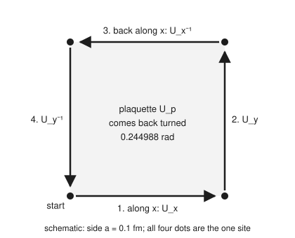

# Yang-Mills: a connection whose curvature costs energy

[Syllabus](../../../SYLLABUS.md) → [Differential geometry and Lie groups](../README.md) → [Geometric Analysis and Physics](../README.md#s07) → Yang-Mills

---

## General Overview

Physicists who compute the strong force put space on a grid. A typical grid spacing is 0.1 fm (femtometres; a proton's radius is a little under one femtometre). Shrink that grid to its smallest case: a box with **one site**, whose edges wrap round so that stepping one place in any direction brings you back to the same site.

On each edge of the grid sits a small turn: an element of SU(2), the 2 by 2 complex matrices that act like rotations ([Lie group](../06-Lie%20Groups/01-lie-groups-and-matrix-groups.md)). Walk round one unit square: along x, along y, back along x, back along y. Multiply the four turns in that order. The product does not come back to "no turn". It comes back turned by 0.244988 rad, which is 14.0368°.

That leftover turn is a **force field**. It is the same idea as a gyroscope carried round a loop on a curved Earth and coming back turned: [Parallel transport](../05-Riemannian%20Geometry/03-parallel-transport-and-holonomy.md) calls it holonomy. Here the turning is in an internal direction that particles carry, not in space.

Yang-Mills theory charges an **energy** for that leftover turn: add up the square of the turning, square by square. Fields at rest make this energy stand still: under any small change of the connection, its rate of change is zero. That condition is the **Yang-Mills field equations**. The lowest-energy fields meet it, and so do others. This card writes the energy, computes it for the one-site box (187.5 per fm⁴), and derives the equations.

**A connection tells a particle how to turn as it moves; its curvature is the turning left over round a small loop; the Yang-Mills energy is the total squared size of that curvature, and the field equations say its first change is zero for every small change of the connection: minima satisfy them, and so do other fields.**

**What kind of fact this is:** the energy is a definition; its field equations are a theorem, derived on this card in Why it works; that this energy describes the strong and weak forces is a model confirmed by experiment. Whether the quantum version has a mass gap is an open problem as of 2026-11-19.

### The picture: one site, one square

<p align="center"></p>

Schematic: one side stands for a = 0.1 fm. All four dots are the one site, because the box wraps round. The product round the square is called the **plaquette** (French for a small tile).

---

## The formula

Reminders: a **connection** $`A`$ is the rule for turning while moving, with one component $`A_\mu`$ per direction $`\mu`$ (x, y, z or t). Each component lies in the **Lie algebra** $`\mathfrak{g}`$, the turn rates of the group $`G`$ ([Principal bundle and connection](../06-Lie%20Groups/10-principal-bundles-and-connections-in-outline.md), [Lie algebra](../06-Lie%20Groups/02-lie-algebras-and-the-exponential-map.md)). The **bracket** $`[X, Y] = XY - YX`$ measures how two rates fail to commute; the **trace** $`\mathrm{tr}`$ adds a matrix's diagonal entries.

New on this card, in words first. The **curvature** $`F_{\mu\nu}`$ is the turning per unit area round a small loop in the $`\mu\nu`$ plane. The **size** of a matrix $`X`$ in $`\mathfrak{g}`$ is $`\lvert X\rvert^2 = -2\,\mathrm{tr}(XX)`$: for the groups used here it is never negative. The **coupling** $`g`$ sets how cheap curvature is. (Elsewhere in this wing $`g`$ is a metric; here it is the coupling.)

```math
\mathrm{YM}(A) = \frac{1}{2g^2}\int \sum_{\mu<\nu} \lvert F_{\mu\nu}\rvert^2 \, dV, \qquad F_{\mu\nu} = \partial_\mu A_\nu - \partial_\nu A_\mu + [A_\mu, A_\nu]
```

**Read it aloud:** the Yang-Mills energy is one over two g squared, times the integral over space of the squared size of the curvature in every plane; the curvature is how the connection changes across the plane plus the bracket of its two components.

Setting the first change of this energy to zero gives the **field equations**. The **covariant derivative** $`D_\mu X = \partial_\mu X + [A_\mu, X]`$ is the ordinary derivative corrected by the connection's own turning.

```math
\sum_{\mu} D_\mu F_{\mu\nu} = \sum_{\mu}\Big(\partial_\mu F_{\mu\nu} + [A_\mu, F_{\mu\nu}]\Big) = 0 \quad \text{for each direction } \nu
```

**Read it aloud:** for each direction, the covariant rate at which the curvature changes, summed over the other directions, is zero.

On a grid, the **link** $`U_\mu`$ is the group element on one edge, about $`\exp(aA_\mu)`$ for spacing $`a`$. The plaquette $`U_p`$ is the product round one square. **Wilson's action** prices each square (Step 2 gathers these lattice pieces in one place):

```math
S_W = \beta \sum_{p} \Big(1 - \frac{1}{N}\,\mathrm{Re}\,\mathrm{tr}\,U_p\Big), \qquad U_p = U_x U_y U_x^{-1} U_y^{-1} \text{ on one site}, \qquad \beta = \frac{2N}{g^2}
```

**Read it aloud:** for every square, take one minus the real part of the plaquette's trace over N, add these up, and multiply by beta.

For SU(2) the code uses a basis $`T_1, T_2, T_3`$ of the Lie algebra, with $`T_k = -\tfrac{i}{2}\sigma_k`$, where $`i = \sqrt{-1}`$ and $`\sigma_k`$ are the three Pauli matrices. As quaternions ([Rotation group](../06-Lie%20Groups/04-rotations-so3-and-quaternions.md)), $`T_1, T_2, T_3`$ are half the quaternion units **i**, **j**, **k**. Two facts are all the card needs: $`[T_1, T_2] = T_3`$ and its cyclic shifts, and $`\lvert f_1T_1 + f_2T_2 + f_3T_3\rvert^2 = f_1^2 + f_2^2 + f_3^2`$.

| Symbol | Plain meaning | In our example | Push it up and the answer… |
| --- | --- | --- | --- |
| $`G`$, $`N`$, $`\mathfrak{g}`$ | the matrix group; its matrix size; its Lie algebra | SU(2), N = 2, su(2) | larger groups add more directions to turn in |
| $`\mu`$, $`\nu`$, $`\lambda`$, $`\partial_\mu`$, $`dV`$ | directions x, y, z, t; rate of change along one; volume element | only x and y carry a field | — |
| $`A_\mu`$, $`\alpha`$ | connection component, per fm; its size in the example | $`A_x = 5T_1`$, $`A_y = 5T_2`$; α = 5 per fm | curvature grows like α² |
| $`F_{\mu\nu}`$ | curvature: turning per unit area | $`F_{xy} = 25\,T_3`$ per fm² | energy grows like its square |
| $`[X, Y]`$, $`\mathrm{tr}`$, $`\lvert X\rvert^2`$, $`\langle X, Y\rangle`$ | bracket; trace; squared size $`-2\,\mathrm{tr}(XX)`$; its pairing $`-2\,\mathrm{tr}(XY)`$; $`X`$, $`Y`$, $`Z`$ stand for any algebra elements | $`\lvert F_{xy}\rvert^2 = 625`$ per fm⁴ | — |
| $`T_k`$, $`\sigma_k`$, $`i`$ | basis of su(2), $`-\tfrac{i}{2}\sigma_k`$; Pauli matrices; square root of −1 | $`[T_1, T_2] = T_3`$ | — |
| $`g`$, $`\beta`$ | coupling; the lattice's inverse coupling, $`2N/g^2`$ | g² = 1.666667, β = 2.4 | larger g makes curvature cheaper |
| $`\mathrm{YM}`$, $`E`$ | the energy; its density per unit volume | E = 187.5 per fm⁴ | — |
| $`D_\mu`$, $`D_A`$, $`\star`$, $`\delta A`$, $`t`$ | covariant derivative $`\partial_\mu + [A_\mu,\cdot\,]`$; the same on forms; Hodge star; a push of the connection; its size | $`\sum_\mu D_\mu F_{\mu x} = -125\,T_1`$ per fm³ | nonzero means not a solution |
| $`a`$, $`\theta`$, $`c`$, $`s`$ | lattice spacing; link angle $`a\alpha`$; $`\cos(\theta/2)`$, $`\sin(\theta/2)`$ | 0.1 fm; 0.5 | lattice error grows like a² |
| $`U_\mu`$, $`p`$, $`U_p`$, $`I`$, $`S_W`$, $`S_p`$ | link; one unit square; its plaquette; the identity, no turn; Wilson action; the cost of one square | Re tr $`U_p`$ = 1.985014; $`S_p`$ = 0.017983 | — |
| $`h`$, $`n`$ | a gauge change, one group element per site; a site | one lopsided element of SU(2) | energy does not move |

### When it holds

- **The group is compact, like SU(N).** Then $`\lvert X\rvert^2 \ge 0`$ and the energy has a floor at zero. For the non-compact group SL(2, ℝ), $`X = \mathrm{diag}(1, -1)`$ gives $`-2\,\mathrm{tr}(XX) = -4`$: curvature could carry negative energy, and nothing would settle.
- **The connection is smooth and boundary terms vanish.** The derivation moves a derivative by integration by parts. On a wrapped box, or with fields that die away, the boundary term is zero; otherwise it stays.
- **The grid is fine beside the field.** The lattice value reaches the continuum value only as $`a \to 0`$: at a = 0.1 fm it is 179.83 per fm⁴, not 187.5, and at a = 0.2 fm it is 158.49.
- **Time is treated as a fourth space direction (Euclidean).** That is how grid simulations run. In real time, with the wing's signature (−, +, +, +), electric terms change sign in the action, but the field equations keep the same form.
- **The theory is classical.** The quantum theory weights every field by $`e^{-S_W}`$ and averages. Whether that average has a continuum limit in four dimensions with a mass gap is the open problem of [Mass gap](04-the-mass-gap-statement.md).

---

## Why it works

### Step 0: only the turning round loops is real

The connection $`A`$ itself is not measurable. Change the reference turn at every site by a group element $`h`$, and the links change: $`U_\mu(n) \to h(n)\,U_\mu(n)\,h(n+\mu)^{-1}`$, where $`n + \mu`$ is the next site in direction $`\mu`$. This is a **gauge change**. ($`h`$ is used here because $`g`$ is the coupling.)

Round a closed loop, the inner $`h`$'s cancel in pairs. Only $`h(n)\,U_p\,h(n)^{-1}`$ is left, and the trace of that equals the trace of $`U_p`$. So the trace of a loop product is gauge-free. A sensible energy must be built from it, and the smallest loops give the most local measure: the plaquettes.

### Step 1: a small loop's turn is the curvature times the area

Expand each link to second order: $`U_x \approx I + aA_x + \tfrac12 a^2A_x^2`$, and the same for $`U_y`$. Multiply the four factors round the square. The first-order terms cancel, because each edge is walked once forward and once back. At second order, what survives is the change of $`A`$ across the square plus the bracket:

```math
U_p = \exp\big(a^2 F_{xy} + \text{terms of order } a^3\big)
```

[Baker-Campbell-Hausdorff](../06-Lie%20Groups/03-baker-campbell-hausdorff-in-outline.md) finds the same bracket for any two small turns done and undone. On the one-site box nothing changes across the square, so only the bracket is left: $`F_{xy} = [A_x, A_y] = 25\,[T_1, T_2] = 25\,T_3`$ per fm². The plaquette should be a turn by $`a^2\lvert F_{xy}\rvert = 0.25`$ rad. The exact product gives 0.244988 rad. At a = 0.05 fm the two are 0.062178 and 0.0625.

<details>
<summary>The second-order product, term by term</summary>

Write $`X = aA_x`$ and $`Y = aA_y`$ for constant fields. Then

$`\displaystyle e^{X}e^{Y}e^{-X}e^{-Y} = \big(I + X + \tfrac12X^2\big)\big(I + Y + \tfrac12Y^2\big)\big(I - X + \tfrac12X^2\big)\big(I - Y + \tfrac12Y^2\big) + \cdots`$

The terms of first order are $`X + Y - X - Y = 0`$. At second order, the half-squares inside the four factors add up to $`X^2 + Y^2`$. The products of two different factors, kept in order, add up to $`XY - X^2 - XY - YX - Y^2 + XY`$. The sum of the two lists is $`XY - YX = [X, Y]`$. So the plaquette is $`I + a^2[A_x, A_y]`$ plus third order.

If $`A`$ also varies across the square, the edges at $`x + a`$ and $`y + a`$ carry shifted values. The shift contributes $`a^2(\partial_xA_y - \partial_yA_x)`$, which completes $`F_{xy}`$.

</details>

### Step 2: lattice gauge theory, and why Wilson's action becomes the Yang-Mills energy

Lattice gauge theory, in one place. Space and time become a grid of spacing $`a`$. Each edge, from site $`n`$ in direction $`\mu`$, carries a **link** $`U_\mu(n)`$ in the group $`G`$, about $`\exp(aA_\mu)`$. Each unit square $`p`$ carries its **plaquette** $`U_p`$, the product of the four links walked round it. **Wilson's action** $`S_W`$, in The formula, adds $`\beta(1 - \mathrm{Re}\,\mathrm{tr}\,U_p/N)`$ over every plaquette, with $`\beta = 2N/g^2`$. It uses loop products only, so a gauge change leaves it alone (Step 0). The rest of this step shows that it becomes the Yang-Mills energy as the grid gets finer.

Take $`U_p = \exp(Z)`$ with $`Z = a^2F_{xy}`$ small and traceless. Then $`\mathrm{tr}\,U_p = N + \tfrac12\mathrm{tr}(Z^2) + \ldots`$, so

```math
\beta\Big(1 - \frac{1}{N}\,\mathrm{Re}\,\mathrm{tr}\,U_p\Big) \approx \frac{2N}{g^2}\cdot\frac{-\mathrm{tr}(Z^2)}{2N} = \frac{a^4\,\lvert F_{xy}\rvert^2}{2g^2}
```

That is the Yang-Mills density times $`a^4`$, the volume of one grid cell in four dimensions. Summing over all squares sums over all cells and all planes: the integral in YM. The factor $`1/N`$ makes a flat plaquette, with trace N, cost nothing; $`\beta = 2N/g^2`$ makes the two energies match.

One site of a four-dimensional wrapped grid has four links and six plaquettes. Here $`A_z = A_t = 0`$, so those links are the identity and five plaquettes are exactly $`I`$. Only the xy square costs anything.

For this box the product can be done by hand with quaternions. With $`c = \cos(\theta/2)`$ and $`s = \sin(\theta/2)`$, the links are $`c + s\,i`$ and $`c + s\,j`$, and the real part of their commutator is $`1 - 2s^4`$. So each square costs exactly $`2\beta\sin^4(\theta/2)`$, which is $`\beta\theta^4/8`$ to leading order: the continuum value.

### Step 3: gauge changes leave the energy alone

In the continuum a gauge change sends $`F_{\mu\nu} \to h F_{\mu\nu} h^{-1}`$. The trace does not see the conjugation, so $`\lvert F\rvert^2`$, and YM with it, is unchanged. On the one-site box, a gauge change is a single $`h`$ at the site, and every link becomes $`hUh^{-1}`$. The code picks a lopsided $`h`$. The link $`U_x`$ moves from (0.968912, 0.247404, 0, 0) to (0.968912, 0.113937, −0.184863, −0.118545). The plaquette trace stays at 1.985014.

### Step 4: the field equations are where the energy stands still

Push the connection a little: $`A \to A + t\,\delta A`$. The curvature moves by $`\delta F_{\mu\nu} = D_\mu\delta A_\nu - D_\nu\delta A_\mu`$. The energy moves at the rate $`\tfrac{1}{g^2}\int \sum \langle F, \delta F\rangle`$, where $`\langle X, Y\rangle = -2\,\mathrm{tr}(XY)`$. Move the $`D_\mu`$ off $`\delta A`$ and onto $`F`$, which flips its sign:

```math
\frac{d}{dt}\mathrm{YM}(A + t\,\delta A)\Big|_{t=0} = -\frac{1}{g^2}\int \sum_{\nu} \Big\langle \sum_{\mu} D_\mu F_{\mu\nu},\; \delta A_\nu \Big\rangle\, dV
```

This is zero for every push $`\delta A`$ exactly when $`\sum_\mu D_\mu F_{\mu\nu} = 0`$ for each $`\nu`$. Those are the field equations. They also say the downhill direction of the energy is $`+\tfrac{1}{g^2}\sum_\mu D_\mu F_{\mu\nu}`$.

<details>
<summary>Detailed proof: the first change of the energy</summary>

Expand $`F_{\mu\nu}(A + t\,\delta A)`$ to first order in $`t`$:

$`\displaystyle \delta F_{\mu\nu} = \partial_\mu\delta A_\nu - \partial_\nu\delta A_\mu + [A_\mu, \delta A_\nu] + [\delta A_\mu, A_\nu] = D_\mu\delta A_\nu - D_\nu\delta A_\mu.`$

The rate of change of $`\tfrac{1}{2g^2}\lvert F_{\mu\nu}\rvert^2`$ is $`\tfrac{1}{g^2}\langle F_{\mu\nu}, \delta F_{\mu\nu}\rangle`$. Summed over $`\mu < \nu`$, and using $`F_{\nu\mu} = -F_{\mu\nu}`$, the two terms combine into one sum over all pairs:

$`\displaystyle \sum_{\mu<\nu}\langle F_{\mu\nu}, \delta F_{\mu\nu}\rangle = \sum_{\mu,\nu}\langle F_{\mu\nu}, D_\mu\delta A_\nu\rangle.`$

Two moves take $`D_\mu`$ across. Integration by parts moves $`\partial_\mu`$, with a minus sign and no boundary term. The trace satisfies $`\mathrm{tr}(X[A, Y]) = -\mathrm{tr}([A, X]Y)`$, so the bracket also moves with a minus sign. Together:

$`\displaystyle \int\langle F_{\mu\nu}, D_\mu\delta A_\nu\rangle\, dV = -\int\langle D_\mu F_{\mu\nu}, \delta A_\nu\rangle\, dV.`$

That is the formula in the body. If $`\sum_\mu D_\mu F_{\mu\nu}`$ were nonzero somewhere, the push $`\delta A_\nu = \sum_\mu D_\mu F_{\mu\nu}`$ near there would lower the energy. So a field that no push can lower must satisfy the equations.

</details>

On the one-site box nothing varies, so $`D_\mu F_{\mu x} = [A_\mu, F_{\mu x}]`$. The only term is $`[A_y, F_{yx}] = -[A_y, F_{xy}] = -125\,[T_2, T_3] = -125\,T_1`$ per fm³. It is not zero. So this field is not a solution: one small downhill step of size 0.001 lowers the energy from 187.5 to 181.917187 per fm⁴. Among constant fields, the ones that satisfy the equations are the commuting ones, with zero curvature and zero energy.

### Step 5: Maxwell is the case where the bracket vanishes

For the group U(1), the turns are complex numbers $`e^{i\theta}`$, and every bracket is zero. Then $`F_{\mu\nu} = \partial_\mu A_\nu - \partial_\nu A_\mu`$ and the field equations read $`\sum_\mu \partial_\mu F_{\mu\nu} = 0`$. These are the source-free half of [Maxwell's equations](../../13-Engineering%20mathematics/06-Circuits%20and%20Electromagnetism/07-maxwells-equations.md), and YM is the field energy up to a constant.

The other half of Maxwell (no magnetic charge, and Faraday's law) comes free: the **Bianchi identity** $`D_\mu F_{\nu\lambda} + D_\nu F_{\lambda\mu} + D_\lambda F_{\mu\nu} = 0`$ holds for every connection. In the language of forms, the pair reads $`D_A F = 0`$ and $`D_A{\star}F = 0`$. Here $`D_A`$ is the covariant derivative on forms, and the Hodge star ⋆ turns the curvature two-form into its complementary two-form; [Hodge star](../04-Differential%20Forms/09-hodge-star-and-maxwell-in-forms.md) teaches it.

The difference is the bracket. On the one-site box, U(1) links give a plaquette of exactly 1 and zero energy: a constant electromagnetic potential carries no field. A constant SU(2) potential does, because its components fail to commute. In this sense the field acts on itself.

---

## Worked numbers, by hand

SU(2), β = 2.4, $`A_x = 5\,T_1`$ and $`A_y = 5\,T_2`$ per fm, spacing a = 0.1 fm.

| Step | Arithmetic | Value |
| --- | --- | --- |
| coupling | g² = 2N/β = 4/2.4 | 1.666667 |
| curvature | $`F_{xy} = [A_x, A_y] = 25\,[T_1, T_2]`$ | 25 $`T_3`$ per fm² |
| squared size | 25² | 625 per fm⁴ |
| **Yang-Mills energy density** | 625 / (2 × 1.666667) | **187.5 per fm⁴** |
| link angle | θ = aα = 0.1 × 5 | 0.5 |
| plaquette's real part | 1 − 2 sin⁴(0.25) | 0.992507 |
| Re tr $`U_p`$ | 2 × 0.992507 | 1.985014 |
| Wilson cost of the square | 2.4 × (1 − 0.992507) | 0.017983 |
| per unit volume | 0.017983 / 0.1⁴ | 179.83 per fm⁴, 7.67 below |
| same at a = 0.05 fm | | 185.56 per fm⁴, 1.94 below |
| **field equation, x-direction** | $`[A_y, F_{yx}] = -125\,[T_2, T_3]`$ | **−125 $`T_1`$ per fm³, not zero** |
| slope of the energy | 125 / 1.666667 | 75 |

The one-site field costs 187.5 per fm⁴, and the grid gets within 1.94 of that at 0.05 fm. Halving the spacing cut the error by a factor of 3.94, close to the 4 that a second-order error predicts. The field equation fails, so this field is not at rest: it would relax towards commuting components.

### What breaks if you drop a piece

| Mistake | Comes out at | What went wrong |
| --- | --- | --- |
| Drop the bracket: $`F = \partial A - \partial A`$ only | 0 per fm⁴ (right: 187.5) | That is Maxwell's curvature. For constant fields it is zero, and the self-interaction is lost. |
| Use U(1) links of the same angle | Wilson cost 0 | Commuting turns cancel round the loop. A constant abelian potential carries no field. |
| Forget the $`1/N`$ in Wilson's action | −2.364034 per square | A flat plaquette has trace N, not 1. The cost becomes negative and has no floor. |
| Take β = 1/g² instead of 2N/g² | 44.958087 per fm⁴ (right: 187.5) | The lattice energy is a factor 2N = 4 too small, so it matches a different coupling. |

---

## Code, from first principles, and it actually runs

The code stores an SU(2) element as a unit quaternion and an su(2) element as three numbers, so the bracket is the cross product. It takes three roads. **Road 1** multiplies the links round the square and checks the Wilson cost against the hand formula $`2\beta\sin^4(\theta/2)`$ and against the continuum energy at two spacings. **Road 2** applies a gauge change and checks the plaquette trace does not move while the link does. **Road 3** checks the field equations: the gradient they predict against finite differences of the energy, on a lopsided field where every component is nonzero. It then prints every number in the What breaks table.

### Python

```python
# Yang-Mills on one lattice site -- the check behind the card.  Standard library only.
# An SU(2) element is a unit quaternion (w, x, y, z).  An su(2) element F = f1 T1 + f2 T2 + f3 T3 is
# the 3-vector f, with T_k = -i sigma_k / 2: then [T_a, T_b] = T_c is the cross product, |F|^2 = -2 tr(F F) = |f|^2,
# and Re tr U = 2w.  Nothing imported knows any gauge theory.
from math import sin, cos, acos, sqrt, pi

def qmul(p, q):
    a, b, c, d = p; e, f, g, h = q
    return (a*e - b*f - c*g - d*h, a*f + b*e + c*h - d*g, a*g - b*h + c*e + d*f, a*h + b*g - c*f + d*e)
def conj(q): return (q[0], -q[1], -q[2], -q[3])
def expT(v):                           # exp(v1 T1 + v2 T2 + v3 T3) in closed form: half angle, unit axis
    n = sqrt(v[0]**2 + v[1]**2 + v[2]**2)
    if n == 0.0: return (1.0, 0.0, 0.0, 0.0)
    return (cos(n / 2), sin(n / 2) * v[0] / n, sin(n / 2) * v[1] / n, sin(n / 2) * v[2] / n)
def cross(a, b): return (a[1]*b[2] - a[2]*b[1], a[2]*b[0] - a[0]*b[2], a[0]*b[1] - a[1]*b[0])
def dot(a, b): return a[0]*b[0] + a[1]*b[1] + a[2]*b[2]
def plaquette(Ux, Uy):                 # one site, wrapped round: along x, along y, back x, back y
    return qmul(qmul(Ux, Uy), qmul(conj(Ux), conj(Uy)))
def wilson(beta, N, Up): return beta * (1.0 - 2.0 * Up[0] / N)    # beta (1 - Re tr U_p / N)
def energy(Ax, Ay, g2):                # continuum Yang-Mills density for constant fields: F_xy = [A_x, A_y]
    F = cross(Ax, Ay)
    return dot(F, F) / (2.0 * g2)
def f6(v): return f"{v:.6f}"
def vec(v): return "(" + ", ".join(f6(c) for c in v) + ")"

beta, N = 2.4, 2
g2 = 2.0 * N / beta                    # coupling squared g^2, from beta = 2N / g^2
alpha, a = 5.0, 0.1                    # field size in 1/fm, lattice spacing in fm
Ax, Ay = (alpha, 0.0, 0.0), (0.0, alpha, 0.0)
F = cross(Ax, Ay)
E = energy(Ax, Ay, g2)
print("g^2 =", f6(g2), "  A_x =", vec(Ax), "  A_y =", vec(Ay), "  per fm")
print("F_xy = [A_x, A_y] =", vec(F), "per fm^2   |F_xy| =", f6(sqrt(dot(F, F))), "  |F_xy|^2 =", f6(dot(F, F)))
print("continuum energy density |F|^2/(2 g^2) =", f6(E), "per fm^4")

# road 1: the lattice.  Links U = exp(a A), plaquette product, Wilson action, at two spacings
err, ang = [], []
for sp in (a, a / 2):
    th = sp * alpha
    Up = plaquette(expT((th, 0.0, 0.0)), expT((0.0, th, 0.0)))
    S = wilson(beta, N, Up)
    closed = 2.0 * beta * sin(th / 2)**4             # by hand: Re of the quaternion commutator is 1 - 2 sin^4
    phi = 2.0 * acos(Up[0])                          # turning angle of the plaquette
    print(f"a = {sp:.3f} fm  theta = {th:.3f}  U_p = ({f6(Up[0])}, {f6(Up[1])}, {f6(Up[2])}, {f6(Up[3])})")
    print(f"   Wilson S_p = {S:.8f}  closed form 2 beta sin^4(theta/2) = {closed:.8f}  continuum a^4 E = {sp**4 * E:.8f}")
    print(f"   S_p / a^4 = {f6(S / sp**4)} per fm^4  error {f6(E - S / sp**4)}   plaquette angle {f6(phi)} rad = {phi * 180 / pi:.4f} deg, a^2 |F| = {f6(sp * sp * sqrt(dot(F, F)))}")
    assert abs(S - closed) < 1e-12
    err.append(E - S / sp**4); ang.append(phi)
print("error ratio, a halved:", f6(err[0] / err[1]))
assert 3.8 < err[0] / err[1] < 4.1                   # second-order: halve a, quarter the error
assert abs(ang[1] - (a / 2)**2 * 25.0) < abs(ang[0] - a * a * 25.0) / 10

# road 2: gauge invariance.  A gauge change h at the site turns every link U into h U h^-1
Ux, Uy = expT((0.5, 0.0, 0.0)), expT((0.0, 0.5, 0.0))
h = expT((0.7, 0.2, -1.1))
Ux2, Uy2 = qmul(qmul(h, Ux), conj(h)), qmul(qmul(h, Uy), conj(h))
P1, P2 = plaquette(Ux, Uy), plaquette(Ux2, Uy2)
print("gauge: U_x =", vec(Ux), "->", vec(Ux2))
print("gauge: Re tr U_p =", f6(2 * P1[0]), "->", f6(2 * P2[0]), "  Wilson", f6(wilson(beta, N, P1)), "->", f6(wilson(beta, N, P2)))
assert max(abs(Ux[i] - Ux2[i]) for i in range(4)) > 0.1
assert abs(P1[0] - P2[0]) < 1e-12

# road 3: the field equations.  dE/dA_x = (1/g^2) [A_y, F_xy] = -(1/g^2) D_mu F_mu,x, against finite differences
def grads(Ax, Ay):
    F = cross(Ax, Ay)
    return [c / g2 for c in cross(Ay, F)], [c / g2 for c in cross(F, Ax)]
def numgrad(Ax, Ay, eps=1e-5):
    out = []
    for which in (0, 1):
        row = []
        for k in range(3):
            up = [list(Ax), list(Ay)]; dn = [list(Ax), list(Ay)]
            up[which][k] += eps; dn[which][k] -= eps
            row.append((energy(*up, g2) - energy(*dn, g2)) / (2 * eps))
        out.append(row)
    return out
DF = [0.0 - c for c in cross(Ay, F)]                      # D_mu F_mu,x = [A_y, F_yx] = -[A_y, F_xy]
print("D_mu F_mu,x =", vec(DF), "per fm^3  (zero for a solution)")
gx, gy = grads(Ax, Ay)
print("dE/dA_x =", vec(gx), "  dE/dA_y =", vec(gy))
B1, B2 = (0.3, -1.1, 0.8), (0.9, 0.4, -0.5)          # a lopsided field, to test every component
ga, na = grads(B1, B2), numgrad(B1, B2)
gap = max(abs(ga[i][k] - na[i][k]) for i in range(2) for k in range(3))
print("lopsided field: dE/dA_x =", vec(ga[0]), " finite differences =", vec(na[0]))
assert gap < 1e-8
step = [Ax[k] - 0.001 * gx[k] for k in range(3)]
E_down = energy(step, Ay, g2)
print("one downhill step of 0.001: energy", f6(E), "->", f6(E_down))
assert E_down < E - 0.1

# what breaks, and the special cases
Uc = expT((0.0, 0.0, 0.5))                           # commuting links: U(1) inside SU(2)
Pc = plaquette(Uc, Uc)
print("U(1): U_p =", vec(Pc[:3]), "+ ...  Wilson", f6(wilson(beta, N, Pc)), "  bracket dropped: F_xy = 0, energy", f6(0.0))
print("commuting fields A_x = (0,0,5), A_y = (0,0,3): energy", f6(energy((0, 0, 5.0), (0, 0, 3.0), g2)))
assert abs(wilson(beta, N, Pc)) < 1e-12 and energy((0, 0, 5.0), (0, 0, 3.0), g2) == 0.0
print("wrong: forgot 1/N:", f6(beta * (1 - 2 * P1[0])), "  wrong: beta = 1/g^2:", f6(0.6 * (1 - P1[0])),
      "per plaquette,", f6(0.6 * (1 - P1[0]) / a**4), "per fm^4")
print("non-compact SL(2,R), X = diag(1,-1): -2 tr(X X) =", f6(-2 * (1 + 1)))

# try changing
Ut = plaquette(expT((1.0, 0, 0)), expT((0, 1.0, 0)))
print("try: a = 0.2 fm  S_p / a^4 =", f6(wilson(beta, N, Ut) / 0.2**4), "  A_y = (3,4,0): energy", f6(energy(Ax, (3.0, 4.0, 0.0), g2)),
      "  A_y = (0,0,5): energy", f6(energy(Ax, (0, 0, 5.0), g2)))
print("figure, square side 220 px = a 0.1 fm, corners (100,60) (320,60) (320,280) (100,280)")
print("ALL CHECKS PASS")
```

**Ran 2026-11-19 on macOS, Python 3.14.10, standard library only. All checks passed. Output, pasted from the run:**

```
g^2 = 1.666667   A_x = (5.000000, 0.000000, 0.000000)   A_y = (0.000000, 5.000000, 0.000000)   per fm
F_xy = [A_x, A_y] = (0.000000, 0.000000, 25.000000) per fm^2   |F_xy| = 25.000000   |F_xy|^2 = 625.000000
continuum energy density |F|^2/(2 g^2) = 187.500000 per fm^4
a = 0.100 fm  theta = 0.500  U_p = (0.992507, 0.029345, -0.029345, 0.114924)
   Wilson S_p = 0.01798323  closed form 2 beta sin^4(theta/2) = 0.01798323  continuum a^4 E = 0.01875000
   S_p / a^4 = 179.832350 per fm^4  error 7.667650   plaquette angle 0.244988 rad = 14.0368 deg, a^2 |F| = 0.250000
a = 0.050 fm  theta = 0.250  U_p = (0.999517, 0.003846, -0.003846, 0.030604)
   Wilson S_p = 0.00115973  closed form 2 beta sin^4(theta/2) = 0.00115973  continuum a^4 E = 0.00117188
   S_p / a^4 = 185.556005 per fm^4  error 1.943995   plaquette angle 0.062178 rad = 3.5625 deg, a^2 |F| = 0.062500
error ratio, a halved: 3.944274
gauge: U_x = (0.968912, 0.247404, 0.000000, 0.000000) -> (0.968912, 0.113937, -0.184863, -0.118545)
gauge: Re tr U_p = 1.985014 -> 1.985014   Wilson 0.017983 -> 0.017983
D_mu F_mu,x = (-125.000000, 0.000000, 0.000000) per fm^3  (zero for a solution)
dE/dA_x = (75.000000, 0.000000, 0.000000)   dE/dA_y = (0.000000, 75.000000, 0.000000)
lopsided field: dE/dA_x = (0.527400, -0.668400, 0.414600)  finite differences = (0.527400, -0.668400, 0.414600)
one downhill step of 0.001: energy 187.500000 -> 181.917187
U(1): U_p = (1.000000, 0.000000, 0.000000) + ...  Wilson 0.000000   bracket dropped: F_xy = 0, energy 0.000000
commuting fields A_x = (0,0,5), A_y = (0,0,3): energy 0.000000
wrong: forgot 1/N: -2.364034   wrong: beta = 1/g^2: 0.004496 per plaquette, 44.958087 per fm^4
non-compact SL(2,R), X = diag(1,-1): -2 tr(X X) = -4.000000
try: a = 0.2 fm  S_p / a^4 = 158.491477   A_y = (3,4,0): energy 120.000000   A_y = (0,0,5): energy 187.500000
figure, square side 220 px = a 0.1 fm, corners (100,60) (320,60) (320,280) (100,280)
ALL CHECKS PASS
```

### Rust

```rust
// Yang-Mills on one lattice site -- the check behind the card.  std only, no crates.
// An SU(2) element is a unit quaternion (w, x, y, z).  An su(2) element F = f1 T1 + f2 T2 + f3 T3 is
// the 3-vector f, with T_k = -i sigma_k / 2: then [T_a, T_b] = T_c is the cross product, |F|^2 = -2 tr(F F) = |f|^2,
// and Re tr U = 2w.  Nothing used knows any gauge theory.
type Q = [f64; 4];
type V = [f64; 3];

fn qmul(p: Q, q: Q) -> Q {
    let [a, b, c, d] = p;
    let [e, f, g, h] = q;
    [a * e - b * f - c * g - d * h, a * f + b * e + c * h - d * g, a * g - b * h + c * e + d * f, a * h + b * g - c * f + d * e]
}
fn conj(q: Q) -> Q { [q[0], -q[1], -q[2], -q[3]] }
fn exp_t(v: V) -> Q { // exp(v1 T1 + v2 T2 + v3 T3) in closed form: half angle, unit axis
    let n = (v[0].powi(2) + v[1].powi(2) + v[2].powi(2)).sqrt();
    if n == 0.0 { return [1.0, 0.0, 0.0, 0.0]; }
    [(n / 2.0).cos(), (n / 2.0).sin() * v[0] / n, (n / 2.0).sin() * v[1] / n, (n / 2.0).sin() * v[2] / n]
}
fn cross(a: V, b: V) -> V { [a[1] * b[2] - a[2] * b[1], a[2] * b[0] - a[0] * b[2], a[0] * b[1] - a[1] * b[0]] }
fn dot(a: V, b: V) -> f64 { a[0] * b[0] + a[1] * b[1] + a[2] * b[2] }
fn plaquette(ux: Q, uy: Q) -> Q { qmul(qmul(ux, uy), qmul(conj(ux), conj(uy))) } // x, y, back x, back y
fn wilson(beta: f64, n: f64, up: Q) -> f64 { beta * (1.0 - 2.0 * up[0] / n) } // beta (1 - Re tr U_p / N)
fn energy(ax: V, ay: V, g2: f64) -> f64 { let f = cross(ax, ay); dot(f, f) / (2.0 * g2) }
fn f6(v: f64) -> String { format!("{:.6}", v) }
fn vec(v: &[f64]) -> String { format!("({})", v.iter().map(|c| f6(*c)).collect::<Vec<_>>().join(", ")) }
fn scale(v: V, s: f64) -> V { [v[0] * s, v[1] * s, v[2] * s] }

fn main() {
    let (beta, n) = (2.4, 2.0);
    let g2 = 2.0 * n / beta; // coupling squared g^2, from beta = 2N / g^2
    let (alpha, a) = (5.0, 0.1); // field size in 1/fm, lattice spacing in fm
    let (ax, ay): (V, V) = ([alpha, 0.0, 0.0], [0.0, alpha, 0.0]);
    let f = cross(ax, ay);
    let e = energy(ax, ay, g2);
    println!("g^2 = {}   A_x = {}   A_y = {}   per fm", f6(g2), vec(&ax), vec(&ay));
    println!("F_xy = [A_x, A_y] = {} per fm^2   |F_xy| = {}   |F_xy|^2 = {}", vec(&f), f6(dot(f, f).sqrt()), f6(dot(f, f)));
    println!("continuum energy density |F|^2/(2 g^2) = {} per fm^4", f6(e));

    // road 1: the lattice.  Links U = exp(a A), plaquette product, Wilson action, at two spacings
    let (mut err, mut ang) = (vec![], vec![]);
    for sp in [a, a / 2.0] {
        let th = sp * alpha;
        let up = plaquette(exp_t([th, 0.0, 0.0]), exp_t([0.0, th, 0.0]));
        let s = wilson(beta, n, up);
        let closed = 2.0 * beta * (th / 2.0).sin().powi(4); // by hand: Re of the commutator is 1 - 2 sin^4
        let phi = 2.0 * up[0].acos(); // turning angle of the plaquette
        println!("a = {:.3} fm  theta = {:.3}  U_p = ({}, {}, {}, {})", sp, th, f6(up[0]), f6(up[1]), f6(up[2]), f6(up[3]));
        println!("   Wilson S_p = {:.8}  closed form 2 beta sin^4(theta/2) = {:.8}  continuum a^4 E = {:.8}", s, closed, sp.powi(4) * e);
        println!("   S_p / a^4 = {} per fm^4  error {}   plaquette angle {} rad = {:.4} deg, a^2 |F| = {}",
            f6(s / sp.powi(4)), f6(e - s / sp.powi(4)), f6(phi), phi * 180.0 / std::f64::consts::PI, f6(sp * sp * dot(f, f).sqrt()));
        assert!((s - closed).abs() < 1e-12);
        err.push(e - s / sp.powi(4));
        ang.push(phi);
    }
    println!("error ratio, a halved: {}", f6(err[0] / err[1]));
    assert!(3.8 < err[0] / err[1] && err[0] / err[1] < 4.1); // second-order: halve a, quarter the error
    assert!((ang[1] - (a / 2.0).powi(2) * 25.0).abs() < (ang[0] - a * a * 25.0).abs() / 10.0);

    // road 2: gauge invariance.  A gauge change h at the site turns every link U into h U h^-1
    let (ux, uy) = (exp_t([0.5, 0.0, 0.0]), exp_t([0.0, 0.5, 0.0]));
    let h = exp_t([0.7, 0.2, -1.1]);
    let (ux2, uy2) = (qmul(qmul(h, ux), conj(h)), qmul(qmul(h, uy), conj(h)));
    let (p1, p2) = (plaquette(ux, uy), plaquette(ux2, uy2));
    println!("gauge: U_x = {} -> {}", vec(&ux), vec(&ux2));
    println!("gauge: Re tr U_p = {} -> {}   Wilson {} -> {}", f6(2.0 * p1[0]), f6(2.0 * p2[0]), f6(wilson(beta, n, p1)), f6(wilson(beta, n, p2)));
    assert!((0..4).map(|i| (ux[i] - ux2[i]).abs()).fold(0.0, f64::max) > 0.1);
    assert!((p1[0] - p2[0]).abs() < 1e-12);

    // road 3: the field equations.  dE/dA_x = (1/g^2) [A_y, F_xy] = -(1/g^2) D_mu F_mu,x, against finite differences
    let grads = |ax: V, ay: V| -> (V, V) { let f = cross(ax, ay); (scale(cross(ay, f), 1.0 / g2), scale(cross(f, ax), 1.0 / g2)) };
    let numgrad = |ax: V, ay: V| -> [V; 2] {
        let eps = 1e-5;
        let mut out = [[0.0; 3]; 2];
        for which in 0..2 {
            for k in 0..3 {
                let (mut up, mut dn) = ([ax, ay], [ax, ay]);
                up[which][k] += eps;
                dn[which][k] -= eps;
                out[which][k] = (energy(up[0], up[1], g2) - energy(dn[0], dn[1], g2)) / (2.0 * eps);
            }
        }
        out
    };
    let c = cross(ay, f);
    let df: V = [0.0 - c[0], 0.0 - c[1], 0.0 - c[2]]; // D_mu F_mu,x = [A_y, F_yx] = -[A_y, F_xy]
    println!("D_mu F_mu,x = {} per fm^3  (zero for a solution)", vec(&df));
    let (gx, gy) = grads(ax, ay);
    println!("dE/dA_x = {}   dE/dA_y = {}", vec(&gx), vec(&gy));
    let (b1, b2): (V, V) = ([0.3, -1.1, 0.8], [0.9, 0.4, -0.5]); // a lopsided field, to test every component
    let (ga, na) = (grads(b1, b2), numgrad(b1, b2));
    let gav = [ga.0, ga.1];
    let mut gap: f64 = 0.0;
    for i in 0..2 { for k in 0..3 { gap = gap.max((gav[i][k] - na[i][k]).abs()); } }
    println!("lopsided field: dE/dA_x = {}  finite differences = {}", vec(&ga.0), vec(&na[0]));
    assert!(gap < 1e-8);
    let step: V = [ax[0] - 0.001 * gx[0], ax[1] - 0.001 * gx[1], ax[2] - 0.001 * gx[2]];
    let e_down = energy(step, ay, g2);
    println!("one downhill step of 0.001: energy {} -> {}", f6(e), f6(e_down));
    assert!(e_down < e - 0.1);

    // what breaks, and the special cases
    let uc = exp_t([0.0, 0.0, 0.5]); // commuting links: U(1) inside SU(2)
    let pc = plaquette(uc, uc);
    println!("U(1): U_p = {} + ...  Wilson {}   bracket dropped: F_xy = 0, energy {}", vec(&pc[..3]), f6(wilson(beta, n, pc)), f6(0.0));
    println!("commuting fields A_x = (0,0,5), A_y = (0,0,3): energy {}", f6(energy([0.0, 0.0, 5.0], [0.0, 0.0, 3.0], g2)));
    assert!(wilson(beta, n, pc).abs() < 1e-12 && energy([0.0, 0.0, 5.0], [0.0, 0.0, 3.0], g2) == 0.0);
    println!("wrong: forgot 1/N: {}   wrong: beta = 1/g^2: {} per plaquette, {} per fm^4",
        f6(beta * (1.0 - 2.0 * p1[0])), f6(0.6 * (1.0 - p1[0])), f6(0.6 * (1.0 - p1[0]) / a.powi(4)));
    println!("non-compact SL(2,R), X = diag(1,-1): -2 tr(X X) = {}", f6(-2.0 * (1.0 + 1.0)));

    // try changing
    let ut = plaquette(exp_t([1.0, 0.0, 0.0]), exp_t([0.0, 1.0, 0.0]));
    println!("try: a = 0.2 fm  S_p / a^4 = {}   A_y = (3,4,0): energy {}   A_y = (0,0,5): energy {}",
        f6(wilson(beta, n, ut) / 0.2f64.powi(4)), f6(energy(ax, [3.0, 4.0, 0.0], g2)), f6(energy(ax, [0.0, 0.0, 5.0], g2)));
    println!("figure, square side 220 px = a 0.1 fm, corners (100,60) (320,60) (320,280) (100,280)");
    println!("ALL CHECKS PASS");
}
```

**Ran 2026-11-19 on macOS, rustc 1.98.1, no crates. All checks passed. Output, pasted from the run:**

```
g^2 = 1.666667   A_x = (5.000000, 0.000000, 0.000000)   A_y = (0.000000, 5.000000, 0.000000)   per fm
F_xy = [A_x, A_y] = (0.000000, 0.000000, 25.000000) per fm^2   |F_xy| = 25.000000   |F_xy|^2 = 625.000000
continuum energy density |F|^2/(2 g^2) = 187.500000 per fm^4
a = 0.100 fm  theta = 0.500  U_p = (0.992507, 0.029345, -0.029345, 0.114924)
   Wilson S_p = 0.01798323  closed form 2 beta sin^4(theta/2) = 0.01798323  continuum a^4 E = 0.01875000
   S_p / a^4 = 179.832350 per fm^4  error 7.667650   plaquette angle 0.244988 rad = 14.0368 deg, a^2 |F| = 0.250000
a = 0.050 fm  theta = 0.250  U_p = (0.999517, 0.003846, -0.003846, 0.030604)
   Wilson S_p = 0.00115973  closed form 2 beta sin^4(theta/2) = 0.00115973  continuum a^4 E = 0.00117188
   S_p / a^4 = 185.556005 per fm^4  error 1.943995   plaquette angle 0.062178 rad = 3.5625 deg, a^2 |F| = 0.062500
error ratio, a halved: 3.944274
gauge: U_x = (0.968912, 0.247404, 0.000000, 0.000000) -> (0.968912, 0.113937, -0.184863, -0.118545)
gauge: Re tr U_p = 1.985014 -> 1.985014   Wilson 0.017983 -> 0.017983
D_mu F_mu,x = (-125.000000, 0.000000, 0.000000) per fm^3  (zero for a solution)
dE/dA_x = (75.000000, 0.000000, 0.000000)   dE/dA_y = (0.000000, 75.000000, 0.000000)
lopsided field: dE/dA_x = (0.527400, -0.668400, 0.414600)  finite differences = (0.527400, -0.668400, 0.414600)
one downhill step of 0.001: energy 187.500000 -> 181.917187
U(1): U_p = (1.000000, 0.000000, 0.000000) + ...  Wilson 0.000000   bracket dropped: F_xy = 0, energy 0.000000
commuting fields A_x = (0,0,5), A_y = (0,0,3): energy 0.000000
wrong: forgot 1/N: -2.364034   wrong: beta = 1/g^2: 0.004496 per plaquette, 44.958087 per fm^4
non-compact SL(2,R), X = diag(1,-1): -2 tr(X X) = -4.000000
try: a = 0.2 fm  S_p / a^4 = 158.491477   A_y = (3,4,0): energy 120.000000   A_y = (0,0,5): energy 187.500000
figure, square side 220 px = a 0.1 fm, corners (100,60) (320,60) (320,280) (100,280)
ALL CHECKS PASS
```

### Lean

Lean proves Steps 3 and 4 for constant fields on the one-site wrapped box, for any SU(N) and any number of directions.

- Take a constant connection $`A`$ and a push $`\delta A`$, both with components in the Lie algebra of SU(N), and $`g^2 > 0`$. Then the energy's rate of change at $`t = 0`$ is Step 4's formula, without the integral, since nothing varies across the box.
- Take a constant connection with components in the Lie algebra of SU(N), and $`g^2 > 0`$. Then its first change is zero for every push $`\delta A`$ in that algebra exactly when the field equations hold.
- Take links $`U_x`$ and $`U_y`$ in SU(N), a gauge change $`h`$ in SU(N), and any β. Then turning each link $`U`$ into $`hUh^{-1}`$ leaves $`S_p`$, Wilson's cost of the square, unchanged.
- Take the card's example, $`A_x = 5T_1`$ and $`A_y = 5T_2`$, with β = 2.4. Then $`F_{xy} = 25\,T_3`$, the energy density is 187.5 per fm⁴, and the x field equation gives $`-125\,T_1`$.
- Take $`A_y`$ tilted to (3, 4, 0), as in Try changing. Then the energy density is exactly 120 per fm⁴.
- Take $`X = \mathrm{diag}(1, -1)`$ in SL(2, ℝ). Then $`-2\,\mathrm{tr}(XX) = -4`$, a negative size.

The lattice values at two spacings, the gauge-changed links and the finite-difference gradient are left to the Python and Rust checks.

```lean
-- Yang-Mills: on the one-site wrapped box with a compact SU(N) connection, the energy's first change is −(1/g²) Σ_ν ⟨Σ_μ [A_μ, F_μν], δA_ν⟩, so the energy stands still exactly when the field equations hold, and a gauge change leaves Wilson's plaquette cost unchanged.
import Mathlib.Algebra.Lie.OfAssociative
import Mathlib.Analysis.Calculus.Deriv.Basic
import Mathlib.Analysis.Calculus.Deriv.Add
import Mathlib.Analysis.Calculus.Deriv.Mul
import Mathlib.Analysis.Calculus.Deriv.Pow
import Mathlib.Tactic.Module
import Mathlib.Analysis.Complex.Basic
import Mathlib.LinearAlgebra.CrossProduct
import Mathlib.LinearAlgebra.Matrix.Trace
import Mathlib.LinearAlgebra.UnitaryGroup
import Mathlib.Tactic.NormNum

open Matrix
open scoped Matrix

namespace YangMills

variable {N d : ℕ}

/-- The card's su(N): N by N complex matrices `X` with `X* = −X` (skew-Hermitian) and trace 0,
the turn rates of the compact group SU(N). -/
def InSU (X : Matrix (Fin N) (Fin N) ℂ) : Prop :=
  X ∈ skewAdjoint (Matrix (Fin N) (Fin N) ℂ) ∧ trace X = 0

/-- The card's pairing `⟨X, Y⟩ = −2 tr(X Y)` (its real part; for su(N) it is already real). -/
noncomputable def pairing (X Y : Matrix (Fin N) (Fin N) ℂ) : ℝ :=
  (-2 * trace (X * Y)).re

/-- The card's squared size `|X|² = −2 tr(X X)`. -/
noncomputable def sqSize (X : Matrix (Fin N) (Fin N) ℂ) : ℝ :=
  pairing X X

/-- Curvature of a constant connection on the one-site wrapped box: nothing varies across the
square, so `F_μν = ∂_μ A_ν − ∂_ν A_μ + [A_μ, A_ν] = [A_μ, A_ν]`. -/
def curv (A : Fin d → Matrix (Fin N) (Fin N) ℂ) (μ ν : Fin d) : Matrix (Fin N) (Fin N) ℂ :=
  ⁅A μ, A ν⁆

/-- The Yang-Mills energy density of a constant connection in `d` directions:
`YM = (1 / (2 g²)) Σ_{μ<ν} |F_μν|²`, with `g2` standing for the coupling squared `g²`. -/
noncomputable def ymEnergy (g2 : ℝ) (A : Fin d → Matrix (Fin N) (Fin N) ℂ) : ℝ :=
  1 / (2 * g2) * ∑ μ : Fin d, ∑ ν : Fin d, if μ < ν then sqSize (curv A μ ν) else 0

/-- The field-equation expression `Σ_μ D_μ F_μν`; for a constant connection
`D_μ F_μν = ∂_μ F_μν + [A_μ, F_μν] = [A_μ, F_μν]`. -/
def fieldEq (A : Fin d → Matrix (Fin N) (Fin N) ℂ) (ν : Fin d) : Matrix (Fin N) (Fin N) ℂ :=
  ∑ μ : Fin d, ⁅A μ, curv A μ ν⁆

/-- The plaquette on one site: walk along x, along y, back along x, back along y,
`U_p = U_x U_y U_x⁻¹ U_y⁻¹`. -/
def plaquette (Ux Uy : specialUnitaryGroup (Fin N) ℂ) : specialUnitaryGroup (Fin N) ℂ :=
  Ux * Uy * Ux⁻¹ * Uy⁻¹

/-- Wilson's cost of one square, `β (1 − Re tr U_p / N)`. -/
noncomputable def wilsonCost (β : ℝ) (Up : specialUnitaryGroup (Fin N) ℂ) : ℝ :=
  β * (1 - (trace (Up : Matrix (Fin N) (Fin N) ℂ)).re / N)

lemma pairing_add_left (X Y Z : Matrix (Fin N) (Fin N) ℂ) :
    pairing (X + Y) Z = pairing X Z + pairing Y Z := by
  simp [pairing, Matrix.add_mul, trace_add, mul_add]

lemma pairing_add_right (X Y Z : Matrix (Fin N) (Fin N) ℂ) :
    pairing X (Y + Z) = pairing X Y + pairing X Z := by
  simp [pairing, trace_add, mul_add]

lemma pairing_smul_left (t : ℝ) (X Y : Matrix (Fin N) (Fin N) ℂ) :
    pairing ((t : ℂ) • X) Y = t * pairing X Y := by
  simp only [pairing, Matrix.smul_mul, trace_smul, smul_eq_mul]
  rw [show (-2 * ((t : ℂ) * trace (X * Y))) = (t : ℂ) * (-2 * trace (X * Y)) by ring,
    Complex.re_ofReal_mul]

lemma pairing_comm (X Y : Matrix (Fin N) (Fin N) ℂ) : pairing X Y = pairing Y X := by
  simp only [pairing, trace_mul_comm X Y]

lemma pairing_smul_right (t : ℝ) (X Y : Matrix (Fin N) (Fin N) ℂ) :
    pairing X ((t : ℂ) • Y) = t * pairing X Y := by
  rw [pairing_comm, pairing_smul_left, pairing_comm]

lemma pairing_neg_neg (X Y : Matrix (Fin N) (Fin N) ℂ) : pairing (-X) (-Y) = pairing X Y := by
  simp [pairing]

lemma pairing_sum_left {ι : Type*} (s : Finset ι) (X : ι → Matrix (Fin N) (Fin N) ℂ)
    (Y : Matrix (Fin N) (Fin N) ℂ) : pairing (∑ i ∈ s, X i) Y = ∑ i ∈ s, pairing (X i) Y := by
  simp [pairing, Finset.sum_mul, trace_sum, Finset.mul_sum, Complex.re_sum]

lemma pairing_lie (F A D : Matrix (Fin N) (Fin N) ℂ) :
    pairing F ⁅A, D⁆ = -pairing ⁅A, F⁆ D := by
  simp only [pairing, Ring.lie_def, Matrix.mul_sub, Matrix.sub_mul, trace_sub]
  rw [show trace (F * (D * A)) = trace (A * F * D) by
    rw [← Matrix.mul_assoc, trace_mul_cycle]]
  rw [show trace (F * (A * D)) = trace (F * A * D) by rw [Matrix.mul_assoc]]
  simp only [mul_sub, Complex.sub_re]
  ring

lemma mlie_skew (X Y : Matrix (Fin N) (Fin N) ℂ) : -⁅Y, X⁆ = ⁅X, Y⁆ := by
  simp only [Ring.lie_def, neg_sub]

lemma curv_line (A δA : Fin d → Matrix (Fin N) (Fin N) ℂ) (t : ℝ) (μ ν : Fin d) :
    curv (fun μ => A μ + (t : ℂ) • δA μ) μ ν = curv A μ ν
      + (t : ℂ) • (⁅δA μ, A ν⁆ + ⁅A μ, δA ν⁆) + ((t ^ 2 : ℝ) : ℂ) • ⁅δA μ, δA ν⁆ := by
  simp only [curv, Ring.lie_def, Matrix.add_mul, Matrix.mul_add, Matrix.smul_mul,
    Matrix.mul_smul]
  push_cast
  module

lemma sqSize_quad (F G H : Matrix (Fin N) (Fin N) ℂ) (t : ℝ) :
    sqSize (F + (t : ℂ) • G + ((t ^ 2 : ℝ) : ℂ) • H) =
      pairing F F + t * (2 * pairing F G) + t ^ 2 * (pairing G G + 2 * pairing F H)
        + t ^ 3 * (2 * pairing G H) + t ^ 4 * pairing H H := by
  simp only [sqSize, pairing_add_left, pairing_add_right, pairing_smul_left, pairing_smul_right]
  rw [pairing_comm G F, pairing_comm H F, pairing_comm H G]
  ring

lemma quartic_hasDerivAt (a b c e f : ℝ) :
    HasDerivAt (fun t : ℝ => a + t * b + t ^ 2 * c + t ^ 3 * e + t ^ 4 * f) b 0 := by
  have h1 := (hasDerivAt_id (0 : ℝ)).mul_const b
  have h2 := (hasDerivAt_pow 2 (0 : ℝ)).mul_const c
  have h3 := (hasDerivAt_pow 3 (0 : ℝ)).mul_const e
  have h4 := (hasDerivAt_pow 4 (0 : ℝ)).mul_const f
  have := ((((h1.const_add a).add h2).add h3).add h4)
  convert this using 1
  · funext t
    simp only [Pi.add_apply, id]
  · simp

lemma sum_lt_two (T : Fin d → Fin d → ℝ) (hs : ∀ μ ν, T ν μ = T μ ν) (hd : ∀ μ, T μ μ = 0) :
    2 * ∑ μ, ∑ ν, (if μ < ν then T μ ν else 0) = ∑ μ, ∑ ν, T μ ν := by
  have hsplit : ∀ μ ν, T μ ν = (if μ < ν then T μ ν else 0) + (if ν < μ then T ν μ else 0) := by
    intro μ ν
    rcases lt_trichotomy μ ν with h | h | h
    · simp [h, not_lt_of_gt h]
    · subst h; simp [hd]
    · simp [h, not_lt_of_gt h, hs]
  have : ∑ μ, ∑ ν, T μ ν = ∑ μ, ∑ ν, (if μ < ν then T μ ν else 0)
      + ∑ μ, ∑ ν, (if ν < μ then T ν μ else 0) := by
    rw [← Finset.sum_add_distrib]
    refine Finset.sum_congr rfl fun μ _ => ?_
    rw [← Finset.sum_add_distrib]
    exact Finset.sum_congr rfl fun ν _ => hsplit μ ν
  rw [this, Finset.sum_comm (f := fun μ ν => if ν < μ then T ν μ else 0)]
  ring

lemma lie_skew_mem {X Y : Matrix (Fin N) (Fin N) ℂ}
    (hX : X ∈ skewAdjoint (Matrix (Fin N) (Fin N) ℂ))
    (hY : Y ∈ skewAdjoint (Matrix (Fin N) (Fin N) ℂ)) : InSU ⁅X, Y⁆ := by
  rw [skewAdjoint.mem_iff] at hX hY
  refine ⟨?_, ?_⟩
  · rw [skewAdjoint.mem_iff, Ring.lie_def, star_sub, star_mul, star_mul, hX, hY]
    simp only [neg_mul_neg]
    abel
  · rw [Ring.lie_def, trace_sub, trace_mul_comm, sub_self]

lemma fieldEq_mem (A : Fin d → Matrix (Fin N) (Fin N) ℂ) (hA : ∀ μ, InSU (A μ)) (ν : Fin d) :
    InSU (fieldEq A ν) := by
  refine ⟨?_, ?_⟩
  · exact AddSubgroup.sum_mem _ fun μ _ =>
      (lie_skew_mem (hA μ).1 (lie_skew_mem (hA μ).1 (hA ν).1).1).1
  · rw [fieldEq, trace_sum]
    exact Finset.sum_eq_zero fun μ _ =>
      (lie_skew_mem (hA μ).1 (lie_skew_mem (hA μ).1 (hA ν).1).1).2

lemma pairing_self_eq (X : Matrix (Fin N) (Fin N) ℂ)
    (hX : X ∈ skewAdjoint (Matrix (Fin N) (Fin N) ℂ)) :
    pairing X X = 2 * ∑ i, ∑ j, Complex.normSq (X i j) := by
  rw [skewAdjoint.mem_iff] at hX
  have hX' : ∀ i j, X j i = -(starRingEnd ℂ) (X i j) := by
    intro i j
    have h1 : star (X j i) = -X i j := by simpa using congr_fun (congr_fun hX i) j
    have h2 := congrArg star h1
    simpa using h2
  have ht : trace (X * X) = -((∑ i, ∑ j, Complex.normSq (X i j) : ℝ) : ℂ) := by
    push_cast
    simp only [trace, diag, Matrix.mul_apply, ← Finset.sum_neg_distrib]
    refine Finset.sum_congr rfl fun i _ => ?_
    refine Finset.sum_congr rfl fun j _ => ?_
    rw [hX' i j, mul_neg, Complex.mul_conj]
  rw [pairing, ht, show (-2 : ℂ) * -((∑ i, ∑ j, Complex.normSq (X i j) : ℝ) : ℂ)
    = ((2 * ∑ i, ∑ j, Complex.normSq (X i j) : ℝ) : ℂ) by push_cast; ring, Complex.ofReal_re]

lemma pairing_self_nonneg (X : Matrix (Fin N) (Fin N) ℂ)
    (hX : X ∈ skewAdjoint (Matrix (Fin N) (Fin N) ℂ)) : 0 ≤ pairing X X := by
  rw [pairing_self_eq X hX]
  exact mul_nonneg (by norm_num)
    (Finset.sum_nonneg fun i _ => Finset.sum_nonneg fun j _ => Complex.normSq_nonneg _)

lemma eq_zero_of_pairing_self (X : Matrix (Fin N) (Fin N) ℂ)
    (hX : X ∈ skewAdjoint (Matrix (Fin N) (Fin N) ℂ)) (h0 : pairing X X = 0) : X = 0 := by
  rw [pairing_self_eq X hX] at h0
  have h1 : ∑ i, ∑ j, Complex.normSq (X i j) = 0 := by linarith
  ext i j
  have h2 := (Finset.sum_eq_zero_iff_of_nonneg (fun i _ =>
    Finset.sum_nonneg fun j _ => Complex.normSq_nonneg (X i j))).1 h1 i (Finset.mem_univ _)
  have h3 := (Finset.sum_eq_zero_iff_of_nonneg (fun j _ =>
    Complex.normSq_nonneg (X i j))).1 h2 j (Finset.mem_univ _)
  simpa using h3

lemma first_variation_aux (g2 : ℝ) (hg : 0 < g2) (A δA : Fin d → Matrix (Fin N) (Fin N) ℂ) :
    HasDerivAt (fun t : ℝ => ymEnergy g2 (fun μ => A μ + (t : ℂ) • δA μ))
      (-(1 / g2) * ∑ ν : Fin d, pairing (fieldEq A ν) (δA ν)) 0 := by
  have hg' : g2 ≠ 0 := hg.ne'
  set G : Fin d → Fin d → Matrix (Fin N) (Fin N) ℂ :=
    fun μ ν => ⁅δA μ, A ν⁆ + ⁅A μ, δA ν⁆ with hGdef
  set T : Fin d → Fin d → ℝ := fun μ ν => pairing (curv A μ ν) (G μ ν) with hTdef
  have h : ∀ μ ν, HasDerivAt (fun t : ℝ =>
      if μ < ν then sqSize (curv (fun μ => A μ + (t : ℂ) • δA μ) μ ν) else 0)
      (2 * (if μ < ν then T μ ν else 0)) 0 := by
    intro μ ν
    split_ifs
    · simp_rw [curv_line, sqSize_quad]
      exact quartic_hasDerivAt _ _ _ _ _
    · rw [mul_zero]; exact hasDerivAt_const _ _
  have hs := (HasDerivAt.sum (u := Finset.univ) fun μ _ =>
    HasDerivAt.sum (u := Finset.univ) fun ν _ => h μ ν).const_mul (1 / (2 * g2))
  have hcurv_skew : ∀ μ ν, curv A ν μ = -curv A μ ν := by
    intro μ ν; simp only [curv, mlie_skew]
  have hsym : ∀ μ ν, T ν μ = T μ ν := by
    intro μ ν
    simp only [hTdef, hGdef, hcurv_skew μ ν]
    rw [← pairing_neg_neg]
    congr 1
    · simp
    · rw [← mlie_skew (A μ) (δA ν), ← mlie_skew (δA μ) (A ν)]; abel
  have hdiag : ∀ μ, T μ μ = 0 := by
    intro μ; simp [hTdef, curv, pairing, Ring.lie_def]
  have hTsum : ∑ μ, ∑ ν, T μ ν = -2 * ∑ ν, pairing (fieldEq A ν) (δA ν) := by
    have e1 : ∑ μ, ∑ ν, T μ ν = ∑ μ, ∑ ν, pairing (curv A μ ν) ⁅δA μ, A ν⁆
        + ∑ μ, ∑ ν, pairing (curv A μ ν) ⁅A μ, δA ν⁆ := by
      simp only [hTdef, hGdef, pairing_add_right, Finset.sum_add_distrib]
    have e2 : ∑ μ, ∑ ν, pairing (curv A μ ν) ⁅δA μ, A ν⁆
        = ∑ μ, ∑ ν, pairing (curv A μ ν) ⁅A μ, δA ν⁆ := by
      rw [Finset.sum_comm]
      refine Finset.sum_congr rfl fun μ _ => Finset.sum_congr rfl fun ν _ => ?_
      rw [hcurv_skew, ← pairing_neg_neg, neg_neg, mlie_skew]
    have e3 : ∑ μ, ∑ ν, pairing (curv A μ ν) ⁅A μ, δA ν⁆
        = -∑ ν, pairing (fieldEq A ν) (δA ν) := by
      rw [Finset.sum_comm, ← Finset.sum_neg_distrib]
      refine Finset.sum_congr rfl fun ν _ => ?_
      rw [fieldEq, pairing_sum_left, ← Finset.sum_neg_distrib]
      exact Finset.sum_congr rfl fun μ _ => pairing_lie _ _ _
    rw [e1, e2, e3]; ring
  have hlt := sum_lt_two T hsym hdiag
  convert hs using 1
  · funext t
    simp only [ymEnergy, Finset.sum_apply]
  · simp only [← Finset.mul_sum]
    rw [hlt, hTsum]
    field_simp

/-- The field equations are where the energy stands still. On the one-site wrapped box (a constant
connection, so no boundary terms), with the compact group SU(N), every component `A_μ` in su(N),
and coupling `g² > 0`: the first change of the Yang-Mills energy is zero for every small change
`δA` in su(N) exactly when the field equations `Σ_μ D_μ F_μν = 0` hold for each direction `ν`. -/
theorem yang_mills_stationary_iff_field_equations (g2 : ℝ) (hg : 0 < g2)
    (A : Fin d → Matrix (Fin N) (Fin N) ℂ) (hA : ∀ μ, InSU (A μ)) :
    (∀ δA : Fin d → Matrix (Fin N) (Fin N) ℂ, (∀ μ, InSU (δA μ)) →
        deriv (fun t : ℝ => ymEnergy g2 (fun μ => A μ + (t : ℂ) • δA μ)) 0 = 0) ↔
      ∀ ν, fieldEq A ν = 0 := by
  have hg' : g2 ≠ 0 := hg.ne'
  constructor
  · intro h
    have hE := fieldEq_mem A hA
    have h0 := h (fieldEq A) hE
    rw [(first_variation_aux g2 hg A (fieldEq A)).deriv] at h0
    have hsum : ∑ ν : Fin d, pairing (fieldEq A ν) (fieldEq A ν) = 0 := by
      rcases mul_eq_zero.1 h0 with h1 | h1
      · exfalso; simp at h1; exact hg' h1
      · exact h1
    intro ν
    have := (Finset.sum_eq_zero_iff_of_nonneg (fun ν _ =>
      pairing_self_nonneg (fieldEq A ν) (hE ν).1)).1 hsum ν (Finset.mem_univ _)
    exact eq_zero_of_pairing_self _ (hE ν).1 this
  · intro h δA hδA
    rw [(first_variation_aux g2 hg A δA).deriv]
    simp [h, pairing]

/-- The first change of the energy. On the one-site wrapped box, pushing the connection to
`A + t δA` changes the Yang-Mills energy at the rate
`−(1/g²) Σ_ν ⟨Σ_μ D_μ F_μν, δA_ν⟩` at `t = 0`. -/
theorem yang_mills_first_variation (g2 : ℝ) (hg : 0 < g2)
    (A δA : Fin d → Matrix (Fin N) (Fin N) ℂ) (hA : ∀ μ, InSU (A μ))
    (hδA : ∀ μ, InSU (δA μ)) :
    HasDerivAt (fun t : ℝ => ymEnergy g2 (fun μ => A μ + (t : ℂ) • δA μ))
      (-(1 / g2) * ∑ ν : Fin d, pairing (fieldEq A ν) (δA ν)) 0 := by
  exact first_variation_aux g2 hg A δA

/-- Gauge changes leave the energy alone. On the one-site box a gauge change is one element `h`
of SU(N) at the site, turning each link `U` into `h U h⁻¹`; Wilson's cost of the plaquette
does not change. -/
theorem wilson_cost_gauge_invariant (β : ℝ) (h Ux Uy : specialUnitaryGroup (Fin N) ℂ) :
    wilsonCost β (plaquette (h * Ux * h⁻¹) (h * Uy * h⁻¹)) = wilsonCost β (plaquette Ux Uy) := by
  have hp : plaquette (h * Ux * h⁻¹) (h * Uy * h⁻¹) = h * plaquette Ux Uy * h⁻¹ := by
    simp only [plaquette]; group
  have ht : trace ((h * plaquette Ux Uy * h⁻¹ : specialUnitaryGroup (Fin N) ℂ) :
      Matrix (Fin N) (Fin N) ℂ) = trace ((plaquette Ux Uy : specialUnitaryGroup (Fin N) ℂ) :
      Matrix (Fin N) (Fin N) ℂ) := by
    rw [Submonoid.coe_mul, Submonoid.coe_mul, trace_mul_cycle, ← Submonoid.coe_mul,
      inv_mul_cancel, Submonoid.coe_one, Matrix.one_mul]
  rw [wilsonCost, wilsonCost, hp, ht]

end YangMills

-- Worked numbers. An su(2) element f₁T₁ + f₂T₂ + f₃T₃ is the 3-vector f, the bracket is the
-- cross product and |f|² = f₁² + f₂² + f₃².

-- F_xy = [A_x, A_y] = [5T₁, 5T₂] = 25 T₃ per fm².
example : ![(5 : ℤ), 0, 0] ⨯₃ ![0, 5, 0] = ![0, 0, 25] := by
  norm_num [crossProduct, vecHead, vecTail]

-- |F_xy|² = 25² = 625 per fm⁴.
example : (0 : ℤ) ^ 2 + 0 ^ 2 + 25 ^ 2 = 625 := by norm_num

-- β = 2.4 = 12/5 gives g² = 2N/β = 4/(12/5) = 5/3, and the energy density 625/(2 g²) = 375/2 = 187.5 per fm⁴.
example : (4 : ℚ) / (12 / 5) = 5 / 3 := by norm_num
example : (625 : ℚ) / (2 * (5 / 3)) = 375 / 2 := by norm_num

-- Field equation, x-direction: [A_y, F_yx] = −[5T₂, 25T₃] = −125 T₁ per fm³, not zero.
example : -(![(0 : ℤ), 5, 0] ⨯₃ ![0, 0, 25]) = ![-125, 0, 0] := by
  norm_num [crossProduct, vecHead, vecTail]

-- Slope of the energy: 125 / g² = 125 / (5/3) = 75.
example : (125 : ℚ) / (5 / 3) = 75 := by norm_num

-- Try changing: A_y = (3, 4, 0) gives F_xy = (0, 0, 20) and energy 400 / (10/3) = 120 per fm⁴.
example : ![(5 : ℤ), 0, 0] ⨯₃ ![3, 4, 0] = ![0, 0, 20] := by
  norm_num [crossProduct, vecHead, vecTail]
example : (20 : ℚ) ^ 2 / (2 * (5 / 3)) = 120 := by norm_num

-- Commuting fields A_x = (0, 0, 5), A_y = (0, 0, 3): the bracket is zero, so the energy is 0.
example : ![(0 : ℤ), 0, 5] ⨯₃ ![0, 0, 3] = ![0, 0, 0] := by
  norm_num [crossProduct, vecHead, vecTail]

-- What breaks: in the non-compact SL(2, ℝ), X = diag(1, −1) has −2 tr(X X) = −4 < 0.
example : -2 * trace (!![(1 : ℤ), 0; 0, -1] * !![1, 0; 0, -1]) = -4 := by
  norm_num [trace, Fin.sum_univ_two]

-- What breaks: forgetting the 1/N and taking β = 1/g² = 3/5 instead of 2N/g² = 12/5 is a factor 2N = 4 too small.
example : (12 : ℚ) / 5 / (3 / 5) = 4 := by norm_num

open YangMills

#print axioms yang_mills_stationary_iff_field_equations
#print axioms yang_mills_first_variation
#print axioms wilson_cost_gauge_invariant
#print axioms pairing_add_left
#print axioms pairing_add_right
#print axioms pairing_smul_left
#print axioms pairing_comm
#print axioms pairing_smul_right
#print axioms pairing_neg_neg
#print axioms pairing_sum_left
#print axioms pairing_lie
#print axioms mlie_skew
#print axioms curv_line
#print axioms sqSize_quad
#print axioms quartic_hasDerivAt
#print axioms sum_lt_two
#print axioms lie_skew_mem
#print axioms fieldEq_mem
#print axioms pairing_self_eq
#print axioms pairing_self_nonneg
#print axioms eq_zero_of_pairing_self
#print axioms first_variation_aux
```

**Checked 2026-11-19 on macOS, Lean 4.36.0-rc2, Mathlib v4.36.0-rc2. Every proof is complete and uses only Lean's standard axioms. Output, pasted from the run:**

```
'YangMills.yang_mills_stationary_iff_field_equations' depends on axioms: [propext, Classical.choice, Quot.sound]
'YangMills.yang_mills_first_variation' depends on axioms: [propext, Classical.choice, Quot.sound]
'YangMills.wilson_cost_gauge_invariant' depends on axioms: [propext, Classical.choice, Quot.sound]
'YangMills.pairing_add_left' depends on axioms: [propext, Classical.choice, Quot.sound]
'YangMills.pairing_add_right' depends on axioms: [propext, Classical.choice, Quot.sound]
'YangMills.pairing_smul_left' depends on axioms: [propext, Classical.choice, Quot.sound]
'YangMills.pairing_comm' depends on axioms: [propext, Classical.choice, Quot.sound]
'YangMills.pairing_smul_right' depends on axioms: [propext, Classical.choice, Quot.sound]
'YangMills.pairing_neg_neg' depends on axioms: [propext, Classical.choice, Quot.sound]
'YangMills.pairing_sum_left' depends on axioms: [propext, Classical.choice, Quot.sound]
'YangMills.pairing_lie' depends on axioms: [propext, Classical.choice, Quot.sound]
'YangMills.mlie_skew' depends on axioms: [propext, Classical.choice, Quot.sound]
'YangMills.curv_line' depends on axioms: [propext, Classical.choice, Quot.sound]
'YangMills.sqSize_quad' depends on axioms: [propext, Classical.choice, Quot.sound]
'YangMills.quartic_hasDerivAt' depends on axioms: [propext, Classical.choice, Quot.sound]
'YangMills.sum_lt_two' depends on axioms: [propext, Classical.choice, Quot.sound]
'YangMills.lie_skew_mem' depends on axioms: [propext, Classical.choice, Quot.sound]
'YangMills.fieldEq_mem' depends on axioms: [propext, Classical.choice, Quot.sound]
'YangMills.pairing_self_eq' depends on axioms: [propext, Classical.choice, Quot.sound]
'YangMills.pairing_self_nonneg' depends on axioms: [propext, Classical.choice, Quot.sound]
'YangMills.eq_zero_of_pairing_self' depends on axioms: [propext, Classical.choice, Quot.sound]
'YangMills.first_variation_aux' depends on axioms: [propext, Classical.choice, Quot.sound]
```

> [!TIP]
> **Try changing**
> - Guess first: double the spacing to a = 0.2 fm, so θ = 1. The lattice density drops to 158.491477 per fm⁴, against 187.5 in the continuum. The grid reading falls further below the continuum as θ grows.
> - Guess first: tilt $`A_y`$ to (3, 4, 0), so it partly lines up with $`A_x`$. The energy falls to 120 per fm⁴. Only the part of $`A_y`$ that fails to commute with $`A_x`$ makes curvature.
> - Guess first: turn $`A_y`$ to (0, 0, 5), along $`T_3`$. The energy stays at 187.5 per fm⁴. Any two perpendicular directions of su(2) give the same curvature size.

---

## The usual mistake

> [!warning]
> **Reading physics off the connection instead of the curvature.** The link entries are not a property of the field. A gauge change moved $`U_x`$'s second entry from 0.247404 to 0.113937, while the plaquette trace stayed at 1.985014 and the cost at 0.017983. Only loop products and the curvature are physical.
>
> Smaller traps:
> - **Thinking a constant potential means no field.** True for Maxwell, false here. Constant SU(2) links on one site still cost 0.017983, because their components do not commute.
> - **Dropping the $`1/N`$.** Wilson's action then gives −2.364034 for this square: a negative energy.
> - **Mismatching β and g.** With β = 1/g² the grid reports 44.958087 per fm⁴ for a field worth 187.5.
> - **Taking the lattice number as the continuum one.** At a = 0.1 fm the grid gives 179.83, 7.67 low. Quote a grid result with its error at two spacings.

---

## Where you meet it in real life

- **Lattice simulations of the strong force.** Quantum chromodynamics, the theory of the strong force, is Yang-Mills with group SU(3), plus quarks. Supercomputers run Wilson's action on grids to compute particle masses.
- **The Standard Model.** The weak and electromagnetic forces together use SU(2) × U(1). Maxwell's theory is a U(1) inside it that mixes both factors, not the U(1) factor itself.
- **Smoothing grid fields.** The Wilson flow follows the downhill direction of this energy, exactly as the code's single step did. Lattice groups use it to remove noise and to set the grid spacing.
- **Geometry of surfaces and four-manifolds.** Atiyah and Bott used this energy over a closed surface as a height function whose critical points reveal the shape of the space of flat connections. Minimisers in four dimensions later helped tell four-manifolds apart.
- **Gravity.** [Einstein equations](02-einstein-equations-in-outline.md) also set the first change of an energy to zero, with the metric in place of the connection.

> **Say it back**
> A connection says how to turn while moving, and its curvature is the turning left over round a small loop. The Yang-Mills energy adds up the squared size of that curvature, one over two g squared times the integral. On a grid this becomes Wilson's action: β times one minus the real trace of each plaquette over N. Setting the first change of the energy to zero gives the field equations, the covariant rate of change of the curvature equals zero. For U(1) the brackets vanish and the equations are Maxwell's; for SU(2) the bracket lets even a constant potential carry a field.

---

## What this builds on

- [Principal bundle and connection](../06-Lie%20Groups/10-principal-bundles-and-connections-in-outline.md): the connection $`A`$, its curvature $`F = dA + A \wedge A`$ and gauge changes. This card puts a price on that curvature.
- [Hodge star](../04-Differential%20Forms/09-hodge-star-and-maxwell-in-forms.md): the operation ⋆ that writes the field equations as $`D_A{\star}F = 0`$ and the energy as $`\int \mathrm{tr}(F \wedge {\star}F)`$ up to sign.
- [Maxwell's equations](../../13-Engineering%20mathematics/06-Circuits%20and%20Electromagnetism/07-maxwells-equations.md): the abelian case, where every bracket vanishes and the field equations are the source-free Maxwell equations.

## Where this goes next

- [Mass gap](04-the-mass-gap-statement.md): the next card. It states precisely what must be proved about the quantum theory built from this energy.
- [Yang-Mills existence and mass gap](../../25-Frontier/02-The%20Millennium%20Problems/06-yang-mills-and-the-mass-gap.md): the prize problem's record, and the lattice evidence from Wilson's action, set out in Step 2 of this card.

The question this card leaves open: the classical field equations have massless waves, so where would a smallest positive energy, a mass gap, come from in the quantum theory?

---

## Sources

Verified 2026-11-19: every link below resolves to the publisher's page.

- Yang, C. N., and R. L. Mills. "Conservation of Isotopic Spin and Isotopic Gauge Invariance." *Physical Review* 96 (1954): 191–195. [doi:10.1103/PhysRev.96.191](https://doi.org/10.1103/PhysRev.96.191). The original: the curvature with its bracket term, and the field equations.
- Wilson, Kenneth G. "Confinement of Quarks." *Physical Review D* 10 (1974): 2445–2459. [doi:10.1103/PhysRevD.10.2445](https://doi.org/10.1103/PhysRevD.10.2445). Links, plaquettes and the lattice action on this card.
- Creutz, Michael. "Monte Carlo Study of Quantized SU(2) Gauge Theory." *Physical Review D* 21 (1980): 2308–2315. [doi:10.1103/PhysRevD.21.2308](https://doi.org/10.1103/PhysRevD.21.2308). The full account of the Monte Carlo study (a simulation by random sampling) of Wilson's SU(2) action first reported in a 1979 letter, Physical Review Letters 43, 553.
- Atiyah, M. F., and R. Bott. "The Yang-Mills Equations over Riemann Surfaces." *Philosophical Transactions of the Royal Society A* 308 (1983): 523–615. [doi:10.1098/rsta.1983.0017](https://doi.org/10.1098/rsta.1983.0017). The energy as a height function, and the equations in forms.
- Lüscher, Martin. "Properties and Uses of the Wilson Flow in Lattice QCD." *Journal of High Energy Physics* 2010, no. 8 (2010): 071. [doi:10.1007/JHEP08(2010)071](https://doi.org/10.1007/JHEP08(2010)071). The downhill flow of this energy, used on grids.
