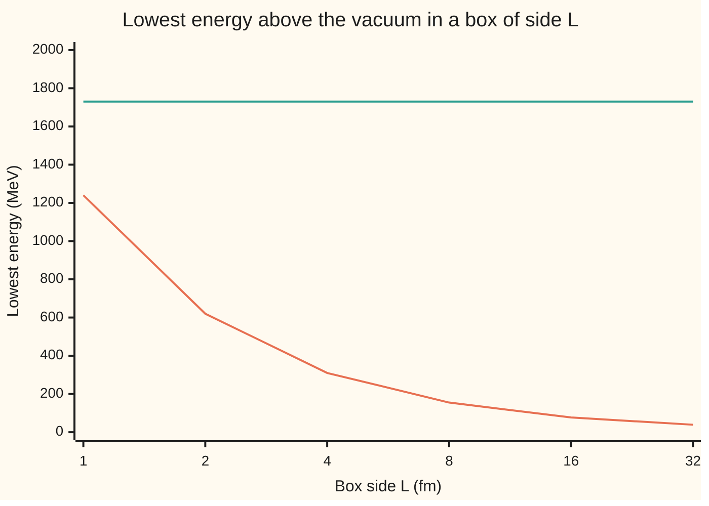
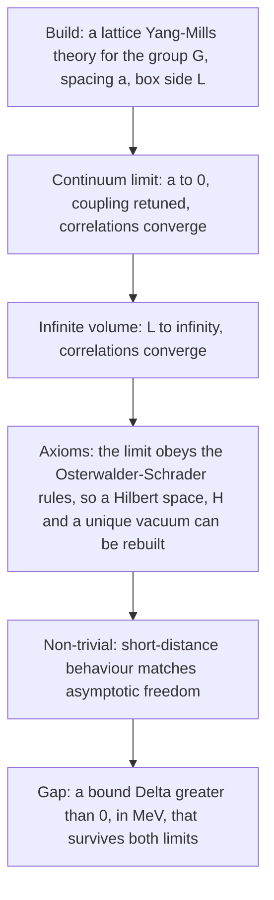

# Mass gap: the Yang-Mills prize problem stated precisely

[Syllabus](../../../SYLLABUS.md) → [Differential geometry and Lie groups](../README.md) → [Geometric Analysis and Physics](../README.md#s07) → Mass gap

---

## General Overview

Two electric charges feel each other at any distance. The force carrier, the photon, has no mass, so the force fades only as one over the distance squared. Light from a galaxy billions of years away still arrives.

The strong force is different. It holds protons and neutrons together in a nucleus. Yet the pull between two of them dies within a few femtometres (1 fm = 10⁻¹⁵ m, about the size of a proton). That is why nuclei are tiny and why the strong force does not reach across a room.

The puzzle is that the strong force's own equations look massless. Gluons, its carriers, obey the [Yang-Mills](03-yang-mills-fields-and-gauge-theory.md) equations, and those have no mass term at all. Read naively, they predict massless gluons: one quantum of a gluon wave of wavelength 1 km would carry only 1.2398 neV (nano-electronvolts). Nature shows no such thing. The lightest object that pure gluon fields form, a **glueball** (a bound lump of gluon field), is computed at 1730 MeV (mega-electronvolts).

In 2000 the Clay Mathematics Institute offered one million dollars for a proof of this from the mathematics. Arthur Jaffe and Edward Witten wrote the official statement. This card says exactly what it asks for, and what a proof must supply.

**The prize asks for two things: a quantum Yang-Mills theory on four-dimensional spacetime that meets the agreed rules for a quantum field theory (existence), and a number Δ > 0 such that every state other than the vacuum has energy at least Δ (the mass gap).**

**What kind of fact this is:** an open problem, unproved as of 2026-11-19. This card states it precisely. It proves the small facts the statement rests on, for finite systems: a gap makes correlations die exponentially, and a toy gauge model has a gap at every coupling.

### The picture: a gap does not shrink with the box



Orange: the lowest energy a photon can have in a box of side L. It falls toward zero as the box grows, so the photon has no gap. Green: an idealised gapped theory at the glueball's 1730 MeV, flat however big the box.

---

## The formula

This card adds one symbol to the wing's shared notation: the **gap** Δ, an energy in MeV. Its other symbols are defined where they appear and stay on this card. Elsewhere in the wing Δ_g is the Laplace-Beltrami operator; here plain Δ is always the gap. H here is the energy operator (the Hamiltonian), not mean curvature.

A quantum theory has a space of states ℋ (a Hilbert space: vectors with lengths and angles). Its energy operator H gives the energy of each state. The vacuum Ω is the empty state, with energy zero. The theory has a mass gap Δ when

```math
H\,\Omega = 0, \qquad \mathrm{spec}(H) \subset \{0\} \cup [\Delta, \infty), \qquad \Delta > 0
```

**Read it aloud:** the vacuum has energy zero, and every other energy the theory allows is at least Δ; nothing lies strictly between 0 and Δ.

Here spec(H), the spectrum, is the set of energies the theory allows.

The gap has a second face, in space. Take a local observable $`\mathcal{O}`$ (a measurement made near one point) whose vacuum average is zero. Its correlation between two points a distance $`\lvert x\rvert`$ apart dies like an exponential:

```math
\lvert \langle \Omega,\ \mathcal{O}(x)\,\mathcal{O}(0)\,\Omega \rangle \rvert \le e^{-b\,\lvert x\rvert/\hbar c} \quad \text{for large } \lvert x\rvert, \text{ for every } b < \Delta
```

**Read it aloud:** measurements far apart stop knowing about each other, and the distance over which they forget is ħc divided by the gap. Here b is any energy below the gap.

That distance, $`r_0 = \hbar c/\Delta`$, is the **range**. For the glueball's 1730 MeV it is 0.1141 fm.

**The prize statement.** For any compact simple gauge group G, prove that a non-trivial quantum Yang-Mills theory exists on ℝ⁴ and has a mass gap Δ > 0.

| Symbol | Plain meaning | In our example | Push it up and the answer… |
| --- | --- | --- | --- |
| $`G`$ | the gauge group: compact (closed and bounded) and simple (no smaller normal pieces) | SU(3) for the strong force; SU(2) in the toy | — |
| $`\mathbb{R}^4`$ | flat spacetime: three space directions and time | — | — |
| $`\mathcal{H}`$, $`\Omega`$ | the space of states; the vacuum, the empty state | — | — |
| $`H`$, $`\mathrm{spec}(H)`$ | the energy operator; the set of energies it allows | vacuum at 0, then a jump | — |
| $`\Delta`$ | the mass gap: the lowest energy above the vacuum, in MeV | 1730 MeV, the lightest glueball | the range shrinks |
| $`\hbar c`$, $`m`$, $`k`$ | Planck's reduced constant times light speed, a unit converter; a particle's mass, with rest energy $`mc^2`$; a wave's wavenumber, $`2\pi`$ over its wavelength | 197.326980 MeV fm; pion $`mc^2`$ 139.57039 MeV | — |
| $`r_0`$ | the range $`\hbar c/\Delta`$, in fm | 0.1141 fm; the pion's 1.4138 fm | — |
| $`\mathcal{O}`$, $`x`$, $`b`$ | a local observable; the separation between two points; any energy below the gap | $`\mathrm{Tr}\,U`$ in the toy | — |
| $`L`$ | the side of a box of space, in fm | 10 fm: a photon needs 123.98 MeV | the box's fake gap falls toward 0 |
| $`a`$, $`g`$ | lattice spacing in fm; the coupling, the strength of the gluon self-interaction | 0.1 fm; $`g^2 = 1`$ | toy gap tends to $`3g^2/8`$ |
| $`U`$, $`\theta`$, $`j`$, $`\hat C`$, $`n`$, $`u_n`$ | the toy's SU(2) matrix; its angle, with $`\mathrm{Tr}\,U = 2\cos\theta`$; the spin label, with $`\hat C = j(j+1)`$, $`n = 2j+1`$ and box wave $`u_n = \sin(n\theta)`$, from [Spin one-half](../../13-Engineering%20mathematics/09-Quantum%20Mechanics%20in%20Outline/06-spin-and-two-state-systems.md) | $`j = 0, \tfrac12, 1, \dots`$ | — |
| $`\tau`$, $`C(\tau)`$, $`m_{\mathrm{eff}}`$ | imaginary time (not torsion or a stopping time); a correlation; the effective mass $`\ln(C(\tau)/C(\tau+1))`$ | $`m_{\mathrm{eff}}`$ tends to 1.831775 | — |

### When it holds

- **The group must be compact and simple.** U(1), the group of electromagnetism, is compact but not simple. Its quantum theory exists, and it has no gap: a photon in a box of side 1000 fm needs only 1.24 MeV, and less in a bigger box.
- **Spacetime must be four-dimensional.** In four dimensions the coupling g has no units. The continuum theory then needs renormalisation (retuning g as the lattice spacing shrinks), and that is where current methods stop.
- **No quarks.** The problem is pure gauge theory. Real strong physics adds quarks, and its lightest particles are the pions; the charged pion is 139.57039 MeV, far below the glueball.
- **The gap must hold in infinite space.** Any finite box gives a gap, even for photons: 123.98 MeV at 10 fm. Only the limit counts.
- **The theory must be quantum.** The classical equations allow waves of any wavelength, so their naive quanta are massless: 1.2398 neV at 1 km. The gap is a purely quantum effect.

---

## Why it works

### Step 0: no massless particle means a gap, and a gap means short range

A particle of mass m at rest has energy mc². In a theory whose excitations are particles, any state other than the vacuum contains at least one particle, so it costs at least the lightest mass. There, "no massless particle" means "the spectrum of H jumps from 0 to Δ". The prize defines the gap by the spectrum, which also covers theories whose states are not particles.

The jump shows up in space as a range. The potential (the energy one particle has in the other's field) of a force carried by something of mass m fades as $`e^{-r/r_0}/r`$ (the Yukawa form), with $`r_0 = \hbar c/(mc^2)`$. A massless carrier gives the plain $`1/r`$ of Coulomb's law, with no range at all.

Double the distance from 1 fm to 2 fm. A Coulomb potential falls by a factor 2.00. A Yukawa potential carried by the pion falls by 4.06. The code checks that $`e^{-r/r_0}/r`$ solves the static field equation of a massive carrier, with residual 0.000000 at 0.5, 1 and 2 fm.

### Step 1: a gap makes correlations die exponentially

Step a state forward in imaginary time τ (real time t replaced by $`-i\tau`$, which turns oscillation into decay; energies and τ are in matching units, here with ħ = 1). The correlation of an observable $`\mathcal{O}`$ with itself splits into one term per energy level:

```math
C(\tau) = \sum_{n \ge 1} \lvert\langle n \vert \mathcal{O} \vert \Omega\rangle\rvert^2\, e^{-(E_n - E_0)\tau}
```

**Read it aloud:** the correlation is a sum of decaying exponentials, one per excited level, each weighted by how strongly the observable creates that level.

Every exponent is at least the gap. So $`C(\tau) \le C(0)\,e^{-\Delta\tau}`$, and at large τ the slowest term wins. The **effective mass** $`m_{\mathrm{eff}}(\tau) = \ln(C(\tau)/C(\tau+1))`$ falls toward the gap from above.

Lattice computations measure glueball masses this way. In the toy of Step 4, at $`g^2 = 1`$, the effective mass runs 1.837418, 1.832823, 1.831971, and settles at 1.831775, the gap found by diagonalising the matrix.

<details>
<summary>Detailed proof: in a finite system, a gap gives exponential decay, and decay gives the gap back</summary>

Let H have eigenvalues $`E_0 < E_1 \le E_2 \le \dots`$ with orthonormal eigenvectors $`\lvert n\rangle`$, and let $`\lvert\Omega\rangle = \lvert 0\rangle`$. Write the gap as $`\Delta = E_1 - E_0`$.

Remove the vacuum part of the observable: $`w = \mathcal{O}\lvert\Omega\rangle - \langle\Omega\vert\mathcal{O}\vert\Omega\rangle\lvert\Omega\rangle`$. Expand $`w = \sum_{n\ge1} c_n \lvert n\rangle`$. There is no $`n = 0`$ term, by construction.

Define $`C(\tau) = \langle w \vert e^{-(H - E_0)\tau} \vert w\rangle`$. Since each $`\lvert n\rangle`$ is an eigenvector,

$`\displaystyle C(\tau) = \sum_{n\ge1} \lvert c_n\rvert^2 e^{-(E_n - E_0)\tau} \le e^{-\Delta\tau} \sum_{n\ge1} \lvert c_n\rvert^2 = e^{-\Delta\tau}\, C(0).`$

That is the bound. For the converse, suppose $`c_1 \ne 0`$. Factor out the slowest term:

$`\displaystyle \frac{C(\tau)}{C(\tau+1)} = e^{\Delta}\, \frac{1 + \sum_{n\ge2} \lvert c_n/c_1\rvert^2 e^{-(E_n - E_1)\tau}}{1 + \sum_{n\ge2} \lvert c_n/c_1\rvert^2 e^{-(E_n - E_1)(\tau+1)}}.`$

The fractions tend to 1 as τ grows, so $`m_{\mathrm{eff}}(\tau) \to \Delta`$. If $`c_1 = 0`$ the observable misses the first level, and the effective mass finds the next level it reaches.

In infinite space, H can have continuous spectrum and the sum becomes an integral. The bound survives with any $`b < \Delta`$ in place of Δ; that is the clustering statement in The formula, which Jaffe and Witten list as a consequence of the gap.

</details>

### Step 2: the classical theory has no gap, so a gap must come from quantum effects

The [Yang-Mills](03-yang-mills-fields-and-gauge-theory.md) card gives the field $`F = dA + A \wedge A`$ for a connection A. A mass term would add $`m^2 A \cdot A`$ to the energy. A gauge change moves A, and $`A \cdot A`$ moves with it, so gauge symmetry forbids that term.

Without it, waves of every wavelength travel at light speed, like light itself. Quantise them one wave at a time and each quantum of wavenumber k carries energy $`\hbar c\,k`$, which goes to zero as the wavelength grows. At 1 km it is 1.2398 neV. Classical Yang-Mills is gapless, like Maxwell's theory.

So the gap must appear only after quantisation. Physicists expect it from asymptotic freedom (the coupling weakens at short distance and grows at long distance). A strong coupling at long distance makes the theory produce its own energy scale. No one has turned this into a proof.

### Step 3: what "existence" demands

A quantum field theory is a structure that must be built and then shown to obey rules. Existence means building, for each compact simple group G, a theory with:

1. **A space of states and an energy operator.** The energy H is never negative, and there is exactly one vacuum Ω.
2. **The symmetries of spacetime.** Shifts, rotations and changes of moving frame act on the states, as relativity requires.
3. **Locality.** Measurements at points no light signal can connect do not disturb each other.
4. **Gauge-invariant observables.** Only quantities unchanged by gauge changes are measurable, such as $`\mathrm{Tr}\,F^2`$.
5. **The right short-distance behaviour.** Correlations at short distance must match asymptotic freedom, so the theory is truly Yang-Mills and not trivial (a theory of free, non-interacting fields would pass the other rules).

These rules are made precise by two sets of axioms. The Wightman axioms describe the theory in real time. The Osterwalder-Schrader axioms describe its imaginary-time correlations, from which the real-time theory can be rebuilt. Both are set out on [Yang-Mills existence and mass gap](../../25-Frontier/02-The%20Millennium%20Problems/06-yang-mills-and-the-mass-gap.md).

No non-trivial relativistic field theory in four dimensions is yet known to satisfy these axioms, so existence alone would be a breakthrough.

### Step 4: a toy where the gap is a theorem

Wilson's lattice, taught on [Yang-Mills](03-yang-mills-fields-and-gauge-theory.md), replaces spacetime by a grid of spacing a. Each link of the grid carries a group matrix. The smallest closed loop, a square called a **plaquette**, measures curvature by the product of its four link matrices, U.

Take one plaquette and the group SU(2), the group of [Spin one-half](../../13-Engineering%20mathematics/09-Quantum%20Mechanics%20in%20Outline/06-spin-and-two-state-systems.md). A gauge change turns U into $`VUV^{-1}`$. So a physical state can depend only on U's angle θ, where U has eigenvalues $`e^{\pm i\theta}`$ and $`\mathrm{Tr}\,U = 2\cos\theta`$. This θ is half the turning angle that the Yang-Mills card quotes for a plaquette, and Tr is the trace that card writes tr. The toy's energy, in units of $`\hbar c/a`$, is

```math
H_{\mathrm{toy}} = \frac{g^2}{2}\,\hat C + \frac{4}{g^2}\,(1 - \cos\theta)
```

**Read it aloud:** the electric energy is g squared over two times the spin label's j(j+1); the magnetic energy grows as the plaquette's angle opens.

Here $`\hat C`$ has value $`j(j+1)`$ on the state of spin j. Write $`n = 2j + 1`$ and $`u_n(\theta) = \sin(n\theta)`$. The problem becomes a particle in a box on $`0 < \theta < \pi`$ with a potential added, as on [Schrodinger's equation](../../13-Engineering%20mathematics/09-Quantum%20Mechanics%20in%20Outline/03-schrodinger-equation-and-the-particle-in-a-box.md). A box has a lowest level and a next one. In one dimension the lowest level is never shared by two different states, so the next level is strictly higher: there is a gap, at every coupling.

At $`g^2 = 1`$ the vacuum sits at 1.334742 and the first excited level at 3.166517. The gap is 1.831775, in units of $`\hbar c/a`$.

<details>
<summary>Detailed derivation: from one plaquette to a particle in a box</summary>

Gauge-invariant states are functions of θ alone. The natural measure on SU(2) gives them the weight $`\sin^2\theta\, d\theta`$. The spin-j states are the characters $`\chi_j(\theta) = \sin((2j+1)\theta)/\sin\theta`$.

Put $`u = \sin\theta \cdot \psi`$. The weight becomes plain $`d\theta`$, and $`\chi_j`$ becomes $`u_n = \sin(n\theta)`$ with $`n = 2j+1`$. These vanish at θ = 0 and θ = π, the box's walls.

Since $`-u_n'' = n^2 u_n`$ and $`j(j+1) = (n^2 - 1)/4`$, the electric operator acts as $`\tfrac14(-u'' - u)`$. So

$`\displaystyle H_{\mathrm{toy}}\,u = \frac{g^2}{8}\,(-u'' - u) + \frac{4}{g^2}\,(1 - \cos\theta)\,u, \qquad u(0) = u(\pi) = 0.`$

In the basis $`\sqrt{2/\pi}\,\sin(n\theta)`$, the identity $`2\cos\theta\sin(n\theta) = \sin((n+1)\theta) + \sin((n-1)\theta)`$ makes the matrix tridiagonal. Its diagonal is $`\tfrac{g^2}{8}(n^2-1) + \tfrac{4}{g^2}`$ and its off-diagonal is $`-2/g^2`$.

Two limits check it. At strong coupling the electric term rules, and the gap is the step from j = 0 to j = ½: $`\tfrac{g^2}{2}\cdot\tfrac34 = 3g^2/8`$. At weak coupling θ stays small, and $`(4/g^2)(1-\cos\theta) \approx (2/g^2)\theta^2`$. The problem becomes a three-dimensional oscillator with level spacing $`2\sqrt{(g^2/8)(2/g^2)} = 1`$, and its symmetric states are two steps apart, a gap of 2.

</details>

### Step 5: why the toy does not win the prize

A finite system always has a lowest level and a next one, so a gap is free. The prize asks for the gap after two limits, and either can destroy it.

**The infinite-volume limit.** Put photons in a box of side L. The lowest non-zero energy is $`2\pi\hbar c/L`$, and it falls toward zero as the box grows. A gapped theory keeps its lowest energy at Δ however big the box. The chart in the General Overview draws both.

**The continuum limit.** The lattice energy in physical units is (gap in lattice units) × ħc/a. To hold Δ at 1730 MeV, the gap in lattice units must shrink in step with a: 0.8767 at a = 0.1 fm, 0.4384 at a = 0.05 fm. The one-plaquette toy cannot do this. As a shrinks the coupling must shrink too, and the toy's gap then tends to 2, not to 0. Already at $`g^2 = 0.25`$ its gap is 1.960286, so it would claim 3868 MeV at 0.1 fm and 7736 MeV at 0.05 fm.

What a proof must supply, in order:



Jaffe and Witten single out the last box: no present idea gives a gap that stays uniform as the volume grows.

---

## Worked numbers, by hand

The constants: ħc = 197.326980 MeV fm, exact from the SI definitions. The charged pion is 139.57039 MeV (PDG 2024). The lightest pure-gauge glueball is 1730(50)(80) MeV (Morningstar and Peardon 1999, a lattice computation).

| Step | Arithmetic | Value |
| --- | --- | --- |
| pion range | 197.326980 ÷ 139.57039 | 1.4138 fm |
| glueball range | 197.326980 ÷ 1730 | 0.1141 fm |
| glueball correlation left at 1 fm | $`e^{-1/0.1141}`$ | 0.000156 |
| potential at 1 fm over 2 fm, Coulomb | 2 ÷ 1 | 2.00 |
| same, Yukawa with the pion | $`2\,e^{1/1.4138}`$ | 4.06 |
| photon in a 10 fm box | 2π × 197.326980 ÷ 10 | 123.98 MeV |
| photon in a 1000 fm box | 2π × 197.326980 ÷ 1000 | 1.24 MeV |
| toy gap, $`g^2 = 1`$ | 3.166517 − 1.334742 | 1.831775 |
| **glueball range** | **ħc ÷ Δ** | **0.1141 fm** |

A gap of 1730 MeV means gluon-field correlations die within about a tenth of a femtometre, while a massless photon's reach has no limit. That contrast is what the prize asks mathematics to prove.

### What breaks if you drop a piece

| Mistake | Comes out at | What went wrong |
| --- | --- | --- |
| Taking a gap in a finite box as proof | photon: 123.98 MeV at 10 fm, 1.24 MeV at 1000 fm | the box makes the gap; it falls to 0 as L grows |
| Reading the gap off the classical equations | 1 km wave: 1.2398 neV | the classical theory is gapless; the gap is quantum |
| Effective mass from the first step only | 1.837418 against 1.831775, 0.3% high | higher levels have not yet died away |
| Holding the toy's lattice gap fixed as a shrinks | 3868 MeV at 0.1 fm, 7736 MeV at 0.05 fm | the lattice gap must shrink as a: 0.8767, then 0.4384 |

---

## Code, from first principles, and it actually runs

The code computes the strong-force numbers, then the toy's gap by three independent roads. The first diagonalises the toy's matrix in the spin-j basis by bisection. The second puts the same problem on a grid at 200 and 400 steps, where the error falls by 4.00, as a second-order method should. The third never diagonalises anything: it steps a correlation forward in imaginary time and reads the gap from its decay. Strong- and weak-coupling limits and the Yukawa field equation are further checks.

### Python

```python
# Mass gap: the Yang-Mills prize problem stated precisely -- the check behind the card.
# Nothing is imported except math.  Energies in MeV, lengths in fm (1 fm = 1e-15 m).
# Part 1: what a gap means for the strong force (range of a force, a photon in a box).
# Part 2: a toy with a provable gap, one plaquette of SU(2) lattice gauge theory.
# Roads to the toy's gap: its matrix in the spin-j basis, a finite-difference grid
# at two step sizes, and the decay of a correlation in imaginary time (no eigensolver).
import math
HBARC = 6.62607015e-34 * 299792458 / (2 * math.pi) / 1.602176634e-13 * 1e15   # MeV fm, exact SI
M_PI, M_GB = 139.57039, 1730.0          # charged pion (PDG 2024); lightest glueball (lattice, 1999)
print(f"hbar c = {HBARC:.6f} MeV fm")
print(f"inputs: charged pion {M_PI:.5f} MeV, lightest glueball {M_GB:.0f} MeV")
r_pi, r_gb = HBARC / M_PI, HBARC / M_GB
print(f"range hbar c / m: pion {r_pi:.4f} fm, lightest glueball {r_gb:.4f} fm, photon infinite")
print(f"glueball correlation left at 1 fm: exp(-1/{r_gb:.4f}) = {math.exp(-1 / r_gb):.6f}")
print(f"potential at 1 fm over potential at 2 fm: Coulomb (massless) {2.0:.2f}, Yukawa with pion {2 * math.exp(1 / r_pi):.2f}")
mu, h = 1 / r_pi, 1e-3                  # road check: exp(-mu r)/r solves -phi'' - (2/r) phi' + mu^2 phi = 0
yuk = lambda r: math.exp(-mu * r) / r
res = [-(yuk(r + h) - 2 * yuk(r) + yuk(r - h)) / h**2 - (2 / r) * (yuk(r + h) - yuk(r - h)) / (2 * h) + mu**2 * yuk(r) for r in (0.5, 1.0, 2.0)]
print("Yukawa field equation residual at 0.5, 1, 2 fm: " + " ".join(f"{abs(x):.6f}" for x in res))
box = [1, 2, 4, 8, 16, 32]
pho = [2 * math.pi * HBARC / L for L in box]
print("lowest photon energy in a box of side L fm, 2 pi hbar c / L (MeV): " + " ".join(f"{e:.2f}" for e in pho))
print(f"  L = 10 fm: {2 * math.pi * HBARC / 10:.2f} MeV; L = 1000 fm: {2 * math.pi * HBARC / 1000:.2f} MeV")
print("chart, photon: " + ", ".join(f"{e:.0f}" for e in pho) + f"; gapped theory: {M_GB:.0f} at every L")
print(f"one massless quantum of a 1 km wave, 2 pi hbar c / lambda: {2 * math.pi * HBARC / 1e18 * 1e15:.4f} neV")

def below(d, e, x):                     # how many eigenvalues of a tridiagonal matrix lie below x
    c, q = 0, 1.0
    for i in range(len(d)):
        q = d[i] - x - (e[i - 1] ** 2 / q if i else 0.0)
        if q == 0.0: q = 1e-300
        c += q < 0
    return c
def eig(d, e, k):                       # k-th eigenvalue by bisection (Sturm count)
    lo, hi = min(d) - 4 * max(map(abs, e)), max(d) + 4 * max(map(abs, e))
    for _ in range(200):
        m = (lo + hi) / 2
        lo, hi = (lo, m) if below(d, e, m) > k else (m, hi)
    return (lo + hi) / 2
def spin_basis(g2, N):                  # u_n = sin(n theta), n = 2j + 1; H = (g2/2) C + (4/g2)(1 - cos theta)
    return [g2 / 8 * (n * n - 1) + 4 / g2 for n in range(1, N + 1)], [-2 / g2] * (N - 1)
def grid(g2, M):                        # same H on theta in (0, pi), u = 0 at both ends, M intervals
    s = math.pi / M
    return [g2 / 8 * (2 / s**2 - 1) + 4 / g2 * (1 - math.cos(k * s)) for k in range(1, M)], [-g2 / 8 / s**2] * (M - 2)
print("one SU(2) plaquette, lattice units: g^2, E0, E1, gap, strong-coupling guess 3 g^2 / 8")
gap = {}
for g2 in (0.25, 1.0, 4.0, 16.0):
    d, e = spin_basis(g2, 30)
    E0, E1 = eig(d, e, 0), eig(d, e, 1)
    gap[g2] = E1 - E0
    print(f"  {g2:5.2f} {E0:.6f} {E1:.6f} {gap[g2]:.6f} {3 * g2 / 8:.6f}")
fd = {}
for M in (200, 400):
    d, e = grid(1.0, M)
    fd[M] = eig(d, e, 1) - eig(d, e, 0)
    print(f"  grid, {M} steps, g^2 = 1: gap {fd[M]:.6f}, off by {gap[1.0] - fd[M]:.6f}")
ratio = (gap[1.0] - fd[200]) / (gap[1.0] - fd[400])
print(f"  grid error ratio, 200 over 400 steps: {ratio:.2f} (second order predicts 4)")

d, e = spin_basis(1.0, 30)              # road three: imaginary time, dv/dtau = -(H - shift) v
N = len(d)
def Hv(v, s):
    return [(d[i] - s) * v[i] + (e[i - 1] * v[i - 1] if i else 0.0) + (e[i] * v[i + 1] if i < N - 1 else 0.0) for i in range(N)]
def step(v, s, dt):
    k1 = Hv(v, s); k2 = Hv([v[i] - dt / 2 * k1[i] for i in range(N)], s)
    k3 = Hv([v[i] - dt / 2 * k2[i] for i in range(N)], s); k4 = Hv([v[i] - dt * k3[i] for i in range(N)], s)
    return [v[i] - dt / 6 * (k1[i] + 2 * k2[i] + 2 * k3[i] + k4[i]) for i in range(N)]
dot = lambda a, b: sum(x * y for x, y in zip(a, b))
v = [1.0] + [0.0] * (N - 1)
for _ in range(3000):                   # 30 units of imaginary time cools any start to the vacuum
    v = step(v, 0.0, 0.01); n = math.sqrt(dot(v, v)); v = [x / n for x in v]
E0 = dot(v, Hv(v, 0.0))
O = [(v[i - 1] if i else 0.0) + (v[i + 1] if i < N - 1 else 0.0) for i in range(N)]   # Tr U = 2 cos theta
avg = dot(v, O)
w = [O[i] - avg * v[i] for i in range(N)]   # Tr U with its vacuum average removed
print(f"imaginary time, g^2 = 1: vacuum energy {E0:.6f}, vacuum average of Tr U {avg:.6f}")
C, u = [], w[:]
for t in range(9):
    C.append(dot(w, u))
    for _ in range(100): u = step(u, E0, 0.01)
meff = [math.log(C[t] / C[t + 1]) for t in range(8)]
print("  tau, C(tau), effective mass ln(C(tau)/C(tau+1))")
for t in range(8):
    print(f"  {t} {C[t]:.10f} {meff[t]:.6f}")
print(f"  bound C(tau) <= C(0) exp(-gap tau) holds at every tau: {'yes' if all(C[t] <= C[0] * math.exp(-gap[1.0] * t) * (1 + 1e-9) for t in range(9)) else 'no'}")
print("toy continuum limit: Delta = (gap in lattice units) hbar c / a, against the required 1730 MeV")
for a in (0.1, 0.05):
    print(f"  a = {a:.2f} fm: toy {gap[0.25] * HBARC / a:.0f} MeV; required gap in lattice units {M_GB * a / HBARC:.4f}")
print(f"what breaks: first-step effective mass {meff[0]:.6f} against gap {gap[1.0]:.6f}, {100 * (meff[0] / gap[1.0] - 1):.1f}% high")

assert abs(HBARC - 197.3269804) < 1e-6                          # CODATA 2022 value of hbar c
assert max(abs(x) for x in res) < 1e-3 * mu**2 * yuk(2.0)       # exp(-mu r)/r solves the static field equation
assert abs(gap[1.0] - fd[400]) < 1e-3 and 3.5 < ratio < 4.5     # spin basis and grid agree, at second order
assert abs(meff[7] - gap[1.0]) < 1e-4 and meff[0] > meff[3] > meff[7]   # correlation decay gives the gap
assert abs(gap[16.0] - 6.0) < 0.01 and abs(gap[0.25] - 2.0) < 0.05     # strong and weak coupling limits
assert all(g > 0 for g in gap.values())                          # the toy has a gap at every coupling
assert all(C[t] <= C[0] * math.exp(-gap[1.0] * t) * (1 + 1e-9) for t in range(9))
print("ALL CHECKS PASS")
```

**Ran 2026-11-19 on macOS, Python 3.14.10, standard library only. All checks passed. Output, pasted from the run:**

```
hbar c = 197.326980 MeV fm
inputs: charged pion 139.57039 MeV, lightest glueball 1730 MeV
range hbar c / m: pion 1.4138 fm, lightest glueball 0.1141 fm, photon infinite
glueball correlation left at 1 fm: exp(-1/0.1141) = 0.000156
potential at 1 fm over potential at 2 fm: Coulomb (massless) 2.00, Yukawa with pion 4.06
Yukawa field equation residual at 0.5, 1, 2 fm: 0.000000 0.000000 0.000000
lowest photon energy in a box of side L fm, 2 pi hbar c / L (MeV): 1239.84 619.92 309.96 154.98 77.49 38.75
  L = 10 fm: 123.98 MeV; L = 1000 fm: 1.24 MeV
chart, photon: 1240, 620, 310, 155, 77, 39; gapped theory: 1730 at every L
one massless quantum of a 1 km wave, 2 pi hbar c / lambda: 1.2398 neV
one SU(2) plaquette, lattice units: g^2, E0, E1, gap, strong-coupling guess 3 g^2 / 8
   0.25 1.458914 3.419201 1.960286 0.093750
   1.00 1.334742 3.166517 1.831775 0.375000
   4.00 0.843360 2.556504 1.713144 1.500000
  16.00 0.247397 6.251041 6.003644 6.000000
  grid, 200 steps, g^2 = 1: gap 1.831295, off by 0.000480
  grid, 400 steps, g^2 = 1: gap 1.831655, off by 0.000120
  grid error ratio, 200 over 400 steps: 4.00 (second order predicts 4)
imaginary time, g^2 = 1: vacuum energy 1.334742, vacuum average of Tr U 1.624674
  tau, C(tau), effective mass ln(C(tau)/C(tau+1))
  0 0.0863890159 1.837418
  1 0.0137555576 1.832823
  2 0.0022003579 1.831971
  3 0.0003522724 1.831812
  4 0.0000564070 1.831782
  5 0.0000090323 1.831776
  6 0.0000014463 1.831775
  7 0.0000002316 1.831775
  bound C(tau) <= C(0) exp(-gap tau) holds at every tau: yes
toy continuum limit: Delta = (gap in lattice units) hbar c / a, against the required 1730 MeV
  a = 0.10 fm: toy 3868 MeV; required gap in lattice units 0.8767
  a = 0.05 fm: toy 7736 MeV; required gap in lattice units 0.4384
what breaks: first-step effective mass 1.837418 against gap 1.831775, 0.3% high
ALL CHECKS PASS
```

### Rust

```rust
// Mass gap: the Yang-Mills prize problem stated precisely -- the check behind the card.
// Standard library only.  Energies in MeV, lengths in fm (1 fm = 1e-15 m).
// Part 1: what a gap means for the strong force (range of a force, a photon in a box).
// Part 2: a toy with a provable gap, one plaquette of SU(2) lattice gauge theory.
// Roads to the toy's gap: its matrix in the spin-j basis, a finite-difference grid
// at two step sizes, and the decay of a correlation in imaginary time (no eigensolver).
use std::f64::consts::PI;

fn below(d: &[f64], e: &[f64], x: f64) -> usize {
    // how many eigenvalues of a tridiagonal matrix lie below x
    let (mut c, mut q) = (0, 1.0);
    for i in 0..d.len() {
        q = d[i] - x - if i > 0 { e[i - 1] * e[i - 1] / q } else { 0.0 };
        if q == 0.0 { q = 1e-300; }
        if q < 0.0 { c += 1; }
    }
    c
}
fn eig(d: &[f64], e: &[f64], k: usize) -> f64 {
    // k-th eigenvalue by bisection (Sturm count)
    let em = e.iter().fold(0.0f64, |m, x| m.max(x.abs()));
    let mut lo = d.iter().cloned().fold(f64::INFINITY, f64::min) - 4.0 * em;
    let mut hi = d.iter().cloned().fold(f64::NEG_INFINITY, f64::max) + 4.0 * em;
    for _ in 0..200 {
        let m = (lo + hi) / 2.0;
        if below(d, e, m) > k { hi = m; } else { lo = m; }
    }
    (lo + hi) / 2.0
}
fn spin_basis(g2: f64, n: usize) -> (Vec<f64>, Vec<f64>) {
    // u_n = sin(n theta), n = 2j + 1; H = (g2/2) C + (4/g2)(1 - cos theta)
    ((1..=n).map(|k| g2 / 8.0 * ((k * k) as f64 - 1.0) + 4.0 / g2).collect(), vec![-2.0 / g2; n - 1])
}
fn grid(g2: f64, m: usize) -> (Vec<f64>, Vec<f64>) {
    // same H on theta in (0, pi), u = 0 at both ends, m intervals
    let s = PI / m as f64;
    ((1..m).map(|k| g2 / 8.0 * (2.0 / (s * s) - 1.0) + 4.0 / g2 * (1.0 - (k as f64 * s).cos())).collect(),
     vec![-g2 / 8.0 / (s * s); m - 2])
}
fn hv(d: &[f64], e: &[f64], v: &[f64], s: f64) -> Vec<f64> {
    let n = d.len();
    (0..n).map(|i| (d[i] - s) * v[i] + if i > 0 { e[i - 1] * v[i - 1] } else { 0.0 }
        + if i < n - 1 { e[i] * v[i + 1] } else { 0.0 }).collect()
}
fn step(d: &[f64], e: &[f64], v: &[f64], s: f64, dt: f64) -> Vec<f64> {
    let n = v.len();
    let k1 = hv(d, e, v, s);
    let k2 = hv(d, e, &(0..n).map(|i| v[i] - dt / 2.0 * k1[i]).collect::<Vec<_>>(), s);
    let k3 = hv(d, e, &(0..n).map(|i| v[i] - dt / 2.0 * k2[i]).collect::<Vec<_>>(), s);
    let k4 = hv(d, e, &(0..n).map(|i| v[i] - dt * k3[i]).collect::<Vec<_>>(), s);
    (0..n).map(|i| v[i] - dt / 6.0 * (k1[i] + 2.0 * k2[i] + 2.0 * k3[i] + k4[i])).collect()
}
fn dot(a: &[f64], b: &[f64]) -> f64 { a.iter().zip(b).map(|(x, y)| x * y).sum() }
fn join(v: &[f64], p: usize) -> String { v.iter().map(|x| format!("{:.*}", p, x)).collect::<Vec<_>>().join(" ") }

fn main() {
    let hbarc = 6.62607015e-34 * 299792458.0 / (2.0 * PI) / 1.602176634e-13 * 1e15; // MeV fm, exact SI
    let (m_pi, m_gb) = (139.57039, 1730.0); // charged pion (PDG 2024); lightest glueball (lattice, 1999)
    println!("hbar c = {:.6} MeV fm", hbarc);
    println!("inputs: charged pion {:.5} MeV, lightest glueball {:.0} MeV", m_pi, m_gb);
    let (r_pi, r_gb) = (hbarc / m_pi, hbarc / m_gb);
    println!("range hbar c / m: pion {:.4} fm, lightest glueball {:.4} fm, photon infinite", r_pi, r_gb);
    println!("glueball correlation left at 1 fm: exp(-1/{:.4}) = {:.6}", r_gb, (-1.0 / r_gb).exp());
    println!("potential at 1 fm over potential at 2 fm: Coulomb (massless) {:.2}, Yukawa with pion {:.2}", 2.0, 2.0 * (1.0 / r_pi).exp());
    let (mu, h) = (1.0 / r_pi, 1e-3); // road check: exp(-mu r)/r solves -phi'' - (2/r) phi' + mu^2 phi = 0
    let yuk = |r: f64| (-mu * r).exp() / r;
    let res: Vec<f64> = [0.5, 1.0, 2.0].iter().map(|&r| -(yuk(r + h) - 2.0 * yuk(r) + yuk(r - h)) / (h * h)
        - (2.0 / r) * (yuk(r + h) - yuk(r - h)) / (2.0 * h) + mu * mu * yuk(r)).collect();
    println!("Yukawa field equation residual at 0.5, 1, 2 fm: {}", join(&res.iter().map(|x| x.abs()).collect::<Vec<_>>(), 6));
    let pho: Vec<f64> = [1.0, 2.0, 4.0, 8.0, 16.0, 32.0].iter().map(|l| 2.0 * PI * hbarc / l).collect();
    println!("lowest photon energy in a box of side L fm, 2 pi hbar c / L (MeV): {}", join(&pho, 2));
    println!("  L = 10 fm: {:.2} MeV; L = 1000 fm: {:.2} MeV", 2.0 * PI * hbarc / 10.0, 2.0 * PI * hbarc / 1000.0);
    println!("chart, photon: {}; gapped theory: {:.0} at every L",
        pho.iter().map(|x| format!("{:.0}", x)).collect::<Vec<_>>().join(", "), m_gb);
    println!("one massless quantum of a 1 km wave, 2 pi hbar c / lambda: {:.4} neV", 2.0 * PI * hbarc / 1e18 * 1e15);

    println!("one SU(2) plaquette, lattice units: g^2, E0, E1, gap, strong-coupling guess 3 g^2 / 8");
    let couplings = [0.25, 1.0, 4.0, 16.0];
    let mut gap = [0.0f64; 4];
    for (i, &g2) in couplings.iter().enumerate() {
        let (d, e) = spin_basis(g2, 30);
        let (e0, e1) = (eig(&d, &e, 0), eig(&d, &e, 1));
        gap[i] = e1 - e0;
        println!("  {:5.2} {:.6} {:.6} {:.6} {:.6}", g2, e0, e1, gap[i], 3.0 * g2 / 8.0);
    }
    let mut fd = [0.0f64; 2];
    for (i, &m) in [200usize, 400].iter().enumerate() {
        let (d, e) = grid(1.0, m);
        fd[i] = eig(&d, &e, 1) - eig(&d, &e, 0);
        println!("  grid, {} steps, g^2 = 1: gap {:.6}, off by {:.6}", m, fd[i], gap[1] - fd[i]);
    }
    let ratio = (gap[1] - fd[0]) / (gap[1] - fd[1]);
    println!("  grid error ratio, 200 over 400 steps: {:.2} (second order predicts 4)", ratio);

    let (d, e) = spin_basis(1.0, 30); // road three: imaginary time, dv/dtau = -(H - shift) v
    let n = d.len();
    let mut v = vec![0.0; n];
    v[0] = 1.0;
    for _ in 0..3000 { // 30 units of imaginary time cools any start to the vacuum
        v = step(&d, &e, &v, 0.0, 0.01);
        let nv = dot(&v, &v).sqrt();
        v = v.iter().map(|x| x / nv).collect();
    }
    let e0 = dot(&v, &hv(&d, &e, &v, 0.0));
    let o: Vec<f64> = (0..n).map(|i| if i > 0 { v[i - 1] } else { 0.0 } + if i < n - 1 { v[i + 1] } else { 0.0 }).collect();
    let avg = dot(&v, &o);
    let w: Vec<f64> = (0..n).map(|i| o[i] - avg * v[i]).collect(); // Tr U with its vacuum average removed
    println!("imaginary time, g^2 = 1: vacuum energy {:.6}, vacuum average of Tr U {:.6}", e0, avg);
    let mut c = Vec::new();
    let mut u = w.clone();
    for _ in 0..9 {
        c.push(dot(&w, &u));
        for _ in 0..100 { u = step(&d, &e, &u, e0, 0.01); }
    }
    let meff: Vec<f64> = (0..8).map(|t| (c[t] / c[t + 1]).ln()).collect();
    println!("  tau, C(tau), effective mass ln(C(tau)/C(tau+1))");
    for t in 0..8 { println!("  {} {:.10} {:.6}", t, c[t], meff[t]); }
    let bound = (0..9).all(|t| c[t] <= c[0] * (-gap[1] * t as f64).exp() * (1.0 + 1e-9));
    println!("  bound C(tau) <= C(0) exp(-gap tau) holds at every tau: {}", if bound { "yes" } else { "no" });
    println!("toy continuum limit: Delta = (gap in lattice units) hbar c / a, against the required 1730 MeV");
    for a in [0.1, 0.05] {
        println!("  a = {:.2} fm: toy {:.0} MeV; required gap in lattice units {:.4}", a, gap[0] * hbarc / a, m_gb * a / hbarc);
    }
    println!("what breaks: first-step effective mass {:.6} against gap {:.6}, {:.1}% high", meff[0], gap[1], 100.0 * (meff[0] / gap[1] - 1.0));

    assert!((hbarc - 197.3269804).abs() < 1e-6); // CODATA 2022 value of hbar c
    assert!(res.iter().fold(0.0f64, |m, x| m.max(x.abs())) < 1e-3 * mu * mu * yuk(2.0)); // Yukawa solves the field equation
    assert!((gap[1] - fd[1]).abs() < 1e-3 && ratio > 3.5 && ratio < 4.5); // spin basis and grid agree, second order
    assert!((meff[7] - gap[1]).abs() < 1e-4 && meff[0] > meff[3] && meff[3] > meff[7]); // decay gives the gap
    assert!((gap[3] - 6.0).abs() < 0.01 && (gap[0] - 2.0).abs() < 0.05); // strong and weak coupling limits
    assert!(gap.iter().all(|&g| g > 0.0)); // the toy has a gap at every coupling
    assert!(bound);
    println!("ALL CHECKS PASS");
}
```

**Ran 2026-11-19 on macOS, rustc 1.98.1, no crates. All checks passed. Output, pasted from the run:**

```
hbar c = 197.326980 MeV fm
inputs: charged pion 139.57039 MeV, lightest glueball 1730 MeV
range hbar c / m: pion 1.4138 fm, lightest glueball 0.1141 fm, photon infinite
glueball correlation left at 1 fm: exp(-1/0.1141) = 0.000156
potential at 1 fm over potential at 2 fm: Coulomb (massless) 2.00, Yukawa with pion 4.06
Yukawa field equation residual at 0.5, 1, 2 fm: 0.000000 0.000000 0.000000
lowest photon energy in a box of side L fm, 2 pi hbar c / L (MeV): 1239.84 619.92 309.96 154.98 77.49 38.75
  L = 10 fm: 123.98 MeV; L = 1000 fm: 1.24 MeV
chart, photon: 1240, 620, 310, 155, 77, 39; gapped theory: 1730 at every L
one massless quantum of a 1 km wave, 2 pi hbar c / lambda: 1.2398 neV
one SU(2) plaquette, lattice units: g^2, E0, E1, gap, strong-coupling guess 3 g^2 / 8
   0.25 1.458914 3.419201 1.960286 0.093750
   1.00 1.334742 3.166517 1.831775 0.375000
   4.00 0.843360 2.556504 1.713144 1.500000
  16.00 0.247397 6.251041 6.003644 6.000000
  grid, 200 steps, g^2 = 1: gap 1.831295, off by 0.000480
  grid, 400 steps, g^2 = 1: gap 1.831655, off by 0.000120
  grid error ratio, 200 over 400 steps: 4.00 (second order predicts 4)
imaginary time, g^2 = 1: vacuum energy 1.334742, vacuum average of Tr U 1.624674
  tau, C(tau), effective mass ln(C(tau)/C(tau+1))
  0 0.0863890159 1.837418
  1 0.0137555576 1.832823
  2 0.0022003579 1.831971
  3 0.0003522724 1.831812
  4 0.0000564070 1.831782
  5 0.0000090323 1.831776
  6 0.0000014463 1.831775
  7 0.0000002316 1.831775
  bound C(tau) <= C(0) exp(-gap tau) holds at every tau: yes
toy continuum limit: Delta = (gap in lattice units) hbar c / a, against the required 1730 MeV
  a = 0.10 fm: toy 3868 MeV; required gap in lattice units 0.8767
  a = 0.05 fm: toy 7736 MeV; required gap in lattice units 0.4384
what breaks: first-step effective mass 1.837418 against gap 1.831775, 0.3% high
ALL CHECKS PASS
```

### Lean

Lean proves Step 1's two facts for any finite system with a gap, and checks the toy's identity and worked numbers.

- Take levels $`E_0 < E_1 \le E_2 \le \dots`$ and an observable with its vacuum part removed. Then $`C(\tau) \le C(0)\,e^{-\Delta\tau}`$ for every $`\tau \ge 0`$.
- Take the same levels, and suppose the observable reaches the first excited level, so $`c_1 \ne 0`$. Then the effective mass tends to the gap Δ as τ grows.
- Take any angle θ and any number n. Then $`2\cos\theta\sin(n\theta) = \sin((n+1)\theta) + \sin((n-1)\theta)`$.
- Take $`n = 2j + 1`$ with j = 0, ½ or 1. Then $`j(j+1) = (n^2 - 1)/4`$.
- Take $`g^2 = 16`$. Then the strong-coupling gap $`3g^2/8`$ is 6.
- From 1 fm to 2 fm, a Coulomb potential falls by a factor 2.

The toy's computed gaps, the force ranges and the box energies are left to the Python and Rust checks.

```lean
-- Mass gap: in a finite quantum system with a gap, correlations die at least as fast as exp(-gap * time), and their effective mass tends to the gap.
import Mathlib.Analysis.SpecialFunctions.Exp
import Mathlib.Analysis.SpecialFunctions.Log.Basic
import Mathlib.Analysis.SpecialFunctions.Trigonometric.Basic
import Mathlib.Analysis.Complex.Basic

open Real Filter Topology

/-- The imaginary-time correlation of the card:
`C(τ) = ∑ₙ |cₙ|² e^{-(Eₙ - E₀) τ}`, where `Eₙ` are the energy levels,
`E 0` is the vacuum energy and `cₙ = ⟨n|𝒪|Ω⟩` are the observable's weights. -/
noncomputable def corr {N : ℕ} (E : Fin (N + 2) → ℝ) (c : Fin (N + 2) → ℂ) (τ : ℝ) : ℝ :=
  ∑ n, ‖c n‖ ^ 2 * Real.exp (-(E n - E 0) * τ)

/-- A gap makes correlations die exponentially. Let the energy levels be
`E₀ < E₁ ≤ E₂ ≤ …` with gap `Δ = E₁ - E₀`, and let the observable have its vacuum
part removed (`c₀ = 0`). Then for every imaginary time `τ ≥ 0`,
`C(τ) ≤ C(0) e^{-Δ τ}`. -/
theorem gap_bounds_correlation {N : ℕ} (E : Fin (N + 2) → ℝ) (hE : Monotone E)
    (hgap : E 0 < E 1) (c : Fin (N + 2) → ℂ) (hc : c 0 = 0) {τ : ℝ} (hτ : 0 ≤ τ) :
    corr E c τ ≤ corr E c 0 * Real.exp (-(E 1 - E 0) * τ) := by
  unfold corr
  rw [Finset.sum_mul]
  apply Finset.sum_le_sum
  intro n _
  simp only [mul_zero, Real.exp_zero, mul_one]
  by_cases hn : n = 0
  · subst hn; simp [hc]
  · have h1 : (1 : Fin (N + 2)) ≤ n := by
      exact Fin.one_le_of_ne_zero hn
    have hEn : E 1 ≤ E n := hE h1
    apply mul_le_mul_of_nonneg_left _ (by positivity)
    apply Real.exp_le_exp.mpr
    nlinarith

/-- Decay gives the gap back. With the same levels, if the observable reaches the
first excited level (`c₁ ≠ 0`), the effective mass `ln(C(τ)/C(τ+1))` tends to the
gap `Δ = E₁ - E₀` as `τ` grows. -/
theorem effective_mass_tendsto_gap {N : ℕ} (E : Fin (N + 2) → ℝ) (hE : Monotone E)
    (hgap : E 0 < E 1) (c : Fin (N + 2) → ℂ) (hc : c 0 = 0) (hc1 : c 1 ≠ 0) :
    Tendsto (fun τ : ℝ => Real.log (corr E c τ / corr E c (τ + 1))) atTop
      (𝓝 (E 1 - E 0)) := by
  set S : ℝ → ℝ := fun τ => ∑ n, ‖c n‖ ^ 2 * Real.exp (-(E n - E 1) * τ) with hS
  set A : ℝ := ∑ n, (if E n = E 1 then ‖c n‖ ^ 2 else 0) with hA
  have hterm : ∀ n : Fin (N + 2), Tendsto (fun τ : ℝ => ‖c n‖ ^ 2 * Real.exp (-(E n - E 1) * τ))
      atTop (𝓝 (if E n = E 1 then ‖c n‖ ^ 2 else 0)) := by
    intro n
    by_cases hn : n = 0
    · subst hn
      have : E 0 ≠ E 1 := ne_of_lt hgap
      simp [hc, this]
    · have h1 : (1 : Fin (N + 2)) ≤ n := by
        exact Fin.one_le_of_ne_zero hn
      have hEn : E 1 ≤ E n := hE h1
      by_cases heq : E n = E 1
      · simp [heq]
      · rw [ite_eq_right_iff.mpr (fun h => absurd h heq)]
        have hlt : 0 < E n - E 1 := by
          rcases lt_or_eq_of_le hEn with h | h
          · linarith
          · exact absurd h.symm heq
        have : Tendsto (fun τ : ℝ => Real.exp (-(E n - E 1) * τ)) atTop (𝓝 0) := by
          have h2 : Tendsto (fun τ : ℝ => -(E n - E 1) * τ) atTop atBot := by
            apply Tendsto.const_mul_atTop_of_neg (by linarith) tendsto_id
          exact Real.tendsto_exp_atBot.comp h2
        simpa using this.const_mul (‖c n‖ ^ 2)
  have hSlim : Tendsto S atTop (𝓝 A) := tendsto_finsetSum _ (fun n _ => hterm n)
  have hSlim1 : Tendsto (fun τ => S (τ + 1)) atTop (𝓝 A) :=
    hSlim.comp (tendsto_atTop_add_const_right _ 1 tendsto_id)
  have hApos : 0 < A := by
    have hle : (if E 1 = E 1 then ‖c 1‖ ^ 2 else 0) ≤ A := by
      apply Finset.single_le_sum (f := fun n => if E n = E 1 then ‖c n‖ ^ 2 else 0)
        (fun n _ => by split_ifs <;> positivity) (Finset.mem_univ 1)
    have : 0 < ‖c 1‖ ^ 2 := by positivity
    simp at hle
    linarith
  have hcorr : ∀ τ, corr E c τ = Real.exp (-(E 1 - E 0) * τ) * S τ := by
    intro τ
    unfold corr
    rw [hS, Finset.mul_sum]
    apply Finset.sum_congr rfl
    intro n _
    rw [mul_left_comm, ← Real.exp_add]
    congr 2
    ring
  have hratio : ∀ τ, corr E c τ / corr E c (τ + 1) = Real.exp (E 1 - E 0) * (S τ / S (τ + 1)) := by
    intro τ
    rw [hcorr, hcorr, mul_div_mul_comm, ← Real.exp_sub]
    congr 2
    ring
  have hlim : Tendsto (fun τ => corr E c τ / corr E c (τ + 1)) atTop
      (𝓝 (Real.exp (E 1 - E 0) * (A / A))) := by
    simp_rw [hratio]
    exact (hSlim.div hSlim1 (ne_of_gt hApos)).const_mul _
  rw [div_self (ne_of_gt hApos), mul_one] at hlim
  have := hlim.log (Real.exp_pos _).ne'
  simpa [Real.log_exp] using this

/-- The identity that makes the toy plaquette's matrix tridiagonal in the box basis
`sin(nθ)`: `2 cos θ sin(nθ) = sin((n+1)θ) + sin((n-1)θ)`. -/
theorem two_cos_mul_sin_eq_sin_add_sin (n θ : ℝ) :
    2 * Real.cos θ * Real.sin (n * θ) = Real.sin ((n + 1) * θ) + Real.sin ((n - 1) * θ) := by
  rw [show (n + 1) * θ = n * θ + θ by ring, show (n - 1) * θ = n * θ - θ by ring,
    Real.sin_add, Real.sin_sub]
  ring

-- The spin label j and the box label n = 2j + 1 give j(j+1) = (n² - 1)/4,
-- at j = 0, 1/2, 1 (n = 1, 2, 3).
example : (0 : ℚ) * (0 + 1) = ((2 * 0 + 1) ^ 2 - 1) / 4 := by norm_num
example : (1 / 2 : ℚ) * (1 / 2 + 1) = ((2 * (1 / 2) + 1) ^ 2 - 1) / 4 := by norm_num
example : (1 : ℚ) * (1 + 1) = ((2 * 1 + 1) ^ 2 - 1) / 4 := by norm_num
-- Strong coupling: the step from j = 0 to j = 1/2 is (g²/2)·(3/4) = 3g²/8; at g² = 16 it is 6.
example : (16 : ℚ) / 2 * ((1 / 2) * (1 / 2 + 1)) = 6 := by norm_num
-- Coulomb potential 1/r: from 1 fm to 2 fm it falls by a factor 2.
example : (1 / 1 : ℚ) / (1 / 2) = 2 := by norm_num

#print axioms gap_bounds_correlation
#print axioms effective_mass_tendsto_gap
#print axioms two_cos_mul_sin_eq_sin_add_sin
```

**Checked 2026-11-19 on macOS, Lean 4.36.0-rc2, Mathlib v4.36.0-rc2. Every proof is complete and uses only Lean's standard axioms. Output, pasted from the run:**

```
'gap_bounds_correlation' depends on axioms: [propext, Classical.choice, Quot.sound]
'effective_mass_tendsto_gap' depends on axioms: [propext, Classical.choice, Quot.sound]
'two_cos_mul_sin_eq_sin_add_sin' depends on axioms: [propext, Classical.choice, Quot.sound]
```

> [!TIP]
> **Try changing**
> - Guess first: what does the toy's gap do at a much stronger coupling? Add 64.0 to the list of couplings. Answer: it follows the last column, $`3g^2/8`$, ever more closely, and grows without limit.
> - Guess first: does the effective mass still find the gap if the vacuum average is not removed? Set `w = O` in Python. Answer: no. C(τ) levels off at the squared vacuum average, and the effective mass falls toward 0.
> - Guess first: how far does the pion's force reach? Swap `M_GB` for `M_PI` in the range line. Answer: 1.4138 fm, against the glueball's 0.1141 fm.
> - Guess first: does the grid gap get closer with more steps? Add 800 to the grid steps. Answer: yes, its error falls by about 4 again.

---

## The usual mistake

> [!warning]
> **Thinking the gap is already settled because computers measure it.** Lattice computations find a glueball at 1730 MeV, but each run uses a finite spacing a and a finite box L, then extrapolates. That is strong evidence, not proof. The prize asks for a bound that provably survives both limits.
>
> - **A gap in a box.** A photon in a 10 fm box needs 123.98 MeV. That gap is the box's, and it falls to 1.24 MeV at 1000 fm.
> - **Adding the pion.** Real strong physics has a pion at 139.57039 MeV. The prize concerns pure Yang-Mills, with no quarks, where the lightest state is the glueball.
> - **Mixing up the gap and confinement.** Confinement (no free quarks) is a separate property. The prize does not ask for it.
> - **Reading the effective mass too early.** At the first step it is 1.837418, 0.3% above the toy's true gap of 1.831775.

---

## Where you meet it in real life

- **The atomic nucleus.** The strong force between nucleons reaches about 1.4138 fm, the pion's range. That sets the size of nuclei, and Jaffe and Witten cite the gap as the reason the nuclear force is strong but short-ranged.
- **Lattice supercomputing.** Glueball and hadron masses are read from the decay of correlations, the effective-mass method of Step 1, on grids like the toy's.
- **Geometry of four-dimensional spaces.** Classical Yang-Mills fields became tools for studying four-dimensional manifolds. Jaffe and Witten suggest that a gap, through clustering, may let the quantum theory do the same on any four-dimensional space.

> **Say it back**
> The strong force has no massless carrier, even though its classical equations are massless. The Clay problem asks for a proof: build quantum Yang-Mills on four-dimensional spacetime obeying the field theory axioms, and show every state but the vacuum has energy at least some Δ > 0. A gap is the same as correlations dying within a range ħc/Δ, 0.1141 fm for a 1730 MeV glueball. A finite lattice or box always has a gap. The whole difficulty is a gap that survives the continuum and infinite-volume limits.

---

## What this builds on

- [Yang-Mills](03-yang-mills-fields-and-gauge-theory.md): the gauge field A, its curvature $`F = dA + A \wedge A`$ and the classical equations, which have no mass term.
- [Schrodinger's equation](../../13-Engineering%20mathematics/09-Quantum%20Mechanics%20in%20Outline/03-schrodinger-equation-and-the-particle-in-a-box.md): energy levels, a ground state above zero, and the particle in a box that the toy turns into.
- [Spin one-half](../../13-Engineering%20mathematics/09-Quantum%20Mechanics%20in%20Outline/06-spin-and-two-state-systems.md): the group SU(2) and its spin labels j, which become the toy's energy levels.

---

## Where this goes next

- [Yang-Mills existence and mass gap](../../25-Frontier/02-The%20Millennium%20Problems/06-yang-mills-and-the-mass-gap.md): the Wightman and Osterwalder-Schrader axioms in full, the lattice evidence, and the record of partial results.

The question this card leaves open is the prize itself: does the gap survive as the lattice spacing goes to zero and the box grows without limit?

---

## Sources

Verified 2026-11-19: every link below resolves to the publisher's page.

- Arthur Jaffe and Edward Witten, [Quantum Yang-Mills Theory](https://www.claymath.org/wp-content/uploads/2022/06/yangmills.pdf), Clay Mathematics Institute: the official problem statement, the definition of the gap, clustering, and the remark that no four-dimensional theory is yet known to satisfy the axioms.
- C. N. Yang and R. L. Mills, [Conservation of Isotopic Spin and Isotopic Gauge Invariance](https://doi.org/10.1103/PhysRev.96.191), Physical Review 96 (1954) 191-195: the non-abelian gauge theory the problem is about.
- Konrad Osterwalder and Robert Schrader, [Axioms for Euclidean Green's Functions](https://doi.org/10.1007/BF01645738), Communications in Mathematical Physics 31 (1973) 83-112: the imaginary-time axioms from which a real-time theory is rebuilt.
- Colin J. Morningstar and Mike Peardon, [Glueball spectrum from an anisotropic lattice study](https://doi.org/10.1103/PhysRevD.60.034509), Physical Review D 60 (1999) 034509: the lightest glueball at 1730(50)(80) MeV in pure SU(3) gauge theory.
- S. Navas et al. (Particle Data Group), [Review of Particle Physics](https://doi.org/10.1103/PhysRevD.110.030001), Physical Review D 110 (2024) 030001: the charged pion mass, 139.57039 MeV.
