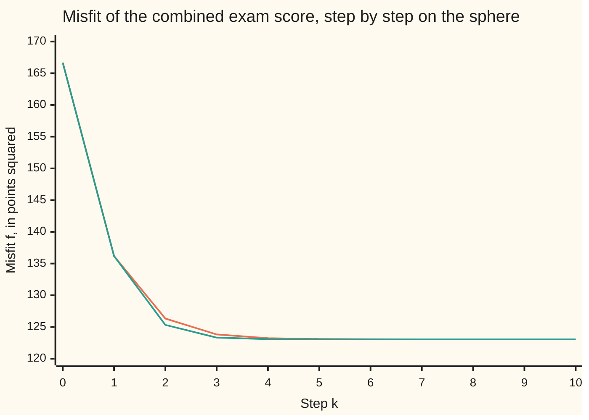

# Riemannian gradient descent: steps that stay on the curved set

[Syllabus](../../../SYLLABUS.md) → [Differential geometry and Lie groups](../README.md) → [Geometric Analysis and Physics](../README.md#s07) → Riemannian gradient descent

---

## General Overview

A school wants one combined score from three exams: maths, physics and English. The combined score is a weighted sum of a student's three marks. The school wants the weights that keep as much of the spread between students as possible, so the single number tells students apart well.

The weights are three numbers, $`w = (w_1, w_2, w_3)`$, and they must keep **unit length**: $`w_1^2 + w_2^2 + w_3^2 = 1`$. Without that rule, doubling every weight would quadruple the spread, and the "best" weights would run off to infinity. With it, the allowed weights form the surface of a ball of radius 1, the **unit sphere** $`S^2`$. The search happens on a curved set.

The fit is measured in points squared. Draw each student as a point in 3D (maths, physics, English marks). The weights pick a line through the middle of the cloud. The **misfit** is the mean squared distance of the students from that line.

- **Equal weights**, 0.577350 each, leave a misfit of 166.667 points².
- **The best weights**, (0.779917, 0.588005, 0.214429), leave 123.061418 points².

The best weights keep 73.76% of the spread in one number. Riemannian gradient descent finds them in 24 steps from the equal weights, or 15 with momentum, to within a millionth of a degree.

The method repeats three moves:

1. **Project.** Take the ordinary downhill slope and remove the part that points off the sphere.
2. **Step and retract.** Step in the flat plane that touches the sphere, then pull the point back onto the sphere.
3. **Transport.** Carry the previous step's direction into the new touching plane, so it can be reused as momentum.

**Riemannian gradient descent keeps every step on the curved set: it steps along the flat tangent plane in the downhill direction found there, pulls the result back onto the set with a retraction, and carries old directions to the new tangent plane before reusing them.**

**What kind of fact this is:** a method. That the projected slope is the steepest direction on the sphere, that the retraction matches the exponential map to second order, and the local rate near the answer are proved in Why it works. That every local minimum of this misfit is the global one is a theorem, stated here with its source (Absil, Mahony and Sepulchre, in Sources), not proved.

The covariance numbers are a constructed example of realistic size: standard deviations of 15, 12 and 10 points, correlations of 0.80, 0.30 and 0.25.

### The picture: misfit over the first ten steps



The upper line is plain Riemannian gradient descent. The lower line adds momentum, a transported share of the previous direction. Both start at 166.67 points² with equal weights and settle at 123.06 points². Every point on both lines is a unit-length weight vector.

---

## The formula

Notation first, in words.

- The data enter through one table, the **covariance matrix** $`A`$: its diagonal holds each exam's spread (variance), and the other entries say how two exams vary together. For the school, `A = [[225, 144, 45], [144, 144, 30], [45, 30, 100]]` points². Its diagonal adds to 469 points², the total spread.
- The **misfit** is $`f(w) = 469 - w \cdot Aw`$. Here $`w \cdot Aw`$, the dot product of $`w`$ with $`Aw`$, is the spread of the combined score.
- $`\nabla f(w) = -2Aw`$ is the ordinary gradient of $`f`$ in 3D, the steepest-uphill arrow if $`w`$ could move anywhere ([Gradient descent](../../15-Optimization/02-Unconstrained%20Methods/02-gradient-descent-and-its-rate.md)).
- The **tangent plane** $`T_wS^2`$ is the flat plane touching the sphere at $`w`$: all arrows $`v`$ with $`w \cdot v = 0`$.

This card introduces three objects: the Riemannian gradient $`\mathrm{grad}\, f`$, the **retraction** $`R_w`$ and the **vector transport** $`\mathcal{T}`$. The update, with step size $`\alpha`$ (alpha) and momentum share $`\beta`$ (beta), counting steps by $`k`$:

```math
\mathrm{grad}\, f(w) = \nabla f(w) - \big(w \cdot \nabla f(w)\big)\, w, \qquad d_k = -\mathrm{grad}\, f(w_k) + \beta\, \mathcal{T}_{w_k}(d_{k-1}), \qquad w_{k+1} = R_{w_k}(\alpha\, d_k)
```

with the sphere's two tools

```math
R_w(v) = \frac{w + v}{\lvert w + v \rvert}, \qquad \mathcal{T}_{w}(d) = d - (w \cdot d)\, w
```

**Read it aloud:** take the downhill slope and drop its part along $`w`$; add a tenth of the old direction, after dropping its part along the new $`w`$; step along the tangent plane, then divide by the length to land back on the sphere.

With $`\beta = 0`$ this is plain Riemannian gradient descent. With $`\beta > 0`$ it is the heavy-ball method of Polyak (Sources), moved onto the sphere.

| Symbol | Plain meaning | In our example | Push it up and the answer… |
| --- | --- | --- | --- |
| $`w,\ w_k,\ w^*`$ | the weights, a unit-length arrow; $`w_k`$ after $`k`$ steps; $`w^*`$ the best weights | start $`w_0`$ = (0.577350, 0.577350, 0.577350); $`w^*`$ = (0.779917, 0.588005, 0.214429) | — |
| $`A`$ | covariance matrix of the three exams, points² | diagonal 225, 144, 100 | a larger exam spread pulls the best weights toward that exam |
| $`f(w)`$ | misfit: mean squared distance of students from the line along $`w`$, points² | 166.667 at the start, 123.061418 at the best | — |
| $`\nabla f`$ | ordinary 3D gradient, $`-2Aw`$ | (−478.046, −367.195, −202.073) at $`w_0`$ | — |
| $`S^2,\ T_wS^2`$ | the unit sphere; the flat plane touching it at $`w`$ | all unit weight vectors; arrows with $`w \cdot v = 0`$ | — |
| $`\mathrm{grad}\, f`$ | **Riemannian gradient**: $`\nabla f`$ with its part along $`w`$ removed | (−128.942, −18.090, 147.032) at $`w_0`$, length 196.396 | longer means a steeper slope along the sphere |
| $`R_w,\ \exp_w`$ | **retraction**: step in $`T_wS^2`$, then rescale to length 1; the exponential map walks the great circle instead | step 1 lands at (0.693052, 0.584279, 0.422252); $`\exp_w`$ lands 0.00247 away | — |
| $`\mathcal{T}_w`$ | **vector transport**: carry an arrow into $`T_wS^2`$ by dropping its part along $`w`$ | the old direction sits 11.11° out of the new plane before transport | — |
| $`d_k`$ | search direction of step $`k`$ | $`d_0 = -\mathrm{grad}\, f(w_0)`$ | — |
| $`\alpha`$ | step size | 0.001 | fewer steps at first, then more as it nears 0.003213; past it the walk bounces |
| $`\beta`$ | momentum share: how much old direction is kept | 0.1 | 15 steps at 0.1; 23 steps at 0.3 |
| $`\lambda_j,\ e_j,\ \varepsilon_j`$ | eigenvalue $`j`$ of $`A`$ (minus the largest, $`-\lambda_1`$, is the Lagrange multiplier at the answer), points²; its eigenvector $`e_j`$; the small offset $`\varepsilon_j`$ along $`e_j`$ near the answer | 345.938582, 88.339676, 34.721743 | — |

### When it holds

- **The step stays under the limit.** Here the limit is $`2/622.434 = 0.003213`$. At 0.004 the weights bounce for ever between two points, each 18.28° from the answer.
- **The start is not a critical point.** A **critical point** is where $`\mathrm{grad}\, f = 0`$. Start on the second eigenvector of $`A`$ and the gradient is zero, so the walk never moves: the misfit stays at 380.660 points².
- **The step comes back to the set.** Without the retraction the weights grow to length 1.028004 and fake a misfit of 103.415 points².
- **Old directions are transported before reuse.** Untransported, the old direction sits 11.11° out of the new tangent plane.
- **The result is local.** The method finds a point where $`\mathrm{grad}\, f = 0`$ and $`f`$ goes down nearby. For this misfit every such local minimum is the global one (stated, Absil, Mahony and Sepulchre); for a general $`f`$ on a curved set there is no such promise.

---

## Why it works

### Step 0: walk on a flat map of the neighbourhood, then come back

On a curved set, a straight step leaves the set. The fix splits the job in two. Near $`w`$, the sphere looks like its tangent plane, the way a town looks flat on a street map. Decide the step on that flat plane, where ordinary calculus works. Then map the result back onto the sphere.

So the method needs three parts: the downhill direction in the plane, a way back to the sphere, and a way to move old directions between planes.

### Step 1: the projected gradient is the steepest direction on the sphere

The sphere's metric is the ordinary dot product, restricted to tangent arrows ([Riemannian metric](../05-Riemannian%20Geometry/01-riemannian-metrics.md)). Move from $`w`$ with velocity $`v`$ in the tangent plane. The rate of change of $`f`$ is $`\nabla f \cdot v`$.

Split $`\nabla f`$ into its part along $`w`$ and the rest. The part along $`w`$ gives zero, because $`w \cdot v = 0`$. So the rate is $`\mathrm{grad}\, f \cdot v`$, where $`\mathrm{grad}\, f`$ is the rest: the projection. It lies in the tangent plane, so it is the gradient that the sphere's own metric defines. Among unit tangent arrows, the rate is largest along $`\mathrm{grad}\, f`$, so $`-\mathrm{grad}\, f`$ is steepest downhill.

At the equal weights, the part along $`w_0`$ is −604.667. Removing it turns (−478.046, −367.195, −202.073) into (−128.942, −18.090, 147.032). Its dot product with $`w_0`$ is zero up to rounding ($`2 \times 10^{-13}`$). It says: more maths, about the same physics, less English.

### Step 2: zero Riemannian gradient is the Lagrange condition

$`\mathrm{grad}\, f = 0`$ means $`\nabla f`$ points straight along $`w`$, the gradient of the rule $`\lvert w \rvert^2 = 1`$. That is the condition of [Lagrange multipliers](../../06-Calculus%20and%20analysis/07-Several%20Variables/08-lagrange-multipliers.md): the gradient of the target is a multiple of the gradient of the rule.

Here it reads $`-2Aw = -\lambda \cdot 2w`$, so $`Aw = \lambda w`$: the best weights are an **eigenvector** of $`A`$, an arrow that $`A`$ only stretches, by the eigenvalue $`\lambda`$. The multiplier is $`-\lambda`$, because the misfit falls as the spread rises; for the spread $`w \cdot Aw`$ itself it would be $`\lambda`$. The best weights have $`\lambda`$ = 345.938582, the largest. The misfit is $`469 - 345.938582 = 123.061418`$. These weights are the first principal component of the exam scores (Hotelling, in Sources).

Riemannian gradient descent solves the Lagrange equations by walking. It never needs the multiplier as a separate unknown.

### Step 3: the retraction is as good as the exponential map, to second order

The exact way back is the exponential map: walk the great circle from $`w`$ in direction $`v`$ for length $`\lvert v \rvert`$ ([Geodesic and exponential map](../05-Riemannian%20Geometry/04-geodesics-and-the-exponential-map.md)). Dividing by the length is cheaper. The two agree up to terms of size $`\lvert v \rvert^3`$.

On step 1, $`\lvert v \rvert`$ = 0.196396. The two landing points are 0.00247 apart, against $`\lvert v \rvert^3/3`$ = 0.00253. Run either way, the walk reaches the answer in the same number of steps: 24 plain, 15 with momentum.

<details>
<summary>Detailed proof: the retraction matches the exponential map to second order</summary>

Take a unit $`w`$, a tangent $`v`$ with $`w \cdot v = 0`$, and a small number $`t`$. Since $`w`$ and $`v`$ are at right angles, $`\lvert w + tv \rvert^2 = 1 + t^2 \lvert v \rvert^2`$. So

$`\displaystyle R_w(tv) = \frac{w + tv}{\sqrt{1 + t^2 \lvert v \rvert^2}} = w + tv - \tfrac12 t^2 \lvert v \rvert^2\, w + O(t^3).`$

The exponential map is

$`\displaystyle \exp_w(tv) = \cos(t\lvert v \rvert)\, w + \sin(t\lvert v \rvert)\, \frac{v}{\lvert v \rvert} = w + tv - \tfrac12 t^2 \lvert v \rvert^2\, w + O(t^3).`$

The two expansions agree through $`t^2`$. The first-order match is what any retraction needs: $`R_w(0) = w`$ and the velocity of $`R_w(tv)`$ at $`t = 0`$ is $`v`$.

The $`t^3`$ terms differ. The retraction turns by the angle $`\arctan \lvert v \rvert`$; the exponential map turns by $`\lvert v \rvert`$. Their gap is $`\lvert v \rvert - \arctan\lvert v \rvert \approx \lvert v \rvert^3/3`$, the size the check prints.

</details>

### Step 4: one step is ordinary gradient descent on a flat function

Fix $`w_k`$. The function $`g(v) = f(R_{w_k}(v))`$ lives on the flat tangent plane. By Step 3, its gradient at $`v = 0`$ is $`\mathrm{grad}\, f(w_k)`$. So one Riemannian step is exactly one ordinary gradient step on $`g`$, from $`v = 0`$.

The [Gradient descent](../../15-Optimization/02-Unconstrained%20Methods/02-gradient-descent-and-its-rate.md) card proves that such a step lowers $`g`$ when the step is small enough. Here that means $`f(w_{k+1}) < f(w_k)`$. Step 1 takes the misfit from 166.667 to 136.177 points².

### Step 5: near the answer, the error shrinks by a fixed factor

Near the best weights $`w^*`$, write $`w = w^* + \varepsilon_2 e_2 + \varepsilon_3 e_3`$, where $`e_2, e_3`$ are the other two eigenvectors and $`\varepsilon_2, \varepsilon_3`$ (epsilon) are small. One plain step multiplies each $`\varepsilon_j`$ by $`1 - 2\alpha(\lambda_1 - \lambda_j)`$, to first order.

The numbers $`2(\lambda_1 - \lambda_j)`$ are the curvatures of $`f`$ along the sphere at $`w^*`$: 515.198 and 622.434 points². They form the Riemannian Hessian, the subject of [Riemannian Hessian](06-riemannian-hessian-and-trust-regions.md). As on the flat card, the step must stay under 2 over the largest curvature: $`2/622.434 = 0.003213`$.

With $`\alpha = 0.001`$, the slow direction shrinks by $`1 - 0.001 \times 515.198 = 0.484802`$ per step. The check measures 0.484746 between steps 11 and 12.

<details>
<summary>Detailed proof: the factor 1 − 2α(λ₁ − λⱼ)</summary>

Use the eigenvectors $`e_1 = w^*, e_2, e_3`$ as axes, so $`A`$ is diagonal with $`\lambda_1, \lambda_2, \lambda_3`$. Take $`w = (1, \varepsilon_2, \varepsilon_3)`$, rescaled; to first order in the small numbers its length is 1.

Then $`Aw = (\lambda_1, \lambda_2\varepsilon_2, \lambda_3\varepsilon_3)`$ and $`w \cdot Aw = \lambda_1`$ to first order. So

$`\displaystyle \mathrm{grad}\, f(w) = -2\big(Aw - (w \cdot Aw)\, w\big) = -2\big(0,\ (\lambda_2 - \lambda_1)\varepsilon_2,\ (\lambda_3 - \lambda_1)\varepsilon_3\big).`$

The step $`w - \alpha\,\mathrm{grad}\, f`$ has components $`\big(1,\ (1 - 2\alpha(\lambda_1 - \lambda_2))\varepsilon_2,\ (1 - 2\alpha(\lambda_1 - \lambda_3))\varepsilon_3\big)`$. Rescaling changes the first component only at second order. So each $`\varepsilon_j`$ is multiplied by $`1 - 2\alpha(\lambda_1 - \lambda_j)`$.

The walk settles when both factors lie between −1 and 1. Since $`\lambda_1`$ is the largest eigenvalue, both factors are below 1. They stay above −1 when $`\alpha < 1/(\lambda_1 - \lambda_3)`$, which is $`2/622.434`$.

</details>

### Step 6: transport moves the old direction into the new plane

Momentum adds $`\beta d_{k-1}`$ to the new direction. But $`d_{k-1}`$ was built in the tangent plane at $`w_{k-1}`$. After the step, the tangent plane has tilted. The old arrow now points partly off the sphere: 11.11° out of the new plane after step 1.

Vectors in two different tangent planes cannot be added meaningfully. A vector transport fixes this. It must land in the new plane, leave an arrow alone when the point does not move, and respect sums and multiples. Dropping the part along $`w_k`$ does all three, so it qualifies.

The exact rule is [Parallel transport](../05-Riemannian%20Geometry/03-parallel-transport-and-holonomy.md) along the great circle, which rotates the arrow with the sphere. Projection agrees with it to first order and costs one dot product.

Here the walk converges even without transport: with the retraction, the old arrow's part along $`w`$ only rescales the tangent step, and exponential-map steps still reach the answer in 15 steps. Transport is what makes the sum a true tangent arrow, which the exponential map, most other retractions and most other curved sets need; untransported, exponential-map steps leave length 1 by up to 0.00378.

---

## Worked numbers, by hand

Step 1 from the equal weights, $`\alpha = 0.001`$.

| Step | Arithmetic | Value |
| --- | --- | --- |
| 1. Start | $`w_0 = (1, 1, 1)/\sqrt3`$ | (0.577350, 0.577350, 0.577350) |
| 2. Spread of the combined score | $`w_0 \cdot Aw_0`$ = (225 + 144 + 100 + 2 × 144 + 2 × 45 + 2 × 30)/3 | 302.333 points² |
| 3. Misfit | 469 − 302.333 | 166.667 points² |
| 4. $`Aw_0`$ | row sums of $`A`$ over $`\sqrt3`$: (414, 318, 175)/1.732051 | (239.023, 183.597, 101.036) |
| 5. Ordinary gradient | $`-2Aw_0`$ | (−478.046, −367.195, −202.073) |
| 6. Its part along $`w_0`$ | $`-2 \times 302.333`$ | −604.667 |
| 7. Riemannian gradient | step 5 − (−604.667) × 0.577350 | (−128.942, −18.090, 147.032) |
| 8. Step in the tangent plane | $`w_0 - 0.001 \times`$ step 7 | (0.706292, 0.595441, 0.430318) |
| 9. Its length | $`\sqrt{0.706292^2 + 0.595441^2 + 0.430318^2}`$ | 1.019103 |
| 10. Retract | step 8 ÷ 1.019103 | (0.693052, 0.584279, 0.422252) |
| **11. New misfit** | $`469 - w_1 \cdot Aw_1`$ | **136.177 points²** |

The walk continues:

| Step k | Plain: misfit, points² | Plain: angle from best | Momentum 0.1: misfit | Momentum 0.1: angle from best |
| ---: | ---: | ---: | ---: | ---: |
| 0 | 166.666667 | 24.0° | 166.666667 | 24.0° |
| 1 | 136.176892 | 12.9° | 136.176892 | 12.9° |
| 2 | 126.325281 | 6.43° | 125.329262 | 5.36° |
| 3 | 123.828486 | 3.12° | 123.334733 | 1.87° |
| 5 | 123.103077 | 0.728° | 123.063119 | 0.147° |
| 10 | 123.061448 | 0.0194° | 123.061418 | 0.000534° |
| 20 | 123.061418 | 0.0000139° | 123.061418 | 0.00000000574° |

Plain descent needs 24 steps to come within a millionth of a degree; momentum needs 15. The best weights lean on maths and physics, which vary most and move together.

### What breaks if you drop a piece

Same data, same start, 30 steps of 0.001, unless the row says otherwise.

| Mistake | Comes out at | What went wrong |
| --- | --- | --- |
| No projection, no retraction: ordinary gradient descent | length 6.4835 × 10⁶, misfit −1.4542 × 10¹⁶ points² | The rule is ignored. Longer weights always "fit better", so the walk runs to infinity. |
| Project, but never retract | length 1.028004, misfit 103.415 points² | Each tangent step lengthens the arrow a little. The reading beats the true best, 123.061418, by cheating. |
| Step 0.004, above the limit 0.003213 | bounces between (0.932248, 0.310807, 0.185238) and (0.548895, 0.805876, 0.221985), misfit 153.670 | Both directions' factors are below −1, so each step overshoots further, until the sphere's curvature traps it in a two-step cycle. |
| Reuse the old direction without transport, stepping by the exponential map | length strays from 1 by up to 0.00378 | The old arrow is 11.11° out of the new tangent plane; the great-circle formula assumes a tangent arrow. |
| Start on a critical point, the second eigenvector | misfit stays at 380.660 for 20 steps | The hypothesis "not a critical point" fails. The gradient is zero, so no step is taken. |

---

## Code, from first principles, and it actually runs

The script builds every tool by hand: the projection, the retraction, the exponential map, the transport and a rotation-by-rotation eigen-solver. It takes three independent roads to the best weights. Road 1 is Riemannian gradient descent, plain and with momentum, stepping by the retraction and again by the exponential map. Road 2 is the eigen-solver: the top eigenvector of $`A`$, by Step 2. Road 3 is brute force: the misfit at 811,800 points of a grid 0.2° apart in both angles, over half the sphere. It also checks that exponential-map steps stay at length 1, the Lagrange condition, the third-order gap between retraction and exponential map, the predicted rate, and every row of What breaks.

### Python

```python
# Riemannian gradient descent -- the check behind the card.  Python standard library only.
# Exam scores in maths, physics and English; A is their covariance in points^2.  The weights w
# (unit length, a point on the sphere S^2) define one combined score.  f(w) is the mean squared
# distance, in points^2, of the students' score points from the line through the mean along w.
from math import sqrt, sin, cos, atan2, pi
A = [[225.0, 144.0, 45.0], [144.0, 144.0, 30.0], [45.0, 30.0, 100.0]]
TR = A[0][0] + A[1][1] + A[2][2]
def mv(v): return [A[i][0] * v[0] + A[i][1] * v[1] + A[i][2] * v[2] for i in range(3)]
def dot(a, b): return a[0] * b[0] + a[1] * b[1] + a[2] * b[2]
def norm(v): return sqrt(dot(v, v))
def add(a, b, t): return [a[i] + t * b[i] for i in range(3)]
def unit(v): n = norm(v); return [x / n for x in v]
def f(w): return TR - dot(w, mv(w))
def egrad(w): return [-2.0 * x for x in mv(w)]               # ordinary gradient of f in 3D
def proj(w, v): return add(v, w, -dot(w, v))                 # drop the part along w
def rgrad(w): return proj(w, egrad(w))                       # Riemannian gradient
def retract(w, v): return unit(add(w, v, 1.0))               # step in the plane, then rescale
def expmap(w, v):                                            # step along the great circle
    t = norm(v)
    return w if t == 0.0 else [cos(t) * w[i] + sin(t) * v[i] / t for i in range(3)]
def deg(x): return x * 180.0 / pi
def fmt(v): return "(" + ", ".join(f"{x:.6f}" for x in v) + ")"

def jacobi(M):                                               # road 2: eigen-solver by rotations
    a = [row[:] for row in M]; V = [[1.0 if i == j else 0.0 for j in range(3)] for i in range(3)]
    for _ in range(20):
        for p, q in ((0, 1), (0, 2), (1, 2)):
            if abs(a[p][q]) < 1e-14: continue
            th = (a[q][q] - a[p][p]) / (2.0 * a[p][q])
            t = (1.0 if th >= 0 else -1.0) / (abs(th) + sqrt(th * th + 1.0)); c = 1.0 / sqrt(t * t + 1.0); s = t * c
            for k in range(3): a[k][p], a[k][q] = c * a[k][p] - s * a[k][q], s * a[k][p] + c * a[k][q]
            for k in range(3): a[p][k], a[q][k] = c * a[p][k] - s * a[q][k], s * a[p][k] + c * a[q][k]
            for k in range(3): V[k][p], V[k][q] = c * V[k][p] - s * V[k][q], s * V[k][p] + c * V[k][q]
    order = sorted(range(3), key=lambda i: -a[i][i])
    vecs = [[V[k][i] for k in range(3)] for i in order]
    return [a[i][i] for i in order], [v if v[0] + v[1] + v[2] > 0 else [-x for x in v] for v in vecs]
lam, E = jacobi(A); e = E[0]
def err(w): return deg(atan2(norm(proj(e, w)), abs(dot(w, e))))   # angle from the answer, degrees

def descend(w, alpha, beta, n, step=retract, transport=True):
    d = [0.0, 0.0, 0.0]; path = [w]
    for _ in range(n):
        if transport: d = proj(w, d)                         # carry the old direction to T_w S^2
        d = add([-x for x in rgrad(w)], d, beta)              # downhill, plus beta times the old way
        w = step(w, [alpha * x for x in d]); path.append(w)
    return path

ALPHA, BETA, N = 0.001, 0.1, 30
w0 = unit([1.0, 1.0, 1.0])
print(f"total spread trace(A) = {TR:.0f} points^2; equal weights w0 = {fmt(w0)}")
sd = [sqrt(A[i][i]) for i in range(3)]
print(f"standard deviations {sd[0]:.0f} {sd[1]:.0f} {sd[2]:.0f} points; correlations {A[0][1] / (sd[0] * sd[1]):.2f} "
      f"{A[0][2] / (sd[0] * sd[2]):.2f} {A[1][2] / (sd[1] * sd[2]):.2f}; row sums of A {fmt(mv([1.0, 1.0, 1.0]))}, sqrt 3 = {sqrt(3.0):.6f}")
print(f"equal weights: index variance {dot(w0, mv(w0)):.3f}, f(w0) = {f(w0):.3f} points^2")
g = egrad(w0); r = rgrad(w0)
print(f"step 1: A w0 = {fmt(mv(w0))}")
print(f"step 1: ordinary gradient {fmt(g)}, part along w0 {dot(g, w0):.3f}")
print(f"step 1: Riemannian gradient {fmt(r)}, length {norm(r):.3f}, w0 . grad = {dot(w0, r):.1e}")
v = [-ALPHA * x for x in r]; u = add(w0, v, 1.0); w1 = retract(w0, v)
print(f"step 1: w0 - alpha grad = {fmt(u)}, length {norm(u):.6f}; retracted w1 = {fmt(w1)}")
gap1 = norm(add(expmap(w0, v), w1, -1.0))
print(f"step 1: f(w1) = {f(w1):.3f}; step length |v| = {norm(v):.6f}; exp map lands {gap1:.2e} from w1, |v|^3/3 = {norm(v) ** 3 / 3:.2e}")
assert abs(dot(w0, r)) < 1e-12 and f(w1) < f(w0) and 0.5 < gap1 / (norm(v) ** 3 / 3) < 1.5
print(f"road 2, eigen-solver: eigenvalues {lam[0]:.6f} {lam[1]:.6f} {lam[2]:.6f}; top eigenvector {fmt(e)}")
gd, hb = descend(w0, ALPHA, 0.0, N), descend(w0, ALPHA, BETA, N)
gx, hx = descend(w0, ALPHA, 0.0, N, expmap), descend(w0, ALPHA, BETA, N, expmap)
print("  k | plain: f, error deg | momentum: f, error deg | exp-map steps, momentum: error deg")
for k in (0, 1, 2, 3, 4, 5, 6, 8, 10, 15, 20, 30):
    print(f"{k:3d} | {f(gd[k]):.6f} {err(gd[k]):.2e} | {f(hb[k]):.6f} {err(hb[k]):.2e} | {err(hx[k]):.2e}")
print("chart, plain:", " ".join(f"{f(w):.2f}" for w in gd[:11]))
print("chart, momentum:", " ".join(f"{f(w):.2f}" for w in hb[:11]))
first = lambda p: next(k for k, w in enumerate(p) if err(w) < 1e-6)
print(f"steps to within 1e-6 deg: plain {first(gd)}, momentum {first(hb)}, plain exp-map {first(gx)}, momentum exp-map {first(hx)}")
wb = hb[N]; mult = dot(wb, mv(wb)); res = norm(add(mv(wb), wb, -mult))
print(f"answer w* = {fmt(wb)}, f = {f(wb):.6f}, share of spread kept {100 * mult / TR:.2f}%")
print(f"Lagrange: A w* = lambda w* with lambda = {mult:.6f}, residual {res:.1e}")
assert err(gd[N]) < 1e-7 and err(hb[N]) < 1e-7 and err(hx[N]) < 1e-7 and abs(mult - lam[0]) < 1e-9 and res < 1e-8
assert max(abs(norm(w) - 1.0) for w in gx + hx) < 1e-12              # exp-map steps stay on the sphere
best = min(((f(unit([sin(i * pi / 900) * cos(j * pi / 900), sin(i * pi / 900) * sin(j * pi / 900), cos(i * pi / 900)])), i, j)
            for i in range(451) for j in range(1800)))
wg = unit([sin(best[1] * pi / 900) * cos(best[2] * pi / 900), sin(best[1] * pi / 900) * sin(best[2] * pi / 900), cos(best[1] * pi / 900)])
print(f"road 3, grid of 811,800 points, 0.2 deg apart in both angles: best f = {best[0]:.6f}, {err(wg):.4f} deg from w*")
assert abs(best[0] - f(wb)) < 1e-2 and err(wg) < 0.2
hess = [2 * (lam[0] - lam[1]), 2 * (lam[0] - lam[2])]; pred = 1 - ALPHA * hess[0]
print(f"Riemannian Hessian at w*: {hess[0]:.3f} {hess[1]:.3f}; step limit 2/L = {2 / hess[1]:.6f}")
ratio = err(gd[12]) / err(gd[11])
print(f"rate: predicted error factor per step {pred:.6f}, measured {ratio:.6f}")
assert abs(ratio - pred) < 1e-3
# what breaks
p = [w0]
for _ in range(N): p.append(add(p[-1], egrad(p[-1]), -ALPHA))
print(f"mistake, no projection, no retraction: after {N} steps |w| = {norm(p[-1]):.4e}, f = {f(p[-1]):.4e}")
q = [w0]
for _ in range(N): x = q[-1]; g = egrad(x); q.append(add(x, add(g, x, -dot(x, g) / dot(x, x)), -ALPHA))
print(f"mistake, project but never retract: |w| = {norm(q[-1]):.6f}, f = {f(q[-1]):.3f}, true f there {f(unit(q[-1])):.3f}")
assert norm(p[-1]) > 1e6 and f(q[-1]) < f(wb) - 1 and norm(q[-1]) > 1.01
big = descend(w0, 0.004, 0.0, 200)
print(f"mistake, step 0.004 above the limit: steps 199 and 200 bounce between {fmt(big[199])} and {fmt(big[200])},"
      f" f = {f(big[199]):.3f} and {f(big[200]):.3f}, {err(big[199]):.2f} and {err(big[200]):.2f} deg from w*")
assert err(big[200]) > 10 and err(big[199]) > 10
d1 = [-x for x in r]; tilt = deg(atan2(abs(dot(hb[1], d1)), norm(proj(hb[1], d1))))
nt = descend(w0, ALPHA, BETA, N, expmap, False); drift = max(abs(norm(w) - 1) for w in nt)
print(f"mistake, no transport: old direction sits {tilt:.2f} deg out of the new tangent plane; with exp-map steps"
      f" |w| strays by up to {drift:.2e}, {first(nt)} steps to within 1e-6 deg")
assert tilt > 5 and drift > 1e-6
e2 = E[1]; s2 = descend(e2, ALPHA, BETA, 20)
print(f"hypothesis fails, start on a critical point (2nd eigenvector): f stays {f(s2[0]):.3f} -> {f(s2[20]):.3f}")
assert abs(f(s2[20]) - (TR - lam[1])) < 1e-6
# try changing
t1, t2, t3 = first(descend(w0, ALPHA, 0.3, 80)), first(descend(w0, 0.0005, 0.0, 120)), first(descend([0.0, 0.0, 1.0], ALPHA, BETA, 80))
print(f"try: momentum 0.3 needs {t1} steps; plain step 0.0005 needs {t2}; English-only start (0, 0, 1) needs {t3}")
print("ALL CHECKS PASS")
```

**Ran 2026-11-19 on macOS, Python 3.14.10, standard library only. All checks passed. Output, pasted from the run:**

```
total spread trace(A) = 469 points^2; equal weights w0 = (0.577350, 0.577350, 0.577350)
standard deviations 15 12 10 points; correlations 0.80 0.30 0.25; row sums of A (414.000000, 318.000000, 175.000000), sqrt 3 = 1.732051
equal weights: index variance 302.333, f(w0) = 166.667 points^2
step 1: A w0 = (239.023011, 183.597386, 101.036297)
step 1: ordinary gradient (-478.046023, -367.194771, -202.072594), part along w0 -604.667
step 1: Riemannian gradient (-128.941560, -18.090308, 147.031869), length 196.396, w0 . grad = 2.0e-13
step 1: w0 - alpha grad = (0.706292, 0.595441, 0.430318), length 1.019103; retracted w1 = (0.693052, 0.584279, 0.422252)
step 1: f(w1) = 136.177; step length |v| = 0.196396; exp map lands 2.47e-03 from w1, |v|^3/3 = 2.53e-03
road 2, eigen-solver: eigenvalues 345.938582 88.339676 34.721743; top eigenvector (0.779917, 0.588005, 0.214429)
  k | plain: f, error deg | momentum: f, error deg | exp-map steps, momentum: error deg
  0 | 166.666667 2.40e+01 | 166.666667 2.40e+01 | 2.40e+01
  1 | 136.176892 1.29e+01 | 136.176892 1.29e+01 | 1.28e+01
  2 | 126.325281 6.43e+00 | 125.329262 5.36e+00 | 5.25e+00
  3 | 123.828486 3.12e+00 | 123.334733 1.87e+00 | 1.81e+00
  4 | 123.240051 1.51e+00 | 123.086429 5.64e-01 | 5.44e-01
  5 | 123.103077 7.28e-01 | 123.063119 1.47e-01 | 1.40e-01
  6 | 123.071158 3.52e-01 | 123.061489 2.95e-02 | 2.78e-02
  8 | 123.061953 8.26e-02 | 123.061419 1.75e-03 | 1.79e-03
 10 | 123.061448 1.94e-02 | 123.061418 5.34e-04 | 5.22e-04
 15 | 123.061418 5.19e-04 | 123.061418 3.91e-07 | 3.63e-07
 20 | 123.061418 1.39e-05 | 123.061418 5.74e-09 | 5.53e-09
 30 | 123.061418 9.97e-09 | 123.061418 4.22e-14 | 3.78e-14
chart, plain: 166.67 136.18 126.33 123.83 123.24 123.10 123.07 123.06 123.06 123.06 123.06
chart, momentum: 166.67 136.18 125.33 123.33 123.09 123.06 123.06 123.06 123.06 123.06 123.06
steps to within 1e-6 deg: plain 24, momentum 15, plain exp-map 24, momentum exp-map 15
answer w* = (0.779917, 0.588005, 0.214429), f = 123.061418, share of spread kept 73.76%
Lagrange: A w* = lambda w* with lambda = 345.938582, residual 1.4e-13
road 3, grid of 811,800 points, 0.2 deg apart in both angles: best f = 123.061461, 0.0225 deg from w*
Riemannian Hessian at w*: 515.198 622.434; step limit 2/L = 0.003213
rate: predicted error factor per step 0.484802, measured 0.484746
mistake, no projection, no retraction: after 30 steps |w| = 6.4835e+06, f = -1.4542e+16
mistake, project but never retract: |w| = 1.028004, f = 103.415, true f there 123.061
mistake, step 0.004 above the limit: steps 199 and 200 bounce between (0.932248, 0.310807, 0.185238) and (0.548895, 0.805876, 0.221985), f = 153.670 and 153.670, 18.28 and 18.28 deg from w*
mistake, no transport: old direction sits 11.11 deg out of the new tangent plane; with exp-map steps |w| strays by up to 3.78e-03, 15 steps to within 1e-6 deg
hypothesis fails, start on a critical point (2nd eigenvector): f stays 380.660 -> 380.660
try: momentum 0.3 needs 23 steps; plain step 0.0005 needs 58; English-only start (0, 0, 1) needs 19
ALL CHECKS PASS
```

### Rust

```rust
// Riemannian gradient descent -- the check behind the card.  Rust std only, no crates.
// Exam scores in maths, physics and English; A is their covariance in points^2.  The weights w
// (unit length, a point on the sphere S^2) define one combined score.  f(w) is the mean squared
// distance, in points^2, of the students' score points from the line through the mean along w.
use std::f64::consts::PI;
type V = [f64; 3];
const A: [[f64; 3]; 3] = [[225.0, 144.0, 45.0], [144.0, 144.0, 30.0], [45.0, 30.0, 100.0]];
const TR: f64 = 225.0 + 144.0 + 100.0;
fn mv(v: V) -> V { [0, 1, 2].map(|i| A[i][0] * v[0] + A[i][1] * v[1] + A[i][2] * v[2]) }
fn dot(a: V, b: V) -> f64 { a[0] * b[0] + a[1] * b[1] + a[2] * b[2] }
fn norm(v: V) -> f64 { dot(v, v).sqrt() }
fn add(a: V, b: V, t: f64) -> V { [0, 1, 2].map(|i| a[i] + t * b[i]) }
fn unit(v: V) -> V { let n = norm(v); v.map(|x| x / n) }
fn neg(v: V) -> V { v.map(|x| -x) }
fn scale(t: f64, v: V) -> V { v.map(|x| t * x) }
fn f(w: V) -> f64 { TR - dot(w, mv(w)) }
fn egrad(w: V) -> V { mv(w).map(|x| -2.0 * x) } // ordinary gradient of f in 3D
fn proj(w: V, v: V) -> V { add(v, w, -dot(w, v)) } // drop the part along w
fn rgrad(w: V) -> V { proj(w, egrad(w)) } // Riemannian gradient
fn retract(w: V, v: V) -> V { unit(add(w, v, 1.0)) } // step in the plane, then rescale
fn expmap(w: V, v: V) -> V { // step along the great circle
    let t = norm(v);
    if t == 0.0 { w } else { [0, 1, 2].map(|i| t.cos() * w[i] + t.sin() * v[i] / t) }
}
fn deg(x: f64) -> f64 { x * 180.0 / PI }
fn fmt(v: V) -> String { format!("({:.6}, {:.6}, {:.6})", v[0], v[1], v[2]) }
fn sci(x: f64, d: usize) -> String { // Python-style exponent: 2.40e+01
    let s = format!("{:.*e}", d, x);
    let (m, e) = s.split_once('e').unwrap();
    let e: i32 = e.parse().unwrap();
    format!("{}e{}{:02}", m, if e < 0 { '-' } else { '+' }, e.abs())
}
fn jacobi(m: [[f64; 3]; 3]) -> (V, [V; 3]) { // road 2: eigen-solver by rotations
    let mut a = m;
    let mut v = [[1.0, 0.0, 0.0], [0.0, 1.0, 0.0], [0.0, 0.0, 1.0]];
    for _ in 0..20 {
        for (p, q) in [(0, 1), (0, 2), (1, 2)] {
            if a[p][q].abs() < 1e-14 { continue; }
            let th = (a[q][q] - a[p][p]) / (2.0 * a[p][q]);
            let t = (if th >= 0.0 { 1.0 } else { -1.0 }) / (th.abs() + (th * th + 1.0).sqrt());
            let c = 1.0 / (t * t + 1.0).sqrt();
            let s = t * c;
            for k in 0..3 { let (x, y) = (a[k][p], a[k][q]); a[k][p] = c * x - s * y; a[k][q] = s * x + c * y; }
            for k in 0..3 { let (x, y) = (a[p][k], a[q][k]); a[p][k] = c * x - s * y; a[q][k] = s * x + c * y; }
            for k in 0..3 { let (x, y) = (v[k][p], v[k][q]); v[k][p] = c * x - s * y; v[k][q] = s * x + c * y; }
        }
    }
    let mut order = [0usize, 1, 2];
    order.sort_by(|&i, &j| a[j][j].partial_cmp(&a[i][i]).unwrap());
    let vecs = order.map(|i| { let e = [v[0][i], v[1][i], v[2][i]]; if e[0] + e[1] + e[2] > 0.0 { e } else { neg(e) } });
    (order.map(|i| a[i][i]), vecs)
}
fn descend(mut w: V, alpha: f64, beta: f64, n: usize, step: fn(V, V) -> V, transport: bool) -> Vec<V> {
    let mut d = [0.0; 3];
    let mut path = vec![w];
    for _ in 0..n {
        if transport { d = proj(w, d); } // carry the old direction to T_w S^2
        d = add(neg(rgrad(w)), d, beta); // downhill, plus beta times the old way
        w = step(w, scale(alpha, d));
        path.push(w);
    }
    path
}

fn main() {
    let (lam, ev) = jacobi(A);
    let e = ev[0];
    let err = |w: V| deg(norm(proj(e, w)).atan2(dot(w, e).abs())); // angle from the answer, degrees
    let first = |p: &Vec<V>| p.iter().position(|w| err(*w) < 1e-6).unwrap();
    let (alpha, beta, n) = (0.001, 0.1, 30usize);
    let w0 = unit([1.0, 1.0, 1.0]);
    println!("total spread trace(A) = {:.0} points^2; equal weights w0 = {}", TR, fmt(w0));
    let sd = [A[0][0].sqrt(), A[1][1].sqrt(), A[2][2].sqrt()];
    println!("standard deviations {:.0} {:.0} {:.0} points; correlations {:.2} {:.2} {:.2}; row sums of A {}, sqrt 3 = {:.6}",
             sd[0], sd[1], sd[2], A[0][1] / (sd[0] * sd[1]), A[0][2] / (sd[0] * sd[2]), A[1][2] / (sd[1] * sd[2]), fmt(mv([1.0, 1.0, 1.0])), 3.0f64.sqrt());
    println!("equal weights: index variance {:.3}, f(w0) = {:.3} points^2", dot(w0, mv(w0)), f(w0));
    let (g, r) = (egrad(w0), rgrad(w0));
    println!("step 1: A w0 = {}", fmt(mv(w0)));
    println!("step 1: ordinary gradient {}, part along w0 {:.3}", fmt(g), dot(g, w0));
    println!("step 1: Riemannian gradient {}, length {:.3}, w0 . grad = {}", fmt(r), norm(r), sci(dot(w0, r), 1));
    let v = r.map(|x| -alpha * x);
    let (u, w1) = (add(w0, v, 1.0), retract(w0, v));
    println!("step 1: w0 - alpha grad = {}, length {:.6}; retracted w1 = {}", fmt(u), norm(u), fmt(w1));
    let gap1 = norm(add(expmap(w0, v), w1, -1.0));
    let c3 = norm(v).powi(3) / 3.0;
    println!("step 1: f(w1) = {:.3}; step length |v| = {:.6}; exp map lands {} from w1, |v|^3/3 = {}", f(w1), norm(v), sci(gap1, 2), sci(c3, 2));
    assert!(dot(w0, r).abs() < 1e-12 && f(w1) < f(w0) && 0.5 < gap1 / c3 && gap1 / c3 < 1.5);
    println!("road 2, eigen-solver: eigenvalues {:.6} {:.6} {:.6}; top eigenvector {}", lam[0], lam[1], lam[2], fmt(e));
    let (gd, hb) = (descend(w0, alpha, 0.0, n, retract, true), descend(w0, alpha, beta, n, retract, true));
    let (gx, hx) = (descend(w0, alpha, 0.0, n, expmap, true), descend(w0, alpha, beta, n, expmap, true));
    println!("  k | plain: f, error deg | momentum: f, error deg | exp-map steps, momentum: error deg");
    for k in [0usize, 1, 2, 3, 4, 5, 6, 8, 10, 15, 20, 30] {
        println!("{:3} | {:.6} {} | {:.6} {} | {}", k, f(gd[k]), sci(err(gd[k]), 2), f(hb[k]), sci(err(hb[k]), 2), sci(err(hx[k]), 2));
    }
    let row = |p: &Vec<V>| p[..11].iter().map(|w| format!("{:.2}", f(*w))).collect::<Vec<_>>().join(" ");
    println!("chart, plain: {}", row(&gd));
    println!("chart, momentum: {}", row(&hb));
    println!("steps to within 1e-6 deg: plain {}, momentum {}, plain exp-map {}, momentum exp-map {}", first(&gd), first(&hb), first(&gx), first(&hx));
    let wb = hb[n];
    let mult = dot(wb, mv(wb));
    let res = norm(add(mv(wb), wb, -mult));
    println!("answer w* = {}, f = {:.6}, share of spread kept {:.2}%", fmt(wb), f(wb), 100.0 * mult / TR);
    println!("Lagrange: A w* = lambda w* with lambda = {:.6}, residual {}", mult, sci(res, 1));
    assert!(err(gd[n]) < 1e-7 && err(hb[n]) < 1e-7 && err(hx[n]) < 1e-7 && (mult - lam[0]).abs() < 1e-9 && res < 1e-8);
    assert!(gx.iter().chain(hx.iter()).all(|w| (norm(*w) - 1.0).abs() < 1e-12)); // exp-map steps stay on the sphere
    let pt = |i: usize, j: usize| { let (a, b) = (i as f64 * PI / 900.0, j as f64 * PI / 900.0); unit([a.sin() * b.cos(), a.sin() * b.sin(), a.cos()]) };
    let mut best = (f64::INFINITY, 0, 0);
    for i in 0..451 { for j in 0..1800 { let fv = f(pt(i, j)); if fv < best.0 { best = (fv, i, j); } } }
    let wg = pt(best.1, best.2);
    println!("road 3, grid of 811,800 points, 0.2 deg apart in both angles: best f = {:.6}, {:.4} deg from w*", best.0, err(wg));
    assert!((best.0 - f(wb)).abs() < 1e-2 && err(wg) < 0.2);
    let hess = [2.0 * (lam[0] - lam[1]), 2.0 * (lam[0] - lam[2])];
    let pred = 1.0 - alpha * hess[0];
    println!("Riemannian Hessian at w*: {:.3} {:.3}; step limit 2/L = {:.6}", hess[0], hess[1], 2.0 / hess[1]);
    let ratio = err(gd[12]) / err(gd[11]);
    println!("rate: predicted error factor per step {:.6}, measured {:.6}", pred, ratio);
    assert!((ratio - pred).abs() < 1e-3);
    // what breaks
    let mut p = w0;
    for _ in 0..n { p = add(p, egrad(p), -alpha); }
    println!("mistake, no projection, no retraction: after {} steps |w| = {}, f = {}", n, sci(norm(p), 4), sci(f(p), 4));
    let mut q = w0;
    for _ in 0..n { let g = egrad(q); q = add(q, add(g, q, -dot(q, g) / dot(q, q)), -alpha); }
    println!("mistake, project but never retract: |w| = {:.6}, f = {:.3}, true f there {:.3}", norm(q), f(q), f(unit(q)));
    assert!(norm(p) > 1e6 && f(q) < f(wb) - 1.0 && norm(q) > 1.01);
    let big = descend(w0, 0.004, 0.0, 200, retract, true);
    println!("mistake, step 0.004 above the limit: steps 199 and 200 bounce between {} and {}, f = {:.3} and {:.3}, {:.2} and {:.2} deg from w*",
             fmt(big[199]), fmt(big[200]), f(big[199]), f(big[200]), err(big[199]), err(big[200]));
    assert!(err(big[200]) > 10.0 && err(big[199]) > 10.0);
    let d1 = neg(r);
    let tilt = deg(dot(hb[1], d1).abs().atan2(norm(proj(hb[1], d1))));
    let nt = descend(w0, alpha, beta, n, expmap, false);
    let drift = nt.iter().map(|w| (norm(*w) - 1.0).abs()).fold(0.0, f64::max);
    println!("mistake, no transport: old direction sits {:.2} deg out of the new tangent plane; with exp-map steps |w| strays by up to {}, {} steps to within 1e-6 deg",
             tilt, sci(drift, 2), first(&nt));
    assert!(tilt > 5.0 && drift > 1e-6);
    let s2 = descend(ev[1], alpha, beta, 20, retract, true);
    println!("hypothesis fails, start on a critical point (2nd eigenvector): f stays {:.3} -> {:.3}", f(s2[0]), f(s2[20]));
    assert!((f(s2[20]) - (TR - lam[1])).abs() < 1e-6);
    // try changing
    let (t1, t2, t3) = (first(&descend(w0, alpha, 0.3, 80, retract, true)), first(&descend(w0, 0.0005, 0.0, 120, retract, true)),
                        first(&descend([0.0, 0.0, 1.0], alpha, beta, 80, retract, true)));
    println!("try: momentum 0.3 needs {} steps; plain step 0.0005 needs {}; English-only start (0, 0, 1) needs {}", t1, t2, t3);
    println!("ALL CHECKS PASS");
}
```

**Ran 2026-11-19 on macOS, rustc 1.98.1, no crates. All checks passed. Output, pasted from the run:**

```
total spread trace(A) = 469 points^2; equal weights w0 = (0.577350, 0.577350, 0.577350)
standard deviations 15 12 10 points; correlations 0.80 0.30 0.25; row sums of A (414.000000, 318.000000, 175.000000), sqrt 3 = 1.732051
equal weights: index variance 302.333, f(w0) = 166.667 points^2
step 1: A w0 = (239.023011, 183.597386, 101.036297)
step 1: ordinary gradient (-478.046023, -367.194771, -202.072594), part along w0 -604.667
step 1: Riemannian gradient (-128.941560, -18.090308, 147.031869), length 196.396, w0 . grad = 2.0e-13
step 1: w0 - alpha grad = (0.706292, 0.595441, 0.430318), length 1.019103; retracted w1 = (0.693052, 0.584279, 0.422252)
step 1: f(w1) = 136.177; step length |v| = 0.196396; exp map lands 2.47e-03 from w1, |v|^3/3 = 2.53e-03
road 2, eigen-solver: eigenvalues 345.938582 88.339676 34.721743; top eigenvector (0.779917, 0.588005, 0.214429)
  k | plain: f, error deg | momentum: f, error deg | exp-map steps, momentum: error deg
  0 | 166.666667 2.40e+01 | 166.666667 2.40e+01 | 2.40e+01
  1 | 136.176892 1.29e+01 | 136.176892 1.29e+01 | 1.28e+01
  2 | 126.325281 6.43e+00 | 125.329262 5.36e+00 | 5.25e+00
  3 | 123.828486 3.12e+00 | 123.334733 1.87e+00 | 1.81e+00
  4 | 123.240051 1.51e+00 | 123.086429 5.64e-01 | 5.44e-01
  5 | 123.103077 7.28e-01 | 123.063119 1.47e-01 | 1.40e-01
  6 | 123.071158 3.52e-01 | 123.061489 2.95e-02 | 2.78e-02
  8 | 123.061953 8.26e-02 | 123.061419 1.75e-03 | 1.79e-03
 10 | 123.061448 1.94e-02 | 123.061418 5.34e-04 | 5.22e-04
 15 | 123.061418 5.19e-04 | 123.061418 3.91e-07 | 3.63e-07
 20 | 123.061418 1.39e-05 | 123.061418 5.74e-09 | 5.53e-09
 30 | 123.061418 9.97e-09 | 123.061418 4.22e-14 | 3.78e-14
chart, plain: 166.67 136.18 126.33 123.83 123.24 123.10 123.07 123.06 123.06 123.06 123.06
chart, momentum: 166.67 136.18 125.33 123.33 123.09 123.06 123.06 123.06 123.06 123.06 123.06
steps to within 1e-6 deg: plain 24, momentum 15, plain exp-map 24, momentum exp-map 15
answer w* = (0.779917, 0.588005, 0.214429), f = 123.061418, share of spread kept 73.76%
Lagrange: A w* = lambda w* with lambda = 345.938582, residual 1.4e-13
road 3, grid of 811,800 points, 0.2 deg apart in both angles: best f = 123.061461, 0.0225 deg from w*
Riemannian Hessian at w*: 515.198 622.434; step limit 2/L = 0.003213
rate: predicted error factor per step 0.484802, measured 0.484746
mistake, no projection, no retraction: after 30 steps |w| = 6.4835e+06, f = -1.4542e+16
mistake, project but never retract: |w| = 1.028004, f = 103.415, true f there 123.061
mistake, step 0.004 above the limit: steps 199 and 200 bounce between (0.932248, 0.310807, 0.185238) and (0.548895, 0.805876, 0.221985), f = 153.670 and 153.670, 18.28 and 18.28 deg from w*
mistake, no transport: old direction sits 11.11 deg out of the new tangent plane; with exp-map steps |w| strays by up to 3.78e-03, 15 steps to within 1e-6 deg
hypothesis fails, start on a critical point (2nd eigenvector): f stays 380.660 -> 380.660
try: momentum 0.3 needs 23 steps; plain step 0.0005 needs 58; English-only start (0, 0, 1) needs 19
ALL CHECKS PASS
```

The grid's best point lies 0.0225° from the descent's answer, inside the grid's 0.2° spacing. The `chart,` lines are the points of the picture above.

### Lean

Lean proves the update stays on the sphere, and Steps 1 and 2, for any function and step; it checks the hand arithmetic exactly.

- Take unit-length weights $`w_0`$, any function $`f`$, any step size $`\alpha`$ and any momentum share $`\beta`$. Then every $`w_k`$ has length 1, and every search direction $`d_k`$ lies in the tangent plane at $`w_k`$.
- The Riemannian gradient at a unit $`w`$ lies in the tangent plane.
- Take a unit $`w`$ and a tangent arrow $`v`$. Then the rate of change of $`f`$ along $`v`$ is $`\mathrm{grad}\, f \cdot v`$.
- Take a unit $`w`$ and a unit tangent arrow $`v`$. Then the rate of change of $`f`$ along $`v`$ is never below $`-\lvert \mathrm{grad}\, f \rvert`$.
- Take a unit $`w`$ where $`\mathrm{grad}\, f \ne 0`$. Then the unit arrow along $`-\mathrm{grad}\, f`$ reaches that lowest rate, so it is steepest downhill.
- Take any 3 by 3 covariance matrix $`A`$, a unit $`w`$, and the misfit: the diagonal sum minus $`w \cdot Aw`$. Then $`\mathrm{grad}\, f(w) = 0`$ exactly when $`Aw = \lambda w`$ for some number $`\lambda`$, so $`w`$ is an eigenvector.
- The school's matrix has diagonal sum 469 points² and row sums (414, 318, 175).
- At equal weights, the spread is 907/3 points², the misfit 500/3 points², and the gradient's part along $`w_0`$ is −1814/3.
- Standard deviations 15, 12 and 10 points give the diagonal 225, 144 and 100, and correlations 0.80, 0.30 and 0.25.

Convergence, the step limit, the rate, the exponential-map comparison and every decimal are left to the Python and Rust checks.

```lean
-- Riemannian gradient descent: every step of projected, retracted and transported gradient descent stays on the unit sphere, its search direction lies in the tangent plane, the projected gradient is the steepest tangent direction, and a zero projected gradient of the misfit means the weights are an eigenvector.
import Mathlib.Analysis.Calculus.Gradient.Basic
import Mathlib.Analysis.InnerProductSpace.PiL2
import Mathlib.Analysis.InnerProductSpace.Calculus
import Mathlib.Analysis.Matrix.Hermitian
import Mathlib.LinearAlgebra.Matrix.Trace
import Mathlib.LinearAlgebra.Matrix.Notation

open RealInnerProductSpace Matrix

/-- Weights `w = (w₁, w₂, w₃)` live in ℝ³ with the ordinary dot product. -/
local notation "ℝ³" => EuclideanSpace ℝ (Fin 3)

/-- The Riemannian gradient on the sphere: the ordinary gradient `∇f(w)` with its part along `w`
removed, `grad f(w) = ∇f(w) - (w · ∇f(w)) w`. -/
noncomputable def rgrad (f : ℝ³ → ℝ) (w : ℝ³) : ℝ³ :=
  gradient f w - ⟪w, gradient f w⟫ • w

/-- The retraction `R_w(v) = (w + v) / |w + v|`: step in the tangent plane, then rescale. -/
noncomputable def retract (w v : ℝ³) : ℝ³ :=
  ‖w + v‖⁻¹ • (w + v)

/-- The vector transport `𝒯_w(d) = d - (w · d) w`: drop the part of `d` along `w`. -/
noncomputable def transport (w d : ℝ³) : ℝ³ :=
  d - ⟪w, d⟫ • w

/-- Riemannian gradient descent with step `α` and momentum share `β`, started at `w₀`.
Entry `k` is the pair `(w_k, d_{k-1})`, with `d_{-1} = 0`. The update is
`d_k = -grad f(w_k) + β 𝒯_{w_k}(d_{k-1})` and `w_{k+1} = R_{w_k}(α d_k)`. -/
noncomputable def rgdState (f : ℝ³ → ℝ) (α β : ℝ) (w₀ : ℝ³) : ℕ → ℝ³ × ℝ³
  | 0 => (w₀, 0)
  | k + 1 =>
      let s := rgdState f α β w₀ k
      let d := -rgrad f s.1 + β • transport s.1 s.2
      (retract s.1 (α • d), d)

/-- Removing the part along a unit vector `w` leaves a vector orthogonal to `w`. -/
theorem inner_sub_inner_smul_self_eq_zero (w g : ℝ³) (hw : ‖w‖ = 1) :
    ⟪w, g - ⟪w, g⟫ • w⟫ = 0 := by
  rw [inner_sub_right, inner_smul_right, real_inner_self_eq_norm_sq, hw]; ring

/-- The retraction of a tangent step at a unit vector is again a unit vector. -/
theorem norm_retract_of_tangent (w v : ℝ³) (hw : ‖w‖ = 1) (hv : ⟪w, v⟫ = 0) :
    ‖retract w v‖ = 1 := by
  have hne : w + v ≠ 0 := by
    intro h
    have hv' : v = -w := eq_neg_of_add_eq_zero_right h
    rw [hv', inner_neg_right, real_inner_self_eq_norm_sq, hw] at hv
    norm_num at hv
  unfold retract
  rw [norm_smul, norm_inv, norm_norm, inv_mul_cancel₀ (norm_ne_zero_iff.mpr hne)]

/-- The inner product with the gradient is the derivative. -/
theorem inner_gradient_eq_fderiv (f : ℝ³ → ℝ) (w v : ℝ³) :
    ⟪gradient f w, v⟫ = fderiv ℝ f w v := by
  unfold gradient
  exact InnerProductSpace.toDual_symm_apply


/-- Riemannian gradient descent keeps every step on the curved set. Start from unit-length
weights `w₀`. For any function `f`, any step size `α` and any momentum share `β`, every iterate
`w_k` has length 1, and every search direction `d_k` (the downhill projected gradient plus the
transported old direction) lies in the tangent plane at `w_k`, that is `w_k · d_k = 0`. -/
theorem riemannian_gradient_descent_stays_on_sphere (f : ℝ³ → ℝ) (α β : ℝ) (w₀ : ℝ³)
    (hw₀ : ‖w₀‖ = 1) (k : ℕ) :
    ‖(rgdState f α β w₀ k).1‖ = 1 ∧
      ⟪(rgdState f α β w₀ k).1, (rgdState f α β w₀ (k + 1)).2⟫ = 0 := by
  have hT : ∀ w d : ℝ³, ‖w‖ = 1 → ⟪w, -rgrad f w + β • transport w d⟫ = 0 := by
    intro w d hw
    rw [inner_add_right, inner_neg_right, inner_smul_right]
    unfold rgrad transport
    rw [inner_sub_inner_smul_self_eq_zero _ _ hw, inner_sub_inner_smul_self_eq_zero _ _ hw]
    ring
  have hN : ∀ k, ‖(rgdState f α β w₀ k).1‖ = 1 := by
    intro k
    induction k with
    | zero => simpa [rgdState] using hw₀
    | succ n ih =>
      simp only [rgdState]
      apply norm_retract_of_tangent _ _ ih
      rw [inner_smul_right, hT _ _ ih, mul_zero]
  refine ⟨hN k, ?_⟩
  simp only [rgdState]
  exact hT _ _ (hN k)

/-- The projected gradient is the steepest direction on the sphere. At a unit vector `w`, the
Riemannian gradient lies in the tangent plane; the rate of change of `f` along a tangent arrow `v`
is `grad f(w) · v`; over unit tangent arrows this rate is never below `-|grad f(w)|`; and when
`grad f(w) ≠ 0` the rate `-|grad f(w)|` is reached along `-grad f(w) / |grad f(w)|`. -/
theorem rgrad_is_steepest_tangent_direction (f : ℝ³ → ℝ) (w : ℝ³) (hw : ‖w‖ = 1) :
    ⟪w, rgrad f w⟫ = 0 ∧
      (∀ v : ℝ³, ⟪w, v⟫ = 0 → fderiv ℝ f w v = ⟪rgrad f w, v⟫) ∧
      (∀ v : ℝ³, ⟪w, v⟫ = 0 → ‖v‖ = 1 → -‖rgrad f w‖ ≤ fderiv ℝ f w v) ∧
      (rgrad f w ≠ 0 → fderiv ℝ f w (-(‖rgrad f w‖⁻¹ • rgrad f w)) = -‖rgrad f w‖) := by
  have h0 : ⟪w, rgrad f w⟫ = 0 := inner_sub_inner_smul_self_eq_zero _ _ hw
  have h1 : ∀ v : ℝ³, ⟪w, v⟫ = 0 → fderiv ℝ f w v = ⟪rgrad f w, v⟫ := by
    intro v hv
    unfold rgrad
    rw [inner_sub_left, inner_smul_left, hv, inner_gradient_eq_fderiv]
    simp
  refine ⟨h0, h1, ?_, ?_⟩
  · intro v hv hv1
    rw [h1 v hv]
    have := abs_real_inner_le_norm (rgrad f w) v
    rw [hv1, mul_one] at this
    exact neg_le_of_abs_le this
  · intro hg
    have ht : ⟪w, -(‖rgrad f w‖⁻¹ • rgrad f w)⟫ = 0 := by
      rw [inner_neg_right, inner_smul_right, h0]; simp
    rw [h1 _ ht, inner_neg_right, inner_smul_right, real_inner_self_eq_norm_sq]
    have hn : ‖rgrad f w‖ ≠ 0 := norm_ne_zero_iff.mpr hg
    field_simp

/-- Zero Riemannian gradient is the Lagrange condition. For a symmetric (covariance) matrix `A`
and the misfit `f(w) = trace A - w · Aw`, a unit vector `w` has zero Riemannian gradient exactly
when `Aw = λ w` for some number `λ`, that is, when `w` is an eigenvector of `A`. -/
theorem rgrad_misfit_eq_zero_iff_eigenvector (A : Matrix (Fin 3) (Fin 3) ℝ) (hA : A.IsHermitian)
    (w : ℝ³) (hw : ‖w‖ = 1) :
    rgrad (fun x => A.trace - ⟪x, Matrix.toEuclideanLin A x⟫) w = 0 ↔
      ∃ μ : ℝ, Matrix.toEuclideanLin A w = μ • w := by
  set T := Matrix.toEuclideanLin A with hTdef
  have hS : T.IsSymmetric := Matrix.isSymmetric_toEuclideanLin_iff.mpr hA
  set Tc : ℝ³ →L[ℝ] ℝ³ := LinearMap.toContinuousLinearMap T with hTc
  have hD : HasFDerivAt (fun x : ℝ³ => A.trace - ⟪x, T x⟫)
      ((-(2 : ℝ)) • (InnerProductSpace.toDual ℝ ℝ³ (T w) : ℝ³ →L[ℝ] ℝ)) w := by
    have hi := HasFDerivAt.inner ℝ (hasFDerivAt_id (𝕜 := ℝ) w) (Tc.hasFDerivAt (x := w))
    have hc := (hasFDerivAt_const (A.trace) w).sub hi
    refine hc.congr_fderiv ?_
    ext v
    simp only [sub_apply, ContinuousLinearMap.comp_apply,
      ContinuousLinearMap.prod_apply, fderivInnerCLM_apply, smul_apply,
      InnerProductSpace.toDual_apply_apply, zero_apply,
      ContinuousLinearMap.id_apply, hTc, LinearMap.coe_toContinuousLinearMap']
    simp only [id, smul_eq_mul]
    linarith [hS w v, real_inner_comm v (T w)]
  have hG : gradient (fun x : ℝ³ => A.trace - ⟪x, T x⟫) w = (-(2 : ℝ)) • T w := by
    apply HasGradientAt.gradient
    rw [hasGradientAt_iff_hasFDerivAt, map_smul]
    exact hD
  unfold rgrad
  rw [hG, inner_smul_right, sub_eq_zero]
  constructor
  · intro h
    refine ⟨⟪w, T w⟫, ?_⟩
    have h2 := congrArg (fun x : ℝ³ => (-(1/2 : ℝ)) • x) h
    simp only [smul_smul] at h2
    norm_num at h2
    simpa [mul_comm] using h2
  · rintro ⟨μ, hμ⟩
    rw [hμ, inner_smul_right, real_inner_self_eq_norm_sq, hw, smul_smul]
    simp

/-! The card's whole-number arithmetic for the school's covariance matrix, in points². -/

-- The diagonal adds to the total spread, 469 points².
example : Matrix.trace !![(225 : ℚ), 144, 45; 144, 144, 30; 45, 30, 100] = 469 := by
  norm_num [Matrix.trace, Fin.sum_univ_three]

-- The row sums of A are (414, 318, 175).
example : !![(225 : ℚ), 144, 45; 144, 144, 30; 45, 30, 100] *ᵥ ![1, 1, 1] = ![414, 318, 175] := by
  ext i; fin_cases i <;> norm_num [Matrix.mulVec, dotProduct, Fin.sum_univ_three]

-- Equal weights (1, 1, 1)/√3: spread of the combined score (225 + 144 + 100 + 2·144 + 2·45 + 2·30)/3.
example : (1 / 3 : ℚ) * (![1, 1, 1] ⬝ᵥ (!![(225 : ℚ), 144, 45; 144, 144, 30; 45, 30, 100] *ᵥ ![1, 1, 1]))
    = 907 / 3 := by
  norm_num [Matrix.mulVec, dotProduct, Fin.sum_univ_three]

-- Misfit at equal weights 469 - 907/3 = 500/3 (166.667), and the gradient's part along w₀, -2 · 907/3.
example : (469 : ℚ) - 907 / 3 = 500 / 3 ∧ (-2 : ℚ) * (907 / 3) = -1814 / 3 := by norm_num

-- Standard deviations 15, 12, 10 points and correlations 0.80, 0.30, 0.25.
example : (15 : ℚ) ^ 2 = 225 ∧ (12 : ℚ) ^ 2 = 144 ∧ (10 : ℚ) ^ 2 = 100 ∧
    (144 : ℚ) / (15 * 12) = 4 / 5 ∧ (45 : ℚ) / (15 * 10) = 3 / 10 ∧ (30 : ℚ) / (12 * 10) = 1 / 4 := by
  norm_num

#print axioms inner_sub_inner_smul_self_eq_zero
#print axioms norm_retract_of_tangent
#print axioms inner_gradient_eq_fderiv
#print axioms riemannian_gradient_descent_stays_on_sphere
#print axioms rgrad_is_steepest_tangent_direction
#print axioms rgrad_misfit_eq_zero_iff_eigenvector
```

**Checked 2026-11-19 on macOS, Lean 4.36.0-rc2, Mathlib v4.36.0-rc2. Every proof is complete and uses only Lean's standard axioms. Output, pasted from the run:**

```
'inner_sub_inner_smul_self_eq_zero' depends on axioms: [propext, Classical.choice, Quot.sound]
'norm_retract_of_tangent' depends on axioms: [propext, Classical.choice, Quot.sound]
'inner_gradient_eq_fderiv' depends on axioms: [propext, Classical.choice, Quot.sound]
'riemannian_gradient_descent_stays_on_sphere' depends on axioms: [propext, Classical.choice, Quot.sound]
'rgrad_is_steepest_tangent_direction' depends on axioms: [propext, Classical.choice, Quot.sound]
'rgrad_misfit_eq_zero_iff_eigenvector' depends on axioms: [propext, Classical.choice, Quot.sound]
```

> [!TIP]
> **Try changing**
> - **More momentum.** Guess first: does keeping 0.3 of the old direction beat 0.1? The setting is `0.3` in the line starting `t1, t2, t3 =`. Answer: no, 23 steps against 15. Too much momentum overshoots and swings.
> - **A smaller step.** Guess first: plain descent with step 0.0005 instead of 0.001? Same line, the `0.0005`. Answer: 58 steps against 24. The slow factor rises from 0.484802 toward 1.
> - **A worse start.** Guess first: start from English only, (0, 0, 1)? Same line, the `[0.0, 0.0, 1.0]`. Answer: 19 steps with momentum, against 15 from equal weights.
> - **A step past the limit.** Guess first: what does step 0.004 do? The setting is `0.004` in the line starting `big =`. Answer: it never settles; it bounces between two points 18.28° from the answer.

---

## The usual mistake

> [!warning]
> **Stepping off the set and reading the answer there.** Take the projected step but skip the retraction, and the weights drift to length 1.028004. The misfit then reads 103.415 points², better than the true best of 123.061418. No unit-length weights achieve that number; the longer arrow inflates the spread. A number computed off the set says nothing about the set.
>
> Three smaller traps:
> - **Using the ordinary gradient.** The weights reach length 6.4835 × 10⁶ in 30 steps, and the misfit −1.4542 × 10¹⁶ points², impossible for a squared distance.
> - **Adding directions from different tangent planes.** Stepped by the exponential map, the weights leave length 1 by up to 0.00378.
> - **Reading zero gradient as "found the best".** The second eigenvector also has zero gradient, with misfit 380.660 points².

---

## Where you meet it in real life

- **Principal component analysis.** The first principal component is this card's answer. Streaming versions, such as Oja's rule, update unit-length weights one data point at a time with the same project-and-rescale step.
- **Neural networks with normalised weights.** Some layers keep each weight vector at unit length. Training them is gradient descent on a product of spheres.
- **Rotations and orientations.** Fitting a camera pose or a robot arm's orientation is optimisation on the rotation group $`SO(3)`$, with retractions built from the matrix exponential or the QR factorisation (Boumal; Absil, Mahony and Sepulchre).
- **Orthogonality constraints.** Finding several orthonormal directions at once, such as the top three components, is optimisation on the Stiefel manifold of orthonormal frames (Edelman, Arias and Smith).
- **Covariance estimation.** Positive-definite matrices form a curved set with their own geometry, the subject of [Covariance matrices](07-the-manifold-of-covariance-matrices.md).

> **Say it back**
> Some optimisation problems allow only points on a curved set, such as unit-length weights on a sphere. Riemannian gradient descent projects the ordinary gradient onto the tangent plane, steps there, and retracts the result back onto the set. Momentum reuses the old direction only after a vector transport carries it into the new tangent plane. For the exam scores, 15 steps from equal weights reach (0.779917, 0.588005, 0.214429), misfit 123.061418 points², which the eigen-solver and a grid search confirm. The step must stay under 0.003213, and a zero gradient marks a critical point, not always the best one.

---

## What this builds on

- [Riemannian metric](../05-Riemannian%20Geometry/01-riemannian-metrics.md): the rule for lengths and angles on the set. Here it is the ordinary dot product on each tangent plane, and it turns the projected slope into the gradient.
- [Geodesic and exponential map](../05-Riemannian%20Geometry/04-geodesics-and-the-exponential-map.md): the exact way to step along the sphere, which the retraction replaces at second-order accuracy.
- [Gradient descent](../../15-Optimization/02-Unconstrained%20Methods/02-gradient-descent-and-its-rate.md): the flat method, its descent guarantee and its step limit of 2 over the largest curvature, applied here to $`f \circ R_w`$ on each tangent plane.
- [Lagrange multipliers](../../06-Calculus%20and%20analysis/07-Several%20Variables/08-lagrange-multipliers.md): the condition that a zero Riemannian gradient expresses, with the multiplier equal to minus the top eigenvalue, 345.938582.

## Where this goes next

- [Riemannian Hessian](06-riemannian-hessian-and-trust-regions.md): the second derivative on a curved set, whose values 515.198 and 622.434 set this card's rate and step limit, and the trust-region methods built on it.
- [Covariance matrices](07-the-manifold-of-covariance-matrices.md): a curved set of matrices, where distance counts risk ratios and two estimates are averaged along the shortest path.

The question this card leaves open: how can curvature information along the set replace the fixed step size, so the walk converges in a handful of steps whatever the shape of the misfit?

---

## Sources

Verified 2026-11-19: every link below resolves to the publisher's page.

- Absil, P.-A., R. Mahony and R. Sepulchre. *Optimization Algorithms on Matrix Manifolds*. Princeton University Press, 2008. [doi:10.1515/9781400830244](https://doi.org/10.1515/9781400830244). Retractions, vector transport and their convergence theory; the Rayleigh quotient on the sphere, including that its local minima are global.
- Boumal, Nicolas. *An Introduction to Optimization on Smooth Manifolds*. Cambridge University Press, 2023. [doi:10.1017/9781009166164](https://doi.org/10.1017/9781009166164). Riemannian gradients by projection, the descent guarantee with a retraction, and worked examples on spheres and rotation groups.
- Edelman, Alan, Tomás A. Arias and Steven T. Smith. "The geometry of algorithms with orthogonality constraints." *SIAM Journal on Matrix Analysis and Applications* 20, no. 2 (1998): 303–353. [doi:10.1137/S0895479895290954](https://doi.org/10.1137/S0895479895290954). Gradient and conjugate-gradient methods on spheres and Stiefel manifolds, with transport of search directions.
- Polyak, B. T. "Some methods of speeding up the convergence of iteration methods." *USSR Computational Mathematics and Mathematical Physics* 4, no. 5 (1964): 1–17. [doi:10.1016/0041-5553(64)90137-5](https://doi.org/10.1016/0041-5553(64)90137-5). The heavy-ball method, the momentum used here.
- Hotelling, Harold. "Analysis of a complex of statistical variables into principal components." *Journal of Educational Psychology* 24, no. 6 (1933): 417–441. [doi:10.1037/h0071325](https://doi.org/10.1037/h0071325). Principal components as eigenvectors of the covariance matrix.
