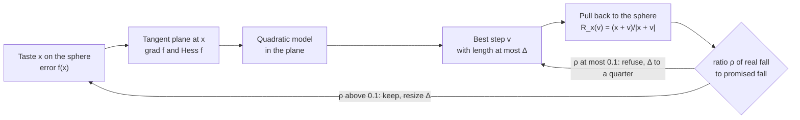
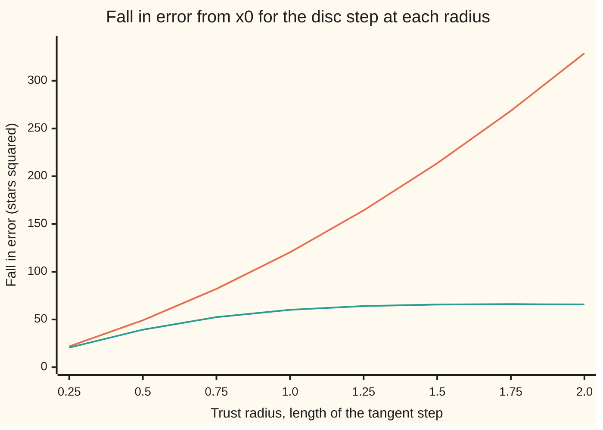

# Riemannian Hessian: second-order steps on a curved set

[Syllabus](../../../SYLLABUS.md) → [Differential geometry and Lie groups](../README.md) → [Geometric Analysis and Physics](../README.md#s07) → Riemannian Hessian

---

## General Overview

A small music service has four listeners and three songs. Each listener rated each song from 1 to 5 stars. Listeners 1 and 2 love songs 1 and 2; listeners 3 and 4 prefer song 3.

The service tunes a rank-1 recommender (a model with one hidden taste). The taste is a direction: three weights, one per song, scaled so their squares add to 1. Each listener gets one score along that direction, and the predicted ratings are that score times the weights. The thing to tune is the direction, and the cost is the squared error over all 12 ratings, in stars².

Directions with squares adding to 1 form a curved set: the unit sphere in three dimensions. A step along a straight line leaves it. Start from "only song 3 matters", with error 92 stars². The best direction gives 25.927321 stars², or 1.4699 stars per rating.

A fast method needs curvature, not just slope. On the sphere the ordinary second derivative gives the wrong curvature: at the best direction it says the error is at a peak. The **Riemannian Hessian** adds one correction term for the bending of the sphere. With it, a trust region (a step limited to a trusted radius) finds the best direction in 4 tries.

**The Riemannian Hessian is the ordinary Hessian, projected onto the tangent plane, plus a correction for how the curved set bends; a trust-region step built from it is taken in the tangent plane and then pulled back onto the set.**

**What kind of fact this is:** a definition, plus a theorem: the sphere formula for the Riemannian Hessian is proved on this card in Why it works. The convergence of the Riemannian trust region is a theorem stated with its source.

### The picture: one trust-region step on the sphere



---

## The formula

Notation first, in words.

- $`M`$ is the ratings table: 4 rows (listeners) by 3 columns (songs). Here $`M`$ is a table, not a manifold.
- $`C = M^{\mathsf T}M`$ is the 3-by-3 co-rating table. Entry $`C_{ij}`$ adds up, over listeners, rating of song i times rating of song j.
- $`x`$ is the taste direction, a unit vector: a point on the sphere $`S^2`$.
- $`f(x) = \lVert M\rVert^2 - x^{\mathsf T}Cx`$ is the rank-1 error in stars². Here $`\lVert M\rVert^2 = 138`$ is the sum of all squared ratings.
- $`\nabla f`$ and $`\nabla^2 f`$ are the ordinary gradient and Hessian of the same formula on all of three-dimensional space ([Hessian](../../06-Calculus%20and%20analysis/07-Several%20Variables/05-hessian-and-second-order-approximation.md)).
- $`T_xS^2`$ is the tangent plane at $`x`$: all vectors $`v`$ with $`x^{\mathsf T}v = 0`$. The projection $`P_x u = u - (x^{\mathsf T}u)\,x`$ removes the part of $`u`$ that points out of the sphere.

The Riemannian gradient, from [Riemannian gradient descent](05-optimisation-on-manifolds.md), is the projected ordinary gradient, $`\mathrm{grad}\, f(x) = P_x \nabla f(x)`$. The new object is the **Riemannian Hessian**, written $`\mathrm{Hess}\, f(x)`$. It takes a tangent vector $`v`$ and returns a tangent vector:

```math
\mathrm{Hess}\, f(x)[v] = P_x\big(\nabla^2 f(x)\,v\big) - \big(x^{\mathsf T}\nabla f(x)\big)\,v
```

**Read it aloud:** project the ordinary curvature onto the tangent plane, then subtract the outward part of the ordinary gradient, times the step.

For the recommender, $`\nabla f = -2Cx`$ and $`\nabla^2 f = -2C`$. So the correction term is $`+2\,(x^{\mathsf T}Cx)\,v`$.

The trust-region step uses the quadratic **model** in the tangent plane:

```math
m_x(v) = f(x) + \mathrm{grad}\, f(x)^{\mathsf T}v + \tfrac12\, v^{\mathsf T}\,\mathrm{Hess}\, f(x)[v], \qquad v \in T_xS^2,\ \lVert v\rVert \le \Delta
```

**Read it aloud:** the error here, plus slope times step, plus half the Riemannian curvature times the step twice, for steps in the tangent plane no longer than the radius.

The best $`v`$ in the disc is pulled back to the sphere by the **retraction** $`R_x(v) = (x + v)/\lVert x + v\rVert`$, the map from [Riemannian gradient descent](05-optimisation-on-manifolds.md) that turns a tangent step into a point on the set. The ratio test and the radius rules are those of [Trust regions](../../15-Optimization/02-Unconstrained%20Methods/08-trust-region-methods.md): keep if $`\rho > 0.1`$, quarter the radius if $`\rho < 0.25`$, double it, up to a cap of 3, if $`\rho > 0.75`$ and the step reached the edge.

| Symbol | Plain meaning | In our example | Push it up and the answer… |
| --- | --- | --- | --- |
| $`x`$, $`x_0`$, $`x^*`$ | taste direction: song weights, squares adding to 1; the start; the best | (0, 0, 1); (0.607624, 0.616717, 0.500453) | — |
| $`M`$, $`C`$, $`\lambda_1, \lambda_2, \lambda_3`$ | ratings table in stars; co-rating table $`M^{\mathsf T}M`$; its eigenvalues, largest first | $`M`$ rows (5, 4, 1), (4, 5, 2), (1, 2, 5), (2, 1, 4); $`\lambda`$ = 112.072679, 24, 1.927321 | a bigger gap $`\lambda_1 - \lambda_2`$ makes the best taste more sharply defined |
| $`f`$ | rank-1 error, stars² | 92 at the start; 25.927321 at best | — |
| $`\nabla f`$, $`\nabla^2 f`$ | ordinary gradient and Hessian in 3D space | $`(-52, -56, -92)`$ and $`-2C`$ at the start | — |
| $`T_xS^2`$, $`P_x`$ | tangent plane at $`x`$; projection onto it | the plane of songs 1 and 2 at the start | — |
| $`\mathrm{grad}\, f`$ | Riemannian gradient: slope along the sphere | $`(-52, -56, 0)`$ at the start | longer early steps |
| $`\mathrm{Hess}\, f`$ | Riemannian Hessian: curvature along the sphere | eigenvalues −88 and 88 at the start; 176.1454 and 220.2907 at best | shorter Newton steps |
| $`v`$, $`\lVert v\rVert`$ | a step in the tangent plane; its length | (0.699138, 0.714987, 0) with length 1 on the first try | — |
| $`m_x(v)`$; $`q`$, $`Q`$ | quadratic model's value after step $`v`$; in a proof, $`x^{\mathsf T}Cx`$ and $`(x+v)^{\mathsf T}C(x+v)`$ | promises a fall of 120.383382 on the first try | — |
| $`\mu`$, $`I`$ | damping number added to the Hessian; the identity | found by bisection (halving an interval until it is tiny) on each try | shorter steps |
| $`R_x`$, $`\gamma(t)`$ | retraction back to the sphere; a great circle through $`x`$, at angle $`t`$ | $`R_x(v)`$ gives f = 31.808309 after the first try | — |
| $`\Delta`$, $`\eta`$, $`\rho`$ | trust radius (not the Laplacian $`\Delta_g`$ or a mass gap); the bar to keep a step; delivered fall over promised fall | 1; 0.1; 0.5 on the first try | a larger $`\Delta`$ trusts the model further, and $`\rho`$ falls |

### When it holds

- **The set is a smooth surface sitting inside ordinary space, and f is twice differentiable there.** The formula uses $`\nabla f`$ and $`\nabla^2 f`$ of a smooth extension. At a sharp corner of the set there is no tangent plane and no Hessian.
- **The connection is the Levi-Civita one.** The Hessian is "differentiate the gradient along v", and on a surface in space that derivative is the projected ordinary derivative ([Levi-Civita connection](../05-Riemannian%20Geometry/02-levi-civita-connection-and-christoffel-symbols.md)). Differentiating the gradient's components in a chart, with no Christoffel symbols (the connection's correction terms), gives a matrix that changes with the chart. Another connection gives a different Hessian, which agrees with this one wherever grad f is zero.
- **The retraction agrees with great circles to second order.** Then $`f(R_x(v))`$ and the model agree in value, slope and curvature at $`v = 0`$. The checks confirm it: along $`v = (1, 1, 0)`$ the great circle and the retraction both give −176. A first-order retraction would make the model's curvature wrong away from critical points.
- **The model's minimum in the disc is found well enough.** This card solves the two-variable disc problem exactly. A cheaper solver must still reach a fixed share of the downhill fall, as on [Trust regions](../../15-Optimization/02-Unconstrained%20Methods/08-trust-region-methods.md).
- **The answer is a point where grad f is zero and Hess f is positive.** That is a local minimum, not automatically the global one. Here $`f(-x) = f(x)`$, so every answer has a twin: $`x`$ and $`-x`$ give the same recommender.

---

## Why it works

### Step 0: curvature means "how the slope changes as you walk along the set"

On flat ground the Hessian measures how the gradient changes along a step. On the sphere a walk follows a great circle (a geodesic: the curve with no sideways turning, as in [Geodesic and exponential map](../05-Riemannian%20Geometry/04-geodesics-and-the-exponential-map.md)). So the right curvature is the second derivative of f along great circles.

A great circle bends. Its acceleration points straight into the sphere, towards the centre. The ordinary gradient usually has a part pointing out of the sphere. When the path accelerates inward, that outward part of the gradient changes f too. The correction term is that effect.

### Step 1: the second derivative along a great circle

Take a unit tangent vector $`v`$ at $`x`$. The great circle through $`x`$ in direction $`v`$ is

```math
\gamma(t) = \cos t\; x + \sin t\; v .
```

**Read it aloud:** start at x, turn towards v, and stay on the sphere at every angle t.

Its velocity at $`t = 0`$ is $`v`$. Its acceleration is $`\gamma''(0) = -x`$: inward, length 1. The chain rule, applied twice, gives

```math
\frac{d^2}{dt^2} f(\gamma(t))\Big|_{t=0} = v^{\mathsf T}\nabla^2 f(x)\, v + \nabla f(x)^{\mathsf T}\gamma''(0) = v^{\mathsf T}\nabla^2 f(x)\, v - x^{\mathsf T}\nabla f(x).
```

**Read it aloud:** the ordinary curvature along v, plus the gradient's response to the inward pull.

The second term is the bending correction. Writing $`v^{\mathsf T}\mathrm{Hess}\, f(x)[v]`$ for this second derivative, and putting $`\lVert v\rVert^2`$ in front of the correction for a $`v`$ of any length, gives the formula.

<details>
<summary>Detailed proof: the same formula from "differentiate the gradient, then project"</summary>

The Riemannian Hessian is defined as the Levi-Civita derivative of the gradient field: $`\mathrm{Hess}\, f(x)[v] = \nabla_v\, \mathrm{grad}\, f`$. For a surface sitting in ordinary space, that derivative is the ordinary derivative of the field, projected back onto the tangent plane.

Write $`g = \nabla f`$. The gradient field is

$`\displaystyle \mathrm{grad}\, f(x) = g(x) - \big(x^{\mathsf T}g(x)\big)\,x.`$

Differentiate along $`v`$, using the product rule on the second term:

$`\displaystyle \nabla^2 f\, v - \big(v^{\mathsf T}g + x^{\mathsf T}\nabla^2 f\, v\big)\,x - \big(x^{\mathsf T}g\big)\,v.`$

Project with $`P_x`$. The middle term is a multiple of $`x`$, so the projection removes it. The last term is a multiple of $`v`$, which is already tangent, so it stays. What is left is

$`\displaystyle \mathrm{Hess}\, f(x)[v] = P_x\big(\nabla^2 f\, v\big) - \big(x^{\mathsf T}g\big)\,v.`$

This matches Step 1: for a unit $`v`$, $`v^{\mathsf T}P_x(\nabla^2 f\, v) = v^{\mathsf T}\nabla^2 f\, v`$, because $`P_x v = v`$. The matrix is symmetric on the tangent plane, so its eigenvalues are real and the trust-region model is a true quadratic.

</details>

### Step 2: the correction changes the answer, not just the digits

At the best taste $`x^*`$, $`x^*`$ is the top eigenvector of $`C`$ (the direction $`C`$ stretches most). The other two eigenvectors span the tangent plane. On them:

- the projected part, $`-2C`$, gives $`-2\lambda_2 = -48`$ and $`-2\lambda_3 = -3.8546`$;
- the correction, $`+2\,x^{*\mathsf T}Cx^* = 2\lambda_1`$, adds $`224.1454`$ to both;
- the sum is $`2(\lambda_1 - \lambda_2) = 176.1454`$ and $`2(\lambda_1 - \lambda_3) = 220.2907`$.

Without the correction, the minimum looks like a peak: both eigenvalues negative. With it, both are positive, so $`x^*`$ is a true local minimum on the sphere. The checks get 176.1454 and 220.2907 twice, from the formula and from an eigen-solver for $`C`$.

The middle eigenvector, song mix proportional to (5, 4, −11), is also a point where grad f is zero. There the Hessian's eigenvalues are −176.1454 and 44.1454: a saddle. Gradient descent started exactly there never moves. The Hessian's negative eigenvalue shows the way off it.

### Step 3: the trust-region step lives in the tangent plane

The model $`m_x`$ is a quadratic in two tangent variables, so the disc problem is the flat one solved on [Trust regions](../../15-Optimization/02-Unconstrained%20Methods/08-trust-region-methods.md). This card solves it exactly: if Hess f is positive and the Newton step fits, take it; otherwise find a damping number $`\mu`$ (added to every eigenvalue, $`I`$ being the identity) so that $`(\mathrm{Hess}\, f + \mu I)\,v = -\mathrm{grad}\, f`$ with $`\lVert v\rVert = \Delta`$.

At the start the Hessian is indefinite (one positive and one negative eigenvalue), so the plain Newton step aims at the model's saddle. It has length 0.868408 and raises the error from 92 to 110.864547. The disc problem instead follows the negative curvature downhill.

For this cost and this retraction the ratio has a closed form:

```math
\rho = \frac{1}{1 + \lVert v\rVert^2}.
```

**Read it aloud:** the model's promise comes true in proportion one over one plus the step length squared.

<details>
<summary>Detailed proof: why the ratio depends only on the step length</summary>

Write $`q = x^{\mathsf T}Cx`$ and $`Q = (x+v)^{\mathsf T}C(x+v)`$, with $`v`$ tangent, so $`\lVert x + v\rVert^2 = 1 + \lVert v\rVert^2`$.

The model's promised fall, using $`\mathrm{grad}\, f = -2(Cx - qx)`$ and the Hessian above, is

$`\displaystyle m_x(0) - m_x(v) = 2v^{\mathsf T}Cx + v^{\mathsf T}Cv - q\lVert v\rVert^2 = Q - q\,(1 + \lVert v\rVert^2).`$

The delivered fall is

$`\displaystyle f(x) - f(R_x(v)) = \frac{Q}{1 + \lVert v\rVert^2} - q = \frac{Q - q\,(1+\lVert v\rVert^2)}{1 + \lVert v\rVert^2}.`$

Divide the second by the first. The unknown $`Q`$ cancels, leaving $`1/(1 + \lVert v\rVert^2)`$.

</details>

So $`\rho`$ is close to 1 for short steps: $`1 - \rho`$ grows like $`\lVert v\rVert^2`$, the same rate as the general bound on [Trust regions](../../15-Optimization/02-Unconstrained%20Methods/08-trust-region-methods.md). The checks assert the closed form on every try of the run whose promised fall is above $`10^{-6}`$; below that, rounding decides $`\rho`$.

### Step 4: from one step to the whole run

Absil, Baker and Gallivan (2007) proved this theorem; it is stated here, not proved. Suppose:

- the set is a smooth manifold and f is twice continuously differentiable;
- the retraction agrees with geodesics to first order, and the model uses the true slope;
- each step earns a fixed share of the downhill fall in the disc;
- the bar $`\eta`$ lies strictly between 0 and $`\tfrac14`$;
- f is bounded below and the model's Hessians stay bounded. On the sphere, a closed and bounded set, both hold automatically.

Then grad f tends to zero along the run. Near a local minimum where Hess f is positive, the run becomes Riemannian Newton's method, and the correct digits roughly double each step. Here the step lengths go 1, 0.288003, 0.019132, 0.000007.

### Step 5: geodesic convexity, and why it is only local

A function is **geodesically convex** on a region when, along every great-circle arc inside it, f is convex in the angle t ([Convex functions](../../06-Calculus%20and%20analysis/07-Several%20Variables/09-convex-functions.md)). The test is Hess f positive (or zero) throughout. If any two points of the region are joined by a great-circle arc inside it, then any local minimum in the region is the region's lowest point.

Walk from $`x^*`$ towards the saddle along a great circle. The lowest Hessian eigenvalue is $`2(\lambda_1 - \lambda_2)\cos 2t`$: 176.1454 at 0°, 88.0727 at 30°, 0 at 45° and −88.0727 at 60°. So f is geodesically convex near the best taste and loses convexity 45° out.

It cannot be convex on the whole sphere. Along a full great circle f returns to its start, and a convex function of t that repeats is constant. The twin minima at $`x^*`$ and $`-x^*`$ say the same thing: two separate lowest points cannot sit inside one convex region.

---

## Worked numbers, by hand

The first try, from "only song 3 matters", $`x_0 = (0, 0, 1)`$, radius 1. The tangent plane at $`x_0`$ is spanned by song 1's axis and song 2's axis.

| Step | Arithmetic | Value |
| --- | --- | --- |
| co-rating table $`C`$ | add rating products over the 4 listeners | rows (46, 44, 26), (44, 46, 28), (26, 28, 46) |
| error at the start | $`138 - C_{33} = 138 - 46`$ | 92 stars² |
| ordinary gradient | $`-2Cx_0 = -2\times(26, 28, 46)`$ | $`(-52, -56, -92)`$ |
| outward part | $`x_0^{\mathsf T}\nabla f`$ | −92 |
| Riemannian gradient | drop the outward part | $`(-52, -56, 0)`$ |
| projected Hessian part | $`-2C`$ on songs 1 and 2 | rows (−92, −88), (−88, −92) |
| correction | $`-x_0^{\mathsf T}\nabla f = +92`$ on the diagonal | rows (0, −88), (−88, 0) |
| eigenvalues of Hess f | $`\pm 88`$ | −88 and 88: a saddle-shaped model |
| plain Newton step | solve $`\mathrm{Hess}\, f\; v = -\mathrm{grad}\, f`$ | length 0.868408, error rises to 110.864547 |
| disc step, radius 1 | $`(\mathrm{Hess}\, f + \mu I)v = -\mathrm{grad}\, f`$, $`\lVert v\rVert = 1`$ | $`v = (0.699138, 0.714987, 0)`$ |
| promised fall | $`-\mathrm{grad}\, f^{\mathsf T}v - \tfrac12 v^{\mathsf T}\mathrm{Hess}\, f\, v`$ | 120.383382 |
| new point | $`R_{x_0}(v) = (x_0 + v)/\lVert x_0 + v\rVert`$, with $`\lVert x_0 + v\rVert = 1.414214`$ | error 31.808309 |
| delivered fall | $`92 - 31.808309`$ | 60.191691 |
| ratio | $`60.191691 / 120.383382`$, and $`1/(1 + 1^2)`$ | 0.5: keep, radius stays 1 |
| **after 4 tries** | the run below | **$`x^* = (0.607624, 0.616717, 0.500453)`$, error 25.927321 stars²** |

The best rank-1 recommender explains 0.8121 of the ratings' total square, $`\lambda_1/138`$, and misses by 1.4699 stars per rating on average. Listener 1 rated the songs 5, 4 and 1 stars; the model predicts 3.65, 3.70 and 3.01. One taste is not enough for listener 1, which is why real recommenders use more.

### What breaks if you drop a piece

| Mistake | Comes out at | What went wrong |
| --- | --- | --- |
| Drop the correction term: use only $`P_x\nabla^2 f`$ | at $`x^*`$, eigenvalues −48 and −3.8546; the run makes 10 tries, refuses 5, and the slope is still 0.0073 | The model thinks the minimum is a peak, so every step overpromises |
| No trust region: plain Newton step at the start | error rises from 92 to 110.864547 | The Hessian there is indefinite; Newton heads for the model's saddle |
| No retraction: use $`x_0 + v`$ itself | "error" −74.383382, with $`\lVert x_0 + v\rVert = 1.414214`$ | The point left the sphere. The formula then measures nothing, and a negative squared error is impossible |
| Treat the saddle as an answer because grad f = 0 | at the mix (5, 4, −11), Hess f has eigenvalues −176.1454 and 44.1454 | A zero slope is not a minimum. The negative eigenvalue shows a way down |

---

## How the step moves

The puzzle: a longer tangent step promises more, but the sphere bends away from the tangent plane. At $`x_0`$ the checks compare promise and delivery at eight radii.



The orange line is the fall the model promises. The green line is the fall the retracted step delivers. They are close at radius 0.25: 21.85 against 20.56. At radius 1 the delivery is half the promise. At radius 1.75 the delivery, 66.07, is almost the whole possible fall, $`92 - 25.927321`$: that step lands next to the best taste. A longer step carries the point past it, so it delivers less.

The whole run, radius starting at 1:

```
try  error       radius  step      ratio
0    92.000000   1.000   1.000000  0.5000  keep
1    31.808309   1.000   0.288003  0.9234  keep
2    25.959534   1.000   0.019132  0.9996  keep
3    25.927321   1.000   0.000007  keep (promised fall below 1e-6)
```

Every ratio equals $`1/(1 + \text{step}^2)`$. None falls below 0.25, so the radius never shrinks. No step after the first reaches the edge, so it never grows either.

---

## Code, from first principles, and it actually runs

The code writes out the projection, the Riemannian gradient and Hessian, the disc problem (by bisection on the damping number), the retraction and the ratio test. Two-by-two systems are solved by elimination, and a Jacobi eigen-solver (repeated plane rotations) is written out for $`C`$. It reaches the card's answers by three independent roads:

- **Road one** checks the Hessian formula against the second derivative of f along great circles and along the retraction, by finite differences (the change in f over a tiny step of 0.0001), in four directions.
- **Road two** runs the trust region and compares its end point and error with the top eigenvector of $`C`$ and $`138 - \lambda_1`$ from the eigen-solver. It also compares the Hessian's eigenvalues at $`x^*`$ with $`2(\lambda_1 - \lambda_2)`$ and $`2(\lambda_1 - \lambda_3)`$.
- **Road three** checks every ratio $`\rho`$, computed from two evaluations of f, against the closed form $`1/(1 + \lVert v\rVert^2)`$ of Step 3.

### Python

```python
# Riemannian Hessian -- the check behind the card.  Standard library only.
# A rank-1 music recommender: 4 listeners rate 3 songs (matrix M).  The taste
# direction x is a unit vector, a point on the sphere S^2.  Its error is
# f(x) = |M|^2 - x^T C x with C = M^T M.  A trust region minimises f using the
# Riemannian Hessian, steps in the tangent plane and returns by a retraction.
from math import sqrt, cos, sin, atan2, pi, hypot
M = [[5, 4, 1], [4, 5, 2], [1, 2, 5], [2, 1, 4]]
C = [[sum(r[i] * r[j] for r in M) for j in range(3)] for i in range(3)]
TOT = sum(v * v for r in M for v in r)
def dot(a, b): return sum(p * q for p, q in zip(a, b))
def Cv(v): return [dot(r, v) for r in C]
def comb(a, x, b, y): return [a * p + b * q for p, q in zip(x, y)]
def z(v): return 0.0 if abs(v) < 5e-5 else v      # print -0.0000 as 0.0000
def unit(v): return [c / sqrt(dot(v, v)) for c in v]
def f(x): return TOT - dot(x, Cv(x))            # the formula, used on all of R^3
def proj(x, u): return comb(1, u, -dot(x, u), x)  # P_x u = u - (x.u) x
def egrad(x): return [-2 * c for c in Cv(x)]      # ordinary gradient in R^3
def rgrad(x): return proj(x, egrad(x))
def rhess(x, v, curv=True):                       # P_x(-2 C v) - (x . egrad) v
    return comb(1, proj(x, [-2 * c for c in Cv(v)]), -dot(x, egrad(x)) if curv else 0.0, v)
def basis(x):                                     # two orthonormal tangent vectors
    out = []
    for e in ([1.0, 0, 0], [0, 1.0, 0], [0, 0, 1.0]):
        w = proj(x, e)
        for b in out: w = comb(1, w, -dot(w, b), b)
        if len(out) < 2 and sqrt(dot(w, w)) > 0.3: out.append(unit(w))
    return out
def model(x, curv=True):
    E = basis(x)
    g = [dot(e, rgrad(x)) for e in E]
    H = [[dot(E[i], rhess(x, E[j], curv)) for j in range(2)] for i in range(2)]
    return E, g, H
def eig2(H):
    m, d = (H[0][0] + H[1][1]) / 2, hypot((H[0][0] - H[1][1]) / 2, H[0][1])
    return m - d, m + d
def solve2(H, g, lam):                            # (H + lam I) s = -g
    a, b, c = H[0][0] + lam, H[0][1], H[1][1] + lam
    return [-(c * g[0] - b * g[1]) / (a * c - b * b), -(a * g[1] - b * g[0]) / (a * c - b * b)]
def subproblem(H, g, D):                          # exact lowest point of the model in the disc
    lo = eig2(H)[0]
    if lo > 0 and hypot(*solve2(H, g, 0)) <= D: return solve2(H, g, 0)
    a, b = max(0.0, -lo) + 1e-12, max(0.0, -lo) + 1e6
    for _ in range(200):
        m = (a + b) / 2
        if hypot(*solve2(H, g, m)) > D: a = m
        else: b = m
    return solve2(H, g, b)
def tangent_step(E, g, H, D):
    s = subproblem(H, g, D)
    return comb(s[0], E[0], s[1], E[1])
def promise(g, H, s): return -(dot(g, s) + 0.5 * dot(s, [dot(H[0], s), dot(H[1], s)]))
def retract(x, v): return unit(comb(1, x, 1, v))
def geodesic(x, v, t):                            # great circle through x along v
    n = sqrt(dot(v, v))
    return comb(cos(t * n), x, sin(t * n) / n, v)
def tr_run(x, D, curv=True, eta=0.1, cap=3.0, kmax=30, quiet=False):
    tries, refused = 0, 0
    for k in range(kmax):
        E, g, H = model(x, curv)
        if hypot(*g) < 1e-8: break
        s = subproblem(H, g, D)
        v = comb(s[0], E[0], s[1], E[1])
        pred, act = promise(g, H, s), f(x) - f(retract(x, v))
        rho = act / pred
        ok = rho > eta or pred < 1e-6                         # a fall below 1e-6 is rounding noise
        tries, refused = tries + 1, refused + (not ok)
        if not quiet and pred > 1e-6:                         # below that, rounding decides rho
            print(f"{k:2d} {f(x):10.6f} {D:5.3f} {hypot(*s):8.6f} {pred:11.6f} {act:10.6f} {rho:7.4f} {1 / (1 + dot(s, s)):7.4f} {'keep' if ok else 'refuse'}")
            assert abs(rho - 1 / (1 + dot(s, s))) < 1e-9          # the closed form of Step 3
        elif not quiet: print(f"{k:2d} {f(x):10.6f} {D:5.3f} {hypot(*s):8.6f}  promised fall below 1e-6: {'keep' if ok else 'refuse'}")
        if ok: x = retract(x, v)
        if rho < 0.25: D /= 4
        elif rho > 0.75 and abs(hypot(*s) - D) < 1e-9: D = min(2 * D, cap)
    return x, tries, refused, hypot(*model(x)[1])
def jacobi(A):                                    # eigenvalues and vectors of symmetric 3x3
    a, V = [r[:] for r in A], [[float(i == j) for j in range(3)] for i in range(3)]
    for _ in range(30):
        for p, q in ((0, 1), (0, 2), (1, 2)):
            if abs(a[p][q]) < 1e-14: continue
            t = 0.5 * atan2(2 * a[p][q], a[q][q] - a[p][p]); c, s = cos(t), sin(t)
            for k in range(3): a[k][p], a[k][q] = c * a[k][p] - s * a[k][q], s * a[k][p] + c * a[k][q]
            for k in range(3): a[p][k], a[q][k] = c * a[p][k] - s * a[q][k], s * a[p][k] + c * a[q][k]
            for k in range(3): V[k][p], V[k][q] = c * V[k][p] - s * V[k][q], s * V[k][p] + c * V[k][q]
    pairs = sorted(((a[i][i], [V[k][i] for k in range(3)]) for i in range(3)), reverse=True)
    return [p[0] for p in pairs], [unit(p[1]) if p[1][0] + p[1][1] + p[1][2] > 0 else [-c for c in p[1]] for p in pairs]
# ---- the data and the start: all weight on song 3 ----
print(f"C = M^T M rows: {C[0]}, {C[1]}, {C[2]}; |M|^2 = {TOT}")
x0 = [0.0, 0.0, 1.0]
E, g, H = model(x0)
Hflat = model(x0, curv=False)[2]
print(f"start x0 = (0, 0, 1): f = {f(x0):.6f}, ordinary gradient ({egrad(x0)[0]:.1f}, {egrad(x0)[1]:.1f}, {egrad(x0)[2]:.1f}), radial part x.grad = {dot(x0, egrad(x0)):.1f}")
print(f"grad f = ({g[0]:.1f}, {g[1]:.1f}); projected part {Hflat[0][0]:.1f}, {Hflat[0][1]:.1f}, {Hflat[1][1]:.1f}; curvature term +{-dot(x0, egrad(x0)):.1f}")
print(f"Hess f at x0 = [[{H[0][0]:.1f}, {H[0][1]:.1f}], [{H[1][0]:.1f}, {H[1][1]:.1f}]], eigenvalues {eig2(H)[0]:.4f}, {eig2(H)[1]:.4f}; flat part alone {eig2(Hflat)[0]:.4f}, {eig2(Hflat)[1]:.4f}")
# ---- road 1: second derivative along great circles and along the retraction ----
h = 1e-4
for v in ([1.0, 0, 0], [0, 1.0, 0], [1.0, 1.0, 0], [1.0, -2.0, 0]):
    geo = (f(geodesic(x0, v, h)) - 2 * f(x0) + f(geodesic(x0, v, -h))) / h ** 2
    ret = (f(retract(x0, [h * c for c in v])) - 2 * f(x0) + f(retract(x0, [-h * c for c in v]))) / h ** 2
    form = dot(v, rhess(x0, v))
    assert abs(geo - form) < 1e-4 and abs(ret - form) < 1e-4
    print(f"v = ({v[0]:.0f}, {v[1]:.0f}, 0): <v, Hess v> = {z(form):9.4f}; great circle {z(geo):9.4f}; retraction {z(ret):9.4f}")
sN = solve2(H, g, 0)
print(f"pure Newton step: length {hypot(*sN):.6f}, f goes 92 -> {f(retract(x0, comb(sN[0], E[0], sN[1], E[1]))):.6f}")
s1 = subproblem(H, g, 1.0)
v1 = comb(s1[0], E[0], s1[1], E[1])
print(f"radius-1 step v = ({v1[0]:.6f}, {v1[1]:.6f}, {v1[2]:.6f}); x0 + v off the sphere: f = {f(comb(1, x0, 1, v1)):.6f}, |x0 + v| = {sqrt(dot(comb(1, x0, 1, v1), comb(1, x0, 1, v1))):.6f}")
print("chart, radius 0.25 to 2.00, promised: " + ", ".join(f"{promise(g, H, subproblem(H, g, 0.25 * i)):.2f}" for i in range(1, 9)))
print("chart, radius 0.25 to 2.00, delivered: " + ", ".join(f"{f(x0) - f(retract(x0, tangent_step(E, g, H, 0.25 * i))):.2f}" for i in range(1, 9)))
# ---- the run, radius 1, eta 0.1 ----
print(" k          f     D     step    promised  delivered     rho 1/(1+s^2)")
xs, tries, refused, gend = tr_run(x0, 1.0)
lam, vec = jacobi(C)
print(f"end x* = ({xs[0]:.6f}, {xs[1]:.6f}, {xs[2]:.6f}), f = {f(xs):.6f}, after {tries} tries, slope below 1e-8: {gend < 1e-8}")
print(f"eigen-solver: lambda = {lam[0]:.6f}, {lam[1]:.6f}, {lam[2]:.6f}; top vector ({vec[0][0]:.6f}, {vec[0][1]:.6f}, {vec[0][2]:.6f}); |M|^2 - lambda1 = {TOT - lam[0]:.6f}")
assert abs(f(xs) - (TOT - lam[0])) < 1e-9 and max(abs(p - q) for p, q in zip(xs, vec[0])) < 1e-8
print(f"rms error per rating {sqrt(f(xs) / 12):.4f} stars; share of |M|^2 captured {lam[0] / TOT:.4f}; listener 1 predicted " + ", ".join(f"{dot(M[0], xs) * c:.2f}" for c in xs))
Hs, Hsf = model(xs)[2], model(xs, curv=False)[2]
print(f"Hess f at x*: eigenvalues {eig2(Hs)[0]:.4f}, {eig2(Hs)[1]:.4f}; 2(l1-l2), 2(l1-l3) = {2 * (lam[0] - lam[1]):.4f}, {2 * (lam[0] - lam[2]):.4f}")
assert abs(eig2(Hs)[0] - 2 * (lam[0] - lam[1])) < 1e-6 and abs(eig2(Hs)[1] - 2 * (lam[0] - lam[2])) < 1e-6
print(f"flat part alone at x*: {eig2(Hsf)[0]:.4f}, {eig2(Hsf)[1]:.4f}; curvature term +{2 * lam[0]:.4f}")
# ---- what breaks ----
_, t2, r2, g2 = tr_run(x0, 1.0, curv=False, kmax=10, quiet=True)
print(f"no curvature term: after {t2} tries, {r2} refused, slope still {g2:.4f}")
Hv = model(vec[1])[2]
print(f"saddle (song mix 5, 4, -11): slope below 1e-8: {hypot(*model(vec[1])[1]) < 1e-8}, Hess eigenvalues {eig2(Hv)[0]:.4f}, {eig2(Hv)[1]:.4f}")
assert abs(eig2(Hv)[0] - 2 * (lam[1] - lam[0])) < 1e-6 and eig2(Hv)[1] > 0 and abs(abs(dot(vec[1], [5, 4, -11])) - sqrt(162)) < 1e-9
print("convexity along the great circle x* -> saddle, lowest Hess eigenvalue:")
for deg in (0, 15, 30, 45, 60):
    t = deg * pi / 180
    print(f"  {deg:2d} deg: {z(eig2(model(comb(cos(t), vec[0], sin(t), vec[1]))[2])[0]):9.4f}   2(l1-l2)cos(2t) = {z(2 * (lam[0] - lam[1]) * cos(2 * t)):9.4f}")
(xe, te, _, _), ts, s2 = tr_run([1.0, 0, 0], 1.0, quiet=True), tr_run(vec[1], 1.0, quiet=True)[1], subproblem(H, g, 2.0)
print(f"try: radius 2 first ratio {(f(x0) - f(retract(x0, tangent_step(E, g, H, 2.0)))) / promise(g, H, s2):.4f}; start (1, 0, 0): f = {f([1.0, 0, 0]):.6f} -> {f(xe):.6f} after {te} tries; start at the saddle: {ts} tries")
print("ALL CHECKS PASS")
```

**Ran 2026-11-19 on macOS, Python 3.14.10, standard library only. All checks passed. Output, pasted from the run:**

```
C = M^T M rows: [46, 44, 26], [44, 46, 28], [26, 28, 46]; |M|^2 = 138
start x0 = (0, 0, 1): f = 92.000000, ordinary gradient (-52.0, -56.0, -92.0), radial part x.grad = -92.0
grad f = (-52.0, -56.0); projected part -92.0, -88.0, -92.0; curvature term +92.0
Hess f at x0 = [[0.0, -88.0], [-88.0, 0.0]], eigenvalues -88.0000, 88.0000; flat part alone -180.0000, -4.0000
v = (1, 0, 0): <v, Hess v> =    0.0000; great circle    0.0000; retraction    0.0000
v = (0, 1, 0): <v, Hess v> =    0.0000; great circle    0.0000; retraction    0.0000
v = (1, 1, 0): <v, Hess v> = -176.0000; great circle -176.0000; retraction -176.0000
v = (1, -2, 0): <v, Hess v> =  352.0000; great circle  352.0000; retraction  352.0000
pure Newton step: length 0.868408, f goes 92 -> 110.864547
radius-1 step v = (0.699138, 0.714987, 0.000000); x0 + v off the sphere: f = -74.383382, |x0 + v| = 1.414214
chart, radius 0.25 to 2.00, promised: 21.85, 49.20, 82.04, 120.38, 164.23, 213.57, 268.41, 328.75
chart, radius 0.25 to 2.00, delivered: 20.56, 39.36, 52.51, 60.19, 64.09, 65.71, 66.07, 65.75
 k          f     D     step    promised  delivered     rho 1/(1+s^2)
 0  92.000000 1.000 1.000000  120.383382  60.191691  0.5000  0.5000 keep
 1  31.808309 1.000 0.288003    6.333905   5.848775  0.9234  0.9234 keep
 2  25.959534 1.000 0.019132    0.032225   0.032214  0.9996  0.9996 keep
 3  25.927321 1.000 0.000007  promised fall below 1e-6: keep
end x* = (0.607624, 0.616717, 0.500453), f = 25.927321, after 4 tries, slope below 1e-8: True
eigen-solver: lambda = 112.072679, 24.000000, 1.927321; top vector (0.607624, 0.616717, 0.500453); |M|^2 - lambda1 = 25.927321
rms error per rating 1.4699 stars; share of |M|^2 captured 0.8121; listener 1 predicted 3.65, 3.70, 3.01
Hess f at x*: eigenvalues 176.1454, 220.2907; 2(l1-l2), 2(l1-l3) = 176.1454, 220.2907
flat part alone at x*: -48.0000, -3.8546; curvature term +224.1454
no curvature term: after 10 tries, 5 refused, slope still 0.0073
saddle (song mix 5, 4, -11): slope below 1e-8: True, Hess eigenvalues -176.1454, 44.1454
convexity along the great circle x* -> saddle, lowest Hess eigenvalue:
   0 deg:  176.1454   2(l1-l2)cos(2t) =  176.1454
  15 deg:  152.5464   2(l1-l2)cos(2t) =  152.5464
  30 deg:   88.0727   2(l1-l2)cos(2t) =   88.0727
  45 deg:    0.0000   2(l1-l2)cos(2t) =    0.0000
  60 deg:  -88.0727   2(l1-l2)cos(2t) =  -88.0727
try: radius 2 first ratio 0.2000; start (1, 0, 0): f = 92.000000 -> 25.927321 after 4 tries; start at the saddle: 0 tries
ALL CHECKS PASS
```

### Rust

Same checks, same inputs, the same output line for line.

```rust
// Riemannian Hessian -- the same check as riemannian_hessian_and_trust_regions_check.py,
// in Rust.  Standard library only, no crates.
// A rank-1 music recommender: 4 listeners rate 3 songs (matrix M).  The taste
// direction x is a unit vector, a point on the sphere S^2.  Its error is
// f(x) = |M|^2 - x^T C x with C = M^T M.  A trust region minimises f using the
// Riemannian Hessian, steps in the tangent plane and returns by a retraction.
// Compile: rustc --edition 2021 -O riemannian_hessian_and_trust_regions_check.rs
type V3 = [f64; 3]; type M2 = [[f64; 2]; 2];
const M: [[f64; 3]; 4] = [[5., 4., 1.], [4., 5., 2.], [1., 2., 5.], [2., 1., 4.]];
struct P { c: [[f64; 3]; 3], tot: f64 }
fn dot(a: &V3, b: &V3) -> f64 { a.iter().zip(b).fold(0.0, |s, (p, q)| s + p * q) }
fn dot2(a: &[f64; 2], b: &[f64; 2]) -> f64 { a[0] * b[0] + a[1] * b[1] }
fn comb(a: f64, x: &V3, b: f64, y: &V3) -> V3 { [a * x[0] + b * y[0], a * x[1] + b * y[1], a * x[2] + b * y[2]] }
fn z(v: f64) -> f64 { if v.abs() < 5e-5 { 0.0 } else { v } } // print -0.0000 as 0.0000
fn unit(v: &V3) -> V3 { let n = dot(v, v).sqrt(); [v[0] / n, v[1] / n, v[2] / n] }
fn tf(b: bool) -> &'static str { if b { "True" } else { "False" } }
impl P {
    fn cv(&self, v: &V3) -> V3 { [dot(&self.c[0], v), dot(&self.c[1], v), dot(&self.c[2], v)] }
    fn f(&self, x: &V3) -> f64 { self.tot - dot(x, &self.cv(x)) } // the formula, used on all of R^3
    fn egrad(&self, x: &V3) -> V3 { let c = self.cv(x); [-2. * c[0], -2. * c[1], -2. * c[2]] }
    fn rgrad(&self, x: &V3) -> V3 { proj(x, &self.egrad(x)) }
    fn rhess(&self, x: &V3, v: &V3, curv: bool) -> V3 { // P_x(-2 C v) - (x . egrad) v
        let c = self.cv(v);
        comb(1.0, &proj(x, &[-2. * c[0], -2. * c[1], -2. * c[2]]), if curv { -dot(x, &self.egrad(x)) } else { 0.0 }, v)
    }
    fn model(&self, x: &V3, curv: bool) -> ([V3; 2], [f64; 2], M2) {
        let e = basis(x);
        let (rg, mut h) = (self.rgrad(x), [[0.0; 2]; 2]);
        let g = [dot(&e[0], &rg), dot(&e[1], &rg)];
        for i in 0..2 { for j in 0..2 { h[i][j] = dot(&e[i], &self.rhess(x, &e[j], curv)); } }
        (e, g, h)
    }
    fn tr_run(&self, x0: &V3, d0: f64, curv: bool, kmax: usize, quiet: bool) -> (V3, usize, usize, f64) {
        let (eta, cap, mut x, mut d, mut tries, mut refused) = (0.1, 3.0, *x0, d0, 0, 0);
        for k in 0..kmax {
            let (e, g, h) = self.model(&x, curv);
            if g[0].hypot(g[1]) < 1e-8 { break; }
            let (s, v) = (subproblem(&h, &g, d), tangent_step(&e, &g, &h, d));
            let (pred, act) = (promise(&g, &h, &s), self.f(&x) - self.f(&retract(&x, &v)));
            let rho = act / pred;
            let ok = rho > eta || pred < 1e-6; // a fall below 1e-6 is rounding noise
            tries += 1; refused += !ok as usize;
            let sl = s[0].hypot(s[1]);
            if !quiet && pred > 1e-6 {
                println!("{:2} {:10.6} {:5.3} {:8.6} {:11.6} {:10.6} {:7.4} {:7.4} {}", k, self.f(&x), d, sl, pred, act, rho, 1.0 / (1.0 + dot2(&s, &s)), if ok { "keep" } else { "refuse" });
                assert!((rho - 1.0 / (1.0 + dot2(&s, &s))).abs() < 1e-9); // the closed form of Step 3
            } else if !quiet {
                println!("{:2} {:10.6} {:5.3} {:8.6}  promised fall below 1e-6: {}", k, self.f(&x), d, sl, if ok { "keep" } else { "refuse" });
            }
            if ok { x = retract(&x, &v); }
            if rho < 0.25 { d /= 4.0; } else if rho > 0.75 && (sl - d).abs() < 1e-9 { d = (2.0 * d).min(cap); }
        }
        let g = self.model(&x, true).1;
        (x, tries, refused, g[0].hypot(g[1]))
    }
}
fn proj(x: &V3, u: &V3) -> V3 { comb(1.0, u, -dot(x, u), x) } // P_x u = u - (x.u) x
fn basis(x: &V3) -> [V3; 2] { // two orthonormal tangent vectors
    let mut out: Vec<V3> = Vec::new();
    for e in [[1.0, 0., 0.], [0., 1.0, 0.], [0., 0., 1.0]] {
        let mut w = proj(x, &e);
        for b in out.clone() { w = comb(1.0, &w, -dot(&w, &b), &b); }
        if out.len() < 2 && dot(&w, &w).sqrt() > 0.3 { out.push(unit(&w)); }
    }
    [out[0], out[1]]
}
fn eig2(h: &M2) -> (f64, f64) {
    let (m, d) = ((h[0][0] + h[1][1]) / 2.0, ((h[0][0] - h[1][1]) / 2.0).hypot(h[0][1]));
    (m - d, m + d)
}
fn solve2(h: &M2, g: &[f64; 2], lam: f64) -> [f64; 2] { // (H + lam I) s = -g
    let (a, b, c) = (h[0][0] + lam, h[0][1], h[1][1] + lam);
    [-(c * g[0] - b * g[1]) / (a * c - b * b), -(a * g[1] - b * g[0]) / (a * c - b * b)]
}
fn subproblem(h: &M2, g: &[f64; 2], d: f64) -> [f64; 2] { // exact lowest point of the model in the disc
    let lo = eig2(h).0;
    let n = solve2(h, g, 0.0);
    if lo > 0.0 && n[0].hypot(n[1]) <= d { return n; }
    let (mut a, mut b) = (0f64.max(-lo) + 1e-12, 0f64.max(-lo) + 1e6);
    for _ in 0..200 {
        let (m, s) = ((a + b) / 2.0, solve2(h, g, (a + b) / 2.0));
        if s[0].hypot(s[1]) > d { a = m; } else { b = m; }
    }
    solve2(h, g, b)
}
fn tangent_step(e: &[V3; 2], g: &[f64; 2], h: &M2, d: f64) -> V3 { let s = subproblem(h, g, d); comb(s[0], &e[0], s[1], &e[1]) }
fn promise(g: &[f64; 2], h: &M2, s: &[f64; 2]) -> f64 { -(dot2(g, s) + 0.5 * dot2(s, &[dot2(&h[0], s), dot2(&h[1], s)])) }
fn retract(x: &V3, v: &V3) -> V3 { unit(&comb(1.0, x, 1.0, v)) }
fn geodesic(x: &V3, v: &V3, t: f64) -> V3 { let n = dot(v, v).sqrt(); comb((t * n).cos(), x, (t * n).sin() / n, v) } // great circle
fn jacobi(a0: &[[f64; 3]; 3]) -> (V3, [V3; 3]) { // eigenvalues and vectors of symmetric 3x3
    let (mut a, mut vv) = (*a0, [[1.0, 0., 0.], [0., 1.0, 0.], [0., 0., 1.0]]);
    for _ in 0..30 {
        for (p, q) in [(0, 1), (0, 2), (1, 2)] {
            if a[p][q].abs() < 1e-14 { continue; }
            let t = 0.5 * (2.0 * a[p][q]).atan2(a[q][q] - a[p][p]);
            let (c, s) = (t.cos(), t.sin()); // one Jacobi rotation
            for k in 0..3 { let (x, y) = (a[k][p], a[k][q]); a[k][p] = c * x - s * y; a[k][q] = s * x + c * y; }
            for k in 0..3 { let (x, y) = (a[p][k], a[q][k]); a[p][k] = c * x - s * y; a[q][k] = s * x + c * y; }
            for k in 0..3 { let (x, y) = (vv[k][p], vv[k][q]); vv[k][p] = c * x - s * y; vv[k][q] = s * x + c * y; }
        }
    }
    let mut idx = [0usize, 1, 2];
    idx.sort_by(|&i, &j| a[j][j].partial_cmp(&a[i][i]).unwrap());
    let (mut lam, mut vec) = ([0.0; 3], [[0.0; 3]; 3]);
    for (n, &i) in idx.iter().enumerate() {
        lam[n] = a[i][i];
        let col = [vv[0][i], vv[1][i], vv[2][i]];
        vec[n] = if col[0] + col[1] + col[2] > 0.0 { unit(&col) } else { [-col[0], -col[1], -col[2]] };
    }
    (lam, vec)
}
fn main() {
    let row = |r: &[f64; 3]| format!("[{}, {}, {}]", r[0], r[1], r[2]);
    let mut c = [[0.0; 3]; 3];
    for i in 0..3 { for j in 0..3 { c[i][j] = M.iter().fold(0.0, |s, r| s + r[i] * r[j]); } }
    let p = P { c, tot: M.iter().flatten().fold(0.0, |s, v| s + v * v) };
    // ---- the data and the start: all weight on song 3 ----
    println!("C = M^T M rows: {}, {}, {}; |M|^2 = {}", row(&c[0]), row(&c[1]), row(&c[2]), p.tot);
    let x0: V3 = [0.0, 0.0, 1.0];
    let (e, g, h) = p.model(&x0, true);
    let (hflat, eg) = (p.model(&x0, false).2, p.egrad(&x0));
    println!("start x0 = (0, 0, 1): f = {:.6}, ordinary gradient ({:.1}, {:.1}, {:.1}), radial part x.grad = {:.1}", p.f(&x0), eg[0], eg[1], eg[2], dot(&x0, &eg));
    println!("grad f = ({:.1}, {:.1}); projected part {:.1}, {:.1}, {:.1}; curvature term +{:.1}", g[0], g[1], hflat[0][0], hflat[0][1], hflat[1][1], -dot(&x0, &eg));
    println!("Hess f at x0 = [[{:.1}, {:.1}], [{:.1}, {:.1}]], eigenvalues {:.4}, {:.4}; flat part alone {:.4}, {:.4}", h[0][0], h[0][1], h[1][0], h[1][1], eig2(&h).0, eig2(&h).1, eig2(&hflat).0, eig2(&hflat).1);
    // ---- road 1: second derivative along great circles and along the retraction ----
    let hh = 1e-4; // finite-difference step
    for v in [[1.0, 0., 0.], [0., 1.0, 0.], [1.0, 1.0, 0.], [1.0, -2.0, 0.]] {
        let geo = (p.f(&geodesic(&x0, &v, hh)) - 2.0 * p.f(&x0) + p.f(&geodesic(&x0, &v, -hh))) / (hh * hh);
        let ret = (p.f(&retract(&x0, &comb(hh, &v, 0.0, &v))) - 2.0 * p.f(&x0) + p.f(&retract(&x0, &comb(-hh, &v, 0.0, &v)))) / (hh * hh);
        let form = dot(&v, &p.rhess(&x0, &v, true));
        assert!((geo - form).abs() < 1e-4 && (ret - form).abs() < 1e-4);
        println!("v = ({:.0}, {:.0}, 0): <v, Hess v> = {:9.4}; great circle {:9.4}; retraction {:9.4}", v[0], v[1], z(form), z(geo), z(ret));
    }
    let sn = solve2(&h, &g, 0.0); // the plain Newton step
    println!("pure Newton step: length {:.6}, f goes 92 -> {:.6}", sn[0].hypot(sn[1]), p.f(&retract(&x0, &comb(sn[0], &e[0], sn[1], &e[1]))));
    let v1 = tangent_step(&e, &g, &h, 1.0);
    let off = comb(1.0, &x0, 1.0, &v1); // the step added in R^3, never pulled back
    println!("radius-1 step v = ({:.6}, {:.6}, {:.6}); x0 + v off the sphere: f = {:.6}, |x0 + v| = {:.6}", v1[0], v1[1], v1[2], p.f(&off), dot(&off, &off).sqrt());
    let pr: Vec<String> = (1..9).map(|i| format!("{:.2}", promise(&g, &h, &subproblem(&h, &g, 0.25 * i as f64)))).collect();
    let de: Vec<String> = (1..9).map(|i| format!("{:.2}", p.f(&x0) - p.f(&retract(&x0, &tangent_step(&e, &g, &h, 0.25 * i as f64))))).collect();
    println!("chart, radius 0.25 to 2.00, promised: {}", pr.join(", "));
    println!("chart, radius 0.25 to 2.00, delivered: {}", de.join(", "));
    // ---- the run, radius 1, eta 0.1 ----
    println!(" k          f     D     step    promised  delivered     rho 1/(1+s^2)");
    let ((xs, tries, _, gend), (lam, vec)) = (p.tr_run(&x0, 1.0, true, 30, false), jacobi(&c));
    println!("end x* = ({:.6}, {:.6}, {:.6}), f = {:.6}, after {} tries, slope below 1e-8: {}", xs[0], xs[1], xs[2], p.f(&xs), tries, tf(gend < 1e-8));
    println!("eigen-solver: lambda = {:.6}, {:.6}, {:.6}; top vector ({:.6}, {:.6}, {:.6}); |M|^2 - lambda1 = {:.6}", lam[0], lam[1], lam[2], vec[0][0], vec[0][1], vec[0][2], p.tot - lam[0]);
    assert!((p.f(&xs) - (p.tot - lam[0])).abs() < 1e-9 && (0..3).all(|i| (xs[i] - vec[0][i]).abs() < 1e-8));
    let (s1, hs, hsf) = (dot(&M[0], &xs), p.model(&xs, true).2, p.model(&xs, false).2);
    println!("rms error per rating {:.4} stars; share of |M|^2 captured {:.4}; listener 1 predicted {:.2}, {:.2}, {:.2}", (p.f(&xs) / 12.0).sqrt(), lam[0] / p.tot, s1 * xs[0], s1 * xs[1], s1 * xs[2]);
    println!("Hess f at x*: eigenvalues {:.4}, {:.4}; 2(l1-l2), 2(l1-l3) = {:.4}, {:.4}", eig2(&hs).0, eig2(&hs).1, 2.0 * (lam[0] - lam[1]), 2.0 * (lam[0] - lam[2]));
    assert!((eig2(&hs).0 - 2.0 * (lam[0] - lam[1])).abs() < 1e-6 && (eig2(&hs).1 - 2.0 * (lam[0] - lam[2])).abs() < 1e-6);
    println!("flat part alone at x*: {:.4}, {:.4}; curvature term +{:.4}", eig2(&hsf).0, eig2(&hsf).1, 2.0 * lam[0]);
    // ---- what breaks ----
    let (_, t2, r2, g2) = p.tr_run(&x0, 1.0, false, 10, true);
    println!("no curvature term: after {} tries, {} refused, slope still {:.4}", t2, r2, g2);
    let (_, gv, hv) = p.model(&vec[1], true);
    println!("saddle (song mix 5, 4, -11): slope below 1e-8: {}, Hess eigenvalues {:.4}, {:.4}", tf(gv[0].hypot(gv[1]) < 1e-8), eig2(&hv).0, eig2(&hv).1);
    assert!((eig2(&hv).0 - 2.0 * (lam[1] - lam[0])).abs() < 1e-6 && eig2(&hv).1 > 0.0 && (dot(&vec[1], &[5., 4., -11.]).abs() - 162f64.sqrt()).abs() < 1e-9);
    println!("convexity along the great circle x* -> saddle, lowest Hess eigenvalue:");
    for deg in [0, 15, 30, 45, 60] {
        let t = deg as f64 * std::f64::consts::PI / 180.0;
        let low = eig2(&p.model(&comb(t.cos(), &vec[0], t.sin(), &vec[1]), true).2).0;
        println!("  {:2} deg: {:9.4}   2(l1-l2)cos(2t) = {:9.4}", deg, z(low), z(2.0 * (lam[0] - lam[1]) * (2.0 * t).cos()));
    }
    let ((xe, te, _, _), ts, s2) = (p.tr_run(&[1.0, 0., 0.], 1.0, true, 30, true), p.tr_run(&vec[1], 1.0, true, 30, true).1, subproblem(&h, &g, 2.0));
    println!("try: radius 2 first ratio {:.4}; start (1, 0, 0): f = {:.6} -> {:.6} after {} tries; start at the saddle: {} tries",
             (p.f(&x0) - p.f(&retract(&x0, &tangent_step(&e, &g, &h, 2.0)))) / promise(&g, &h, &s2), p.f(&[1.0, 0., 0.]), p.f(&xe), te, ts);
    println!("ALL CHECKS PASS");
}
```

**Ran 2026-11-19 on macOS, rustc 1.98.1, no crates. All checks passed. Output, pasted from the run:**

```
C = M^T M rows: [46, 44, 26], [44, 46, 28], [26, 28, 46]; |M|^2 = 138
start x0 = (0, 0, 1): f = 92.000000, ordinary gradient (-52.0, -56.0, -92.0), radial part x.grad = -92.0
grad f = (-52.0, -56.0); projected part -92.0, -88.0, -92.0; curvature term +92.0
Hess f at x0 = [[0.0, -88.0], [-88.0, 0.0]], eigenvalues -88.0000, 88.0000; flat part alone -180.0000, -4.0000
v = (1, 0, 0): <v, Hess v> =    0.0000; great circle    0.0000; retraction    0.0000
v = (0, 1, 0): <v, Hess v> =    0.0000; great circle    0.0000; retraction    0.0000
v = (1, 1, 0): <v, Hess v> = -176.0000; great circle -176.0000; retraction -176.0000
v = (1, -2, 0): <v, Hess v> =  352.0000; great circle  352.0000; retraction  352.0000
pure Newton step: length 0.868408, f goes 92 -> 110.864547
radius-1 step v = (0.699138, 0.714987, 0.000000); x0 + v off the sphere: f = -74.383382, |x0 + v| = 1.414214
chart, radius 0.25 to 2.00, promised: 21.85, 49.20, 82.04, 120.38, 164.23, 213.57, 268.41, 328.75
chart, radius 0.25 to 2.00, delivered: 20.56, 39.36, 52.51, 60.19, 64.09, 65.71, 66.07, 65.75
 k          f     D     step    promised  delivered     rho 1/(1+s^2)
 0  92.000000 1.000 1.000000  120.383382  60.191691  0.5000  0.5000 keep
 1  31.808309 1.000 0.288003    6.333905   5.848775  0.9234  0.9234 keep
 2  25.959534 1.000 0.019132    0.032225   0.032214  0.9996  0.9996 keep
 3  25.927321 1.000 0.000007  promised fall below 1e-6: keep
end x* = (0.607624, 0.616717, 0.500453), f = 25.927321, after 4 tries, slope below 1e-8: True
eigen-solver: lambda = 112.072679, 24.000000, 1.927321; top vector (0.607624, 0.616717, 0.500453); |M|^2 - lambda1 = 25.927321
rms error per rating 1.4699 stars; share of |M|^2 captured 0.8121; listener 1 predicted 3.65, 3.70, 3.01
Hess f at x*: eigenvalues 176.1454, 220.2907; 2(l1-l2), 2(l1-l3) = 176.1454, 220.2907
flat part alone at x*: -48.0000, -3.8546; curvature term +224.1454
no curvature term: after 10 tries, 5 refused, slope still 0.0073
saddle (song mix 5, 4, -11): slope below 1e-8: True, Hess eigenvalues -176.1454, 44.1454
convexity along the great circle x* -> saddle, lowest Hess eigenvalue:
   0 deg:  176.1454   2(l1-l2)cos(2t) =  176.1454
  15 deg:  152.5464   2(l1-l2)cos(2t) =  152.5464
  30 deg:   88.0727   2(l1-l2)cos(2t) =   88.0727
  45 deg:    0.0000   2(l1-l2)cos(2t) =    0.0000
  60 deg:  -88.0727   2(l1-l2)cos(2t) =  -88.0727
try: radius 2 first ratio 0.2000; start (1, 0, 0): f = 92.000000 -> 25.927321 after 4 tries; start at the saddle: 0 tries
ALL CHECKS PASS
```

### Lean

Lean proves the sphere formula for the Riemannian Hessian and the closed form of $`\rho`$, for spheres of every dimension and every ratings table.

- Take a unit $`x`$ and a tangent $`v`$, with f twice differentiable. Then differentiating grad f along $`v`$ and projecting gives $`P_x(\nabla^2 f\,v) - (x^{\mathsf T}\nabla f)\,v`$.
- Take a unit $`x`$ and a unit tangent $`v`$. Then f's second derivative along the great circle at $`x`$ is $`v^{\mathsf T}\nabla^2 f\,v`$ minus $`x^{\mathsf T}\nabla f`$.
- Take any ratings table $`M`$, a unit $`x`$ and a tangent step $`v`$. Then the delivered fall is the promised fall divided by $`1 + \lVert v\rVert^2`$. So $`\rho = 1/(1 + \lVert v\rVert^2)`$ whenever the promise is not zero.
- At the start, $`C`$ is the table above, $`\lVert M\rVert^2 = 138`$, the error is 92 and the ordinary gradient is $`(-52, -56, -92)`$.
- At the start, Hess f has rows (0, −88) and (−88, 0). Along $`(1, 1, 0)`$ and $`(1, -2, 0)`$, $`v^{\mathsf T}\,\mathrm{Hess}\, f\,v`$ is −176 and 352.
- The song mix (5, 4, −11) is an eigenvector of $`C`$ with eigenvalue $`\lambda_2 = 24`$.

The decimal answers, the trust-region run and the eigen-solver are left to the Python and Rust checks.

```lean
-- Riemannian Hessian: on the unit sphere, the Riemannian Hessian is the projected ordinary Hessian minus the outward part of the gradient times the step, and the trust-region ratio for the rank-1 recommender is 1/(1 + |v|^2).
import Mathlib.Analysis.Calculus.Gradient.Basic
import Mathlib.Analysis.SpecialFunctions.Trigonometric.Deriv
import Mathlib.Analysis.SpecialFunctions.Sqrt
import Mathlib.Analysis.InnerProductSpace.Basic
import Mathlib.Analysis.InnerProductSpace.Calculus
import Mathlib.LinearAlgebra.Matrix.Determinant.Basic
import Mathlib.Data.Matrix.Mul
import Mathlib.Tactic.NormNum
import Mathlib.Tactic.FinCases

open Matrix

/-! The surrounding space is a real inner product space `E` (ordinary 3D space on the card).
A point `x` of the unit sphere has `‖x‖ = 1`; its tangent plane is all `v` with `⟪x, v⟫ = 0`;
the projection onto it is `P_x u = u - ⟪x, u⟫ x`.
`∇f` is Mathlib's `gradient f`, and the ordinary Hessian applied to `v` is
`fderiv ℝ (gradient f) x v`. The Riemannian gradient field is `grad f(y) = ∇f(y) - ⟪y, ∇f(y)⟫ y`,
and the Riemannian Hessian is its derivative along `v`, projected back onto the tangent plane. -/

/-- The sphere formula for the Riemannian Hessian: differentiating the Riemannian gradient field
along a tangent vector `v` and projecting onto the tangent plane gives the projected ordinary
Hessian minus the outward part of the ordinary gradient times the step,
`Hess f(x)[v] = P_x(∇²f(x) v) - (x ⬝ ∇f(x)) v`, for a twice differentiable `f`. -/
theorem riemannian_hessian_sphere_formula {E : Type*} [NormedAddCommGroup E]
    [InnerProductSpace ℝ E] [CompleteSpace E]
    (f : E → ℝ) (hf : Differentiable ℝ f) (hf2 : Differentiable ℝ (gradient f))
    (x v : E) (hx : ‖x‖ = 1) (hxv : inner ℝ x v = 0) :
    let P : E → E := fun u => u - inner ℝ x u • x
    let rgrad : E → E := fun y => gradient f y - inner ℝ y (gradient f y) • y
    P (fderiv ℝ rgrad x v) = P (fderiv ℝ (gradient f) x v) - inner ℝ x (gradient f x) • v := by
  intro P rgrad
  have hxx : inner ℝ x x = (1:ℝ) := by
    rw [real_inner_self_eq_norm_sq, hx]; norm_num
  have hg := hf2 x
  have hin : DifferentiableAt ℝ (fun y => inner ℝ y (gradient f y)) x :=
    differentiableAt_id.inner ℝ hg
  have h1 : fderiv ℝ rgrad x v = fderiv ℝ (gradient f) x v
      - ((inner ℝ x (gradient f x)) • v
        + (inner ℝ x (fderiv ℝ (gradient f) x v) + inner ℝ v (gradient f x)) • x) := by
    have := (hg.hasFDerivAt.sub ((hin.hasFDerivAt).smul (hasFDerivAt_id x)))
    rw [show rgrad
      = gradient f - (fun y => inner ℝ y (gradient f y)) • id from rfl, this.fderiv]
    have hI : fderiv ℝ (fun y => inner ℝ y (gradient f y)) x v
        = inner ℝ x (fderiv ℝ (gradient f) x v) + inner ℝ v (gradient f x) := by
      have h := fderiv_inner_apply ℝ (f := fun y : E => y) differentiableAt_fun_id hg v
      rw [h, fderiv_fun_id, ContinuousLinearMap.id_apply]
    simp only [sub_apply, add_apply, smul_apply, ContinuousLinearMap.smulRight_apply,
      ContinuousLinearMap.id_apply, id, hI]
  rw [h1]
  simp only [P, inner_sub_right, inner_add_right, inner_smul_right, hxv, hxx]
  module

/-- Step 1: the second derivative of `f` along the great circle `γ(t) = cos t · x + sin t · v`
through a point `x` of the sphere, in a unit tangent direction `v`, is the ordinary curvature
along `v` minus the outward part of the gradient:
`d²/dt² f(γ(t)) at t = 0 = vᵀ ∇²f(x) v - xᵀ ∇f(x) = ⟪v, Hess f(x)[v]⟫`. -/
theorem second_derivative_along_great_circle {E : Type*} [NormedAddCommGroup E]
    [InnerProductSpace ℝ E] [CompleteSpace E]
    (f : E → ℝ) (hf : Differentiable ℝ f) (hf2 : Differentiable ℝ (gradient f))
    (x v : E) (hx : ‖x‖ = 1) (hv : ‖v‖ = 1) (hxv : inner ℝ x v = 0) :
    deriv (deriv fun t : ℝ => f (Real.cos t • x + Real.sin t • v)) 0
      = inner ℝ v (fderiv ℝ (gradient f) x v) - inner ℝ x (gradient f x) := by
  set γ : ℝ → E := fun t => Real.cos t • x + Real.sin t • v with hγdef
  set γ' : ℝ → E := fun t => (-Real.sin t) • x + Real.cos t • v with hγ'def
  have hγ : ∀ t, HasDerivAt γ (γ' t) t := fun t =>
    ((Real.hasDerivAt_cos t).smul_const x).add ((Real.hasDerivAt_sin t).smul_const v)
  have hγ'' : HasDerivAt γ' ((-Real.cos 0) • x + (-Real.sin 0) • v) 0 :=
    ((Real.hasDerivAt_sin 0).neg.smul_const x).add ((Real.hasDerivAt_cos 0).smul_const v)
  have h1 : deriv (fun t => f (γ t)) = fun t => inner ℝ (gradient f (γ t)) (γ' t) := by
    funext t
    have := (hf (γ t)).hasGradientAt.hasFDerivAt.comp_hasDerivAt t (hγ t)
    rw [show (fun t => f (γ t)) = f ∘ γ from rfl, this.deriv]
    simp
  show deriv (deriv fun t => f (γ t)) 0 = _
  rw [h1]
  have h2 : HasDerivAt (fun t => gradient f (γ t)) (fderiv ℝ (gradient f) x v) 0 := by
    have := (hf2 (γ 0)).hasFDerivAt.comp_hasDerivAt 0 (hγ 0)
    simpa [γ, γ', Function.comp_def] using this
  have h3 := h2.inner ℝ hγ''
  rw [h3.deriv]
  simp [γ, γ', real_inner_comm]
  ring

/-- Step 3: for the rank-1 error `f(y) = ‖M‖² - yᵀ C y` with `C = Mᵀ M`, at a unit `x` and a
tangent step `v`, the fall delivered by the retraction `R_x(v) = (x + v)/|x + v|` equals the
fall promised by the quadratic model with the Riemannian gradient and Hessian, divided by
`1 + |v|²`. So the trust-region ratio is `ρ = 1/(1 + |v|²)` whenever the promise is nonzero. -/
theorem trust_region_ratio_closed_form {m n : ℕ} (M : Matrix (Fin m) (Fin n) ℝ)
    (x v : Fin n → ℝ) (hx : x ⬝ᵥ x = 1) (hxv : x ⬝ᵥ v = 0) :
    let C := Mᵀ * M
    let f : (Fin n → ℝ) → ℝ := fun y => (∑ i, ∑ j, M i j ^ 2) - y ⬝ᵥ (C *ᵥ y)
    let P : (Fin n → ℝ) → (Fin n → ℝ) := fun u => u - (x ⬝ᵥ u) • x
    let egrad : Fin n → ℝ := -(2 : ℝ) • (C *ᵥ x)
    let rgrad : Fin n → ℝ := P egrad
    let hess : (Fin n → ℝ) → (Fin n → ℝ) := fun w => P (-(2 : ℝ) • (C *ᵥ w)) - (x ⬝ᵥ egrad) • w
    let R : Fin n → ℝ := (Real.sqrt ((x + v) ⬝ᵥ (x + v)))⁻¹ • (x + v)
    let promised : ℝ := -(rgrad ⬝ᵥ v + (1 / 2) * (v ⬝ᵥ hess v))
    f x - f R = promised / (1 + v ⬝ᵥ v) := by
  intro C f P egrad rgrad hess R promised
  have hvx : v ⬝ᵥ x = 0 := by rw [dotProduct_comm]; exact hxv
  have hsymm : v ⬝ᵥ (C *ᵥ x) = x ⬝ᵥ (C *ᵥ v) := by
    have hC : Cᵀ = C := by simp [C, transpose_mul]
    rw [dotProduct_mulVec, ← mulVec_transpose, hC, dotProduct_comm]
  have hnorm : (x + v) ⬝ᵥ (x + v) = 1 + v ⬝ᵥ v := by
    simp only [add_dotProduct, dotProduct_add, hx, hxv, hvx]; ring
  have hq : 0 ≤ v ⬝ᵥ v := by
    simp only [dotProduct]; exact Finset.sum_nonneg fun i _ => mul_self_nonneg (v i)
  have hpos : 0 < 1 + v ⬝ᵥ v := by linarith
  set s := Real.sqrt ((x + v) ⬝ᵥ (x + v)) with hs
  have hs2 : s ^ 2 = 1 + v ⬝ᵥ v := by
    rw [hs, Real.sq_sqrt (by rw [hnorm]; exact hpos.le), hnorm]
  have hspos : 0 < s := by rw [hs, hnorm]; exact Real.sqrt_pos.mpr hpos
  have hfR : f x - f R = s⁻¹ ^ 2 * ((x + v) ⬝ᵥ (C *ᵥ (x + v))) - x ⬝ᵥ (C *ᵥ x) := by
    simp only [f, R, mulVec_smul, dotProduct_smul, smul_dotProduct, smul_eq_mul]
    ring
  have hexp : (x + v) ⬝ᵥ (C *ᵥ (x + v))
      = x ⬝ᵥ (C *ᵥ x) + 2 * (x ⬝ᵥ (C *ᵥ v)) + v ⬝ᵥ (C *ᵥ v) := by
    simp only [mulVec_add, add_dotProduct, dotProduct_add, hsymm]; ring
  have hprom : promised = 2 * (x ⬝ᵥ (C *ᵥ v)) + v ⬝ᵥ (C *ᵥ v)
      - (x ⬝ᵥ (C *ᵥ x)) * (v ⬝ᵥ v) := by
    have hsymm' : (C *ᵥ x) ⬝ᵥ v = x ⬝ᵥ (C *ᵥ v) := by rw [dotProduct_comm, hsymm]
    simp only [promised, rgrad, hess, P, egrad, sub_dotProduct, smul_dotProduct,
      dotProduct_sub, dotProduct_smul, smul_eq_mul, hvx, hxv, hsymm']
    ring
  rw [hfR, hexp, hprom, inv_pow, hs2]
  field_simp
  ring

/-! The card's whole-number worked examples. -/

/-- The ratings table: 4 listeners by 3 songs. -/
def ratings : Matrix (Fin 4) (Fin 3) ℤ := !![5, 4, 1; 4, 5, 2; 1, 2, 5; 2, 1, 4]

/-- The co-rating table `C = Mᵀ M`. -/
def corating : Matrix (Fin 3) (Fin 3) ℤ := !![46, 44, 26; 44, 46, 28; 26, 28, 46]

-- C = Mᵀ M has rows (46, 44, 26), (44, 46, 28), (26, 28, 46).
example : ratingsᵀ * ratings = corating := by decide
-- ‖M‖² = 138.
example : ∑ i, ∑ j, ratings i j ^ 2 = 138 := by decide
-- Error at the start x₀ = (0, 0, 1): 138 - x₀ᵀ C x₀ = 92.
example : 138 - ![0, 0, 1] ⬝ᵥ (corating *ᵥ ![0, 0, 1]) = 92 := by decide
-- Ordinary gradient at x₀: -2 C x₀ = (-52, -56, -92); its outward part is -92.
example : -(2 : ℤ) • (corating *ᵥ ![0, 0, 1]) = ![-52, -56, -92] := by decide
-- Riemannian Hessian at x₀ on songs 1 and 2: the projected part (-92, -88), (-88, -92)
-- plus the correction +92 on the diagonal gives (0, -88), (-88, 0).
example : !![(-92 : ℤ), -88; -88, -92] + 92 • (1 : Matrix (Fin 2) (Fin 2) ℤ)
    = !![0, -88; -88, 0] := by decide
-- Its determinant is -88², so its eigenvalues are -88 and 88.
example : (!![(0 : ℤ), -88; -88, 0]).det = -88 ^ 2 := by
  simp [Matrix.det_fin_two]
-- Road one: ⟪v, Hess v⟫ = -176 along v = (1, 1, 0) and 352 along v = (1, -2, 0).
example : ![(1 : ℤ), 1] ⬝ᵥ (!![0, -88; -88, 0] *ᵥ ![1, 1]) = -176 := by decide
example : ![(1 : ℤ), -2] ⬝ᵥ (!![0, -88; -88, 0] *ᵥ ![1, -2]) = 352 := by decide
-- The saddle: the song mix (5, 4, -11) is an eigenvector of C with eigenvalue λ₂ = 24.
example : corating *ᵥ ![5, 4, -11] = (24 : ℤ) • ![5, 4, -11] := by decide
-- The other two eigenvalues satisfy λ₁ + λ₃ = 138 - 24 = 114 and λ₁ λ₃ = det C / 24 = 216.
example : corating.det = 24 * 216 := by
  simp [Matrix.det_fin_three, corating]

#print axioms riemannian_hessian_sphere_formula
#print axioms second_derivative_along_great_circle
#print axioms trust_region_ratio_closed_form
```

**Checked 2026-11-19 on macOS, Lean 4.36.0-rc2, Mathlib v4.36.0-rc2. Every proof is complete and uses only Lean's standard axioms. Output, pasted from the run:**

```
'riemannian_hessian_sphere_formula' depends on axioms: [propext, Classical.choice, Quot.sound]
'second_derivative_along_great_circle' depends on axioms: [propext, Classical.choice, Quot.sound]
'trust_region_ratio_closed_form' depends on axioms: [propext, Classical.choice, Quot.sound]
```

> [!TIP]
> **Try changing**
> - **Guess first:** does the first ratio depend on the ratings? Run `tr_run(x0, 2.0)`. The first step has length 2 and the ratio is 0.2, which is $`1/(1 + 2^2)`$, whatever the ratings are.
> - **Guess first:** how much does the correction term buy? Run `tr_run(x0, 1.0, curv=False, kmax=10)`. After 10 tries, 5 are refused and the slope is still 0.0073; with the correction, 4 tries bring the slope below $`10^{-8}`$.
> - **Guess first:** where does the run go from the saddle? Run `tr_run(vec[1], 1.0)`. It makes 0 tries: the slope is zero and the stopping test checks only the slope. A second-order test would see the eigenvalue −176.1454 and move off.
> - **Guess first:** does the start matter? Run `tr_run([1.0, 0, 0], 1.0)`, "only song 1 matters". It also starts at error 92 and ends at 25.927321 after 4 tries.

---

## The usual mistake

> [!warning]
> **Using the ordinary Hessian, projected, as the curvature on the curved set.** It leaves out the correction $`-(x^{\mathsf T}\nabla f)\,v`$, which comes from the set bending. At the best taste the projected part has eigenvalues −48 and −3.8546, so a method using it sees a peak where there is a valley. The correction, +224.1454, turns them into 176.1454 and 220.2907.
>
> Smaller traps:
> - **Taking the step in the surrounding space.** $`x_0 + v`$ is off the sphere, at length 1.414214, and the formula there gives −74.383382, an impossible "error". Pull every step back with the retraction.
> - **Calling a zero slope a minimum.** The saddle at (5, 4, −11) has zero slope and Hessian eigenvalues −176.1454 and 44.1454.
> - **Trusting the plain Newton step where Hess f is indefinite.** At the start it raises the error from 92 to 110.864547. The trust region takes the downhill negative-curvature direction instead.

---

## Where you meet it in real life

- **Recommender systems.** A rank-k taste model is a point on a Grassmann manifold (the set of k-dimensional subspaces). This card is its smallest case: k = 1, where a subspace is a direction up to sign, and $`x`$ and $`-x`$ give the same recommender.
- **Principal component analysis.** The best taste direction is the first principal direction of the ratings. Trust-region methods on the sphere and on the Grassmann manifold compute leading eigenvectors of very large matrices.
- **Low-rank matrix completion.** When most ratings are missing, the unknown table is searched over the set of fixed-rank matrices, a curved set. Riemannian trust regions with exact Hessians are a standard solver there; [Matrix completion](../../15-Optimization/06-Conic%2C%20Quadratic%20and%20Stochastic%20Programs/13-matrix-completion-and-the-nuclear-norm.md) takes the convex route.
- **Rotations and poses.** Robotics and computer vision fit camera orientations on the rotation group. The same recipe applies: tangent model, Riemannian Hessian with its correction, retraction back to the group.

> **Say it back**
> On a curved set, the useful curvature is the second derivative of f along geodesics. For a surface in space it equals the projected ordinary Hessian plus one correction term, the outward part of the gradient times the step. On the sphere of taste directions, that correction turns an apparent peak at the best taste into a valley with curvatures 176.1454 and 220.2907. A trust region builds a quadratic model with it in the tangent plane, steps inside a disc there, and retracts onto the sphere. From error 92 it reaches 25.927321 stars² in 4 tries, and geodesic convexity holds only within 45° of the answer.

---

## What this builds on

- [Riemannian gradient descent](05-optimisation-on-manifolds.md): the tangent plane, the Riemannian gradient as the projected ordinary gradient, and the retraction. This card adds second-order information to that first-order method.
- [Hessian](../../06-Calculus%20and%20analysis/07-Several%20Variables/05-hessian-and-second-order-approximation.md): the ordinary matrix of second derivatives and the quadratic model it gives. The Riemannian Hessian starts from it.
- [Convex functions](../../06-Calculus%20and%20analysis/07-Several%20Variables/09-convex-functions.md): convexity, the Hessian test, and "a local minimum is global". Step 5 carries these onto great circles.
- [Trust regions](../../15-Optimization/02-Unconstrained%20Methods/08-trust-region-methods.md): the disc problem, the ratio test and the radius rules, used here unchanged inside the tangent plane.

## Where this goes next

- [Covariance matrices](07-the-manifold-of-covariance-matrices.md): another curved set used in data work, where distance counts risk ratios and two estimates are averaged along geodesics.
- [Frechet mean](08-frechet-means-and-statistics-on-curved-data.md): averaging on a curved set is a minimisation, and geodesic convexity decides whether the mean is unique.
- [Fisher metric](09-information-geometry-and-the-fisher-metric.md): a metric chosen for statistical models, which turns the Riemannian gradient into the natural gradient.
- [Manifold learning](10-manifold-learning-and-the-manifold-hypothesis.md): finding the curved set from the data, before optimising on it.

The question this card leaves open: the stopping test checks only the slope, so how can a method reliably escape saddles like the (5, 4, −11) mix on manifolds with millions of dimensions?

---

## Sources

Verified 2026-11-19: every link below resolves to the publisher's page.

- Absil, P.-A., C. G. Baker, and K. A. Gallivan. "Trust-Region Methods on Riemannian Manifolds." *Foundations of Computational Mathematics* 7, no. 3 (2007): 303–330. [doi:10.1007/s10208-005-0179-9](https://doi.org/10.1007/s10208-005-0179-9). The Riemannian trust-region method and its convergence theorem, stated in Step 4.
- Absil, P.-A., R. Mahony, and J. Trumpf. "An Extrinsic Look at the Riemannian Hessian." In *Geometric Science of Information*, Lecture Notes in Computer Science (Springer, 2013): 361–368. [doi:10.1007/978-3-642-40020-9_39](https://doi.org/10.1007/978-3-642-40020-9_39). The projected Hessian plus a curvature correction, for sets sitting in a larger space.
- Absil, P.-A., R. Mahony, and R. Sepulchre. *Optimization Algorithms on Matrix Manifolds*. Princeton University Press, 2008. [doi:10.1515/9781400830244](https://doi.org/10.1515/9781400830244). Retractions, the Riemannian Newton method, and trust regions on the sphere and the Grassmann manifold.
- Boumal, N. *An Introduction to Optimization on Smooth Manifolds*. Cambridge University Press, 2023. [doi:10.1017/9781009166164](https://doi.org/10.1017/9781009166164). Hessians of embedded submanifolds, second-order retractions, and geodesic convexity.
- Koren, Y., R. Bell, and C. Volinsky. "Matrix Factorization Techniques for Recommender Systems." *Computer* 42, no. 8 (2009): 30–37. [doi:10.1109/MC.2009.263](https://doi.org/10.1109/MC.2009.263). Low-rank taste models for ratings, the setting of the example.
