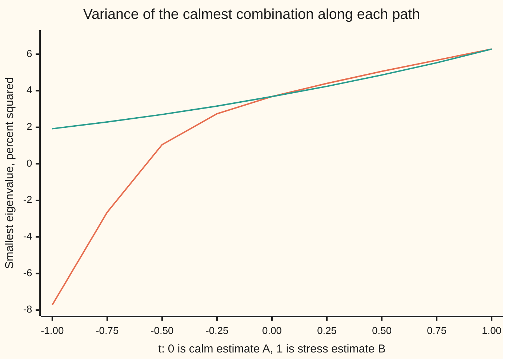

# Covariance matrices: a curved space you can average inside

[Syllabus](../../../SYLLABUS.md) → [Differential geometry and Lie groups](../README.md) → [Geometric Analysis and Physics](../README.md#s07) → Covariance matrices

---

## General Overview

A pension fund holds stocks and bonds. Its risk team has two estimates of how the two assets move, both built from monthly returns in percent.

- **Calm estimate A**, from quiet years: stocks swing 4.00% a month, bonds 2.00%, correlation 0.2500.
- **Stress estimate B**, from a crisis when both fell together: stocks 6.00%, bonds 3.00%, correlation 0.5000.

Each estimate is a **covariance matrix**: a square table with each asset's variance (its swing squared) on the diagonal and their covariance (correlation times both swings) off it, in percent squared. Written row by row, A is `[[16, 2], [2, 4]]` and B is `[[36, 9], [9, 9]]`. The team wants one matrix halfway between the two, to plan with.

Averaging entry by entry gives `[[26, 5.5], [5.5, 6.5]]`. That treats risk as something that adds. But risk grows by ratios. The stock variance went from 16 to 36. Halfway on a ratio scale is 24, because 16 times 1.5 is 24 and 24 times 1.5 is 36. The entry-by-entry average says 26.

The set of all covariance matrices is a curved space in which distance counts these ratios. Two rulers measure it, and each has its own halfway point:

- the **log-Euclidean** ruler averages the matrices' logarithms: `[[23.8785, 4.5406], [4.5406, 5.9201]]`;
- the **affine-invariant** ruler measures every change in the units of the matrix it starts from: `[[23.7801, 4.5416], [4.5416, 5.9450]]`.

Unlike the entry-by-entry average, both give one answer whether the team stores the matrices or their inverses, and neither produces a negative variance when pushed past the data.

**Covariance matrices form a curved space in which distance counts how many times each portfolio's risk grows; the average of two risk estimates is the halfway point of the shortest path under one of two rulers: average the matrix logarithms (log-Euclidean), or first rescale one estimate into the other's units (affine-invariant).**

**What kind of fact this is:** two definitions (the two distances and their halfway points) and theorems about them: the distance formula, the shortest path, its midpoint and its two-by-two closed form are proved in Why it works. That the affine-invariant space is curved but never positively curved is a theorem stated, not proved here, with its source. Choosing either average for a risk model is a modelling decision, not a law.

### The picture: run the trend past the data

Put A at time t = 0 and B at t = 1. Values of t below zero run the trend backwards past A: a forecast that risk keeps falling at the pace it rose. The chart follows the **smallest eigenvalue** of each matrix: the variance of the calmest combination of the two assets, with weights whose squares add to 1 (from [Quadratic forms](../../03-Algebra/07-Eigenvalues%20and%20Symmetric%20Matrices/05-quadratic-forms-and-positive-definite.md)). A real covariance matrix keeps it above zero.



Orange is the straight line between the two tables of entries. Green is the affine-invariant shortest path, called the **geodesic**. Both start at 3.68 and end at 6.28. Run backwards, the straight line crosses zero between t = −0.75 and t = −0.50 and reaches −7.72 at t = −1: a portfolio with negative risk, which cannot exist. The geodesic slows as it nears zero and is still at 1.92. Between 0 and 1 the two paths differ only a little; outside they part completely.

---

## The formula

One new piece of notation. $`\mathrm{SPD}(n)`$ is the set of symmetric positive definite $`n \times n`$ matrices: every covariance matrix of $`n`$ assets in which no mix is riskless. For two assets a point is three numbers: two variances, both positive, and a covariance whose square is less than their product. That set is a solid cone in three-dimensional space.

A function of a symmetric matrix, such as $`\log\Sigma`$, $`\Sigma^{1/2}`$ or $`\Sigma^t`$, acts on the eigenvalues and keeps the eigenvectors, as [The spectral theorem](../../03-Algebra/07-Eigenvalues%20and%20Symmetric%20Matrices/04-spectral-theorem.md) allows. So $`\log\Sigma`$ is the matrix with the same axes as $`\Sigma`$ and the natural logs of its stretch factors.

The affine-invariant ruler measures a small change $`d\Sigma`$ at the point $`\Sigma`$ as a fraction of $`\Sigma`$ itself. This is a [Riemannian metric](../05-Riemannian%20Geometry/01-riemannian-metrics.md), a rule for lengths at every point, where $`\mathrm{tr}`$ is the trace, the sum of the diagonal:

```math
ds^2 = \mathrm{tr}\big((\Sigma^{-1}\, d\Sigma)^2\big)
```

Adding it up along the shortest path gives the distance, and the path's midpoint is the average:

```math
d_{AI}(A,B) = \sqrt{(\ln\lambda_1)^2 + \dots + (\ln\lambda_n)^2}, \qquad \lambda_i = \text{eigenvalues of } A^{-1}B
```

```math
\gamma(t) = A^{1/2}\,\big(A^{-1/2}\,B\,A^{-1/2}\big)^{t}\,A^{1/2}, \qquad M_{AI} = \gamma(\tfrac12)
```

The log-Euclidean ruler flattens the space first, with the matrix logarithm, and measures there with the Frobenius size $`\lVert X\rVert_F`$, the square root of the sum of a matrix's squared entries:

```math
d_{LE}(A,B) = \lVert \log A - \log B \rVert_F, \qquad M_{LE} = \exp\big(\tfrac12(\log A + \log B)\big)
```

**Read it aloud:** the distance between two risk estimates is the size of the log of their ratio, and their average is the point halfway along the shortest path under each ruler: rescale A to the identity for the affine-invariant one, or average the logarithms for the log-Euclidean one.

| Symbol | Plain meaning | In our example | Push it up and the answer… |
| --- | --- | --- | --- |
| $`n`$ | number of assets | 2 | the space has $`n(n+1)/2`$ dimensions: 3 here |
| $`\mathrm{SPD}(n)`$ | the space of all covariance matrices with no riskless mix | a solid cone | |
| $`\Sigma`$, $`d\Sigma`$, $`ds`$ | any covariance matrix, a small change to it, and that change's length | | a bigger $`\Sigma`$ makes the same $`d\Sigma`$ count for less |
| $`A`$, $`B`$, $`C`$ | the calm, stress and hedging estimates ($`C`$, from a decade when bonds hedged stocks, appears in Step 6) | `[[16, 2], [2, 4]]`, `[[36, 9], [9, 9]]`, `[[9, -3], [-3, 9]]` | |
| $`w`$, $`W`$ | the weights of one mix, and a matrix whose rows are mixes (not the shape operator $`W`$ of shelf 02); $`w^T\Sigma w`$ is a mix's variance and $`W\Sigma W^T`$ the re-mixed matrix | | |
| $`\lambda_i`$ | eigenvalues of $`A^{-1}B`$: the largest and smallest risk ratio of B to A over all mixes | 2.700000, 1.500000 | further from 1 means a longer distance |
| $`\mathrm{tr}`$, $`\det`$, $`\lVert X\rVert_F`$, $`I`$, $`X^T`$ | trace (sum of the diagonal); determinant; size of a matrix $`X`$ (square root of the sum of squared entries); identity matrix; transpose (rows turned into columns) | | |
| $`\log`$, $`\exp`$, $`X^{1/2}`$, $`X^t`$, $`\ln`$ | matrix functions of a symmetric $`X`$: act on the eigenvalues, keep the eigenvectors; $`\ln`$ is the natural log of a single number | | |
| $`d_{AI}`$, $`d_{LE}`$ | affine-invariant and log-Euclidean distances | 1.072824, 1.062030 | |
| $`\gamma(t)`$, $`t`$ | the geodesic from A ($`t = 0`$) to B ($`t = 1`$) | $`t = \tfrac12`$ for the average | $`t`$ past 1 or below 0 extrapolates |
| $`M_{AI}`$, $`M_{LE}`$ | the two averages | `[[23.7801, 4.5416], [4.5416, 5.9450]]`, `[[23.8785, 4.5406], [4.5406, 5.9201]]` | |
| $`S`$ | helper in the two-by-two closed form (Step 4); not the scalar curvature $`S`$ of shelf 05 | `[[4.3750, 0.8355], [0.8355, 1.0937]]` | |

### When it holds

- **Both estimates are positive definite.** With more assets than months of data, some mix looks riskless, an eigenvalue is 0 and its log is minus infinity. The distance is then infinite; shrink the estimate towards a diagonal one first.
- **The estimates are views to blend, not samples to pool.** If A and B come from equal-sized samples of the same market, pooling the data gives the entry-by-entry average, and that is right. The curved averages are for combining models.
- **The log-Euclidean ruler needs fixed units.** Quote bonds in basis points instead of percent and its stock variance moves from 23.8785 to 23.5317. The affine-invariant one stays at 23.7801.
- **Equal trust in both.** Halfway assumes it. To give B a weight of one quarter and A three quarters, take $`\gamma(\tfrac14)`$ instead.
- **Two estimates.** For three or more, the log-Euclidean average is still one formula; the affine-invariant one needs an iteration ([Frechet mean](08-frechet-means-and-statistics-on-curved-data.md)).

---

## Why it works

### Step 0: risk changes by ratios

Take the stocks alone. Their variance grew 2.25 times, from 16 to 36. A move from 116 to 136 would be growth of under a fifth. Treating both as "plus 20" ignores how risk behaves: it multiplies.

So measure the distance between variances by the log of their ratio: $`|\ln(36/16)| = 0.810930`$. The halfway point is then 24, which is 1.5 times 16 and 36 divided by 1.5. On this ruler a variance of zero is infinitely far away, so no finite step reaches it. That is why the geodesic in the picture never went negative.

The metric $`ds^2 = (d\sigma^2/\sigma^2)^2`$ for one variance $`\sigma^2`$ is exactly this ruler in small steps. The matrix metric $`\mathrm{tr}((\Sigma^{-1}d\Sigma)^2)`$ is the same idea for a whole table.

### Step 1: for a table, the ratio is a matrix

With two assets there is no single ratio. Each mix $`w`$ has its own: B's variance for that mix over A's, $`w^T B w / w^T A w`$. The largest and smallest of these are the eigenvalues of $`A^{-1}B`$.

The reason: write $`w = A^{-1/2}v`$. The ratio becomes $`v^T (A^{-1/2} B A^{-1/2}) v / v^T v`$, whose largest and smallest values are that matrix's eigenvalues ([Quadratic forms](../../03-Algebra/07-Eigenvalues%20and%20Symmetric%20Matrices/05-quadratic-forms-and-positive-definite.md)). It has the same eigenvalues as $`A^{-1}B`$, because it equals $`A^{1/2}\,(A^{-1}B)\,A^{-1/2}`$, and a matrix sandwiched between another matrix and its inverse keeps its eigenvalues.

Here $`A^{-1}B`$ has trace 4.2 and determinant 4.05, so its eigenvalues are 2.7 and 1.5. Under the stress estimate some mix is 2.7 times as risky as under the calm one, and every mix is at least 1.5 times as risky.

### Step 2: rescale into A's units

Re-express the two assets as new mixes, with a matrix $`W`$ whose rows are the weights. A covariance matrix then becomes $`W\Sigma W^T`$. Changing units is the case of a diagonal $`W`$.

The metric does not notice. With $`\Sigma' = W\Sigma W^T`$ and $`d\Sigma' = W\,d\Sigma\,W^T`$, the product $`\Sigma'^{-1}d\Sigma'`$ is $`W^{-T}\,\Sigma^{-1}d\Sigma\,W^T`$. A matrix and its rescaled copy have the same trace of the square. So every length, distance and midpoint is the same in any units. This is what "affine-invariant" means.

Use that freedom: take $`W = A^{-1/2}`$. It sends A to the identity matrix $`I`$ and B to $`A^{-1/2}BA^{-1/2}`$. One more rotation makes the second one diagonal, `[[2.7, 0], [0, 1.5]]`, without moving $`I`$.

### Step 3: from the identity, the shortest path is a straight line in logs

On diagonal matrices $`\mathrm{diag}(e^x, e^y)`$ the metric is $`dx^2 + dy^2`$, two copies of Step 0's ratio ruler. That is a flat plane in the coordinates $`(x, y)`$. The straight line from $`(0, 0)`$ to $`(\ln 2.7, \ln 1.5)`$ has length

```math
\sqrt{0.993252^2 + 0.405465^2} = 1.072824
```

and it is the path $`\mathrm{diag}(2.7^t, 1.5^t)`$. No path through non-diagonal matrices is shorter; the fold proves it. Undo the rotation and the rescaling of Step 2 and this path becomes $`\gamma(t)`$ of the formula. So the formula for $`d_{AI}`$ holds for any two estimates.

<details>
<summary>Detailed proof: no path is shorter, and the log-Euclidean distance never exceeds the affine-invariant one</summary>

Take any path $`\Sigma(s)`$ from $`I`$ to $`P`$. At each moment, work in the eigenvector axes of $`\Sigma(s)`$, where it is $`\mathrm{diag}(\sigma_1, \sigma_2)`$. Write $`H`$ for the rate of change $`\Sigma'(s)`$ in those axes.

The affine-invariant speed squared is the sum over entries of $`H_{ij}^2/(\sigma_i\sigma_j)`$, because

$`\displaystyle \mathrm{tr}\big((\Sigma^{-1}H)^2\big) = \sum_{i,j} \frac{H_{ij}^2}{\sigma_i\,\sigma_j}.`$

The rate of change of $`\log\Sigma(s)`$ has entries $`H_{ij}\,(\ln\sigma_i - \ln\sigma_j)/(\sigma_i - \sigma_j)`$, and $`H_{ii}/\sigma_i`$ on the diagonal. This is the derivative of a matrix function in its own eigenvector axes.

The logarithmic mean of two positive numbers is at least their geometric mean:

$`\displaystyle \frac{\sigma_i - \sigma_j}{\ln\sigma_i - \ln\sigma_j} \ge \sqrt{\sigma_i\,\sigma_j}.`$

So each entry of the log's rate of change is at most the matching entry of the affine-invariant one. The log path is never faster than the affine-invariant path. Integrating, the affine-invariant length of any path from $`I`$ to $`P`$ is at least the flat length of its log path, which is at least the straight-line distance $`\lVert \log P \rVert_F`$.

On the diagonal path of Step 3, the matrices share axes, the off-diagonal $`H_{ij}`$ are zero and equality holds. So that path is shortest.

The same inequality, for a path from A to B, gives $`d_{AI}(A,B) \ge \lVert \log A - \log B\rVert_F = d_{LE}(A,B)`$: here 1.072824 against 1.062030.

</details>

### Step 4: the midpoint, and a two-by-two shortcut

The average is $`M_{AI} = \gamma(\tfrac12)`$. Three facts pin it down.

- It is equally far from both: $`d_{AI}(A, M_{AI}) = d_{AI}(M_{AI}, B) = 0.536412`$, half of 1.072824.
- Compared with A, its risk ratios are the square roots of B's: 1.643168 and 1.224745, the square roots of 2.7 and 1.5.
- It solves $`M A^{-1} M = B`$: multiplying by A's inverse in the middle undoes one half-step.

For two assets there is a closed form that needs no eigenvectors. Scale each estimate to determinant 1, add, and scale back:

```math
M_{AI} = \sqrt{\frac{\sqrt{\det A}\,\sqrt{\det B}}{\det S}}\; S, \qquad S = \frac{A}{\sqrt{\det A}} + \frac{B}{\sqrt{\det B}}
```

<details>
<summary>Detailed proof of the two-by-two closed form</summary>

Let $`X`$ be a symmetric positive definite 2 × 2 matrix with determinant 1. Every 2 × 2 matrix satisfies its own characteristic equation, $`X^2 - \mathrm{tr}(X)\,X + I = 0`$ when $`\det X = 1`$. Rearranged,

$`\displaystyle (X + I)^2 = (\mathrm{tr}\,X + 2)\,X, \qquad \text{so} \qquad X^{1/2} = \frac{X + I}{\sqrt{\mathrm{tr}\,X + 2}}.`$

Also $`\det(X + I) = \det X + \mathrm{tr}\,X + 1 = \mathrm{tr}\,X + 2`$.

Now let $`P`$ and $`Q`$ have determinant 1 and put $`X = P^{-1/2}QP^{-1/2}`$, which also has determinant 1. Then

$`\displaystyle P^{1/2} X^{1/2} P^{1/2} = \frac{P^{1/2}(X + I)P^{1/2}}{\sqrt{\det(X + I)}} = \frac{Q + P}{\sqrt{\det(P + Q)}},`$

using $`\det P = 1`$ in the denominator. For general A and B, put $`P = A/\sqrt{\det A}`$ and $`Q = B/\sqrt{\det B}`$. The midpoint scales by the square root of the two scale factors, $`\sqrt{\sqrt{\det A}\sqrt{\det B}}`$, which gives the formula.

</details>

### Step 5: the log-Euclidean shortcut

The matrix logarithm turns $`\mathrm{SPD}(n)`$ into the set of all symmetric matrices, one to one. That set is flat: for two assets it is ordinary three-dimensional space. The log-Euclidean ruler treats this flat picture as the truth. It averages there and maps back with $`\exp`$.

When A and B commute (share eigenvectors), Step 3's diagonal path lies in such a flat, and the two rulers agree exactly. Here they do not commute, and the averages differ in the third digit: stock variance 23.8785 against 23.7801.

What the log-Euclidean ruler keeps:

- inverses: $`\log(\Sigma^{-1}) = -\log\Sigma`$, so averaging inverses and inverting gives the same average;
- the determinant: both averages have determinant $`\sqrt{60 \times 243} = 120.747671`$;
- rotations, and rescaling every asset by the same factor.

It loses a change of units for one asset alone. In exchange it is cheap: one eigen-decomposition per matrix, and one formula for any number of estimates.

### Step 6: the space is curved, never positively

Draw a triangle between A, B and a third estimate C, from a decade when bonds hedged stocks: both assets 3.00% a month, correlation −0.3333. Measure the three corner angles between geodesics. At a corner P, the direction to Q is $`\log(P^{-1/2}QP^{-1/2})`$, and the angle between two directions $`X`$ and $`Y`$ has cosine $`\mathrm{tr}(XY)/(\lVert X\rVert_F\lVert Y\rVert_F)`$.

The affine-invariant angles add to 178.5615°, short of 180°. The log-Euclidean angles add to 180.0000°, as in any flat space. A triangle whose angles add to less than 180° is the mark of negative curvature, the saddle shape of the hyperbolic plane ([Sphere, plane and hyperbolic space](../05-Riemannian%20Geometry/05-model-spaces-of-constant-curvature.md)).

**Theorem, stated, not proved here.** With the affine-invariant metric, $`\mathrm{SPD}(n)`$ is complete and its curvature is never positive (Bhatia, chapter 6). It is also one piece with no holes (simply connected), because the matrix log of Step 5 maps it smoothly and one to one onto the flat set of symmetric matrices. From these three facts, two consequences matter for averaging, both global:

- any two estimates are joined by exactly one geodesic, so the halfway point is unique;
- any set of estimates has exactly one average, the [Frechet mean](08-frechet-means-and-statistics-on-curved-data.md).

---

## Worked numbers, by hand

The affine-invariant distance and average, from A and B alone.

| Step | Arithmetic | Value |
| --- | --- | --- |
| 1. Trace and determinant of $`A^{-1}B`$ | $`\mathrm{tr} = 4.2`$; $`\det = 243/60`$ | 4.200000, 4.050000 |
| 2. Its eigenvalues | roots of $`\lambda^2 - 4.2\lambda + 4.05 = 0`$: $`(4.2 \pm 1.2)/2`$ | 2.700000 and 1.500000 |
| 3. Logs | $`\ln 2.7`$, $`\ln 1.5`$ | 0.993252, 0.405465 |
| 4. Distance $`d_{AI}`$ | $`\sqrt{0.993252^2 + 0.405465^2}`$ | 1.072824 |
| 5. Square roots of the determinants | $`\sqrt{60}`$, $`\sqrt{243}`$ | 7.745967, 15.588457 |
| 6. $`S`$ | $`A/7.745967 + B/15.588457`$ | `[[4.3750, 0.8355], [0.8355, 1.0937]]` |
| 7. $`\det S`$ | $`4.3750 \times 1.0937 - 0.8355^2`$ | 4.086997 |
| 8. Scale | $`\sqrt{7.745967 \times 15.588457 / 4.086997}`$ | 5.435472 |
| **9. Average $`M_{AI}`$** | $`5.435472 \times S`$ | **`[[23.7801, 4.5416], [4.5416, 5.9450]]`** |

The log-Euclidean average, by eigenvalues.

| Step | Arithmetic | Value |
| --- | --- | --- |
| 1. Eigenvalues of A and B | $`10 \pm \sqrt{36 + 4}`$; $`22.5 \pm \sqrt{182.25 + 81}`$ | 16.324555, 3.675445; 38.724981, 6.275019 |
| 2. $`\log A`$ | natural logs of A's eigenvalues, A's axes | `[[2.7544, 0.2357], [0.2357, 1.3399]]` |
| 3. $`\log B`$ | the same for B | `[[3.5037, 0.5048], [0.5048, 1.9894]]` |
| 4. Average of logs | entry by entry | `[[3.1290, 0.3702], [0.3702, 1.6647]]` |
| 5. Distance $`d_{LE}`$ | $`\lVert \log A - \log B\rVert_F`$ | 1.062030 |
| **6. Average $`M_{LE}`$** | $`\exp`$ of step 4 | **`[[23.8785, 4.5406], [4.5406, 5.9201]]`** |

The blended estimate puts stock variance at 23.7801 and correlation at 0.381966, close to the 24 that the ratio scale gave for stocks alone. Its determinant, the "generalised variance", is 120.747671, exactly $`\sqrt{\det A \det B}`$, for both averages.

### What breaks if you drop a piece

| Mistake | Comes out at | What went wrong |
| --- | --- | --- |
| Average entry by entry | determinant 138.750000, 1.1491 times the curved averages' 120.747671; correlation 0.423077 | Adds risks instead of multiplying them. The blend claims more joint risk than the ratio scale supports. |
| Average the inverse matrices, then invert | stock variance 21.7946, correlation 0.339286, against 26.0000 and 0.423077 entry by entry | Entry-by-entry averaging gives a different answer for covariances and their inverses. Both curved averages give the same answer either way. |
| Log-Euclidean, bonds quoted in basis points | stock variance 23.5317, was 23.8785; distance 1.003163, was 1.062030 | Flattening with the log depends on the units. The affine-invariant average stays at 23.7801 and its distance at 1.072824. |
| Extrapolate in a straight line to t = −1 | `[[-4.0000, -5.0000], [-5.0000, -1.0000]]`: stock variance −4 | The straight line leaves the cone of real covariance matrices. The geodesic gives $`AB^{-1}A`$ = `[[7.7037, -0.1481], [-0.1481, 1.9259]]`, still positive definite. |

---

## Code, from first principles, and it actually runs

The script finds both averages and both distances with its own two-by-two matrix tools and no imports beyond `math`. Each result has independent roads.

- **The risk ratios:** from the characteristic quadratic of $`A^{-1}B`$, and by scanning 20,000 mixes for the largest and smallest ratio.
- **The affine-invariant distance:** from those ratios, and by adding up the metric along the geodesic in 10 and then 100 steps.
- **The affine-invariant average:** through eigenvectors, through the two-by-two closed form, and through Denman–Beavers square roots, an iteration that needs no eigenvectors; then the equation $`MA^{-1}M = B`$.
- **The log-Euclidean average:** through eigenvectors, and through a series logarithm (repeated square roots, then a power series) and a series exponential.

It also asserts the invariance claims, the last two rows of What breaks and the triangle, and prints the first two rows, the chart points and the answers of the Try changing box.

### Python

```python
# Covariance matrices: blend two risk estimates by the log-Euclidean and affine-invariant means.
import math
def mul(X, Y): return (X[0]*Y[0] + X[1]*Y[2], X[0]*Y[1] + X[1]*Y[3], X[2]*Y[0] + X[3]*Y[2], X[2]*Y[1] + X[3]*Y[3])
def lin(X, Y, s, t): return tuple(s*x + t*y for x, y in zip(X, Y))
def det(X): return X[0]*X[3] - X[1]*X[2]
def tr(X): return X[0] + X[3]
def inv(X): d = det(X); return (X[3]/d, -X[1]/d, -X[2]/d, X[0]/d)
def fro(X): return math.sqrt(sum(x*x for x in X))
def corr(M): return M[1] / math.sqrt(M[0]*M[3])
def gap(X, Y): return max(abs(x - y) for x, y in zip(X, Y))
def yn(ok): return "yes" if ok else "no"
I = (1.0, 0.0, 0.0, 1.0)
def eig(M):  # road 1: closed-form eigenvalues of a symmetric 2x2 matrix, smallest first
    m, r = (M[0] + M[3]) / 2, math.hypot((M[0] - M[3]) / 2, (M[1] + M[2]) / 2); return m - r, m + r
def fun(M, f):  # road 1: f applied along the eigenvectors (rotation angle th)
    th = 0.5 * math.atan2(M[1] + M[2], M[0] - M[3]); c, s = math.cos(th), math.sin(th)
    lo, hi = eig(M); f1, f2 = f(hi), f(lo)
    return (f1*c*c + f2*s*s, (f1 - f2)*c*s, (f1 - f2)*c*s, f1*s*s + f2*c*c)
def sqrt_db(M):  # Denman-Beavers square root, no eigenvectors: road 3 of the mean, inside road 2's log
    Y, Z = M, I
    for _ in range(60): Y, Z = lin(Y, inv(Z), 0.5, 0.5), lin(Z, inv(Y), 0.5, 0.5)
    return Y
def log_ser(M):  # road 2: take square roots until near I, then the artanh series
    k = 0
    while fro(lin(M, I, 1, -1)) > 0.05: M, k = sqrt_db(M), k + 1
    U = mul(lin(M, I, 1, -1), inv(lin(M, I, 1, 1))); U2, P, S = mul(U, U), U, (0.0,)*4
    for j in range(30): S, P = lin(S, P, 1, 2 / (2*j + 1)), mul(P, U2)
    return lin(S, S, 2**k, 0)
def exp_ser(X):  # road 2: Taylor series on X/1024, then square ten times
    Y, P, S = lin(X, X, 1/1024, 0), I, I
    for j in range(1, 20): P = lin(mul(P, Y), P, 1/j, 0); S = lin(S, P, 1, 1)
    for _ in range(10): S = mul(S, S)
    return S
def show(name, M): print(f"{name}: [[{M[0]:.4f}, {M[1]:.4f}], [{M[2]:.4f}, {M[3]:.4f}]]")
def geo(A, B, t):  # affine-invariant geodesic A^(1/2) (A^(-1/2) B A^(-1/2))^t A^(1/2)
    h, ih = fun(A, math.sqrt), fun(A, lambda x: 1 / math.sqrt(x))
    return mul(mul(h, fun(mul(mul(ih, B), ih), lambda x: x**t)), h)
def ai_log(P, Q): ih = fun(P, lambda x: 1 / math.sqrt(x)); return fun(mul(mul(ih, Q), ih), math.log)
def d_ai(P, Q): return fro(ai_log(P, Q))
def d_le(P, Q): return fro(lin(fun(P, math.log), fun(Q, math.log), 1, -1))
def mean_le(P, Q): return fun(lin(fun(P, math.log), fun(Q, math.log), 0.5, 0.5), math.exp)
A, B = (16.0, 2.0, 2.0, 4.0), (36.0, 9.0, 9.0, 9.0)   # calm and stress estimates, monthly returns in %
show("calm A", A); show("stress B", B)
for nm, M in (("A", A), ("B", B), ("C", (9.0, -3.0, -3.0, 9.0))):
    print(f"{nm}: stock volatility {math.sqrt(M[0]):.2f}%, bond volatility {math.sqrt(M[3]):.2f}%, correlation {corr(M):.4f}")
print(f"one asset: growth {36/16:.2f}, arithmetic {(16+36)/2:.6f}, geometric {math.sqrt(16*36):.6f}, ratio {math.sqrt(36/16):.6f}, distance {math.log(36/16):.6f}")
AiB = mul(inv(A), B); q = math.sqrt(tr(AiB)**2 - 4*det(AiB)); l1, l2 = (tr(AiB) + q) / 2, (tr(AiB) - q) / 2
print(f"A^-1 B: trace {tr(AiB):.6f}, det {det(AiB):.6f}, eigenvalues {l1:.6f} and {l2:.6f}")
ws = [(math.cos(k*math.pi/20000), math.sin(k*math.pi/20000)) for k in range(20000)]
qf = lambda M, w: M[0]*w[0]**2 + 2*M[1]*w[0]*w[1] + M[3]*w[1]**2
rq = [qf(B, w) / qf(A, w) for w in ws]   # road 2: scan every mix for its risk ratio
print(f"scan of mixes: largest risk ratio {max(rq):.6f}, smallest {min(rq):.6f}")
assert abs(max(rq) - l1) < 1e-6 and abs(min(rq) - l2) < 1e-6
dai = math.sqrt(math.log(l1)**2 + math.log(l2)**2)
print(f"ln {l1:.1f} = {math.log(l1):.6f}, ln {l2:.1f} = {math.log(l2):.6f}, affine-invariant distance {dai:.6f}")
assert abs(dai - d_ai(A, B)) < 1e-12
G1 = geo(A, B, 0.5)
al, be = math.sqrt(det(A)), math.sqrt(det(B)); S = lin(A, B, 1/al, 1/be)
print(f"closed form: sqrt det A {al:.6f}, sqrt det B {be:.6f}, det S {det(S):.6f}, scale {math.sqrt(al*be / det(S)):.6f}")
show("S = A/sqrt det A + B/sqrt det B", S)
G2 = lin(S, S, math.sqrt(al*be / det(S)), 0)                                  # road 2: 2x2 closed form
h = sqrt_db(A); ih = inv(h); G3 = mul(mul(h, sqrt_db(mul(mul(ih, B), ih))), h)  # road 3: Denman-Beavers
show("affine-invariant mean", G1)
print(f"closed form and Denman-Beavers roads agree within 1e-9: {yn(gap(G1, G2) < 1e-9 and gap(G1, G3) < 1e-9)}")
assert gap(G1, G2) < 1e-9 and gap(G1, G3) < 1e-9
print(f"G A^-1 G = B within 1e-9: {yn(gap(mul(mul(G1, inv(A)), G1), B) < 1e-9)}")
assert gap(mul(mul(G1, inv(A)), G1), B) < 1e-9
D = mul(inv(A), G1); qd = math.sqrt(tr(D)**2 - 4*det(D))
print(f"ratios of G to A: {(tr(D) + qd)/2:.6f} and {(tr(D) - qd)/2:.6f}, square roots of {l1:.1f} and {l2:.1f}")
assert abs((tr(D) + qd)/2 - math.sqrt(l1)) < 1e-9 and abs((tr(D) - qd)/2 - math.sqrt(l2)) < 1e-9
print(f"d(A, G) {d_ai(A, G1):.6f}, d(G, B) {d_ai(G1, B):.6f}, half of d(A, B) {dai/2:.6f}")
assert abs(d_ai(A, G1) - dai/2) < 1e-9 and abs(d_ai(G1, B) - dai/2) < 1e-9
def length(path, n):  # road 2: add up sqrt(tr((P^-1 dP)^2)) over n small steps
    tot = 0.0
    for k in range(n):
        P0, P1 = path(k / n), path((k + 1) / n); dP = lin(P1, P0, 1, -1); X = mul(inv(lin(P0, P1, 0.5, 0.5)), dP)
        tot += math.sqrt(tr(mul(X, X)))
    return tot
for n in (10, 100):
    print(f"length by {n} steps: geodesic {length(lambda t: geo(A, B, t), n):.6f}, straight line {length(lambda t: lin(A, B, 1 - t, t), n):.6f}")
assert abs(length(lambda t: geo(A, B, t), 100) - dai) < 1e-4 and length(lambda t: lin(A, B, 1 - t, t), 100) > dai + 0.001
lA, lB = fun(A, math.log), fun(B, math.log)
print(f"eigenvalues: A {eig(A)[1]:.6f}, {eig(A)[0]:.6f}; B {eig(B)[1]:.6f}, {eig(B)[0]:.6f}")
show("log A", lA); show("log B", lB)
print(f"log by series agrees within 1e-9: {yn(max(gap(lA, log_ser(A)), gap(lB, log_ser(B))) < 1e-9)}")
assert gap(lA, log_ser(A)) < 1e-9 and gap(lB, log_ser(B)) < 1e-9
dle = fro(lin(lA, lB, 1, -1)); L1 = mean_le(A, B); L2 = exp_ser(lin(log_ser(A), log_ser(B), 0.5, 0.5))
show("average of logs", lin(lA, lB, 0.5, 0.5)); print(f"log-Euclidean distance {dle:.6f}")
show("log-Euclidean mean", L1); print(f"series road agrees within 1e-9: {yn(gap(L1, L2) < 1e-9)}")
assert gap(L1, L2) < 1e-9
AR, HM = lin(A, B, 0.5, 0.5), inv(lin(inv(A), inv(B), 0.5, 0.5))
show("arithmetic mean", AR); show("mean of inverses, inverted", HM)
for nm, M in (("arithmetic", AR), ("inverses", HM), ("log-Euclidean", L1), ("affine-invariant", G1)):
    print(f"{nm}: det {det(M):.6f}, smallest variance {eig(M)[0]:.6f}, correlation {corr(M):.6f}")
print(f"det A {det(A):.6f}, det B {det(B):.6f}, sqrt(det A det B) {math.sqrt(det(A)*det(B)):.6f}")
print(f"arithmetic det over geometric det: {det(AR) / math.sqrt(det(A)*det(B)):.4f}")
assert abs(det(G1) - math.sqrt(det(A)*det(B))) < 1e-9 and abs(det(L1) - math.sqrt(det(A)*det(B))) < 1e-9
print(f"mean of inverses, inverted, equals the mean: affine-invariant {yn(gap(inv(geo(inv(A), inv(B), 0.5)), G1) < 1e-9)}, log-Euclidean {yn(gap(inv(mean_le(inv(A), inv(B))), L1) < 1e-9)}")
assert gap(inv(geo(inv(A), inv(B), 0.5)), G1) < 1e-9 and gap(inv(mean_le(inv(A), inv(B))), L1) < 1e-9
W = (1.0, 0.0, 0.0, 100.0); A2, B2 = mul(mul(W, A), W), mul(mul(W, B), W)   # bonds in basis points
G4, L4 = geo(A2, B2, 0.5), mean_le(A2, B2)
print(f"bonds in basis points: affine-invariant distance {d_ai(A2, B2):.6f}, log-Euclidean distance {d_le(A2, B2):.6f}")
print(f"stock variance of mean: affine-invariant {G4[0]:.4f} (was {G1[0]:.4f}), log-Euclidean {L4[0]:.4f} (was {L1[0]:.4f})")
print(f"correlation of mean: affine-invariant {corr(G4):.6f}, log-Euclidean {corr(L4):.6f}")
assert abs(d_ai(A2, B2) - dai) < 1e-9 and gap(G4, mul(mul(W, G1), W)) < 1e-6 and abs(L4[0] - L1[0]) > 0.3
E1, E2 = lin(A, B, 2, -1), geo(A, B, -1)
show("straight line at t = -1", E1); show("geodesic at t = -1", E2); show("A B^-1 A", mul(mul(A, inv(B)), A))
assert gap(E2, mul(mul(A, inv(B)), A)) < 1e-9 and E1[0] < 0 and eig(E2)[0] > 0
ts = [k / 4 - 1 for k in range(9)]
print("chart t: " + ", ".join(f"{t:.2f}" for t in ts))
print("chart straight: " + ", ".join(f"{eig(lin(A, B, 1 - t, t))[0]:.2f}" for t in ts))
print("chart geodesic: " + ", ".join(f"{eig(geo(A, B, t))[0]:.2f}" for t in ts))
Cm = (9.0, -3.0, -3.0, 9.0)   # third estimate, from a decade when bonds hedged stocks
show("third estimate C", Cm)
def ang(X, Y): return math.degrees(math.acos(tr(mul(X, Y)) / (fro(X) * fro(Y))))
tri = [(A, B, Cm), (B, Cm, A), (Cm, A, B)]
sai = sum(ang(ai_log(P, Q), ai_log(P, R)) for P, Q, R in tri)
lg = lambda P, Q: lin(fun(Q, math.log), fun(P, math.log), 1, -1)
sle = sum(ang(lg(P, Q), lg(P, R)) for P, Q, R in tri)
print(f"triangle A, B, C angle sum: affine-invariant {sai:.4f} deg, log-Euclidean {sle:.4f} deg")
assert sai < 179 and abs(sle - 180) < 1e-9
# try changing: the box's four answers, computed without editing the settings above
F, W10, Bn = (16.0, 0.0, 0.0, 4.0), (1.0, 0.0, 0.0, 10.0), (20.0, 3.0, 3.0, 5.0); Rn = mul(inv(A), Bn); qn = math.sqrt(tr(Rn)**2 - 4*det(Rn))
sflat = sum(ang(ai_log(P, Q), ai_log(P, R)) for P, Q, R in [(A, B, F), (B, F, A), (F, A, B)])
dn = length(lambda t: lin(A, Bn, 1 - t, t), 100) - length(lambda t: geo(A, Bn, t), 100)
print(f"try: bonds in tenths of a percent, log-Euclidean stock variance {mean_le(mul(mul(W10, A), W10), mul(mul(W10, B), W10))[0]:.4f}; flat triangle C = (16, 0, 0, 4), affine-invariant angle sum {sflat:.4f} deg")
print(f"try: B = (20, 3, 3, 5): risk ratios {(tr(Rn) + qn) / 2:.6f} and {(tr(Rn) - qn) / 2:.6f}, distance {d_ai(A, Bn):.6f}, straight line longer by {dn:.6f} at 100 steps")
show("try: weight one quarter, geodesic at t = 0.25", geo(A, B, 0.25))
print("ALL CHECKS PASS")
```

**Ran 2026-11-19 on macOS, Python 3.14.10, standard library only. All checks passed. Output, pasted from the run:**

```
calm A: [[16.0000, 2.0000], [2.0000, 4.0000]]
stress B: [[36.0000, 9.0000], [9.0000, 9.0000]]
A: stock volatility 4.00%, bond volatility 2.00%, correlation 0.2500
B: stock volatility 6.00%, bond volatility 3.00%, correlation 0.5000
C: stock volatility 3.00%, bond volatility 3.00%, correlation -0.3333
one asset: growth 2.25, arithmetic 26.000000, geometric 24.000000, ratio 1.500000, distance 0.810930
A^-1 B: trace 4.200000, det 4.050000, eigenvalues 2.700000 and 1.500000
scan of mixes: largest risk ratio 2.700000, smallest 1.500000
ln 2.7 = 0.993252, ln 1.5 = 0.405465, affine-invariant distance 1.072824
closed form: sqrt det A 7.745967, sqrt det B 15.588457, det S 4.086997, scale 5.435472
S = A/sqrt det A + B/sqrt det B: [[4.3750, 0.8355], [0.8355, 1.0937]]
affine-invariant mean: [[23.7801, 4.5416], [4.5416, 5.9450]]
closed form and Denman-Beavers roads agree within 1e-9: yes
G A^-1 G = B within 1e-9: yes
ratios of G to A: 1.643168 and 1.224745, square roots of 2.7 and 1.5
d(A, G) 0.536412, d(G, B) 0.536412, half of d(A, B) 0.536412
length by 10 steps: geodesic 1.072048, straight line 1.073655
length by 100 steps: geodesic 1.072816, straight line 1.074656
eigenvalues: A 16.324555, 3.675445; B 38.724981, 6.275019
log A: [[2.7544, 0.2357], [0.2357, 1.3399]]
log B: [[3.5037, 0.5048], [0.5048, 1.9894]]
log by series agrees within 1e-9: yes
average of logs: [[3.1290, 0.3702], [0.3702, 1.6647]]
log-Euclidean distance 1.062030
log-Euclidean mean: [[23.8785, 4.5406], [4.5406, 5.9201]]
series road agrees within 1e-9: yes
arithmetic mean: [[26.0000, 5.5000], [5.5000, 6.5000]]
mean of inverses, inverted: [[21.7946, 3.6973], [3.6973, 5.4486]]
arithmetic: det 138.750000, smallest variance 5.055693, correlation 0.423077
inverses: det 105.081081, smallest variance 4.651254, correlation 0.339286
log-Euclidean: det 120.747671, smallest variance 4.837396, correlation 0.381892
affine-invariant: det 120.747671, smallest variance 4.855147, correlation 0.381966
det A 60.000000, det B 243.000000, sqrt(det A det B) 120.747671
arithmetic det over geometric det: 1.1491
mean of inverses, inverted, equals the mean: affine-invariant yes, log-Euclidean yes
bonds in basis points: affine-invariant distance 1.072824, log-Euclidean distance 1.003163
stock variance of mean: affine-invariant 23.7801 (was 23.7801), log-Euclidean 23.5317 (was 23.8785)
correlation of mean: affine-invariant 0.381966, log-Euclidean 0.380460
straight line at t = -1: [[-4.0000, -5.0000], [-5.0000, -1.0000]]
geodesic at t = -1: [[7.7037, -0.1481], [-0.1481, 1.9259]]
A B^-1 A: [[7.7037, -0.1481], [-0.1481, 1.9259]]
chart t: -1.00, -0.75, -0.50, -0.25, 0.00, 0.25, 0.50, 0.75, 1.00
chart straight: -7.72, -2.65, 1.05, 2.74, 3.68, 4.40, 5.06, 5.67, 6.28
chart geodesic: 1.92, 2.29, 2.70, 3.16, 3.68, 4.24, 4.86, 5.53, 6.28
third estimate C: [[9.0000, -3.0000], [-3.0000, 9.0000]]
triangle A, B, C angle sum: affine-invariant 178.5615 deg, log-Euclidean 180.0000 deg
try: bonds in tenths of a percent, log-Euclidean stock variance 23.5934; flat triangle C = (16, 0, 0, 4), affine-invariant angle sum 180.0000 deg
try: B = (20, 3, 3, 5): risk ratios 1.300000 and 1.166667, distance 0.304298, straight line longer by 0.000028 at 100 steps
try: weight one quarter, geodesic at t = 0.25: [[19.4587, 3.0893], [3.0893, 4.8647]]
ALL CHECKS PASS
```

### Rust

```rust
// Covariance matrices: blend two risk estimates by the log-Euclidean and affine-invariant means.
type M = [f64; 4]; // a 2x2 matrix, row by row
const I: M = [1.0, 0.0, 0.0, 1.0];
fn mul(x: M, y: M) -> M {
    [x[0]*y[0] + x[1]*y[2], x[0]*y[1] + x[1]*y[3], x[2]*y[0] + x[3]*y[2], x[2]*y[1] + x[3]*y[3]]
}
fn lin(x: M, y: M, s: f64, t: f64) -> M { [s*x[0] + t*y[0], s*x[1] + t*y[1], s*x[2] + t*y[2], s*x[3] + t*y[3]] }
fn det(x: M) -> f64 { x[0]*x[3] - x[1]*x[2] }
fn tr(x: M) -> f64 { x[0] + x[3] }
fn inv(x: M) -> M { let d = det(x); [x[3]/d, -x[1]/d, -x[2]/d, x[0]/d] }
fn fro(x: M) -> f64 { x.iter().map(|v| v*v).sum::<f64>().sqrt() }
fn corr(m: M) -> f64 { m[1] / (m[0]*m[3]).sqrt() }
fn gap(x: M, y: M) -> f64 { (0..4).map(|i| (x[i] - y[i]).abs()).fold(0.0, f64::max) }
fn yn(ok: bool) -> &'static str { if ok { "yes" } else { "no" } }
// road 1: closed-form eigenvalues of a symmetric 2x2 matrix, smallest first
fn eig(m: M) -> (f64, f64) {
    let c = (m[0] + m[3]) / 2.0; let r = ((m[0] - m[3]) / 2.0).hypot((m[1] + m[2]) / 2.0); (c - r, c + r)
}
// road 1: f applied along the eigenvectors (rotation angle th)
fn fun(m: M, f: &dyn Fn(f64) -> f64) -> M {
    let th = 0.5 * (m[1] + m[2]).atan2(m[0] - m[3]); let (c, s) = (th.cos(), th.sin());
    let (lo, hi) = eig(m); let (f1, f2) = (f(hi), f(lo));
    [f1*c*c + f2*s*s, (f1 - f2)*c*s, (f1 - f2)*c*s, f1*s*s + f2*c*c]
}
// Denman-Beavers square root, no eigenvectors: road 3 of the mean, inside road 2's log
fn sqrt_db(m: M) -> M {
    let (mut y, mut z) = (m, I);
    for _ in 0..60 { let (y2, z2) = (lin(y, inv(z), 0.5, 0.5), lin(z, inv(y), 0.5, 0.5)); y = y2; z = z2; }
    y
}
// road 2: take square roots until near I, then the artanh series
fn log_ser(m: M) -> M {
    let (mut m, mut k) = (m, 0);
    while fro(lin(m, I, 1.0, -1.0)) > 0.05 { m = sqrt_db(m); k += 1; }
    let u = mul(lin(m, I, 1.0, -1.0), inv(lin(m, I, 1.0, 1.0)));
    let (u2, mut p, mut s) = (mul(u, u), u, [0.0; 4]);
    for j in 0..30 { s = lin(s, p, 1.0, 2.0 / (2 * j + 1) as f64); p = mul(p, u2); }
    lin(s, s, 2f64.powi(k), 0.0)
}
// road 2: Taylor series on X/1024, then square ten times
fn exp_ser(x: M) -> M {
    let (y, mut p, mut s) = (lin(x, x, 1.0 / 1024.0, 0.0), I, I);
    for j in 1..20 { p = lin(mul(p, y), p, 1.0 / j as f64, 0.0); s = lin(s, p, 1.0, 1.0); }
    for _ in 0..10 { s = mul(s, s); }
    s
}
fn show(name: &str, m: M) { println!("{}: [[{:.4}, {:.4}], [{:.4}, {:.4}]]", name, m[0], m[1], m[2], m[3]); }
// affine-invariant geodesic A^(1/2) (A^(-1/2) B A^(-1/2))^t A^(1/2)
fn geo(a: M, b: M, t: f64) -> M {
    let (h, ih) = (fun(a, &|x: f64| x.sqrt()), fun(a, &|x: f64| 1.0 / x.sqrt()));
    mul(mul(h, fun(mul(mul(ih, b), ih), &|x: f64| x.powf(t))), h)
}
fn ai_log(p: M, q: M) -> M { let ih = fun(p, &|x: f64| 1.0 / x.sqrt()); fun(mul(mul(ih, q), ih), &f64::ln) }
fn d_ai(p: M, q: M) -> f64 { fro(ai_log(p, q)) }
fn d_le(p: M, q: M) -> f64 { fro(lin(fun(p, &f64::ln), fun(q, &f64::ln), 1.0, -1.0)) }
fn mean_le(p: M, q: M) -> M { fun(lin(fun(p, &f64::ln), fun(q, &f64::ln), 0.5, 0.5), &f64::exp) }
// road 2: add up sqrt(tr((P^-1 dP)^2)) over n small steps
fn length(path: &dyn Fn(f64) -> M, n: usize) -> f64 {
    let mut tot = 0.0;
    for k in 0..n {
        let (p0, p1) = (path(k as f64 / n as f64), path((k + 1) as f64 / n as f64));
        let x = mul(inv(lin(p0, p1, 0.5, 0.5)), lin(p1, p0, 1.0, -1.0));
        tot += tr(mul(x, x)).sqrt();
    }
    tot
}
fn ang(x: M, y: M) -> f64 { (tr(mul(x, y)) / (fro(x) * fro(y))).acos().to_degrees() }
fn main() {
    let (a, b): (M, M) = ([16.0, 2.0, 2.0, 4.0], [36.0, 9.0, 9.0, 9.0]); // calm and stress estimates, monthly returns in %
    show("calm A", a); show("stress B", b);
    for (nm, m) in [("A", a), ("B", b), ("C", [9.0, -3.0, -3.0, 9.0])] {
        println!("{}: stock volatility {:.2}%, bond volatility {:.2}%, correlation {:.4}", nm, m[0].sqrt(), m[3].sqrt(), corr(m));
    }
    println!("one asset: growth {:.2}, arithmetic {:.6}, geometric {:.6}, ratio {:.6}, distance {:.6}", 36.0 / 16.0, (16.0 + 36.0) / 2.0, (16.0f64 * 36.0).sqrt(), (36.0f64 / 16.0).sqrt(), (36.0f64 / 16.0).ln());
    let aib = mul(inv(a), b); let q = (tr(aib).powi(2) - 4.0 * det(aib)).sqrt(); let (l1, l2) = ((tr(aib) + q) / 2.0, (tr(aib) - q) / 2.0);
    println!("A^-1 B: trace {:.6}, det {:.6}, eigenvalues {:.6} and {:.6}", tr(aib), det(aib), l1, l2);
    let qf = |m: M, w: (f64, f64)| m[0]*w.0*w.0 + 2.0*m[1]*w.0*w.1 + m[3]*w.1*w.1;
    let rq: Vec<f64> = (0..20000).map(|k| { let th = k as f64 * std::f64::consts::PI / 20000.0; let w = (th.cos(), th.sin()); qf(b, w) / qf(a, w) }).collect();
    let (mx, mn) = (rq.iter().cloned().fold(f64::MIN, f64::max), rq.iter().cloned().fold(f64::MAX, f64::min));
    println!("scan of mixes: largest risk ratio {:.6}, smallest {:.6}", mx, mn);
    assert!((mx - l1).abs() < 1e-6 && (mn - l2).abs() < 1e-6);
    let dai = (l1.ln().powi(2) + l2.ln().powi(2)).sqrt();
    println!("ln {:.1} = {:.6}, ln {:.1} = {:.6}, affine-invariant distance {:.6}", l1, l1.ln(), l2, l2.ln(), dai);
    assert!((dai - d_ai(a, b)).abs() < 1e-12);
    let g1 = geo(a, b, 0.5);
    let (al, be) = (det(a).sqrt(), det(b).sqrt()); let s = lin(a, b, 1.0 / al, 1.0 / be);
    println!("closed form: sqrt det A {:.6}, sqrt det B {:.6}, det S {:.6}, scale {:.6}", al, be, det(s), (al * be / det(s)).sqrt());
    show("S = A/sqrt det A + B/sqrt det B", s);
    let g2 = lin(s, s, (al * be / det(s)).sqrt(), 0.0); // road 2: 2x2 closed form
    let h = sqrt_db(a); let ih = inv(h); let g3 = mul(mul(h, sqrt_db(mul(mul(ih, b), ih))), h); // road 3: Denman-Beavers
    show("affine-invariant mean", g1);
    println!("closed form and Denman-Beavers roads agree within 1e-9: {}", yn(gap(g1, g2) < 1e-9 && gap(g1, g3) < 1e-9));
    assert!(gap(g1, g2) < 1e-9 && gap(g1, g3) < 1e-9);
    println!("G A^-1 G = B within 1e-9: {}", yn(gap(mul(mul(g1, inv(a)), g1), b) < 1e-9));
    assert!(gap(mul(mul(g1, inv(a)), g1), b) < 1e-9);
    let d = mul(inv(a), g1); let qd = (tr(d).powi(2) - 4.0 * det(d)).sqrt();
    println!("ratios of G to A: {:.6} and {:.6}, square roots of {:.1} and {:.1}", (tr(d) + qd) / 2.0, (tr(d) - qd) / 2.0, l1, l2);
    assert!(((tr(d) + qd) / 2.0 - l1.sqrt()).abs() < 1e-9 && ((tr(d) - qd) / 2.0 - l2.sqrt()).abs() < 1e-9);
    println!("d(A, G) {:.6}, d(G, B) {:.6}, half of d(A, B) {:.6}", d_ai(a, g1), d_ai(g1, b), dai / 2.0);
    assert!((d_ai(a, g1) - dai / 2.0).abs() < 1e-9 && (d_ai(g1, b) - dai / 2.0).abs() < 1e-9);
    let (gp, sp) = (|t: f64| geo(a, b, t), |t: f64| lin(a, b, 1.0 - t, t));
    for n in [10, 100] { println!("length by {} steps: geodesic {:.6}, straight line {:.6}", n, length(&gp, n), length(&sp, n)); }
    assert!((length(&gp, 100) - dai).abs() < 1e-4 && length(&sp, 100) > dai + 0.001);
    let (la, lb) = (fun(a, &f64::ln), fun(b, &f64::ln));
    println!("eigenvalues: A {:.6}, {:.6}; B {:.6}, {:.6}", eig(a).1, eig(a).0, eig(b).1, eig(b).0);
    show("log A", la); show("log B", lb);
    println!("log by series agrees within 1e-9: {}", yn(gap(la, log_ser(a)).max(gap(lb, log_ser(b))) < 1e-9));
    assert!(gap(la, log_ser(a)) < 1e-9 && gap(lb, log_ser(b)) < 1e-9);
    let dle = fro(lin(la, lb, 1.0, -1.0)); let le1 = mean_le(a, b); let le2 = exp_ser(lin(log_ser(a), log_ser(b), 0.5, 0.5));
    show("average of logs", lin(la, lb, 0.5, 0.5)); println!("log-Euclidean distance {:.6}", dle);
    show("log-Euclidean mean", le1); println!("series road agrees within 1e-9: {}", yn(gap(le1, le2) < 1e-9));
    assert!(gap(le1, le2) < 1e-9);
    let (ar, hm) = (lin(a, b, 0.5, 0.5), inv(lin(inv(a), inv(b), 0.5, 0.5)));
    show("arithmetic mean", ar); show("mean of inverses, inverted", hm);
    for (nm, m) in [("arithmetic", ar), ("inverses", hm), ("log-Euclidean", le1), ("affine-invariant", g1)] {
        println!("{}: det {:.6}, smallest variance {:.6}, correlation {:.6}", nm, det(m), eig(m).0, corr(m));
    }
    println!("det A {:.6}, det B {:.6}, sqrt(det A det B) {:.6}", det(a), det(b), (det(a) * det(b)).sqrt());
    println!("arithmetic det over geometric det: {:.4}", det(ar) / (det(a) * det(b)).sqrt());
    assert!((det(g1) - (det(a) * det(b)).sqrt()).abs() < 1e-9 && (det(le1) - (det(a) * det(b)).sqrt()).abs() < 1e-9);
    let (ia, il) = (gap(inv(geo(inv(a), inv(b), 0.5)), g1) < 1e-9, gap(inv(mean_le(inv(a), inv(b))), le1) < 1e-9);
    println!("mean of inverses, inverted, equals the mean: affine-invariant {}, log-Euclidean {}", yn(ia), yn(il));
    assert!(ia && il);
    let w: M = [1.0, 0.0, 0.0, 100.0]; let (a2, b2) = (mul(mul(w, a), w), mul(mul(w, b), w)); // bonds in basis points
    let (g4, l4) = (geo(a2, b2, 0.5), mean_le(a2, b2));
    println!("bonds in basis points: affine-invariant distance {:.6}, log-Euclidean distance {:.6}", d_ai(a2, b2), d_le(a2, b2));
    println!("stock variance of mean: affine-invariant {:.4} (was {:.4}), log-Euclidean {:.4} (was {:.4})", g4[0], g1[0], l4[0], le1[0]);
    println!("correlation of mean: affine-invariant {:.6}, log-Euclidean {:.6}", corr(g4), corr(l4));
    assert!((d_ai(a2, b2) - dai).abs() < 1e-9 && gap(g4, mul(mul(w, g1), w)) < 1e-6 && (l4[0] - le1[0]).abs() > 0.3);
    let (e1, e2) = (lin(a, b, 2.0, -1.0), geo(a, b, -1.0));
    show("straight line at t = -1", e1); show("geodesic at t = -1", e2); show("A B^-1 A", mul(mul(a, inv(b)), a));
    assert!(gap(e2, mul(mul(a, inv(b)), a)) < 1e-9 && e1[0] < 0.0 && eig(e2).0 > 0.0);
    let ts: Vec<f64> = (0..9).map(|k| k as f64 / 4.0 - 1.0).collect();
    let row = |f: &dyn Fn(f64) -> String| ts.iter().map(|&t| f(t)).collect::<Vec<_>>().join(", ");
    println!("chart t: {}", row(&|t| format!("{:.2}", t)));
    println!("chart straight: {}", row(&|t| format!("{:.2}", eig(lin(a, b, 1.0 - t, t)).0)));
    println!("chart geodesic: {}", row(&|t| format!("{:.2}", eig(geo(a, b, t)).0)));
    let cm: M = [9.0, -3.0, -3.0, 9.0]; // third estimate, from a decade when bonds hedged stocks
    show("third estimate C", cm);
    let tri = [(a, b, cm), (b, cm, a), (cm, a, b)];
    let sai: f64 = tri.iter().map(|&(p, q, r)| ang(ai_log(p, q), ai_log(p, r))).sum();
    let lg = |p: M, q: M| lin(fun(q, &f64::ln), fun(p, &f64::ln), 1.0, -1.0);
    let sle: f64 = tri.iter().map(|&(p, q, r)| ang(lg(p, q), lg(p, r))).sum();
    println!("triangle A, B, C angle sum: affine-invariant {:.4} deg, log-Euclidean {:.4} deg", sai, sle);
    assert!(sai < 179.0 && (sle - 180.0).abs() < 1e-9);
    // try changing: the box's four answers, computed without editing the settings above
    let (f0, w10, bn): (M, M, M) = ([16.0, 0.0, 0.0, 4.0], [1.0, 0.0, 0.0, 10.0], [20.0, 3.0, 3.0, 5.0]);
    let rn = mul(inv(a), bn); let qn = (tr(rn).powi(2) - 4.0 * det(rn)).sqrt();
    let sflat: f64 = [(a, b, f0), (b, f0, a), (f0, a, b)].iter().map(|&(p, q, r)| ang(ai_log(p, q), ai_log(p, r))).sum();
    let dn = length(&|t| lin(a, bn, 1.0 - t, t), 100) - length(&|t| geo(a, bn, t), 100);
    println!("try: bonds in tenths of a percent, log-Euclidean stock variance {:.4}; flat triangle C = (16, 0, 0, 4), affine-invariant angle sum {:.4} deg",
             mean_le(mul(mul(w10, a), w10), mul(mul(w10, b), w10))[0], sflat);
    println!("try: B = (20, 3, 3, 5): risk ratios {:.6} and {:.6}, distance {:.6}, straight line longer by {:.6} at 100 steps", (tr(rn) + qn) / 2.0, (tr(rn) - qn) / 2.0, d_ai(a, bn), dn);
    show("try: weight one quarter, geodesic at t = 0.25", geo(a, b, 0.25));
    println!("ALL CHECKS PASS");
}
```

**Ran 2026-11-19 on macOS, rustc 1.98.1, no crates. All checks passed. Output, pasted from the run:**

```
calm A: [[16.0000, 2.0000], [2.0000, 4.0000]]
stress B: [[36.0000, 9.0000], [9.0000, 9.0000]]
A: stock volatility 4.00%, bond volatility 2.00%, correlation 0.2500
B: stock volatility 6.00%, bond volatility 3.00%, correlation 0.5000
C: stock volatility 3.00%, bond volatility 3.00%, correlation -0.3333
one asset: growth 2.25, arithmetic 26.000000, geometric 24.000000, ratio 1.500000, distance 0.810930
A^-1 B: trace 4.200000, det 4.050000, eigenvalues 2.700000 and 1.500000
scan of mixes: largest risk ratio 2.700000, smallest 1.500000
ln 2.7 = 0.993252, ln 1.5 = 0.405465, affine-invariant distance 1.072824
closed form: sqrt det A 7.745967, sqrt det B 15.588457, det S 4.086997, scale 5.435472
S = A/sqrt det A + B/sqrt det B: [[4.3750, 0.8355], [0.8355, 1.0937]]
affine-invariant mean: [[23.7801, 4.5416], [4.5416, 5.9450]]
closed form and Denman-Beavers roads agree within 1e-9: yes
G A^-1 G = B within 1e-9: yes
ratios of G to A: 1.643168 and 1.224745, square roots of 2.7 and 1.5
d(A, G) 0.536412, d(G, B) 0.536412, half of d(A, B) 0.536412
length by 10 steps: geodesic 1.072048, straight line 1.073655
length by 100 steps: geodesic 1.072816, straight line 1.074656
eigenvalues: A 16.324555, 3.675445; B 38.724981, 6.275019
log A: [[2.7544, 0.2357], [0.2357, 1.3399]]
log B: [[3.5037, 0.5048], [0.5048, 1.9894]]
log by series agrees within 1e-9: yes
average of logs: [[3.1290, 0.3702], [0.3702, 1.6647]]
log-Euclidean distance 1.062030
log-Euclidean mean: [[23.8785, 4.5406], [4.5406, 5.9201]]
series road agrees within 1e-9: yes
arithmetic mean: [[26.0000, 5.5000], [5.5000, 6.5000]]
mean of inverses, inverted: [[21.7946, 3.6973], [3.6973, 5.4486]]
arithmetic: det 138.750000, smallest variance 5.055693, correlation 0.423077
inverses: det 105.081081, smallest variance 4.651254, correlation 0.339286
log-Euclidean: det 120.747671, smallest variance 4.837396, correlation 0.381892
affine-invariant: det 120.747671, smallest variance 4.855147, correlation 0.381966
det A 60.000000, det B 243.000000, sqrt(det A det B) 120.747671
arithmetic det over geometric det: 1.1491
mean of inverses, inverted, equals the mean: affine-invariant yes, log-Euclidean yes
bonds in basis points: affine-invariant distance 1.072824, log-Euclidean distance 1.003163
stock variance of mean: affine-invariant 23.7801 (was 23.7801), log-Euclidean 23.5317 (was 23.8785)
correlation of mean: affine-invariant 0.381966, log-Euclidean 0.380460
straight line at t = -1: [[-4.0000, -5.0000], [-5.0000, -1.0000]]
geodesic at t = -1: [[7.7037, -0.1481], [-0.1481, 1.9259]]
A B^-1 A: [[7.7037, -0.1481], [-0.1481, 1.9259]]
chart t: -1.00, -0.75, -0.50, -0.25, 0.00, 0.25, 0.50, 0.75, 1.00
chart straight: -7.72, -2.65, 1.05, 2.74, 3.68, 4.40, 5.06, 5.67, 6.28
chart geodesic: 1.92, 2.29, 2.70, 3.16, 3.68, 4.24, 4.86, 5.53, 6.28
third estimate C: [[9.0000, -3.0000], [-3.0000, 9.0000]]
triangle A, B, C angle sum: affine-invariant 178.5615 deg, log-Euclidean 180.0000 deg
try: bonds in tenths of a percent, log-Euclidean stock variance 23.5934; flat triangle C = (16, 0, 0, 4), affine-invariant angle sum 180.0000 deg
try: B = (20, 3, 3, 5): risk ratios 1.300000 and 1.166667, distance 0.304298, straight line longer by 0.000028 at 100 steps
try: weight one quarter, geodesic at t = 0.25: [[19.4587, 3.0893], [3.0893, 4.8647]]
ALL CHECKS PASS
```

The stepped geodesic length is approximate: 1.072048 at 10 steps and 1.072816 at 100, closing on 1.072824. The straight line is longer at both step counts: 1.073655 and 1.074656.

### Lean

Lean proves the affine-invariant average's equation, uniqueness, determinant, two-by-two closed form and invariance for any positive definite estimates, and checks the worked numbers.

- Take positive definite A and B, and $`M_{AI} = \gamma(\tfrac12)`$. Then $`M_{AI}`$ is positive definite and solves $`M A^{-1} M = B`$.
- Take any positive definite $`X`$ with $`X A^{-1} X = B`$. Then $`X = M_{AI}`$, so the average is the only such matrix.
- Take positive definite A and B. Then the generalised variance $`\det M_{AI}`$ is exactly $`\sqrt{\det A \det B}`$.
- Take two-by-two A and B, and $`S`$ as in Step 4. Then $`M_{AI}`$ equals Step 4's closed form, $`\sqrt{\sqrt{\det A}\sqrt{\det B}/\det S}\; S`$.
- Take any invertible matrix of mixes $`W`$. Then the average of $`WAW^T`$ and $`WBW^T`$ is $`W M_{AI} W^T`$.
- Take the inverses $`A^{-1}`$ and $`B^{-1}`$. Then their affine-invariant average is $`M_{AI}^{-1}`$.
- Take the card's A and B. Then $`\det A = 60`$, $`\det B = 243`$, and $`A^{-1}B`$ has trace 4.2, determinant 4.05 and eigenvalues 2.7 and 1.5.
- Take one asset with variances 16 and 36. Then 24 is halfway on the ratio scale: 16 times 1.5 is 24, and 24 times 1.5 is 36.
- Take the card's A and B again. Then the entry-by-entry average has determinant 138.75, and the straight line at t = −1 has stock variance −4.
- Take the same A and B. Then $`AB^{-1}A`$ is `[[208/27, -4/27], [-4/27, 52/27]]`, about `[[7.7037, -0.1481], [-0.1481, 1.9259]]`.

The distances, the shortest-path proof, the log-Euclidean average, the averages' decimal entries and Step 6's triangle are left to the Python and Rust checks.

```lean
-- Covariance matrices: the affine-invariant average of two positive definite matrices is the unique positive definite M with M A⁻¹ M = B, its determinant is √(det A · det B), for two assets it has a closed form, and it does not depend on units or on storing inverses.
import Mathlib.Analysis.Matrix.Order
import Mathlib.LinearAlgebra.Matrix.Adjugate
import Mathlib.LinearAlgebra.Matrix.NonsingularInverse

open Matrix
open scoped MatrixOrder

/-- The affine-invariant average of two covariance matrices: the midpoint `γ(1/2)` of the
geodesic `γ(t) = A^{1/2} (A^{-1/2} B A^{-1/2})^t A^{1/2}`, that is
`A^{1/2} (A^{-1/2} B A^{-1/2})^{1/2} A^{1/2}`, with matrix square roots taken by
Mathlib's `CFC.sqrt`. -/
noncomputable def aiMean {n : Type*} [Fintype n] [DecidableEq n] (A B : Matrix n n ℝ) :
    Matrix n n ℝ :=
  CFC.sqrt A * CFC.sqrt ((CFC.sqrt A)⁻¹ * B * (CFC.sqrt A)⁻¹) * CFC.sqrt A

lemma aiMean_aux_sqrt_mul {n : Type*} [Fintype n] [DecidableEq n] {A : Matrix n n ℝ}
    (hA : A.PosDef) : CFC.sqrt A * CFC.sqrt A = A :=
  CFC.sqrt_mul_sqrt_self A hA.posSemidef.nonneg

lemma aiMean_aux_sqrt_posDef {n : Type*} [Fintype n] [DecidableEq n] {A : Matrix n n ℝ}
    (hA : A.PosDef) : (CFC.sqrt A).PosDef := by
  have h0 : (CFC.sqrt A).PosSemidef := (CFC.sqrt_nonneg A).posSemidef
  refine h0.posDef_iff_isUnit.mpr ?_
  have hu : IsUnit (CFC.sqrt A * CFC.sqrt A) := by
    rw [aiMean_aux_sqrt_mul hA]; exact hA.isUnit
  exact isUnit_of_mul_isUnit_left hu

lemma aiMean_aux_conj {n : Type*} [Fintype n] [DecidableEq n] {T X : Matrix n n ℝ}
    (hT : T.IsHermitian) (hTu : IsUnit T) (hX : X.PosDef) : (T * X * T).PosDef := by
  have h := (Matrix.IsUnit.posDef_star_right_conjugate_iff (x := X) hTu).mpr hX
  rwa [star_eq_conjTranspose, hT.eq] at h

lemma aiMean_aux_spec {n : Type*} [Fintype n] [DecidableEq n]
    {A B : Matrix n n ℝ} (hA : A.PosDef) (hB : B.PosDef) :
    (aiMean A B).PosDef ∧ aiMean A B * A⁻¹ * aiMean A B = B ∧
      (∀ X : Matrix n n ℝ, X.PosDef → X * A⁻¹ * X = B → X = aiMean A B) := by
  set S := CFC.sqrt A with hSdef
  have hS : S.PosDef := aiMean_aux_sqrt_posDef hA
  have hSS : S * S = A := aiMean_aux_sqrt_mul hA
  have hSd : IsUnit S.det := (Matrix.isUnit_iff_isUnit_det S).mp hS.isUnit
  have hSi : S⁻¹.PosDef := hS.inv
  have hAinv : A⁻¹ = S⁻¹ * S⁻¹ := by rw [← hSS, Matrix.mul_inv_rev]
  set C := S⁻¹ * B * S⁻¹ with hCdef
  have hC : C.PosDef := aiMean_aux_conj hSi.isHermitian hSi.isUnit hB
  set R := CFC.sqrt C with hRdef
  have hR : R.PosDef := aiMean_aux_sqrt_posDef hC
  have hRR : R * R = C := aiMean_aux_sqrt_mul hC
  have hM : aiMean A B = S * R * S := rfl
  refine ⟨?_, ?_, ?_⟩
  · rw [hM]; exact aiMean_aux_conj hS.isHermitian hS.isUnit hR
  · rw [hM, hAinv]
    calc S * R * S * (S⁻¹ * S⁻¹) * (S * R * S)
        = S * (R * ((S * S⁻¹) * (S⁻¹ * S)) * R) * S := by simp only [Matrix.mul_assoc]
      _ = S * (R * R) * S := by
          rw [Matrix.mul_nonsing_inv _ hSd, Matrix.nonsing_inv_mul _ hSd]; simp [Matrix.mul_assoc]
      _ = B := by
          rw [hRR, hCdef]
          simp only [← Matrix.mul_assoc]
          rw [Matrix.mul_nonsing_inv _ hSd, Matrix.one_mul, Matrix.nonsing_inv_mul_cancel_right S _ hSd]
  · intro X hX hXB
    set Y := S⁻¹ * X * S⁻¹ with hYdef
    have hY : Y.PosDef := aiMean_aux_conj hSi.isHermitian hSi.isUnit hX
    have hYY : Y * Y = C := by
      rw [hCdef, ← hXB, hAinv, hYdef]; simp only [Matrix.mul_assoc]
    have hRY : R = Y := CFC.sqrt_unique hYY hY.posSemidef.nonneg
    rw [hM, hRY, hYdef]
    simp only [← Matrix.mul_assoc]
    rw [Matrix.mul_nonsing_inv _ hSd, Matrix.one_mul, Matrix.nonsing_inv_mul_cancel_right S _ hSd]

lemma aiMean_aux_two_key (A B : Matrix (Fin 2) (Fin 2) ℝ) (hAh : A.IsHermitian)
    (hBh : B.IsHermitian) (a b : ℝ) (ha : a ^ 2 = A.det) (hb : b ^ 2 = B.det) :
    b • ((b • A + a • B) * A.adjugate * (b • A + a • B)) = (a * (b • A + a • B).det) • B := by
  have hA10 : A 1 0 = A 0 1 := by simpa using (hAh.apply 1 0).symm
  have hB10 : B 1 0 = B 0 1 := by simpa using (hBh.apply 1 0).symm
  rw [Matrix.det_fin_two, hA10] at ha
  rw [Matrix.det_fin_two, hB10] at hb
  ext i j
  fin_cases i <;> fin_cases j <;>
    simp [Matrix.adjugate_fin_two, Matrix.det_fin_two, Matrix.mul_apply, Fin.sum_univ_two,
      hA10, hB10]
  · linear_combination (-(B 0 0 * B 1 1 - B 0 1 * B 0 1) * (b * A 0 0 + a * B 0 0)) * ha
      + ((A 0 0 * A 1 1 - A 0 1 * A 0 1) * (b * A 0 0 + a * B 0 0)) * hb
  · linear_combination (-(B 0 0 * B 1 1 - B 0 1 * B 0 1) * (b * A 0 1 + a * B 0 1)) * ha
      + ((A 0 0 * A 1 1 - A 0 1 * A 0 1) * (b * A 0 1 + a * B 0 1)) * hb
  · linear_combination (-(B 0 0 * B 1 1 - B 0 1 * B 0 1) * (b * A 0 1 + a * B 0 1)) * ha
      + ((A 0 0 * A 1 1 - A 0 1 * A 0 1) * (b * A 0 1 + a * B 0 1)) * hb
  · linear_combination (-(B 0 0 * B 1 1 - B 0 1 * B 0 1) * (b * A 1 1 + a * B 1 1)) * ha
      + ((A 0 0 * A 1 1 - A 0 1 * A 0 1) * (b * A 1 1 + a * B 1 1)) * hb

/-- For two positive definite covariance matrices `A` and `B`, the affine-invariant average
`M = A^{1/2} (A^{-1/2} B A^{-1/2})^{1/2} A^{1/2}` is itself a positive definite covariance
matrix, it solves `M A⁻¹ M = B` (multiplying by `A⁻¹` in the middle undoes one half-step),
it is the only positive definite matrix that does, and its determinant (the generalised
variance) is `√(det A · det B)`. -/
theorem ai_mean_unique_pos_def_solution {n : Type*} [Fintype n] [DecidableEq n]
    {A B : Matrix n n ℝ} (hA : A.PosDef) (hB : B.PosDef) :
    (aiMean A B).PosDef ∧ aiMean A B * A⁻¹ * aiMean A B = B ∧
      (∀ X : Matrix n n ℝ, X.PosDef → X * A⁻¹ * X = B → X = aiMean A B) ∧
      (aiMean A B).det = Real.sqrt (A.det * B.det) := by
  obtain ⟨h1, h2, h3⟩ := aiMean_aux_spec hA hB
  refine ⟨h1, h2, h3, ?_⟩
  have hdA : A.det ≠ 0 := hA.det_pos.ne'
  have hd : (aiMean A B).det * A.det⁻¹ * (aiMean A B).det = B.det := by
    have := congrArg Matrix.det h2
    rwa [Matrix.det_mul, Matrix.det_mul, Matrix.det_nonsing_inv, Ring.inverse_eq_inv'] at this
  have hsq : A.det * B.det = (aiMean A B).det ^ 2 := by
    rw [← hd]; field_simp
  rw [hsq, Real.sqrt_sq h1.det_pos.le]

/-- The two-by-two closed form: for two assets, scale each estimate to determinant 1, add,
and scale back. With `S = A/√(det A) + B/√(det B)`, the affine-invariant average is
`√(√(det A) √(det B) / det S) · S`. -/
theorem ai_mean_two_by_two_closed_form {A B : Matrix (Fin 2) (Fin 2) ℝ}
    (hA : A.PosDef) (hB : B.PosDef) :
    aiMean A B =
      Real.sqrt (Real.sqrt A.det * Real.sqrt B.det /
          ((Real.sqrt A.det)⁻¹ • A + (Real.sqrt B.det)⁻¹ • B).det) •
        ((Real.sqrt A.det)⁻¹ • A + (Real.sqrt B.det)⁻¹ • B) := by
  obtain ⟨-, -, h3⟩ := aiMean_aux_spec hA hB
  have hdA := hA.det_pos
  have hdB := hB.det_pos
  set a := Real.sqrt A.det with ha_def
  set b := Real.sqrt B.det with hb_def
  have hapos : 0 < a := Real.sqrt_pos.mpr hdA
  have hbpos : 0 < b := Real.sqrt_pos.mpr hdB
  have ha2 : a ^ 2 = A.det := Real.sq_sqrt hdA.le
  have hb2 : b ^ 2 = B.det := Real.sq_sqrt hdB.le
  set S := a⁻¹ • A + b⁻¹ • B with hSdef
  have hS : S.PosDef := (hA.smul (inv_pos.mpr hapos)).add (hB.smul (inv_pos.mpr hbpos))
  set T := b • A + a • B with hTdef
  have hST : S = (a * b)⁻¹ • T := by
    rw [hSdef, hTdef, smul_add, smul_smul, smul_smul]
    congr 2 <;> field_simp
  have hdS : S.det = ((a * b)⁻¹) ^ 2 * T.det := by
    rw [hST, Matrix.det_smul]; simp
  have hdpos : 0 < S.det := hS.det_pos
  have hdT : 0 < T.det := by
    rw [hdS] at hdpos
    exact pos_of_mul_pos_right hdpos (by positivity)
  set c := Real.sqrt (a * b / S.det) with hc_def
  have hc : 0 < c := Real.sqrt_pos.mpr (by positivity)
  have hc2 : c ^ 2 = a * b / S.det := Real.sq_sqrt (by positivity)
  refine (h3 _ (hS.smul hc) ?_).symm
  have hAinv : A⁻¹ = (A.det)⁻¹ • A.adjugate := by rw [Matrix.inv_def, Ring.inverse_eq_inv']
  have key := aiMean_aux_two_key A B hA.isHermitian hB.isHermitian a b ha2 hb2
  have key' : T * A.adjugate * T = (b⁻¹ * (a * T.det)) • B := by
    rw [← smul_smul, ← key, smul_smul, inv_mul_cancel₀ hbpos.ne', one_smul]
  rw [hST, hAinv]
  simp only [Matrix.smul_mul, Matrix.mul_smul, smul_smul]
  rw [key', smul_smul]
  convert one_smul ℝ B
  rw [hdS] at hc2
  have hc2' : c ^ 2 * T.det = (a * b) ^ 3 := by
    rw [hc2]; field_simp
  rw [← ha2]
  field_simp
  linear_combination hc2'

/-- The affine-invariant average gives one answer in any units: re-expressing the assets as
new mixes with an invertible matrix `W` (each covariance matrix `Σ` becoming `W Σ Wᵀ`)
re-expresses the average the same way. It also gives one answer whether the matrices or
their inverses are stored: averaging the inverses gives the inverse of the average. -/
theorem ai_mean_affine_invariant {n : Type*} [Fintype n] [DecidableEq n]
    {A B : Matrix n n ℝ} (hA : A.PosDef) (hB : B.PosDef)
    (W : Matrix n n ℝ) (hW : IsUnit W.det) :
    aiMean (W * A * Wᵀ) (W * B * Wᵀ) = W * aiMean A B * Wᵀ ∧
      aiMean A⁻¹ B⁻¹ = (aiMean A B)⁻¹ := by
  obtain ⟨h1, h2, -⟩ := aiMean_aux_spec hA hB
  have hWu : IsUnit W := (Matrix.isUnit_iff_isUnit_det W).mpr hW
  have hWt : IsUnit Wᵀ.det := by rwa [Matrix.det_transpose]
  have conjW : ∀ X : Matrix n n ℝ, X.PosDef → (W * X * Wᵀ).PosDef := by
    intro X hX
    have h := (Matrix.IsUnit.posDef_star_right_conjugate_iff (x := X) hWu).mpr hX
    rwa [star_eq_conjTranspose, conjTranspose_eq_transpose_of_trivial] at h
  have hMd : IsUnit (aiMean A B).det := (Matrix.isUnit_iff_isUnit_det _).mp h1.isUnit
  have hAd : IsUnit A.det := (Matrix.isUnit_iff_isUnit_det _).mp hA.isUnit
  refine ⟨?_, ?_⟩
  · obtain ⟨-, -, h3'⟩ := aiMean_aux_spec (conjW A hA) (conjW B hB)
    refine (h3' _ (conjW _ h1) ?_).symm
    generalize aiMean A B = M at h1 h2 hMd ⊢
    subst h2
    rw [Matrix.mul_inv_rev, Matrix.mul_inv_rev]
    calc W * M * Wᵀ * (Wᵀ⁻¹ * (A⁻¹ * W⁻¹)) * (W * M * Wᵀ)
        = W * M * (Wᵀ * Wᵀ⁻¹) * A⁻¹ * (W⁻¹ * W) * M * Wᵀ := by
          simp only [Matrix.mul_assoc]
      _ = W * (M * A⁻¹ * M) * Wᵀ := by
          rw [Matrix.mul_nonsing_inv _ hWt, Matrix.nonsing_inv_mul _ hW]
          simp only [Matrix.mul_one, Matrix.mul_assoc]
  · obtain ⟨-, -, h3'⟩ := aiMean_aux_spec hA.inv hB.inv
    refine (h3' _ h1.inv ?_).symm
    generalize aiMean A B = M at h1 h2 hMd ⊢
    subst h2
    rw [Matrix.nonsing_inv_nonsing_inv _ hAd, Matrix.mul_inv_rev, Matrix.mul_inv_rev,
      Matrix.nonsing_inv_nonsing_inv _ hAd]
    simp only [Matrix.mul_assoc]

/-! The card's worked numbers, with A = [[16, 2], [2, 4]] (calm) and B = [[36, 9], [9, 9]]
(stress), in percent squared. -/

-- det A = 60 and det B = 243.
example : (!![16, 2; 2, 4] : Matrix (Fin 2) (Fin 2) ℝ).det = 60 := by
  norm_num [Matrix.det_fin_two_of]

example : (!![36, 9; 9, 9] : Matrix (Fin 2) (Fin 2) ℝ).det = 243 := by
  norm_num [Matrix.det_fin_two_of]

-- A⁻¹B has trace 4.2 and determinant 4.05.
example : ((!![16, 2; 2, 4] : Matrix (Fin 2) (Fin 2) ℝ)⁻¹ * !![36, 9; 9, 9]).trace = 21 / 5 := by
  norm_num [Matrix.inv_def, Matrix.adjugate_fin_two, Matrix.det_fin_two_of, Matrix.trace_fin_two]

example : ((!![16, 2; 2, 4] : Matrix (Fin 2) (Fin 2) ℝ)⁻¹ * !![36, 9; 9, 9]).det = 81 / 20 := by
  norm_num [Matrix.inv_def, Matrix.adjugate_fin_two, Matrix.det_fin_two_of]

-- The eigenvalues of A⁻¹B, the largest and smallest risk ratios, are 2.7 and 1.5:
-- det(B - λA) = 0 at both.
example : ((!![36, 9; 9, 9] : Matrix (Fin 2) (Fin 2) ℝ) - (27 / 10 : ℝ) • !![16, 2; 2, 4]).det
    = 0 := by
  norm_num [Matrix.det_fin_two]

example : ((!![36, 9; 9, 9] : Matrix (Fin 2) (Fin 2) ℝ) - (3 / 2 : ℝ) • !![16, 2; 2, 4]).det
    = 0 := by
  norm_num [Matrix.det_fin_two]

-- One asset: halfway between variances 16 and 36 on the ratio scale is 24.
example : (16 : ℝ) * (3 / 2) = 24 ∧ (24 : ℝ) * (3 / 2) = 36 ∧ (24 : ℝ) ^ 2 = 16 * 36 := by
  norm_num

-- The entry-by-entry average has determinant 138.75.
example : ((1 / 2 : ℝ) • ((!![16, 2; 2, 4] : Matrix (Fin 2) (Fin 2) ℝ) + !![36, 9; 9, 9])).det
    = 555 / 4 := by
  norm_num [Matrix.det_fin_two_of]

-- The straight line run back to t = -1 gives 2A - B = [[-4, -5], [-5, -1]]: stock variance -4.
example : (2 : ℝ) • (!![16, 2; 2, 4] : Matrix (Fin 2) (Fin 2) ℝ) - !![36, 9; 9, 9]
    = !![-4, -5; -5, -1] := by
  ext i j; fin_cases i <;> fin_cases j <;> norm_num

-- The geodesic run back to t = -1 gives A B⁻¹ A = [[208/27, -4/27], [-4/27, 52/27]].
example : (!![16, 2; 2, 4] : Matrix (Fin 2) (Fin 2) ℝ) * (!![36, 9; 9, 9])⁻¹ * !![16, 2; 2, 4]
    = !![208 / 27, -4 / 27; -4 / 27, 52 / 27] := by
  norm_num [Matrix.inv_def, Matrix.adjugate_fin_two, Matrix.det_fin_two_of]

#print axioms aiMean_aux_sqrt_mul
#print axioms aiMean_aux_sqrt_posDef
#print axioms aiMean_aux_conj
#print axioms aiMean_aux_spec
#print axioms aiMean_aux_two_key
#print axioms ai_mean_unique_pos_def_solution
#print axioms ai_mean_two_by_two_closed_form
#print axioms ai_mean_affine_invariant
```

**Checked 2026-11-19 on macOS, Lean 4.36.0-rc2, Mathlib v4.36.0-rc2. Every proof is complete and uses only Lean's standard axioms. Output, pasted from the run:**

```
'aiMean_aux_sqrt_mul' depends on axioms: [propext, Classical.choice, Quot.sound]
'aiMean_aux_sqrt_posDef' depends on axioms: [propext, Classical.choice, Quot.sound]
'aiMean_aux_conj' depends on axioms: [propext, Classical.choice, Quot.sound]
'aiMean_aux_spec' depends on axioms: [propext, Classical.choice, Quot.sound]
'aiMean_aux_two_key' depends on axioms: [propext, Classical.choice, Quot.sound]
'ai_mean_unique_pos_def_solution' depends on axioms: [propext, Classical.choice, Quot.sound]
'ai_mean_two_by_two_closed_form' depends on axioms: [propext, Classical.choice, Quot.sound]
'ai_mean_affine_invariant' depends on axioms: [propext, Classical.choice, Quot.sound]
```

> [!TIP]
> **Try changing**
> Guess first. The `try:` lines of the output print each answer. An assert stops the program when a number comes out wrong; several are pinned to this pair.
> - **Quote bonds in tenths of a percent.** Set the `100.0` in the line starting `W =` to `10.0`. Does the log-Euclidean stock variance still move? Answer: it becomes 23.5934, against 23.8785; the affine-invariant one stays at 23.7801. The assert on the shift then fires, because the shift is now under 0.3.
> - **Bring the estimates close.** Set B to `(20.0, 3.0, 3.0, 5.0)`. Answer: the risk ratios become 1.300000 and 1.166667 and the distance 0.304298. The straight line is then only 0.000028 longer than the geodesic by 100 steps, so its assert fires: near each other, the space looks flat.
> - **Give the stress estimate a weight of one quarter.** Change `0.5` in `G1 = geo(A, B, 0.5)` to `0.25`. Answer: `[[19.4587, 3.0893], [3.0893, 4.8647]]`. The closed-form assert fires, because that formula gives only the midpoint.
> - **Pick a flat triangle.** Set `Cm` to `(16.0, 0.0, 0.0, 4.0)`. Answer: the affine-invariant angles add to 180.0000°. With bonds counted at twice their size, all three matrices have equal diagonals and share eigenvectors, so they lie in one flat. The assert on the triangle then fires, because the sum is no longer under 179°.

---

## The usual mistake

> [!warning]
> **Averaging covariance matrices entry by entry when they are views to blend.** That treats a rise in variance from 16 to 36 like a rise from 116 to 136. Here it inflates the determinant to 138.750000, 1.1491 times the 120.747671 of a ratio-scale blend, and it gives a different answer if the same estimates are stored as inverse matrices (stock variance 26.0000 against 21.7946).
>
> Smaller traps:
> - **Taking logs of the entries.** The matrix log acts on eigenvalues, not entries. A negative covariance, such as C's −3, has no entry log at all.
> - **Extrapolating in a straight line.** One step back from A along the line from B gives a stock variance of −4. Step along the geodesic instead: $`AB^{-1}A`$ has stock variance 7.7037.
> - **Using log-Euclidean across mixed units.** Quoting bonds in basis points moves its stock variance from 23.8785 to 23.5317. Standardise the units first, or use the affine-invariant average.
> - **Forgetting that the ratio is a matrix.** The stock variances alone grew 2.25 times, but the risk ratios over all mixes are 2.7 and 1.5. The distance comes from those two eigenvalues of $`A^{-1}B`$, not from any single entry.

---

## Where you meet it in real life

- **Risk models.** Blending a long-run covariance estimate with a recent or stressed one, and moving a risk model smoothly from one regime to the next without passing through an impossible matrix.
- **Brain-computer interfaces.** Each few seconds of brain signals is summarised by a covariance matrix across electrodes. Classifying by affine-invariant distance to each class's average became a standard method (Barachant and others, 2012).
- **Diffusion imaging of the brain.** Each voxel of an MRI scan holds a 3 × 3 matrix describing how water spreads. Smoothing and averaging these with the log-Euclidean or affine-invariant rulers avoids the swelling that entry-by-entry averaging causes (Arsigny and others, 2007).

> **Say it back**
> A covariance matrix lists variances and covariances, and all of them together form a curved cone, $`\mathrm{SPD}(n)`$. Distance there counts how many times each mix's risk grows: the logs of the eigenvalues of $`A^{-1}B`$, here 2.7 and 1.5, give 1.072824. The average of two estimates is the midpoint of the shortest path, `[[23.7801, 4.5416], [4.5416, 5.9450]]`, the same in any units. The log-Euclidean ruler averages matrix logarithms instead, which is cheaper and nearly the same here, but depends on units. Both keep the determinant at the geometric mean and never leave the cone; the entry-by-entry average does neither.

---

## What this builds on

- [Riemannian gradient descent](05-optimisation-on-manifolds.md): tangent steps and retractions on a curved set, shown there on unit-length weights.
- [Quadratic forms](../../03-Algebra/07-Eigenvalues%20and%20Symmetric%20Matrices/05-quadratic-forms-and-positive-definite.md): $`w^T\Sigma w`$ as the risk of a mix, positive definite as "no riskless mix", and its largest and smallest values as eigenvalues.
- [Multivariate normal](../../09-Probability%20and%20statistics/05-Transformations%20and%20Joint%20Laws/06-multivariate-normal.md): where covariance matrices come from, and how $`W\Sigma W^T`$ is the covariance of a re-mixed vector.

## Where this goes next

- [Frechet mean](08-frechet-means-and-statistics-on-curved-data.md): the next card. The average of any number of points on a curved space, found by minimising squared distances, with this card's midpoint as the two-point case.

Other cards on this shelf connect to it: [Riemannian Hessian](06-riemannian-hessian-and-trust-regions.md), curvature-corrected Hessians and trust-region steps, shown there on the sphere, and [Fisher metric](09-information-geometry-and-the-fisher-metric.md), where the affine-invariant metric reappears, up to a factor of one half, as the Fisher metric of normal distributions with a fixed mean.

The question this card leaves open: with dozens of risk estimates rather than two, how is their affine-invariant average found, and how spread out are they around it?

---

## Sources

Verified 2026-11-19: every link below resolves to the publisher's page.

- Pennec, Xavier, Pierre Fillard, and Nicholas Ayache. "A Riemannian Framework for Tensor Computing." *International Journal of Computer Vision* 66, no. 1 (2006): 41–66. [doi:10.1007/s11263-005-3222-z](https://doi.org/10.1007/s11263-005-3222-z). The affine-invariant metric, its geodesics, distances and means, and why the boundary of the cone is infinitely far away.
- Arsigny, Vincent, Pierre Fillard, Xavier Pennec, and Nicholas Ayache. "Geometric Means in a Novel Vector Space Structure on Symmetric Positive-Definite Matrices." *SIAM Journal on Matrix Analysis and Applications* 29, no. 1 (2007): 328–347. [doi:10.1137/050637996](https://doi.org/10.1137/050637996). The log-Euclidean ruler, its invariances, and its comparison with the affine-invariant one.
- Moakher, Maher. "A Differential Geometric Approach to the Geometric Mean of Symmetric Positive-Definite Matrices." *SIAM Journal on Matrix Analysis and Applications* 26, no. 3 (2005): 735–747. [doi:10.1137/S0895479803436937](https://doi.org/10.1137/S0895479803436937). The midpoint as a Riemannian mean and the equation $`MA^{-1}M = B`$.
- Bhatia, Rajendra. *Positive Definite Matrices*. Princeton University Press, 2007. [doi:10.1515/9781400827787](https://doi.org/10.1515/9781400827787). Chapter 6 proves the exponential-metric inequality used in the fold, completeness and non-positive curvature.
- Barachant, Alexandre, Stéphane Bonnet, Marco Congedo, and Christian Jutten. "Multiclass Brain–Computer Interface Classification by Riemannian Geometry." *IEEE Transactions on Biomedical Engineering* 59, no. 4 (2012): 920–928. [doi:10.1109/TBME.2011.2172210](https://doi.org/10.1109/TBME.2011.2172210). Classifying brain-signal covariance matrices by affine-invariant distance.
