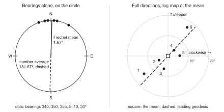

# Frechet mean: the average of points on a curved space

[Syllabus](../../../SYLLABUS.md) → [Differential geometry and Lie groups](../README.md) → [Geometric Analysis and Physics](../README.md#s07) → Frechet mean

---

## General Overview

A geologist drills six cores from one lava flow. Each core kept a record of the Earth's magnetic field from when the lava cooled. In the lab, each core's magnetisation gives two numbers:

- a **bearing**, the compass direction it points, clockwise from north: 340°, 350°, 355°, 5°, 10° and 30°;
- a **dip**, how far it points below the horizontal: 50°, 58°, 54°, 63°, 60° and 72°.

The geologist wants one direction for the whole flow. Adding the six bearings and dividing by six gives 181.67°: due south, while every core points roughly north. The numbers 350 and 10 sit 20° apart on a compass, but 340 apart as numbers.

The fix: the ordinary average is also the point with the smallest sum of squared distances to the data. That description needs only distances, which make sense on a circle or a sphere. Measured along the compass, the six bearings average to 1.67°, a little east of north.

The full directions, bearing and dip together, are points on a sphere. The same rule gives the flow's mean direction: bearing 358.39°, dip 60.33°. Around that mean, the six points are not a round cloud. They stretch along one great circle, from shallow and west of north to steep and east of north, which carries 93.1% of their spread.

**The Frechet mean of points on a curved space is the point that makes the average squared distance to them smallest; it is found by averaging the arrows that aim at the points from a guess and stepping along that average, and the leading direction of those arrows at the mean gives the geodesic along which the data spread most.**

**What kind of fact this is:** the mean is a definition. The rule "the arrows to the data average to zero at the mean" is a theorem, proved on this card in Why it works. When the mean is unique is a theorem stated with its source, not proved. The leading geodesic is a method: principal components, done in the flat map at the mean.

### The picture: the bearings, then the full directions

<p align="center"></p>

Both panels are to scale. Right: the **log map** at the mean (see The formula), 4 drawing units per degree: each core sits at its true direction and angular distance from the mean. Rightward is "bearing increasing", upward is "dip steeper". The dashed line is the leading geodesic, drawn two standard deviations of the data along it (2 × 9.80°) out each way.

---

## The formula

Three reminders and one new piece of notation.

- A direction is a point on the **unit sphere**: an arrow of length 1, written here as (north, east, down) parts. A bearing D and a dip I give the arrow $`x = (\cos I \cos D,\ \cos I \sin D,\ \sin I)`$. Here I is the dip, the geologists' letter; elsewhere in the library I can mean Fisher information.
- The **distance** between two directions is the angle between them, $`d(a, b) = \arccos(a \cdot b)`$, where $`a \cdot b`$ is the dot product. On the unit sphere, angle and great-circle length are the same number ([Riemannian metric](../05-Riemannian%20Geometry/01-riemannian-metrics.md)).
- The **logarithm map** $`\log_m(x)`$ is the arrow at m, lying flat along the sphere, that points toward x and is as long as the distance to x. The **exponential map** $`\exp_m(v)`$ undoes it: it shoots a great circle from m along the arrow v for v's length ([Geodesic and exponential map](../05-Riemannian%20Geometry/04-geodesics-and-the-exponential-map.md)).

The new piece is the **Frechet function**: for a candidate point m, the average squared distance to the n data points $`x_1, \dots, x_n`$.

```math
F(m) = \frac{1}{n}\sum_{i=1}^{n} d(m, x_i)^2, \qquad \bar x = \mathrm{argmin}_m\, F(m)
```

**Read it aloud:** score each candidate point by its average squared distance to the data; the Frechet mean is the candidate with the lowest score.

The value $`F(\bar x)`$ is the **Frechet variance**, the curved-space version of the variance.

At the mean, the arrows to the data balance:

```math
\sum_{i=1}^{n} \log_{\bar x}(x_i) = 0
```

**Read it aloud:** stand at the mean and point at every data point; the arrows add up to nothing.

That condition gives the algorithm. From any guess m, average the arrows and step along the average:

```math
m_{\text{new}} = \exp_m\!\Big(\frac{1}{n}\sum_{i=1}^{n} \log_m(x_i)\Big)
```

**Read it aloud:** from the current guess, aim at every point, average the aims, and walk that far along that way.

The **leading geodesic** is principal components applied to the arrows at the mean. Write each arrow $`v_i = \log_{\bar x}(x_i)`$ in two flat coordinates, then

```math
C = \frac{1}{n}\sum_{i=1}^{n} v_i v_i^{T}, \qquad C\,u = \lambda_1 u, \qquad \gamma(t) = \exp_{\bar x}(t\,u)
```

**Read it aloud:** gather the arrows' spread into a two-by-two matrix; its top eigenvector u is the direction of most spread; shooting along u traces the leading geodesic.

| Symbol | Plain meaning | In our example | Push it up and the answer… |
| --- | --- | --- | --- |
| $`D`$, $`I`$ | bearing (clockwise from north) and dip (below horizontal) | core 1: 340°, 50° | — |
| $`x_i`$, $`n`$ | the data, as unit arrows; how many | six cores | more cores, a steadier mean |
| $`m`$; $`w`$, $`s`$ | a candidate point, or the current guess; in the proof fold, a unit arrow along the sphere at m, and the distance walked along it | core 1, the first guess | — |
| $`d(m, x)`$ | angle between two directions, radians in formulas | rms distance to the mean 10.15° | — |
| $`F(m)`$ | average squared distance from m to the data | 103.12 deg² at the mean | — |
| $`\bar x`$ | the Frechet mean | bearing 358.39°, dip 60.33° | — |
| $`\log_m(x)`$, $`\exp_m(v)`$ | aim from m at x; shoot from m along v | core 6: 9.415° clockwise, 14.073° steeper | — |
| $`v_i`$, $`C`$; $`a`$, $`b`$, $`c`$ | core i's arrow at the mean, in (clockwise, steeper) degrees; the arrows' spread matrix, deg², with entries C = `[[a, b], [b, c]]` | arrows listed under Worked numbers; a = 48.778, b = 44.378, c = 54.338 | — |
| $`\lambda_1`$, $`\lambda_2`$ | its eigenvalues: spread along and across the leading direction | 96.022 and 7.093 deg² | a larger share for the leading geodesic |
| $`u`$, $`\psi`$ | top eigenvector, and its angle from "clockwise" toward "steeper" | ψ = 46.79° | — |
| $`K_{\max}`$ | largest sectional curvature of the space (Step 3) | 1 per square radian, the unit sphere | a smaller ball in which the mean is sure to be unique |
| $`\gamma(t)`$ | the leading geodesic, t in radians along it | two standard deviations (2 × 9.80°) either side of the mean: (339.7°, 44.2°) and (40.5°, 70.0°) | — |

### When it holds

- **The data sit inside an open hemisphere around some point.** Then the mean exists and is unique (stated in Step 3). Bearings 0° and 180° break this: 90° and 270° both score 8100 deg², the lowest possible, so there are two means.
- **The guess starts inside that region.** The iteration finds a point where the arrows balance. On a crowded or spread-out data set, that can be a local minimum or even a balance point at the far side. Starting from a data point inside the cluster avoids this here.
- **Distances are measured on the space, not in the chart.** Averaging bearing and dip as separate numbers lands 1.839° from the mean, at a point with a larger spread, 106.47 deg².
- **The spread is small compared with the curvature.** The flat map at the mean is then nearly faithful, so principal components there match the true best great circle: 46.79° against 46.67°. Stretch the data and the two drift apart.

---

## Why it works

### Step 0: the average is the point nearest to everything

On a number line, the average of a list is also the point m that makes $`\sum (m - x_i)^2`$ smallest. Set the slope to zero: $`2\sum (m - x_i) = 0`$, so m is the sum divided by n.

This form uses only distances, so it works in any space with a distance, as Maurice Frechet proposed in 1948. A sphere needs that: the sum of two unit arrows is not a unit arrow.

### Step 1: on a circle, unwrap around a guess

On the compass, the distance between two bearings is the short way round: 350° to 10° is 20°. Pick a guess, say 340° (core 1). Measure each bearing as a signed turn from the guess, taking the short way: 0, +10, +15, +25, +30 and +50. Those turns are exactly the logs at 340°.

Their average is +21.67°. Step that far: 340° + 21.67° = 361.67°, which is 1.67°. Measured from 1.67°, the turns are −21.67, −11.67, −6.67, +3.33, +8.33 and +28.33. They add to zero, so a second step moves it 0.00°.

One step is enough because a circle has no curvature along itself: unwrapping it near the data is exact. A scan of all 36,000 bearings at 0.01° spacing finds the lowest score at 1.67° too.

### Step 2: the slope of the Frechet function is minus twice the average arrow

On a curved space, the rule from Step 0 still holds in this form:

```math
\mathrm{grad}\, F(m) = -\frac{2}{n}\sum_{i=1}^{n} \log_m(x_i)
```

The reason is one fact. Walk from m a short way in the direction of a unit arrow w. Your distance to x shrinks at the rate equal to the part of w that points at x. So $`d^2`$ shrinks at twice the distance times that part, which is $`2\,\log_m(x)\cdot w`$. Average over the data: F falls fastest along the average arrow. The gradient ($`\mathrm{grad}\, F`$, the uphill arrow, as on the [Riemannian gradient descent](05-optimisation-on-manifolds.md) card) is minus twice that average.

A minimum has zero gradient, so at the mean the arrows balance. On flat ground $`\log_m(x) = x - m`$, and the rule reads $`\sum (x_i - m) = 0`$: the ordinary average.

<details>
<summary>Detailed proof: the gradient of the squared distance on the sphere</summary>

Fix a data point x, and write d for its distance from m, with $`0 < d < \pi`$. Walk m along a great circle at unit speed: $`m(s) = \cos s\, m + \sin s\, w`$, with w a unit arrow along the sphere at m, so $`m \cdot w = 0`$, and s the distance walked.

As m walks, the distance to x is $`d(s) = \arccos(m(s)\cdot x)`$, with $`d(0) = d`$ and $`m \cdot x = \cos d`$. A prime means the rate of change with s. At s = 0:

$`\displaystyle d'(0) = -\frac{w \cdot x}{\sqrt{1 - \cos^2 d}} = -\frac{w \cdot x}{\sin d}.`$

The log is $`\log_m(x) = d\, \frac{x - \cos d\; m}{\sin d}`$: the arrow $`x - \cos d\; m`$ is x with its part along m removed, and its length is $`\sin d`$. Since $`w \cdot m = 0`$, $`w \cdot \log_m(x) = d\,\frac{w \cdot x}{\sin d}`$. So the squared distance changes at the rate

$`\displaystyle (d^2)'(0) = 2\,d\; d'(0) = 2\,d \cdot \Big(-\frac{w\cdot x}{\sin d}\Big) = -2\, \log_m(x) \cdot w.`$

That holds for every direction w, so the gradient of $`d(\cdot, x)^2`$ is $`-2\log_m(x)`$. Average over the data. The proof is local: it needs m away from each $`x_i`$'s antipode, where the distance has a kink.

</details>

### Step 3: the iteration is gradient descent with step one half

Substitute the gradient into the update: $`\exp_m\big(\frac1n \sum \log_m x_i\big) = \exp_m\big(-\tfrac12\, \mathrm{grad}\, F(m)\big)`$. So the iteration is Riemannian gradient descent with a fixed step of one half, the step that is exact on flat ground.

On the sphere, it is not exact. Started at core 1, the first step moves 14.6°. It lands so close that the second step moves only 0.0277°. Each later step is about 0.00979 times the one before.

Linearising near the mean predicts that factor. The step of one half is sized for flat ground. On the sphere the Frechet function's bowl is a little flatter, so each step falls short by the fraction it is flatter. In any direction, the bowl is flatter by about one third of the data's spread at right angles to that direction, in square radians. So an error across the leading geodesic shrinks slowest: each step leaves the fraction $`\lambda_1/3`$ = 0.00975 of it, where $`\lambda_1`$ is the spread along that geodesic (Step 5). Six steps bring the move below 1e-9 degrees.

Whether the minimum is unique is a separate, global question. Bijan Afsari proved in 2011 that it is unique when all the data lie inside an open ball of radius less than half of $`\pi / \sqrt{K_{\max}}`$, where $`K_{\max}`$ is the largest sectional curvature, and less than half the injectivity radius. On the unit sphere both give 90°: the data must fit in an open hemisphere. The six cores fit easily. The pair 0° and 180° does not, and has two means.

A point where the arrows balance but the score is not the lowest is a **Karcher mean**, after Hermann Karcher's 1977 study. Every Frechet mean is a Karcher mean, provided no data point sits exactly opposite it; not every Karcher mean is a Frechet mean.

### Step 4: the second road, a whole-sphere grid

The iteration uses logs and exps. A brute-force search uses neither. It scores every bearing and dip on a 1° grid over the whole sphere, with the score computed from plain angles. The best grid point, bearing 358°, dip 60°, is 0.3857° from the iteration's answer. Refined to 0.00001° spacing, the gap is 3.98e-6 degrees, below one grid step.

Because the grid covers the whole sphere, it also confirms the answer is the global minimum, not a local one.

### Step 5: the leading geodesic is principal components in the flat map

The log map at the mean flattens the sphere around it, keeping each core's distance and direction from the mean exact. Write each core's arrow in two coordinates: degrees clockwise (bearing increasing) and degrees steeper (dip increasing).

At the mean these arrows average to zero, which is Step 2's balance. So their spread matrix $`C`$ is an ordinary covariance matrix about the centre. Principal components ([Principal components](../../09-Probability%20and%20statistics/09-Regression/07-principal-components.md)) say its top eigenvector carries the most spread. Here $`\lambda_1 = 96.022`$ deg² and $`\lambda_2 = 7.093`$ deg², so the leading direction carries 93.1%.

The eigenvalues add to 103.116 deg², the Frechet variance $`F(\bar x)`$. That is no coincidence: each arrow's squared length is its squared distance to the mean.

The leading direction is 46.79° from "clockwise" toward "steeper". Shoot along it and the great circle through the mean is the leading geodesic. Thomas Fletcher and colleagues described this **principal geodesic analysis** in full in 2004.

The flat map is an approximation for this step. The exact version scans every great circle through the mean, projects each core onto it along the sphere, and keeps the circle with the largest spread. That scan finds 46.67°, with spread 96.162 deg² along it. The 0.12° gap is the curvature, at a 10° spread.

### Step 6: why the sphere's mean bearing is not the circle's

The bearings alone averaged to 1.67°. The full directions give bearing 358.39°. A degree of bearing is a shorter arc on the sphere when the dip is steep: at dip I, it is $`\cos I`$ degrees of arc. Core 6, at 30° bearing, has the steepest dip, 72°. Its bearing counts for least, and the mean swings west.

The **vector mean** is a third answer: add the six unit arrows and rescale to length 1. R. A. Fisher built his 1953 statistics of directions on it. Here it is bearing 358.3897°, dip 60.3161°, only 0.0163° from the Frechet mean; the summed arrow has length 0.9844 per core. It is still a different definition: it uses straight-line distance through the sphere, not along it.

---

## Worked numbers, by hand

The bearings alone, on the circle:

| Step | Arithmetic | Value |
| --- | --- | --- |
| number average | (340 + 350 + 355 + 5 + 10 + 30) / 6 | 181.67° |
| turns from 340° | 0, 10, 15, 25, 30, 50 | sum 130 |
| one step | 340 + 130/6, past 360 | **1.67°** |
| spread at the mean | average of 21.67², 11.67², 6.67², 3.33², 8.33², 28.33² | 255.56 deg², rms 15.99° |
| spread at 181.67° | the same, measured from the south | 27,855.56 deg² |

The full directions, on the sphere, starting from core 1:

| Step | Bearing | Dip | Move |
| ---: | ---: | ---: | ---: |
| 1 | 358.340786° | 60.342150° | 14.6° |
| 2 | 358.393250° | 60.332405° | 0.0277° |
| 3 | 358.393630° | 60.332239° | 0.000251° |
| 4 | 358.393634° | 60.332237° | 2.46e-6 degrees |
| 6 | **358.393634°** | **60.332237°** | 2.36e-10 degrees |

Each core's arrow at the mean, in degrees:

| Core | Bearing, dip | Clockwise | Steeper |
| ---: | --- | ---: | ---: |
| 1 | 340°, 50° | −11.749 | −8.736 |
| 2 | 350°, 58° | −4.437 | −2.051 |
| 3 | 355°, 54° | −1.998 | −6.282 |
| 4 | 5°, 63° | 2.995 | 2.819 |
| 5 | 10°, 60° | 5.773 | 0.177 |
| 6 | 30°, 72° | 9.415 | 14.073 |

The columns average to 0.000000, as Step 2 promises. Then the leading direction:

| Step | Arithmetic | Value |
| --- | --- | --- |
| spread matrix C = `[[a, b], [b, c]]` | a, b, c: averages of clockwise², clockwise × steeper, steeper² | 48.778, 44.378, 54.338 deg² |
| eigenvalues | (a + c)/2 ± √(((a − c)/2)² + b²) | 96.022 and 7.093 deg² |
| total | 96.022 + 7.093, the Frechet variance | 103.116 deg², rms 10.15° |
| leading share | 96.022 / 103.116 | **93.1%** |
| leading direction | top eigenvector's angle | **46.79°** from clockwise toward steeper |
| check | C u against λ₁ u | (65.741, 69.988) both |
| exact great-circle scan | best circle through the mean | 46.67° |

Read back for the geologist: the flow's magnetisation points at bearing 358.39°, 60.33° below horizontal. If the field was the Earth's average field, a magnet at the centre lined up with the spin axis, then $`\tan I = 2 \tan(\text{latitude})`$, and the lava cooled at about 41.3° latitude. That field is a model, a good average over many thousands of years.

The spread is not round. One great circle holds 93.1% of the variance; two standard deviations (2 × 9.80°) either side of the mean, it reaches about (339.7°, 44.2°) and (40.5°, 70.0°). A smear along one great circle is a known clue in rock magnetism: cores carrying two magnetisations in different amounts scatter along the great circle joining them.

### What breaks if you drop a piece

| Mistake | Comes out at | What went wrong |
| --- | --- | --- |
| Averaging the bearings as numbers | 181.67°, pointing south; spread 27,855.56 deg² | 350 and 10 are 20° apart on the compass, 340 apart as numbers |
| Averaging bearing and dip as two separate numbers | (1.67°, 59.50°): 1.839° from the mean, spread 106.47 deg² | A degree of bearing is a shorter arc at steep dip; the chart is not the sphere |
| Principal components on raw bearing and dip numbers | 22.71° as drawn on the raw chart; carried onto the sphere, 40.21°, which is 6.58° short of 46.79° | An angle on the chart is not an angle on the sphere. The chart stretches bearing by 1/cos I, about 2 here, so bearing spread counts double and the axis tilts toward "clockwise" |
| Two bearings 180° apart, 0° and 180° | two means, 90° and 270°, both scoring 8100 deg² | No open half-circle holds the data, so the minimum is not unique |

The code prints all four.

---

## Code, from first principles, and it actually runs

Only the math module is used: no geometry, statistics or linear-algebra packages. The script takes five roads that check each other.

1. On the circle: one log-average-exp step, against a scan of 36,000 bearings.
2. On the sphere: the log-average-exp iteration, against a brute-force grid over the whole sphere that uses only angles.
3. The leading direction: the two-by-two eigenvector formula, checked by multiplying back, against a scan over every great circle through the mean with exact projection.
4. The eigenvalues' sum against the Frechet variance from distances.
5. The vector mean as an outside comparison, and the antipodal pair for the failure case.

### Python

```python
# Frechet mean -- the check behind the card.  Standard library only (math).  Six rock cores:
# each gives a compass bearing D and a dip I of its magnetisation.  Part 1 averages the bearings
# alone, on the circle.  Part 2 averages the full directions, on the sphere, and finds the leading geodesic.
import math
D = [340.0, 350.0, 355.0, 5.0, 10.0, 30.0]          # bearing, degrees clockwise from north
I = [50.0, 58.0, 54.0, 63.0, 60.0, 72.0]            # dip, degrees below horizontal
N, R2D = len(D), 180.0 / math.pi
D2 = R2D * R2D                                      # square degrees per square radian

def sq(x): return x * x
def wrap(a): return (a + 180.0) % 360.0 - 180.0     # an angle difference into [-180, 180)
def dot(a, b): return a[0] * b[0] + a[1] * b[1] + a[2] * b[2]
def vec(d, i):                                      # (north, east, down), a unit arrow
    d, i = d / R2D, i / R2D
    return (math.cos(i) * math.cos(d), math.cos(i) * math.sin(d), math.sin(i))
def chart(m): return (math.atan2(m[1], m[0]) * R2D % 360.0, math.asin(m[2]) * R2D)
def dist(a, b): return math.acos(max(-1.0, min(1.0, dot(a, b))))   # radians
def log(m, x):                                      # the arrow at m that aims at x
    c = max(-1.0, min(1.0, dot(m, x)))
    w = [x[k] - c * m[k] for k in range(3)]
    s = math.sqrt(dot(w, w))
    return [0.0, 0.0, 0.0] if s == 0.0 else [math.acos(c) * w[k] / s for k in range(3)]
def exp(m, v):                                      # shoot from m along v
    t = math.sqrt(dot(v, v))
    if t == 0.0: return m
    y = [math.cos(t) * m[k] + math.sin(t) * v[k] / t for k in range(3)]
    s = math.sqrt(dot(y, y))                        # rescale away rounding drift off the sphere
    return tuple(y[k] / s for k in range(3))
def sci(x):                                         # x as d.dd e-n, the same in Rust
    n = math.floor(math.log10(x))
    return f"{x / 10.0 ** n:.2f}e{n}"
def frechet(m, pts): return sum(sq(dist(m, x)) for x in pts) / len(pts)

print("part 1: the six bearings on the circle")
print("bearings: " + ", ".join(f"{d:.0f}" for d in D))
naive = sum(D) / N
m1 = (D[0] + sum(wrap(d - D[0]) for d in D) / N) % 360.0  # road 1: one log-average-exp step
again = sum(wrap(d - m1) for d in D) / N                  # a second step moves it by this much
F1 = lambda b: sum(sq(wrap(d - b)) for d in D) / N
scan1 = min((F1(k / 100.0), k / 100.0) for k in range(36000))[1]    # road 2: scan every 0.01 deg
ext1 = math.atan2(sum(math.sin(d / R2D) for d in D), sum(math.cos(d / R2D) for d in D)) * R2D % 360.0
print(f"average of the numbers: {naive:.2f} deg")
print(f"Frechet mean, one step from {D[0]:.0f}: {m1:.2f} deg; a second step moves it {abs(again):.2f} deg")
print("turns from 340: " + ", ".join(f"{wrap(d - D[0]):.0f}" for d in D) + f", sum {sum(wrap(d - D[0]) for d in D):.0f}")
print("turns from the mean: " + ", ".join(f"{wrap(d - m1):.2f}" for d in D))
print(f"Frechet mean, scanning 36000 bearings: {scan1:.2f} deg")
print(f"spread at the mean: {F1(m1):.2f} deg^2, rms {math.sqrt(F1(m1)):.2f} deg")
print(f"spread at the number average: {F1(naive):.2f} deg^2")
print(f"vector average of the bearings: {ext1:.2f} deg")
pair = lambda b: (sq(wrap(0.0 - b)) + sq(wrap(180.0 - b))) / 2
print(f"bearings 350 and 10: number average {(350 + 10) / 2:.0f}, Frechet mean "
      f"{min((sq(wrap(350 - k / 10)) + sq(wrap(10 - k / 10)), k / 10) for k in range(3600))[1]:.0f}")
print(f"bearings 0 and 180: spread {pair(90):.0f} at 90, {pair(270):.0f} at 270, {pair(0):.0f} at 0")

print("part 2: the six full directions on the sphere")
X = [vec(d, i) for d, i in zip(D, I)]
print("core  bearing  dip   north   east    down")
for k in range(N):
    print(f"{k + 1:>4}{D[k]:>9.0f}{I[k]:>5.0f}{X[k][0]:>8.4f}{X[k][1]:>8.4f}{X[k][2]:>8.4f}")
m, it, moves = X[0], 0, []                          # road 1: average the logs, shoot, repeat
print("step    bearing        dip   move (deg)")
while True:
    g = [sum(log(m, x)[k] for x in X) / N for k in range(3)]
    m, it, mv = exp(m, g), it + 1, math.sqrt(dot(g, g)) * R2D
    moves += [mv]
    print(f"{it:>4}{chart(m)[0]:>11.6f}{chart(m)[1]:>11.6f}   {sci(mv)}")
    if mv < 1e-9: break
Fm = frechet(m, X)
def grid(d0, i0, h, n):                             # road 2: scan a bearing-dip grid
    best = None
    for a in range(-n, n + 1):
        for b in range(-n, n + 1):
            i = max(-90.0, min(90.0, i0 + b * h))
            f = frechet(vec(d0 + a * h, i), X)
            if best is None or f < best[0]: best = (f, (d0 + a * h) % 360.0, i)
    return best
g1 = grid(180.0, 0.0, 1.0, 180)
gd = g1
for h in (0.1, 0.01, 0.001, 0.0001, 0.00001): gd = grid(gd[1], gd[2], h, 20)
gap = max(abs(wrap(gd[1] - chart(m)[0])), abs(gd[2] - chart(m)[1]))
print(f"whole-sphere grid, 1 deg steps: bearing {g1[1]:.0f}, dip {g1[2]:.0f}, "
      f"{dist(m, vec(g1[1], g1[2])) * R2D:.4f} deg from road 1")
print(f"grid refined to 1e-5 deg: bearing {gd[1]:.5f}, dip {gd[2]:.5f}, {sci(gap)} deg from road 1")
print(f"Frechet variance {Fm * D2:.2f} deg^2, rms angle {math.sqrt(Fm) * R2D:.2f} deg")
S = [sum(x[k] for x in X) for k in range(3)]
rbar = math.sqrt(dot(S, S)) / N
e = tuple(s / (N * rbar) for s in S)
print(f"vector (Fisher) mean: bearing {chart(e)[0]:.4f}, dip {chart(e)[1]:.4f}, "
      f"length {rbar:.4f}, {dist(m, e) * R2D:.4f} deg from the Frechet mean")
print(f"dipole latitude from the mean dip: {math.atan(math.tan(chart(m)[1] / R2D) / 2) * R2D:.1f} deg")
d0, i0 = chart(m)[0] / R2D, chart(m)[1] / R2D       # unit arrows at the mean: steeper, clockwise
eI = (-math.sin(i0) * math.cos(d0), -math.sin(i0) * math.sin(d0), math.cos(i0))
eD = (-math.sin(d0), math.cos(d0), 0.0)
P = [(dot(v, eD) * R2D, dot(v, eI) * R2D) for v in (log(m, x) for x in X)]
print("core  clockwise  steeper   (log-map coordinates at the mean, deg)")
for k in range(N): print(f"{k + 1:>4}{P[k][0]:>10.3f}{P[k][1]:>9.3f}")
sx, sy = sum(p[0] for p in P) / N, sum(p[1] for p in P) / N
a, b, c = sum(sq(p[0]) for p in P) / N, sum(p[0] * p[1] for p in P) / N, sum(sq(p[1]) for p in P) / N  # C = [[a, b], [b, c]]
root = math.sqrt(sq((a - c) / 2) + b * b)
l1, l2 = (a + c) / 2 + root, (a + c) / 2 - root
psi = math.atan2(l1 - a, b) * R2D                   # angle of the top eigenvector from clockwise
u = (math.cos(psi / R2D), math.sin(psi / R2D))
cu = (a * u[0] + b * u[1], b * u[0] + c * u[1])     # the matrix times u, against l1 times u
print(f"centre of the log points: {abs(sx):.6f}, {abs(sy):.6f} deg")
print(f"covariance: {a:.3f} {b:.3f} / {b:.3f} {c:.3f} deg^2")
print(f"eigenvalues {l1:.3f} and {l2:.3f}, sum {l1 + l2:.3f}; leading share {100 * l1 / (l1 + l2):.1f}%")
rate = moves[4] / moves[3]                          # the slowest error lies across the leading geodesic
print(f"each move over the one before: {rate:.5f}; leading spread in square radians, over 3: {l1 / D2 / 3:.5f}")
print(f"leading direction {psi:.2f} deg from clockwise toward steeper; check C u = ({cu[0]:.3f}, {cu[1]:.3f}), "
      f"l1 u = ({l1 * u[0]:.3f}, {l1 * u[1]:.3f})")
def along(t):                                       # road 2: project onto the true great circle
    w = tuple(math.cos(t / R2D) * eD[k] + math.sin(t / R2D) * eI[k] for k in range(3))
    s = [math.atan2(dot(x, w), dot(x, m)) for x in X]
    return sum(q * q for q in s) / N * D2
best = max((along(k / 100.0), k / 100.0) for k in range(18000))
print(f"exact great-circle scan: best {best[1]:.2f} deg, variance along it {best[0]:.3f} deg^2")
ends = [chart(exp(m, tuple(sg * 2 * math.sqrt(l1) / R2D * (u[0] * eD[k] + u[1] * eI[k]) for k in range(3)))) for sg in (-1, 1)]
print(f"two standard deviations, 2 x {math.sqrt(l1):.2f} deg, either way: ({ends[0][0]:.1f}, {ends[0][1]:.1f}) and ({ends[1][0]:.1f}, {ends[1][1]:.1f})")
fx = sum(wrap(d) for d in D) / N
fa = [(wrap(d) - fx, i - sum(I) / N) for d, i in zip(D, I)]
fc = [sum(p[j] * p[k] for p in fa) / N for j, k in ((0, 0), (0, 1), (1, 1))]
flat = 0.5 * math.atan2(2 * fc[1], fc[0] - fc[2]) * R2D             # an angle on the raw chart
onsph = math.atan2(math.sin(flat / R2D), math.cos(flat / R2D) * math.cos(i0)) * R2D  # the same line on the sphere
sep = vec(m1, sum(I) / N)
print(f"mistake: PCA on raw bearing and dip: {flat:.2f} deg on the chart, {onsph:.2f} on the sphere, {psi - onsph:.2f} short of {psi:.2f}")
print(f"mistake: bearing and dip averaged apart: ({m1:.2f}, {sum(I) / N:.2f}), "
      f"{dist(m, sep) * R2D:.3f} deg from the mean, spread {frechet(sep, X) * D2:.2f} deg^2")
sc = 4.0                                            # figure: 4 px per degree, centre (330, 110)
print("figure, log-map pixels: " + " ".join(f"({330 + sc * p[0]:.1f},{110 - sc * p[1]:.1f})" for p in P))
L = sc * 2 * math.sqrt(l1)                          # two standard deviations, in pixels
print(f"figure, leading line pixels: ({330 - L * u[0]:.1f},{110 + L * u[1]:.1f}) to ({330 + L * u[0]:.1f},{110 - L * u[1]:.1f})")
print("figure, compass pixels: " + " ".join(
    f"({100 + 70 * math.sin(d / R2D):.1f},{110 - 70 * math.cos(d / R2D):.1f})" for d in D + [m1, naive]))
assert abs(wrap(m1 - scan1)) <= 0.006 and abs(naive - m1) > 170   # two roads; the trap is real
assert gap < 2e-5 and dist(m, vec(g1[1], g1[2])) * R2D < 1.0      # iteration against grid
assert abs((l1 + l2) - Fm * D2) < 1e-9 and abs(cu[0] - l1 * u[0]) + abs(cu[1] - l1 * u[1]) < 1e-9      # trace = variance; eigenvector
assert 0.05 < abs(best[1] - psi) < 0.3 and l1 < best[0] < l1 * 1.01  # exact scan: a small tilt, a longer spread
assert pair(90) == pair(270) and pair(90) < pair(0)               # antipodes: two means
assert abs(rate / (l1 / D2 / 3) - 1) < 0.1                        # convergence factor as linearising predicts
print("ALL CHECKS PASS")
```

**Ran 2026-11-19 on macOS, Python 3.14.10, standard library only. All checks passed. Output, pasted from the run:**

```
part 1: the six bearings on the circle
bearings: 340, 350, 355, 5, 10, 30
average of the numbers: 181.67 deg
Frechet mean, one step from 340: 1.67 deg; a second step moves it 0.00 deg
turns from 340: 0, 10, 15, 25, 30, 50, sum 130
turns from the mean: -21.67, -11.67, -6.67, 3.33, 8.33, 28.33
Frechet mean, scanning 36000 bearings: 1.67 deg
spread at the mean: 255.56 deg^2, rms 15.99 deg
spread at the number average: 27855.56 deg^2
vector average of the bearings: 1.57 deg
bearings 350 and 10: number average 180, Frechet mean 0
bearings 0 and 180: spread 8100 at 90, 8100 at 270, 16200 at 0
part 2: the six full directions on the sphere
core  bearing  dip   north   east    down
   1      340   50  0.6040 -0.2198  0.7660
   2      350   58  0.5219 -0.0920  0.8480
   3      355   54  0.5855 -0.0512  0.8090
   4        5   63  0.4523  0.0396  0.8910
   5       10   60  0.4924  0.0868  0.8660
   6       30   72  0.2676  0.1545  0.9511
step    bearing        dip   move (deg)
   1 358.340786  60.342150   1.46e1
   2 358.393250  60.332405   2.77e-2
   3 358.393630  60.332239   2.51e-4
   4 358.393634  60.332237   2.46e-6
   5 358.393634  60.332237   2.41e-8
   6 358.393634  60.332237   2.36e-10
whole-sphere grid, 1 deg steps: bearing 358, dip 60, 0.3857 deg from road 1
grid refined to 1e-5 deg: bearing 358.39363, dip 60.33224, 3.98e-6 deg from road 1
Frechet variance 103.12 deg^2, rms angle 10.15 deg
vector (Fisher) mean: bearing 358.3897, dip 60.3161, length 0.9844, 0.0163 deg from the Frechet mean
dipole latitude from the mean dip: 41.3 deg
core  clockwise  steeper   (log-map coordinates at the mean, deg)
   1   -11.749   -8.736
   2    -4.437   -2.051
   3    -1.998   -6.282
   4     2.995    2.819
   5     5.773    0.177
   6     9.415   14.073
centre of the log points: 0.000000, 0.000000 deg
covariance: 48.778 44.378 / 44.378 54.338 deg^2
eigenvalues 96.022 and 7.093, sum 103.116; leading share 93.1%
each move over the one before: 0.00979; leading spread in square radians, over 3: 0.00975
leading direction 46.79 deg from clockwise toward steeper; check C u = (65.741, 69.988), l1 u = (65.741, 69.988)
exact great-circle scan: best 46.67 deg, variance along it 96.162 deg^2
two standard deviations, 2 x 9.80 deg, either way: (339.7, 44.2) and (40.5, 70.0)
mistake: PCA on raw bearing and dip: 22.71 deg on the chart, 40.21 on the sphere, 6.58 short of 46.79
mistake: bearing and dip averaged apart: (1.67, 59.50), 1.839 deg from the mean, spread 106.47 deg^2
figure, log-map pixels: (283.0,144.9) (312.3,118.2) (322.0,135.1) (342.0,98.7) (353.1,109.3) (367.7,53.7)
figure, leading line pixels: (276.3,167.1) to (383.7,52.9)
figure, compass pixels: (76.1,44.2) (87.8,41.1) (93.9,40.3) (106.1,40.3) (112.2,41.1) (135.0,49.4) (102.0,40.0) (98.0,180.0)
ALL CHECKS PASS
```

### Rust

Same numbers, same labels, built with `rustc --edition 2021 -O`.

```rust
// Frechet mean -- the same check as the Python, in Rust.  No crates.
// Six rock cores: each gives a compass bearing D and a dip I of its magnetisation.
// Part 1 averages the bearings alone, on the circle.  Part 2 averages the full
// directions, on the sphere, and finds the leading geodesic through the mean.
type V3 = [f64; 3];
const D: [f64; 6] = [340.0, 350.0, 355.0, 5.0, 10.0, 30.0]; // bearing, degrees clockwise from north
const I: [f64; 6] = [50.0, 58.0, 54.0, 63.0, 60.0, 72.0]; // dip, degrees below horizontal
const N: f64 = 6.0;
const R2D: f64 = 180.0 / std::f64::consts::PI;
const D2: f64 = R2D * R2D; // square degrees per square radian

fn sq(x: f64) -> f64 { x * x }
fn wrap(a: f64) -> f64 { (a + 180.0).rem_euclid(360.0) - 180.0 } // into [-180, 180)
fn dot(a: &V3, b: &V3) -> f64 { a[0] * b[0] + a[1] * b[1] + a[2] * b[2] }
fn vec(d: f64, i: f64) -> V3 { // (north, east, down), a unit arrow
    let (d, i) = (d / R2D, i / R2D);
    [i.cos() * d.cos(), i.cos() * d.sin(), i.sin()]
}
fn chart(m: &V3) -> (f64, f64) { ((m[1].atan2(m[0]) * R2D).rem_euclid(360.0), m[2].asin() * R2D) }
fn dist(a: &V3, b: &V3) -> f64 { dot(a, b).min(1.0).max(-1.0).acos() } // radians
fn log(m: &V3, x: &V3) -> V3 { // the arrow at m that aims at x
    let c = dot(m, x).min(1.0).max(-1.0);
    let w = [x[0] - c * m[0], x[1] - c * m[1], x[2] - c * m[2]];
    let s = dot(&w, &w).sqrt();
    if s == 0.0 { return [0.0; 3] }
    [c.acos() * w[0] / s, c.acos() * w[1] / s, c.acos() * w[2] / s]
}
fn exp(m: &V3, v: &V3) -> V3 { // shoot from m along v
    let t = dot(v, v).sqrt();
    if t == 0.0 { return *m }
    let y = [0, 1, 2].map(|k| t.cos() * m[k] + t.sin() * v[k] / t);
    let s = dot(&y, &y).sqrt(); // rescale away rounding drift off the sphere
    y.map(|q| q / s)
}
fn sci(x: f64) -> String { // x as d.dd e-n, the same in Python
    let n = x.log10().floor();
    format!("{:.2}e{}", x / 10f64.powf(n), n as i32)
}
fn frechet(m: &V3, pts: &[V3]) -> f64 { pts.iter().map(|x| sq(dist(m, x))).sum::<f64>() / pts.len() as f64 }
fn sum(it: impl Iterator<Item = f64>) -> f64 { it.fold(0.0, |s, x| s + x) }

fn main() {
    println!("part 1: the six bearings on the circle");
    println!("bearings: {}", D.iter().map(|d| format!("{:.0}", d)).collect::<Vec<_>>().join(", "));
    let naive = sum(D.iter().copied()) / N;
    let m1 = (D[0] + sum(D.iter().map(|d| wrap(d - D[0]))) / N).rem_euclid(360.0); // road 1
    let again = sum(D.iter().map(|d| wrap(d - m1))) / N;
    let f1 = |b: f64| sum(D.iter().map(|d| sq(wrap(d - b)))) / N;
    let (mut scan1, mut fb) = (0.0, f64::INFINITY); // road 2: scan every 0.01 deg
    for k in 0..36000 { let b = k as f64 / 100.0; if f1(b) < fb { fb = f1(b); scan1 = b } }
    let ext1 = (sum(D.iter().map(|d| (d / R2D).sin())).atan2(sum(D.iter().map(|d| (d / R2D).cos()))) * R2D).rem_euclid(360.0);
    println!("average of the numbers: {:.2} deg", naive);
    println!("Frechet mean, one step from {:.0}: {:.2} deg; a second step moves it {:.2} deg", D[0], m1, again.abs());
    println!("turns from 340: {}, sum {:.0}", D.iter().map(|d| format!("{:.0}", wrap(d - D[0]))).collect::<Vec<_>>().join(", "), sum(D.iter().map(|d| wrap(d - D[0]))));
    println!("turns from the mean: {}", D.iter().map(|d| format!("{:.2}", wrap(d - m1))).collect::<Vec<_>>().join(", "));
    println!("Frechet mean, scanning 36000 bearings: {:.2} deg", scan1);
    println!("spread at the mean: {:.2} deg^2, rms {:.2} deg", f1(m1), f1(m1).sqrt());
    println!("spread at the number average: {:.2} deg^2", f1(naive));
    println!("vector average of the bearings: {:.2} deg", ext1);
    let pair = |b: f64| (sq(wrap(0.0 - b)) + sq(wrap(180.0 - b))) / 2.0;
    let (mut p2, mut pf) = (0.0, f64::INFINITY);
    for k in 0..3600 { let b = k as f64 / 10.0; let f = sq(wrap(350.0 - b)) + sq(wrap(10.0 - b)); if f < pf { pf = f; p2 = b } }
    println!("bearings 350 and 10: number average {:.0}, Frechet mean {:.0}", (350.0 + 10.0) / 2.0, p2);
    println!("bearings 0 and 180: spread {:.0} at 90, {:.0} at 270, {:.0} at 0", pair(90.0), pair(270.0), pair(0.0));

    println!("part 2: the six full directions on the sphere");
    let x: Vec<V3> = (0..6).map(|k| vec(D[k], I[k])).collect();
    println!("core  bearing  dip   north   east    down");
    for k in 0..6 {
        println!("{:>4}{:>9.0}{:>5.0}{:>8.4}{:>8.4}{:>8.4}", k + 1, D[k], I[k], x[k][0], x[k][1], x[k][2]);
    }
    let (mut m, mut it) = (x[0], 0); // road 1: average the logs, shoot, repeat
    println!("step    bearing        dip   move (deg)");
    let mut moves = vec![];
    loop {
        let g = [0, 1, 2].map(|k| sum(x.iter().map(|p| log(&m, p)[k])) / N);
        m = exp(&m, &g);
        it += 1;
        let mv = dot(&g, &g).sqrt() * R2D;
        moves.push(mv);
        println!("{:>4}{:>11.6}{:>11.6}   {}", it, chart(&m).0, chart(&m).1, sci(mv));
        if mv < 1e-9 { break }
    }
    let fm = frechet(&m, &x);
    let grid = |d0: f64, i0: f64, h: f64, n: i32| { // road 2: scan a bearing-dip grid
        let mut best = (f64::INFINITY, 0.0, 0.0);
        for a in -n..=n {
            for b in -n..=n {
                let i = (i0 + b as f64 * h).min(90.0).max(-90.0);
                let f = frechet(&vec(d0 + a as f64 * h, i), &x);
                if f < best.0 { best = (f, (d0 + a as f64 * h).rem_euclid(360.0), i) }
            }
        }
        best
    };
    let g1 = grid(180.0, 0.0, 1.0, 180);
    let mut gd = g1;
    for h in [0.1, 0.01, 0.001, 0.0001, 0.00001] { gd = grid(gd.1, gd.2, h, 20) }
    let gap = wrap(gd.1 - chart(&m).0).abs().max((gd.2 - chart(&m).1).abs());
    let gap1 = dist(&m, &vec(g1.1, g1.2)) * R2D;
    println!("whole-sphere grid, 1 deg steps: bearing {:.0}, dip {:.0}, {:.4} deg from road 1", g1.1, g1.2, gap1);
    println!("grid refined to 1e-5 deg: bearing {:.5}, dip {:.5}, {} deg from road 1", gd.1, gd.2, sci(gap));
    println!("Frechet variance {:.2} deg^2, rms angle {:.2} deg", fm * D2, fm.sqrt() * R2D);
    let s = [0, 1, 2].map(|k| sum(x.iter().map(|p| p[k])));
    let rbar = dot(&s, &s).sqrt() / N;
    let e = s.map(|v| v / (N * rbar));
    println!("vector (Fisher) mean: bearing {:.4}, dip {:.4}, length {:.4}, {:.4} deg from the Frechet mean",
             chart(&e).0, chart(&e).1, rbar, dist(&m, &e) * R2D);
    println!("dipole latitude from the mean dip: {:.1} deg", ((chart(&m).1 / R2D).tan() / 2.0).atan() * R2D);
    let (d0, i0) = (chart(&m).0 / R2D, chart(&m).1 / R2D); // unit arrows at the mean: steeper, clockwise
    let ei = [-i0.sin() * d0.cos(), -i0.sin() * d0.sin(), i0.cos()];
    let ed = [-d0.sin(), d0.cos(), 0.0];
    let p: Vec<(f64, f64)> = x.iter().map(|q| { let v = log(&m, q); (dot(&v, &ed) * R2D, dot(&v, &ei) * R2D) }).collect();
    println!("core  clockwise  steeper   (log-map coordinates at the mean, deg)");
    for k in 0..6 { println!("{:>4}{:>10.3}{:>9.3}", k + 1, p[k].0, p[k].1) }
    let sx = sum(p.iter().map(|q| q.0)) / N;
    let sy = sum(p.iter().map(|q| q.1)) / N;
    let a = sum(p.iter().map(|q| sq(q.0))) / N;
    let c = sum(p.iter().map(|q| sq(q.1))) / N;
    let b = sum(p.iter().map(|q| q.0 * q.1)) / N; // C = [[a, b], [b, c]]
    let root = (sq((a - c) / 2.0) + b * b).sqrt();
    let (l1, l2) = ((a + c) / 2.0 + root, (a + c) / 2.0 - root);
    let psi = (l1 - a).atan2(b) * R2D; // angle of the top eigenvector from clockwise
    let u = ((psi / R2D).cos(), (psi / R2D).sin());
    let cu = (a * u.0 + b * u.1, b * u.0 + c * u.1); // the matrix times u, against l1 times u
    println!("centre of the log points: {:.6}, {:.6} deg", sx.abs(), sy.abs());
    println!("covariance: {:.3} {:.3} / {:.3} {:.3} deg^2", a, b, b, c);
    println!("eigenvalues {:.3} and {:.3}, sum {:.3}; leading share {:.1}%", l1, l2, l1 + l2, 100.0 * l1 / (l1 + l2));
    let rate = moves[4] / moves[3]; // the slowest error lies across the leading geodesic
    println!("each move over the one before: {:.5}; leading spread in square radians, over 3: {:.5}", rate, l1 / D2 / 3.0);
    println!("leading direction {:.2} deg from clockwise toward steeper; check C u = ({:.3}, {:.3}), l1 u = ({:.3}, {:.3})",
             psi, cu.0, cu.1, l1 * u.0, l1 * u.1);
    let along = |t: f64| { // road 2: project onto the true great circle
        let w = [0, 1, 2].map(|k| (t / R2D).cos() * ed[k] + (t / R2D).sin() * ei[k]);
        sum(x.iter().map(|q| { let s = dot(q, &w).atan2(dot(q, &m)); s * s })) / N * D2
    };
    let mut best = (f64::NEG_INFINITY, 0.0);
    for k in 0..18000 { let t = k as f64 / 100.0; let f = along(t); if f >= best.0 { best = (f, t) } }
    println!("exact great-circle scan: best {:.2} deg, variance along it {:.3} deg^2", best.1, best.0);
    let ends: Vec<(f64, f64)> = [-1.0, 1.0].iter().map(|sg: &f64| {
        chart(&exp(&m, &[0, 1, 2].map(|k| sg * 2.0 * l1.sqrt() / R2D * (u.0 * ed[k] + u.1 * ei[k]))))
    }).collect();
    println!("two standard deviations, 2 x {:.2} deg, either way: ({:.1}, {:.1}) and ({:.1}, {:.1})", l1.sqrt(), ends[0].0, ends[0].1, ends[1].0, ends[1].1);
    let fx = sum(D.iter().map(|d| wrap(*d))) / N;
    let ibar = sum(I.iter().copied()) / N;
    let fa: Vec<(f64, f64)> = (0..6).map(|k| (wrap(D[k]) - fx, I[k] - ibar)).collect();
    let fc = [sum(fa.iter().map(|q| q.0 * q.0)) / N, sum(fa.iter().map(|q| q.0 * q.1)) / N, sum(fa.iter().map(|q| q.1 * q.1)) / N];
    let flat = 0.5 * (2.0 * fc[1]).atan2(fc[0] - fc[2]) * R2D; // an angle on the raw chart
    let onsph = (flat / R2D).sin().atan2((flat / R2D).cos() * i0.cos()) * R2D; // the same line on the sphere
    let sep = vec(m1, ibar);
    println!("mistake: PCA on raw bearing and dip: {:.2} deg on the chart, {:.2} on the sphere, {:.2} short of {:.2}", flat, onsph, psi - onsph, psi);
    println!("mistake: bearing and dip averaged apart: ({:.2}, {:.2}), {:.3} deg from the mean, spread {:.2} deg^2",
             m1, ibar, dist(&m, &sep) * R2D, frechet(&sep, &x) * D2);
    let sc = 4.0; // figure: 4 px per degree, centre (330, 110)
    println!("figure, log-map pixels: {}", p.iter().map(|q| format!("({:.1},{:.1})", 330.0 + sc * q.0, 110.0 - sc * q.1)).collect::<Vec<_>>().join(" "));
    let l = sc * 2.0 * l1.sqrt(); // two standard deviations, in pixels
    println!("figure, leading line pixels: ({:.1},{:.1}) to ({:.1},{:.1})", 330.0 - l * u.0, 110.0 + l * u.1, 330.0 + l * u.0, 110.0 - l * u.1);
    let mut cd = D.to_vec();
    cd.push(m1);
    cd.push(naive);
    println!("figure, compass pixels: {}", cd.iter().map(|d| format!("({:.1},{:.1})", 100.0 + 70.0 * (d / R2D).sin(), 110.0 - 70.0 * (d / R2D).cos())).collect::<Vec<_>>().join(" "));
    assert!(wrap(m1 - scan1).abs() <= 0.006 && (naive - m1).abs() > 170.0); // two roads; the trap is real
    assert!(gap < 2e-5 && gap1 < 1.0); // iteration against grid
    assert!(((l1 + l2) - fm * D2).abs() < 1e-9 && (cu.0 - l1 * u.0).abs() + (cu.1 - l1 * u.1).abs() < 1e-9); // trace = variance; eigenvector
    assert!(0.05 < (best.1 - psi).abs() && (best.1 - psi).abs() < 0.3 && l1 < best.0 && best.0 < l1 * 1.01); // exact scan: a small tilt, a longer spread
    assert!(pair(90.0) == pair(270.0) && pair(90.0) < pair(0.0)); // antipodes: two means
    assert!((rate / (l1 / D2 / 3.0) - 1.0).abs() < 0.1); // convergence factor as linearising predicts
    println!("ALL CHECKS PASS");
}
```

**Ran 2026-11-19 on macOS, rustc 1.98.1, no crates. All checks passed. Output, pasted from the run:**

```
part 1: the six bearings on the circle
bearings: 340, 350, 355, 5, 10, 30
average of the numbers: 181.67 deg
Frechet mean, one step from 340: 1.67 deg; a second step moves it 0.00 deg
turns from 340: 0, 10, 15, 25, 30, 50, sum 130
turns from the mean: -21.67, -11.67, -6.67, 3.33, 8.33, 28.33
Frechet mean, scanning 36000 bearings: 1.67 deg
spread at the mean: 255.56 deg^2, rms 15.99 deg
spread at the number average: 27855.56 deg^2
vector average of the bearings: 1.57 deg
bearings 350 and 10: number average 180, Frechet mean 0
bearings 0 and 180: spread 8100 at 90, 8100 at 270, 16200 at 0
part 2: the six full directions on the sphere
core  bearing  dip   north   east    down
   1      340   50  0.6040 -0.2198  0.7660
   2      350   58  0.5219 -0.0920  0.8480
   3      355   54  0.5855 -0.0512  0.8090
   4        5   63  0.4523  0.0396  0.8910
   5       10   60  0.4924  0.0868  0.8660
   6       30   72  0.2676  0.1545  0.9511
step    bearing        dip   move (deg)
   1 358.340786  60.342150   1.46e1
   2 358.393250  60.332405   2.77e-2
   3 358.393630  60.332239   2.51e-4
   4 358.393634  60.332237   2.46e-6
   5 358.393634  60.332237   2.41e-8
   6 358.393634  60.332237   2.36e-10
whole-sphere grid, 1 deg steps: bearing 358, dip 60, 0.3857 deg from road 1
grid refined to 1e-5 deg: bearing 358.39363, dip 60.33224, 3.98e-6 deg from road 1
Frechet variance 103.12 deg^2, rms angle 10.15 deg
vector (Fisher) mean: bearing 358.3897, dip 60.3161, length 0.9844, 0.0163 deg from the Frechet mean
dipole latitude from the mean dip: 41.3 deg
core  clockwise  steeper   (log-map coordinates at the mean, deg)
   1   -11.749   -8.736
   2    -4.437   -2.051
   3    -1.998   -6.282
   4     2.995    2.819
   5     5.773    0.177
   6     9.415   14.073
centre of the log points: 0.000000, 0.000000 deg
covariance: 48.778 44.378 / 44.378 54.338 deg^2
eigenvalues 96.022 and 7.093, sum 103.116; leading share 93.1%
each move over the one before: 0.00979; leading spread in square radians, over 3: 0.00975
leading direction 46.79 deg from clockwise toward steeper; check C u = (65.741, 69.988), l1 u = (65.741, 69.988)
exact great-circle scan: best 46.67 deg, variance along it 96.162 deg^2
two standard deviations, 2 x 9.80 deg, either way: (339.7, 44.2) and (40.5, 70.0)
mistake: PCA on raw bearing and dip: 22.71 deg on the chart, 40.21 on the sphere, 6.58 short of 46.79
mistake: bearing and dip averaged apart: (1.67, 59.50), 1.839 deg from the mean, spread 106.47 deg^2
figure, log-map pixels: (283.0,144.9) (312.3,118.2) (322.0,135.1) (342.0,98.7) (353.1,109.3) (367.7,53.7)
figure, leading line pixels: (276.3,167.1) to (383.7,52.9)
figure, compass pixels: (76.1,44.2) (87.8,41.1) (93.9,40.3) (106.1,40.3) (112.2,41.1) (135.0,49.4) (102.0,40.0) (98.0,180.0)
ALL CHECKS PASS
```

The two outputs match line for line.

### Lean

Lean proves the balance rule on the unit sphere, the slope fact from the detailed proof, and the two-means case for bearings 0° and 180°.

- Suppose the data lie inside an open hemisphere, and m is a Frechet mean on the sphere. Then $`\sum_{i} \log_m(x_i) = 0`$: the arrows balance.
- Take unit arrows m, x and w, with $`m \cdot w = 0`$ and $`0 < d(m, x) < \pi`$. Then, walking from m at unit speed along w's great circle, $`d^2`$ changes at the rate $`-2\,\log_m(x)\cdot w`$.
- Take bearings 0° and 180°. Then 90° and 270° both score 8100 deg², and no other bearing scores that low.
- Take the six bearings as exact fractions. Then one step from 340° lands at 5/3° (1.67°), the turns from it add to zero, and its spread is 2300/9 deg².

The sphere mean of the six cores, the iteration's speed, the grid search and the leading geodesic are left to the Python and Rust checks.

```lean
-- Frechet mean: on the unit sphere, at a Frechet mean of data inside an open hemisphere the log-map arrows to the data add to zero, the squared distance has slope minus twice the log arrow, and bearings 0° and 180° have exactly two means.
import Mathlib.Analysis.InnerProductSpace.PiL2
import Mathlib.Analysis.SpecialFunctions.Trigonometric.InverseDeriv
import Mathlib.Analysis.Normed.Group.AddCircle
import Mathlib.Analysis.Calculus.LocalExtr.Basic

open Real
open scoped RealInnerProductSpace

/-- Directions are unit arrows in ordinary three-dimensional space. -/
abbrev E3 := EuclideanSpace ℝ (Fin 3)

/-- The distance between two directions on the unit sphere: the angle `arccos (a · b)`. -/
noncomputable def sphDist (a b : E3) : ℝ := arccos ⟪a, b⟫

/-- The logarithm map at `m`: the arrow along the sphere at `m` aiming at `x`, as long as the
distance to `x`, namely `d (x - cos d m) / sin d` with `d = d(m, x)` (it is `0` when `x = m`). -/
noncomputable def sphLog (m x : E3) : E3 :=
  (sphDist m x / sin (sphDist m x)) • (x - cos (sphDist m x) • m)

/-- The Frechet function: the average squared distance from `m` to the data `x 0, ..., x (n-1)`. -/
noncomputable def frechetFn {n : ℕ} (x : Fin n → E3) (m : E3) : ℝ :=
  (1 / (n : ℝ)) * ∑ i, sphDist m (x i) ^ 2

/-- On the compass (bearings in degrees, `AddCircle 360`, distance the short way round),
the average squared distance from a bearing `θ` to the bearings `b i`. -/
noncomputable def compassScore {k : ℕ} (b : Fin k → AddCircle (360 : ℝ)) (θ : AddCircle (360 : ℝ)) : ℝ :=
  (1 / (k : ℝ)) * ∑ i, dist θ (b i) ^ 2

/-- Helper: the slope lemma, proved here so the main claim can use it. -/
lemma sq_dist_slope_aux (m x w : E3) (hmw : ⟪m, w⟫ = 0) (hd0 : 0 < sphDist m x) (hdπ : sphDist m x < π) :
    HasDerivAt (fun s : ℝ => sphDist (cos s • m + sin s • w) x ^ 2)
      (-2 * ⟪sphLog m x, w⟫) 0 := by
  have hd : sphDist m x = arccos ⟪m, x⟫ := rfl
  have ha1 : ⟪m, x⟫ ≠ 1 := by
    intro h; rw [hd, h, arccos_one] at hd0; exact lt_irrefl _ hd0
  have ham1 : ⟪m, x⟫ ≠ -1 := by
    intro h; rw [hd, h, arccos_neg_one] at hdπ; exact lt_irrefl _ hdπ
  have hfun : (fun s : ℝ => ⟪cos s • m + sin s • w, x⟫) =
      fun s => cos s * ⟪m, x⟫ + sin s * ⟪w, x⟫ := by
    funext s; rw [inner_add_left, real_inner_smul_left, real_inner_smul_left]
  have hg : HasDerivAt (fun s : ℝ => ⟪cos s • m + sin s • w, x⟫) ⟪w, x⟫ 0 := by
    rw [hfun]
    have := ((hasDerivAt_cos 0).mul_const ⟪m, x⟫).add ((hasDerivAt_sin 0).mul_const ⟪w, x⟫)
    convert this using 1; simp
  have hg0 : ⟪cos 0 • m + sin 0 • w, x⟫ = ⟪m, x⟫ := by simp
  have h1 : HasDerivAt arccos (-(1 / √(1 - ⟪m, x⟫ ^ 2))) ⟪cos 0 • m + sin 0 • w, x⟫ := by
    rw [hg0]; exact hasDerivAt_arccos ham1 ha1
  have h2 := (h1.comp 0 hg).pow 2
  have hsin : sin (sphDist m x) = √(1 - ⟪m, x⟫ ^ 2) := by rw [hd, sin_arccos]
  have hpos : 0 < √(1 - ⟪m, x⟫ ^ 2) := by
    rw [← hsin]; exact sin_pos_of_pos_of_lt_pi hd0 hdπ
  have hval : -2 * ⟪sphLog m x, w⟫ =
      ↑2 * (arccos ∘ fun s : ℝ => ⟪cos s • m + sin s • w, x⟫) 0 ^ (2 - 1) *
        (-(1 / √(1 - ⟪m, x⟫ ^ 2)) * ⟪w, x⟫) := by
    simp only [Function.comp, hg0]
    rw [sphLog, real_inner_smul_left, inner_sub_left, real_inner_smul_left, hmw, hsin,
      real_inner_comm w x, ← hd]
    field_simp
    ring
  rw [hval]
  exact h2

/-- Helper: for unit arrows, the inner product lies in `[-1, 1]`. -/
lemma inner_mem_Icc_of_unit {a b : E3} (ha : ‖a‖ = 1) (hb : ‖b‖ = 1) :
    -1 ≤ ⟪a, b⟫ ∧ ⟪a, b⟫ ≤ 1 := by
  have h := abs_le.mp (abs_real_inner_le_norm a b)
  rw [ha, hb, mul_one] at h
  exact h

/-- Helper: two unit arrows with inner product `1` are equal. -/
lemma eq_of_inner_eq_one {a b : E3} (ha : ‖a‖ = 1) (hb : ‖b‖ = 1) (h : ⟪a, b⟫ = 1) :
    a = b := by
  have h2 : ⟪a, b⟫ = ‖a‖ * ‖b‖ := by rw [ha, hb, h, mul_one]
  have := inner_eq_norm_mul_iff_real.mp h2
  rwa [ha, hb, one_smul, one_smul] at this

/-- Helper: the great circle through `m` in direction `w` stays on the unit sphere. -/
lemma norm_great_circle {m w : E3} (hm : ‖m‖ = 1) (hw : ‖w‖ = 1) (hmw : ⟪m, w⟫ = 0)
    (s : ℝ) : ‖cos s • m + sin s • w‖ = 1 := by
  have h : ‖cos s • m + sin s • w‖ ^ 2 = 1 := by
    rw [@norm_add_sq_real, norm_smul, norm_smul, real_inner_smul_left, real_inner_smul_right,
      hmw, hm, hw, Real.norm_eq_abs, Real.norm_eq_abs, mul_pow, mul_pow, sq_abs, sq_abs]
    nlinarith [sin_sq_add_cos_sq s]
  have h0 := norm_nonneg (cos s • m + sin s • w)
  nlinarith

/-- Helper: the log arrow at `m` is perpendicular to `m`. -/
lemma inner_sphLog_self {m x : E3} (hm : ‖m‖ = 1) (hx : ‖x‖ = 1) :
    ⟪sphLog m x, m⟫ = 0 := by
  obtain ⟨h1, h2⟩ := inner_mem_Icc_of_unit hm hx
  rw [sphLog, real_inner_smul_left, inner_sub_left, real_inner_smul_left,
    real_inner_self_eq_norm_sq, hm, sphDist, cos_arccos h1 h2, real_inner_comm]
  ring

/-- Helper: the slope of one squared distance, also when the data point is `m` itself. -/
lemma sq_dist_slope_term (m x w : E3) (hm : ‖m‖ = 1) (hx : ‖x‖ = 1)
    (hmw : ⟪m, w⟫ = 0) (hdπ : sphDist m x < π) :
    HasDerivAt (fun s : ℝ => sphDist (cos s • m + sin s • w) x ^ 2)
      (-2 * ⟪sphLog m x, w⟫) 0 := by
  rcases (arccos_nonneg ⟪m, x⟫).lt_or_eq with hd0 | hd0
  · exact sq_dist_slope_aux m x w hmw hd0 hdπ
  · have h1 : ⟪m, x⟫ = 1 := le_antisymm (inner_mem_Icc_of_unit hm hx).2
      (arccos_eq_zero.mp hd0.symm)
    have hxm : x = m := (eq_of_inner_eq_one hm hx h1).symm
    subst hxm
    have hlog : sphLog x x = 0 := by
      rw [sphLog, show sphDist x x = 0 from hd0.symm, zero_div, zero_smul]
    rw [hlog, inner_zero_left, mul_zero]
    have hsq : HasDerivAt (fun s : ℝ => s ^ 2) 0 0 := by
      simpa using (hasDerivAt_pow 2 (0 : ℝ))
    apply hsq.congr_of_eventuallyEq
    have hI : Set.Ioo (-π) π ∈ nhds (0 : ℝ) := Ioo_mem_nhds (by linarith [pi_pos]) pi_pos
    filter_upwards [hI] with s hs
    have hin : ⟪cos s • x + sin s • w, x⟫ = cos s := by
      rw [inner_add_left, real_inner_smul_left, real_inner_smul_left,
        real_inner_self_eq_norm_sq, hx, real_inner_comm, hmw]
      ring
    show arccos ⟪cos s • x + sin s • w, x⟫ ^ 2 = s ^ 2
    rw [hin]
    rcases le_total 0 s with h | h
    · rw [arccos_cos h hs.2.le]
    · rw [← cos_neg, arccos_cos (by linarith) (by linarith [hs.1]), neg_sq]

/-- Helper: on the compass, the distance from `↑t` to `0` for `t` in `[0, 180]`. -/
lemma compass_norm_small {t : ℝ} (h0 : -180 ≤ t) (h1 : t ≤ 180) :
    ‖((t : ℝ) : AddCircle (360 : ℝ))‖ = |t| := by
  refine (AddCircle.norm_coe_eq_abs_iff (p := (360 : ℝ)) (by norm_num)).mpr ?_
  rw [abs_le]; constructor <;> norm_num [abs_of_pos] <;> linarith

/-- Helper: every bearing is some `t` in `[0, 360)`, with its two distances to `0` and `180`. -/
lemma compass_rep (θ : AddCircle (360 : ℝ)) :
    ∃ t : ℝ, 0 ≤ t ∧ t < 360 ∧ θ = (t : AddCircle (360 : ℝ)) ∧
      ((t ≤ 180 ∧ dist θ 0 = t) ∨ (180 ≤ t ∧ dist θ 0 = 360 - t)) ∧
      dist θ ((180 : ℝ) : AddCircle (360 : ℝ)) = |t - 180| := by
  have : Fact ((0 : ℝ) < 360) := ⟨by norm_num⟩
  set t : ℝ := (AddCircle.equivIco (360 : ℝ) 0 θ : ℝ) with ht
  have hmem : 0 ≤ t ∧ t < 360 := by
    have h2 := (AddCircle.equivIco (360 : ℝ) 0 θ).2
    rw [Set.mem_Ico] at h2
    exact ⟨h2.1, by linarith [h2.2]⟩
  have hθ : θ = (t : AddCircle (360 : ℝ)) := by rw [ht, AddCircle.coe_equivIco]
  refine ⟨t, hmem.1, hmem.2, hθ, ?_, ?_⟩
  · rw [dist_eq_norm, sub_zero, hθ]
    rcases le_total t 180 with h | h
    · left; refine ⟨h, ?_⟩
      rw [compass_norm_small (by linarith) h, abs_of_nonneg hmem.1]
    · right; refine ⟨h, ?_⟩
      have : (t : AddCircle (360 : ℝ)) = ((t - 360 : ℝ) : AddCircle (360 : ℝ)) := by
        rw [AddCircle.coe_sub, AddCircle.coe_period, sub_zero]
      rw [this, compass_norm_small (by linarith) (by linarith), abs_of_neg (by linarith)]
      ring
  · rw [dist_eq_norm, hθ, ← AddCircle.coe_sub,
      compass_norm_small (by linarith) (by linarith)]

lemma compass_score_eq (θ : AddCircle (360 : ℝ)) :
    compassScore ![(0 : AddCircle (360 : ℝ)), (180 : ℝ)] θ =
      (1 / 2) * (dist θ 0 ^ 2 + dist θ ((180 : ℝ) : AddCircle (360 : ℝ)) ^ 2) := by
  simp [compassScore, Fin.sum_univ_two]

lemma compass_score_ge (θ : AddCircle (360 : ℝ)) :
    8100 ≤ compassScore ![(0 : AddCircle (360 : ℝ)), (180 : ℝ)] θ := by
  obtain ⟨t, h0, h1, -, hA, hB⟩ := compass_rep θ
  rw [compass_score_eq, hB]
  rcases hA with ⟨h, hA⟩ | ⟨h, hA⟩
  · rw [hA, abs_of_nonpos (by linarith)]; nlinarith [sq_nonneg (t - 90)]
  · rw [hA, abs_of_nonneg (by linarith)]; nlinarith [sq_nonneg (t - 270)]

lemma compass_score_90 :
    compassScore ![(0 : AddCircle (360 : ℝ)), (180 : ℝ)] ((90 : ℝ) : AddCircle (360 : ℝ)) = 8100 := by
  rw [compass_score_eq, dist_eq_norm, dist_eq_norm, sub_zero, ← AddCircle.coe_sub,
    compass_norm_small (by norm_num) (by norm_num),
    compass_norm_small (by norm_num) (by norm_num)]
  norm_num

lemma compass_score_270 :
    compassScore ![(0 : AddCircle (360 : ℝ)), (180 : ℝ)] ((270 : ℝ) : AddCircle (360 : ℝ)) = 8100 := by
  have e1 : dist ((270 : ℝ) : AddCircle (360 : ℝ)) 0 = 90 := by
    have : ((270 : ℝ) : AddCircle (360 : ℝ)) = ((-90 : ℝ) : AddCircle (360 : ℝ)) := by
      rw [show (270 : ℝ) = -90 + 360 by norm_num, AddCircle.coe_add_period]
    rw [this, dist_eq_norm, sub_zero, compass_norm_small (by norm_num) (by norm_num)]
    norm_num
  have e2 : dist ((270 : ℝ) : AddCircle (360 : ℝ)) ((180 : ℝ) : AddCircle (360 : ℝ)) = 90 := by
    rw [dist_eq_norm, ← AddCircle.coe_sub, compass_norm_small (by norm_num) (by norm_num)]
    norm_num
  rw [compass_score_eq, e1, e2]
  norm_num

/-- Main claim. If the data directions lie inside an open hemisphere (around a unit arrow `p`),
then at any Frechet mean `m` (a point of the sphere with the smallest average squared distance to
the data) the arrows from `m` to the data balance: `∑ log_m (x i) = 0`. So every Frechet mean is a
point where the averaging iteration stands still. -/
theorem frechet_mean_arrows_balance {n : ℕ} (x : Fin n → E3) (hx : ∀ i, ‖x i‖ = 1)
    (hhemi : ∃ p : E3, ‖p‖ = 1 ∧ ∀ i, 0 < ⟪p, x i⟫)
    (m : E3) (hm : ‖m‖ = 1) (hmin : ∀ q : E3, ‖q‖ = 1 → frechetFn x m ≤ frechetFn x q) :
    ∑ i, sphLog m (x i) = 0 := by
  rcases Nat.eq_zero_or_pos n with hn | hn
  · subst hn; simp
  obtain ⟨p, hp, hpx⟩ := hhemi
  have hnR : (0 : ℝ) < n := by exact_mod_cast hn
  -- Step 1: no data point is opposite to `m`.
  have hlt : ∀ i, sphDist m (x i) < π := by
    intro j
    by_contra hj
    replace hj := not_lt.mp hj
    have hj' : ⟪m, x j⟫ ≤ -1 := arccos_eq_pi.mp (le_antisymm (arccos_le_pi _) hj)
    have hj1 : ⟪-m, x j⟫ = 1 := by
      rw [inner_neg_left]; linarith [(inner_mem_Icc_of_unit hm (hx j)).1]
    have hxj : -m = x j := eq_of_inner_eq_one (by rw [norm_neg, hm]) (hx j) hj1
    have hpm : ⟪p, m⟫ < 0 := by
      have := hpx j; rw [← hxj, inner_neg_right] at this; linarith
    set c := ⟪p, m⟫ with hc
    set m' : E3 := m - (2 * c) • p with hm'
    have hnorm' : ‖m'‖ = 1 := by
      have h : ‖m'‖ ^ 2 = 1 := by
        rw [hm', @norm_sub_sq_real, norm_smul, real_inner_smul_right, real_inner_comm, ← hc,
          hm, hp, Real.norm_eq_abs, mul_pow, sq_abs]
        ring
      have h0 := norm_nonneg m'
      nlinarith
    have hlt' : frechetFn x m' < frechetFn x m := by
      unfold frechetFn
      apply mul_lt_mul_of_pos_left _ (by positivity)
      apply Finset.sum_lt_sum_of_nonempty ⟨j, Finset.mem_univ _⟩
      intro i _
      have hi1 := inner_mem_Icc_of_unit hm (hx i)
      have hi2 := inner_mem_Icc_of_unit hnorm' (hx i)
      have hinner : ⟪m, x i⟫ < ⟪m', x i⟫ := by
        rw [hm', inner_sub_left, real_inner_smul_left]
        have := hpx i
        nlinarith
      have hacc : sphDist m' (x i) < sphDist m (x i) :=
        arccos_lt_arccos hi1.1 hinner hi2.2
      exact pow_lt_pow_left₀ hacc (arccos_nonneg _) (by norm_num)
    linarith [hmin m' hnorm']
  -- Step 2: along every great circle through `m`, the slope of the Frechet function is zero.
  have hperp : ∀ w : E3, ‖w‖ = 1 → ⟪m, w⟫ = 0 → ⟪∑ i, sphLog m (x i), w⟫ = 0 := by
    intro w hw hmw
    have hD : HasDerivAt (fun s : ℝ => frechetFn x (cos s • m + sin s • w))
        ((1 / (n : ℝ)) * ∑ i, (-2 * ⟪sphLog m (x i), w⟫)) 0 := by
      unfold frechetFn
      apply HasDerivAt.const_mul
      apply HasDerivAt.fun_sum
      intro i _
      exact sq_dist_slope_term m (x i) w hm (hx i) hmw (hlt i)
    have hloc : IsLocalMin (fun s : ℝ => frechetFn x (cos s • m + sin s • w)) 0 := by
      apply Filter.Eventually.of_forall
      intro s
      have h0 : cos (0 : ℝ) • m + sin (0 : ℝ) • w = m := by simp
      simp only [h0]
      exact hmin _ (norm_great_circle hm hw hmw s)
    have h0 := IsLocalMin.hasDerivAt_eq_zero hloc hD
    rw [sum_inner]
    rw [← Finset.mul_sum] at h0
    have hne : (1 / (n : ℝ)) ≠ 0 := by positivity
    have := (mul_eq_zero.mp h0).resolve_left hne
    linarith
  -- Step 3: the sum is perpendicular to `m` and to every direction along the sphere at `m`.
  set v := ∑ i, sphLog m (x i) with hv
  have hvm : ⟪m, v⟫ = 0 := by
    rw [real_inner_comm, hv, sum_inner]
    exact Finset.sum_eq_zero (fun i _ => inner_sphLog_self hm (hx i))
  by_contra hne
  have hvpos : 0 < ‖v‖ := norm_pos_iff.mpr hne
  have hw : ‖‖v‖⁻¹ • v‖ = 1 := norm_smul_inv_norm hne
  have hmw : ⟪m, ‖v‖⁻¹ • v⟫ = 0 := by rw [real_inner_smul_right, hvm, mul_zero]
  have := hperp _ hw hmw
  rw [real_inner_smul_right, real_inner_self_eq_norm_sq] at this
  have : ‖v‖ = 0 := by field_simp at this; nlinarith
  linarith

/-- The detailed proof's lemma: walk from `m` at unit speed along the great circle in the
direction of a unit arrow `w` along the sphere at `m`. If the data point `x` is at distance `d`
with `0 < d < π`, the squared distance to `x` changes at the rate `-2 log_m(x) · w`; so the
gradient of `d(·, x)²` is `-2 log_m(x)`. -/
theorem sq_dist_slope_eq_neg_two_log (m x w : E3) (hm : ‖m‖ = 1) (hx : ‖x‖ = 1)
    (hw : ‖w‖ = 1) (hmw : ⟪m, w⟫ = 0) (hd0 : 0 < sphDist m x) (hdπ : sphDist m x < π) :
    HasDerivAt (fun s : ℝ => sphDist (cos s • m + sin s • w) x ^ 2)
      (-2 * ⟪sphLog m x, w⟫) 0 := by
  exact sq_dist_slope_aux m x w hmw hd0 hdπ

/-- What breaks: bearings 0° and 180° fit in no open half-circle, and they have two means.
The bearings with the lowest average squared distance are exactly 90° and 270°,
each scoring 8100 deg². -/
theorem antipodal_bearings_two_means :
    compassScore ![(0 : AddCircle (360 : ℝ)), (180 : ℝ)] ((90 : ℝ) : AddCircle (360 : ℝ)) = 8100 ∧
    compassScore ![(0 : AddCircle (360 : ℝ)), (180 : ℝ)] ((270 : ℝ) : AddCircle (360 : ℝ)) = 8100 ∧
    {θ : AddCircle (360 : ℝ) | ∀ φ, compassScore ![(0 : AddCircle (360 : ℝ)), (180 : ℝ)] θ ≤
        compassScore ![(0 : AddCircle (360 : ℝ)), (180 : ℝ)] φ} =
      {((90 : ℝ) : AddCircle (360 : ℝ)), ((270 : ℝ) : AddCircle (360 : ℝ))} ∧
    ((90 : ℝ) : AddCircle (360 : ℝ)) ≠ ((270 : ℝ) : AddCircle (360 : ℝ)) := by
  refine ⟨compass_score_90, compass_score_270, ?_, ?_⟩
  · ext θ
    simp only [Set.mem_ofPred_eq, Set.mem_insert_iff, Set.mem_singleton_iff]
    constructor
    · intro hθ
      have hle := hθ ((90 : ℝ) : AddCircle (360 : ℝ))
      rw [compass_score_90] at hle
      obtain ⟨t, h0, h1, hθt, hA, hB⟩ := compass_rep θ
      rw [compass_score_eq, hB] at hle
      rcases hA with ⟨h, hA⟩ | ⟨h, hA⟩
      · rw [hA, abs_of_nonpos (by linarith)] at hle
        left; rw [hθt]
        have : (t - 90) ^ 2 ≤ 0 := by nlinarith
        have : t = 90 := by nlinarith [sq_nonneg (t - 90)]
        rw [this]
      · rw [hA, abs_of_nonneg (by linarith)] at hle
        right; rw [hθt]
        have : (t - 270) ^ 2 ≤ 0 := by nlinarith
        have : t = 270 := by nlinarith [sq_nonneg (t - 270)]
        rw [this]
    · rintro (rfl | rfl) φ
      · rw [compass_score_90]; exact compass_score_ge φ
      · rw [compass_score_270]; exact compass_score_ge φ
  · have : Fact ((0 : ℝ) < 360) := ⟨by norm_num⟩
    rw [Ne, AddCircle.coe_eq_coe_iff_of_mem_Ico (a := 0)] <;> norm_num

-- The card's whole-number arithmetic on the compass, as exact fractions.
-- The number average of the six bearings: 1090 / 6 = 545/3 (181.67°).
example : ((340 + 350 + 355 + 5 + 10 + 30 : ℚ) / 6) = 545 / 3 := by norm_num
-- Turns from the guess 340°: 0, 10, 15, 25, 30, 50, summing to 130.
example : (0 + 10 + 15 + 25 + 30 + 50 : ℤ) = 130 := by norm_num
-- One step: 340 + 130/6, past 360, is 5/3 (1.67°).
example : (340 + 130 / 6 - 360 : ℚ) = 5 / 3 := by norm_num
-- Measured from 5/3, the turns -65/3, -35/3, -20/3, 10/3, 25/3, 85/3 add to zero.
example : ((340 - 360 - 5/3) + (350 - 360 - 5/3) + (355 - 360 - 5/3) + (5 - 5/3) + (10 - 5/3)
    + (30 - 5/3) : ℚ) = 0 := by norm_num
-- Spread at the mean: 2300/9 deg² (255.56).
example : (((-65/3)^2 + (-35/3)^2 + (-20/3)^2 + (10/3)^2 + (25/3)^2 + (85/3)^2) / 6 : ℚ)
    = 2300 / 9 := by norm_num
-- Spread at the number average 545/3: 250700/9 deg² (27,855.56).
example : (((340 - 545/3)^2 + (350 - 545/3)^2 + (355 - 545/3)^2 + (5 - 545/3)^2
    + (10 - 545/3)^2 + (30 - 545/3)^2) / 6 : ℚ) = 250700 / 9 := by norm_num
-- Bearings 0° and 180°: from 90°, both are 90° away, scoring 8100 deg².
example : ((90 ^ 2 + 90 ^ 2) / 2 : ℕ) = 8100 := by norm_num

#print axioms sq_dist_slope_aux
#print axioms inner_mem_Icc_of_unit
#print axioms eq_of_inner_eq_one
#print axioms norm_great_circle
#print axioms inner_sphLog_self
#print axioms sq_dist_slope_term
#print axioms compass_norm_small
#print axioms compass_rep
#print axioms compass_score_eq
#print axioms compass_score_ge
#print axioms compass_score_90
#print axioms compass_score_270
#print axioms frechet_mean_arrows_balance
#print axioms sq_dist_slope_eq_neg_two_log
#print axioms antipodal_bearings_two_means
```

**Checked 2026-11-19 on macOS, Lean 4.36.0-rc2, Mathlib v4.36.0-rc2. Every proof is complete and uses only Lean's standard axioms. Output, pasted from the run:**

```
'sq_dist_slope_aux' depends on axioms: [propext, Classical.choice, Quot.sound]
'inner_mem_Icc_of_unit' depends on axioms: [propext, Classical.choice, Quot.sound]
'eq_of_inner_eq_one' depends on axioms: [propext, Classical.choice, Quot.sound]
'norm_great_circle' depends on axioms: [propext, Classical.choice, Quot.sound]
'inner_sphLog_self' depends on axioms: [propext, Classical.choice, Quot.sound]
'sq_dist_slope_term' depends on axioms: [propext, Classical.choice, Quot.sound]
'compass_norm_small' depends on axioms: [propext, Classical.choice, Quot.sound]
'compass_rep' depends on axioms: [propext, Classical.choice, Quot.sound]
'compass_score_eq' depends on axioms: [propext, Classical.choice, Quot.sound]
'compass_score_ge' depends on axioms: [propext, Classical.choice, Quot.sound]
'compass_score_90' depends on axioms: [propext, Classical.choice, Quot.sound]
'compass_score_270' depends on axioms: [propext, Classical.choice, Quot.sound]
'frechet_mean_arrows_balance' depends on axioms: [propext, Classical.choice, Quot.sound]
'sq_dist_slope_eq_neg_two_log' depends on axioms: [propext, Classical.choice, Quot.sound]
'antipodal_bearings_two_means' depends on axioms: [propext, Classical.choice, Quot.sound]
```

> [!TIP]
> **Try changing**
> - **Start somewhere else.** Guess first: does the mean depend on the start? Change `X[0]` to `X[5]` in the line `m, it, moves = X[0], 0, []`, so the guess starts at core 6. The run reaches the same 358.393634°, 60.332237° in six steps, and every check passes.
> - **Shallower dips.** Guess first: does the sphere's mean bearing move toward the circle's 1.67°? Take 40° off every dip, giving `[10.0, 18.0, 14.0, 23.0, 20.0, 32.0]`. The mean becomes bearing 0.94°, dip 20.24°, nearer 1.67°. Raw-number principal components now miss by less: 2.39° short of 26.43°, against 6.58° before.
> - **A wild core.** Guess first: which check gives way? Change core 6's bearing from 30 to 120. The circle mean becomes 16.67°, the sphere mean (1.07°, 64.37°), and each step now shrinks the move only by 0.03261. The flat-map direction, 60.18°, and the exact scan, 59.49°, drift 0.69° apart, so the fourth assert stops the run: at this spread the flat map is no longer close enough.

---

## The usual mistake

> [!warning]
> **Averaging angles as numbers.** A bearing is a place on a circle, not a quantity on a line. The numbers 350 and 10 average to 180, due south, while the bearings average to due north. The six cores average to 181.67° as numbers and 1.67° as places. Any mean of angles, times of day, months or orientations needs a distance measured the short way round.
>
> - **Averaging each coordinate on its own.** Bearing and dip averaged separately give (1.67°, 59.50°), 1.839° from the true mean. Coordinates are a chart, and the chart stretches the bearing direction by 1/cos I.
> - **Running principal components on the raw coordinates.** The leading direction comes out at 22.71° on the raw chart, but that angle belongs to the chart. Carried onto the sphere it is 40.21°, 6.58° short of the true 46.79°. Work in the log map at the mean, where distances are true.
> - **Trusting a mean when the data straddle the sphere.** For 0° and 180° there are two equally good means, 90° and 270°. Data that do not fit in an open hemisphere can have several means or a mean that jumps under a small change. The same trap catches rotations: averaging a quaternion q with its twin −q, which is the same turn ([Rotation group](../06-Lie%20Groups/04-rotations-so3-and-quaternions.md)).
> - **Calling the vector mean the Frechet mean.** It is 0.0163° away here, which is close but not the same; for spread-out data the gap grows.

---

## Where you meet it in real life

- **Paleomagnetism.** The mean magnetisation direction of a rock unit gives the latitude where it formed and how far the plate has turned since. Field software reports the vector mean, with Fisher's statistics.
- **Wind and ocean currents.** A weather station's mean wind direction is a mean on the circle. Averaging the numbers sends a northerly wind south.
- **Medical shape analysis.** Fletcher and colleagues built principal geodesic analysis to describe how organ shapes vary, where each shape is a point on a curved space.
- **Robot and camera orientation.** Averaging several noisy estimates of a 3D orientation is a Frechet mean on the rotation group.
- **Averaging covariance matrices.** Blending two risk estimates is a Frechet mean of two points on the space of covariance matrices ([Covariance matrices](07-the-manifold-of-covariance-matrices.md)).

> **Say it back**
> On a curved space you cannot add points, but you can measure distances. The Frechet mean is the point with the smallest average squared distance to the data. At it, the arrows from the mean to the data balance, so the mean is found by averaging those arrows and stepping along them until they balance. The six cores average to bearing 358.39°, dip 60.33°, while their bearings as numbers average to a meaningless 181.67°. Principal components on the arrows at the mean give the leading geodesic, here holding 93.1% of the spread.

---

## What this builds on

- [Covariance matrices](07-the-manifold-of-covariance-matrices.md): averaging inside a curved space of matrices. Its blend of two matrices is a Frechet mean of two points.
- [Principal components](../../09-Probability%20and%20statistics/09-Regression/07-principal-components.md): the top eigenvector of a covariance matrix as the direction of most spread, used here on the arrows at the mean.
- [Geodesic and exponential map](../05-Riemannian%20Geometry/04-geodesics-and-the-exponential-map.md): the shot $`\exp_m`$ and the aim $`\log_m`$ on the sphere, with their closed forms.
- [Riemannian gradient descent](05-optimisation-on-manifolds.md): stepping downhill on a curved set. The mean iteration is that method with step one half.
- [Riemannian Hessian](06-riemannian-hessian-and-trust-regions.md): the curvature of a function on a curved space. The Frechet function's curvature sets how fast the mean iteration converges (Step 3).

## Where this goes next

- [Fisher metric](09-information-geometry-and-the-fisher-metric.md): a family of statistical models as a curved space, where means and geodesics of models make sense.
- [Manifold learning](10-manifold-learning-and-the-manifold-hypothesis.md): when the curved space is not known in advance and must be found from the data.

The question this card leaves open: with only six cores, how far might the true mean direction lie from 358.39°, 60.33°, and how does a confidence region look on a curved space?

---

## Sources

Verified 2026-11-19: every link below resolves to the publisher's page.

- Fréchet, Maurice. "Les éléments aléatoires de nature quelconque dans un espace distancié." *Annales de l'institut Henri Poincaré* 10, no. 4 (1948): 215–310. [Numdam](https://www.numdam.org/item/AIHP_1948__10_4_215_0/). The definition of the mean as the minimiser of average squared distance, in any space with a distance.
- Karcher, Hermann. "Riemannian center of mass and mollifier smoothing." *Communications on Pure and Applied Mathematics* 30, no. 5 (1977): 509–541. [doi:10.1002/cpa.3160300502](https://doi.org/10.1002/cpa.3160300502). The gradient as the average log, and the centre of mass on a Riemannian manifold.
- Afsari, Bijan. "Riemannian $`L^p`$ center of mass: existence, uniqueness, and convexity." *Proceedings of the American Mathematical Society* 139, no. 2 (2011): 655–673. [doi:10.1090/S0002-9939-2010-10541-5](https://doi.org/10.1090/S0002-9939-2010-10541-5). The ball-radius condition for a unique mean, stated in Step 3.
- Fletcher, P. Thomas, Conglin Lu, Stephen M. Pizer, and Sarang Joshi. "Principal geodesic analysis for the study of nonlinear statistics of shape." *IEEE Transactions on Medical Imaging* 23, no. 8 (2004): 995–1005. [doi:10.1109/TMI.2004.831793](https://doi.org/10.1109/TMI.2004.831793). The leading geodesic through the mean, by principal components in the log map.
- Fisher, R. A. "Dispersion on a sphere." *Proceedings of the Royal Society of London A* 217 (1953): 295–305. [doi:10.1098/rspa.1953.0064](https://doi.org/10.1098/rspa.1953.0064). The vector mean of directions, built for paleomagnetic data.
