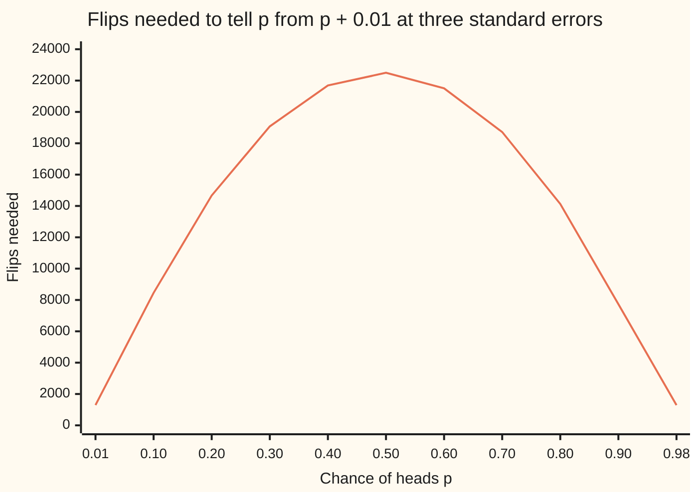
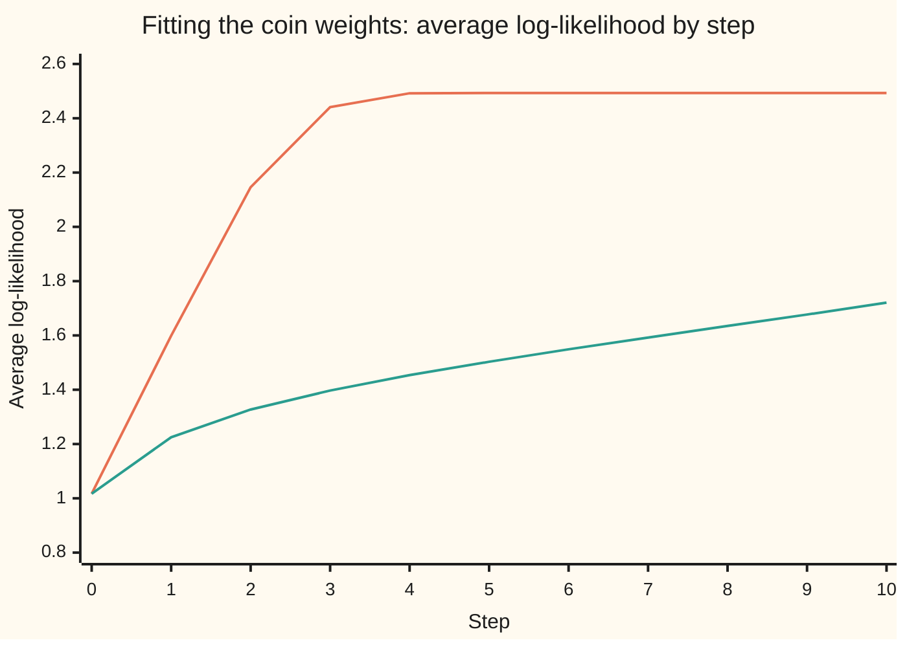

# Fisher metric: a family of models as a curved space

[Syllabus](../../../SYLLABUS.md) → [Differential geometry and Lie groups](../README.md) → [Geometric Analysis and Physics](../README.md#s07) → Fisher metric

---

## General Overview

A games inspector has two coin questions.

- **Is a coin fair, or slightly loaded?** Fair lands heads with chance 0.50; loaded lands heads with chance 0.51.
- **Is a trick coin a 98% coin or a 99% coin?** It lands heads with chance 0.98 or 0.99.

Both ask about a gap of 0.01 in the chance of heads. They are not equally hard. To separate the models by three standard errors, the first needs **22,497 flips** and the second **1,292**. (The standard errors are measured on the arcsine scale of Step 2, where every coin's estimate scatters by the same amount: one over the square root of the number of flips.) At those counts the best decision rule errs about equally often in both: 0.066808 and 0.066135 of the time.

So the chance of heads is a bad ruler for models. Near 0.50 a step of 0.01 is short: data barely notice it. Near 0.99 the same step is long: data notice it fast.

The **Fisher metric** is the right ruler. It gives each small step between two models a length equal to how fast data tell them apart. A family of models then becomes a space with distances, shortest paths and curvature, as on the [Riemannian metric](../05-Riemannian%20Geometry/01-riemannian-metrics.md) card. This subject is **information geometry**.

Two dials give real curvature. Coins from one mint are weighed, and their weights are modelled by a bell curve (a normal distribution) with a mean and a spread. Under the Fisher metric those two dials form a hyperbolic plane (a surface that curves like a saddle, by the same amount at every point), with constant curvature −1/2.

The ruler also fixes how to fit a model. A **natural-gradient step** climbs toward the best fit along the steepest path as the Fisher ruler measures it. On the coin weights, one natural step puts the mean exactly on the data and five steps finish the fit. The plain gradient, which ignores the ruler, needs 29 with step size 0.0002 g².

**The Fisher metric measures the distance between two nearby models by how fast data tell them apart; it turns a family of models into a curved space, and the steepest way uphill in that space is the natural gradient.**

**What kind of fact this is:** the Fisher metric is a definition. That it measures how fast evidence builds up, the metrics of the coin and normal families, and the normal family's curvature −1/2 are theorems, proved on this card in Why it works. That it is the only ruler, up to a constant factor, which does not change when data are summarized without loss is Čencov's theorem, stated here without proof; Amari's book (Sources) treats it. The natural gradient is a method.

### The picture: the same gap of 0.01 is not the same distance



The line (orange) is the number of flips needed to separate the chance p from p + 0.01. It peaks at the fair coin and falls toward both edges. A small number of flips means a long Fisher distance. The step from 0.01 to 0.02 and the step from 0.98 to 0.99 are mirror images, so both need 1,292 flips.

---

## The formula

A family of models has dials $`\theta^1, \theta^2, \dots`$ (the parameters). The upper index is a label, not a power. For the coin there is one dial, the chance of heads $`p`$. For the coin weights there are two, the mean $`\mu`$ and the standard deviation $`\sigma`$.

The **score** is the slope of the log-likelihood $`\ell`$ (the logarithm of the chance of one observation, or of its density for a measured weight) as a dial turns. The [Fisher information](../../09-Probability%20and%20statistics/07-Sampling%20and%20Estimation/07-fisher-information-and-cramer-rao.md) card defines it and averages its square. With two or more dials the averages of products of scores form a matrix, and that matrix is the metric:

```math
g_{ij}(\theta) = E\!\left[\frac{\partial \ell}{\partial \theta^i}\,\frac{\partial \ell}{\partial \theta^j}\right], \qquad ds^2 = g_{ij}\,d\theta^i\,d\theta^j, \qquad \theta^i_{\mathrm{new}} = \theta^i + \eta\,g^{ij}\,\frac{\partial \bar\ell}{\partial \theta^j}
```

**Read it aloud:** the metric is the average product of the scores; a small step's squared length is the metric applied to the step; a natural step moves each dial by the inverse metric times the slope of the average log-likelihood.

A repeated index, once up and once down, is summed over all its values, the summation rule used throughout this wing. For the two families on this card:

```math
\text{coin: } ds^2 = \frac{dp^2}{p(1-p)}, \qquad \text{normal: } ds^2 = \frac{d\mu^2 + 2\,d\sigma^2}{\sigma^2}, \qquad \Delta\mu = \eta\,(m - \mu), \quad \Delta\sigma = \eta\,\frac{v - \sigma^2}{2\sigma}
```

**Read it aloud:** a coin step's squared length is the step squared over $`p(1-p)`$; a normal step's is the mean step squared plus twice the spread step squared, over the spread squared; the natural step moves the mean toward the data mean and the spread toward the data's root-mean-square gap.

| Symbol | Plain meaning | In our example | Push it up and the answer… |
| --- | --- | --- | --- |
| $`p`$, $`n`$ | chance of heads; number of flips or weighings | 0.50 vs 0.51; 22,497 flips | $`p`$ toward an edge: distances grow; $`n`$: distances grow like $`\sqrt{n}`$ |
| $`\theta^i`$, $`\delta^i`$ | the model's dials, with $`i`$ a label; a small step in them | $`(\mu, \sigma)`$ | — |
| $`x`$, $`z`$ | one observation; its gap from $`\mu`$ in units of $`\sigma`$, $`z = (x - \mu)/\sigma`$ | one coin's weight in grams | — |
| $`\ell`$, $`E`$ | log-likelihood of one observation; the average over observations drawn from the model (not shelf 02's $`E`$) | $`\ell = -\ln\sigma - z^2/2 - \tfrac12\ln 2\pi`$ | — |
| $`g_{ij}`$, $`g^{ij}`$ | the Fisher metric; its inverse matrix | 400 and 800 per g², off-diagonal 0 | larger $`g`$: models tell apart faster |
| $`ds`$, $`d`$, $`\varepsilon`$ | length of a small step; distance, the length of the shortest path; a fixed small length in Step 5 | 0.020001 for 0.50 to 0.51 | — |
| $`D`$ | Kullback–Leibler divergence: average log-likelihood ratio per observation | 0.000200 | more evidence per observation |
| $`\mu`$, $`\sigma`$ | the normal model's mean and standard deviation | start 5.600 g, 0.050 g | larger $`\sigma`$: models crowd together |
| $`m`$, $`s`$, $`v`$ | the batch's mean and standard deviation; $`v = s^2 + (m - \mu)^2`$ | 5.670 g, 0.020 g; $`v`$ = 0.0053 g² at the start | — |
| $`\bar\ell`$ | average log-likelihood of the batch under the model | 1.016794 at the start | higher is a better fit |
| $`\eta`$, $`\Delta`$ | step size, read "eta"; $`\Delta`$ is the change one step makes (not the gap of the mass-gap card) | 1 | 0.5: 13 steps instead of 5 |
| $`K`$, $`u`$ | Gaussian curvature of the normal family; $`u = \mu/\sqrt2`$, a rescaled mean dial in Step 4 | $`-1/2`$ | — |

All distances on this card are pure numbers. The dials carry units, and the metric carries the inverse units squared, so they cancel.

### When it holds

- **The set of possible observations does not move with the dials.** The score needs the chance of each observation to have a slope. A quantity spread evenly between 0 and θ breaks this, as the [Fisher information](../../09-Probability%20and%20statistics/07-Sampling%20and%20Estimation/07-fisher-information-and-cramer-rao.md) card shows, and the metric is then not defined.
- **Every dial changes the model.** The matrix $`g_{ij}`$ must have an inverse. If two dials do the same job, for example a mean written as $`a + b`$, the matrix has no inverse and the natural step is not defined.
- **The model is inside the family, not on its edge.** At $`p = 0`$ or $`1`$ the coin metric divides by zero. The distance there stays finite: the whole coin family has length $`\pi`$ = 3.141593.
- **The natural step is chart-free only for small steps.** Its direction does not depend on the chart (the choice of dials). A full step does. In the chart $`(\mu, \ln\sigma)`$ the first step lands at $`\sigma`$ = 0.087534 g, not 0.078000 g.
- **Half the squared distance equals the divergence only for nearby models.** For 0.50 and 0.51 both are 0.000200. For 0.98 and 0.99 they are 0.003483 and 0.003914.

---

## Why it works

### Step 0: distance is the rate at which evidence builds up

To choose between two models, add up the log-likelihood ratio of each observation. Its average per observation, under the first model, is the **Kullback–Leibler divergence** $`D`$: the evidence one observation gives.

For nearby models the divergence is a quadratic form in the step, and the Fisher metric is that form: $`D \approx \tfrac12\,ds^2`$. So a step's Fisher length is its evidence per observation, on a square-root scale.

With $`n`$ independent observations the evidence adds, so distance grows like $`\sqrt{n}`$. For the coin, $`\sqrt{n}\,d`$ is the gap in standard errors on the arcsine scale of Step 2, where the estimate scatters by $`1/\sqrt{n}`$ whatever the coin. So 22,497 flips, which is $`3/0.020001`$ squared, put 0.50 and 0.51 three standard errors apart.

### Step 1: the divergence expands into the metric

Write $`\ell(\theta)`$ for the log-likelihood of one observation and expand $`\ell(\theta + d\theta)`$ to second order. The divergence is minus the average of the change:

```math
D(\theta \,\|\, \theta + d\theta) = -E\!\left[\frac{\partial \ell}{\partial \theta^i}\right] d\theta^i - \frac12\,E\!\left[\frac{\partial^2 \ell}{\partial \theta^i\,\partial \theta^j}\right] d\theta^i d\theta^j + \dots = \frac12\,g_{ij}\,d\theta^i d\theta^j + \dots
```

Two facts from the Fisher information card finish it. The score averages zero, so the first term vanishes. Minus the average second slope equals the average squared score, so the second term is half the metric.

The code checks this on the normal family: the divergence a small step either side, divided by the step squared, gives 400.00 and 800.01 per g², against the metric's 400 and 800.

### Step 2: the coin family is a quarter circle of radius 2

One flip has Fisher information $`1/(p(1-p))`$, from the Fisher information card. So $`ds^2 = dp^2/(p(1-p))`$.

Now place each coin at the point $`(2\sqrt{p},\ 2\sqrt{1-p})`$ of a flat plane. A step $`dp`$ moves that point by $`dp/\sqrt{p}`$ in one direction and $`dp/\sqrt{1-p}`$ in the other. Its squared length is $`dp^2/p + dp^2/(1-p) = dp^2/(p(1-p))`$, the Fisher length exactly.

All these points lie on a circle of radius 2, so the coin family is a quarter of that circle. Distance is arc length:

```math
d(p_0, p_1) = 2\,\left|\arcsin\sqrt{p_1} - \arcsin\sqrt{p_0}\right|
```

For 0.50 to 0.51 this gives 0.020001. For 0.98 to 0.99 it gives 0.083459, 4.17 times as long. The whole family, from $`p = 0`$ to $`p = 1`$, has length $`\pi`$.

A distance belongs to the family, not to the chart. Integrating $`ds`$ in the chart $`p`$ and in the log-odds chart $`\ln(p/(1-p))`$ gives the same 0.020001 and 0.083459. A one-dial family is a curve, which has no curvature of its own. Curvature needs two dials.

### Step 3: the normal family's metric

For a bell curve with mean $`\mu`$ and spread $`\sigma`$, write $`z = (x - \mu)/\sigma`$. The two scores are:

```math
\frac{\partial \ell}{\partial \mu} = \frac{z}{\sigma}, \qquad \frac{\partial \ell}{\partial \sigma} = \frac{z^2 - 1}{\sigma}
```

Average their products using three facts about a standard bell curve: the average of $`z^2`$ is 1, of $`z^3`$ is 0, and of $`z^4`$ is 3. The mean entry is $`1/\sigma^2`$. The spread entry is $`(3 - 2 + 1)/\sigma^2 = 2/\sigma^2`$. The cross entry is 0.

At the start guess, $`\sigma`$ = 0.050 g, the metric is 400 per g² for the mean and 800 per g² for the spread. The code reaches these four ways: the formula, a numerical integral over the bell curve, 200,000 simulated weighings (400.3, 801.4 and a cross term of 2.5, inside the simulation's scatter), and the divergence of Step 1.

The factor $`1/\sigma^2`$ is the whole story of this family. A gap of 0.07 g between two means is long when weights scatter by 0.020 g. The same gap is short when they scatter by 1 g.

### Step 4: the normal family is the hyperbolic plane

Put $`u = \mu/\sqrt2`$. The metric becomes $`ds^2 = 2\,(du^2 + d\sigma^2)/\sigma^2`$. Without the factor 2, this is the **upper half-plane**: the points with $`\sigma > 0`$, measured by $`(du^2 + d\sigma^2)/\sigma^2`$. It is a second flat map of the hyperbolic plane $`\mathbb{H}^2`$, beside the Poincaré disc of [Sphere, plane and hyperbolic space](../05-Riemannian%20Geometry/05-model-spaces-of-constant-curvature.md), with curvature −1 at every point. Multiplying every length by $`\sqrt2`$ divides the curvature by 2, so here $`K = -1/2`$ at every point. The fold below proves this directly from the metric.

The code computes $`K`$ from the metric with numerical slopes. With slope steps of 1% and 0.1% of $`\sigma`$ it gets −0.500350 and −0.500004, at both the start guess and the fit.

Shortest paths in the half-plane are half circles centred on the line $`\sigma = 0`$, and they give a closed form for the Fisher–Rao distance (the Fisher metric's distance) between two bell curves. Both are standard facts about the half-plane, stated here from Costa, Santos and Strapasson (Sources) and checked numerically, not proved. In the formula, arccosh undoes $`\cosh x = (e^x + e^{-x})/2`$:

```math
d = \sqrt2\,\mathrm{arccosh}\!\left(1 + \frac{(\mu_1 - \mu_2)^2/2 + (\sigma_1 - \sigma_2)^2}{2\,\sigma_1\sigma_2}\right)
```

From the start guess (5.600 g, 0.050 g) to the fit (5.670 g, 0.020 g) it is 2.319553. Integrating $`ds`$ along the half circle by Simpson's rule gives 2.319575 with 20 steps and 2.319554 with 40, closing on the closed form as the step halves. The straight line in the $`(\mu, \sigma)`$ dials is longer: 2.500054 by its own closed form, $`\sqrt{0.07^2 + 2\cdot 0.03^2}\;\ln(0.05/0.02)/0.03`$, and 2.500057 and 2.500054 by the same integral at 20 and 40 steps. The result is global: the half-plane is complete, so any two bell curves have a shortest path between them.

<details>
<summary>Detailed proof: the curvature from the metric</summary>

With no cross term and with $`g_{11}`$ and $`g_{22}`$ depending only on $`\sigma`$, the formula on [Sphere, plane and hyperbolic space](../05-Riemannian%20Geometry/05-model-spaces-of-constant-curvature.md) reduces to one term:

$`\displaystyle K = -\frac{1}{2\sqrt{g_{11}g_{22}}}\,\frac{\partial}{\partial\sigma}\!\left(\frac{\partial g_{11}/\partial\sigma}{\sqrt{g_{11}g_{22}}}\right)`$

Here $`g_{11} = 1/\sigma^2`$ and $`g_{22} = 2/\sigma^2`$, so $`\sqrt{g_{11}g_{22}} = \sqrt2/\sigma^2`$. The slope $`\partial g_{11}/\partial\sigma`$ is $`-2/\sigma^3`$. The fraction inside is $`-\sqrt2/\sigma`$, and its slope is $`\sqrt2/\sigma^2`$. So

$`\displaystyle K = -\frac{\sigma^2}{2\sqrt2}\cdot\frac{\sqrt2}{\sigma^2} = -\frac12`$

The code does the same calculation with every slope taken numerically from $`g_{11}`$ and $`g_{22}`$.

</details>

### Step 5: the natural gradient is the steepest way up, measured by the Fisher ruler

"Steepest" needs a ruler. The steepest step is the one that gains the most per unit length. The plain gradient $`\partial\bar\ell/\partial\theta^j`$ is steepest only if one unit of every dial counts as the same length. For grams against grams-of-spread, or for chance of heads, that is false.

Take the Fisher ruler instead. Among all steps $`\delta`$ of Fisher length $`\varepsilon`$, find the one that raises $`\bar\ell`$ most. The gain is $`(\partial\bar\ell/\partial\theta^j)\,\delta^j`$, which equals $`g_{ij}\,(g^{jk}\,\partial\bar\ell/\partial\theta^k)\,\delta^i`$: the Fisher inner product of the step with $`g^{jk}\,\partial\bar\ell/\partial\theta^k`$. An inner product is largest when both vectors point the same way (Cauchy–Schwarz). So the best step points along

```math
g^{ij}\,\frac{\partial \bar\ell}{\partial \theta^j}
```

This is the **natural gradient**: the wing's $`\mathrm{grad}\,f`$ for the Fisher metric. Stepping along it is [Riemannian gradient descent](05-optimisation-on-manifolds.md) run uphill on the space of models.

A brute-force check tries 36,000 directions of unit Fisher length and keeps the best. Its ratio of spread step to mean step is 0.4001; the formula gives 0.4000.

The natural step does not depend on units. In milligrams the gradient shrinks by 1,000 and the inverse metric grows by 1,000,000, so the step is 1,000 milligrams for every gram: the same model.

### Step 6: one natural step on the coin weights

For the bell curve, the batch's average log-likelihood is $`\bar\ell = -\ln\sigma - v/(2\sigma^2) - \tfrac12\ln 2\pi`$, where $`v = s^2 + (m - \mu)^2`$. Its slopes are:

```math
\frac{\partial \bar\ell}{\partial \mu} = \frac{m - \mu}{\sigma^2}, \qquad \frac{\partial \bar\ell}{\partial \sigma} = -\frac{1}{\sigma} + \frac{v}{\sigma^3}
```

Multiply by the inverse metric, $`\sigma^2`$ for the mean and $`\sigma^2/2`$ for the spread. The $`\sigma`$'s cancel and the natural step of The formula appears: $`\Delta\mu = \eta\,(m - \mu)`$ and $`\Delta\sigma = \eta\,(v - \sigma^2)/(2\sigma)`$.

With $`\eta = 1`$ the mean lands on the data mean $`m`$ in one step. The spread becomes $`(\sigma^2 + v)/(2\sigma)`$. That is Heron's rule for a square root, which roughly doubles the number of correct digits each step. From step 1 on, $`\mu = m`$, so $`v = s^2`$ and $`\sigma`$ heads quickly for $`s`$, the [Maximum likelihood](../../09-Probability%20and%20statistics/07-Sampling%20and%20Estimation/04-maximum-likelihood.md) answer.

This is no accident. The Fisher metric is minus the average second slope of the log-likelihood (Step 1), so a natural step of size 1 is a Newton step with the average curvature in place of the observed one. Statisticians call it **Fisher scoring**.

---

## Worked numbers, by hand

A batch of coins is weighed. The weights average $`m`$ = 5.670 g with standard deviation $`s`$ = 0.020 g. The starting model is a bell curve with $`\mu`$ = 5.600 g and $`\sigma`$ = 0.050 g. Step size $`\eta = 1`$.

| Step | Arithmetic | Value |
| --- | --- | --- |
| $`v`$ at the start | $`0.020^2 + (5.670 - 5.600)^2 = 0.0004 + 0.0049`$ | 0.0053 g² |
| metric, mean entry | $`1/0.050^2`$ | 400 per g² |
| metric, spread entry | $`2/0.050^2`$ | 800 per g² |
| slope in $`\mu`$ | $`0.070/0.0025`$ | 28.0000 per g |
| slope in $`\sigma`$ | $`-1/0.050 + 0.0053/0.000125 = -20 + 42.4`$ | 22.4000 per g |
| natural step in $`\mu`$ | $`28/400`$ | 0.070000 g |
| natural step in $`\sigma`$ | $`22.4/800`$ | 0.028000 g |
| **new model** | $`(5.600 + 0.070,\ 0.050 + 0.028)`$ | **5.670 g, 0.078 g** |
| average log-likelihood | from 1.016794 to | 1.599235 |

One step puts the mean exactly on the batch mean. The spread grows at first, because from the old mean the data looked widely scattered. Heron's rule then shrinks it: 0.041564, 0.025594, 0.020611, 0.020009, 0.020000 g.

| Natural step | $`\mu`$ (g) | $`\sigma`$ (g) | $`\bar\ell`$ |
| --- | --- | --- | --- |
| 0 | 5.600000 | 0.050000 | 1.016794 |
| 1 | 5.670000 | 0.078000 | 1.599235 |
| 2 | 5.670000 | 0.041564 | 2.145811 |
| 3 | 5.670000 | 0.025594 | 2.441141 |
| 4 | 5.670000 | 0.020611 | 2.492196 |
| 5 | 5.670000 | 0.020009 | 2.493084 |
| 6 | 5.670000 | 0.020000 | 2.493084 |

**After five natural steps the model is within 0.0001 g of the best fit, 5.670 g and 0.020 g.** The plain gradient with step size 0.0002 g² needs 29 steps for the same accuracy.



First line (orange): natural steps, at the top by step 5. Second line (green): plain gradient steps of size 0.0002 g², still climbing at step 10.

### What breaks if you drop a piece

| Mistake | Comes out at | What went wrong |
| --- | --- | --- |
| Treat the gap in $`p`$ as the distance | "0.50 vs 0.51 and 0.98 vs 0.99 are equally far apart" | They need 22,497 and 1,292 flips. The Fisher distances are 0.020001 and 0.083459, a ratio of 4.17 |
| Plain gradient, same step size 0.0002, weights in milligrams | a mean step of 0.0000000056 g instead of 0.005600 g | The plain step depends on units. The natural step is 0.070000 g in both units |
| Drop the 2 in the spread entry, using $`1/\sigma^2`$ | $`\sigma`$ = 0.106000 g after one step, not 0.078000 g | The spread score has average square $`2/\sigma^2`$, from the average of $`z^4`$ being 3 |
| Same natural step size, chart $`(\mu, \ln\sigma)`$ | $`\sigma`$ = 0.087534 g, not 0.078000 g | Chart-free only for small steps: at $`\eta = 0.01`$ the two charts give 0.0502800 and 0.0502808 g |
| Plain gradient with step size 0.0004 g² | $`\sigma`$ = 0.020484 g, then 0.019572 g, at steps 30 and 31 | Too large for the narrow spread direction: it overshoots back and forth across 0.020 g and is still not within 0.0001 g |

---

## Code, from first principles, and it actually runs

Both programs use only the standard library. They reach each answer by independent roads:

1. **Coin distance, three charts:** the arcsin closed form, the integral of $`ds`$ in the chart $`p`$, and the integral in the log-odds chart.
2. **Coin difficulty, exactly:** the exact binomial error of the best rule (pick the model with the higher likelihood) at the flip counts the metric predicts, against the bell-curve value 0.066807.
3. **Normal metric, four ways:** the formula, a Simpson integral of the score products over the bell curve, 200,000 simulated weighings from a SplitMix64 generator (a small random-number generator) with seed 20261119, and the divergence a small step either side.
4. **Curvature:** numerical slopes of the metric at two step sizes, against −1/2.
5. **Distance:** the arccosh closed form against the integral of $`ds`$ along the half circle at 20 and 40 Simpson steps; the straight line by its own closed form and the same integral.
6. **Natural gradient:** the inverse-metric formula against a search over 36,000 directions of unit Fisher length; then natural and plain steps run side by side, in grams and in milligrams.

### Python

```python
# Fisher metric: a family of models as a curved space.  Standard library only.
# Coin family: distance three ways, then exact error rates.  Normal family:
# Fisher matrix four ways, curvature, Fisher-Rao distance, natural-gradient steps.
from math import sqrt, log, exp, asin, acosh, atan2, cos, sin, pi

def simpson(f, a, b, n=2000):                         # n even; a plain loop, so Rust adds in the same order
    h, tot = (b - a) / n, 0.0
    for i in range(n + 1): tot += (1 if i in (0, n) else 4 if i % 2 else 2) * f(a + i * h)
    return h / 3 * tot

# ---- coins: ds^2 = dp^2 / (p(1-p)) per flip ----
def d_arc(p0, p1): return 2 * abs(asin(sqrt(p1)) - asin(sqrt(p0)))      # chart phi = asin(sqrt p)
def d_p(p0, p1): return simpson(lambda p: 1 / sqrt(p * (1 - p)), p0, p1)  # chart p
def d_logodds(p0, p1):                                                  # chart eta = ln(p/(1-p))
    e = lambda p: log(p / (1 - p))
    return simpson(lambda t: sqrt(exp(t)) / (1 + exp(t)), e(p0), e(p1))
def exact_error(p0, p1, n):                    # best rule: pick the model with higher likelihood
    lf = [0.0] * (n + 1)
    for k in range(1, n + 1): lf[k] = lf[k - 1] + log(k)
    e = 0.0
    for k in range(n + 1):
        c = lf[n] - lf[k] - lf[n - k]
        l0, l1 = c + k * log(p0) + (n - k) * log(1 - p0), c + k * log(p1) + (n - k) * log(1 - p1)
        e += exp(l0) if l1 > l0 else exp(l1)
    return e / 2
Phi = lambda x: simpson(lambda z: exp(-z * z / 2) / sqrt(2 * pi), -12, x)   # bell-curve area left of x
flips = {}
for p0, p1 in ((0.50, 0.51), (0.98, 0.99)):
    a, b, c = d_arc(p0, p1), d_p(p0, p1), d_logodds(p0, p1)
    n = round((3 / a) ** 2); flips[p0] = n
    kl = p0 * log(p0 / p1) + (1 - p0) * log((1 - p0) / (1 - p1))
    print(f"coin {p0:.2f} vs {p1:.2f}: distance arcsin {a:.6f} | p-chart {b:.6f} | log-odds chart {c:.6f}")
    print(f"  flips for 3 standard errors {n} | exact error {exact_error(p0, p1, n):.6f} | KL {kl:.6f} | d^2/2 {a * a / 2:.6f}")
    assert abs(a - b) < 1e-6 and abs(a - c) < 1e-6
print(f"normal approximation of that error Phi(-1.5) = {Phi(-1.5):.6f} | whole coin family length {d_arc(0, 1):.6f}")
assert all(abs(exact_error(p0, p1, flips[p0]) - Phi(-1.5)) < 0.002 for p0, p1 in ((0.50, 0.51), (0.98, 0.99)))
print(f"ratios, 0.98 pair over 0.50 pair: distance {d_arc(0.98, 0.99) / d_arc(0.50, 0.51):.2f} | flips {flips[0.50] / flips[0.98]:.1f}")
print("chart flips: " + ", ".join(f"{p:.2f}:{(3 / d_arc(p, p + 0.01)) ** 2:.0f}" for p in (0.01, 0.1, 0.2, 0.3, 0.4, 0.5, 0.6, 0.7, 0.8, 0.9, 0.98)))

# ---- normal family N(mu, sigma^2): coin weights in grams ----
m, s = 5.670, 0.020                                   # batch mean and standard deviation (divide by n)
mu0, sg0 = 5.600, 0.050                               # starting guess
def L(mu, sg): return -log(sg) - (s * s + (m - mu) ** 2) / (2 * sg * sg) - 0.5 * log(2 * pi)
def grad(mu, sg, u=1.0):                              # u = 1000 when every length is in milligrams
    v = (s * u) ** 2 + (m * u - mu) ** 2
    return (m * u - mu) / sg ** 2, -1 / sg + v / sg ** 3
def g(mu, sg): return 1 / sg ** 2, 2 / sg ** 2       # Fisher matrix diag(g_11, g_22), g_12 = 0
def score(x, mu, sg): z = (x - mu) / sg; return z / sg, (z * z - 1) / sg
dens = lambda z: exp(-z * z / 2) / sqrt(2 * pi)
quad = [simpson(lambda z: f(score(mu0 + sg0 * z, mu0, sg0)) * dens(z), -12, 12)
        for f in (lambda t: t[0] ** 2, lambda t: t[1] ** 2, lambda t: t[0] * t[1])]
state = 20261119                                      # SplitMix64 for the simulation road
def u01():
    global state
    state = (state + 0x9E3779B97F4A7C15) & 0xFFFFFFFFFFFFFFFF
    z = state
    z = ((z ^ (z >> 30)) * 0xBF58476D1CE4E5B9) & 0xFFFFFFFFFFFFFFFF
    z = ((z ^ (z >> 27)) * 0x94D049BB133111EB) & 0xFFFFFFFFFFFFFFFF
    return ((z ^ (z >> 31)) >> 11) / 2.0 ** 53
N, mc = 200000, [0.0, 0.0, 0.0]
for _ in range(N // 2):
    r, t = sqrt(-2 * log(1 - u01())), 2 * pi * u01()
    for z in (r * cos(t), r * sin(t)):
        a, b = score(mu0 + sg0 * z, mu0, sg0); mc[0] += a * a / N; mc[1] += b * b / N; mc[2] += a * b / N
def kl(m1, s1, m2, s2): return log(s2 / s1) + (s1 * s1 + (m1 - m2) ** 2) / (2 * s2 * s2) - 0.5
h = 1e-4
klg = ((kl(mu0, sg0, mu0 + h, sg0) + kl(mu0, sg0, mu0 - h, sg0)) / h ** 2,
       (kl(mu0, sg0, mu0, sg0 + h) + kl(mu0, sg0, mu0, sg0 - h)) / h ** 2)
G = g(mu0, sg0)
print(f"Fisher at (5.600, 0.050): formula {G[0]:.4f} {G[1]:.4f} 0 | quadrature {quad[0]:.4f} {quad[1]:.4f} {abs(quad[2]):.4f}")
print(f"  simulated {mc[0]:.1f} {mc[1]:.1f} {mc[2]:.1f} | KL both sides / h^2 {klg[0]:.2f} {klg[1]:.2f}")
assert abs(quad[0] - G[0]) < 1e-6 and abs(quad[1] - G[1]) < 1e-6 and abs(quad[2]) < 1e-9
assert abs(mc[0] - G[0]) < 5 * G[0] * sqrt(2 / N) and abs(mc[1] - G[1]) < 5 * G[1] * sqrt(8 / N)
assert abs(klg[0] - G[0]) < 0.1 and abs(klg[1] - G[1]) < 0.5
def K(mu, sg, r):                                        # Brioschi with F = 0, every slope numerical
    E, Gf = (lambda y: g(mu, y)[0]), (lambda y: g(mu, y)[1]); e = sg * r
    f = lambda y: (E(y + e) - E(y - e)) / (2 * e) / sqrt(E(y) * Gf(y))   # E_sigma / sqrt(EG); G_mu = 0
    return -(f(sg + e) - f(sg - e)) / (2 * e) / (2 * sqrt(E(sg) * Gf(sg)))
print(f"curvature K, slope steps 1% and 0.1% of sigma: start {K(mu0, sg0, 1e-2):.6f} {K(mu0, sg0, 1e-3):.6f} | fit {K(m, s, 1e-2):.6f} {K(m, s, 1e-3):.6f}")
assert abs(K(mu0, sg0, 1e-3) + 0.5) < 1e-5 and abs(K(m, s, 1e-3) + 0.5) < 1e-5

def d_closed(m1, s1, m2, s2): return sqrt(2) * acosh(1 + ((m1 - m2) ** 2 / 2 + (s1 - s2) ** 2) / (2 * s1 * s2))
def length(path, n):                                  # Fisher length of a path t -> (mu, sigma), t in [0, 1]
    def ds(t):
        e = 1e-6; (a1, b1), (a2, b2) = path(t - e), path(t + e)
        return sqrt((a2 - a1) ** 2 + 2 * (b2 - b1) ** 2) / (2 * e) / path(t)[1]
    return simpson(ds, 0.0, 1.0, n)                   # Simpson's rule with n steps
x1, x2 = mu0 / sqrt(2), m / sqrt(2)                   # geodesic: half circle in (mu/sqrt2, sigma)
c = (x2 ** 2 + s ** 2 - x1 ** 2 - sg0 ** 2) / (2 * (x2 - x1)); R = sqrt((x1 - c) ** 2 + sg0 ** 2)
t1, t2 = atan2(sg0, x1 - c), atan2(s, x2 - c)
arc = lambda t: (sqrt(2) * (c + R * cos(t1 + (t2 - t1) * t)), R * sin(t1 + (t2 - t1) * t))
line = lambda t: (mu0 + (m - mu0) * t, sg0 + (s - sg0) * t)
dc, da, db, dl, dm = d_closed(mu0, sg0, m, s), length(arc, 20), length(arc, 40), length(line, 20), length(line, 40)
lc = sqrt((m - mu0) ** 2 + 2 * (s - sg0) ** 2) / (sg0 - s) * log(sg0 / s)   # straight line, closed form
print(f"Fisher-Rao distance start to fit: closed form {dc:.6f} | along geodesic, 20 and 40 steps {da:.6f} {db:.6f}")
print(f"  straight line: 20 and 40 steps {dl:.6f} {dm:.6f} | closed form {lc:.6f}")
assert abs(dc - db) < 1e-5 and abs(dc - db) < abs(dc - da) / 8 and abs(dm - lc) < 1e-6 and lc > dc  # halving the step

gm, gs = grad(mu0, sg0)
nat = (gm / G[0], gs / G[1])                           # natural gradient g^ij dL/dtheta^j
best = max(range(36000), key=lambda k: gm * cos(k * pi / 18000) / sqrt(G[0]) + gs * sin(k * pi / 18000) / sqrt(G[1]))
th = best * pi / 18000; dirn = (cos(th) / sqrt(G[0]), sin(th) / sqrt(G[1]))  # best unit-Fisher-length step
print(f"gradient {gm:.4f} {gs:.4f} | natural step {nat[0]:.6f} {nat[1]:.6f} | slope ratio formula {nat[1] / nat[0]:.4f}, search {dirn[1] / dirn[0]:.4f}")
assert abs(nat[1] / nat[0] - dirn[1] / dirn[0]) < 1e-3
def natural(mu, sg, eta=1.0, u=1.0):
    a, b = grad(mu, sg, u); A, B = g(mu, sg); return mu + eta * a / A, sg + eta * b / B
def plain(mu, sg, eta, u=1.0):
    a, b = grad(mu, sg, u); return mu + eta * a, sg + eta * b
pn, pp = [(mu0, sg0)], [(mu0, sg0)]
for k in range(30): pn.append(natural(*pn[-1])); pp.append(plain(*pp[-1], 0.0002))
for k in range(7): print(f"natural step {k}: mu {pn[k][0]:.6f} sigma {pn[k][1]:.6f} avg log-lik {L(*pn[k]):.6f}")
print("chart natural: " + ", ".join(f"{L(*q):.3f}" for q in pn[:11]))
print("chart plain:   " + ", ".join(f"{L(*q):.3f}" for q in pp[:11]))
close = lambda q: abs(q[0] - m) < 1e-4 and abs(q[1] - s) < 1e-4
first = lambda qs: next(k for k, q in enumerate(qs) if close(q))
q4 = [(mu0, sg0)]
for k in range(31): q4.append(plain(*q4[-1], 0.0004))
print(f"steps to within 0.0001 g: natural {first(pn)} | plain eta 0.0002 {first(pp)} | plain eta 0.0004 sigma at 30, 31: {q4[30][1]:.6f} {q4[31][1]:.6f}")
assert first(pn) == 5 and first(pp) > 20 and abs(pn[1][0] - m) < 1e-12

# ---- what breaks ----
mg = plain(mu0 * 1000, sg0 * 1000, 0.0002, 1000)            # same eta, coordinates in milligrams
nmg = natural(mu0 * 1000, sg0 * 1000, 1.0, 1000)
one = sg0 + gs * sg0 ** 2                             # Fisher entry for sigma taken as 1/sigma^2
tau = log(sg0) + sg0 * gs / 2                          # natural step in chart (mu, ln sigma): g = diag(1/sigma^2, 2)
small = (sg0 + 0.01 * gs / G[1], exp(log(sg0) + 0.01 * sg0 * gs / 2))
print(f"plain step in g {pp[1][0] - mu0:.6f} | same eta in mg, back in g {(mg[0] - mu0 * 1000) / 1000:.10f} | natural in mg, back in g {(nmg[0] - mu0 * 1000) / 1000:.6f}")
print(f"sigma after one step: right {pn[1][1]:.6f} | missing the 2 {one:.6f} | chart ln sigma {exp(tau):.6f} | eta 0.01 both charts {small[0]:.7f} {small[1]:.7f}")
assert abs((nmg[0] - mu0 * 1000) / 1000 - nat[0]) < 1e-9 and abs(small[0] - small[1]) < 1e-6 < abs(exp(tau) - pn[1][1])

# ---- try changing ----
nh = [(mu0, sg0)]
for k in range(30): nh.append(natural(*nh[-1], 0.5))
nw = [(mu0, 0.010)]
for k in range(30): nw.append(natural(*nw[-1]))
print(f"try: 0.50 vs 0.51 at 4 standard errors {(4 / d_arc(0.50, 0.51)) ** 2:.0f} flips | natural eta 0.5 steps {first(nh)} | start sigma 0.010: step 1 sigma {nw[1][1]:.6f}, steps {first(nw)}")
print("ALL CHECKS PASS")
```

**Ran 2026-11-19 on macOS, Python 3.14.10, standard library only. All checks passed. Output, pasted from the run:**

```
coin 0.50 vs 0.51: distance arcsin 0.020001 | p-chart 0.020001 | log-odds chart 0.020001
  flips for 3 standard errors 22497 | exact error 0.066808 | KL 0.000200 | d^2/2 0.000200
coin 0.98 vs 0.99: distance arcsin 0.083459 | p-chart 0.083459 | log-odds chart 0.083459
  flips for 3 standard errors 1292 | exact error 0.066135 | KL 0.003914 | d^2/2 0.003483
normal approximation of that error Phi(-1.5) = 0.066807 | whole coin family length 3.141593
ratios, 0.98 pair over 0.50 pair: distance 4.17 | flips 17.4
chart flips: 0.01:1292, 0.10:8453, 0.20:14666, 0.30:19077, 0.40:21687, 0.50:22497, 0.60:21507, 0.70:18717, 0.80:14126, 0.90:7733, 0.98:1292
Fisher at (5.600, 0.050): formula 400.0000 800.0000 0 | quadrature 400.0000 800.0000 0.0000
  simulated 400.3 801.4 2.5 | KL both sides / h^2 400.00 800.01
curvature K, slope steps 1% and 0.1% of sigma: start -0.500350 -0.500004 | fit -0.500350 -0.500004
Fisher-Rao distance start to fit: closed form 2.319553 | along geodesic, 20 and 40 steps 2.319575 2.319554
  straight line: 20 and 40 steps 2.500057 2.500054 | closed form 2.500054
gradient 28.0000 22.4000 | natural step 0.070000 0.028000 | slope ratio formula 0.4000, search 0.4001
natural step 0: mu 5.600000 sigma 0.050000 avg log-lik 1.016794
natural step 1: mu 5.670000 sigma 0.078000 avg log-lik 1.599235
natural step 2: mu 5.670000 sigma 0.041564 avg log-lik 2.145811
natural step 3: mu 5.670000 sigma 0.025594 avg log-lik 2.441141
natural step 4: mu 5.670000 sigma 0.020611 avg log-lik 2.492196
natural step 5: mu 5.670000 sigma 0.020009 avg log-lik 2.493084
natural step 6: mu 5.670000 sigma 0.020000 avg log-lik 2.493084
chart natural: 1.017, 1.599, 2.146, 2.441, 2.492, 2.493, 2.493, 2.493, 2.493, 2.493, 2.493
chart plain:   1.017, 1.225, 1.327, 1.397, 1.454, 1.503, 1.549, 1.592, 1.635, 1.677, 1.721
steps to within 0.0001 g: natural 5 | plain eta 0.0002 29 | plain eta 0.0004 sigma at 30, 31: 0.020484 0.019572
plain step in g 0.005600 | same eta in mg, back in g 0.0000000056 | natural in mg, back in g 0.070000
sigma after one step: right 0.078000 | missing the 2 0.106000 | chart ln sigma 0.087534 | eta 0.01 both charts 0.0502800 0.0502808
try: 0.50 vs 0.51 at 4 standard errors 39995 flips | natural eta 0.5 steps 13 | start sigma 0.010: step 1 sigma 0.270000, steps 7
ALL CHECKS PASS
```

### Rust

```rust
// Fisher metric: a family of models as a curved space.  std only, no crates.
// Coin family: distance three ways, then exact error rates.  Normal family:
// Fisher matrix four ways, curvature, Fisher-Rao distance, natural-gradient steps.
use std::f64::consts::PI;

fn simpson(f: &dyn Fn(f64) -> f64, a: f64, b: f64, n: usize) -> f64 {
    let h = (b - a) / n as f64;
    let mut tot = 0.0;
    for i in 0..=n {
        let w = if i == 0 || i == n { 1.0 } else if i % 2 == 1 { 4.0 } else { 2.0 };
        tot += w * f(a + i as f64 * h);
    }
    h / 3.0 * tot
}
// ---- coins: ds^2 = dp^2 / (p(1-p)) per flip ----
fn d_arc(p0: f64, p1: f64) -> f64 { 2.0 * (p1.sqrt().asin() - p0.sqrt().asin()).abs() }
fn d_p(p0: f64, p1: f64) -> f64 { simpson(&|p: f64| 1.0 / (p * (1.0 - p)).sqrt(), p0, p1, 2000) }
fn d_logodds(p0: f64, p1: f64) -> f64 {
    let e = |p: f64| (p / (1.0 - p)).ln();
    simpson(&|t: f64| t.exp().sqrt() / (1.0 + t.exp()), e(p0), e(p1), 2000)
}
fn exact_error(p0: f64, p1: f64, n: usize) -> f64 { // best rule: pick the model with higher likelihood
    let mut lf = vec![0.0; n + 1];
    for k in 1..=n { lf[k] = lf[k - 1] + (k as f64).ln(); }
    let mut e = 0.0;
    for k in 0..=n {
        let (kf, rf) = (k as f64, (n - k) as f64);
        let c = lf[n] - lf[k] - lf[n - k];
        let l0 = c + kf * p0.ln() + rf * (1.0 - p0).ln();
        let l1 = c + kf * p1.ln() + rf * (1.0 - p1).ln();
        e += if l1 > l0 { l0.exp() } else { l1.exp() };
    }
    e / 2.0
}
fn phi(x: f64) -> f64 { simpson(&|z: f64| (-z * z / 2.0).exp() / (2.0 * PI).sqrt(), -12.0, x, 2000) }
// ---- normal family N(mu, sigma^2): coin weights in grams ----
const M: f64 = 5.670; const S: f64 = 0.020; // batch mean and standard deviation (divide by n)
const MU0: f64 = 5.600; const SG0: f64 = 0.050; // starting guess
fn avg_ll(mu: f64, sg: f64) -> f64 { -sg.ln() - (S * S + (M - mu).powi(2)) / (2.0 * sg * sg) - 0.5 * (2.0 * PI).ln() }
fn grad(mu: f64, sg: f64, u: f64) -> (f64, f64) { // u = 1000 when every length is in milligrams
    let v = (S * u).powi(2) + (M * u - mu).powi(2);
    ((M * u - mu) / sg.powi(2), -1.0 / sg + v / sg.powi(3))
}
fn g(_mu: f64, sg: f64) -> (f64, f64) { (1.0 / sg.powi(2), 2.0 / sg.powi(2)) } // diag(g_11, g_22), g_12 = 0
fn score(x: f64, mu: f64, sg: f64) -> (f64, f64) { let z = (x - mu) / sg; (z / sg, (z * z - 1.0) / sg) }
fn dens(z: f64) -> f64 { (-z * z / 2.0).exp() / (2.0 * PI).sqrt() }
struct Rng(u64); // SplitMix64 for the simulation road
impl Rng {
    fn u01(&mut self) -> f64 {
        self.0 = self.0.wrapping_add(0x9E3779B97F4A7C15);
        let mut z = self.0;
        z = (z ^ (z >> 30)).wrapping_mul(0xBF58476D1CE4E5B9);
        z = (z ^ (z >> 27)).wrapping_mul(0x94D049BB133111EB);
        ((z ^ (z >> 31)) >> 11) as f64 / 2f64.powi(53)
    }
}
fn kl(m1: f64, s1: f64, m2: f64, s2: f64) -> f64 { (s2 / s1).ln() + (s1 * s1 + (m1 - m2).powi(2)) / (2.0 * s2 * s2) - 0.5 }
fn curv(mu: f64, sg: f64, r: f64) -> f64 { // Brioschi with F = 0, every slope numerical
    let e = sg * r;
    let ee = |y: f64| g(mu, y).0; let gg = |y: f64| g(mu, y).1;
    let f = |y: f64| (ee(y + e) - ee(y - e)) / (2.0 * e) / (ee(y) * gg(y)).sqrt(); // E_sigma / sqrt(EG); G_mu = 0
    -(f(sg + e) - f(sg - e)) / (2.0 * e) / (2.0 * (ee(sg) * gg(sg)).sqrt())
}
fn d_closed(m1: f64, s1: f64, m2: f64, s2: f64) -> f64 {
    2f64.sqrt() * (1.0 + ((m1 - m2).powi(2) / 2.0 + (s1 - s2).powi(2)) / (2.0 * s1 * s2)).acosh()
}
fn length(path: &dyn Fn(f64) -> (f64, f64), n: usize) -> f64 { // Fisher length of a path t -> (mu, sigma), t in [0, 1]
    let ds = |t: f64| {
        let e = 1e-6; let (a1, b1) = path(t - e); let (a2, b2) = path(t + e);
        ((a2 - a1).powi(2) + 2.0 * (b2 - b1).powi(2)).sqrt() / (2.0 * e) / path(t).1
    };
    simpson(&ds, 0.0, 1.0, n) // Simpson's rule with n steps
}
fn natural(q: (f64, f64), eta: f64, u: f64) -> (f64, f64) {
    let (a, b) = grad(q.0, q.1, u); let (aa, bb) = g(q.0, q.1); (q.0 + eta * a / aa, q.1 + eta * b / bb)
}
fn plain(q: (f64, f64), eta: f64, u: f64) -> (f64, f64) { let (a, b) = grad(q.0, q.1, u); (q.0 + eta * a, q.1 + eta * b) }
fn first(qs: &[(f64, f64)]) -> usize { qs.iter().position(|q| (q.0 - M).abs() < 1e-4 && (q.1 - S).abs() < 1e-4).unwrap() }
fn run(start: (f64, f64), steps: usize, step: &dyn Fn((f64, f64)) -> (f64, f64)) -> Vec<(f64, f64)> {
    let mut v = vec![start];
    for _ in 0..steps { let q = step(*v.last().unwrap()); v.push(q); }
    v
}

fn main() {
    let (mut flips, mut errs) = (vec![], vec![]);
    for (p0, p1) in [(0.50, 0.51), (0.98, 0.99)] {
        let (a, b, c) = (d_arc(p0, p1), d_p(p0, p1), d_logodds(p0, p1));
        let n = (3.0 / a).powi(2).round() as usize; flips.push(n);
        let klc = p0 * (p0 / p1).ln() + (1.0 - p0) * ((1.0 - p0) / (1.0 - p1)).ln();
        let er = exact_error(p0, p1, n); errs.push(er);
        println!("coin {:.2} vs {:.2}: distance arcsin {:.6} | p-chart {:.6} | log-odds chart {:.6}", p0, p1, a, b, c);
        println!("  flips for 3 standard errors {} | exact error {:.6} | KL {:.6} | d^2/2 {:.6}", n, er, klc, a * a / 2.0);
        assert!((a - b).abs() < 1e-6 && (a - c).abs() < 1e-6);
    }
    println!("normal approximation of that error Phi(-1.5) = {:.6} | whole coin family length {:.6}", phi(-1.5), d_arc(0.0, 1.0));
    assert!((errs[0] - phi(-1.5)).abs() < 0.002 && (errs[1] - phi(-1.5)).abs() < 0.002);
    println!("ratios, 0.98 pair over 0.50 pair: distance {:.2} | flips {:.1}", d_arc(0.98, 0.99) / d_arc(0.50, 0.51), flips[0] as f64 / flips[1] as f64);
    let pts: Vec<String> = [0.01, 0.1, 0.2, 0.3, 0.4, 0.5, 0.6, 0.7, 0.8, 0.9, 0.98].iter()
        .map(|&p| format!("{:.2}:{:.0}", p, (3.0 / d_arc(p, p + 0.01)).powi(2))).collect();
    println!("chart flips: {}", pts.join(", "));

    let fs: [fn((f64, f64)) -> f64; 3] = [|t| t.0 * t.0, |t| t.1 * t.1, |t| t.0 * t.1];
    let quad: Vec<f64> = fs.iter().map(|f| simpson(&|z: f64| f(score(MU0 + SG0 * z, MU0, SG0)) * dens(z), -12.0, 12.0, 2000)).collect();
    let mut rng = Rng(20261119);
    let nn = 200000usize; let nf = nn as f64;
    let mut mc = [0.0f64; 3];
    for _ in 0..nn / 2 {
        let r = (-2.0 * (1.0 - rng.u01()).ln()).sqrt(); let t = 2.0 * PI * rng.u01();
        for z in [r * t.cos(), r * t.sin()] {
            let (a, b) = score(MU0 + SG0 * z, MU0, SG0); mc[0] += a * a / nf; mc[1] += b * b / nf; mc[2] += a * b / nf;
        }
    }
    let h = 1e-4;
    let klg = ((kl(MU0, SG0, MU0 + h, SG0) + kl(MU0, SG0, MU0 - h, SG0)) / (h * h),
               (kl(MU0, SG0, MU0, SG0 + h) + kl(MU0, SG0, MU0, SG0 - h)) / (h * h));
    let gm0 = g(MU0, SG0);
    println!("Fisher at (5.600, 0.050): formula {:.4} {:.4} 0 | quadrature {:.4} {:.4} {:.4}", gm0.0, gm0.1, quad[0], quad[1], quad[2].abs());
    println!("  simulated {:.1} {:.1} {:.1} | KL both sides / h^2 {:.2} {:.2}", mc[0], mc[1], mc[2], klg.0, klg.1);
    assert!((quad[0] - gm0.0).abs() < 1e-6 && (quad[1] - gm0.1).abs() < 1e-6 && quad[2].abs() < 1e-9);
    assert!((mc[0] - gm0.0).abs() < 5.0 * gm0.0 * (2.0 / nf).sqrt() && (mc[1] - gm0.1).abs() < 5.0 * gm0.1 * (8.0 / nf).sqrt());
    assert!((klg.0 - gm0.0).abs() < 0.1 && (klg.1 - gm0.1).abs() < 0.5);
    println!("curvature K, slope steps 1% and 0.1% of sigma: start {:.6} {:.6} | fit {:.6} {:.6}",
             curv(MU0, SG0, 1e-2), curv(MU0, SG0, 1e-3), curv(M, S, 1e-2), curv(M, S, 1e-3));
    assert!((curv(MU0, SG0, 1e-3) + 0.5).abs() < 1e-5 && (curv(M, S, 1e-3) + 0.5).abs() < 1e-5);

    let (x1, x2) = (MU0 / 2f64.sqrt(), M / 2f64.sqrt()); // geodesic: half circle in (mu/sqrt2, sigma)
    let c = (x2 * x2 + S * S - x1 * x1 - SG0 * SG0) / (2.0 * (x2 - x1)); let rr = ((x1 - c).powi(2) + SG0 * SG0).sqrt();
    let (t1, t2) = (SG0.atan2(x1 - c), S.atan2(x2 - c));
    let arc = |t: f64| (2f64.sqrt() * (c + rr * (t1 + (t2 - t1) * t).cos()), rr * (t1 + (t2 - t1) * t).sin());
    let line = |t: f64| (MU0 + (M - MU0) * t, SG0 + (S - SG0) * t);
    let (dc, da, db, dl, dm) = (d_closed(MU0, SG0, M, S), length(&arc, 20), length(&arc, 40), length(&line, 20), length(&line, 40));
    let lc = ((M - MU0).powi(2) + 2.0 * (S - SG0).powi(2)).sqrt() / (SG0 - S) * (SG0 / S).ln(); // straight line, closed form
    println!("Fisher-Rao distance start to fit: closed form {:.6} | along geodesic, 20 and 40 steps {:.6} {:.6}", dc, da, db);
    println!("  straight line: 20 and 40 steps {:.6} {:.6} | closed form {:.6}", dl, dm, lc);
    assert!((dc - db).abs() < 1e-5 && (dc - db).abs() < (dc - da).abs() / 8.0 && (dm - lc).abs() < 1e-6 && lc > dc); // halving the step

    let (gm, gs) = grad(MU0, SG0, 1.0);
    let nat = (gm / gm0.0, gs / gm0.1); // natural gradient g^ij dL/dtheta^j
    let score_dir = |k: usize| { let a = k as f64 * PI / 18000.0; gm * a.cos() / gm0.0.sqrt() + gs * a.sin() / gm0.1.sqrt() };
    let mut best = 0; for k in 0..36000 { if score_dir(k) > score_dir(best) { best = k; } }
    let th = best as f64 * PI / 18000.0; let dirn = (th.cos() / gm0.0.sqrt(), th.sin() / gm0.1.sqrt()); // best unit-Fisher-length step
    println!("gradient {:.4} {:.4} | natural step {:.6} {:.6} | slope ratio formula {:.4}, search {:.4}", gm, gs, nat.0, nat.1, nat.1 / nat.0, dirn.1 / dirn.0);
    assert!((nat.1 / nat.0 - dirn.1 / dirn.0).abs() < 1e-3);
    let pn = run((MU0, SG0), 30, &|q| natural(q, 1.0, 1.0));
    let pp = run((MU0, SG0), 30, &|q| plain(q, 0.0002, 1.0));
    for k in 0..7 { println!("natural step {}: mu {:.6} sigma {:.6} avg log-lik {:.6}", k, pn[k].0, pn[k].1, avg_ll(pn[k].0, pn[k].1)); }
    let ch = |v: &[(f64, f64)]| v[..11].iter().map(|q| format!("{:.3}", avg_ll(q.0, q.1))).collect::<Vec<_>>().join(", ");
    println!("chart natural: {}\nchart plain:   {}", ch(&pn), ch(&pp));
    let q4 = run((MU0, SG0), 31, &|q| plain(q, 0.0004, 1.0));
    println!("steps to within 0.0001 g: natural {} | plain eta 0.0002 {} | plain eta 0.0004 sigma at 30, 31: {:.6} {:.6}", first(&pn), first(&pp), q4[30].1, q4[31].1);
    assert!(first(&pn) == 5 && first(&pp) > 20 && (pn[1].0 - M).abs() < 1e-12);

    // ---- what breaks ----
    let mg = plain((MU0 * 1000.0, SG0 * 1000.0), 0.0002, 1000.0); // same eta, coordinates in milligrams
    let nmg = natural((MU0 * 1000.0, SG0 * 1000.0), 1.0, 1000.0);
    let one = SG0 + gs * SG0 * SG0; // Fisher entry for sigma taken as 1/sigma^2
    let tau = SG0.ln() + SG0 * gs / 2.0; // natural step in chart (mu, ln sigma): g = diag(1/sigma^2, 2)
    let small = (SG0 + 0.01 * gs / gm0.1, (SG0.ln() + 0.01 * SG0 * gs / 2.0).exp());
    println!("plain step in g {:.6} | same eta in mg, back in g {:.10} | natural in mg, back in g {:.6}", pp[1].0 - MU0, (mg.0 - MU0 * 1000.0) / 1000.0, (nmg.0 - MU0 * 1000.0) / 1000.0);
    println!("sigma after one step: right {:.6} | missing the 2 {:.6} | chart ln sigma {:.6} | eta 0.01 both charts {:.7} {:.7}", pn[1].1, one, tau.exp(), small.0, small.1);
    assert!(((nmg.0 - MU0 * 1000.0) / 1000.0 - nat.0).abs() < 1e-9 && (small.0 - small.1).abs() < 1e-6 && 1e-6 < (tau.exp() - pn[1].1).abs());

    // ---- try changing ----
    let nh = run((MU0, SG0), 30, &|q| natural(q, 0.5, 1.0));
    let nw = run((MU0, 0.010), 30, &|q| natural(q, 1.0, 1.0));
    println!("try: 0.50 vs 0.51 at 4 standard errors {:.0} flips | natural eta 0.5 steps {} | start sigma 0.010: step 1 sigma {:.6}, steps {}",
             (4.0 / d_arc(0.50, 0.51)).powi(2), first(&nh), nw[1].1, first(&nw));
    println!("ALL CHECKS PASS");
}
```

**Ran 2026-11-19 on macOS, rustc 1.98.1, no crates. All checks passed. Output, pasted from the run:**

```
coin 0.50 vs 0.51: distance arcsin 0.020001 | p-chart 0.020001 | log-odds chart 0.020001
  flips for 3 standard errors 22497 | exact error 0.066808 | KL 0.000200 | d^2/2 0.000200
coin 0.98 vs 0.99: distance arcsin 0.083459 | p-chart 0.083459 | log-odds chart 0.083459
  flips for 3 standard errors 1292 | exact error 0.066135 | KL 0.003914 | d^2/2 0.003483
normal approximation of that error Phi(-1.5) = 0.066807 | whole coin family length 3.141593
ratios, 0.98 pair over 0.50 pair: distance 4.17 | flips 17.4
chart flips: 0.01:1292, 0.10:8453, 0.20:14666, 0.30:19077, 0.40:21687, 0.50:22497, 0.60:21507, 0.70:18717, 0.80:14126, 0.90:7733, 0.98:1292
Fisher at (5.600, 0.050): formula 400.0000 800.0000 0 | quadrature 400.0000 800.0000 0.0000
  simulated 400.3 801.4 2.5 | KL both sides / h^2 400.00 800.01
curvature K, slope steps 1% and 0.1% of sigma: start -0.500350 -0.500004 | fit -0.500350 -0.500004
Fisher-Rao distance start to fit: closed form 2.319553 | along geodesic, 20 and 40 steps 2.319575 2.319554
  straight line: 20 and 40 steps 2.500057 2.500054 | closed form 2.500054
gradient 28.0000 22.4000 | natural step 0.070000 0.028000 | slope ratio formula 0.4000, search 0.4001
natural step 0: mu 5.600000 sigma 0.050000 avg log-lik 1.016794
natural step 1: mu 5.670000 sigma 0.078000 avg log-lik 1.599235
natural step 2: mu 5.670000 sigma 0.041564 avg log-lik 2.145811
natural step 3: mu 5.670000 sigma 0.025594 avg log-lik 2.441141
natural step 4: mu 5.670000 sigma 0.020611 avg log-lik 2.492196
natural step 5: mu 5.670000 sigma 0.020009 avg log-lik 2.493084
natural step 6: mu 5.670000 sigma 0.020000 avg log-lik 2.493084
chart natural: 1.017, 1.599, 2.146, 2.441, 2.492, 2.493, 2.493, 2.493, 2.493, 2.493, 2.493
chart plain:   1.017, 1.225, 1.327, 1.397, 1.454, 1.503, 1.549, 1.592, 1.635, 1.677, 1.721
steps to within 0.0001 g: natural 5 | plain eta 0.0002 29 | plain eta 0.0004 sigma at 30, 31: 0.020484 0.019572
plain step in g 0.005600 | same eta in mg, back in g 0.0000000056 | natural in mg, back in g 0.070000
sigma after one step: right 0.078000 | missing the 2 0.106000 | chart ln sigma 0.087534 | eta 0.01 both charts 0.0502800 0.0502808
try: 0.50 vs 0.51 at 4 standard errors 39995 flips | natural eta 0.5 steps 13 | start sigma 0.010: step 1 sigma 0.270000, steps 7
ALL CHECKS PASS
```

### Lean

Lean proves the claims of Steps 3 to 5 exactly, for every bell curve with $`\sigma > 0`$ and any number of dials.

- Take a bell curve with mean $`\mu`$ and spread $`\sigma > 0`$. Then the metric's mean entry is $`1/\sigma^2`$, its spread entry $`2/\sigma^2`$, and its cross entry 0.
- Take the metric $`(d\mu^2 + 2\,d\sigma^2)/\sigma^2`$ with $`\sigma > 0`$. Then the curvature formula of Step 4's fold gives $`K = -1/2`$ at every point.
- Take a Fisher metric $`g_{ij}`$ with an inverse, in any number of dials, a nonzero slope of $`\bar\ell`$, and $`\varepsilon > 0`$. Then, of all steps of Fisher length $`\varepsilon`$, the natural gradient scaled to that length has the largest gain. No other step of that length ties with it.
- Take the start guess, 5.600 g and 0.050 g, and the batch's $`m`$ and $`s`$. Then the hand table's metric, slopes and first natural step come out exactly.
- Step 2's arcsine formula gives the whole coin family length $`\pi`$.

The coin flip counts, error rates, Fisher–Rao distances, the later natural steps and the five mistakes are left to the Python and Rust checks.

```lean
-- Fisher metric: the Fisher metric of the normal family in the dials (μ, σ) is (dμ² + 2 dσ²)/σ², its curvature is −1/2 at every point, and the natural gradient is the steepest step uphill under the Fisher ruler.
import Mathlib.Probability.Distributions.Gaussian.Real
import Mathlib.Analysis.Calculus.Deriv.Basic
import Mathlib.Analysis.SpecialFunctions.Sqrt
import Mathlib.Analysis.SpecialFunctions.Trigonometric.Inverse
import Mathlib.LinearAlgebra.Matrix.PosDef
import Mathlib.LinearAlgebra.Matrix.NonsingularInverse
import Mathlib.LinearAlgebra.Matrix.Notation
import Mathlib.Tactic.NormNum

/-! A model's dials are a list `θ : Fin n → ℝ` (for the bell curve, `θ 0 = μ` and `θ 1 = σ`).
A family of models is given by its density `p θ x` for one observation `x` and its law
`P θ`, the measure observations are drawn from. Mathlib's `gaussianReal μ v` is the bell curve
with mean `μ` and variance `v`, and `gaussianPDFReal μ v` is its density. `a ⬝ᵥ b` is the dot
product and `M *ᵥ a` a matrix times a column. -/

open MeasureTheory ProbabilityTheory Matrix

noncomputable section

namespace FisherMetric

variable {n : ℕ}

/-- The log-likelihood `ℓ(θ; x) = ln p(x; θ)` of one observation `x` under the model `θ`. -/
def logLik (p : (Fin n → ℝ) → ℝ → ℝ) (θ : Fin n → ℝ) (x : ℝ) : ℝ :=
  Real.log (p θ x)

/-- The score `∂ℓ/∂θ^i`: the slope of the log-likelihood as dial `i` turns, the others held. -/
def score (p : (Fin n → ℝ) → ℝ → ℝ) (θ : Fin n → ℝ) (i : Fin n) (x : ℝ) : ℝ :=
  deriv (fun t => logLik p (Function.update θ i t) x) (θ i)

/-- The Fisher metric `g_ij(θ) = E[∂ℓ/∂θ^i · ∂ℓ/∂θ^j]`, the average taken over observations
drawn from the model `θ` itself. -/
def fisherMetric (p : (Fin n → ℝ) → ℝ → ℝ) (P : (Fin n → ℝ) → Measure ℝ) (θ : Fin n → ℝ) :
    Matrix (Fin n) (Fin n) ℝ :=
  Matrix.of fun i j => ∫ x, score p θ i x * score p θ j x ∂(P θ)

/-- The bell-curve density with mean `μ = θ 0` and standard deviation `σ = θ 1`. -/
def normalDensity (θ : Fin 2 → ℝ) (x : ℝ) : ℝ :=
  gaussianPDFReal (θ 0) (θ 1 ^ 2).toNNReal x

/-- The bell curve with mean `μ = θ 0` and standard deviation `σ = θ 1`, as a law. -/
def normalModel (θ : Fin 2 → ℝ) : Measure ℝ :=
  gaussianReal (θ 0) (θ 1 ^ 2).toNNReal

/-- Every power of the observation is integrable under a centred bell curve. -/
lemma gauss_int_pow (v : NNReal) (k : ℕ) :
    Integrable (fun x : ℝ => x ^ k) (gaussianReal 0 v) :=
  integrable_pow_of_mem_interior_integrableExpSet (X := fun x => x) (by simp) k

/-- The `k`-th moment of a centred bell curve is the `k`-th derivative of its moment
generating function `t ↦ exp (v t² / 2)` at `0`. -/
lemma gauss_moment (v : NNReal) (k : ℕ) :
    ∫ x, x ^ k ∂(gaussianReal 0 v) =
      iteratedDeriv k (fun t : ℝ => Real.exp ((v : ℝ) * t ^ 2 / 2)) 0 := by
  have := iteratedDeriv_mgf_zero (X := fun x : ℝ => x) (μ := gaussianReal 0 v) (by simp) k
  rw [mgf_fun_id_gaussianReal] at this
  simp only [zero_mul, zero_add] at this
  rw [this]
  rfl

/-- The first four derivatives of `t ↦ exp (v t² / 2)` at `0`: `0, v, 0, 3v²`. -/
lemma gauss_derivs (v : ℝ) :
    iteratedDeriv 4 (fun t : ℝ => Real.exp (v * t ^ 2 / 2)) 0 = 3 * v ^ 2 ∧
    iteratedDeriv 3 (fun t : ℝ => Real.exp (v * t ^ 2 / 2)) 0 = 0 ∧
    iteratedDeriv 2 (fun t : ℝ => Real.exp (v * t ^ 2 / 2)) 0 = v ∧
    iteratedDeriv 1 (fun t : ℝ => Real.exp (v * t ^ 2 / 2)) 0 = 0 := by
  set f : ℝ → ℝ := fun t => Real.exp (v * t ^ 2 / 2) with hf
  have hE : ∀ t, HasDerivAt f (v * t * f t) t := by
    intro t
    have h := ((hasDerivAt_pow 2 t).const_mul v).div_const 2 |>.exp
    convert h using 1
    simp [hf]; ring
  have d1 : deriv f = fun t => v * t * f t := funext fun t => (hE t).deriv
  have d2 : deriv (fun t => v * t * f t) = fun t => (v + v ^ 2 * t ^ 2) * f t := by
    funext t
    have h := ((hasDerivAt_id t).const_mul v).mul (hE t)
    refine h.deriv.trans ?_
    simp; ring
  have d3 : deriv (fun t => (v + v ^ 2 * t ^ 2) * f t) =
      fun t => (3 * v ^ 2 * t + v ^ 3 * t ^ 3) * f t := by
    funext t
    have h := (((hasDerivAt_pow 2 t).const_mul (v ^ 2)).const_add v).mul (hE t)
    refine h.deriv.trans ?_
    simp; ring
  have d4 : deriv (fun t => (3 * v ^ 2 * t + v ^ 3 * t ^ 3) * f t) =
      fun t => (3 * v ^ 2 + 6 * v ^ 3 * t ^ 2 + v ^ 4 * t ^ 4) * f t := by
    funext t
    have h := ((((hasDerivAt_id t).const_mul (3 * v ^ 2))).add
      ((hasDerivAt_pow 3 t).const_mul (v ^ 3))).mul (hE t)
    refine h.deriv.trans ?_
    simp; ring
  simp only [iteratedDeriv_succ, iteratedDeriv_zero, d1, d2, d3, d4]
  simp [hf]

/-- The average of a quartic under a centred bell curve of variance `v`. -/
lemma gauss_poly (v : NNReal) (a b c d e : ℝ) :
    ∫ x, (a * x ^ 4 + b * x ^ 3 + c * x ^ 2 + d * x + e) ∂(gaussianReal 0 v) =
      3 * a * (v : ℝ) ^ 2 + c * v + e := by
  have I := gauss_int_pow v
  obtain ⟨h4, h3, h2, h1⟩ := gauss_derivs (v : ℝ)
  have m : ∀ k, ∫ x, x ^ k ∂(gaussianReal 0 v) =
      iteratedDeriv k (fun t : ℝ => Real.exp ((v : ℝ) * t ^ 2 / 2)) 0 := gauss_moment v
  have I1 : Integrable (fun x : ℝ => x) (gaussianReal 0 v) := by simpa using I 1
  have m1 : ∫ x, x ∂(gaussianReal 0 v) = 0 := by simp
  rw [integral_add, integral_add, integral_add, integral_add]
  · simp only [integral_const_mul, integral_const, m, h4, h3, h2]
    simp
    rw [integral_const_mul, m1]
    ring
  all_goals repeat' first
    | refine Integrable.add ?_ ?_
    | exact integrable_const _
    | exact (I _).const_mul _
    | exact I1.const_mul _

/-- The average of a quartic in `x − μ` under the bell curve with mean `μ`, variance `v`. -/
lemma gauss_poly' (μ : ℝ) (v : NNReal) (a b c d e : ℝ) :
    ∫ x, (a * (x - μ) ^ 4 + b * (x - μ) ^ 3 + c * (x - μ) ^ 2 + d * (x - μ) + e)
      ∂(gaussianReal μ v) = 3 * a * (v : ℝ) ^ 2 + c * v + e := by
  have h : ∫ x, (a * (x - μ) ^ 4 + b * (x - μ) ^ 3 + c * (x - μ) ^ 2 + d * (x - μ) + e)
      ∂(gaussianReal μ v) =
      ∫ x, (a * x ^ 4 + b * x ^ 3 + c * x ^ 2 + d * x + e) ∂(gaussianReal μ v).map (· - μ) := by
    rw [integral_map (by fun_prop) (by fun_prop)]
  rw [h, gaussianReal_map_sub_const, sub_self, gauss_poly]

/-- The score for the mean: `(x − μ)/σ²`. -/
lemma score_normal_zero (μ σ : ℝ) (hσ : 0 < σ) (x : ℝ) :
    score normalDensity ![μ, σ] 0 x = (x - μ) / σ ^ 2 := by
  have hfun : (fun t => logLik normalDensity (Function.update ![μ, σ] 0 t) x) =
      fun t => -Real.log (√(2 * Real.pi * σ ^ 2)) - (x - t) ^ 2 / (2 * σ ^ 2) := by
    funext t
    have hv : (((σ ^ 2).toNNReal : NNReal) : ℝ) = σ ^ 2 := Real.coe_toNNReal _ (by positivity)
    simp only [logLik, normalDensity, Function.update_self]
    rw [Function.update_of_ne (by decide), gaussianPDFReal]
    simp only [Matrix.cons_val_one, Matrix.cons_val_fin_one]
    rw [hv, Real.log_mul (by positivity) (Real.exp_pos _).ne', Real.log_inv, Real.log_exp]
    ring
  have hd : HasDerivAt (fun t => -Real.log (√(2 * Real.pi * σ ^ 2)) - (x - t) ^ 2 / (2 * σ ^ 2))
      ((x - μ) / σ ^ 2) μ := by
    have h := ((((hasDerivAt_id μ).const_sub x).pow 2).div_const (2 * σ ^ 2)).const_sub
      (-Real.log (√(2 * Real.pi * σ ^ 2)))
    refine h.congr_deriv ?_
    simp only [id]
    field_simp
    ring
  rw [score, hfun]
  simpa using hd.deriv

/-- The score for the spread: `−1/σ + (x − μ)²/σ³`. -/
lemma score_normal_one (μ σ : ℝ) (hσ : 0 < σ) (x : ℝ) :
    score normalDensity ![μ, σ] 1 x = -1 / σ + (x - μ) ^ 2 / σ ^ 3 := by
  have hev : (fun t => logLik normalDensity (Function.update ![μ, σ] 1 t) x) =ᶠ[nhds σ]
      fun t => -Real.log (√(2 * Real.pi)) - Real.log t - (x - μ) ^ 2 / (2 * t ^ 2) := by
    filter_upwards [eventually_gt_nhds hσ] with t ht
    have hv : (((t ^ 2).toNNReal : NNReal) : ℝ) = t ^ 2 := Real.coe_toNNReal _ (by positivity)
    simp only [logLik, normalDensity, Function.update_self]
    rw [Function.update_of_ne (by decide), gaussianPDFReal]
    simp only [Matrix.cons_val_zero]
    rw [hv, Real.log_mul (by positivity) (Real.exp_pos _).ne', Real.log_inv,
      Real.log_exp, Real.sqrt_mul (by positivity), Real.sqrt_sq ht.le,
      Real.log_mul (by positivity) ht.ne']
    ring
  have hd : HasDerivAt
      (fun t => -Real.log (√(2 * Real.pi)) - Real.log t - (x - μ) ^ 2 / (2 * t ^ 2))
      (-1 / σ + (x - μ) ^ 2 / σ ^ 3) σ := by
    have h := ((Real.hasDerivAt_log hσ.ne').const_sub (-Real.log (√(2 * Real.pi)))).sub
      ((hasDerivAt_const σ ((x - μ) ^ 2)).div ((hasDerivAt_pow 2 σ).const_mul 2)
        (by positivity))
    convert h using 1
    field_simp
    ring
  rw [score]
  simpa using hev.deriv_eq.trans hd.deriv

#print axioms gauss_int_pow
#print axioms gauss_moment
#print axioms gauss_derivs
#print axioms gauss_poly
#print axioms gauss_poly'
#print axioms score_normal_zero
#print axioms score_normal_one

/-- **The normal family's Fisher metric.** For a bell curve with mean `μ` and standard
deviation `σ > 0` (a model inside the family), the average products of the two scores are
`1/σ²` for the mean, `2/σ²` for the spread and `0` across, so
`ds² = (dμ² + 2 dσ²)/σ²`. -/
theorem fisher_metric_normal_family (μ σ : ℝ) (hσ : 0 < σ) :
    fisherMetric normalDensity normalModel ![μ, σ] = !![1 / σ ^ 2, 0; 0, 2 / σ ^ 2] := by
  have hv : (((σ ^ 2).toNNReal : NNReal) : ℝ) = σ ^ 2 := Real.coe_toNNReal _ (by positivity)
  have hP : normalModel ![μ, σ] = gaussianReal μ (σ ^ 2).toNNReal := by
    simp [normalModel]
  have hσ0 : σ ≠ 0 := hσ.ne'
  ext i j
  fin_cases i <;> fin_cases j
  · simp only [fisherMetric, Matrix.of_apply, hP]
    simp only [Fin.zero_eta, Fin.isValue, score_normal_zero μ σ hσ]
    refine (integral_congr_ae (ae_of_all _ fun x => ?_)).trans
      ((gauss_poly' μ _ 0 0 (1 / σ ^ 4) 0 0).trans ?_)
    · field_simp; ring
    · simp [hv]; field_simp
  · simp only [fisherMetric, Matrix.of_apply, hP]
    simp only [Fin.zero_eta, Fin.isValue, Fin.mk_one, score_normal_zero μ σ hσ,
      score_normal_one μ σ hσ]
    refine (integral_congr_ae (ae_of_all _ fun x => ?_)).trans
      ((gauss_poly' μ _ 0 (1 / σ ^ 5) 0 (-1 / σ ^ 3) 0).trans ?_)
    · field_simp; ring
    · simp
  · simp only [fisherMetric, Matrix.of_apply, hP]
    simp only [Fin.zero_eta, Fin.isValue, Fin.mk_one, score_normal_zero μ σ hσ,
      score_normal_one μ σ hσ]
    refine (integral_congr_ae (ae_of_all _ fun x => ?_)).trans
      ((gauss_poly' μ _ 0 (1 / σ ^ 5) 0 (-1 / σ ^ 3) 0).trans ?_)
    · field_simp; ring
    · simp
  · simp only [fisherMetric, Matrix.of_apply, hP]
    simp only [Fin.isValue, Fin.mk_one, score_normal_one μ σ hσ]
    refine (integral_congr_ae (ae_of_all _ fun x => ?_)).trans
      ((gauss_poly' μ _ (1 / σ ^ 6) 0 (-2 / σ ^ 4) 0 (1 / σ ^ 2)).trans ?_)
    · field_simp; ring
    · simp [hv]; field_simp; ring

/-- Gaussian curvature of a metric `E du² + G dv²` with no cross term, by the formula of
the Sphere, plane and hyperbolic space card:
`K = −1/(2√(EG)) · (∂_u(G_u/√(EG)) + ∂_v(E_v/√(EG)))`. -/
def curvatureNoCrossTerm (E G : ℝ → ℝ → ℝ) (u v : ℝ) : ℝ :=
  -(1 / (2 * √(E u v * G u v))) *
    (deriv (fun u' => deriv (fun u'' => G u'' v) u' / √(E u' v * G u' v)) u
      + deriv (fun v' => deriv (fun v'' => E u v'') v' / √(E u v' * G u v')) v)

/-- **The normal family is a hyperbolic plane of curvature −1/2.** In the dials `(μ, σ)`, the
Fisher metric `g₁₁ = 1/σ²`, `g₂₂ = 2/σ²`, `g₁₂ = 0` has Gaussian curvature `−1/2` at every
model with `σ > 0`. -/
theorem normal_family_curvature (μ σ : ℝ) (hσ : 0 < σ) :
    curvatureNoCrossTerm (fun _ s => 1 / s ^ 2) (fun _ s => 2 / s ^ 2) μ σ = -1 / 2 := by
  have hσ0 : σ ≠ 0 := hσ.ne'
  have hs2 : (0 : ℝ) < √2 := by positivity
  have hsq : √2 ^ 2 = 2 := Real.sq_sqrt (by norm_num)
  have hroot : ∀ s : ℝ, 0 < s → √(1 / s ^ 2 * (2 / s ^ 2)) = √2 / s ^ 2 := by
    intro s hs
    rw [show 1 / s ^ 2 * (2 / s ^ 2) = (√2 / s ^ 2) ^ 2 by rw [div_pow, hsq]; ring]
    exact Real.sqrt_sq (by positivity)
  have hEv : ∀ s : ℝ, 0 < s → deriv (fun s' : ℝ => 1 / s' ^ 2) s = -2 / s ^ 3 := by
    intro s hs
    have h := (hasDerivAt_const s (1 : ℝ)).div (hasDerivAt_pow 2 s) (by positivity)
    refine h.deriv.trans ?_
    field_simp
    ring
  have hev : (fun v' => deriv (fun v'' => (fun (_ : ℝ) (s : ℝ) => 1 / s ^ 2) μ v'') v' /
      √((fun (_ : ℝ) (s : ℝ) => 1 / s ^ 2) μ v' * (fun (_ : ℝ) (s : ℝ) => 2 / s ^ 2) μ v'))
      =ᶠ[nhds σ] fun v' => -2 / (√2 * v') := by
    filter_upwards [eventually_gt_nhds hσ] with s hs
    rw [hEv s hs, hroot s hs]
    field_simp
  have hd : HasDerivAt (fun v' : ℝ => -2 / (√2 * v')) ((0 * (√2 * σ) - -2 * (√2 * 1)) /
      (√2 * σ) ^ 2) σ :=
    (hasDerivAt_const σ (-2 : ℝ)).div ((hasDerivAt_id σ).const_mul √2) (by positivity)
  unfold curvatureNoCrossTerm
  rw [hev.deriv_eq, hd.deriv, hroot σ hσ]
  simp only [zero_div, deriv_const, zero_add]
  field_simp
  rw [hsq]
  ring

/-- **The natural gradient is the steepest way uphill.** Let the Fisher metric `g` at a model
have an inverse (so, being a Fisher matrix, it is positive definite), and let the slope of the
average log-likelihood be `grad ≠ 0`. Among all steps `δ` of Fisher length `ε > 0`, that is
`δ · g δ = ε²`, the step along the natural gradient `g⁻¹ grad`, scaled to length `ε`, raises the
average log-likelihood the most, and it is the only step of that length that does. -/
theorem natural_gradient_is_steepest (g : Matrix (Fin n) (Fin n) ℝ) (hg : g.PosDef)
    (grad : Fin n → ℝ) (hgrad : grad ≠ 0) (ε : ℝ) (hε : 0 < ε) :
    let best := (ε / √(grad ⬝ᵥ (g⁻¹ *ᵥ grad))) • (g⁻¹ *ᵥ grad)
    best ⬝ᵥ (g *ᵥ best) = ε ^ 2 ∧
      ∀ δ : Fin n → ℝ, δ ⬝ᵥ (g *ᵥ δ) = ε ^ 2 →
        grad ⬝ᵥ δ ≤ grad ⬝ᵥ best ∧ (grad ⬝ᵥ δ = grad ⬝ᵥ best → δ = best) := by
  intro best
  have hgu : IsUnit g.det := (Matrix.isUnit_iff_isUnit_det g).mp hg.isUnit
  have hT : gᵀ = g := by
    have := hg.isHermitian.eq
    rwa [Matrix.conjTranspose_eq_transpose_of_trivial] at this
  have hsym : ∀ a b : Fin n → ℝ, a ⬝ᵥ (g *ᵥ b) = b ⬝ᵥ (g *ᵥ a) := by
    intro a b
    rw [Matrix.dotProduct_mulVec, ← Matrix.mulVec_transpose, hT, dotProduct_comm]
  set h := g⁻¹ *ᵥ grad with hh
  have hgh : g *ᵥ h = grad := by
    rw [hh, Matrix.mulVec_mulVec, Matrix.mul_nonsing_inv _ hgu, Matrix.one_mulVec]
  set c := grad ⬝ᵥ h with hc
  have hcpos : 0 < c := by
    have := hg.inv.dotProduct_mulVec_pos hgrad
    simpa [star_trivial] using this
  set k := ε / √c with hk
  have hkpos : 0 < k := by positivity
  have hsc : √c ^ 2 = c := Real.sq_sqrt hcpos.le
  have hbest : best = k • h := rfl
  have hQh : h ⬝ᵥ (g *ᵥ h) = c := by rw [hgh, dotProduct_comm]
  have hQb : best ⬝ᵥ (g *ᵥ best) = ε ^ 2 := by
    rw [hbest, Matrix.mulVec_smul, smul_dotProduct, dotProduct_smul, hQh, hk, smul_eq_mul,
      smul_eq_mul]
    field_simp
    rw [hsc]
  have hgb : grad ⬝ᵥ best = k * c := by
    rw [hbest, dotProduct_smul, smul_eq_mul]
  have hgd : ∀ δ : Fin n → ℝ, grad ⬝ᵥ δ = h ⬝ᵥ (g *ᵥ δ) := by
    intro δ
    rw [hsym, hgh, dotProduct_comm]
  have hkc : k * (k * c) = ε ^ 2 := by
    rw [hk]; field_simp; rw [hsc]
  have hexp : ∀ δ : Fin n → ℝ, δ ⬝ᵥ (g *ᵥ δ) = ε ^ 2 →
      (δ - best) ⬝ᵥ (g *ᵥ (δ - best)) = 2 * ε ^ 2 - 2 * k * (grad ⬝ᵥ δ) := by
    intro δ hδ
    have h1 : best ⬝ᵥ (g *ᵥ δ) = k * (grad ⬝ᵥ δ) := by
      rw [hbest, smul_dotProduct, hgd, smul_eq_mul]
    have h2 : δ ⬝ᵥ (g *ᵥ best) = k * (grad ⬝ᵥ δ) := by rw [hsym, h1]
    rw [Matrix.mulVec_sub, sub_dotProduct, dotProduct_sub, dotProduct_sub, hδ, hQb, h1, h2]
    ring
  refine ⟨hQb, fun δ hδ => ⟨?_, fun heq => ?_⟩⟩
  · have hnn := hg.posSemidef.dotProduct_mulVec_nonneg (δ - best)
    simp only [star_trivial] at hnn
    rw [hexp δ hδ] at hnn
    rw [hgb]
    have : k * (grad ⬝ᵥ δ) ≤ k * (k * c) := by nlinarith
    exact le_of_mul_le_mul_left this hkpos
  · by_contra hne
    have hpos := hg.dotProduct_mulVec_pos (sub_ne_zero.mpr hne)
    simp only [star_trivial] at hpos
    rw [hexp δ hδ, heq, hgb] at hpos
    nlinarith

/-! Worked numbers, by hand: start at `μ = 5.600 g`, `σ = 0.050 g`; the batch has mean
`m = 5.670 g` and standard deviation `s = 0.020 g`. All values are exact fractions. -/

/-- `v = s² + (m − μ)² = 0.0053 g²`. -/
example : ((1 : ℚ) / 50) ^ 2 + (567 / 100 - 56 / 10) ^ 2 = 53 / 10000 := by norm_num

/-- The metric at `σ = 0.050 g`: `1/σ² = 400` and `2/σ² = 800` per g². -/
example : (1 : ℚ) / (1 / 20) ^ 2 = 400 ∧ (2 : ℚ) / (1 / 20) ^ 2 = 800 := by norm_num

/-- The slopes: `(m − μ)/σ² = 28` per g and `−1/σ + v/σ³ = 22.4` per g. -/
example : ((567 : ℚ) / 100 - 56 / 10) / (1 / 20) ^ 2 = 28 ∧
    -1 / ((1 : ℚ) / 20) + (53 / 10000) / (1 / 20) ^ 3 = 112 / 5 := by norm_num

/-- The natural step: `28/400 = 0.070 g` and `22.4/800 = 0.028 g`, giving the new model
`(5.670 g, 0.078 g)`, which agrees with `Δμ = m − μ` and `Δσ = (v − σ²)/(2σ)`. -/
example : (28 : ℚ) / 400 = 7 / 100 ∧ (112 / 5 : ℚ) / 800 = 7 / 250 ∧
    (56 : ℚ) / 10 + 7 / 100 = 567 / 100 ∧ (1 : ℚ) / 20 + 7 / 250 = 39 / 500 ∧
    (567 : ℚ) / 100 - 56 / 10 = 7 / 100 ∧
    ((53 : ℚ) / 10000 - (1 / 20) ^ 2) / (2 * (1 / 20)) = 7 / 250 := by norm_num

/-- The whole coin family, `p` from 0 to 1, has Fisher length `2 |arcsin √1 − arcsin √0| = π`. -/
example : 2 * |Real.arcsin (√1) - Real.arcsin (√0)| = Real.pi := by
  rw [Real.sqrt_one, Real.sqrt_zero, Real.arcsin_one, Real.arcsin_zero, sub_zero,
    abs_of_pos (by positivity)]
  ring

#print axioms fisher_metric_normal_family
#print axioms normal_family_curvature
#print axioms natural_gradient_is_steepest

end FisherMetric
```

**Checked 2026-11-19 on macOS, Lean 4.36.0-rc2, Mathlib v4.36.0-rc2. Every proof is complete and uses only Lean's standard axioms. Output, pasted from the run:**

```
'FisherMetric.gauss_int_pow' depends on axioms: [propext, Classical.choice, Quot.sound]
'FisherMetric.gauss_moment' depends on axioms: [propext, Classical.choice, Quot.sound]
'FisherMetric.gauss_derivs' depends on axioms: [propext, Classical.choice, Quot.sound]
'FisherMetric.gauss_poly' depends on axioms: [propext, Classical.choice, Quot.sound]
'FisherMetric.gauss_poly'' depends on axioms: [propext, Classical.choice, Quot.sound]
'FisherMetric.score_normal_zero' depends on axioms: [propext, Classical.choice, Quot.sound]
'FisherMetric.score_normal_one' depends on axioms: [propext, Classical.choice, Quot.sound]
'FisherMetric.fisher_metric_normal_family' depends on axioms: [propext, Classical.choice, Quot.sound]
'FisherMetric.normal_family_curvature' depends on axioms: [propext, Classical.choice, Quot.sound]
'FisherMetric.natural_gradient_is_steepest' depends on axioms: [propext, Classical.choice, Quot.sound]
```

> [!TIP]
> **Try changing**
> - **Guess first:** how many flips separate 0.50 from 0.51 at four standard errors instead of three? Change `3 / a` to `4 / a`. Answer: 39,995. The count grows with the square of the required gap.
> - **Guess first:** does a half-size natural step take twice as many steps? Give the natural steps a step size of 0.5, as `natural(*nh[-1], 0.5)` does. Answer: 13 steps instead of 5. Heron's fast doubling of correct digits needs the full step.
> - **Guess first:** what happens if the starting spread is far too narrow? Start at $`\sigma`$ = 0.010 g, as the list `nw` does. Answer: the first step throws $`\sigma`$ out to 0.270000 g, and the fit still finishes in 7 steps.

---

## The usual mistake

> [!warning]
> **Taking the plain gradient as the steepest way uphill.** "Steepest" depends on a ruler, and the plain gradient silently uses the ruler "one unit of every dial is the same length". That ruler changes when units change. With weights in milligrams, the same plain step size moves the mean by 0.0000000056 g instead of 0.005600 g. The natural step uses the Fisher ruler and moves 0.070000 g in either unit.
>
> - **Reading a gap in the dials as a distance.** A gap of 0.01 in $`p`$ costs 22,497 flips at 0.50 and 1,292 flips at 0.98.
> - **Dropping the 2 in the spread entry.** The metric for $`\sigma`$ is $`2/\sigma^2`$, not $`1/\sigma^2`$. With the wrong entry the first step sends $`\sigma`$ to 0.106000 g instead of 0.078000 g.
> - **Using the divergence as a distance far from the centre.** Half the squared distance matches the divergence for nearby models only. For 0.98 and 0.99 they already differ: 0.003483 against 0.003914. The divergence is not symmetric and is not a distance.
> - **Expecting a full natural step to be chart-free.** Only its direction is. In the chart $`(\mu, \ln\sigma)`$ a full step lands at 0.087534 g, not 0.078000 g.

---

## Where you meet it in real life

- **Sample-size planning.** The flips, patients or users needed to tell two rates apart grow like one over the Fisher distance squared. That is why a test of 50% against 51% needs 17.4 times the flips of a test of 98% against 99%.
- **Training neural networks.** Natural-gradient training rescales each update by the inverse Fisher matrix. Practical methods approximate that matrix in blocks, because the full matrix is too large to invert.
- **Reinforcement learning.** Trust-region methods for training a control policy (the rule mapping situations to actions) cap the divergence between the old policy and the new one. To second order this is a cap on the Fisher length of the step.
- **Search by evolution.** Some optimizers sample trial points from a bell curve and update its mean and spread by natural-gradient steps. The step has the shape of Step 6.
- **Fitting statistical models.** Fisher scoring, Step 6 with a fixed step size of 1, is the standard fitting routine for generalized linear models such as logistic regression.

> **Say it back**
> The Fisher metric measures a small step between two models by how fast data tell them apart. Half its squared length is the evidence one observation gives, the divergence. The coin family is a quarter circle of radius 2, so a gap of 0.01 is four times longer near 0.98 than near 0.50. The normal family's metric is $`(d\mu^2 + 2\,d\sigma^2)/\sigma^2`$, which makes it a hyperbolic plane with curvature −1/2. The natural gradient is the steepest way uphill under this ruler; on the coin weights it puts the mean on the data in one step and finishes in five.

---

## What this builds on

- [Frechet mean](08-frechet-means-and-statistics-on-curved-data.md): the average of points on a curved space as the point that minimizes summed squared distance. Here the points can be models, and the distance is the Fisher distance.
- [Fisher information](../../09-Probability%20and%20statistics/07-Sampling%20and%20Estimation/07-fisher-information-and-cramer-rao.md): the score, its zero average, and the coin's information $`n/(p(1-p))`$. This card turns that number into a ruler.
- [Maximum likelihood](../../09-Probability%20and%20statistics/07-Sampling%20and%20Estimation/04-maximum-likelihood.md): the best-fitting model, here 5.670 g and 0.020 g. The natural steps climb to it.
- [Riemannian metric](../05-Riemannian%20Geometry/01-riemannian-metrics.md): a rule for lengths at every point, and distance as the shortest path. The Fisher metric is one such rule.
- [Sphere, plane and hyperbolic space](../05-Riemannian%20Geometry/05-model-spaces-of-constant-curvature.md): the hyperbolic plane $`\mathbb{H}^2`$, and the curvature formula for a metric with no cross term, used in Step 4's fold.
- [Riemannian gradient descent](05-optimisation-on-manifolds.md): the general method that the natural gradient is one case of, with retractions for steps too long to take in a straight line.
- [Riemannian Hessian](06-riemannian-hessian-and-trust-regions.md): second-order steps and trust regions on a curved space. Step 6's Newton-like step is one example.
- [Covariance matrices](07-the-manifold-of-covariance-matrices.md): for bell curves with a fixed mean, the Fisher metric on their covariance matrices is half that card's affine-invariant metric. With one variable this is $`2\,d\sigma^2/\sigma^2`$, the spread entry of Step 3.

## Where this goes next

- [Manifold learning](10-manifold-learning-and-the-manifold-hypothesis.md): data points, not models, that lie near a curved surface, and how to recover that surface's geometry from the points.
- Optimal transport (planned): a second geometry on probability models, which measures the cost of moving probability from place to place rather than how fast data tell models apart.

The question this card leaves open: when two models are far apart, the divergence and the Fisher distance disagree, so which one should decide between them?

---

## Sources

Verified 2026-11-19: every link below resolves to the publisher's page.

- Rao, C. R. "Information and the Accuracy Attainable in the Estimation of Statistical Parameters." *Bulletin of the Calcutta Mathematical Society* 37 (1945): 81–91; reprinted in *Breakthroughs in Statistics*, Springer, 1992. [doi:10.1007/978-1-4612-0919-5_16](https://doi.org/10.1007/978-1-4612-0919-5_16). First reads the Fisher information as a Riemannian metric on a family of models, and proposes the distance used here.
- Amari, Shun-ichi. "Natural Gradient Works Efficiently in Learning." *Neural Computation* 10, no. 2 (1998): 251–276. [doi:10.1162/089976698300017746](https://doi.org/10.1162/089976698300017746). Defines the natural gradient as the steepest direction under the Fisher metric, Step 5.
- Costa, Sueli I. R., Sandra A. Santos, and João E. Strapasson. "Fisher Information Distance: A Geometrical Reading." *Discrete Applied Mathematics* 197 (2015): 59–69. [doi:10.1016/j.dam.2014.10.004](https://doi.org/10.1016/j.dam.2014.10.004). The normal family as a hyperbolic half-plane, and the closed-form distance of Step 4.
- Amari, Shun-ichi. *Information Geometry and Its Applications*. Springer, 2016. [doi:10.1007/978-4-431-55978-8](https://doi.org/10.1007/978-4-431-55978-8). The full theory: the divergence and the metric, Čencov's uniqueness theorem, and natural-gradient learning.
