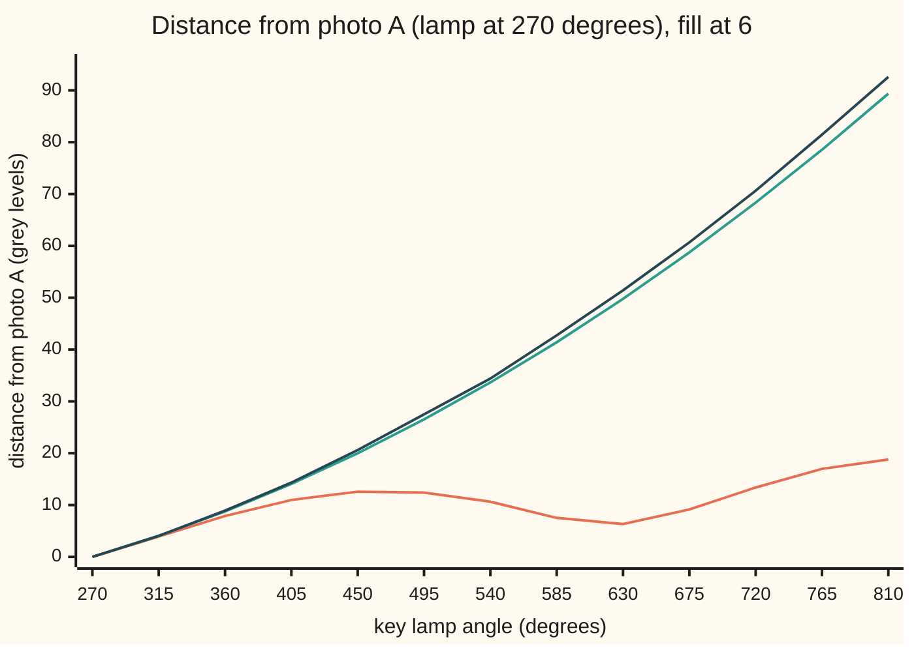
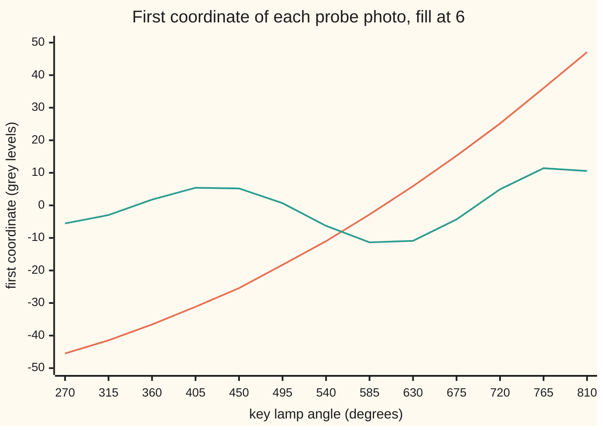

# Manifold learning: coordinates for data lying near a curved sheet

[Syllabus](../../../SYLLABUS.md) → [Differential geometry and Lie groups](../README.md) → [Geometric Analysis and Physics](../README.md#s07) → Manifold learning

---

## General Overview

A guitar maker photographs one guitar 600 times for a product page, with only the light changing. A key lamp on a boom circles the camera lens one and a half times, from 270° to 810°. As it circles, the boom swings outward, so the lamp rakes more and more sideways across the guitar. A fill lamp beside the camera sits on a dimmer, set anywhere from 0 to 12.

Each photo is shrunk to a thumbnail of 6 × 4 pixels. Each pixel is a grey level from 0 (black) to 255 (white). So one photo is a list of 24 numbers: a point in a space with 24 directions, one per pixel.

Only two knobs changed: where the key lamp is on its path, and the fill dimmer. So the 600 points lie on a two-dimensional sheet inside the 24-direction space, plus a little sensor noise. That sheet is rolled up: when the key lamp comes round to the same side one turn later, the photo looks much like the earlier one.

Take photo A, lamp at 270°, and photo B, lamp at 630°, one turn later, both with the fill at 6. Their pixels differ by only 6.331 grey levels in straight-line distance. Yet the lamp travelled a whole turn between them: measured along the sheet, they are 49.769 apart.

**Manifold learning** finds coordinates that follow the sheet instead of cutting across it. A **manifold** is a shape that looks flat when seen up close, like this sheet; the [Smooth manifold](../03-Manifolds/01-smooth-manifolds-and-charts.md) card gives the exact definition. The method on this card, **Isomap**, does three things:

1. It joins each photo to its 10 nearest photos.
2. It measures distance as the shortest path through those joins.
3. It lays the photos flat so that distances on the flat map match those path lengths.

Isomap's first coordinate tracks the distance along the lamp's path with correlation 0.99996, and its second tracks the fill dimmer with correlation 0.9768. Principal components (PCA), the flat method, get only 0.3074.

The **manifold hypothesis** is the bet behind all of this: real high-dimensional data, such as photos, sounds or gene readings, lie near a low-dimensional manifold. For this card's photos it is true by construction. For real data it is an assumption to be tested.

**When data lie near a curved sheet, short hops between near neighbours follow the sheet, so shortest paths through a neighbour graph measure distance along the sheet, and laying the points flat to match those paths recovers the sheet's own coordinates.**

**What kind of fact this is:** a method resting on a hypothesis. The manifold hypothesis is an empirical assumption, not a theorem. That graph paths approach distances along the sheet as photos get denser is a theorem stated in the Isomap paper (Sources), not proved on this card; the checks measure it here, where the graph path is 3.3% long. The photos come from an idealised model: a matte guitar with no shadows or highlights, under a lamp path chosen to make a roll.

### The picture: three ways to measure how far each photo is from photo A

The 13 photos below have the fill at 6 and the key lamp every 45°, from 270° to 810°. Each line is a distance from photo A, in grey levels.



The orange line is the straight-line distance between the pixel lists. It rises, then falls back to 6.33 at 630°, because the roll brings photo B close to photo A again. The green line is the distance along the sheet, from the closed form below. It rises steadily. The dark line is the shortest path through the neighbour graph. It hugs the green line and ends a little long at 810°: 92.58 against 89.37.

---

## The formula

Notation first, in words. Photo i is a list of 24 grey levels, written $`x_i`$. The **straight-line distance** $`|x_i - x_j|`$ squares the 24 pixel differences, adds them and takes the square root. It is measured in grey levels.

**The model of the photos.** Lambert's law says a matte surface's brightness is proportional to the cosine of the angle between the light and the surface's normal (the direction straight out of the surface). Under that law, while no part of the object is in shadow, every photo of it is a mix of three basic photos, lit from three perpendicular directions, weighted by the light's strength along each (Sources). Here the three basic photos are chosen as perpendicular patterns of length 1: $`P_x`$ brightens the right-hand columns, $`P_y`$ the top rows, $`P_z`$ every pixel equally. This is an idealised model, built to make a roll. The patterns are generic, not photos of a real guitar, and the lamp's path, with its sideways strength equal to its angle in radians, is chosen so the photos curl into a spiral. A real lamp raking from the side would leave front-facing parts in shadow, which the three-photo law excludes.

```math
x(t, h) = 128 + t\cos t \; P_x + t \sin t \; P_y + h \; P_z + \text{noise}
```

**Read it aloud:** start from mid-grey 128 in every pixel; the key lamp at angle t pushes with strength t, split between sideways and up-down by its angle; the fill lamp adds h to the front-lit pattern.

Seen through the three patterns, each photo is the point $`(t\cos t,\ t\sin t,\ h)`$. That is a spiral of radius t, stretched upward by h: a rolled sheet. Because the patterns are perpendicular and of length 1, the straight-line distance between photos equals the distance between these points, plus noise.

**The length along the sheet.** Arc length s (distance measured along a curve) of the spiral, from angle 0 to angle t:

```math
s(t) = \int_0^t \sqrt{u^2 + 1}\; du = \frac{1}{2}\left(t\sqrt{t^2+1} + \ln\big(t + \sqrt{t^2+1}\big)\right)
```

**Read it aloud:** the spiral's speed at angle u is the square root of u squared plus one; add up the speed to get the length.

The sheet unrolls into a flat rectangle. Its two true coordinates are $`s(t) - s(3\pi/2)`$, the distance along the lamp's path from its start, and h, the fill.

**Isomap.** Join photo i to photo j when either is among the other's k nearest photos, with the straight-line distance as the edge's length. Let $`d_G(i, j)`$ be the shortest path length through the graph, found by [Dijkstra's algorithm](../../04-Combinatorics%20and%20graphs/10-Trees%20and%20Cheapest%20Routes/05-dijkstra.md). Then lay the photos flat:

```math
B_{ij} = -\frac{1}{2}\Big(d_G(i,j)^2 - \bar r_i - \bar r_j + \bar g\Big), \qquad B\,v_c = \lambda_c\, v_c, \qquad y_i = \big(\sqrt{\lambda_1}\, v_{1,i},\ \sqrt{\lambda_2}\, v_{2,i}\big)
```

**Read it aloud:** square every path length; subtract each row's average and each column's average, and add back the overall average; halve and flip the sign; the top two eigenvectors of that table, each stretched by the square root of its eigenvalue, are the photos' flat coordinates.

An **eigenvector** v of a symmetric table B is a direction B only stretches, never turns: $`Bv = \lambda v`$, with stretch factor λ, the **eigenvalue**. This step is called **classical scaling**.

| Symbol | Plain meaning | In our example | Push it up and the answer… |
| --- | --- | --- | --- |
| $`x_i`$, n | photo i as 24 grey levels; the number of photos | n = 600 | more photos: graph paths closer to the sheet |
| t | key lamp angle, in radians; also the lamp's sideways strength | 3π/2 to 9π/2 (270° to 810°) | the roll turns further |
| h | fill dimmer setting, in grey-level units | 0 to 12; 6 for the 13 probe photos | the sheet gets taller |
| $`P_x`$, $`P_y`$, $`P_z`$ | the three basic lighting patterns, perpendicular, length 1 | side, top and front light on a 6 × 4 thumbnail | — |
| noise | sensor noise added to each pixel, standard deviation σ | σ = 0.05 grey levels | graph paths grow longer: 130.60 end to end at σ = 0.5 |
| s(t), u | length along the spiral from angle 0 to t; u is the angle partway along, inside the integral | s(A) = 12.478, s(B) = 62.247 | — |
| k | neighbours joined to each photo (a count here, not a form degree) | 10 | too high: short cuts; too low: the graph falls apart |
| $`d_G(i,j)`$ | shortest path length through the graph | 51.419 from A to B | — |
| $`B_{ij}`$, $`\bar r_i`$, $`\bar g`$ | the centred table that classical scaling splits into eigenvectors; the average of row i of the squared path lengths; the average of the whole table | B is 600 by 600 | — |
| $`\lambda_c`$, $`v_c`$ | eigenvalue and unit eigenvector number c of B; $`v_{c,i}`$ is its entry for photo i | λ₁ = 412530, λ₂ = 10199, λ₃ = 1861; most negative −2515 | a bigger λ: a longer axis on the map |
| $`y_i`$ | photo i's two flat coordinates | A at −45.50, B at 5.91 on axis 1 | — |
| $`D_{ij}`$, $`a_i`$, $`\bar a`$, Y | in the Detailed proof: a squared distance between flat points, a point's squared length, the average of those, and the n × 2 table of coordinates | — | — |

### When it holds

- **Photos dense compared with the gap between turns.** Neighbouring turns of the roll sit 2π = 6.283 apart. Each photo's neighbours must lie on its own turn. With 300 photos instead of 600, joins reach across the gap: the end-to-end path drops to 32.03 and the first coordinate's correlation to 0.7231.
- **k chosen with care.** With k = 20, joins jump between turns and the end-to-end path is 30.44 instead of 89.37. With k = 2, the graph falls apart: 579 of the 600 photos cannot be reached from photo A.
- **Noise small compared with the spacing of photos.** Noise adds length to every hop. At σ = 0.5 the end-to-end path is 130.60, though the ordering survives (correlation 0.9994).
- **A sheet that unrolls without stretching.** This roll is the spiral swept straight up, so it unrolls flat exactly (Step 2). A piece of a sphere has nonzero Gaussian curvature, so by the [Theorema Egregium](../02-Surfaces/08-theorema-egregium.md) it cannot, and Isomap must stretch some distances.
- **No holes.** Paths bend round a hole, so distances across it come out too long and the map distorts.

---

## Why it works

### Step 0: up close the sheet is flat, so add up short hops

A long straight line between photos can cut across the roll, from one turn to the next. A short straight line between near neighbours stays on the sheet, because up close the sheet is flat. Adding up short hops along a path therefore measures distance along the sheet. The shortest such path is the graph's version of a geodesic, the shortest route that stays on the surface ([Geodesic on a surface](../02-Surfaces/09-geodesics-on-surfaces.md)).

### Step 1: the photos are a rolled sheet, one gap of 2π between turns

The three patterns are perpendicular and of length 1. So the straight-line distance between two photos equals the distance between their points $`(t\cos t, t\sin t, h)`$, apart from noise. Photos A and B have the lamp at the same position round the lens, one turn apart. Their spiral radii are 4.712 and 10.996, on the same line from the centre, so they sit 2π = 6.283 apart. The pixels, with noise, give 6.331.

### Step 2: the length along the sheet

The spiral is $`(t\cos t, t\sin t)`$. Its velocity is $`(\cos t - t\sin t,\ \sin t + t\cos t)`$. Square and add: the cross terms cancel and $`\cos^2 + \sin^2 = 1`$ leaves $`1 + t^2`$. So the speed is $`\sqrt{t^2+1}`$, and the length is its integral, s(t) above.

<details>
<summary>Detailed proof: the closed form of the integral</summary>

Differentiate the right-hand side. The derivative of $`t\sqrt{t^2+1}`$ is $`\sqrt{t^2+1} + t^2/\sqrt{t^2+1}`$. The derivative of $`\ln(t + \sqrt{t^2+1})`$ is $`1/\sqrt{t^2+1}`$, because $`1 + t/\sqrt{t^2+1} = (t + \sqrt{t^2+1})/\sqrt{t^2+1}`$.

Add them: $`\sqrt{t^2+1} + (t^2 + 1)/\sqrt{t^2+1} = 2\sqrt{t^2+1}`$. Half of that is the integrand, and both sides are 0 at t = 0. So

$`\displaystyle \int_0^t \sqrt{u^2+1}\, du = \frac{1}{2}\left(t\sqrt{t^2+1} + \ln\big(t+\sqrt{t^2+1}\big)\right)`$

The code checks it against Simpson's rule: 49.769 from A to B, and 89.373 for the whole roll, both ways.

</details>

The sheet is the spiral swept straight up by h. Rolling a sheet of paper does not stretch it, so unrolling this one gives a flat rectangle 89.373 long and 12 high. Its coordinates, distance along the lamp's path and the fill, are the sheet's own coordinates. Isomap's task is to find them from the pixels alone.

### Step 3: shortest graph paths follow the sheet

A short hop between neighbours on one turn is a chord of a gently curved sheet, almost exactly as long as its arc. So a path of hops has about its length on the sheet, and Dijkstra's algorithm finds the shortest.

The graph path zigzags between photos, and noise lengthens each hop, so it runs a little long: 51.419 from A to B, against 49.769 along the sheet, 3.3% long.

### Step 4: classical scaling lays the photos flat

Suppose points $`y_i`$ sit in a plane, with their average at the origin. Expand a squared distance: $`|y_i - y_j|^2 = |y_i|^2 + |y_j|^2 - 2\, y_i \cdot y_j`$. The first two terms are the only ones that depend on one point alone. Removing row and column averages deletes them, and $`-\frac{1}{2}`$ leaves $`B_{ij} = y_i \cdot y_j`$.

So B is a table of dot products of two-coordinate points. Such a table has at most two eigenvalues that are not 0. The eigenvectors, stretched by the square roots of their eigenvalues, give back the points, up to a rotation or reflection of the whole map ([The spectral theorem](../../03-Algebra/07-Eigenvalues%20and%20Symmetric%20Matrices/04-spectral-theorem.md)).

<details>
<summary>Detailed proof: the centring step gives the dot products</summary>

Write $`D_{ij} = |y_i - y_j|^2 = a_i + a_j - 2\, y_i \cdot y_j`$, with $`a_i = |y_i|^2`$. The points average to zero, so the dot products in each row average to zero.

Row average: $`\bar r_i = a_i + \bar a`$, where $`\bar a`$ is the average of all $`a_j`$. Column average: $`\bar r_j = a_j + \bar a`$. Overall average: $`\bar g = 2\bar a`$.

Then $`D_{ij} - \bar r_i - \bar r_j + \bar g = -2\, y_i \cdot y_j`$, and

$`\displaystyle B_{ij} = -\frac{1}{2}\left(D_{ij} - \bar r_i - \bar r_j + \bar g\right) = y_i \cdot y_j`$

Collect the points as the rows of an n × 2 table Y. Then $`B = Y Y^T`$, so $`B v = Y(Y^T v)`$ lies in the two-dimensional span of Y's columns, and B has at most two nonzero eigenvalues. For each, $`v^T B v = |Y^T v|^2 = \lambda`$. Taking $`\sqrt{\lambda}\, v`$ as a column of coordinates reproduces every dot product, hence every distance.

</details>

Graph path lengths are not exactly distances in a plane, so B has other eigenvalues too. Some are negative, and a negative eigenvalue is distortion that no flat coordinate can carry; the most negative here is −2515. The positive ones run λ₁ = 412530, λ₂ = 10199, then λ₃ = 1861. The third is under a fifth of λ₂ and smaller in size than the −2515, so a third coordinate would be no larger than the graph's own distortion. The first two follow the two knobs, so two coordinates are kept.

Power iteration finds the eigenvalues largest in size, which here puts −2515 third. To find λ₃, the code adds 2515 to every diagonal entry of B. That raises every eigenvalue by 2515, makes them all at least 0, and so puts the largest positive ones first.

### Step 5: PCA is the same scaling on straight-line distances

Classical scaling on straight-line distances gives exactly the scores of [Principal components](../../09-Probability%20and%20statistics/09-Regression/07-principal-components.md). So PCA and Isomap differ in one choice only: straight lines or graph paths.

That choice decides everything here. PCA finds that three flat directions hold 99.955% of the variance: the roll sits in a flat three-direction slice of pixel space. But PCA's first direction cuts across the turns. Its correlation with the distance along the lamp's path is 0.3074, against Isomap's 0.99996.

### The picture: Isomap unrolls, PCA folds

The same 13 photos, placed on each method's first coordinate.



The orange line is Isomap's first coordinate: it climbs steadily, one step per 45° of lamp travel. The green line is PCA's first coordinate: it swings up and down with the roll, so photos a turn apart land close together.

---

## Worked numbers, by hand

Photos A and B: fill at 6, key lamp at 270° and 630°.

| Step | Arithmetic | Value |
| --- | --- | --- |
| Lamp angle at A, in radians | 270° = 3π/2 | 4.712 |
| Lamp angle at B, in radians | 630° = 7π/2 | 10.996 |
| Gap between turns | spiral radius = angle, so 10.996 − 4.712 = 2π | 6.283 |
| Straight-line distance from the pixels | square root of the sum of 24 squared pixel differences, noise included | 6.331 |
| s(A) | ½(t√(t²+1) + ln(t + √(t²+1))) at t = 4.712 | 12.478 |
| s(B) | the same at t = 10.996 | 62.247 |
| Distance along the sheet | 62.247 − 12.478 | 49.769 |
| Shortest path through the graph | Dijkstra's algorithm, k = 10 | 51.419, 3.3% long |
| Distance on Isomap's flat map | first coordinate of B minus that of A: 5.91 − (−45.50), before rounding | **51.405** |

Isomap places photo B a full turn of lamp travel from photo A, 51.405 apart, where the pixels alone put them 6.331 apart.

### What breaks if you drop a piece

| Mistake | Comes out at | What went wrong |
| --- | --- | --- |
| Use straight-line distances (PCA) | correlation 0.3074 with distance along the lamp's path | the flat view folds turns onto each other |
| Join 20 neighbours, not 10 | start to end 30.44 instead of 89.37; correlation 0.8038 | joins jump the 6.283 gap between turns: a short cut |
| Join 2 neighbours | 579 of 600 photos unreachable from photo A | the graph falls into pieces, so path lengths do not exist |
| Use 300 photos, not 600 | start to end 32.03; correlation 0.7231 | sparser photos need longer joins, which cross the gap |

---

## Code, from first principles, and it actually runs

The code builds the 600 photos from the model, with noise from a SplitMix64 generator written out in both languages. It joins neighbours, runs Dijkstra's algorithm from every photo, and finds the top eigenvectors by power iteration (multiply and rescale, repeated), once more with B shifted to find its largest positive eigenvalues. It takes four independent roads: the sheet length by closed form and by Simpson's rule; graph paths against that length; Isomap's coordinates against the two hidden knobs, which the method never sees; and PCA on the same photos. Python and Rust print the same text.

### Python

```python
# Manifold learning check: Isomap on 600 photos of one guitar under changing light.
# Standard library only. Random numbers come from SplitMix64, written out below.
import heapq, math

M64 = (1 << 64) - 1
state = [0]
def rand():  # SplitMix64: a float in [0, 1)
    state[0] = (state[0] + 0x9E3779B97F4A7C15) & M64
    z = state[0]
    z = ((z ^ (z >> 30)) * 0xBF58476D1CE4E5B9) & M64
    z = ((z ^ (z >> 27)) * 0x94D049BB133111EB) & M64
    return ((z ^ (z >> 31)) >> 11) / 9007199254740992.0
def gauss():  # Box-Muller: one standard normal draw
    u1, u2 = rand(), rand()
    return math.sqrt(-2.0 * math.log(1.0 - u1)) * math.cos(2.0 * math.pi * u2)

# A 6 x 4 thumbnail, 24 grey levels. Three lighting patterns, perpendicular, each of length 1:
# side light brightens the right-hand columns, top light the top rows, front light every pixel.
PX = [(i % 6 - 2.5) / math.sqrt(70.0) for i in range(24)]
PY = [(1.5 - i // 6) / math.sqrt(30.0) for i in range(24)]
PZ = [1.0 / math.sqrt(24.0) for i in range(24)]
T0, T1, HMAX = 1.5 * math.pi, 4.5 * math.pi, 12.0  # key lamp 270 to 810 degrees; fill 0 to 12
def make(n, sigma, seed=2026):  # 13 probe photos (fill 6), then random knob settings
    state[0] = seed
    knobs = [(T0 + j * math.pi / 4.0, HMAX / 2.0) for j in range(13)]
    while len(knobs) < n:  # t drawn so that nearly equal areas of the sheet get equal shares
        knobs.append((math.sqrt(T0 * T0 + (T1 * T1 - T0 * T0) * rand()), HMAX * rand()))
    return knobs, [[128.0 + t * math.cos(t) * PX[i] + t * math.sin(t) * PY[i] + h * PZ[i]
                    + sigma * gauss() for i in range(24)] for t, h in knobs]
def sheet_s(t):  # length of the spiral (t cos t, t sin t) from angle 0 to angle t, closed form
    w = math.sqrt(t * t + 1.0)
    return 0.5 * (t * w + math.log(t + w))
def simpson(a, b, m):  # the same length by Simpson's rule on the speed sqrt(t^2 + 1)
    f = lambda t: math.sqrt(t * t + 1.0)
    hh = (b - a) / m
    return (f(a) + f(b) + sum((4.0 if j % 2 else 2.0) * f(a + j * hh) for j in range(1, m))) * hh / 3.0
def graph(E, order, k):  # k-nearest-neighbour graph, then Dijkstra from every photo
    n = len(E)
    adj = [dict() for _ in range(n)]
    for i in range(n):
        for j in order[i][1:k + 1]:
            adj[i][j] = adj[j][i] = E[i][j]
    G = []
    for s in range(n):
        d = [math.inf] * n
        d[s] = 0.0
        heap = [(0.0, s)]
        while heap:
            du, u = heapq.heappop(heap)
            if du > d[u]: continue
            for v, w in adj[u].items():
                if du + w < d[v]:
                    d[v] = du + w
                    heapq.heappush(heap, (d[v], v))
        G.append(d)
    return G
def eigen(A, r, iters, shift=0.0):  # power iteration on A + shift I, each vector kept perpendicular to the earlier ones
    vals, vecs = [], []
    for c in range(r):
        v = [1.0 + ((i * 7 + c * 3) % 11) / 10.0 for i in range(len(A))]
        for _ in range(iters):
            for u in vecs:
                dot = sum(a * b for a, b in zip(v, u))
                v = [a - dot * b for a, b in zip(v, u)]
            w = [sum(a * b for a, b in zip(row, v)) + shift * x for row, x in zip(A, v)]
            nrm = math.sqrt(sum(a * a for a in w))
            v = [a / nrm for a in w]
        vals.append(sum(a * sum(b * c for b, c in zip(row, v)) for a, row in zip(v, A)))
        vecs.append(v)
    return vals, vecs
def mds(G, r, shift=0.0):  # classical scaling: a table of distances -> r coordinates per photo
    n = len(G)
    D2 = [[x * x for x in row] for row in G]
    rm = [sum(row) / n for row in D2]
    gm = sum(rm) / n
    B = [[-0.5 * (D2[i][j] - rm[i] - rm[j] + gm) for j in range(n)] for i in range(n)]
    vals, vecs = eigen(B, r, 60, shift)
    Y = [[v[i] * math.sqrt(max(l, 0.0)) for l, v in zip(vals, vecs)] for i in range(n)]
    return vals, Y
def corr(a, b):
    ma, mb = sum(a) / len(a), sum(b) / len(b)
    sab = sum((x - ma) * (y - mb) for x, y in zip(a, b))
    return sab / math.sqrt(sum((x - ma) * (x - ma) for x in a) * sum((y - mb) * (y - mb) for y in b))
def isomap(E, order, k, s, hs):  # graph distances, coordinates, eigenvalues, both correlations
    G = graph(E, order, k)
    vals, Y = mds(G, 3)
    if Y[0][0] > 0:  # a convention: the first probe photo sits at the left
        Y = [[-y[0], y[1], y[2]] for y in Y]
    if corr([y[1] for y in Y], hs) < 0:  # and the fill dimmer points up
        Y = [[y[0], -y[1], y[2]] for y in Y]
    return G, Y, vals, corr([y[0] for y in Y], s), corr([y[1] for y in Y], hs)
def run(n, sigma, k):
    knobs, ph = make(n, sigma)
    E = [[math.sqrt(sum((x - y) * (x - y) for x, y in zip(p, q))) for q in ph] for p in ph]  # straight lines
    order = [sorted(range(n), key=lambda j: E[i][j]) for i in range(n)]
    s = [sheet_s(t) - sheet_s(T0) for t, h in knobs]
    return knobs, ph, E, order, s, [h for t, h in knobs]

knobs, ph, E, order, s, hs = run(600, 0.05, 10)
print("photos 600, pixels 24, neighbours k = 10, sensor noise 0.05 grey levels")
sAB, simAB = sheet_s(T0 + 2 * math.pi) - sheet_s(T0), simpson(T0, T0 + 2 * math.pi, 200)
G, Y, vals, c1, c2 = isomap(E, order, 10, s, hs)
print(f"A at 270 deg, B at 630 deg, fill 6: radii {T0:.3f} and {T0 + 2 * math.pi:.3f}, gap 2 pi = {2 * math.pi:.3f}")
print(f"A-B straight line {E[0][8]:.3f}; s(A) {sheet_s(T0):.3f}, s(B) {sheet_s(T0 + 2 * math.pi):.3f}, along the sheet {sAB:.3f} (Simpson {simAB:.3f})")
print(f"A-B through the graph {G[0][8]:.3f}, {100 * (G[0][8] / sAB - 1):.1f}% long; on the Isomap map {Y[8][0] - Y[0][0]:.3f} apart")
print(f"whole roll along the sheet {s[12]:.3f} (Simpson {simpson(T0, T1, 200):.3f})")
print("angle_deg, straight, sheet, graph, isomap_1, pca_1")
n = 600
mean = [sum(p[i] for p in ph) / n for i in range(24)]
X = [[p[i] - mean[i] for i in range(24)] for p in ph]
C = [[sum(x[i] * x[j] for x in X) / (n - 1) for j in range(24)] for i in range(24)]
pv, pvec = eigen(C, 3, 300)
Z = [[sum(a * b for a, b in zip(x, v)) for v in pvec] for x in X]
if Z[0][0] > 0: Z = [[-z[0], z[1], z[2]] for z in Z]
for j in range(13):
    print(f"{270 + 45 * j}, {E[0][j]:.2f}, {s[j]:.2f}, {G[0][j]:.2f}, {Y[j][0]:.2f}, {Z[j][0]:.2f}")
top = mds(G, 3, max(0.0, -vals[2]))[0]  # shifted by the most negative eigenvalue's size: the largest positive ones
print(f"isomap eigenvalues, largest in size {vals[0]:.0f}, {vals[1]:.0f}, then {vals[2]:.0f}; largest three {top[0]:.0f}, {top[1]:.0f}, {top[2]:.0f}")
print(f"isomap: corr(coord 1, sheet length) {c1:.5f}, corr(coord 2, fill) {c2:.4f}")
tr = sum(C[i][i] for i in range(24))
print(f"pca shares {pv[0] / tr:.4f}, {pv[1] / tr:.4f}, {pv[2] / tr:.4f}; top three {(pv[0] + pv[1] + pv[2]) / tr:.5f}")
p1, p2 = corr([z[0] for z in Z], s), corr([z[1] for z in Z], s)
print(f"pca: corr(pc 1, sheet length) {p1:.4f}, corr(pc 2, sheet length) {p2:.4f}, corr(pc 3, fill) {abs(corr([z[2] for z in Z], hs)):.4f}")
Gb, _, _, b1, _ = isomap(E, order, 20, s, hs)
print(f"break, k = 20: start to end through the graph {Gb[0][12]:.2f} against {s[12]:.2f} along the sheet; corr {b1:.4f}")
print(f"break, k = 2: photos unreachable from the first {sum(1 for x in graph(E, order, 2)[0] if x == math.inf)}")
for lab, nn, sg, kk in [("k = 6", 600, 0.05, 6), ("k = 14", 600, 0.05, 14), ("noise 0.5", 600, 0.5, 10), ("300 photos", 300, 0.05, 10)]:
    _, _, Et, ot, st, ht = run(nn, sg, kk)
    Gt, _, _, t1, t2 = isomap(Et, ot, kk, st, ht)
    print(f"try {lab}: end to end {Gt[0][12]:.2f}, corr {t1:.4f}, {t2:.4f}")

assert abs(sAB - simAB) < 1e-6 and abs(s[12] - simpson(T0, T1, 200)) < 1e-6  # closed form against Simpson
assert abs(E[0][8] - 2 * math.pi) < 0.3            # neighbouring turns sit one gap of 2 pi apart
assert 1.0 < G[0][8] / sAB < 1.06                  # the graph follows the sheet, a little long
assert c1 > 0.999                                  # Isomap's first coordinate is the sheet length
assert c2 > 0.95                                   # and its second is the fill dimmer
assert max(abs(p1), abs(p2)) < 0.5                 # PCA's flat view does not unroll
assert Gb[0][12] < 0.5 * s[12]                     # too many neighbours: a short cut
assert 0 < top[2] < 0.25 * top[1] and top[2] < -vals[2]  # a third direction, smaller than the distortion
print("ALL CHECKS PASS")
```

**Ran 2026-11-19 on macOS, Python 3.14.10, standard library only. All checks passed. Output, pasted from the run:**

```
photos 600, pixels 24, neighbours k = 10, sensor noise 0.05 grey levels
A at 270 deg, B at 630 deg, fill 6: radii 4.712 and 10.996, gap 2 pi = 6.283
A-B straight line 6.331; s(A) 12.478, s(B) 62.247, along the sheet 49.769 (Simpson 49.769)
A-B through the graph 51.419, 3.3% long; on the Isomap map 51.405 apart
whole roll along the sheet 89.373 (Simpson 89.373)
angle_deg, straight, sheet, graph, isomap_1, pca_1
270, 0.00, 0.00, 0.00, -45.50, -5.55
315, 3.92, 4.09, 4.04, -41.46, -2.97
360, 7.90, 8.78, 8.93, -36.59, 1.77
405, 10.98, 14.08, 14.33, -31.15, 5.40
450, 12.58, 19.99, 20.62, -25.42, 5.20
495, 12.41, 26.52, 27.50, -18.28, 0.67
540, 10.64, 33.65, 34.41, -11.00, -6.28
585, 7.52, 41.40, 42.74, -2.80, -11.37
630, 6.33, 49.77, 51.42, 5.91, -10.90
675, 9.14, 58.75, 60.67, 15.23, -4.32
720, 13.38, 68.34, 70.65, 25.14, 4.94
765, 16.98, 78.55, 81.46, 36.02, 11.41
810, 18.79, 89.37, 92.58, 47.07, 10.55
isomap eigenvalues, largest in size 412530, 10199, then -2515; largest three 412530, 10199, 1861
isomap: corr(coord 1, sheet length) 0.99996, corr(coord 2, fill) 0.9768
pca shares 0.5059, 0.3909, 0.1027; top three 0.99955
pca: corr(pc 1, sheet length) 0.3074, corr(pc 2, sheet length) -0.3133, corr(pc 3, fill) 0.9997
break, k = 20: start to end through the graph 30.44 against 89.37 along the sheet; corr 0.8038
break, k = 2: photos unreachable from the first 579
try k = 6: end to end 97.03, corr 0.9999, 0.9468
try k = 14: end to end 33.05, corr 0.7691, 0.0569
try noise 0.5: end to end 130.60, corr 0.9994, 0.9144
try 300 photos: end to end 32.03, corr 0.7231, 0.1081
ALL CHECKS PASS
```

### Rust

```rust
// Manifold learning check: Isomap on 600 photos of one guitar under changing light.
// Rust std only. Random numbers come from SplitMix64, written out below.
use std::cmp::Reverse;
use std::collections::BinaryHeap;
use std::f64::consts::PI;

const T0: f64 = 1.5 * PI; const T1: f64 = 4.5 * PI; const HMAX: f64 = 12.0; // lamp 270-810 deg; fill 0-12

struct Rng(u64);
impl Rng {
    fn rand(&mut self) -> f64 { // SplitMix64: a float in [0, 1)
        self.0 = self.0.wrapping_add(0x9E3779B97F4A7C15);
        let mut z = self.0;
        z = (z ^ (z >> 30)).wrapping_mul(0xBF58476D1CE4E5B9);
        z = (z ^ (z >> 27)).wrapping_mul(0x94D049BB133111EB);
        ((z ^ (z >> 31)) >> 11) as f64 / 9007199254740992.0
    }
    fn gauss(&mut self) -> f64 { // Box-Muller: one standard normal draw
        let (u1, u2) = (self.rand(), self.rand());
        (-2.0 * (1.0 - u1).ln()).sqrt() * (2.0 * PI * u2).cos()
    }
}
// Compensated (Neumaier) sum, the rule Python's built-in sum() uses for floats.
fn ns<I: IntoIterator<Item = f64>>(it: I) -> f64 {
    let (mut s, mut c) = (0.0f64, 0.0f64);
    for x in it {
        let t = s + x;
        if s.abs() >= x.abs() { c += (s - t) + x; } else { c += (x - t) + s; }
        s = t;
    }
    if c != 0.0 && c.is_finite() { s + c } else { s }
}
fn dot(a: &[f64], b: &[f64]) -> f64 { ns(a.iter().zip(b).map(|(x, y)| x * y)) }
type Data = (Vec<(f64, f64)>, Vec<Vec<f64>>);
fn make(n: usize, sigma: f64) -> Data { // 13 probe photos (fill 6), then random knob settings
    let mut g = Rng(2026);
    let px: Vec<f64> = (0..24).map(|i| ((i % 6) as f64 - 2.5) / 70f64.sqrt()).collect();
    let py: Vec<f64> = (0..24).map(|i| (1.5 - (i / 6) as f64) / 30f64.sqrt()).collect();
    let pz = 1.0 / 24f64.sqrt();
    let mut knobs: Vec<(f64, f64)> = (0..13).map(|j| (T0 + j as f64 * PI / 4.0, HMAX / 2.0)).collect();
    while knobs.len() < n {
        let t = (T0 * T0 + (T1 * T1 - T0 * T0) * g.rand()).sqrt(); knobs.push((t, HMAX * g.rand()));
    }
    let ph = knobs.iter().map(|&(t, h)| (0..24).map(|i| 128.0 + t * t.cos() * px[i] + t * t.sin() * py[i]
        + h * pz + sigma * g.gauss()).collect()).collect();
    (knobs, ph)
}
fn sheet_s(t: f64) -> f64 { // length of the spiral (t cos t, t sin t) from angle 0 to t, closed form
    let w = (t * t + 1.0).sqrt(); 0.5 * (t * w + (t + w).ln())
}
fn simpson(a: f64, b: f64, m: usize) -> f64 { // the same length by Simpson's rule
    let f = |t: f64| (t * t + 1.0).sqrt();
    let hh = (b - a) / m as f64;
    (f(a) + f(b) + ns((1..m).map(|j| (if j % 2 == 1 { 4.0 } else { 2.0 }) * f(a + j as f64 * hh)))) * hh / 3.0
}
fn graph(e: &[Vec<f64>], order: &[Vec<usize>], k: usize) -> Vec<Vec<f64>> { // k-NN graph + Dijkstra
    let n = e.len();
    let mut adj: Vec<Vec<(usize, f64)>> = vec![Vec::new(); n];
    for i in 0..n {
        for &j in &order[i][1..k + 1] { adj[i].push((j, e[i][j])); adj[j].push((i, e[i][j])); }
    }
    (0..n).map(|s| {
        let mut d = vec![f64::INFINITY; n]; d[s] = 0.0;
        let mut heap = BinaryHeap::new();
        heap.push(Reverse((0f64.to_bits(), s)));
        while let Some(Reverse((bits, u))) = heap.pop() {
            let du = f64::from_bits(bits); if du > d[u] { continue; }
            for &(v, w) in &adj[u] {
                if du + w < d[v] { d[v] = du + w; heap.push(Reverse((d[v].to_bits(), v))); }
            }
        }
        d
    }).collect()
}
fn eigen(a: &[Vec<f64>], r: usize, iters: usize, shift: f64) -> (Vec<f64>, Vec<Vec<f64>>) { // power iteration on A + shift I
    let (mut vals, mut vecs): (Vec<f64>, Vec<Vec<f64>>) = (vec![], vec![]);
    for c in 0..r {
        let mut v: Vec<f64> = (0..a.len()).map(|i| 1.0 + ((i * 7 + c * 3) % 11) as f64 / 10.0).collect();
        for _ in 0..iters {
            for u in &vecs { let d = dot(&v, u); v = v.iter().zip(u).map(|(x, y)| x - d * y).collect(); }
            let w: Vec<f64> = a.iter().zip(&v).map(|(row, x)| dot(row, &v) + shift * x).collect();
            let nrm = ns(w.iter().map(|x| x * x)).sqrt();
            v = w.iter().map(|x| x / nrm).collect();
        }
        vals.push(ns(v.iter().zip(a).map(|(x, row)| x * dot(row, &v))));
        vecs.push(v);
    }
    (vals, vecs)
}
fn mds(g: &[Vec<f64>], r: usize, shift: f64) -> (Vec<f64>, Vec<Vec<f64>>) { // classical scaling
    let n = g.len();
    let d2: Vec<Vec<f64>> = g.iter().map(|row| row.iter().map(|x| x * x).collect()).collect();
    let rm: Vec<f64> = d2.iter().map(|row| ns(row.iter().copied()) / n as f64).collect();
    let gm = ns(rm.iter().copied()) / n as f64;
    let b: Vec<Vec<f64>> = (0..n).map(|i| (0..n).map(|j| -0.5 * (d2[i][j] - rm[i] - rm[j] + gm)).collect()).collect();
    let (vals, vecs) = eigen(&b, r, 60, shift);
    let y = (0..n).map(|i| vals.iter().zip(&vecs).map(|(l, v)| v[i] * l.max(0.0).sqrt()).collect()).collect();
    (vals, y)
}
fn corr(a: &[f64], b: &[f64]) -> f64 {
    let (ma, mb) = (ns(a.iter().copied()) / a.len() as f64, ns(b.iter().copied()) / b.len() as f64);
    let sab = ns(a.iter().zip(b).map(|(x, y)| (x - ma) * (y - mb)));
    sab / (ns(a.iter().map(|x| (x - ma) * (x - ma))) * ns(b.iter().map(|y| (y - mb) * (y - mb)))).sqrt()
}
fn col(y: &[Vec<f64>], c: usize) -> Vec<f64> { y.iter().map(|r| r[c]).collect() }
type Iso = (Vec<Vec<f64>>, Vec<Vec<f64>>, Vec<f64>, f64, f64);
fn isomap(e: &[Vec<f64>], order: &[Vec<usize>], k: usize, s: &[f64], hs: &[f64]) -> Iso {
    let g = graph(e, order, k);
    let (vals, mut y) = mds(&g, 3, 0.0);
    if y[0][0] > 0.0 { for r in y.iter_mut() { r[0] = -r[0]; } } // first probe photo at the left
    if corr(&col(&y, 1), hs) < 0.0 { for r in y.iter_mut() { r[1] = -r[1]; } } // fill points up
    let (c1, c2) = (corr(&col(&y, 0), s), corr(&col(&y, 1), hs));
    (g, y, vals, c1, c2)
}
type Run = (Vec<Vec<f64>>, Vec<Vec<f64>>, Vec<Vec<usize>>, Vec<f64>, Vec<f64>);
fn run(n: usize, sigma: f64) -> Run {
    let (knobs, ph) = make(n, sigma);
    let e: Vec<Vec<f64>> = ph.iter().map(|p| ph.iter().map(|q| ns(p.iter().zip(q).map(|(x, y)| (x - y) * (x - y))).sqrt()).collect()).collect();
    let order = (0..n).map(|i| { let mut o: Vec<usize> = (0..n).collect(); o.sort_by(|&a, &b| e[i][a].partial_cmp(&e[i][b]).unwrap()); o }).collect();
    let s = knobs.iter().map(|&(t, _)| sheet_s(t) - sheet_s(T0)).collect();
    (ph, e, order, s, knobs.iter().map(|&(_, h)| h).collect())
}
fn main() {
    let (ph, e, order, s, hs) = run(600, 0.05);
    println!("photos 600, pixels 24, neighbours k = 10, sensor noise 0.05 grey levels");
    let (s_ab, sim_ab) = (sheet_s(T0 + 2.0 * PI) - sheet_s(T0), simpson(T0, T0 + 2.0 * PI, 200));
    let (g, y, vals, c1, c2) = isomap(&e, &order, 10, &s, &hs);
    println!("A at 270 deg, B at 630 deg, fill 6: radii {:.3} and {:.3}, gap 2 pi = {:.3}", T0, T0 + 2.0 * PI, 2.0 * PI);
    println!("A-B straight line {:.3}; s(A) {:.3}, s(B) {:.3}, along the sheet {:.3} (Simpson {:.3})", e[0][8], sheet_s(T0), sheet_s(T0 + 2.0 * PI), s_ab, sim_ab);
    println!("A-B through the graph {:.3}, {:.1}% long; on the Isomap map {:.3} apart", g[0][8], 100.0 * (g[0][8] / s_ab - 1.0), y[8][0] - y[0][0]);
    println!("whole roll along the sheet {:.3} (Simpson {:.3})", s[12], simpson(T0, T1, 200));
    println!("angle_deg, straight, sheet, graph, isomap_1, pca_1");
    let n = 600;
    let mean: Vec<f64> = (0..24).map(|i| ns(ph.iter().map(|p| p[i])) / n as f64).collect();
    let x: Vec<Vec<f64>> = ph.iter().map(|p| (0..24).map(|i| p[i] - mean[i]).collect()).collect();
    let c: Vec<Vec<f64>> = (0..24).map(|i| (0..24).map(|j| ns(x.iter().map(|r| r[i] * r[j])) / (n - 1) as f64).collect()).collect();
    let (pv, pvec) = eigen(&c, 3, 300, 0.0);
    let mut z: Vec<Vec<f64>> = x.iter().map(|r| pvec.iter().map(|v| dot(r, v)).collect()).collect();
    if z[0][0] > 0.0 { for r in z.iter_mut() { r[0] = -r[0]; } }
    for j in 0..13 { println!("{}, {:.2}, {:.2}, {:.2}, {:.2}, {:.2}", 270 + 45 * j, e[0][j], s[j], g[0][j], y[j][0], z[j][0]); }
    let top = mds(&g, 3, (-vals[2]).max(0.0)).0; // shifted by the most negative eigenvalue's size: the largest positive ones
    println!("isomap eigenvalues, largest in size {:.0}, {:.0}, then {:.0}; largest three {:.0}, {:.0}, {:.0}", vals[0], vals[1], vals[2], top[0], top[1], top[2]);
    println!("isomap: corr(coord 1, sheet length) {:.5}, corr(coord 2, fill) {:.4}", c1, c2);
    let tr = ns((0..24).map(|i| c[i][i]));
    println!("pca shares {:.4}, {:.4}, {:.4}; top three {:.5}", pv[0] / tr, pv[1] / tr, pv[2] / tr, (pv[0] + pv[1] + pv[2]) / tr);
    let (p1, p2) = (corr(&col(&z, 0), &s), corr(&col(&z, 1), &s));
    println!("pca: corr(pc 1, sheet length) {:.4}, corr(pc 2, sheet length) {:.4}, corr(pc 3, fill) {:.4}", p1, p2, corr(&col(&z, 2), &hs).abs());
    let (gb, _, _, b1, _) = isomap(&e, &order, 20, &s, &hs);
    println!("break, k = 20: start to end through the graph {:.2} against {:.2} along the sheet; corr {:.4}", gb[0][12], s[12], b1);
    println!("break, k = 2: photos unreachable from the first {}", graph(&e, &order, 2)[0].iter().filter(|x| x.is_infinite()).count());
    for (lab, nn, sg, kk) in [("k = 6", 600, 0.05, 6), ("k = 14", 600, 0.05, 14), ("noise 0.5", 600, 0.5, 10), ("300 photos", 300, 0.05, 10)] {
        let (_, et, ot, st, ht) = run(nn, sg);
        let (gt, _, _, t1, t2) = isomap(&et, &ot, kk, &st, &ht);
        println!("try {}: end to end {:.2}, corr {:.4}, {:.4}", lab, gt[0][12], t1, t2);
    }
    assert!((s_ab - sim_ab).abs() < 1e-6 && (s[12] - simpson(T0, T1, 200)).abs() < 1e-6); // closed form v Simpson
    assert!((e[0][8] - 2.0 * PI).abs() < 0.3); // neighbouring turns sit one gap of 2 pi apart
    assert!(g[0][8] / s_ab > 1.0 && g[0][8] / s_ab < 1.06); // the graph follows the sheet, a little long
    assert!(c1 > 0.999); // Isomap's first coordinate is the sheet length
    assert!(c2 > 0.95); // and its second is the fill dimmer
    assert!(p1.abs().max(p2.abs()) < 0.5); // PCA's flat view does not unroll
    assert!(gb[0][12] < 0.5 * s[12]); // too many neighbours: a short cut
    assert!(0.0 < top[2] && top[2] < 0.25 * top[1] && top[2] < -vals[2]); // a third direction, smaller than the distortion
    println!("ALL CHECKS PASS");
}
```

**Ran 2026-11-19 on macOS, rustc 1.98.1, no crates. All checks passed. Output, pasted from the run:**

```
photos 600, pixels 24, neighbours k = 10, sensor noise 0.05 grey levels
A at 270 deg, B at 630 deg, fill 6: radii 4.712 and 10.996, gap 2 pi = 6.283
A-B straight line 6.331; s(A) 12.478, s(B) 62.247, along the sheet 49.769 (Simpson 49.769)
A-B through the graph 51.419, 3.3% long; on the Isomap map 51.405 apart
whole roll along the sheet 89.373 (Simpson 89.373)
angle_deg, straight, sheet, graph, isomap_1, pca_1
270, 0.00, 0.00, 0.00, -45.50, -5.55
315, 3.92, 4.09, 4.04, -41.46, -2.97
360, 7.90, 8.78, 8.93, -36.59, 1.77
405, 10.98, 14.08, 14.33, -31.15, 5.40
450, 12.58, 19.99, 20.62, -25.42, 5.20
495, 12.41, 26.52, 27.50, -18.28, 0.67
540, 10.64, 33.65, 34.41, -11.00, -6.28
585, 7.52, 41.40, 42.74, -2.80, -11.37
630, 6.33, 49.77, 51.42, 5.91, -10.90
675, 9.14, 58.75, 60.67, 15.23, -4.32
720, 13.38, 68.34, 70.65, 25.14, 4.94
765, 16.98, 78.55, 81.46, 36.02, 11.41
810, 18.79, 89.37, 92.58, 47.07, 10.55
isomap eigenvalues, largest in size 412530, 10199, then -2515; largest three 412530, 10199, 1861
isomap: corr(coord 1, sheet length) 0.99996, corr(coord 2, fill) 0.9768
pca shares 0.5059, 0.3909, 0.1027; top three 0.99955
pca: corr(pc 1, sheet length) 0.3074, corr(pc 2, sheet length) -0.3133, corr(pc 3, fill) 0.9997
break, k = 20: start to end through the graph 30.44 against 89.37 along the sheet; corr 0.8038
break, k = 2: photos unreachable from the first 579
try k = 6: end to end 97.03, corr 0.9999, 0.9468
try k = 14: end to end 33.05, corr 0.7691, 0.0569
try noise 0.5: end to end 130.60, corr 0.9994, 0.9144
try 300 photos: end to end 32.03, corr 0.7231, 0.1081
ALL CHECKS PASS
```

### Lean

Lean proves the classical scaling step for any number of points in a plane, and the spiral's length for every angle t.

- Suppose points $`y_i`$ sit in a plane, with their average at the origin. Then the centred table built from their squared distances gives $`B_{ij} = y_i \cdot y_j`$ exactly.
- Take any table of dot products $`y_i \cdot y_j`$ of points in a plane. Then at most two of its eigenvalues are not 0.
- Take the spiral $`(t\cos t,\ t\sin t)`$. Then its speed at angle u is $`\sqrt{u^2+1}`$. Its length from angle 0 to angle t is exactly s(t), the closed form above.
- Take photos A and B, at 270° and 630°. Then they are one full turn apart, and their spiral radii 3π/2 and 7π/2 differ by exactly 2π.
- Take a 6 × 4 thumbnail. Then it has 24 pixels.
- Take 13 probe photos every 45°, starting at 270°. Then the last is at 810°, one and a half turns on.

The pixels, the neighbour graph, Dijkstra's paths, the eigenvalues found and the correlations are left to the Python and Rust checks.

```lean
-- Manifold learning: classical scaling turns centred squared distances between points in a plane back into their dot products, the table has at most two nonzero eigenvalues, and the spiral's length from angle 0 to t has the closed form ½(t√(t²+1) + ln(t + √(t²+1))).
import Mathlib.Analysis.InnerProductSpace.PiL2
import Mathlib.Analysis.Matrix.Spectrum
import Mathlib.Analysis.SpecialFunctions.Integrals.Basic
import Mathlib.Analysis.SpecialFunctions.Trigonometric.Deriv
import Mathlib.Analysis.SpecialFunctions.Sqrt
import Mathlib.Analysis.SpecialFunctions.Log.Deriv

open Real

/-- Classical scaling: for points y₁, …, yₙ in a plane whose average is the origin, write
D_ij = |y_i − y_j|², r̄_i for the average of row i of D, and ḡ for the average of the whole
table. Then B_ij = −½(D_ij − r̄_i − r̄_j + ḡ) is exactly the dot product y_i · y_j. -/
theorem centred_squared_distances_give_dot_products {n : ℕ}
    (y : Fin n → EuclideanSpace ℝ (Fin 2)) (hcentre : ∑ i, y i = 0) (i j : Fin n) :
    let D : Fin n → Fin n → ℝ := fun a b => ‖y a - y b‖ ^ 2;
    let r : Fin n → ℝ := fun a => (∑ b, D a b) / n;
    let g : ℝ := (∑ a, r a) / n;
    -(1 / 2 : ℝ) * (D i j - r i - r j + g) = inner ℝ (y i) (y j) := by
  intro D r g
  have hn : (n : ℝ) ≠ 0 := by
    have : 0 < n := Fin.pos i
    exact_mod_cast this.ne'
  set S : ℝ := ∑ b, ‖y b‖ ^ 2 with hS
  have hinner : ∀ a, ∑ b, inner ℝ (y a) (y b) = 0 := by
    intro a
    rw [← inner_sum, hcentre, inner_zero_right]
  have hr : ∀ a, r a = ‖y a‖ ^ 2 + S / n := by
    intro a
    simp only [r, D, norm_sub_sq_real, Finset.sum_add_distrib, Finset.sum_sub_distrib,
      ← Finset.mul_sum, hinner, Finset.sum_const, Finset.card_univ, Fintype.card_fin,
      nsmul_eq_mul]
    field_simp
    ring
  have hg : g = 2 * S / n := by
    simp only [g, hr, Finset.sum_add_distrib, Finset.sum_const, Finset.card_univ,
      Fintype.card_fin, nsmul_eq_mul]
    rw [← hS]
    field_simp
    ring
  rw [hg, hr i, hr j]
  simp only [D, norm_sub_sq_real]
  field_simp
  ring

/-- A table of dot products of points in a plane, B_ij = y_i · y_j, has at most two
eigenvalues that are not 0. -/
theorem dot_product_table_has_at_most_two_nonzero_eigenvalues {n : ℕ}
    (y : Fin n → EuclideanSpace ℝ (Fin 2))
    (hB : (Matrix.of fun i j => inner ℝ (y i) (y j) : Matrix (Fin n) (Fin n) ℝ).IsHermitian) :
    (Finset.univ.filter fun k => hB.eigenvalues k ≠ 0).card ≤ 2 := by
  rw [← Fintype.card_subtype, ← hB.rank_eq_card_non_zero_eigs]
  set Y : Matrix (Fin n) (Fin 2) ℝ := Matrix.of fun i k => y i k
  have hEq : (Matrix.of fun i j => inner ℝ (y i) (y j) : Matrix (Fin n) (Fin n) ℝ) =
      Y * Y.transpose := by
    ext a b
    simp [Y, Matrix.mul_apply, PiLp.inner_apply, mul_comm]
  rw [hEq]
  exact (Matrix.rank_mul_le_left _ _).trans (Matrix.rank_le_width _)

/-- The length of the spiral (t cos t, t sin t) from angle 0 to angle t: its speed is
√(u² + 1), and adding up the speed gives ½(t√(t²+1) + ln(t + √(t²+1))). -/
theorem spiral_arc_length (t : ℝ) :
    ∫ u in (0 : ℝ)..t,
        √((deriv (fun v => v * cos v) u) ^ 2 + (deriv (fun v => v * sin v) u) ^ 2) =
      (1 / 2 : ℝ) * (t * √(t ^ 2 + 1) + log (t + √(t ^ 2 + 1))) := by
  have hd1 : ∀ u, deriv (fun v => v * cos v) u = cos u - u * sin u := by
    intro u
    have h : HasDerivAt (fun v => v * cos v) (1 * cos u + u * -sin u) u :=
      (hasDerivAt_id' u).mul (hasDerivAt_cos u)
    rw [h.deriv]; ring
  have hd2 : ∀ u, deriv (fun v => v * sin v) u = sin u + u * cos u := by
    intro u
    have h : HasDerivAt (fun v => v * sin v) (1 * sin u + u * cos u) u :=
      (hasDerivAt_id' u).mul (hasDerivAt_sin u)
    rw [h.deriv]; ring
  have hint : ∀ u, √((deriv (fun v => v * cos v) u) ^ 2 + (deriv (fun v => v * sin v) u) ^ 2)
      = √(u ^ 2 + 1) := by
    intro u
    rw [hd1, hd2]
    congr 1
    have := sin_sq_add_cos_sq u
    nlinarith [this]
  simp_rw [hint]
  have hpos : ∀ u : ℝ, 0 < √(u ^ 2 + 1) := fun u => Real.sqrt_pos.mpr (by positivity)
  have hgt : ∀ u : ℝ, 0 < u + √(u ^ 2 + 1) := by
    intro u
    have h1 : |u| < √(u ^ 2 + 1) := by
      rw [← Real.sqrt_sq_eq_abs]
      exact Real.sqrt_lt_sqrt (sq_nonneg _) (by linarith)
    linarith [neg_abs_le u]
  have hderiv : ∀ x ∈ Set.uIcc (0:ℝ) t,
      HasDerivAt (fun u : ℝ => (1 / 2 : ℝ) * (u * √(u ^ 2 + 1) + log (u + √(u ^ 2 + 1))))
        (√(x ^ 2 + 1)) x := by
    intro x _
    have hs : HasDerivAt (fun u : ℝ => √(u ^ 2 + 1)) (x / √(x ^ 2 + 1)) x := by
      have h := ((hasDerivAt_pow 2 x).add_const 1).sqrt (by positivity)
      convert h using 1
      field_simp
      ring
    have h := ((((hasDerivAt_id' x).mul hs).add (((hasDerivAt_id' x).add hs).log
      (hgt x).ne'))).const_mul (1 / 2 : ℝ)
    convert h using 1
    have h0 := (hpos x).ne'
    have h1 := (hgt x).ne'
    have hsq : √(x ^ 2 + 1) ^ 2 = x ^ 2 + 1 := Real.sq_sqrt (by positivity)
    have key : (1 + x / √(x ^ 2 + 1)) / (x + √(x ^ 2 + 1)) = 1 / √(x ^ 2 + 1) := by
      rw [div_eq_div_iff h1 h0]
      field_simp
      ring
    simp only [Pi.add_apply]
    rw [key]
    field_simp
    nlinarith [hsq]
  rw [intervalIntegral.integral_eq_sub_of_hasDerivAt hderiv]
  · simp
  · exact (by fun_prop : Continuous fun u : ℝ => √(u ^ 2 + 1)).intervalIntegrable _ _

-- Photos A and B: lamp angles 3π/2 and 7π/2, one turn apart, so their spiral radii differ by 2π.
example : 7 * π / 2 - 3 * π / 2 = 2 * π := by ring
-- A 6 × 4 thumbnail has 24 pixels.
example : 6 * 4 = 24 := by norm_num
-- The 13 probe photos, every 45°, run from 270° to 810°: one and a half turns.
example : 270 + 45 * 12 = 810 := by norm_num
example : ((810 - 270 : ℚ)) / 360 = 3 / 2 := by norm_num
-- A and B, at 270° and 630°, are one full turn apart.
example : 630 - 270 = 360 := by norm_num

#print axioms centred_squared_distances_give_dot_products
#print axioms dot_product_table_has_at_most_two_nonzero_eigenvalues
#print axioms spiral_arc_length
```

**Checked 2026-11-19 on macOS, Lean 4.36.0-rc2, Mathlib v4.36.0-rc2. Every proof is complete and uses only Lean's standard axioms. Output, pasted from the run:**

```
'centred_squared_distances_give_dot_products' depends on axioms: [propext, Classical.choice, Quot.sound]
'dot_product_table_has_at_most_two_nonzero_eigenvalues' depends on axioms: [propext, Classical.choice, Quot.sound]
'spiral_arc_length' depends on axioms: [propext, Classical.choice, Quot.sound]
```

> [!TIP]
> **Try changing**
> The last four lines of the output run these settings. Guess first, then read the answer.
> - **Fewer neighbours: k = 6.** Guess first: does the map survive? Yes. The end-to-end path is 97.03, longer, because paths zigzag more; correlations 0.9999 and 0.9468.
> - **More neighbours: k = 14.** Guess first: is 14 still safe? No. Joins cross a turn, the end-to-end path collapses to 33.05, and the correlations fall to 0.7691 and 0.0569.
> - **Ten times the noise: σ = 0.5.** Guess first: does the ordering break? No, correlation 0.9994, but every hop is longer and the end-to-end path is 130.60.
> - **Half the photos: 300.** Guess first: with k = 10 still? The joins reach across the gap. End to end 32.03, correlations 0.7231 and 0.1081.

---

## The usual mistake

> [!warning]
> **Trusting straight-line distance between photos that are far apart.** Photos A and B are 6.331 apart in pixels and 49.769 apart along the sheet. Straight lines cut across the roll, so any method fed long straight-line distances, PCA included, folds the turns together. Only short straight lines can be trusted; long distances must be built from them.
>
> Four smaller traps:
> - **Choosing k by habit.** k = 10 works here and k = 14 already fails: the end-to-end path drops from 92.58 to 33.05. Check the graph for joins that cross the roll.
> - **Reading Isomap's axes as named knobs.** The map is fixed only up to rotation and reflection. This card orients the axes using the known knobs; real data has no such labels. The first axis also runs a little long: the graph path end to end is 92.58 against 89.37 along the sheet.
> - **Counting PCA's directions as the sheet's dimension.** Three flat directions hold 99.955% of the variance, yet the sheet has two dimensions. A rolled sheet needs a third flat direction to curl into.
> - **Treating the manifold hypothesis as proved.** For real photos it is an assumption that can be tested, and can fail.

---

## Where you meet it in real life

- **Face recognition.** Photos of one face under changing light lie near a low-dimensional set, so recognisers compare faces along it, not pixel by pixel.
- **Robots and cameras.** The images a moving camera sees depend on a few numbers: its position and heading. Manifold learning recovers those numbers from the images alone.
- **Cell biology.** Gene readings from thousands of cells lie near curves that follow how cells develop. Neighbour-graph methods order the cells along those curves.
- **Image generators.** Generative models make new photos from a few hidden numbers. That design rests on the manifold hypothesis.

> **Say it back**
> Photos that differ in two knobs lie on a two-dimensional sheet inside pixel space, and here that sheet is rolled up. Straight lines between far-apart photos cut across the roll, so they lie about distance. Isomap trusts only short hops between neighbours, adds them up along shortest paths, and lays the photos flat to match those path lengths. Its two coordinates match the lamp's path and the fill dimmer, while PCA, which uses straight lines, folds the turns together. It works when photos are dense, neighbours are few and noise is small; one join across the gap ruins it.

---

## What this builds on

- [Fisher metric](09-information-geometry-and-the-fisher-metric.md): distance measured inside a curved space of models rather than across it. Manifold learning applies the same idea to data, with no formula for the space, only samples from it.
- [Principal components](../../09-Probability%20and%20statistics/09-Regression/07-principal-components.md): the flat method. Isomap is PCA's classical scaling with graph paths in place of straight lines.
- [Dijkstra's algorithm](../../04-Combinatorics%20and%20graphs/10-Trees%20and%20Cheapest%20Routes/05-dijkstra.md): the shortest-path step, run once from every photo.
- [Theorema Egregium](../02-Surfaces/08-theorema-egregium.md): a map that keeps lengths keeps Gaussian curvature, so a piece of a sphere cannot be laid flat without stretching.
- [Geodesic on a surface](../02-Surfaces/09-geodesics-on-surfaces.md): the shortest route that stays on a surface, which graph paths approximate.

## Where this goes next

- [Volume form and Laplace-Beltrami](../05-Riemannian%20Geometry/08-volume-form-and-the-laplace-beltrami-operator.md): Laplacian eigenmaps and diffusion maps replace shortest paths with heat flow on the neighbour graph. As photos get denser, the graph's Laplacian approaches the sheet's $`\Delta_g`$.
- [Frechet mean](08-frechet-means-and-statistics-on-curved-data.md): averages and spreads for data on a curved space, once its distances are known.
- [Riemannian gradient descent](05-optimisation-on-manifolds.md): optimising over a curved set, the step that follows once data or parameters live on a manifold.

The question this card leaves open: how many photos, and which k, guarantee that no join crosses the gap, given how tightly the sheet curves and how close its turns come?

---

## Sources

Verified 2026-11-19: every link below resolves to the publisher's page.

- Tenenbaum, Joshua B., Vin de Silva, and John C. Langford. "A Global Geometric Framework for Nonlinear Dimensionality Reduction." *Science* 290, no. 5500 (2000): 2319–2323. [doi:10.1126/science.290.5500.2319](https://doi.org/10.1126/science.290.5500.2319). Isomap: the neighbour graph, shortest paths, classical scaling, and the claim that graph paths converge to distances along the manifold.
- Belkin, Mikhail, and Partha Niyogi. "Laplacian Eigenmaps for Dimensionality Reduction and Data Representation." *Neural Computation* 15, no. 6 (2003): 1373–1396. [doi:10.1162/089976603321780317](https://doi.org/10.1162/089976603321780317). The heat-flow alternative to shortest paths, and its link to the Laplace-Beltrami operator.
- Fefferman, Charles, Sanjoy Mitter, and Hariharan Narayanan. "Testing the Manifold Hypothesis." *Journal of the American Mathematical Society* 29, no. 4 (2016): 983–1049. [doi:10.1090/jams/852](https://doi.org/10.1090/jams/852). The manifold hypothesis stated precisely, with how many samples a test of it needs.
- Belhumeur, Peter N., and David J. Kriegman. "What Is the Set of Images of an Object Under All Possible Illumination Conditions?" *International Journal of Computer Vision* 28, no. 3 (1998): 245–260. [doi:10.1023/A:1008005721484](https://doi.org/10.1023/A:1008005721484). Lambert's law and why photos of a matte object under changing light are mixes of three basic photos.
