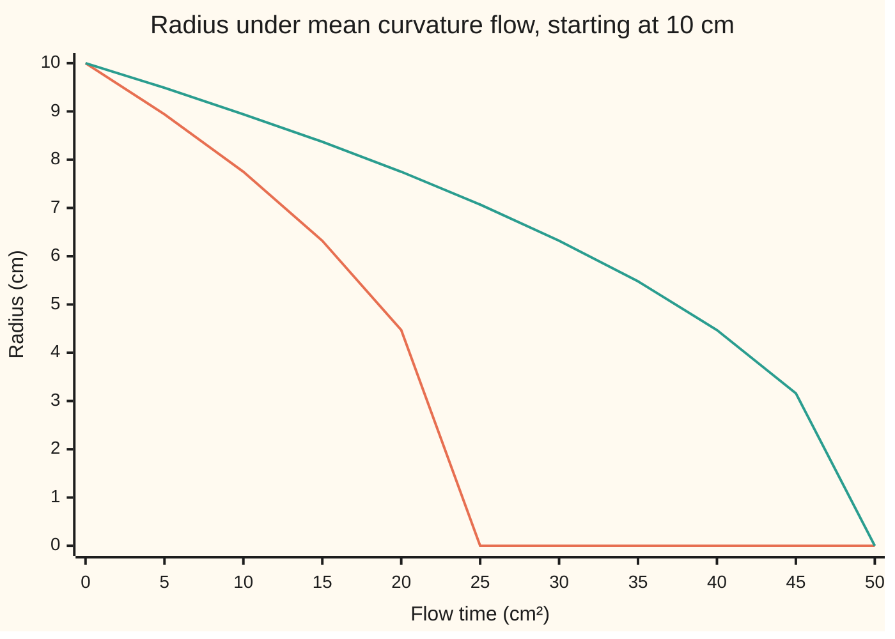
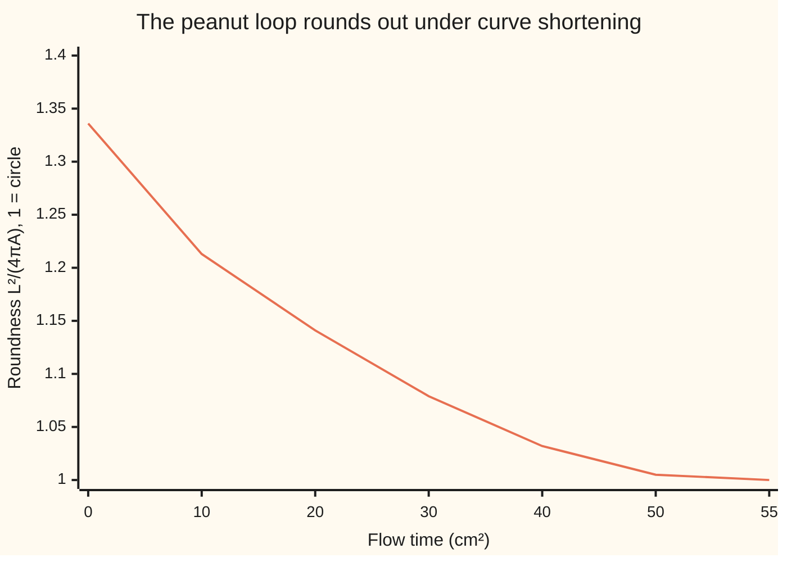
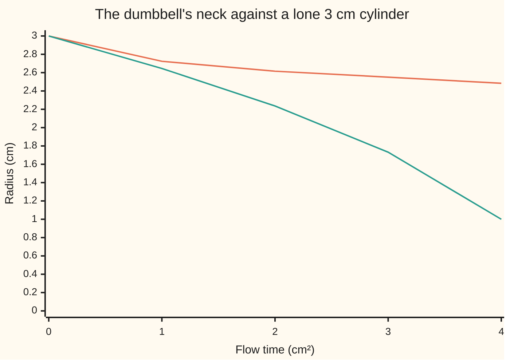

# Mean curvature flow: surfaces that shrink to cut their own area fastest

[Syllabus](../../../SYLLABUS.md) → [Differential geometry and Lie groups](../README.md) → [Geometric Analysis and Physics](../README.md#s07) → Mean curvature flow

---

## General Overview

Picture a soap-bubble sphere of radius 10 cm, as an idealised film: a real bubble is also held up by the air inside it. Let every patch of its skin move inward at a speed set by how sharply the skin bends there. A sphere of radius $`r`$ bends by $`1/r`$ in every direction, so take the speed to be the two bends added: $`2/r`$. At the start that is 0.2 cm per unit of time.

The sphere stays round and shrinks. As it shrinks it bends harder, so it speeds up. Its radius squared falls in a straight line, $`r^2 = 100 - 4t`$, and the sphere is gone at $`t = 25`$. A circle of radius 10 cm, moving at its single bend $`1/r`$, falls as $`r^2 = 100 - 2t`$ and is gone at $`t = 50`$.

Why this speed? Of all the ways to push a surface by a given amount, this one cuts its area fastest. So the flow is the surface running downhill on its own area, the way water runs down the steepest slope.

Round shapes are not the interesting case. A dented, peanut-shaped loop, the polar curve $`r = 10(1 + 0.5\cos 2\theta)`$ cm with θ the angle round its centre, has 353.43 cm² inside it. It first loses its dents. It is convex (bulging outward everywhere) by $`t = 14.26`$, almost perfectly round by $`t = 50`$, and gone at $`t = 56.25`$. Grayson's theorem says every closed plane curve that does not cross itself does the same: it becomes convex, then round, then vanishes.

Surfaces behave differently. Two balls of radius 10 cm joined by a neck of radius 3 cm do not round out. The neck is down to 0.3 cm at $`t = 11.87`$ and about to pinch shut, while each ball still has a radius of 7.26 cm.

**Mean curvature flow moves every point of a curve or surface toward the side it bends to, at a speed equal to its total bend; that is the steepest way down in length or area, so a sphere of radius 10 cm vanishes at t = 25, a circle at t = 50, and any embedded plane loop rounds out before it vanishes.**

**What kind of fact this is:** the flow is a definition, an equation chosen for a moving surface. That it is steepest descent of area, the shrinking laws for spheres and circles, and the area law for loops (2π lost per unit time, whatever the shape) are theorems proved on this card. Grayson's theorem for loops and Huisken's theorem for convex surfaces are global theorems stated with sources, not proved here. The peanut and dumbbell numbers come from a computer flow and are approximate, each given at two mesh sizes.

### The picture: radius squared falls in a straight line



Orange: the sphere, gone at $`t = 25`$. Green: the circle, gone at $`t = 50`$. Both curves drop slowly at first and steeply at the end, because a smaller shape bends harder and moves faster.

Flow time is measured in cm². A speed in cm per unit time equals a bend in 1/cm, so the time unit must be cm². In a real material a constant, its mobility times its surface tension (in cm² per second), turns flow time into seconds.

---

## The formula

Notation first, in words. This card introduces **mean curvature flow**: a family of surfaces, one for each time $`t`$, in which each point $`\mathbf{x}`$ moves along the unit normal $`\mathbf{n}`$ (the arrow at right angles to the surface) at speed $`2H`$. Here $`H`$ is the mean curvature, the average $`(\kappa_1 + \kappa_2)/2`$ of the two principal curvatures $`\kappa_1, \kappa_2`$, the greatest and least bend at the point ([Principal, mean and Gaussian curvature](../02-Surfaces/05-principal-mean-and-gaussian-curvature.md)).

```math
\frac{\partial \mathbf{x}}{\partial t} = 2H\,\mathbf{n} = (\kappa_1 + \kappa_2)\,\mathbf{n}
```

**Read it aloud:** each point moves along the normal at a speed equal to the sum of its two principal curvatures.

The sign looks after itself. $`H`$ is positive when the surface bends toward $`\mathbf{n}`$. Flip $`\mathbf{n}`$ and $`H`$ flips too, so $`2H\,\mathbf{n}`$ always points toward the side the surface bends to.

Many books call the sum $`\kappa_1 + \kappa_2`$ "the mean curvature". This wing keeps $`H`$ for the average, so the speed here is $`2H`$, said once.

For a plane curve the flow is called **curve shortening**. Each point moves along the normal $`N`$ at speed $`\kappa`$, its signed curvature (positive turning left, [Curvature](../01-Curves/02-curvature-of-plane-curves.md)):

```math
\frac{\partial \mathbf{x}}{\partial t} = \kappa\, N
```

**Read it aloud:** each point of the curve moves toward the inside of its bend at a speed equal to its curvature.

A sphere of radius $`r`$ has $`\kappa_1 = \kappa_2 = 1/r`$. A circle has $`\kappa = 1/r`$. Each stays round, so only the radius changes:

```math
\frac{dr}{dt} = -\frac{2}{r} \;\Rightarrow\; r^2 = r_0^2 - 4t, \qquad \frac{dr}{dt} = -\frac{1}{r} \;\Rightarrow\; r^2 = r_0^2 - 2t
```

**Read it aloud:** a sphere's radius squared falls by 4 per unit time, a circle's by 2.

With $`r_0 = 10`$ cm, the sphere is gone at $`t_{\mathrm{end}} = 100/4 = 25`$ and the circle at $`100/2 = 50`$. The two size laws, proved in Why it works:

```math
\frac{dA}{dt} = -2\pi \ \text{(any loop that does not cross itself)}, \qquad \frac{dA}{dt} = -\int (2H)^2\, dA \ \text{(a closed surface)}
```

**Read it aloud:** a loop loses enclosed area at exactly two pi per unit time; a surface loses area at the total of its speed squared.

| Symbol | Plain meaning | In our example | Push it up and the answer… |
| --- | --- | --- | --- |
| $`\mathbf{x}`$ | a point of the moving curve or surface, cm | a point on the bubble | — |
| $`t`$, $`t_{\mathrm{end}}`$ | flow time, cm²; the time the shape vanishes | sphere $`t_{\mathrm{end}} = 25`$, circle 50 | — |
| $`\mathbf{n}`$ | unit normal of the surface | pointing into the bubble | — |
| $`\kappa_1`$, $`\kappa_2`$ | principal curvatures: greatest and least bend, 1/cm | both 0.1 at the start | that point moves faster |
| $`H`$ | mean curvature, the average $`(\kappa_1 + \kappa_2)/2`$, 1/cm | 0.1, so speed $`2H = 0.2`$ cm per unit time | faster shrinking |
| $`\kappa`$, $`N`$, $`T`$ | signed curvature of a plane curve, 1/cm; its unit normal, pointing left; its unit tangent | 0.1 on the circle; $`N`$ points to the centre | that point moves faster |
| $`s`$, $`\theta`$ | arc length along a curve, cm; the polar angle round the peanut's centre | runs round the peanut, 77.02 in all; θ from 0 to 2π | — |
| $`r`$, $`r_0`$, $`\rho`$ | radius now; radius at the start; a cylinder's radius, cm | $`r_0 = 10`$; $`r = 6`$ for the sphere at $`t = 16`$; $`\rho = 3`$ for the neck | a later $`t_{\mathrm{end}}`$, growing as $`r_0^2`$ |
| $`A`$, $`A_0`$ | area: inside a loop, or of a surface, cm²; its value at the start | 314.16 inside the circle, 1256.64 on the sphere | a later $`t_{\mathrm{end}}`$ |
| $`L`$ | length of a loop, cm | 77.02 for the peanut at the start | — |
| $`\varphi`$, $`\varepsilon`$ | a push profile: how far each point is pushed along the normal, per unit of push; the small size of the push | the trial pushes in Why it works | — |
| $`g`$, $`\mathrm{Ric}`$ | a metric (the rule for lengths) and its Ricci curvature, from the Ricci flow card | the round sphere's metric | — |

### When it holds

- **The speed is the sum, not the average.** Move the sphere at $`H = 1/r`$ and it lasts to 50, not 25. Every law on this card uses $`2H`$.
- **The shape sits in a surrounding space.** The flow moves a surface through space, so it depends on how the surface bends there. A cylinder and a flat sheet are isometric (the same lengths on the skin), yet the flat sheet never moves and a 10 cm cylinder vanishes at $`t = 50`$.
- **The loop does not cross itself (embedded).** The area law uses a turning number of 1. A loop that crosses itself has other turning numbers, and a small inner loop can close into a sharp point before the curve vanishes.
- **Huisken's rounding needs a convex surface.** For surfaces, convex is the price of rounding. The dumbbell is not convex: its neck is down to 0.3 cm at $`t = 11.87`$ and pinches while the balls survive.
- **Time runs forward.** Run backward, the flow is a backward heat equation: bumps sharpen and small ripples grow without limit.

---

## Why it works

### Step 0: area falls fastest when the push follows the bend

Push a surface by $`\varepsilon\varphi`$ along $`\mathbf{n}`$, where $`\varepsilon`$ is a small number and $`\varphi`$ says how much each point moves. The [Minimal surface](../02-Surfaces/07-minimal-surfaces-and-soap-films.md) card proves the first variation of area: the area changes at the rate

```math
\frac{dA}{d\varepsilon} = -\int 2H\,\varphi\; dA .
```

To compare pushes fairly, fix their size, $`\int \varphi^2\, dA`$. The Cauchy-Schwarz inequality says $`\int 2H\varphi\, dA`$ is largest, for a fixed size, when $`\varphi`$ is a multiple of $`2H`$. So the push $`\varphi = 2H`$ is the steepest way down in area. Mean curvature flow is that push, applied all the time: the gradient flow of area, the same idea as [Riemannian gradient descent](05-optimisation-on-manifolds.md), on the space of all surfaces.

### Step 1: the same for curves, with numbers

For a curve, pushing by $`\varepsilon\varphi`$ along $`N`$ changes the length at $`-\int \kappa\varphi\, ds`$. The steepest push is $`\varphi = \kappa`$, and it costs length at the rate $`\int \kappa^2\, ds`$.

On the smooth peanut that rate is 1.7801 cm per unit time. An even push of the same size, the same speed everywhere, cuts only 0.9552 cm per unit time. The code's polygons approach these values: 1.7563 and 0.9491 with 100 sides, 1.7741 and 0.9537 with 200. On a circle the two pushes coincide, since $`\kappa`$ is the same everywhere.

<details>
<summary>Detailed proof: the first variation of length, and why κ wins</summary>

Write the curve as $`\mathbf{x}(s)`$ with unit tangent $`\mathbf{x}' = T`$ and $`T' = \kappa N`$. Push it to $`\mathbf{x} + \varepsilon\varphi N`$. Since $`N' = -\kappa T`$, the new velocity is

$`\displaystyle T + \varepsilon(\varphi' N - \varphi\kappa T).`$

Its length is $`1 - \varepsilon\varphi\kappa`$ to first order, because the $`\varphi' N`$ part is at right angles to $`T`$ and enters only at order $`\varepsilon^2`$. Adding round the loop:

$`\displaystyle L(\varepsilon) = L - \varepsilon\int \kappa\,\varphi\; ds + O(\varepsilon^2).`$

Cauchy-Schwarz gives $`\int \kappa\varphi\, ds \le \left(\int \kappa^2 ds\right)^{1/2}\left(\int \varphi^2 ds\right)^{1/2}`$, with equality only when $`\varphi`$ is a positive multiple of $`\kappa`$. An even push $`\varphi = c`$ of the same size has $`c^2 L = \int \kappa^2 ds`$ and cuts length at $`c\int\kappa\, ds = 2\pi c`$: on the smooth peanut, $`2\pi\sqrt{1.7801/77.0188} = 0.9552`$.

</details>

### Step 2: round shapes stay round, and their radius squared falls in a line

A sphere moving at $`2/r`$ stays a sphere: every point has the same speed. So $`dr/dt = -2/r`$. Multiply by $`2r`$: $`d(r^2)/dt = -4`$, a constant. So $`r^2 = 100 - 4t`$, and the sphere vanishes at 25.

The circle has $`dr/dt = -1/r`$, so $`r^2 = 100 - 2t`$ and it vanishes at 50. A sphere in $`n`$ dimensions has $`n`$ equal bends, so $`r^2 = r_0^2 - 2nt`$. A cylinder has bends $`1/r`$ and 0, so it shrinks like a circle: a 3 cm cylinder vanishes at $`9/2 = 4.5`$.

### Step 3: a loop loses area at exactly 2π, whatever its shape

Each piece $`ds`$ of the loop moves inward at speed $`\kappa`$, so it sweeps area at $`\kappa\, ds`$. Add round the loop: $`dA/dt = -\int \kappa\, ds`$. The total turning $`\int \kappa\, ds`$ of a loop that does not cross itself is one full turn, $`2\pi`$ ([Turning and winding numbers](../01-Curves/08-turning-number-and-winding-number.md)). So

```math
\frac{dA}{dt} = -2\pi, \qquad t_{\mathrm{end}} = \frac{A_0}{2\pi},
```

where $`A_0`$ is the starting area. The circle has 314.1593 cm², gone at $`314.1593/6.2832 = 50`$. The peanut has $`\tfrac12\int_0^{2\pi} r^2\, d\theta = 112.5\pi`$ = 353.4292 cm², gone at 56.25. Any loop with 300 cm² inside vanishes at 47.7465.

On a surface the same sweep gives $`dA/dt = -\int (2H)^2\, dA`$, which depends on the shape. The round sphere has $`2H = 2/r`$ everywhere, so the rate is $`(4/r^2)(4\pi r^2) = -16\pi`$, a constant. It starts with $`400\pi`$ = 1256.6371 cm² and loses 50.2655 per unit time, so it is gone at 25: the same answer as Step 2, by a different road.

### Step 4: the flow is a heat equation, so dents fill in

On a curve, $`\kappa N = T' = \mathbf{x}''`$, the second derivative of position by arc length. So curve shortening reads $`\partial\mathbf{x}/\partial t = \mathbf{x}''`$: a heat equation for the position ([The heat equation](../../08-Differential%20equations%20and%20dynamics/10-The%20Classical%20PDEs/03-the-heat-equation.md)). Each point drifts toward the average of its neighbours, so dents fill in and bumps flatten.

Watch the peanut. Its roundness ratio $`L^2/(4\pi A)`$ is 1 for a circle and larger for any other loop ([Isoperimetric and four-vertex](../01-Curves/09-isoperimetric-and-four-vertex-theorems.md)).



The line is the peanut, a 200-sided polygon, from 1.336 at the start to 1.000 at $`t = 55`$, shortly before it vanishes at 56.25. The dents are gone by $`t = 14.26`$.

Gage and Hamilton proved in 1986 that a convex loop stays convex and shrinks to a round point. Grayson proved in 1987 that any embedded loop becomes convex first. Together: **every embedded closed plane curve becomes convex, then round, then vanishes at $`t_{\mathrm{end}} = A_0/2\pi`$.** The proofs are long and are not given here.

### Step 5: surfaces round out only if they start convex

Huisken proved in 1984 that a closed surface in space that is strictly convex (both bends positive everywhere), and its versions in higher dimensions, stays convex and shrinks to a point. Rescaled to keep its area, it becomes a round sphere. This is stated, not proved.

Without convexity, surfaces need not round out. A thin neck is nearly a cylinder, and a cylinder of radius $`\rho`$ lasts $`\rho^2/2`$. A ball of radius $`r_0`$ lasts $`r_0^2/4`$. This rough count says a neck thinner than $`r_0/\sqrt 2`$ should pinch first: the 3 cm neck alone would last 4.5, the balls 25. The real neck lasts longer than the count says, but it still pinches first, as the dumbbell below shows.

Huisken's monotonicity formula (1990) controls what a pinch looks like. A Gaussian-weighted area of the surface, centred on the future pinch point, never increases. When the bend blows up no faster than on a shrinking sphere, the zoomed-in surface near the pinch looks more and more like a shape that shrinks without changing form, such as a sphere or a cylinder. This too is stated with its source.

### Step 6: the extrinsic twin of Ricci flow

[Ricci flow](01-ricci-flow-and-the-poincare-proof-in-outline.md) changes a metric, the rule for lengths on a space, at $`\partial g/\partial t = -2\,\mathrm{Ric}`$. Mean curvature flow moves a surface through the space around it. Both are heat equations for geometry, and both shrink a sphere. They differ in what they see.

| | Mean curvature flow | Ricci flow |
| --- | --- | --- |
| What moves | the points of a surface, in space | the metric on the space itself |
| Needs a surrounding space | yes | no |
| Driven by | $`2H`$, an outside bend | $`\mathrm{Ric}`$, an inside curvature |
| Sphere of radius 10 cm | $`r^2 = 100 - 4t`$, gone at 25 | $`r^2 = 100 - 2t`$, gone at 50 |
| Cylinder of radius 10 cm | gone at 50 | never moves: it is flat inside |
| Circle of radius 10 cm | gone at 50 | never moves: a curve has $`\mathrm{Ric} = 0`$ |

The cylinder row is the whole difference. On its skin, a cylinder is a flat sheet rolled up. Ricci flow sees only the skin, so nothing happens. Mean curvature flow sees the rolling.

The dumbbell shows it too. Under mean curvature flow its neck pinches. On a two-dimensional dumbbell skin, the [Ricci flow](01-ricci-flow-and-the-poincare-proof-in-outline.md) card shows the neck fattening instead, and the whole skin rounding out.

---

## Worked numbers, by hand

The bubble: a sphere of radius 10 cm, and beside it a circle of radius 10 cm.

| Step | Arithmetic | Value |
| --- | --- | --- |
| sphere's speed at the start | $`2/r = 2/10`$ | 0.2 cm per unit time |
| rate of $`r^2`$ | $`2r \times (-2/r)`$ | −4 cm² per unit time |
| sphere's radius at $`t = 16`$ | $`\sqrt{100 - 64}`$ | 6.0000 cm |
| sphere's area at the start | $`4\pi \times 100`$ | 1256.6371 cm² |
| its rate of loss | $`(2/r)^2 \times 4\pi r^2 = 16\pi`$ | 50.2655 cm² per unit time |
| **sphere gone at** | $`100/4 = 1256.6371/50.2655`$ | **25** |
| circle's radius at $`t = 16`$ | $`\sqrt{100 - 32}`$ | 8.2462 cm |
| circle's enclosed area | $`\pi \times 100`$ | 314.1593 cm² |
| **circle gone at** | $`100/2 = 314.1593/(2\pi)`$ | **50** |

The sphere vanishes at flow time 25 cm², twice as fast as the circle, because it has two bends adding to its speed, not one. The computer flow below gets 6.0008 cm at $`t = 16`$ for the sphere and 8.2450 cm for the circle.

### What breaks if you drop a piece

| Mistake | Comes out at | What went wrong |
| --- | --- | --- |
| Speed $`H`$, the average, instead of $`2H`$ | sphere gone at 50, not 25 | the half belongs to the definition of $`H`$, not to the flow |
| Surface speed $`2/r`$ on a circle | circle gone at 25, not 50 | a curve has one bend, not two |
| Treat it as Ricci flow, an inside rule | sphere gone at 50; cylinder never moves, not gone at 50 | the flow depends on the outside bend |
| Expect Huisken's rounding without convexity | the dumbbell's neck is 0.3 cm at $`t = 11.87`$, ball radius still 7.26 cm | the hypothesis "convex" fails, and the neck pinches |
| Treat the neck as a lone 3 cm cylinder | pinch at 4.5, not near 11.87 | the balls hold the neck's ends open and slow it |

The code prints every number in this table.

---

## A neck that pinches before the balls vanish

Two balls of radius 10 cm, centres 24 cm apart, are joined by a short neck of radius 3 cm. The neck is a thin cylinder, so it wants to vanish early. The balls want to last until 25. Which wins?

The table follows the computer flow with mesh spacing 0.25 cm, next to each piece alone.

| Flow time | Neck radius, cm | Lone 3 cm cylinder | Ball radius, cm | Lone 10 cm sphere |
| --- | --- | --- | --- | --- |
| 1 | 2.7238 | 2.6458 | 9.7971 | 9.7980 |
| 2 | 2.6157 | 2.2361 | 9.5908 | 9.5917 |
| 3 | 2.5508 | 1.7321 | 9.3800 | 9.3808 |
| 4 | 2.4839 | 1.0000 | 9.1644 | 9.1652 |
| 11.87 | 0.3 | gone at 4.5 | 7.2640 | 7.2475 |

The balls move almost exactly like lone spheres. The neck shrinks much more slowly than a lone cylinder, because its ends flare out into the balls and that outward bend pushes back. Still, it reaches 0.3 cm at $`t = 11.87`$ (11.90 on the coarser 0.5 cm mesh), long before the balls would vanish at 25.



Orange: the neck of the dumbbell, on the 0.25 cm mesh. Green: a lone cylinder of radius 3 cm, gone at 4.5. The two start together; held open by the balls, the neck is still 2.4839 cm when the lone cylinder is down to 1.0000 cm.

At the pinch the surface splits into two separate balls. Each then shrinks on its own like a sphere. The smooth flow cannot pass the pinch: continuing it needs a weaker notion of surface, or cutting at the pinch as Ricci flow does.

---

## Code, from first principles, and it actually runs

The code runs the flow literally as steepest descent. A shape is a polygon, or a polygon profile spun round an axis to make a surface. Each corner moves by minus the gradient of the length or area, divided by its own share of the length or area; on a fine mesh that is $`\kappa N`$ or $`2H\mathbf{n}`$. Corners are re-spaced evenly when they bunch up. The code takes five independent roads: the closed forms $`r^2 = r_0^2 - 4t`$ and $`r_0^2 - 2t`$; the area laws $`-16\pi`$ and $`-2\pi`$; the polygon flow on the circle and the peanut at two sizes; the spun-profile flow on the sphere and the dumbbell at two mesh spacings; and the length-loss comparison of Step 1, on polygons of 100 and 200 sides against the smooth peanut by Simpson's rule. The asserts check that each finer mesh lands closer to the exact time, that the peanut obeys the area law, becomes convex and rounds out, and that the dumbbell's neck pinches before 25.

### Python

```python
# Mean curvature flow -- the check behind the card.  Standard library only.
# Each shape moves down the gradient of its own size: a polygon down the gradient of its
# length, a profile spun round the z-axis down the gradient of its surface area.  A vertex
# moves by minus that gradient over its share of the size, the discrete kappa N or 2H n.
from math import pi, sqrt, cos, sin, asin
def f(x): return f"{x:.4f}"
def curve(P):                           # closed polygon, counterclockwise
    n = len(P); E = []
    for i in range(n):
        dx = P[(i + 1) % n][0] - P[i][0]; dy = P[(i + 1) % n][1] - P[i][1]
        E.append((dx, dy, sqrt(dx * dx + dy * dy)))
    V = []; L = 0.0; A = 0.0; lmin = E[0][2]; convex = True; k2 = 0.0
    for i in range(n):
        a = E[i - 1]; b = E[i]; m = (a[2] + b[2]) / 2       # the vertex's share of the length
        vx = (b[0] / b[2] - a[0] / a[2]) / m; vy = (b[1] / b[2] - a[1] / a[2]) / m
        V.append((vx, vy)); k2 += (vx * vx + vy * vy) * m  # adds kappa^2 ds
        L += b[2]; lmin = min(lmin, b[2]); convex = convex and a[0] * b[1] - a[1] * b[0] > 0
        A += (P[i][0] * P[(i + 1) % n][1] - P[(i + 1) % n][0] * P[i][1]) / 2
    return V, A, 0.2 * lmin * lmin, (L, convex, k2)
def surface(P):                         # profile (z, r) from pole to pole, spun round the z-axis
    n = len(P) - 1; E = []; A = 0.0; lmin = 1e9
    for i in range(n):
        dz = P[i + 1][0] - P[i][0]; dr = P[i + 1][1] - P[i][1]; l = sqrt(dz * dz + dr * dr)
        E.append((dz / l, dr / l, l, pi * (P[i][1] + P[i + 1][1]))); A += E[i][3] * l; lmin = min(lmin, l)
    V = []; rneck = P[n // 2][1]; rmax = 0.0
    for i in range(n + 1):
        gz = 0.0; gr = 0.0; m = 0.0                         # gradient of area, share of area
        if i > 0:
            e = E[i - 1]; gz += e[3] * e[0]; gr += e[3] * e[1] + pi * e[2]
            m += pi * (1.5 * P[i][1] + 0.5 * P[i - 1][1]) * e[2] / 2  # half-band next to the vertex
        if i < n:
            e = E[i]; gz -= e[3] * e[0]; gr += pi * e[2] - e[3] * e[1]
            m += pi * (1.5 * P[i][1] + 0.5 * P[i + 1][1]) * e[2] / 2
        V.append((-gz / m, 0.0 if i == 0 or i == n else -gr / m)); rmax = max(rmax, P[i][1])
    return V, A, 0.1 * min(lmin * lmin, rneck * rneck), (rneck, rmax)
def edges(P, closed):
    Q = P + [P[0]] if closed else P
    return [sqrt((b[0] - a[0]) * (b[0] - a[0]) + (b[1] - a[1]) * (b[1] - a[1])) for a, b in zip(Q, Q[1:])]
def even(P, closed):                   # re-space the vertices evenly along the shape
    Q = P + [P[0]] if closed else P; s = [0.0]
    for l in edges(P, closed): s.append(s[-1] + l)
    n = len(P) if closed else len(P) - 1; out = []; j = 0
    for k in range(len(P)):
        g = s[-1] * k / n
        while j < len(Q) - 2 and s[j + 1] < g: j += 1
        w = (g - s[j]) / (s[j + 1] - s[j]); out.append((Q[j][0] + w * (Q[j + 1][0] - Q[j][0]), Q[j][1] + w * (Q[j + 1][1] - Q[j][1])))
    if not closed: out[-1] = P[-1]
    return out
def lmin(P, closed): return min(edges(P, closed))
def lmean(P, closed):
    s = 0.0
    for l in edges(P, closed): s += l
    return s / len(edges(P, closed))
def flow(P, law, marks, stop):          # explicit steps; returns readings at marks, stop time
    t = 0.0; steps = 0; V, A, dt, x = law(P); A0 = A; seen = {}; marks = list(marks)
    while True:
        if marks and t >= marks[0] - 1e-12: seen[marks.pop(0)] = (A, x)
        h = min(dt, marks[0] - t) if marks else dt
        Q = [(p[0] + h * v[0], p[1] + h * v[1]) for p, v in zip(P, V)]
        steps += 1
        if steps % 10 == 0 and lmin(Q, law is curve) < 0.6 * lmean(Q, law is curve): Q = even(Q, law is curve)
        V2, A2, dt2, x2 = law(Q)
        if stop(A0, A2, x2, t + h):
            return seen, t, h, A, A2, x, x2
        P, V, A, dt, x, t = Q, V2, A2, dt2, x2, t + h
def at_one_percent(P, law, marks=()):   # time the size falls to 1% of its start; first convex time
    cv = []
    seen, t, h, A, A2, x, x2 = flow(P, law, marks, lambda A0, A2, x, t:
                                    (law is surface or not x[1] or cv or cv.append(t)) and A2 < 0.01 * A0)
    target = 0.01 * law(P)[1]
    return t + h * (A - target) / (A - A2), seen, cv
ring = lambda n: [(10 * cos(2 * pi * k / n), 10 * sin(2 * pi * k / n)) for k in range(n)]
ball = lambda n: [(10 * cos(pi * k / n), 10 * sin(pi * k / n)) for k in range(n + 1)]
def peanut(n):
    return [(10 * (1 + 0.5 * cos(2 * a)) * cos(a), 10 * (1 + 0.5 * cos(2 * a)) * sin(a))
            for a in [2 * pi * k / n for k in range(n)]]
print("closed forms, radius 10 cm: sphere r^2 = 100 - 4t, circle r^2 = 100 - 2t")
print("chart sphere", ", ".join(f"{sqrt(max(0.0, 100 - 4 * t)):.2f}" for t in range(0, 51, 5)))
print("chart circle", ", ".join(f"{sqrt(100 - 2 * t):.2f}" for t in range(0, 51, 5)))
print("sphere area", f(400 * pi), "cm^2, rate -16 pi =", f(-16 * pi), "-> gone at", f(400 * pi / (16 * pi)))
print("circle area", f(100 * pi), "cm^2, rate -2 pi =", f(-2 * pi), "-> gone at", f(100 * pi / (2 * pi)))
print("closed form at t=16: sphere", f(sqrt(100 - 64)), "circle", f(sqrt(100 - 32)))
print("circle length rate -2pi/r at r=10:", f(-2 * pi / 10), " sphere speed 2/r:", f(0.2))
res = {}
for name, law, mk, n1, exact in (("sphere", surface, ball, 40, 24.75), ("circle", curve, ring, 64, 49.5)):
    for n in (n1, 2 * n1):
        t1, seen, cv = at_one_percent(mk(n), law, (16.0,))
        r16 = seen[16.0][1][1] if law is surface else sqrt(seen[16.0][0] / pi)
        res[name, n] = t1
        print(f"{name} N={n}: 1% of size left at t = {f(t1)} (exact {f(exact)}); radius at t=16: {f(r16)}")
    assert abs(res[name, 2 * n1] - exact) < abs(res[name, n1] - exact) + 1e-9 and abs(res[name, 2 * n1] - exact) < 0.05
P = peanut(200); A_exact = 112.5 * pi
print("peanut area", f(A_exact), "exact,", f(curve(P)[1]), "polygon; gone at A/2pi =", f(A_exact / (2 * pi)))
def smooth(n):                          # the smooth peanut by Simpson's rule in the polar angle: L, int kappa^2 ds
    L = 0.0; k2 = 0.0
    for k in range(n + 1):
        a = 2 * pi * k / n; r = 10 + 5 * cos(2 * a); r1 = -10 * sin(2 * a); r2 = -20 * cos(2 * a)
        w = (1 if k in (0, n) else 4 if k % 2 else 2) * 2 * pi / (3 * n); v = sqrt(r * r + r1 * r1)
        q = r * r + 2 * r1 * r1 - r * r2; L += w * v; k2 += w * q * q / (v * v * v * v * v)
    return L, k2
Ls, k2s = smooth(2000); gap = []
for n in (100, 200):
    V, A, dt, (L, cv, k2) = curve(peanut(n)); gap.append(abs(k2 - k2s))
    print(f"peanut N={n} start: length {f(L)}; length lost per unit time: speed kappa {f(k2)}, even speed of equal size {f(2 * pi * sqrt(k2 / L))}")
    assert k2 > 2 * pi * sqrt(k2 / L) * 1.05 and not cv
print(f"smooth peanut start: length {f(Ls)}; length lost per unit time: speed kappa {f(k2s)}, even speed of equal size {f(2 * pi * sqrt(k2s / Ls))}")
assert gap[1] < gap[0] < 0.1 and abs(L - Ls) < 0.05
for n in (100, 200):
    marks = (0.0, 10.0, 20.0, 30.0, 40.0, 50.0, 55.0)
    t1, seen, cv = at_one_percent(peanut(n), curve, marks)
    ratio = [s[1][0] * s[1][0] / (4 * pi * s[0]) for s in (seen[m] for m in marks)]
    print(f"peanut N={n}: area at t=20 {f(seen[20.0][0])} (law {f(curve(peanut(n))[1] - 40 * pi)}), 1% at t = {f(t1)} (law {f(0.99 * A_exact / (2 * pi))})")
    print(f"  chart L^2/(4 pi A):", ", ".join(f"{r:.3f}" for r in ratio), "; convex from t =", f(cv[0]))
    assert abs(seen[20.0][0] - (curve(peanut(n))[1] - 40 * pi)) < 0.5 and abs(t1 - 0.99 * A_exact / (2 * pi)) < 0.3
    assert ratio[0] > 1.3 and ratio[-1] < 1.01 and not seen[0.0][1][1] and 0 < cv[0] < 50
def dumbbell(h):                        # two 10 cm bulbs, centres 24 cm apart, a 3 cm neck
    tj = pi - asin(0.3); m = round(10 * tj / h); zj = 12 - 10 * cos(asin(0.3)); q = 2 * round(zj / h)
    right = [(12 + 10 * cos(tj * k / m), 10 * sin(tj * k / m)) for k in range(m + 1)]
    neck = [(zj - 2 * zj * k / q, 3.0) for k in range(1, q)]
    return right + neck + [(-z, r) for z, r in reversed(right)]
tp = {}
for h in (0.5, 0.25):
    seen, t, hh, A, A2, x, x2 = flow(dumbbell(h), surface, (0.0, 1.0, 2.0, 3.0, 4.0), lambda A0, A2, x, t: x[0] < 0.3)
    tp[h] = t + hh * (x[0] - 0.3) / (x[0] - x2[0])
    print(f"dumbbell h={h}: neck/bulb radius at t=0..4:", "; ".join(f"{f(s[1][0])}/{f(s[1][1])}" for s in seen.values()))
    print(f"  neck 0.3 cm at t = {f(tp[h])}; bulbs then {f(x2[1])} cm, a lone sphere {f(sqrt(100 - 4 * tp[h]))}")
    assert 4.5 < tp[h] < 25 and abs(x2[1] - sqrt(100 - 4 * tp[h])) < 0.1
assert abs(tp[0.5] - tp[0.25]) < 0.1
print("lone sphere r=10 at t=0..4:", ", ".join(f(sqrt(100 - 4 * t)) for t in (0, 1, 2, 3, 4)))
print("lone cylinder r=3 at t=0..4:", ", ".join(f(sqrt(9 - 2 * t)) for t in (0, 1, 2, 3, 4)), "; gone at", f(4.5))
print("wrong: speed H = average, sphere gone at", f(100 / 2), "not 25")
print("wrong: surface speed 2/r on a circle, gone at", f(100 / 4), "not 50")
print("Ricci flow, sphere radius 10: R^2 = 100 - 2t, gone at", f(100 / 2), "; circle and cylinder: Ric = 0, never move;", "this flow: cylinder r=10 gone at", f(100 / 2))
print("try: sphere radius 5 gone at", f(25 / 4), "; 3-sphere radius 10 gone at", f(100 / 6), "; circle area 300 gone at", f(300 / (2 * pi)))
print("ALL CHECKS PASS")
```

**Ran 2026-11-24 on macOS, Python 3.14.10, standard library only. All checks passed. Output, pasted from the run:**

```
closed forms, radius 10 cm: sphere r^2 = 100 - 4t, circle r^2 = 100 - 2t
chart sphere 10.00, 8.94, 7.75, 6.32, 4.47, 0.00, 0.00, 0.00, 0.00, 0.00, 0.00
chart circle 10.00, 9.49, 8.94, 8.37, 7.75, 7.07, 6.32, 5.48, 4.47, 3.16, 0.00
sphere area 1256.6371 cm^2, rate -16 pi = -50.2655 -> gone at 25.0000
circle area 314.1593 cm^2, rate -2 pi = -6.2832 -> gone at 50.0000
closed form at t=16: sphere 6.0000 circle 8.2462
circle length rate -2pi/r at r=10: -0.6283  sphere speed 2/r: 0.2000
sphere N=40: 1% of size left at t = 24.7632 (exact 24.7500); radius at t=16: 6.0031
sphere N=80: 1% of size left at t = 24.7533 (exact 24.7500); radius at t=16: 6.0008
circle N=64: 1% of size left at t = 49.5477 (exact 49.5000); radius at t=16: 8.2415
circle N=128: 1% of size left at t = 49.5119 (exact 49.5000); radius at t=16: 8.2450
peanut area 353.4292 exact, 353.2936 polygon; gone at A/2pi = 56.2500
peanut N=100 start: length 76.9792; length lost per unit time: speed kappa 1.7563, even speed of equal size 0.9491
peanut N=200 start: length 77.0089; length lost per unit time: speed kappa 1.7741, even speed of equal size 0.9537
smooth peanut start: length 77.0188; length lost per unit time: speed kappa 1.7801, even speed of equal size 0.9552
peanut N=100: area at t=20 227.2081 (law 227.2235), 1% at t = 55.6071 (law 55.6875)
  chart L^2/(4 pi A): 1.336, 1.213, 1.141, 1.079, 1.032, 1.005, 1.001 ; convex from t = 14.2477
peanut N=200: area at t=20 227.6213 (law 227.6299), 1% at t = 55.6660 (law 55.6875)
  chart L^2/(4 pi A): 1.336, 1.213, 1.141, 1.079, 1.032, 1.005, 1.000 ; convex from t = 14.2640
dumbbell h=0.5: neck/bulb radius at t=0..4: 3.0000/9.9976; 2.7213/9.7956; 2.6089/9.5894; 2.5420/9.3787; 2.4743/9.1631
  neck 0.3 cm at t = 11.9036; bulbs then 7.2549 cm, a lone sphere 7.2378
dumbbell h=0.25: neck/bulb radius at t=0..4: 3.0000/9.9994; 2.7238/9.7971; 2.6157/9.5908; 2.5508/9.3800; 2.4839/9.1644
  neck 0.3 cm at t = 11.8684; bulbs then 7.2640 cm, a lone sphere 7.2475
lone sphere r=10 at t=0..4: 10.0000, 9.7980, 9.5917, 9.3808, 9.1652
lone cylinder r=3 at t=0..4: 3.0000, 2.6458, 2.2361, 1.7321, 1.0000 ; gone at 4.5000
wrong: speed H = average, sphere gone at 50.0000 not 25
wrong: surface speed 2/r on a circle, gone at 25.0000 not 50
Ricci flow, sphere radius 10: R^2 = 100 - 2t, gone at 50.0000 ; circle and cylinder: Ric = 0, never move; this flow: cylinder r=10 gone at 50.0000
try: sphere radius 5 gone at 6.2500 ; 3-sphere radius 10 gone at 16.6667 ; circle area 300 gone at 47.7465
ALL CHECKS PASS
```

### Rust

```rust
// Mean curvature flow -- the check behind the card.  Rust std only.
// Each shape moves down the gradient of its own size: a polygon down the gradient of its
// length, a profile spun round the z-axis down the gradient of its surface area.  A vertex
// moves by minus that gradient over its share of the size, the discrete kappa N or 2H n.
use std::f64::consts::PI;
type Pt = (f64, f64);
#[derive(Clone, Copy)]
struct X { v0: f64, v1: f64, cv: bool, k2: f64 } // curve: length, -, convex, int kappa^2 ds; surface: neck, bulb
fn f(x: f64) -> String { format!("{:.4}", x) }
fn curve(p: &[Pt]) -> (Vec<Pt>, f64, f64, X) {   // closed polygon, counterclockwise
    let n = p.len();
    let e: Vec<(f64, f64, f64)> = (0..n).map(|i| {
        let dx = p[(i + 1) % n].0 - p[i].0; let dy = p[(i + 1) % n].1 - p[i].1; (dx, dy, (dx * dx + dy * dy).sqrt()) }).collect();
    let (mut v, mut l, mut a, mut lmin, mut convex, mut k2) = (Vec::new(), 0.0, 0.0, e[0].2, true, 0.0);
    for i in 0..n {
        let ea = e[(i + n - 1) % n]; let b = e[i]; let m = (ea.2 + b.2) / 2.0; // the vertex's share of the length
        let vx = (b.0 / b.2 - ea.0 / ea.2) / m; let vy = (b.1 / b.2 - ea.1 / ea.2) / m;
        v.push((vx, vy)); k2 += (vx * vx + vy * vy) * m; // adds kappa^2 ds
        l += b.2; lmin = f64::min(lmin, b.2); convex = convex && ea.0 * b.1 - ea.1 * b.0 > 0.0;
        a += (p[i].0 * p[(i + 1) % n].1 - p[(i + 1) % n].0 * p[i].1) / 2.0;
    }
    (v, a, 0.2 * lmin * lmin, X { v0: l, v1: 0.0, cv: convex, k2 })
}
fn surface(p: &[Pt]) -> (Vec<Pt>, f64, f64, X) { // profile (z, r) from pole to pole, spun round the z-axis
    let n = p.len() - 1; let mut e = Vec::new(); let mut a = 0.0; let mut lmin = 1e9;
    for i in 0..n {
        let dz = p[i + 1].0 - p[i].0; let dr = p[i + 1].1 - p[i].1; let l = (dz * dz + dr * dr).sqrt();
        e.push((dz / l, dr / l, l, PI * (p[i].1 + p[i + 1].1))); a += e[i].3 * l; lmin = f64::min(lmin, l);
    }
    let mut v = Vec::new(); let rneck = p[n / 2].1; let mut rmax: f64 = 0.0;
    for i in 0..=n {
        let (mut gz, mut gr, mut m) = (0.0, 0.0, 0.0); // gradient of area, share of area
        if i > 0 {
            let q = e[i - 1]; gz += q.3 * q.0; gr += q.3 * q.1 + PI * q.2;
            m += PI * (1.5 * p[i].1 + 0.5 * p[i - 1].1) * q.2 / 2.0; // half-band next to the vertex
        }
        if i < n {
            let q = e[i]; gz -= q.3 * q.0; gr += PI * q.2 - q.3 * q.1;
            m += PI * (1.5 * p[i].1 + 0.5 * p[i + 1].1) * q.2 / 2.0;
        }
        v.push((-gz / m, if i == 0 || i == n { 0.0 } else { -gr / m })); rmax = f64::max(rmax, p[i].1);
    }
    (v, a, 0.1 * f64::min(lmin * lmin, rneck * rneck), X { v0: rneck, v1: rmax, cv: false, k2: 0.0 })
}
fn law(p: &[Pt], c: bool) -> (Vec<Pt>, f64, f64, X) { if c { curve(p) } else { surface(p) } }
fn edges(p: &[Pt], closed: bool) -> Vec<f64> {
    let mut q = p.to_vec(); if closed { q.push(p[0]); }
    q.windows(2).map(|w| ((w[1].0 - w[0].0) * (w[1].0 - w[0].0) + (w[1].1 - w[0].1) * (w[1].1 - w[0].1)).sqrt()).collect()
}
fn even(p: &[Pt], closed: bool) -> Vec<Pt> {   // re-space the vertices evenly along the shape
    let mut q = p.to_vec(); if closed { q.push(p[0]); }
    let mut s = vec![0.0]; for l in edges(p, closed) { let last = s[s.len() - 1]; s.push(last + l); }
    let n = if closed { p.len() } else { p.len() - 1 }; let mut out = Vec::new(); let mut j = 0;
    for k in 0..p.len() {
        let g = s[s.len() - 1] * k as f64 / n as f64;
        while j < q.len() - 2 && s[j + 1] < g { j += 1; }
        let w = (g - s[j]) / (s[j + 1] - s[j]);
        out.push((q[j].0 + w * (q[j + 1].0 - q[j].0), q[j].1 + w * (q[j + 1].1 - q[j].1)));
    }
    if !closed { let k = out.len() - 1; out[k] = p[p.len() - 1]; }
    out
}
fn lmin(p: &[Pt], c: bool) -> f64 { edges(p, c).into_iter().fold(f64::INFINITY, f64::min) }
fn lmean(p: &[Pt], c: bool) -> f64 { let e = edges(p, c); let mut s = 0.0; for l in &e { s += l; } s / e.len() as f64 }
type Seen = Vec<(f64, f64, X)>;
fn flow(mut p: Vec<Pt>, c: bool, marks: &[f64], stop: &mut dyn FnMut(f64, f64, &X, f64) -> bool)
        -> (Seen, f64, f64, f64, f64, X, X) {          // explicit steps; readings at marks, stop time
    let mut t = 0.0; let mut steps = 0; let (mut v, mut a, mut dt, mut x) = law(&p, c); let a0 = a;
    let mut seen: Seen = Vec::new(); let mut mk: Vec<f64> = marks.to_vec();
    loop {
        if !mk.is_empty() && t >= mk[0] - 1e-12 { seen.push((mk.remove(0), a, x)); }
        let h = if !mk.is_empty() { f64::min(dt, mk[0] - t) } else { dt };
        let mut q: Vec<Pt> = p.iter().zip(v.iter()).map(|(pp, vv)| (pp.0 + h * vv.0, pp.1 + h * vv.1)).collect();
        steps += 1;
        if steps % 10 == 0 && lmin(&q, c) < 0.6 * lmean(&q, c) { q = even(&q, c); }
        let (v2, a2, dt2, x2) = law(&q, c);
        if stop(a0, a2, &x2, t + h) { return (seen, t, h, a, a2, x, x2); }
        p = q; v = v2; a = a2; dt = dt2; x = x2; t += h;
    }
}
fn at_one_percent(p: Vec<Pt>, c: bool, marks: &[f64]) -> (f64, Seen, Vec<f64>) {
    let mut cv: Vec<f64> = Vec::new(); let target = 0.01 * law(&p, c).1;
    let (seen, t, h, a, a2, _, _) = flow(p, c, marks, &mut |a0, a2, x, t| {
        if c && x.cv && cv.is_empty() { cv.push(t); return false; }
        a2 < 0.01 * a0 });
    (t + h * (a - target) / (a - a2), seen, cv)
}
fn ring(n: usize) -> Vec<Pt> { (0..n).map(|k| (10.0 * (2.0 * PI * k as f64 / n as f64).cos(), 10.0 * (2.0 * PI * k as f64 / n as f64).sin())).collect() }
fn ball(n: usize) -> Vec<Pt> { (0..=n).map(|k| (10.0 * (PI * k as f64 / n as f64).cos(), 10.0 * (PI * k as f64 / n as f64).sin())).collect() }
fn peanut(n: usize) -> Vec<Pt> {
    (0..n).map(|k| { let a = 2.0 * PI * k as f64 / n as f64; let r = 10.0 * (1.0 + 0.5 * (2.0 * a).cos()); (r * a.cos(), r * a.sin()) }).collect()
}
fn smooth(n: usize) -> (f64, f64) {             // the smooth peanut by Simpson's rule in the polar angle: L, int kappa^2 ds
    let (mut l, mut k2) = (0.0, 0.0);
    for k in 0..=n {
        let a = 2.0 * PI * k as f64 / n as f64; let (r, r1, r2) = (10.0 + 5.0 * (2.0 * a).cos(), -10.0 * (2.0 * a).sin(), -20.0 * (2.0 * a).cos());
        let w = (if k == 0 || k == n { 1.0 } else if k % 2 == 1 { 4.0 } else { 2.0 }) * 2.0 * PI / (3.0 * n as f64); let v = (r * r + r1 * r1).sqrt();
        let q = r * r + 2.0 * r1 * r1 - r * r2; l += w * v; k2 += w * q * q / (v * v * v * v * v);
    }
    (l, k2)
}
fn dumbbell(h: f64) -> Vec<Pt> {               // two 10 cm bulbs, centres 24 cm apart, a 3 cm neck
    let tj = PI - 0.3f64.asin(); let m = (10.0 * tj / h).round() as usize; let zj = 12.0 - 10.0 * 0.3f64.asin().cos();
    let q = 2 * (zj / h).round() as usize;
    let right: Vec<Pt> = (0..=m).map(|k| (12.0 + 10.0 * (tj * k as f64 / m as f64).cos(), 10.0 * (tj * k as f64 / m as f64).sin())).collect();
    let mut out = right.clone();
    for k in 1..q { out.push((zj - 2.0 * zj * k as f64 / q as f64, 3.0)); }
    for &(z, r) in right.iter().rev() { out.push((-z, r)); }
    out
}
fn join(v: &[String]) -> String { v.join(", ") }
fn main() {
    println!("closed forms, radius 10 cm: sphere r^2 = 100 - 4t, circle r^2 = 100 - 2t");
    println!("chart sphere {}", join(&(0..11).map(|i| format!("{:.2}", f64::max(0.0, 100.0 - 4.0 * (5 * i) as f64).sqrt())).collect::<Vec<_>>()));
    println!("chart circle {}", join(&(0..11).map(|i| format!("{:.2}", (100.0 - 2.0 * (5 * i) as f64).sqrt())).collect::<Vec<_>>()));
    println!("sphere area {} cm^2, rate -16 pi = {} -> gone at {}", f(400.0 * PI), f(-16.0 * PI), f(400.0 * PI / (16.0 * PI)));
    println!("circle area {} cm^2, rate -2 pi = {} -> gone at {}", f(100.0 * PI), f(-2.0 * PI), f(100.0 * PI / (2.0 * PI)));
    println!("closed form at t=16: sphere {} circle {}", f((100.0f64 - 64.0).sqrt()), f((100.0f64 - 32.0).sqrt()));
    println!("circle length rate -2pi/r at r=10: {}  sphere speed 2/r: {}", f(-2.0 * PI / 10.0), f(0.2));
    for (name, c, n1, exact) in [("sphere", false, 40usize, 24.75), ("circle", true, 64, 49.5)] {
        let mut res = Vec::new();
        for n in [n1, 2 * n1] {
            let (t1, seen, _) = at_one_percent(if c { ring(n) } else { ball(n) }, c, &[16.0]);
            let r16 = if c { (seen[0].1 / PI).sqrt() } else { seen[0].2.v1 };
            res.push(t1);
            println!("{} N={}: 1% of size left at t = {} (exact {}); radius at t=16: {}", name, n, f(t1), f(exact), f(r16));
        }
        assert!((res[1] - exact).abs() < (res[0] - exact).abs() + 1e-9 && (res[1] - exact).abs() < 0.05);
    }
    let a_exact = 112.5 * PI;
    println!("peanut area {} exact, {} polygon; gone at A/2pi = {}", f(a_exact), f(curve(&peanut(200)).1), f(a_exact / (2.0 * PI)));
    let (ls, k2s) = smooth(2000); let mut gap = Vec::new(); let mut l = 0.0;
    for n in [100usize, 200] {
        let (_, _, _, x0) = curve(&peanut(n)); let k2 = x0.k2; l = x0.v0; gap.push((k2 - k2s).abs());
        println!("peanut N={} start: length {}; length lost per unit time: speed kappa {}, even speed of equal size {}", n, f(l), f(k2), f(2.0 * PI * (k2 / l).sqrt()));
        assert!(k2 > 2.0 * PI * (k2 / l).sqrt() * 1.05 && !x0.cv);
    }
    println!("smooth peanut start: length {}; length lost per unit time: speed kappa {}, even speed of equal size {}", f(ls), f(k2s), f(2.0 * PI * (k2s / ls).sqrt()));
    assert!(gap[1] < gap[0] && gap[0] < 0.1 && (l - ls).abs() < 0.05);
    for n in [100usize, 200] {
        let marks = [0.0, 10.0, 20.0, 30.0, 40.0, 50.0, 55.0];
        let (t1, seen, cv) = at_one_percent(peanut(n), true, &marks);
        let ratio: Vec<f64> = seen.iter().map(|s| s.2.v0 * s.2.v0 / (4.0 * PI * s.1)).collect();
        let law20 = curve(&peanut(n)).1 - 40.0 * PI;
        println!("peanut N={}: area at t=20 {} (law {}), 1% at t = {} (law {})", n, f(seen[2].1), f(law20), f(t1), f(0.99 * a_exact / (2.0 * PI)));
        println!("  chart L^2/(4 pi A): {} ; convex from t = {}", join(&ratio.iter().map(|r| format!("{:.3}", r)).collect::<Vec<_>>()), f(cv[0]));
        assert!((seen[2].1 - law20).abs() < 0.5 && (t1 - 0.99 * a_exact / (2.0 * PI)).abs() < 0.3);
        assert!(ratio[0] > 1.3 && ratio[6] < 1.01 && !seen[0].2.cv && 0.0 < cv[0] && cv[0] < 50.0);
    }
    let mut tp = Vec::new();
    for h in [0.5, 0.25] {
        let (seen, t, hh, _, _, x, x2) = flow(dumbbell(h), false, &[0.0, 1.0, 2.0, 3.0, 4.0], &mut |_, _, x, _| x.v0 < 0.3);
        let p = t + hh * (x.v0 - 0.3) / (x.v0 - x2.v0); tp.push(p);
        println!("dumbbell h={}: neck/bulb radius at t=0..4: {}", h, seen.iter().map(|s| format!("{}/{}", f(s.2.v0), f(s.2.v1))).collect::<Vec<_>>().join("; "));
        println!("  neck 0.3 cm at t = {}; bulbs then {} cm, a lone sphere {}", f(p), f(x2.v1), f((100.0 - 4.0 * p).sqrt()));
        assert!(4.5 < p && p < 25.0 && (x2.v1 - (100.0 - 4.0 * p).sqrt()).abs() < 0.1);
    }
    assert!((tp[0] - tp[1]).abs() < 0.1);
    println!("lone sphere r=10 at t=0..4: {}", join(&[0.0, 1.0, 2.0, 3.0, 4.0].iter().map(|t: &f64| f((100.0 - 4.0 * t).sqrt())).collect::<Vec<_>>()));
    println!("lone cylinder r=3 at t=0..4: {} ; gone at {}", join(&[0.0, 1.0, 2.0, 3.0, 4.0].iter().map(|t: &f64| f((9.0 - 2.0 * t).sqrt())).collect::<Vec<_>>()), f(4.5));
    println!("wrong: speed H = average, sphere gone at {} not 25", f(100.0 / 2.0));
    println!("wrong: surface speed 2/r on a circle, gone at {} not 50", f(100.0 / 4.0));
    println!("Ricci flow, sphere radius 10: R^2 = 100 - 2t, gone at {} ; circle and cylinder: Ric = 0, never move; this flow: cylinder r=10 gone at {}", f(100.0 / 2.0), f(100.0 / 2.0));
    println!("try: sphere radius 5 gone at {} ; 3-sphere radius 10 gone at {} ; circle area 300 gone at {}", f(25.0 / 4.0), f(100.0 / 6.0), f(300.0 / (2.0 * PI)));
    println!("ALL CHECKS PASS");
}
```

**Ran 2026-11-24 on macOS, rustc 1.98.1, no crates. All checks passed. Output, pasted from the run:**

```
closed forms, radius 10 cm: sphere r^2 = 100 - 4t, circle r^2 = 100 - 2t
chart sphere 10.00, 8.94, 7.75, 6.32, 4.47, 0.00, 0.00, 0.00, 0.00, 0.00, 0.00
chart circle 10.00, 9.49, 8.94, 8.37, 7.75, 7.07, 6.32, 5.48, 4.47, 3.16, 0.00
sphere area 1256.6371 cm^2, rate -16 pi = -50.2655 -> gone at 25.0000
circle area 314.1593 cm^2, rate -2 pi = -6.2832 -> gone at 50.0000
closed form at t=16: sphere 6.0000 circle 8.2462
circle length rate -2pi/r at r=10: -0.6283  sphere speed 2/r: 0.2000
sphere N=40: 1% of size left at t = 24.7632 (exact 24.7500); radius at t=16: 6.0031
sphere N=80: 1% of size left at t = 24.7533 (exact 24.7500); radius at t=16: 6.0008
circle N=64: 1% of size left at t = 49.5477 (exact 49.5000); radius at t=16: 8.2415
circle N=128: 1% of size left at t = 49.5119 (exact 49.5000); radius at t=16: 8.2450
peanut area 353.4292 exact, 353.2936 polygon; gone at A/2pi = 56.2500
peanut N=100 start: length 76.9792; length lost per unit time: speed kappa 1.7563, even speed of equal size 0.9491
peanut N=200 start: length 77.0089; length lost per unit time: speed kappa 1.7741, even speed of equal size 0.9537
smooth peanut start: length 77.0188; length lost per unit time: speed kappa 1.7801, even speed of equal size 0.9552
peanut N=100: area at t=20 227.2081 (law 227.2235), 1% at t = 55.6071 (law 55.6875)
  chart L^2/(4 pi A): 1.336, 1.213, 1.141, 1.079, 1.032, 1.005, 1.001 ; convex from t = 14.2477
peanut N=200: area at t=20 227.6213 (law 227.6299), 1% at t = 55.6660 (law 55.6875)
  chart L^2/(4 pi A): 1.336, 1.213, 1.141, 1.079, 1.032, 1.005, 1.000 ; convex from t = 14.2640
dumbbell h=0.5: neck/bulb radius at t=0..4: 3.0000/9.9976; 2.7213/9.7956; 2.6089/9.5894; 2.5420/9.3787; 2.4743/9.1631
  neck 0.3 cm at t = 11.9036; bulbs then 7.2549 cm, a lone sphere 7.2378
dumbbell h=0.25: neck/bulb radius at t=0..4: 3.0000/9.9994; 2.7238/9.7971; 2.6157/9.5908; 2.5508/9.3800; 2.4839/9.1644
  neck 0.3 cm at t = 11.8684; bulbs then 7.2640 cm, a lone sphere 7.2475
lone sphere r=10 at t=0..4: 10.0000, 9.7980, 9.5917, 9.3808, 9.1652
lone cylinder r=3 at t=0..4: 3.0000, 2.6458, 2.2361, 1.7321, 1.0000 ; gone at 4.5000
wrong: speed H = average, sphere gone at 50.0000 not 25
wrong: surface speed 2/r on a circle, gone at 25.0000 not 50
Ricci flow, sphere radius 10: R^2 = 100 - 2t, gone at 50.0000 ; circle and cylinder: Ric = 0, never move; this flow: cylinder r=10 gone at 50.0000
try: sphere radius 5 gone at 6.2500 ; 3-sphere radius 10 gone at 16.6667 ; circle area 300 gone at 47.7465
ALL CHECKS PASS
```

### Lean

Lean proves the shrinking laws for round spheres and circles, for every starting radius, and checks the worked numbers.

- Take a sphere whose radius $`r`$ starts at $`r_0`$, stays positive and moves at $`dr/dt = -2/r`$. Then $`r^2 = r_0^2 - 4t`$, and it cannot last past $`t = r_0^2/4`$.
- Take a sphere in $`n`$ dimensions, with $`n`$ equal bends, moving at $`dr/dt = -n/r`$. Then $`r^2 = r_0^2 - 2nt`$, and it cannot last past $`r_0^2/(2n)`$.
- The circle is the case $`n = 1`$, so its radius squared falls as $`r^2 = r_0^2 - 2t`$.
- Take $`r = \sqrt{r_0^2 - 4t}`$ while $`4t < r_0^2`$. Then $`dr/dt = -2/r`$ exactly, so this radius really solves the sphere's flow.
- The worked arithmetic checks too. The sphere has radius 6 cm at $`t = 16`$ and loses area at $`16\pi`$ per unit time.
- The end times 25, 50, 56.25 and 4.5, for the sphere, circle, peanut and 3 cm cylinder, also check.

The stepped flows of the circle, sphere, peanut and dumbbell are left to the Python and Rust checks.

```lean
-- Mean curvature flow: a round sphere moving inward at speed 2/r (a circle at 1/r, an n-dimensional sphere at n/r) has radius squared falling in a straight line, r^2 = r0^2 - 4t, so it is gone by t = r0^2/4, and r = sqrt(r0^2 - 4t) does solve the flow.
import Mathlib.Analysis.SpecialFunctions.Sqrt
import Mathlib.Analysis.SpecialFunctions.Trigonometric.Basic
import Mathlib.Analysis.Calculus.MeanValue

/-- Helper: a positive radius moving at speed c/r inward, dr/dt = -c/r with c ≥ 0, has
r(t)^2 = r0^2 - 2ct on [0, T), and so 2cT ≤ r0^2. -/
theorem radius_sq_law_aux (c : ℝ) (hc : 0 ≤ c) (r : ℝ → ℝ) (r₀ T : ℝ) (h0 : r 0 = r₀)
    (hpos : ∀ t ∈ Set.Ico 0 T, 0 < r t)
    (hflow : ∀ t ∈ Set.Ico 0 T, HasDerivAt r (-c / r t) t) :
    (∀ t ∈ Set.Ico 0 T, r t ^ 2 = r₀ ^ 2 - 2 * c * t) ∧ 2 * c * T ≤ r₀ ^ 2 := by
  have key : ∀ t ∈ Set.Ico 0 T, r t ^ 2 = r₀ ^ 2 - 2 * c * t := by
    intro t ht
    have hsub : Set.Icc 0 t ⊆ Set.Ico 0 T := fun x hx => ⟨hx.1, lt_of_le_of_lt hx.2 ht.2⟩
    have hd : ∀ x ∈ Set.Ico 0 T, HasDerivAt (fun s => r s ^ 2 + 2 * c * s) 0 x := by
      intro x hx
      have h1 := ((hflow x hx).pow 2).add ((hasDerivAt_id x).const_mul (2 * c))
      have hne : r x ≠ 0 := (hpos x hx).ne'
      convert h1 using 1
      · funext s
        simp only [Pi.add_apply, Pi.pow_apply, id]
      · field_simp
        push_cast
        ring
    have hconst := constant_of_has_deriv_right_zero (f := fun s => r s ^ 2 + 2 * c * s)
      (a := 0) (b := t)
      (fun x hx => (hd x (hsub hx)).continuousAt.continuousWithinAt)
      (fun x hx => (hd x (hsub (Set.Ico_subset_Icc_self hx))).hasDerivWithinAt)
      t ⟨ht.1, le_refl t⟩
    simp only [h0, mul_zero, add_zero] at hconst
    linarith
  refine ⟨key, ?_⟩
  rcases hc.eq_or_lt with hc0 | hcpos
  · rw [← hc0]; nlinarith [sq_nonneg r₀]
  · by_contra hT
    replace hT := not_le.mp hT
    set t := r₀ ^ 2 / (2 * c) with ht_def
    have h2c : 0 < 2 * c := by linarith
    have htT : t < T := by rw [ht_def, div_lt_iff₀ h2c]; linarith
    have ht0 : 0 ≤ t := div_nonneg (sq_nonneg _) h2c.le
    have hmem : t ∈ Set.Ico 0 T := ⟨ht0, htT⟩
    have hk := key t hmem
    have : 2 * c * t = r₀ ^ 2 := by rw [ht_def]; field_simp
    have hp := hpos t hmem
    nlinarith

#print axioms radius_sq_law_aux

/-- A round sphere under mean curvature flow keeps its shape, and its radius r(t) moves at speed
2H = 2/r inward: dr/dt = -2/r. If the radius starts at r0 and stays positive on the time interval
[0, T), then its square falls in a straight line, r(t)^2 = r0^2 - 4t, and the sphere cannot last
past t = r0^2/4 (for r0 = 10 cm, past t = 25). -/
theorem sphere_radius_sq_law (r : ℝ → ℝ) (r₀ T : ℝ) (h0 : r 0 = r₀)
    (hpos : ∀ t ∈ Set.Ico 0 T, 0 < r t)
    (hflow : ∀ t ∈ Set.Ico 0 T, HasDerivAt r (-2 / r t) t) :
    (∀ t ∈ Set.Ico 0 T, r t ^ 2 = r₀ ^ 2 - 4 * t) ∧ T ≤ r₀ ^ 2 / 4 := by
  obtain ⟨h1, h2⟩ := radius_sq_law_aux 2 (by norm_num) r r₀ T h0 hpos hflow
  refine ⟨fun t ht => by rw [h1 t ht]; ring, by linarith⟩

/-- The same law with n equal bends: a round n-dimensional sphere moves at speed n/r, so
dr/dt = -n/r gives r(t)^2 = r0^2 - 2nt and an end time of at most r0^2/(2n). The case n = 1 is a
circle under curve shortening, r^2 = r0^2 - 2t, gone by t = 50 when r0 = 10; the case n = 2 is the
sphere above. -/
theorem round_sphere_radius_sq_law (n : ℕ) (r : ℝ → ℝ) (r₀ T : ℝ) (h0 : r 0 = r₀)
    (hpos : ∀ t ∈ Set.Ico 0 T, 0 < r t)
    (hflow : ∀ t ∈ Set.Ico 0 T, HasDerivAt r (-(n : ℝ) / r t) t) :
    (∀ t ∈ Set.Ico 0 T, r t ^ 2 = r₀ ^ 2 - 2 * n * t) ∧ 2 * n * T ≤ r₀ ^ 2 := by
  exact radius_sq_law_aux (n : ℝ) (Nat.cast_nonneg n) r r₀ T h0 hpos hflow

/-- The shrinking law really is a solution: while 4t < r0^2, the radius r(t) = sqrt(r0^2 - 4t)
has derivative -2/r(t), the sphere's mean curvature flow speed. -/
theorem sphere_radius_sqrt_solves_flow (r₀ t : ℝ) (ht : 4 * t < r₀ ^ 2) :
    HasDerivAt (fun s => Real.sqrt (r₀ ^ 2 - 4 * s)) (-2 / Real.sqrt (r₀ ^ 2 - 4 * t)) t := by
  have hf : HasDerivAt (fun s => r₀ ^ 2 - 4 * s) (-4) t := by
    simpa using ((hasDerivAt_id t).const_mul 4).const_sub (r₀ ^ 2)
  have hpos : 0 < r₀ ^ 2 - 4 * t := by linarith
  have h := hf.sqrt hpos.ne'
  have hs : 0 < Real.sqrt (r₀ ^ 2 - 4 * t) := Real.sqrt_pos.mpr hpos
  convert h using 1
  field_simp
  ring

-- The card's worked numbers, radius 10 cm.
-- Sphere: rate of r^2 is 2r * (-2/r) = -4; gone at 100/4 = 25; radius 6 at t = 16.
example : (2 : ℝ) * 10 * (-2 / 10) = -4 := by norm_num
example : (100 : ℝ) / 4 = 25 := by norm_num
example : Real.sqrt (100 - 4 * 16) = 6 := by
  rw [show (100 : ℝ) - 4 * 16 = 6 ^ 2 by norm_num]; exact Real.sqrt_sq (by norm_num)
-- Sphere area 4 pi 10^2 = 400 pi, lost at (2/10)^2 * 400 pi = 16 pi per unit time, gone at 25.
example : (2 / 10 : ℝ) ^ 2 * (4 * Real.pi * 10 ^ 2) = 16 * Real.pi := by ring
example : (400 * Real.pi) / (16 * Real.pi) = 25 := by
  have := Real.pi_pos; field_simp; norm_num
-- Circle: r^2 = 100 - 2t, gone at 100/2 = 50; enclosed area 100 pi lost at 2 pi, gone at 50.
example : (100 : ℝ) / 2 = 50 := by norm_num
example : (100 * Real.pi) / (2 * Real.pi) = 50 := by
  have := Real.pi_pos; field_simp; norm_num
-- Peanut: area 225 pi / 2, lost at 2 pi, gone at 225/4. A 3 cm cylinder is gone at 3^2/2 = 9/2.
example : (225 * Real.pi / 2) / (2 * Real.pi) = 225 / 4 := by
  have := Real.pi_pos; field_simp; norm_num
example : (3 : ℝ) ^ 2 / 2 = 9 / 2 := by norm_num

#print axioms sphere_radius_sq_law
#print axioms round_sphere_radius_sq_law
#print axioms sphere_radius_sqrt_solves_flow
```

**Checked 2026-11-24 on macOS, Lean 4.36.0-rc2, Mathlib v4.36.0-rc2. Every proof is complete and uses only Lean's standard axioms. Output, pasted from the run:**

```
'radius_sq_law_aux' depends on axioms: [propext, Classical.choice, Quot.sound]
'sphere_radius_sq_law' depends on axioms: [propext, Classical.choice, Quot.sound]
'round_sphere_radius_sq_law' depends on axioms: [propext, Classical.choice, Quot.sound]
'sphere_radius_sqrt_solves_flow' depends on axioms: [propext, Classical.choice, Quot.sound]
```

> [!TIP]
> **Try changing**
> - Guess first: how long does a 5 cm sphere last? Its radius squared starts at 25 and falls by 4 per unit time, so the code's `try:` line prints $`25/4`$ = 6.2500, a quarter of the time, since $`t_{\mathrm{end}}`$ grows as the radius squared.
> - Guess first: does the shape of a loop matter to when it vanishes? Any loop with 300 cm² inside, round or dented, is gone at 47.7465. Only the area enters.
> - Guess first: a 3-sphere (three bends) of radius 10 cm? Its radius squared falls by $`2 \times 3 = 6`$ per unit time, so it is gone at 16.6667.
> - Guess first: how much does a coarser polygon cost? Compare the peanut's two runs. With 100 corners, 1% of the area is left at $`t`$ = 55.6071; with 200, at 55.6660; the area law gives 55.6875.

---

## The usual mistake

> [!warning]
> **Moving at the mean curvature $`H`$ instead of $`2H`$.** The speed is the sum of the two bends. This wing's $`H`$ is their average, so moving at $`H`$ runs the flow at half speed: the 10 cm sphere lasts to 50, not 25. Many books write $`H`$ for the sum, so check which one a formula means.
>
> Smaller traps:
> - **Using the surface rule on a curve.** A circle moving at $`2/r`$ is gone at 25, not 50. A curve has one bend.
> - **Treating it as an inside rule, like Ricci flow.** A cylinder is flat on its skin, so Ricci flow leaves it alone; mean curvature flow removes a 10 cm cylinder at $`t = 50`$.
> - **Reading a thin neck as a lone cylinder.** The 3 cm neck does not pinch at 4.5; held open by the balls, it reaches 0.3 cm at 11.87.
> - **Reading flow time as seconds.** Flow time is in cm². Seconds need the material's mobility times its surface tension.

---

## Where you meet it in real life

- **Annealed metals.** A metal is a patchwork of crystal grains. When it is heated, the boundaries between grains move at a speed set by their curvature, and small grains shrink away. In a thin sheet a grain's area changes at a constant rate, the 2π law of Step 3 with the junctions where three grains meet added in.
- **Smoothing scanned shapes.** Graphics software smooths a noisy 3D scan by moving each vertex of its triangle mesh along its discrete mean curvature, the same step as the code here.
- **Image analysis.** Treat the edges of light and dark areas in an image as curves and run curve shortening. Noise, which bends sharply, disappears first, while large outlines survive. The level-set method moves such curves on a grid.
- **General relativity.** A variant, inverse mean curvature flow, moves a surface outward at speed $`1/(2H)`$. It was used in 2001 to prove the Riemannian Penrose inequality: a space containing a black hole has total mass at least what the hole's horizon area requires.

> **Say it back**
> Mean curvature flow moves each point of a surface toward the side it bends to, at speed $`2H`$, the sum of its two principal curvatures; for a curve the speed is $`\kappa`$. Among all pushes of a given size, this one cuts area fastest, so the flow is steepest descent of area. A 10 cm sphere keeps its shape and its radius squared falls by 4 per unit time, so it vanishes at 25; a 10 cm circle falls by 2 and vanishes at 50. Any loop that does not cross itself loses area at exactly 2π, becomes convex, then round, then vanishes. Surfaces round out only from a convex start: a dumbbell's neck pinches first.

---

## What this builds on

- [Gauss, Codazzi and Ricci equations](../05-Riemannian%20Geometry/11-second-fundamental-form-and-gauss-codazzi.md): the second fundamental form of a surface inside a larger space, whose trace is the $`2H`$ that drives this flow.
- [Ricci flow](01-ricci-flow-and-the-poincare-proof-in-outline.md): the intrinsic flow this card contrasts with, and the picture of a neck that pinches.
- [Minimal surface](../02-Surfaces/07-minimal-surfaces-and-soap-films.md): the first variation of area, $`-2\int H\varphi\, dA`$, which makes this flow steepest descent; minimal surfaces are the shapes it leaves still.
- [Curvature](../01-Curves/02-curvature-of-plane-curves.md): signed curvature $`\kappa`$ and the normal $`N`$, the speed and direction of curve shortening.

## Where this goes next

- [Lorentzian geometry](13-lorentzian-geometry-causality-and-singularities.md): the mean curvature of a surface reappears as the expansion of light leaving it, and a trapped surface, where that expansion is negative, starts the singularity theorems.
- Singularities and geometric flows, a planned shelf: curve shortening and the classification of pinches in full, built on this card.

The question this card leaves open: when a neck pinches, how can the flow be continued, and which shapes can appear at a pinch?

---

## Sources

Verified 2026-11-24: every link below resolves to the publisher's page.

- Mullins, W. W. "Two-dimensional motion of idealized grain boundaries." *Journal of Applied Physics* 27, no. 8 (1956): 900–904. [doi:10.1063/1.1722511](https://doi.org/10.1063/1.1722511). Grain boundaries moving by curvature, and the constant-rate area law for grains in a sheet.
- Gage, M., and R. S. Hamilton. "The heat equation shrinking convex plane curves." *Journal of Differential Geometry* 23 (1986): 69–96. [doi:10.4310/jdg/1214439902](https://doi.org/10.4310/jdg/1214439902). Convex loops stay convex and shrink to round points.
- Grayson, Matthew A. "The heat equation shrinks embedded plane curves to round points." *Journal of Differential Geometry* 26 (1987): 285–314. [doi:10.4310/jdg/1214441371](https://doi.org/10.4310/jdg/1214441371). Every embedded loop becomes convex, the theorem of Step 4.
- Huisken, Gerhard. "Flow by mean curvature of convex surfaces into spheres." *Journal of Differential Geometry* 20 (1984): 237–266. [doi:10.4310/jdg/1214438998](https://doi.org/10.4310/jdg/1214438998). Convex surfaces shrink to round points, the theorem of Step 5.
- Huisken, Gerhard. "Asymptotic behavior for singularities of the mean curvature flow." *Journal of Differential Geometry* 31 (1990): 285–299. [doi:10.4310/jdg/1214444099](https://doi.org/10.4310/jdg/1214444099). The monotonicity formula and the shape of pinches.
