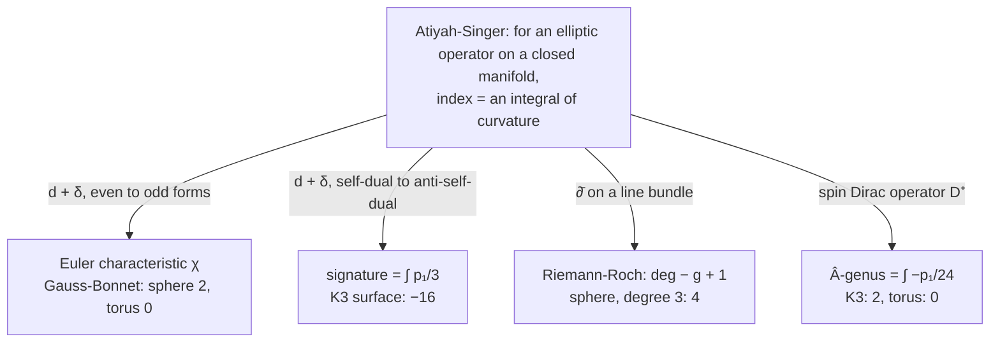

# Spinors and the Dirac operator: a square root of the Laplacian, and the index theorem in outline

[Syllabus](../../../SYLLABUS.md) → [Differential geometry and Lie groups](../README.md) → [Geometric Analysis and Physics](../README.md#s07) → Spinors and the Dirac operator

---

## General Overview

A graphene flake is one layer of carbon atoms. Make it a square 100 nm on a side, and join opposite edges, so an electron that leaves one edge comes back at the other. The flake is then a flat torus: a square with opposite edges glued.

Near zero energy, graphene's electrons do not obey the usual rule, energy proportional to momentum squared. They obey the **Dirac equation** in two dimensions. Energy is proportional to momentum itself, with a plus or minus sign. On the 100 nm flake the lowest levels above zero sit at 41.3567 meV and 58.4872 meV (millielectronvolts), in the ratio 1 to $`\sqrt{2}`$.

That ratio comes from one operator. Call it $`D`$. It is a first-order derivative, built with two 2 by 2 matrices, and applying it twice gives minus the Laplacian, the operator of heat and waves. The minus sign makes every eigenvalue 0 or positive, so each has a square root. So $`D`$ is a **square root of the Laplacian**, up to that sign, and its eigenvalues are plus and minus those square roots.

The same kind of operator exists on any curved space that has a "spin structure" (a consistent way to track the sign of half-turns, Step 2). Its solutions come in two kinds, called handedness. The count of one kind minus the other is a whole number, the **index**, which the curvature alone decides. The **Atiyah-Singer index theorem** (1963) says what that number is. Gauss-Bonnet is one case of it.

**A Dirac operator is a first-order operator built from matrices that anticommute, so it squares to minus the Laplacian; the number of its solutions of one handedness minus the other is its index, and the Atiyah-Singer theorem computes that index from curvature alone.**

**What kind of fact this is:** the Clifford rules, $`D^2`$ equal to minus the Laplacian, the torus eigenvalues, the double cover and the Gauss-Bonnet index are theorems proved on this card in Why it works. The Atiyah-Singer theorem and Lichnerowicz's formula are global theorems stated here with sources, not proved. Graphene obeying the Dirac equation is a model that fits measurements near zero energy.

### The picture: one theorem, four cases



Schematic. Each arrow picks an operator; each box is the topological number its index equals.

---

## The formula

Notation first, in words.

- The **Pauli matrices** $`\sigma_1`$, $`\sigma_2`$, $`\sigma_3`$ are the three 2 by 2 complex matrices of [Spin one-half](../../13-Engineering%20mathematics/09-Quantum%20Mechanics%20in%20Outline/06-spin-and-two-state-systems.md). Here σ is never a standard deviation, and $`i = \sqrt{-1}`$.
- A **spinor** at a point is a column of two complex numbers. A **spinor field** $`\psi`$ gives one at every point.
- $`\partial_x`$ and $`\partial_y`$ are the rates of change along x and y.
- The **Clifford algebra** $`\mathrm{Cl}(\mathbb{R}^2)`$ is everything built by adding and multiplying two symbols $`e_1`$, $`e_2`$ under one rule: a unit vector squares to 1, and two perpendicular ones anticommute.

```math
e_1^2 = e_2^2 = 1, \qquad e_1e_2 = -e_2e_1, \qquad D = -i\big(\sigma_1\,\partial_x + \sigma_2\,\partial_y\big), \qquad D^2 = -\big(\partial_x^2 + \partial_y^2\big)
```

**Read it aloud:** each basis vector squares to one and the two anticommute; the Dirac operator is minus i times sigma-one d by dx plus sigma-two d by dy; and its square is minus the flat Laplacian.

The Pauli matrices obey the Clifford rules, so $`e_1 = \sigma_1`$, $`e_2 = \sigma_2`$ builds the algebra out of matrices. Some books use $`e_1^2 = -1`$ instead; the theory is the same with signs moved.

On the torus with sides $`2\pi`$, try $`\psi = e^{i(mx + ny)}\xi`$ with whole numbers $`m`$, $`n`$ and a fixed spinor $`\xi`$. Then $`D`$ acts as a 2 by 2 matrix:

```math
D\,\psi = \big(m\,\sigma_1 + n\,\sigma_2\big)\psi = \begin{pmatrix} 0 & m - in \\ m + in & 0 \end{pmatrix}\psi, \qquad \lambda = \pm\sqrt{m^2 + n^2}
```

**Read it aloud:** on the wave with whole-number frequencies m and n, the Dirac operator is the matrix m sigma-one plus n sigma-two, and its eigenvalues are plus and minus the root of m squared plus n squared.

The **index theorem** for the spin Dirac operator of a closed four-dimensional spin manifold M. Here $`D^{+}`$ is the part of $`D`$ acting on spinors of positive handedness, $`p_1`$ (the first Pontryagin form) is a 4-form built from curvature as in Chern-Weil, and $`\hat{A}`$ is read "A-hat":

```math
\mathrm{ind}\,D^{+} = \dim\ker D^{+} - \dim\ker D^{-} = \hat{A}(M) = -\frac{1}{24}\int_M p_1
```

**Read it aloud:** the solutions of positive handedness minus those of negative handedness equals the A-hat genus, minus one twenty-fourth of the integral of the first Pontryagin form.

| Symbol | Plain meaning | In our example | Push it up and the answer… |
| --- | --- | --- | --- |
| $`\sigma_1, \sigma_2, \sigma_3`$ | Pauli matrices; $`\sigma_3 = -i\sigma_1\sigma_2`$ marks handedness | $`\sigma_1\sigma_2 = i\sigma_3`$ | — |
| $`e_1, e_2`$, $`\mathrm{Cl}`$, $`v`$, $`u`$ | Clifford generators; the algebra they build; a vector; a unit vector, $`u^2 = 1`$ | basis 1, $`e_1`$, $`e_2`$, $`e_1e_2`$ | — |
| $`q(\theta)`$, $`\mathrm{Spin}(3)`$ | a spin element turning the $`e_1e_2`$ plane by θ; the group of unit even elements in three dimensions | $`q(360°) = -1`$; $`\mathrm{Spin}(3) = SU(2)`$ | — |
| $`\psi`$, $`\xi`$ | spinor field; a fixed column of two complex numbers | $`\xi = (1, 0)`$ | — |
| $`D`$, $`D^{\pm}`$, $`\mathcal{S}^{\pm}`$ | Dirac operator; its piece from one handedness to the other; spinors of positive and negative handedness | $`D^2 = -(\partial_x^2 + \partial_y^2)`$; $`\mathcal{S}^{+}`$ is the top entry | — |
| $`m, n`$, $`\lambda`$ | whole-number frequencies; eigenvalue of $`D`$ | (1, 2) gives $`\pm\sqrt{5} = \pm 2.236068`$ | $`\lvert\lambda\rvert`$ grows like the frequency |
| $`h`$, $`v_F`$, $`L`$ | Planck's constant; graphene's Fermi velocity; flake side | 6.62607015e-34 J s; $`10^6`$ m/s; 100 nm | larger L lowers every level as 1/L |
| $`\mathrm{ind}`$, $`\ker`$ | index; kernel, the solutions of $`P\psi = 0`$ for an operator $`P`$ | 1 − 1 = 0 on the torus | unchanged by any smooth deformation |
| $`d + \delta`$ | exterior derivative plus its adjoint, on forms | index 2 on the sphere | — |
| $`\chi(M)`$, $`b_k`$, $`K`$, $`dA`$ | Euler characteristic; Betti numbers; Gaussian curvature, 1/m²; area element | 2; (1, 0, 1); $`\int K\,dA = 4\pi`$ | — |
| $`p_1`$, $`c_1, c_2`$, $`\hat{A}`$, $`\mathrm{sig}`$ | first Pontryagin form; Chern classes; A-hat genus; signature | K3: −48; 0, 24; 2; −16 | — |
| $`S`$, $`\nabla^{*}\nabla`$ | scalar curvature; rough Laplacian | unit sphere $`S = 2`$ | larger S pushes $`\lambda^2`$ up |

The signature is written $`\mathrm{sig}`$ because σ is taken.

### When it holds

- **The matrices anticommute.** Swap $`\sigma_2`$ for a second $`\sigma_1`$ and the cross term survives: on the mode (1, 1), $`D^2`$ gives 4, not $`1^2 + 1^2 = 2`$.
- **The manifold is closed: compact with no edge.** On a flat disc, one triangle, $`V - E + F = 1`$ but the total curvature is 0. The edge carries the missing turning, and the index theorem needs a boundary term.
- **The operator is elliptic.** Its top-order part must be invertible at every nonzero frequency. For $`D`$ that part is $`m\sigma_1 + n\sigma_2`$, whose square is $`(m^2 + n^2)I`$. Without ellipticity the kernel can be infinite and the index means nothing.
- **The manifold is spin.** The spin Dirac operator needs a spin structure (Step 2). The complex projective plane $`\mathbb{CP}^2`$ has none: its $`\hat{A}`$ is −0.125, not a whole number.
- **For graphene: low energy, one valley.** The Dirac picture holds within a few hundred meV of zero, near one of graphene's two "valleys" in momentum. The two entries of $`\psi`$ there are the two carbon sublattices, not the electron's spin.

---

## Why it works

### Step 0: the idea, a first-order operator whose square is second order

The Laplacian is a sum of squares, $`\partial_x^2 + \partial_y^2`$. A square root would be $`a\,\partial_x + b\,\partial_y`$ with $`(a\partial_x + b\partial_y)^2 = \partial_x^2 + \partial_y^2`$. Expanding gives $`a^2\partial_x^2 + (ab + ba)\partial_x\partial_y + b^2\partial_y^2`$.

So $`a^2 = b^2 = 1`$ and $`ab + ba = 0`$. No two numbers do this. Two matrices do: the Pauli matrices. Paul Dirac found this in 1928 for the electron, in four dimensions with 4 by 4 matrices.

### Step 1: the Clifford algebra and the spin group

Build every product of $`e_1`$ and $`e_2`$. The rules collapse them to four: 1, $`e_1`$, $`e_2`$, $`e_1e_2`$. With three generators there are $`2^3 = 8`$.

A vector $`v = v_1e_1 + v_2e_2`$ squares to its length squared, $`v^2 = v_1^2 + v_2^2`$. So the algebra multiplies vectors while remembering lengths. The reflection in the mirror at right angles to a unit vector $`u`$ is a sandwich with a minus sign, $`v \mapsto -u\,v\,u^{-1}`$. A rotation is two reflections, so the two minus signs cancel: a rotation is the sandwich $`v \mapsto q\,v\,q^{-1}`$, with $`q`$ the product of the two unit vectors.

The spin element that turns the $`e_1e_2`$ plane by θ is

```math
q(\theta) = \cos\tfrac{\theta}{2} - \sin\tfrac{\theta}{2}\,e_1e_2, \qquad q\,e_1\,q^{-1} = \cos\theta\,e_1 + \sin\theta\,e_2
```

**Read it aloud:** q of theta is cos of half theta minus sin of half theta times e-one e-two, and sandwiching e-one with it turns e-one by theta toward e-two.

Each side of the sandwich turns by half the angle. So at θ = 360° the vector is back, but $`q = -1`$. Only at 720° is $`q = +1`$ again. $`q`$ and $`-q`$ give the same rotation: this is the two-to-one map of [Rotation group](../06-Lie%20Groups/04-rotations-so3-and-quaternions.md).

In three dimensions, take $`e_k = \sigma_k`$ for k = 1, 2, 3: the three Pauli matrices obey the same rules. The even products are 1 and $`e_3e_2 = -i\sigma_1`$, $`e_1e_3 = -i\sigma_2`$, $`e_2e_1 = -i\sigma_3`$. These three multiply like the quaternion units of [Rotation group](../06-Lie%20Groups/04-rotations-so3-and-quaternions.md): each squares to −1, and the first times the second gives the third. So the even elements are the real combinations of $`I`$, $`-i\sigma_1`$, $`-i\sigma_2`$, $`-i\sigma_3`$. Such a matrix has determinant equal to the sum of the squares of its four coefficients, and the unit ones, with that sum equal to 1, are exactly the matrices of $`SU(2)`$. This group is $`\mathrm{Spin}(3)`$, the double cover of $`SO(3)`$. In every dimension from 3 up, $`\mathrm{Spin}`$ is the simply connected double cover of the rotation group ([Lie's theorems](../06-Lie%20Groups/11-lies-theorems-and-covering-groups.md)).

<details>
<summary>Detailed proof: the sandwich turns e₁ by θ</summary>

Write $`c = \cos\tfrac{\theta}{2}`$, $`s = \sin\tfrac{\theta}{2}`$. The inverse of $`q`$ is $`c + s\,e_1e_2`$, because $`(e_1e_2)^2 = e_1e_2e_1e_2 = -e_1e_1e_2e_2 = -1`$.

Three small products: $`e_1e_2e_1 = -e_2`$ and $`e_1\,e_1e_2 = e_2`$, and $`e_2\,e_1e_2 = -e_1`$. Then

$`\displaystyle q\,e_1\,q^{-1} = (c\,e_1 + s\,e_2)(c + s\,e_1e_2) = c^2e_1 + cs\,e_2 + cs\,e_2 - s^2e_1 = \cos\theta\,e_1 + \sin\theta\,e_2`$

by the double-angle formulas. Replacing $`q`$ with $`-q`$ changes both factors' signs, which cancel.

</details>

### Step 2: spinor fields on a curved space

On a curved surface, the frame of directions turns from patch to patch by rotations. A **spin structure** is a consistent choice of spin elements $`\pm q`$ for those turns, one sign each, agreeing round every triple overlap. A **spinor field** then has, in every patch, a column $`\psi`$ that changes by $`q`$. The columns form a bundle, built as in [Principal bundle and connection](../06-Lie%20Groups/10-principal-bundles-and-connections-in-outline.md). Twisting spinors by another bundle uses [Tensor products](../../03-Algebra/11-Duals%2C%20Quotients%20and%20Tensors/03-tensor-products.md).

The flat torus has four spin structures: in each direction, spinors either repeat or flip sign going round. This card uses the one where they repeat in both. The flip in a direction shifts that frequency by one half and removes the zero eigenvalue. $`\mathbb{CP}^2`$ has no spin structure at all.

The Dirac operator on a curved space is $`D = -i\sum_k e_k\nabla_k`$, summed over an orthonormal frame, with $`\nabla_k`$ the spinor's covariant derivative from the Levi-Civita connection.

### Step 3: D squares to minus the Laplacian, on the flat torus

Multiply out $`D^2 = -(\sigma_1\partial_x + \sigma_2\partial_y)^2`$. The squares give $`-(\sigma_1^2\partial_x^2 + \sigma_2^2\partial_y^2) = -(\partial_x^2 + \partial_y^2)`$. The cross terms give $`-(\sigma_1\sigma_2 + \sigma_2\sigma_1)\partial_x\partial_y = 0`$. The code multiplies these matrices out.

On the wave $`e^{i(mx + ny)}\xi`$, each $`\partial_x`$ becomes $`im`$ and each $`\partial_y`$ becomes $`in`$. The $`-i`$ cancels the $`i`$, leaving the matrix $`m\sigma_1 + n\sigma_2`$. It squares to $`(m^2 + n^2)I`$, so its eigenvalues are $`\pm\sqrt{m^2 + n^2}`$.

For graphene, the frequencies become momenta $`2\pi m/L`$ on a flake of side L, and the energy is $`\pm h v_F\sqrt{m^2 + n^2}/L`$. Here $`h`$ is Planck's constant and $`v_F \approx 10^6`$ m/s is graphene's measured Fermi velocity, the speed of its low-energy electrons. With L = 100 nm, (1, 0) gives 41.3567 meV and (1, 1) gives 58.4872 meV.

### Step 4: handedness and the index

The matrix $`\sigma_3 = -i\sigma_1\sigma_2`$ anticommutes with $`D`$. Its +1 eigenspace $`\mathcal{S}^{+}`$ is the top entry, and its −1 eigenspace $`\mathcal{S}^{-}`$ the bottom. So $`D`$ sends positive spinors to negative ones and back: $`D^{+}`$ and $`D^{-}`$. Each is the other's **adjoint**: the operator that moves it across the inner product, $`\langle D^{+}u, v\rangle = \langle u, D^{-}v\rangle`$. Solutions of $`D\psi = 0`$ are called **harmonic spinors**.

Every nonzero eigenvalue comes paired. If $`D\psi = \lambda\psi`$, then $`D(\sigma_3\psi) = -\lambda\,\sigma_3\psi`$. Split $`\psi`$ into its positive part $`\psi^{+}`$ and negative part $`\psi^{-}`$. Then $`D^{+}\psi^{+} = \lambda\psi^{-}`$, so for $`\lambda \ne 0`$ the positive and negative solutions match one for one. Only the kernel can be lopsided. The **index** measures that lopsidedness:

```math
\mathrm{ind}\,D^{+} = \dim\ker D^{+} - \dim\ker D^{-}
```

On the torus the kernel is the constant spinors: (1, 0) in $`\mathcal{S}^{+}`$ and (0, 1) in $`\mathcal{S}^{-}`$. The index is 1 − 1 = 0.

Why the index is stable: take a matrix from a space of size a to a space of size b. Its kernel size minus its cokernel size (the dimensions the image misses in the target) is always a − b, whatever the entries. Deforming the matrix moves kernel and cokernel together. The same holds for elliptic operators on a closed manifold. Small changes of the metric create or destroy zero modes only in plus-minus pairs.

### Step 5: Lichnerowicz's formula and what positive curvature forbids

On a curved spin manifold, $`D^2`$ is not exactly the Laplacian. Lichnerowicz (1963) proved

```math
D^2 = \nabla^{*}\nabla + \frac{S}{4}
```

**Read it aloud:** D squared is the rough Laplacian plus a quarter of the scalar curvature.

The **rough Laplacian** $`\nabla^{*}\nabla`$ is minus the sum of second covariant derivatives along an orthonormal frame. It is never negative. The proof splits $`D^2 = -\sum_{j,k} e_je_k\nabla_j\nabla_k`$ into terms with $`j = k`$, the rough Laplacian, and $`j \ne k`$. The Clifford rules turn the second group into curvature, and the first Bianchi identity reduces that to $`S/4`$ ([Ricci and scalar curvature](../05-Riemannian%20Geometry/07-ricci-and-scalar-curvature.md) defines S).

Consequence. If $`S > 0`$ everywhere on a closed spin manifold, then $`D\psi = 0`$ forces $`\int\lvert\nabla\psi\rvert^2 + \tfrac{S}{4}\lvert\psi\rvert^2 = 0`$, so $`\psi = 0`$. No kernel, index 0, so $`\hat{A}(M) = 0`$. Read backwards: a spin manifold with $`\hat{A} \ne 0`$ carries no metric of positive scalar curvature.

On the unit sphere, S = 2. The bound gives $`\lambda^2 \ge S/4 = 0.5`$. The true smallest is $`\lambda^2 = 1`$: the eigenvalues are $`\pm(k + 1)`$ for k = 0, 1, 2, … (Bär, in Sources). Friedrich's sharper bound for surfaces, $`\lambda^2 \ge S/2 = 1`$, is reached exactly.

### Step 6: the index theorem and its cases

Atiyah and Singer proved the theorem for every elliptic operator on a closed manifold. The index equals an integral of characteristic forms built from curvature ([Chern-Weil](../06-Lie%20Groups/13-chern-weil-theory-and-characteristic-classes.md)). The proof is long; the card states it and names its source. One modern route is the heat kernel: the paired nonzero eigenvalues cancel in $`\mathrm{tr}\,e^{-tD^{-}D^{+}} - \mathrm{tr}\,e^{-tD^{+}D^{-}}`$ for every time t. As t grows, this leaves the kernel count. As t shrinks, it becomes a local curvature integral.

| Operator | Its index | The curvature side | Example |
| --- | --- | --- | --- |
| $`d + \delta`$, even to odd forms | $`b_0 - b_1 + b_2 - \cdots = \chi(M)`$ | surfaces: $`\frac{1}{2\pi}\int K\,dA`$ | sphere 2, torus 0 |
| $`d + \delta`$, self-dual to anti-self-dual forms | $`\mathrm{sig}(M)`$ | four dimensions: $`\frac{1}{3}\int p_1`$ | K3: −16; $`\mathbb{CP}^2`$: 1 |
| $`\bar\partial`$ on a line bundle over a surface of genus g | holomorphic sections minus obstructions | degree − g + 1 | sphere, degree 3: 4 |
| spin Dirac $`D^{+}`$ | $`\dim\ker D^{+} - \dim\ker D^{-}`$ | four dimensions: $`-\frac{1}{24}\int p_1`$ | K3: 2; flat 2-torus: 0 |

In the table, $`\delta`$ is the adjoint of $`d`$. A self-dual 2-form equals its own Hodge star; an anti-self-dual one equals minus it. $`\bar\partial`$ is the derivative along the conjugate complex variable, whose solutions are holomorphic. g is the genus (the number of handles), not a metric.

**The Gauss-Bonnet case.** The kernel of $`d + \delta`$ is the harmonic forms. [Hodge's theorem](../05-Riemannian%20Geometry/12-hodge-laplacian-and-harmonic-forms.md) counts them: $`b_k`$ in degree k. On the sphere the even forms give $`b_0 + b_2 = 2`$ solutions and the odd forms give $`b_1 = 0`$. The index is 2 − 0 = 2. That is $`\chi(S^2)`$, and the [Gauss-Bonnet](../02-Surfaces/10-gauss-bonnet-theorem.md) total $`\frac{1}{2\pi}\int K\,dA = 4\pi/2\pi = 2`$.

**The signature and  cases on K3.** The K3 surface is a compact complex surface with $`b_2 = 22`$. Its 2-dimensional holes pair up through an intersection form with 3 positive and 19 negative directions, so $`\mathrm{sig} = -16`$. On the curvature side, its Chern classes (the complex cousins of $`p_1`$ from Chern-Weil) are $`c_1 = 0`$ and $`c_2 = \chi = 2 + 22 = 24`$, so $`p_1 = c_1^2 - 2c_2 = -48`$. Then $`p_1/3 = -16`$, matching, and $`\hat{A} = 48/24 = 2`$. So K3 has two harmonic spinors of positive handedness more than negative, and no metric on it has positive scalar curvature.

---

## Worked numbers, by hand

| Step | Arithmetic | Value |
| --- | --- | --- |
| Clifford rules | $`\sigma_1^2 = \sigma_2^2 = I`$, $`\sigma_1\sigma_2 + \sigma_2\sigma_1 = 0`$ | yes |
| spin element at 360° | $`\cos 180° - \sin 180°\,e_1e_2`$ | −1 |
| $`D^2`$ | coefficients of $`\partial_x^2`$, $`\partial_y^2`$, $`\partial_x\partial_y`$ | −1, −1, 0 |
| mode (1, 2) | $`\pm\sqrt{1 + 4}`$ | ±2.236068 |
| lowest torus eigenvalues | 0, ±1, ±1.414214, ±2, ±2.236068 | 2, 4, 4, 4, 8 times each |
| torus Dirac index | (1, 0) in $`\mathcal{S}^{+}`$, (0, 1) in $`\mathcal{S}^{-}`$ | 1 − 1 = 0 |
| sphere, by Betti numbers | $`b_0 - b_1 + b_2 = 1 - 0 + 1`$ | **2** |
| sphere, by $`d + \delta`$ kernels | even 2, odd 0 | 2 |
| sphere, by curvature | $`\frac{1}{2\pi}\int K\,dA = 4\pi/2\pi`$ | 2 |
| K3 | $`\hat{A} = -p_1/24 = 48/24`$ | 2 |

The answer, 2, is the same number counted four ways: holes, solutions of an equation, triangles and total curvature. That agreement is the Gauss-Bonnet case of the index theorem.

### What breaks if you drop a piece

| Mistake | Comes out at | What went wrong |
| --- | --- | --- |
| Commuting matrices, $`\sigma_1`$ twice | $`D^2`$ on (1, 1) gives 4, not 2 | the cross term $`2\partial_x\partial_y`$ survives |
| Dropping the $`-i`$ | $`(\sigma_1\partial_x + \sigma_2\partial_y)^2`$ on (1, 1) gives −2 | the operator is not self-adjoint; its eigenvalues are imaginary |
| A disc in place of a closed surface | $`V - E + F = 1`$, total curvature 0 | the boundary's turning is missing |
| Applying the spin index to $`\mathbb{CP}^2`$ | $`\hat{A} = -0.125`$ | no spin structure, so no spin Dirac operator |
| Dropping the 1/4 in Lichnerowicz | bound $`\lambda^2 \ge 2`$, but the true value is 1 | the curvature term is a quarter of S |

---

## Code, from first principles, and it actually runs

The programs build the Pauli matrices and multiply them out; nothing imported knows about spinors. They take independent roads to each answer:

- **Torus eigenvalues, three roads:** the closed form $`\sqrt{m^2 + n^2}`$; the roots of each 2 by 2 matrix's characteristic polynomial; and $`D`$ by central differences on periodic grids of 16, 32 and 64 points a side. The wave repeats on the grid, so the differences turn $`D`$ into another 2 by 2 matrix; its eigenvalue approaches $`\sqrt{5}`$ with an error that falls fourfold as the step halves.
- **The Gauss-Bonnet index, four roads:** Betti numbers by exact rank; the kernels of the simplicial $`d + \delta`$; the count $`V - E + F`$; and the integral of K over a squashed sphere at two step sizes.
- **K3's signature, two roads:** the eigenvalues of its intersection form, and $`p_1/3`$ from its Chern numbers.

### Python

```python
# Spinors and the Dirac operator -- the check behind the card.  Standard library only.
# 2x2 matrices are lists of Python complex numbers.  Ranks are exact, in Fractions.  The
# eigenvalues of the 22 x 22 form come from a Jacobi sweep written out here.
import math
from fractions import Fraction

def mul(a, b): return [[sum(a[i][k] * b[k][j] for k in range(2)) for j in range(2)] for i in range(2)]
def lin(*terms): return [[sum(c * m[i][j] for c, m in terms) for j in range(2)] for i in range(2)]
def size(a): return max(abs(a[i][j]) for i in range(2) for j in range(2))
def eig2(a):                                     # roots of the characteristic polynomial
    tr, det = a[0][0] + a[1][1], a[0][0] * a[1][1] - a[0][1] * a[1][0]
    r = complex(tr * tr - 4 * det) ** 0.5
    return sorted([((tr - r) / 2).real, ((tr + r) / 2).real])
I, S1, S2, S3 = [[1, 0], [0, 1]], [[0, 1], [1, 0]], [[0, -1j], [1j, 0]], [[1, 0], [0, -1]]
S12 = mul(S1, S2)

rules = [size(lin((1, mul(S1, S1)), (-1, I))), size(lin((1, mul(S2, S2)), (-1, I))), size(lin((1, S12), (1, mul(S2, S1))))]
print("Clifford rules: s1 s1 = 1, s2 s2 = 1, s1 s2 + s2 s1 = 0:", "yes" if max(rules) < 1e-12 else "no")
assert max(rules) < 1e-12 and size(lin((1, S12), (-1j, S3))) < 1e-12 and size(lin((1, mul(mul(S3, S2), mul(S1, S3))), (-1, mul(S2, S1)))) < 1e-12  # s1 s2 = i s3; (e3e2)(e1e3) = e2e1
def spin(t): return lin((math.cos(t / 2), I), (-math.sin(t / 2), S12))   # its inverse is spin(-t)
t = math.pi / 2                                        # a quarter turn in the s1 s2 plane
turned = mul(mul(spin(t), S1), spin(-t))
err = size(lin((1, turned), (-math.cos(t), S1), (-math.sin(t), S2)))
print("g(90 deg) s1 g^-1 = cos(90) s1 + sin(90) s2, to 1e-12:", "yes" if err < 1e-12 else "no")
minus = mul(mul(lin((-1, spin(t))), S1), lin((-1, spin(-t))))
print("g and -g turn s1 the same way:", "yes" if size(lin((1, minus), (-1, turned))) < 1e-12 else "no")
assert err < 1e-12 and size(lin((1, minus), (-1, turned))) < 1e-12
for deg in (360, 720):
    print(f"g after a {deg} degree turn: {spin(math.radians(deg))[0][0].real:.6f} times the identity")
assert abs(spin(2 * math.pi)[0][0] + 1) < 1e-12 and abs(spin(4 * math.pi)[0][0] - 1) < 1e-12

D = {(1, 0): lin((-1j, S1)), (0, 1): lin((-1j, S2))}   # D = -i(s1 d/dx + s2 d/dy)
DD = {(2, 0): mul(D[1, 0], D[1, 0]), (0, 2): mul(D[0, 1], D[0, 1]), (1, 1): lin((1, mul(D[1, 0], D[0, 1])), (1, mul(D[0, 1], D[1, 0])))}
print(f"D squared: d2/dx2 coefficient {DD[2, 0][0][0].real:.0f} | d2/dy2 {DD[0, 2][0][0].real:.0f} | d2/dxdy {size(DD[1, 1]):.0f}")
assert size(lin((1, DD[(2, 0)]), (1, I))) < 1e-12 and size(DD[(1, 1)]) < 1e-12

def mode(m, n): return lin((m, S1), (n, S2))           # D acting on e^{i(mx+ny)} times a spinor
spec = {}
for m in range(-3, 4):
    for n in range(-3, 4):
        for lam in eig2(mode(m, n)):                   # road 2 against road 1, sqrt(m^2 + n^2)
            assert abs(abs(lam) - math.hypot(m, n)) < 1e-9 and size(lin((1, mul(S3, mode(m, n))), (1, mul(mode(m, n), S3)))) < 1e-12
            if abs(lam) < 2.3: spec[round(lam, 6) + 0.0] = spec.get(round(lam, 6) + 0.0, 0) + 1
print("torus eigenvalues with multiplicity:", ", ".join(f"{k:.6f} x{v}" for k, v in sorted(spec.items())))
print(f"chirality s3 anticommutes with D on mode (1, 2): {size(lin((1, mul(S3, mode(1, 2))), (1, mul(mode(1, 2), S3)))):.0f}")
kp, km = [sum(s * v > 0 for v in eig2(S3)) for s in (1, -1)]   # s3 splits the kernel, mode (0, 0), by handedness
print(f"kernel: {spec[0.0]} constant spinors, (1, 0) in S+ and (0, 1) in S-; index of D+ = {kp} - {km} = {kp - km}")
assert spec[0.0] == kp + km and kp == km               # flat torus: curvature integral 0
print(f"try: mode (3, 4) eigenvalues {eig2(mode(3, 4))[0]:.6f} and {eig2(mode(3, 4))[1]:.6f}")

def grid_eig(m, n, N):                                 # D by central differences on a periodic N x N grid
    h = 2 * math.pi / N                                # the wave e^{i(mx+ny)} repeats on the grid, and each
    w = lambda u, v: complex(math.cos(m * u + n * v), math.sin(m * u + n * v))   # stencil returns it times a number,
    dx, dy = (w(h, 0) - w(-h, 0)) / (2 * h), (w(0, h) - w(0, -h)) / (2 * h)       # read off at the origin, where w = 1
    return eig2(lin((-1j * dx, S1), (-1j * dy, S2)))[1]                          # so D acts on it as this 2x2 matrix
errs = [math.sqrt(5) - grid_eig(1, 2, N) for N in (16, 32, 64)]
for N, e in zip((16, 32, 64), errs): print(f"grid {N} x {N}: mode (1, 2) eigenvalue {math.sqrt(5) - e:.6f}, error {e:.6f}")
assert 3.5 < errs[0] / errs[1] < 4.5                   # error falls like h^2

def rank(rows):                                        # exact Gaussian elimination
    rows, r = [[Fraction(v) for v in row] for row in rows], 0
    for c in range(len(rows[0])):
        p = next((i for i in range(r, len(rows)) if rows[i][c] != 0), None)
        if p is None: continue
        rows[r], rows[p] = rows[p], rows[r]
        for i in range(len(rows)):
            if i != r and rows[i][c] != 0:
                f = rows[i][c] / rows[r][c]
                rows[i] = [a - f * b for a, b in zip(rows[i], rows[r])]
        r += 1
    return r
def surface(faces):
    edges = sorted({tuple(sorted((f[a], f[b]))) for f in faces for a, b in ((0, 1), (0, 2), (1, 2))})
    verts = sorted({v for e in edges for v in e})
    d0 = [[(v == e[1]) - (v == e[0]) for v in verts] for e in edges]                     # edges x verts
    d1 = [[(e == (f[1], f[2])) - (e == (f[0], f[2])) + (e == (f[0], f[1])) for e in edges] for f in faces]
    assert all(sum(d1[f][e] * d0[e][v] for e in range(len(edges))) == 0 for f in range(len(faces)) for v in range(len(verts)))
    r0, r1 = rank(d0), rank(d1)                        # (above: the boundary of a boundary is zero)
    betti = (len(verts) - r0, len(edges) - r0 - r1, len(faces) - r1)
    A = [d0[i] + [d1[j][i] for j in range(len(faces))] for i in range(len(edges))]      # d + delta
    At = [list(col) for col in zip(*A)]
    ker_even, ker_odd = len(At) - rank(A), len(A) - rank(At)
    return len(verts), len(edges), len(faces), betti, ker_even, ker_odd
sphere = surface([sorted(f) for f in ((0, 1, 2), (0, 1, 3), (0, 2, 3), (1, 2, 3))])
at = lambda i, j: 3 * (i % 3) + j % 3                  # the 3 x 3 grid torus, two triangles per square
torus = surface([sorted(f) for i in range(3) for j in range(3) for f in ((at(i, j), at(i, j + 1), at(i + 1, j + 1)), (at(i, j), at(i + 1, j), at(i + 1, j + 1)))])
for name, (V, E, F, b, ke, ko) in (("sphere", sphere), ("torus", torus)):
    print(f"{name}: V - E + F = {V} - {E} + {F} = {V - E + F}; b = {b}; b0 - b1 + b2 = {b[0] - b[1] + b[2]}")
    print(f"{name}: d + delta kernel on even forms {ke}, on odd forms {ko}, index {ke - ko}")
    assert ke - ko == V - E + F == b[0] - b[1] + b[2] and (ke, ko) == (b[0] + b[2], b[1])
def gauss_bonnet(a, c, n):                             # total curvature of a spheroid / 2 pi
    tot = 0.0
    for k in range(n):
        p = (k + 0.5) * math.pi / n
        K = 1 / (a ** 4 * c * c * (math.sin(p) ** 2 / a ** 2 + math.cos(p) ** 2 / c ** 2) ** 2)
        tot += K * a * math.sin(p) * math.sqrt(c * c * math.sin(p) ** 2 + a * a * math.cos(p) ** 2) * math.pi / n
    return tot
for a, c, n in ((2, 1, 20), (2, 1, 40), (1, 0.1, 40)): print(f"spheroid a = {a}, c = {c}, {n} steps: total curvature / 2 pi = {gauss_bonnet(a, c, n):.6f}")
gb20, gb40 = gauss_bonnet(2, 1, 20) - 2, gauss_bonnet(2, 1, 40) - 2
assert abs(gb40) < 5e-4 and 3.5 < gb20 / gb40 < 4.5     # converges to 2 like h^2

def jacobi(A):                                         # eigenvalues of a symmetric matrix
    A, n = [row[:] for row in A], len(A)
    for _ in range(60):
        for p in range(n):
            for q in range(p + 1, n):
                if abs(A[p][q]) < 1e-15: continue
                th = 0.5 * math.atan2(2 * A[p][q], A[q][q] - A[p][p])
                c, s = math.cos(th), math.sin(th)
                for k in range(n): A[k][p], A[k][q] = c * A[k][p] - s * A[k][q], s * A[k][p] + c * A[k][q]
                for k in range(n): A[p][k], A[q][k] = c * A[p][k] - s * A[q][k], s * A[p][k] + c * A[q][k]
    return [A[i][i] for i in range(n)]
E8 = [[2 if i == j else -1 if {i, j} in ({0, 2}, {2, 3}, {3, 4}, {4, 5}, {5, 6}, {6, 7}, {1, 3}) else 0
       for j in range(8)] for i in range(8)]
blocks = [[[-v for v in row] for row in E8]] * 2 + [[[0, 1], [1, 0]]] * 3
Q, o = [[0] * 22 for _ in range(22)], 0
for b in blocks:
    for i, j in ((i, j) for i in range(len(b)) for j in range(len(b))): Q[o + i][o + j] = b[i][j]
    o += len(b)
ev = jacobi(Q)
pos, neg = sum(v > 1e-9 for v in ev), sum(v < -1e-9 for v in ev)
chi, p1 = 2 + 22, 0 - 2 * (2 + 22)                     # c2 = chi, c1 = 0, p1 = c1^2 - 2 c2
print(f"K3 intersection form: {pos} positive, {neg} negative eigenvalues; signature {pos - neg}")
print(f"K3 from curvature: chi = {chi}, p1 = {p1}, signature = p1/3 = {p1 // 3}, A-hat = -p1/24 = {-p1 // 24}")
assert 3 * (pos - neg) == p1                           # the signature theorem: the two roads agree
c1, c2 = 3, 3                                          # CP2: c = 1 + 3h + 3h^2, signature 1
print(f"CP2: signature 1, p1 = {c1 * c1 - 2 * c2}, p1/3 = {(c1 * c1 - 2 * c2) / 3:.6f}, A-hat = -p1/24 = {-(c1 * c1 - 2 * c2) / 24:.6f} (not whole: CP2 is not spin)")
print(f"unit sphere: S = 2, Lichnerowicz S/4 = {2 / 4:.6f}, Friedrich nS/(4(n-1)) = {2 * 2 / 4:.6f}")
mono = [f"z^{k}" for k in range(3 + 1)]               # polynomials of degree <= 3 on the sphere
print(f"Riemann-Roch on the sphere, degree 3: sections {', '.join(mono)} count {len(mono)}; d - g + 1 = {3 - 0 + 1}")
hv = 6.62607015e-34 * 1.0e6 / 1.602176634e-19         # h v_F in eV m
for L in (100e-9, 200e-9): print(f"graphene flake {L * 1e9:.0f} nm: levels {1000 * hv / L:.4f} and {1000 * hv / L * math.sqrt(2):.4f} meV")
same, no_i = lin((1, S1), (1, S1)), lin((1j, S1), (1j, S2))     # mode (1, 1) with each mistake
print(f"mistake: commuting s1, s1 on mode (1, 1): D squared gives {eig2(mul(same, same))[1]:.0f}, not 2")
print(f"mistake: no -i, (s1 dx + s2 dy) squared on mode (1, 1) gives {eig2(mul(no_i, no_i))[1]:.0f}, not 2")
V, E, F = surface([[0, 1, 2]])[:3]
print(f"mistake: one flat triangle, a disc: V - E + F = {V} - {E} + {F} = {V - E + F}, total curvature / 2 pi = 0")
print(f"mistake: no 1/4 in Lichnerowicz: bound {2:.6f} above the true smallest eigenvalue squared {1:.6f}")
print("ALL CHECKS PASS")
```

**Ran 2026-11-24 on macOS, Python 3.14.10, standard library only. All checks passed. Output, pasted from the run:**

```
Clifford rules: s1 s1 = 1, s2 s2 = 1, s1 s2 + s2 s1 = 0: yes
g(90 deg) s1 g^-1 = cos(90) s1 + sin(90) s2, to 1e-12: yes
g and -g turn s1 the same way: yes
g after a 360 degree turn: -1.000000 times the identity
g after a 720 degree turn: 1.000000 times the identity
D squared: d2/dx2 coefficient -1 | d2/dy2 -1 | d2/dxdy 0
torus eigenvalues with multiplicity: -2.236068 x8, -2.000000 x4, -1.414214 x4, -1.000000 x4, 0.000000 x2, 1.000000 x4, 1.414214 x4, 2.000000 x4, 2.236068 x8
chirality s3 anticommutes with D on mode (1, 2): 0
kernel: 2 constant spinors, (1, 0) in S+ and (0, 1) in S-; index of D+ = 1 - 1 = 0
try: mode (3, 4) eigenvalues -5.000000 and 5.000000
grid 16 x 16: mode (1, 2) eigenvalue 2.047418, error 0.188650
grid 32 x 32: mode (1, 2) eigenvalue 2.187642, error 0.048425
grid 64 x 64: mode (1, 2) eigenvalue 2.223882, error 0.012186
sphere: V - E + F = 4 - 6 + 4 = 2; b = (1, 0, 1); b0 - b1 + b2 = 2
sphere: d + delta kernel on even forms 2, on odd forms 0, index 2
torus: V - E + F = 9 - 27 + 18 = 0; b = (1, 2, 1); b0 - b1 + b2 = 0
torus: d + delta kernel on even forms 2, on odd forms 2, index 0
spheroid a = 2, c = 1, 20 steps: total curvature / 2 pi = 2.000512
spheroid a = 2, c = 1, 40 steps: total curvature / 2 pi = 2.000128
spheroid a = 1, c = 0.1, 40 steps: total curvature / 2 pi = 1.995143
K3 intersection form: 3 positive, 19 negative eigenvalues; signature -16
K3 from curvature: chi = 24, p1 = -48, signature = p1/3 = -16, A-hat = -p1/24 = 2
CP2: signature 1, p1 = 3, p1/3 = 1.000000, A-hat = -p1/24 = -0.125000 (not whole: CP2 is not spin)
unit sphere: S = 2, Lichnerowicz S/4 = 0.500000, Friedrich nS/(4(n-1)) = 1.000000
Riemann-Roch on the sphere, degree 3: sections z^0, z^1, z^2, z^3 count 4; d - g + 1 = 4
graphene flake 100 nm: levels 41.3567 and 58.4872 meV
graphene flake 200 nm: levels 20.6783 and 29.2436 meV
mistake: commuting s1, s1 on mode (1, 1): D squared gives 4, not 2
mistake: no -i, (s1 dx + s2 dy) squared on mode (1, 1) gives -2, not 2
mistake: one flat triangle, a disc: V - E + F = 3 - 3 + 1 = 1, total curvature / 2 pi = 0
mistake: no 1/4 in Lichnerowicz: bound 2.000000 above the true smallest eigenvalue squared 1.000000
ALL CHECKS PASS
```

### Rust

Same numbers, same labels, built with `rustc --edition 2021 -O`.

```rust
// Spinors and the Dirac operator -- the same check as the Python, in Rust.  No crates.
// Complex numbers and 2x2 matrices are written out.  Ranks are exact, in fractions of i128.
// The eigenvalues of the 22 x 22 form come from a Jacobi sweep written out here.
use std::f64::consts::PI;
#[derive(Clone, Copy)]
struct C { re: f64, im: f64 }
fn c(re: f64, im: f64) -> C { C { re, im } }
impl std::ops::Add for C { type Output = C; fn add(self, o: C) -> C { c(self.re + o.re, self.im + o.im) } }
impl std::ops::Sub for C { type Output = C; fn sub(self, o: C) -> C { c(self.re - o.re, self.im - o.im) } }
impl std::ops::Mul for C { type Output = C; fn mul(self, o: C) -> C { c(self.re * o.re - self.im * o.im, self.re * o.im + self.im * o.re) } }
impl std::ops::Div for C { type Output = C; fn div(self, o: C) -> C { let d = o.re * o.re + o.im * o.im; c((self.re * o.re + self.im * o.im) / d, (self.im * o.re - self.re * o.im) / d) } }
fn csqrt(z: C) -> C { let r = (z.re * z.re + z.im * z.im).sqrt().sqrt(); let t = z.im.atan2(z.re) / 2.0; c(r * t.cos(), r * t.sin()) }
type M = [[C; 2]; 2];
fn mul(a: &M, b: &M) -> M { let mut o = [[c(0.0, 0.0); 2]; 2]; for i in 0..2 { for j in 0..2 { for k in 0..2 { o[i][j] = o[i][j] + a[i][k] * b[k][j] } } } o }
fn lin(terms: &[(C, M)]) -> M { let mut o = [[c(0.0, 0.0); 2]; 2]; for (k, m) in terms { for i in 0..2 { for j in 0..2 { o[i][j] = o[i][j] + *k * m[i][j] } } } o }
fn size(a: &M) -> f64 { let mut s: f64 = 0.0; for i in 0..2 { for j in 0..2 { s = s.max((a[i][j].re * a[i][j].re + a[i][j].im * a[i][j].im).sqrt()) } } s }
fn eig2(a: &M) -> [f64; 2] {   // roots of the characteristic polynomial
    let (tr, det) = (a[0][0] + a[1][1], a[0][0] * a[1][1] - a[0][1] * a[1][0]);
    let r = csqrt(tr * tr - c(4.0, 0.0) * det);
    let (x, y) = (((tr - r) / c(2.0, 0.0)).re, ((tr + r) / c(2.0, 0.0)).re);
    if x <= y { [x, y] } else { [y, x] }
}
fn r(x: f64) -> C { c(x, 0.0) }
const O: C = C { re: 0.0, im: 0.0 };
const fn k(re: f64, im: f64) -> C { C { re, im } }
const I: M = [[k(1.0, 0.0), O], [O, k(1.0, 0.0)]];
const S1: M = [[O, k(1.0, 0.0)], [k(1.0, 0.0), O]];
const S2: M = [[O, k(0.0, -1.0)], [k(0.0, 1.0), O]];
const S3: M = [[k(1.0, 0.0), O], [O, k(-1.0, 0.0)]];
fn spin(t: f64) -> M { lin(&[(r((t / 2.0).cos()), I), (r(-(t / 2.0).sin()), mul(&S1, &S2))]) }   // inverse is spin(-t)
fn mode(m: f64, n: f64) -> M { lin(&[(r(m), S1), (r(n), S2)]) }   // D acting on e^{i(mx+ny)} times a spinor
fn yn(b: bool) -> &'static str { if b { "yes" } else { "no" } }
fn grid_eig(m: f64, n: f64, nn: f64) -> f64 {   // D by central differences on a periodic N x N grid
    let h = 2.0 * PI / nn;   // the wave e^{i(mx+ny)} repeats on the grid, and each stencil returns it times a number,
    let w = |u: f64, v: f64| c((m * u + n * v).cos(), (m * u + n * v).sin());   // read off at the origin, where w = 1
    let (dx, dy) = ((w(h, 0.0) - w(-h, 0.0)) / r(2.0 * h), (w(0.0, h) - w(0.0, -h)) / r(2.0 * h));
    eig2(&lin(&[(c(0.0, -1.0) * dx, S1), (c(0.0, -1.0) * dy, S2)]))[1]   // so D acts on it as this 2x2 matrix
}
fn gcd(a: i128, b: i128) -> i128 { if b == 0 { a.abs() } else { gcd(b, a % b) } }
fn rank(rows: &Vec<Vec<i64>>) -> usize {   // exact Gaussian elimination, fractions (num, den)
    let mut a: Vec<Vec<(i128, i128)>> = rows.iter().map(|row| row.iter().map(|&v| (v as i128, 1)).collect()).collect();
    let mut rk = 0;
    for col in 0..a[0].len() {
        let p = match (rk..a.len()).find(|&i| a[i][col].0 != 0) { Some(p) => p, None => continue };
        a.swap(rk, p);
        for i in 0..a.len() {
            if i != rk && a[i][col].0 != 0 {
                let (f0, f1) = (a[i][col].0 * a[rk][col].1, a[i][col].1 * a[rk][col].0);
                for j in 0..a[0].len() {
                    let (x, y) = (a[i][j], a[rk][j]);
                    let (num, den) = (x.0 * y.1 * f1 - f0 * y.0 * x.1, x.1 * y.1 * f1);
                    let g = gcd(num, den).max(1) * if den < 0 { -1 } else { 1 };
                    a[i][j] = (num / g, den / g);
                }
            }
        }
        rk += 1;
    }
    rk
}
fn surface(faces: &Vec<[usize; 3]>) -> (usize, usize, usize, [usize; 3], usize, usize) {
    let mut edges: Vec<(usize, usize)> = Vec::new();
    for f in faces { for (a, b) in [(0, 1), (0, 2), (1, 2)] { let e = (f[a].min(f[b]), f[a].max(f[b])); if !edges.contains(&e) { edges.push(e) } } }
    edges.sort();
    let mut verts: Vec<usize> = edges.iter().flat_map(|e| [e.0, e.1]).collect(); verts.sort(); verts.dedup();
    let d0: Vec<Vec<i64>> = edges.iter().map(|e| verts.iter().map(|&v| (v == e.1) as i64 - (v == e.0) as i64).collect()).collect();
    let d1: Vec<Vec<i64>> = faces.iter().map(|f| edges.iter().map(|&e| (e == (f[1], f[2])) as i64 - (e == (f[0], f[2])) as i64 + (e == (f[0], f[1])) as i64).collect()).collect();
    for f in 0..faces.len() { for v in 0..verts.len() { assert!((0..edges.len()).map(|e| d1[f][e] * d0[e][v]).sum::<i64>() == 0) } }   // boundary of a boundary is zero
    let (r0, r1) = (rank(&d0), rank(&d1));
    let betti = [verts.len() - r0, edges.len() - r0 - r1, faces.len() - r1];
    let a: Vec<Vec<i64>> = (0..edges.len()).map(|i| { let mut row = d0[i].clone(); row.extend((0..faces.len()).map(|j| d1[j][i])); row }).collect();
    let at: Vec<Vec<i64>> = (0..a[0].len()).map(|j| (0..a.len()).map(|i| a[i][j]).collect()).collect();
    (verts.len(), edges.len(), faces.len(), betti, at.len() - rank(&a), a.len() - rank(&at))
}
fn sorted3(mut f: [usize; 3]) -> [usize; 3] { f.sort(); f }
fn gauss_bonnet(a: f64, cc: f64, n: usize) -> f64 {   // total curvature of a spheroid / 2 pi
    (0..n).map(|k| { let p = (k as f64 + 0.5) * PI / n as f64;
        let kk = 1.0 / (a.powi(4) * cc * cc * (p.sin().powi(2) / (a * a) + p.cos().powi(2) / (cc * cc)).powi(2));
        kk * a * p.sin() * (cc * cc * p.sin().powi(2) + a * a * p.cos().powi(2)).sqrt() * PI / n as f64 }).fold(0.0, |s, x| s + x)
}
fn jacobi(mut a: Vec<Vec<f64>>) -> Vec<f64> {   // eigenvalues of a symmetric matrix
    let n = a.len(); for _ in 0..60 { for p in 0..n { for q in p + 1..n {
        if a[p][q].abs() < 1e-15 { continue }
        let th = 0.5 * (2.0 * a[p][q]).atan2(a[q][q] - a[p][p]);
        let (cs, sn) = (th.cos(), th.sin());
        for k in 0..n { let (x, y) = (a[k][p], a[k][q]); a[k][p] = cs * x - sn * y; a[k][q] = sn * x + cs * y }
        for k in 0..n { let (x, y) = (a[p][k], a[q][k]); a[p][k] = cs * x - sn * y; a[q][k] = sn * x + cs * y }
    } } }
    (0..n).map(|i| a[i][i]).collect()
}
fn main() {
    let s12 = mul(&S1, &S2);
    let rules = [size(&lin(&[(r(1.0), mul(&S1, &S1)), (r(-1.0), I)])), size(&lin(&[(r(1.0), mul(&S2, &S2)), (r(-1.0), I)])), size(&lin(&[(r(1.0), s12), (r(1.0), mul(&S2, &S1))]))];
    let worst = rules.iter().cloned().fold(0.0, f64::max);
    println!("Clifford rules: s1 s1 = 1, s2 s2 = 1, s1 s2 + s2 s1 = 0: {}", yn(worst < 1e-12));
    assert!(worst < 1e-12 && size(&lin(&[(r(1.0), s12), (c(0.0, -1.0), S3)])) < 1e-12 && size(&lin(&[(r(1.0), mul(&mul(&S3, &S2), &mul(&S1, &S3))), (r(-1.0), mul(&S2, &S1))])) < 1e-12);   // s1 s2 = i s3; (e3e2)(e1e3) = e2e1
    let t = PI / 2.0;   // a quarter turn in the s1 s2 plane
    let turned = mul(&mul(&spin(t), &S1), &spin(-t));
    let err = size(&lin(&[(r(1.0), turned), (r(-t.cos()), S1), (r(-t.sin()), S2)]));
    println!("g(90 deg) s1 g^-1 = cos(90) s1 + sin(90) s2, to 1e-12: {}", yn(err < 1e-12));
    assert!(err < 1e-12);
    let minus = mul(&mul(&lin(&[(r(-1.0), spin(t))]), &S1), &lin(&[(r(-1.0), spin(-t))]));
    println!("g and -g turn s1 the same way: {}", yn(size(&lin(&[(r(1.0), minus), (r(-1.0), turned)])) < 1e-12));
    for deg in [360.0f64, 720.0] { println!("g after a {} degree turn: {:.6} times the identity", deg, spin(deg.to_radians())[0][0].re) }
    assert!((spin(2.0 * PI)[0][0].re + 1.0).abs() < 1e-12 && (spin(4.0 * PI)[0][0].re - 1.0).abs() < 1e-12 && size(&lin(&[(r(1.0), minus), (r(-1.0), turned)])) < 1e-12);
    let (dx, dy) = (lin(&[(c(0.0, -1.0), S1)]), lin(&[(c(0.0, -1.0), S2)]));   // D = -i(s1 d/dx + s2 d/dy)
    let (xx, yy, xy) = (mul(&dx, &dx), mul(&dy, &dy), lin(&[(r(1.0), mul(&dx, &dy)), (r(1.0), mul(&dy, &dx))]));
    println!("D squared: d2/dx2 coefficient {:.0} | d2/dy2 {:.0} | d2/dxdy {:.0}", xx[0][0].re, yy[0][0].re, size(&xy));
    assert!(size(&lin(&[(r(1.0), xx), (r(1.0), I)])) < 1e-12 && size(&xy) < 1e-12);
    let mut spec: Vec<(f64, usize)> = Vec::new();
    for m in -3..4 { for n in -3..4 {
        for lam in eig2(&mode(m as f64, n as f64)) {   // road 2 against road 1, sqrt(m^2 + n^2)
            assert!((lam.abs() - (m as f64).hypot(n as f64)).abs() < 1e-9 && size(&lin(&[(r(1.0), mul(&S3, &mode(m as f64, n as f64))), (r(1.0), mul(&mode(m as f64, n as f64), &S3))])) < 1e-12);
            if lam.abs() < 2.3 {
                let key = (lam * 1e6).round() / 1e6 + 0.0;
                match spec.iter_mut().find(|e| e.0 == key) { Some(e) => e.1 += 1, None => spec.push((key, 1)) }
            }
        }
    } }
    spec.sort_by(|a, b| a.0.partial_cmp(&b.0).unwrap());
    println!("torus eigenvalues with multiplicity: {}", spec.iter().map(|(k, v)| format!("{:.6} x{}", k, v)).collect::<Vec<_>>().join(", "));
    println!("chirality s3 anticommutes with D on mode (1, 2): {:.0}", size(&lin(&[(r(1.0), mul(&S3, &mode(1.0, 2.0))), (r(1.0), mul(&mode(1.0, 2.0), &S3))])));
    let (kp, km) = eig2(&S3).iter().fold((0, 0), |(p, q), &v| (p + (v > 0.0) as usize, q + (v < 0.0) as usize));   // s3 splits the kernel by handedness
    let k0 = spec.iter().find(|e| e.0 == 0.0).map_or(0, |e| e.1); assert!(k0 == kp + km && kp == km);   // flat torus: curvature integral 0
    println!("kernel: {} constant spinors, (1, 0) in S+ and (0, 1) in S-; index of D+ = {} - {} = {}", k0, kp, km, kp as i64 - km as i64);
    let e34 = eig2(&mode(3.0, 4.0)); println!("try: mode (3, 4) eigenvalues {:.6} and {:.6}", e34[0], e34[1]);
    let errs: Vec<f64> = [16.0, 32.0, 64.0].iter().map(|&nn| 5f64.sqrt() - grid_eig(1.0, 2.0, nn)).collect();
    for (nn, e) in [16, 32, 64].iter().zip(&errs) { println!("grid {} x {}: mode (1, 2) eigenvalue {:.6}, error {:.6}", nn, nn, 5f64.sqrt() - e, e) }
    assert!(3.5 < errs[0] / errs[1] && errs[0] / errs[1] < 4.5);   // error falls like h^2
    let sphere = surface(&vec![[0, 1, 2], [0, 1, 3], [0, 2, 3], [1, 2, 3]]);
    let mut tf: Vec<[usize; 3]> = Vec::new();
    for i in 0..3 { for j in 0..3 {
        tf.push(sorted3([3 * i + j, 3 * i + (j + 1) % 3, 3 * ((i + 1) % 3) + (j + 1) % 3]));
        tf.push(sorted3([3 * i + j, 3 * ((i + 1) % 3) + j, 3 * ((i + 1) % 3) + (j + 1) % 3]));
    } }
    let torus = surface(&tf);
    for (name, (v, e, f, b, ke, ko)) in [("sphere", sphere), ("torus", torus)] {
        let (chi, alt) = (v as i64 - e as i64 + f as i64, b[0] as i64 - b[1] as i64 + b[2] as i64);
        println!("{}: V - E + F = {} - {} + {} = {}; b = ({}, {}, {}); b0 - b1 + b2 = {}", name, v, e, f, chi, b[0], b[1], b[2], alt);
        println!("{}: d + delta kernel on even forms {}, on odd forms {}, index {}", name, ke, ko, ke as i64 - ko as i64);
        assert!(ke as i64 - ko as i64 == chi && chi == alt && ke == b[0] + b[2] && ko == b[1]);
    }
    for (a, cc, n) in [(2.0, 1.0, 20), (2.0, 1.0, 40), (1.0, 0.1, 40)] { println!("spheroid a = {}, c = {}, {} steps: total curvature / 2 pi = {:.6}", a, cc, n, gauss_bonnet(a, cc, n)) }
    let (gb20, gb40) = (gauss_bonnet(2.0, 1.0, 20) - 2.0, gauss_bonnet(2.0, 1.0, 40) - 2.0);
    assert!(gb40.abs() < 5e-4 && 3.5 < gb20 / gb40 && gb20 / gb40 < 4.5);   // converges to 2 like h^2
    let edges = [(0, 2), (2, 3), (3, 4), (4, 5), (5, 6), (6, 7), (1, 3)];
    let e8 = |i: usize, j: usize| -> f64 { if i == j { 2.0 } else if edges.iter().any(|&(a, b)| (a, b) == (i, j) || (a, b) == (j, i)) { -1.0 } else { 0.0 } };
    let mut q = vec![vec![0.0; 22]; 22];
    for blk in 0..2 { for i in 0..8 { for j in 0..8 { q[8 * blk + i][8 * blk + j] = -e8(i, j) } } }
    for h in 0..3 { q[16 + 2 * h][17 + 2 * h] = 1.0; q[17 + 2 * h][16 + 2 * h] = 1.0 }
    let ev = jacobi(q); let (pos, neg) = (ev.iter().filter(|&&v| v > 1e-9).count() as i64, ev.iter().filter(|&&v| v < -1e-9).count() as i64);
    let (chi, p1): (i64, i64) = (2 + 22, 0 - 2 * (2 + 22));   // c2 = chi, c1 = 0, p1 = c1^2 - 2 c2
    println!("K3 intersection form: {} positive, {} negative eigenvalues; signature {}", pos, neg, pos - neg);
    println!("K3 from curvature: chi = {}, p1 = {}, signature = p1/3 = {}, A-hat = -p1/24 = {}", chi, p1, p1 / 3, -p1 / 24);
    assert!(3 * (pos - neg) == p1);   // the signature theorem: the two roads agree
    let (c1, c2) = (3i64, 3i64); let pp = c1 * c1 - 2 * c2;   // CP2: c = 1 + 3h + 3h^2, signature 1
    println!("CP2: signature 1, p1 = {}, p1/3 = {:.6}, A-hat = -p1/24 = {:.6} (not whole: CP2 is not spin)", pp, pp as f64 / 3.0, -(pp as f64) / 24.0);
    println!("unit sphere: S = 2, Lichnerowicz S/4 = {:.6}, Friedrich nS/(4(n-1)) = {:.6}", 2.0 / 4.0, 2.0 * 2.0 / 4.0);
    let mono: Vec<String> = (0..3 + 1).map(|k| format!("z^{}", k)).collect();   // polynomials of degree <= 3
    println!("Riemann-Roch on the sphere, degree 3: sections {} count {}; d - g + 1 = {}", mono.join(", "), mono.len(), 3 - 0 + 1);
    let hv = 6.62607015e-34 * 1.0e6 / 1.602176634e-19;   // h v_F in eV m
    for l in [100e-9f64, 200e-9] { println!("graphene flake {:.0} nm: levels {:.4} and {:.4} meV", l * 1e9, 1000.0 * hv / l, 1000.0 * hv / l * 2f64.sqrt()) }
    let (same, no_i) = (lin(&[(r(1.0), S1), (r(1.0), S1)]), lin(&[(c(0.0, 1.0), S1), (c(0.0, 1.0), S2)]));   // mode (1, 1) with each mistake
    println!("mistake: commuting s1, s1 on mode (1, 1): D squared gives {:.0}, not 2", eig2(&mul(&same, &same))[1]);
    println!("mistake: no -i, (s1 dx + s2 dy) squared on mode (1, 1) gives {:.0}, not 2", eig2(&mul(&no_i, &no_i))[1]);
    let (v, e, f, _, _, _) = surface(&vec![[0, 1, 2]]);
    println!("mistake: one flat triangle, a disc: V - E + F = {} - {} + {} = {}, total curvature / 2 pi = 0", v, e, f, v as i64 - e as i64 + f as i64);
    println!("mistake: no 1/4 in Lichnerowicz: bound {:.6} above the true smallest eigenvalue squared {:.6}", 2.0, 1.0);
    println!("ALL CHECKS PASS");
}
```

**Ran 2026-11-24 on macOS, rustc 1.98.1, no crates. All checks passed. Output, pasted from the run:**

```
Clifford rules: s1 s1 = 1, s2 s2 = 1, s1 s2 + s2 s1 = 0: yes
g(90 deg) s1 g^-1 = cos(90) s1 + sin(90) s2, to 1e-12: yes
g and -g turn s1 the same way: yes
g after a 360 degree turn: -1.000000 times the identity
g after a 720 degree turn: 1.000000 times the identity
D squared: d2/dx2 coefficient -1 | d2/dy2 -1 | d2/dxdy 0
torus eigenvalues with multiplicity: -2.236068 x8, -2.000000 x4, -1.414214 x4, -1.000000 x4, 0.000000 x2, 1.000000 x4, 1.414214 x4, 2.000000 x4, 2.236068 x8
chirality s3 anticommutes with D on mode (1, 2): 0
kernel: 2 constant spinors, (1, 0) in S+ and (0, 1) in S-; index of D+ = 1 - 1 = 0
try: mode (3, 4) eigenvalues -5.000000 and 5.000000
grid 16 x 16: mode (1, 2) eigenvalue 2.047418, error 0.188650
grid 32 x 32: mode (1, 2) eigenvalue 2.187642, error 0.048425
grid 64 x 64: mode (1, 2) eigenvalue 2.223882, error 0.012186
sphere: V - E + F = 4 - 6 + 4 = 2; b = (1, 0, 1); b0 - b1 + b2 = 2
sphere: d + delta kernel on even forms 2, on odd forms 0, index 2
torus: V - E + F = 9 - 27 + 18 = 0; b = (1, 2, 1); b0 - b1 + b2 = 0
torus: d + delta kernel on even forms 2, on odd forms 2, index 0
spheroid a = 2, c = 1, 20 steps: total curvature / 2 pi = 2.000512
spheroid a = 2, c = 1, 40 steps: total curvature / 2 pi = 2.000128
spheroid a = 1, c = 0.1, 40 steps: total curvature / 2 pi = 1.995143
K3 intersection form: 3 positive, 19 negative eigenvalues; signature -16
K3 from curvature: chi = 24, p1 = -48, signature = p1/3 = -16, A-hat = -p1/24 = 2
CP2: signature 1, p1 = 3, p1/3 = 1.000000, A-hat = -p1/24 = -0.125000 (not whole: CP2 is not spin)
unit sphere: S = 2, Lichnerowicz S/4 = 0.500000, Friedrich nS/(4(n-1)) = 1.000000
Riemann-Roch on the sphere, degree 3: sections z^0, z^1, z^2, z^3 count 4; d - g + 1 = 4
graphene flake 100 nm: levels 41.3567 and 58.4872 meV
graphene flake 200 nm: levels 20.6783 and 29.2436 meV
mistake: commuting s1, s1 on mode (1, 1): D squared gives 4, not 2
mistake: no -i, (s1 dx + s2 dy) squared on mode (1, 1) gives -2, not 2
mistake: one flat triangle, a disc: V - E + F = 3 - 3 + 1 = 1, total curvature / 2 pi = 0
mistake: no 1/4 in Lichnerowicz: bound 2.000000 above the true smallest eigenvalue squared 1.000000
ALL CHECKS PASS
```

The two outputs match line for line.

### Lean

Lean proves Step 3's square and torus eigenvalues and Step 1's spin element, for every mode $`(m, n)`$ and every angle θ.

- Take matrices $`a`$, $`b`$ with $`a^2 = b^2 = 1`$ and $`ab + ba = 0`$, and a spinor field $`\psi`$ with continuous second derivatives. Then $`-i(a\partial_x + b\partial_y)`$, applied twice, sends $`\psi`$ to $`-(\partial_x^2 + \partial_y^2)\psi`$.
- Take the Pauli matrices. Then $`\sigma_1^2 = \sigma_2^2 = I`$ and $`\sigma_1\sigma_2 + \sigma_2\sigma_1 = 0`$, so the first bullet covers $`D`$.
- Take whole numbers $`m`$, $`n`$ and the torus wave $`\psi = e^{i(mx + ny)}\xi`$. Then $`D\psi = e^{i(mx + ny)}(m\sigma_1 + n\sigma_2)\xi`$.
- Take whole numbers $`m`$, $`n`$ and any number $`\lambda`$. Then some nonzero $`\xi`$ has $`D\psi = \lambda\psi`$ on that wave exactly when $`\lambda = \pm\sqrt{m^2 + n^2}`$.
- Take the modes with $`m`$ and $`n`$ from −3 to 3. Then $`m^2 + n^2 = 0, 1, 2, 4, 5`$ occurs 1, 4, 4, 4, 8 times.
- Take any angle θ and the spin element $`q = \cos\tfrac{\theta}{2} - \sin\tfrac{\theta}{2}\,\sigma_1\sigma_2`$. Then $`q\sigma_1q^{-1} = \cos\theta\,\sigma_1 + \sin\theta\,\sigma_2`$.
- Take the same $`q`$. Then $`q\sigma_2q^{-1} = -\sin\theta\,\sigma_1 + \cos\theta\,\sigma_2`$, so the sandwich turns the plane by θ.
- Take one full turn, θ = 360°. Then $`q = -1`$, while two full turns, θ = 720°, give $`q = +1`$.

The Gauss-Bonnet and K3 counts, the grid and spheroid runs and graphene's levels are left to the Python and Rust checks.

```lean
-- Spinors and the Dirac operator: two matrices that square to one and anticommute make D = -i(a ∂x + b ∂y) square to minus the flat Laplacian, on the torus wave with whole-number frequencies (m, n) the Pauli Dirac operator acts as m σ₁ + n σ₂ with eigenvalues ±√(m² + n²), and the spin element q(θ) = cos(θ/2) − sin(θ/2) σ₁σ₂ turns the plane by θ while q(360°) = −1 and q(720°) = +1.
import Mathlib.Analysis.Calculus.FDeriv.Symmetric
import Mathlib.Analysis.SpecialFunctions.ExpDeriv
import Mathlib.Analysis.SpecialFunctions.Trigonometric.Basic
import Mathlib.Analysis.SpecialFunctions.Sqrt
import Mathlib.LinearAlgebra.Matrix.NonsingularInverse
import Mathlib.LinearAlgebra.Matrix.Notation
import Mathlib.Tactic.NormNum
import Mathlib.Tactic.FinCases
import Mathlib.Analysis.Complex.RealDeriv
import Mathlib.Analysis.Calculus.Deriv.Prod
import Mathlib.Tactic.Module
import Mathlib.Topology.Algebra.Module.FiniteDimension
import Mathlib.Tactic.LinearCombination

open Matrix

namespace SpinorDirac

/-! A spinor is a column of two complex numbers, `Fin 2 → ℂ`. A spinor field on the plane is a
function `ψ : ℝ × ℝ → Fin 2 → ℂ`; a field on the flat torus with sides `2π` is one that repeats
when `x` or `y` grows by `2π`. The rates of change `∂x ψ` and `∂y ψ` are ordinary derivatives
along one coordinate with the other held fixed. A matrix acts on a spinor by `*ᵥ`. -/

/-- The Pauli matrix `σ₁ = [[0, 1], [1, 0]]`. -/
def σ₁ : Matrix (Fin 2) (Fin 2) ℂ := !![0, 1; 1, 0]
/-- The Pauli matrix `σ₂ = [[0, −i], [i, 0]]`. -/
def σ₂ : Matrix (Fin 2) (Fin 2) ℂ := !![0, -Complex.I; Complex.I, 0]
/-- The Pauli matrix `σ₃ = [[1, 0], [0, −1]]`, which marks handedness. -/
def σ₃ : Matrix (Fin 2) (Fin 2) ℂ := !![1, 0; 0, -1]

/-- The rate of change along `x`: `∂x ψ (x, y)` is the derivative of `t ↦ ψ (t, y)` at `x`. -/
noncomputable def dx (ψ : ℝ × ℝ → Fin 2 → ℂ) : ℝ × ℝ → Fin 2 → ℂ :=
  fun p => deriv (fun t => ψ (t, p.2)) p.1

/-- The rate of change along `y`: `∂y ψ (x, y)` is the derivative of `t ↦ ψ (x, t)` at `y`. -/
noncomputable def dy (ψ : ℝ × ℝ → Fin 2 → ℂ) : ℝ × ℝ → Fin 2 → ℂ :=
  fun p => deriv (fun t => ψ (p.1, t)) p.2

/-- The flat Laplacian `∂x² ψ + ∂y² ψ`, taken on each entry of the spinor. -/
noncomputable def laplacian (ψ : ℝ × ℝ → Fin 2 → ℂ) : ℝ × ℝ → Fin 2 → ℂ :=
  fun p => dx (dx ψ) p + dy (dy ψ) p

/-- The Dirac operator built from two 2 by 2 matrices `a` and `b`:
`D ψ = −i (a ∂x ψ + b ∂y ψ)`. The card's operator is `dirac σ₁ σ₂`. -/
noncomputable def dirac (a b : Matrix (Fin 2) (Fin 2) ℂ) (ψ : ℝ × ℝ → Fin 2 → ℂ) :
    ℝ × ℝ → Fin 2 → ℂ :=
  fun p => (-Complex.I) • (a *ᵥ dx ψ p + b *ᵥ dy ψ p)

/-- The wave `e^{i(mx + ny)} ξ` with whole-number frequencies `m`, `n` and a fixed spinor `ξ`.
It repeats when `x` or `y` grows by `2π`, so it is a spinor field on the flat torus. -/
noncomputable def wave (m n : ℤ) (ξ : Fin 2 → ℂ) : ℝ × ℝ → Fin 2 → ℂ :=
  fun p => Complex.exp (Complex.I * ((m : ℂ) * (p.1 : ℂ) + (n : ℂ) * (p.2 : ℂ))) • ξ

/-- The spin element that turns the `e₁e₂` plane by `θ`, with `e₁ = σ₁` and `e₂ = σ₂`:
`q(θ) = cos(θ/2) − sin(θ/2) σ₁σ₂`. -/
noncomputable def spinElt (θ : ℝ) : Matrix (Fin 2) (Fin 2) ℂ :=
  (Real.cos (θ / 2) : ℂ) • (1 : Matrix (Fin 2) (Fin 2) ℂ) - (Real.sin (θ / 2) : ℂ) • (σ₁ * σ₂)


lemma hasDerivAt_lineX {E : Type*} [NormedAddCommGroup E] [NormedSpace ℝ E]
    (g : ℝ × ℝ → E) (g' : (ℝ × ℝ) →L[ℝ] E) (p : ℝ × ℝ) (h : HasFDerivAt g g' p) :
    HasDerivAt (fun t => g (t, p.2)) (g' (1, 0)) p.1 := by
  have hl : HasDerivAt (fun t : ℝ => (t, p.2)) ((1 : ℝ), (0 : ℝ)) p.1 :=
    (hasDerivAt_id p.1).prodMk (hasDerivAt_const p.1 p.2)
  have h' : HasFDerivAt g g' (p.1, p.2) := h
  exact h'.comp_hasDerivAt p.1 hl

lemma hasDerivAt_lineY {E : Type*} [NormedAddCommGroup E] [NormedSpace ℝ E]
    (g : ℝ × ℝ → E) (g' : (ℝ × ℝ) →L[ℝ] E) (p : ℝ × ℝ) (h : HasFDerivAt g g' p) :
    HasDerivAt (fun t => g (p.1, t)) (g' (0, 1)) p.2 := by
  have hl : HasDerivAt (fun t : ℝ => (p.1, t)) ((0 : ℝ), (1 : ℝ)) p.2 :=
    (hasDerivAt_const p.2 p.1).prodMk (hasDerivAt_id p.2)
  have h' : HasFDerivAt g g' (p.1, p.2) := h
  exact h'.comp_hasDerivAt p.2 hl

lemma hasDerivAt_mulVec (a : Matrix (Fin 2) (Fin 2) ℂ) {F : ℝ → Fin 2 → ℂ} {F' : Fin 2 → ℂ}
    {x : ℝ} (hF : HasDerivAt F F' x) : HasDerivAt (fun t => a *ᵥ F t) (a *ᵥ F') x := by
  let L : (Fin 2 → ℂ) →L[ℝ] (Fin 2 → ℂ) :=
    (LinearMap.toContinuousLinearMap (Matrix.mulVecLin a)).restrictScalars ℝ
  have := L.hasFDerivAt.comp_hasDerivAt x hF
  simpa [L, Function.comp_def] using this

lemma hasDerivAt_comb (c : ℂ) (a b : Matrix (Fin 2) (Fin 2) ℂ) {F G : ℝ → Fin 2 → ℂ}
    {F' G' : Fin 2 → ℂ} {x : ℝ} (hF : HasDerivAt F F' x) (hG : HasDerivAt G G' x) :
    HasDerivAt (fun t => c • (a *ᵥ F t + b *ᵥ G t)) (c • (a *ᵥ F' + b *ᵥ G')) x :=
  ((hasDerivAt_mulVec a hF).add (hasDerivAt_mulVec b hG)).const_smul c

lemma hasDerivAt_wave_line (ξ : Fin 2 → ℂ) (x : ℝ) (c k : ℂ) :
    HasDerivAt (fun t : ℝ => Complex.exp (Complex.I * (k * (t : ℂ) + c)) • ξ)
      ((Complex.exp (Complex.I * (k * (x : ℂ) + c)) * (Complex.I * k)) • ξ) x := by
  have h1 : HasDerivAt (fun t : ℝ => (t : ℂ)) 1 x := (hasDerivAt_id x).ofReal_comp
  have h2 := ((h1.const_mul k).add_const (c : ℂ)).const_mul Complex.I
  have h3 := h2.cexp.smul_const ξ
  simpa using h3

/-- **A square root of the Laplacian.** If two matrices each square to one and anticommute,
`a² = b² = 1` and `ab + ba = 0` (the Clifford rules), then the first-order operator
`D = −i(a ∂x + b ∂y)` squares to minus the flat Laplacian: `D(Dψ) = −(∂x²ψ + ∂y²ψ)` for every
twice continuously differentiable spinor field `ψ`. -/
theorem dirac_sq_eq_neg_laplacian (a b : Matrix (Fin 2) (Fin 2) ℂ)
    (ha : a * a = 1) (hb : b * b = 1) (hab : a * b + b * a = 0)
    (ψ : ℝ × ℝ → Fin 2 → ℂ) (hψ : ContDiff ℝ 2 ψ) :
    dirac a b (dirac a b ψ) = -laplacian ψ := by
  have hd : Differentiable ℝ ψ := hψ.differentiable (by norm_num)
  have hfd : Differentiable ℝ (fderiv ℝ ψ) :=
    (hψ.fderiv_right (m := 1) (by norm_num)).differentiable (by norm_num)
  set D := fderiv ℝ (fderiv ℝ ψ) with hD
  have hsymm : ∀ p, IsSymmSndFDerivAt ℝ ψ p := fun p => by
    apply ContDiffAt.isSymmSndFDerivAt hψ.contDiffAt
    simp
  have hdx : dx ψ = fun q => fderiv ℝ ψ q (1, 0) := by
    funext q
    exact (hasDerivAt_lineX ψ _ q (hd q).hasFDerivAt).deriv
  have hdy : dy ψ = fun q => fderiv ℝ ψ q (0, 1) := by
    funext q
    exact (hasDerivAt_lineY ψ _ q (hd q).hasFDerivAt).deriv
  -- line derivatives of the first partials
  have hXv : ∀ (q : ℝ × ℝ) (v : ℝ × ℝ),
      HasDerivAt (fun t => fderiv ℝ ψ (t, q.2) v) (D q (1, 0) v) q.1 := by
    intro q v
    have := (hasDerivAt_lineX (fderiv ℝ ψ) _ q (hfd q).hasFDerivAt).clm_apply
      (hasDerivAt_const q.1 v)
    simpa using this
  have hYv : ∀ (q : ℝ × ℝ) (v : ℝ × ℝ),
      HasDerivAt (fun t => fderiv ℝ ψ (q.1, t) v) (D q (0, 1) v) q.2 := by
    intro q v
    have := (hasDerivAt_lineY (fderiv ℝ ψ) _ q (hfd q).hasFDerivAt).clm_apply
      (hasDerivAt_const q.2 v)
    simpa using this
  have hDx : ∀ q, dx (dirac a b ψ) q =
      (-Complex.I) • (a *ᵥ D q (1, 0) (1, 0) + b *ᵥ D q (1, 0) (0, 1)) := by
    intro q
    have := hasDerivAt_comb (-Complex.I) a b (hXv q (1, 0)) (hXv q (0, 1))
    change deriv (fun t => (-Complex.I) • (a *ᵥ dx ψ (t, q.2) + b *ᵥ dy ψ (t, q.2))) q.1 = _
    rw [hdx, hdy]
    exact this.deriv
  have hDy : ∀ q, dy (dirac a b ψ) q =
      (-Complex.I) • (a *ᵥ D q (0, 1) (1, 0) + b *ᵥ D q (0, 1) (0, 1)) := by
    intro q
    have := hasDerivAt_comb (-Complex.I) a b (hYv q (1, 0)) (hYv q (0, 1))
    change deriv (fun t => (-Complex.I) • (a *ᵥ dx ψ (q.1, t) + b *ᵥ dy ψ (q.1, t))) q.2 = _
    rw [hdx, hdy]
    exact this.deriv
  have hxx : ∀ q, dx (dx ψ) q = D q (1, 0) (1, 0) := fun q => by
    rw [hdx]; exact (hXv q (1, 0)).deriv
  have hyy : ∀ q, dy (dy ψ) q = D q (0, 1) (0, 1) := fun q => by
    rw [hdy]; exact (hYv q (0, 1)).deriv
  funext q
  have hs := hsymm q (1, 0) (0, 1)
  rw [← hD] at hs
  have hab' : a * b = -(b * a) := eq_neg_of_add_eq_zero_left hab
  simp only [dirac, laplacian, hDx, hDy, hxx, hyy, hs, Pi.neg_apply]
  simp only [Matrix.mulVec_smul, Matrix.mulVec_add, Matrix.mulVec_mulVec, smul_add, smul_smul,
    ha, hb, hab', Matrix.neg_mulVec, Matrix.one_mulVec]
  have hI : -Complex.I * -Complex.I = -1 := by simp
  rw [hI]
  module

/-- **The torus eigenvalues.** On the wave `e^{i(mx + ny)} ξ` with whole numbers `m`, `n`, the
Dirac operator `D = −i(σ₁ ∂x + σ₂ ∂y)` acts as the matrix `m σ₁ + n σ₂`, and a number `λ` is an
eigenvalue of `D` on such a wave (some nonzero `ξ` has `D(e^{i(mx+ny)} ξ) = λ e^{i(mx+ny)} ξ`)
exactly when `λ = √(m² + n²)` or `λ = −√(m² + n²)`. -/
theorem torus_mode_eigenvalues (m n : ℤ) :
    (∀ ξ : Fin 2 → ℂ,
      dirac σ₁ σ₂ (wave m n ξ) = wave m n (((m : ℂ) • σ₁ + (n : ℂ) • σ₂) *ᵥ ξ)) ∧
    (∀ lam : ℂ, (∃ ξ : Fin 2 → ℂ, ξ ≠ 0 ∧ dirac σ₁ σ₂ (wave m n ξ) = lam • wave m n ξ) ↔
      (lam = (Real.sqrt ((m : ℝ) ^ 2 + (n : ℝ) ^ 2) : ℂ) ∨
        lam = -(Real.sqrt ((m : ℝ) ^ 2 + (n : ℝ) ^ 2) : ℂ))) := by
  have hpart : ∀ ξ : Fin 2 → ℂ,
      dirac σ₁ σ₂ (wave m n ξ) = wave m n (((m : ℂ) • σ₁ + (n : ℂ) • σ₂) *ᵥ ξ) := by
    intro ξ
    funext q
    have hx : dx (wave m n ξ) q =
        (Complex.exp (Complex.I * ((m : ℂ) * (q.1 : ℂ) + (n : ℂ) * (q.2 : ℂ))) *
          (Complex.I * m)) • ξ := by
      have := hasDerivAt_wave_line ξ q.1 ((n : ℂ) * (q.2 : ℂ)) (m : ℂ)
      simp only [dx, wave]
      exact this.deriv
    have hy : dy (wave m n ξ) q =
        (Complex.exp (Complex.I * ((m : ℂ) * (q.1 : ℂ) + (n : ℂ) * (q.2 : ℂ))) *
          (Complex.I * n)) • ξ := by
      have h := hasDerivAt_wave_line ξ q.2 ((m : ℂ) * (q.1 : ℂ)) (n : ℂ)
      simp only [dy, wave]
      have e : (fun t : ℝ => Complex.exp (Complex.I * ((m : ℂ) * (q.1 : ℂ) + (n : ℂ) * (t : ℂ))) • ξ)
          = (fun t : ℝ => Complex.exp (Complex.I * ((n : ℂ) * (t : ℂ) + (m : ℂ) * (q.1 : ℂ))) • ξ) := by
        funext t; ring_nf
      rw [e, h.deriv, add_comm ((n : ℂ) * (q.2 : ℂ))]
    simp only [dirac, hx, hy, wave, Matrix.mulVec_smul, Matrix.add_mulVec, Matrix.smul_mulVec,
      smul_add, smul_smul]
    have hI : ∀ z w : ℂ, -Complex.I * (z * (Complex.I * w)) = z * w := by
      intro z w
      linear_combination (-z * w) * Complex.I_sq
    rw [hI, hI]
  refine ⟨hpart, fun lam => ?_⟩
  set s : ℂ := (Real.sqrt ((m : ℝ) ^ 2 + (n : ℝ) ^ 2) : ℂ) with hsdef
  have hs : s ^ 2 = (m : ℂ) ^ 2 + (n : ℂ) ^ 2 := by
    rw [hsdef, ← Complex.ofReal_pow, Real.sq_sqrt (by positivity)]
    push_cast; ring
  have hw0 : ∀ v, wave m n v (0, 0) = v := by intro v; simp [wave]
  have key : ∀ ξ, (dirac σ₁ σ₂ (wave m n ξ) = lam • wave m n ξ) ↔
      (((m : ℂ) • σ₁ + (n : ℂ) • σ₂) *ᵥ ξ = lam • ξ) := by
    intro ξ
    rw [hpart]
    constructor
    · intro h
      have := congrFun h (0, 0)
      simpa [hw0] using this
    · intro h
      rw [h]
      funext q
      exact smul_comm _ _ _
  simp_rw [key]
  have hM : ∀ ξ : Fin 2 → ℂ, ((m : ℂ) • σ₁ + (n : ℂ) • σ₂) *ᵥ ξ =
      ![((m : ℂ) - n * Complex.I) * ξ 1, ((m : ℂ) + n * Complex.I) * ξ 0] := by
    intro ξ
    ext i
    fin_cases i
    · simp [σ₁, σ₂, Matrix.mulVec, dotProduct, Fin.sum_univ_two]
      left; ring
    · simp [σ₁, σ₂, Matrix.mulVec, dotProduct, Fin.sum_univ_two]
  simp_rw [hM]
  constructor
  · rintro ⟨ξ, hξ, h⟩
    have h0 := congrFun h 0
    have h1 := congrFun h 1
    simp at h0 h1
    have e0 : (lam ^ 2 - s ^ 2) * ξ 0 = 0 := by
      rw [hs]
      linear_combination -lam * h0 - ((m : ℂ) - n * Complex.I) * h1 - (n : ℂ) ^ 2 * ξ 0 * Complex.I_sq
    have e1 : (lam ^ 2 - s ^ 2) * ξ 1 = 0 := by
      rw [hs]
      linear_combination -lam * h1 - ((m : ℂ) + n * Complex.I) * h0 - (n : ℂ) ^ 2 * ξ 1 * Complex.I_sq
    have hl : lam ^ 2 - s ^ 2 = 0 := by
      by_contra hne
      apply hξ
      funext i
      fin_cases i
      · exact (mul_eq_zero.1 e0).resolve_left hne
      · exact (mul_eq_zero.1 e1).resolve_left hne
    have : (lam - s) * (lam + s) = 0 := by linear_combination hl
    rcases mul_eq_zero.1 this with h | h
    · left; linear_combination h
    · right; linear_combination h
  · intro h
    have hl2 : lam ^ 2 = s ^ 2 := by
      rcases h with h | h
      · rw [h]
      · rw [h]; ring
    by_cases h0 : (m : ℂ) + n * Complex.I = 0
    · have hlam : lam = 0 := by
        have : lam ^ 2 = 0 := by
          rw [hl2, hs]
          linear_combination ((m : ℂ) - n * Complex.I) * h0 + (n : ℂ) ^ 2 * Complex.I_sq
        exact pow_eq_zero_iff (n := 2) (by norm_num) |>.1 this
      refine ⟨![1, 0], ?_, ?_⟩
      · intro hc
        have := congrFun hc 0
        simp at this
      · funext i
        fin_cases i <;> simp [h0, hlam]
    · refine ⟨![lam, (m : ℂ) + n * Complex.I], ?_, ?_⟩
      · intro hc
        have := congrFun hc 1
        exact h0 (by simpa using this)
      · funext i
        fin_cases i
        · simp
          rw [hs] at hl2
          linear_combination -hl2 - (n : ℂ) ^ 2 * Complex.I_sq
        · simp; ring

/-- **Spinors turn by half the angle.** The sandwich with the spin element
`q(θ) = cos(θ/2) − sin(θ/2) σ₁σ₂` turns the plane by `θ`: `q σ₁ q⁻¹ = cos θ σ₁ + sin θ σ₂` and
`q σ₂ q⁻¹ = −sin θ σ₁ + cos θ σ₂`. Yet after a full turn `q(360°) = −1`, and only after two
full turns `q(720°) = +1`: `q` and `−q` give the same rotation, the double cover. -/
theorem spin_element_double_cover (θ : ℝ) :
    spinElt θ * σ₁ * (spinElt θ)⁻¹ = (Real.cos θ : ℂ) • σ₁ + (Real.sin θ : ℂ) • σ₂ ∧
    spinElt θ * σ₂ * (spinElt θ)⁻¹ = (-(Real.sin θ) : ℂ) • σ₁ + (Real.cos θ : ℂ) • σ₂ ∧
    spinElt (2 * Real.pi) = -1 ∧ spinElt (4 * Real.pi) = 1 := by
  have h12 : σ₁ * σ₂ = !![Complex.I, 0; 0, -Complex.I] := by
    ext i j
    fin_cases i <;> fin_cases j <;> simp [σ₁, σ₂, Matrix.mul_apply, Fin.sum_univ_two]
  have hq : ∀ φ, spinElt φ = !![(Real.cos (φ / 2) : ℂ) - Complex.I * Real.sin (φ / 2), 0;
      0, (Real.cos (φ / 2) : ℂ) + Complex.I * Real.sin (φ / 2)] := by
    intro φ
    rw [spinElt, h12]
    ext i j
    fin_cases i <;> fin_cases j <;> simp <;> ring
  have hinv : (spinElt θ)⁻¹ = spinElt (-θ) := by
    apply Matrix.inv_eq_left_inv
    rw [hq, hq, neg_div, Real.cos_neg, Real.sin_neg]
    have hpy := Real.cos_sq_add_sin_sq (θ / 2)
    generalize Real.cos (θ / 2) = c at hpy ⊢
    generalize Real.sin (θ / 2) = s at hpy ⊢
    have hpy' : (c : ℂ) ^ 2 + (s : ℂ) ^ 2 = 1 := by exact_mod_cast hpy
    ext i j
    fin_cases i <;> fin_cases j <;> simp [Matrix.mul_apply, Fin.sum_univ_two]
    · linear_combination hpy' - (s : ℂ) ^ 2 * Complex.I_sq
    · linear_combination hpy' - (s : ℂ) ^ 2 * Complex.I_sq
  refine ⟨?_, ?_, ?_, ?_⟩
  · rw [hinv, hq, hq, neg_div, Real.cos_neg, Real.sin_neg]
    obtain ⟨φ, rfl⟩ : ∃ φ, θ = 2 * φ := ⟨θ / 2, by ring⟩
    rw [mul_div_cancel_left₀ _ two_ne_zero, Real.cos_two_mul', Real.sin_two_mul]
    generalize Real.cos φ = c
    generalize Real.sin φ = s
    ext i j
    fin_cases i <;> fin_cases j <;> simp [σ₁, σ₂, Matrix.mul_apply, Fin.sum_univ_two]
    · linear_combination (s : ℂ) ^ 2 * Complex.I_sq
    · linear_combination (s : ℂ) ^ 2 * Complex.I_sq
  · rw [hinv, hq, hq, neg_div, Real.cos_neg, Real.sin_neg]
    obtain ⟨φ, rfl⟩ : ∃ φ, θ = 2 * φ := ⟨θ / 2, by ring⟩
    rw [mul_div_cancel_left₀ _ two_ne_zero, Real.cos_two_mul', Real.sin_two_mul]
    generalize Real.cos φ = c
    generalize Real.sin φ = s
    ext i j
    fin_cases i <;> fin_cases j <;> simp [σ₁, σ₂, Matrix.mul_apply, Fin.sum_univ_two]
    · linear_combination (2 * (s : ℂ) * c - Complex.I * (s : ℂ) ^ 2) * Complex.I_sq
    · linear_combination (2 * (s : ℂ) * c + Complex.I * (s : ℂ) ^ 2) * Complex.I_sq
  · rw [spinElt, mul_div_cancel_left₀ _ two_ne_zero]
    simp
  · rw [spinElt, show 4 * Real.pi / 2 = 2 * Real.pi by ring]
    simp

/-! The card's whole-number worked examples. -/

-- Clifford rules for the Pauli matrices: σ₁σ₁ = 1, σ₂σ₂ = 1, σ₁σ₂ + σ₂σ₁ = 0, and σ₁σ₂ = iσ₃.
-- So σ₁, σ₂ meet the hypotheses of `dirac_sq_eq_neg_laplacian`, and the card's D squares to −Δ.
example : σ₁ * σ₁ = 1 ∧ σ₂ * σ₂ = 1 ∧ σ₁ * σ₂ + σ₂ * σ₁ = 0 ∧ σ₁ * σ₂ = Complex.I • σ₃ := by
  norm_num [σ₁, σ₂, σ₃, ← Matrix.ext_iff, Fin.forall_fin_two, Matrix.one_fin_two]

-- Torus eigenvalues: the modes (m, n) with m² + n² = 0, 1, 2, 4, 5 number 1, 4, 4, 4, 8, so
-- 0 appears twice (two constant spinors) and ±1, ±√2, ±2, ±√5 appear 4, 4, 4, 8 times each.
example : [0, 1, 2, 4, 5].map (fun k : ℤ =>
    ((Finset.Icc (-3 : ℤ) 3 ×ˢ Finset.Icc (-3 : ℤ) 3).filter
      (fun p => p.1 ^ 2 + p.2 ^ 2 = k)).card) = [1, 4, 4, 4, 8] := by decide
-- Mode (1, 2): eigenvalues ±√(1 + 4) = ±√5.  Mode (3, 4): ±√(9 + 16) = ±5.
example : (1 : ℤ) ^ 2 + 2 ^ 2 = 5 ∧ (3 : ℤ) ^ 2 + 4 ^ 2 = 5 ^ 2 := by norm_num
-- Commuting matrices, σ₁ twice, on mode (1, 1): (1 + 1)² = 4, not 1² + 1² = 2.
example : ((1 : ℤ) + 1) ^ 2 = 4 ∧ (1 : ℤ) ^ 2 + 1 ^ 2 = 2 := by norm_num
-- Torus Dirac index: (1, 0) in S⁺ and (0, 1) in S⁻, index 1 − 1 = 0.
example : (1 : ℤ) - 1 = 0 := by norm_num
-- Sphere: V − E + F = 4 − 6 + 4 = 2 and b₀ − b₁ + b₂ = 1 − 0 + 1 = 2; the d + δ kernels are
-- 2 on even forms and 0 on odd forms, index 2.
example : (4 : ℤ) - 6 + 4 = 2 ∧ (1 : ℤ) - 0 + 1 = 2 ∧ (2 : ℤ) - 0 = 2 := by norm_num
-- The simplicial d + δ on the sphere maps 4 + 4 = 8 numbers to 6, so its index is 8 − 6 = 2.
example : (4 : ℤ) + 4 - 6 = 2 := by norm_num
-- Torus: V − E + F = 9 − 27 + 18 = 0 and b₀ − b₁ + b₂ = 1 − 2 + 1 = 0.
example : (9 : ℤ) - 27 + 18 = 0 ∧ (1 : ℤ) - 2 + 1 = 0 := by norm_num
-- A disc, one flat triangle: V − E + F = 3 − 3 + 1 = 1.
example : (3 : ℤ) - 3 + 1 = 1 := by norm_num
-- K3: χ = 2 + 22 = 24 = c₂, p₁ = c₁² − 2c₂ = 0 − 48 = −48, signature 3 − 19 = −16 = p₁/3,
-- and  = −p₁/24 = 2.
example : (2 : ℚ) + 22 = 24 ∧ (0 : ℚ) ^ 2 - 2 * 24 = -48 ∧ (3 : ℚ) - 19 = -16 ∧
    (-48 : ℚ) / 3 = -16 ∧ -(-48 : ℚ) / 24 = 2 := by norm_num
-- CP²: p₁ = 3, signature p₁/3 = 1, and  = −p₁/24 = −1/8 = −0.125, not a whole number.
example : (3 : ℚ) / 3 = 1 ∧ -(3 : ℚ) / 24 = -1 / 8 := by norm_num
-- Riemann-Roch on the sphere, degree 3: d − g + 1 = 3 − 0 + 1 = 4 sections 1, z, z², z³.
example : (3 : ℤ) - 0 + 1 = 4 := by norm_num

#print axioms hasDerivAt_lineX
#print axioms hasDerivAt_lineY
#print axioms hasDerivAt_mulVec
#print axioms hasDerivAt_comb
#print axioms hasDerivAt_wave_line
#print axioms dirac_sq_eq_neg_laplacian
#print axioms torus_mode_eigenvalues
#print axioms spin_element_double_cover

end SpinorDirac
```

**Checked 2026-11-24 on macOS, Lean 4.36.0-rc2, Mathlib v4.36.0-rc2. Every proof is complete and uses only Lean's standard axioms. Output, pasted from the run:**

```
'SpinorDirac.hasDerivAt_lineX' depends on axioms: [propext, Classical.choice, Quot.sound]
'SpinorDirac.hasDerivAt_lineY' depends on axioms: [propext, Classical.choice, Quot.sound]
'SpinorDirac.hasDerivAt_mulVec' depends on axioms: [propext, Classical.choice, Quot.sound]
'SpinorDirac.hasDerivAt_comb' depends on axioms: [propext, Classical.choice, Quot.sound]
'SpinorDirac.hasDerivAt_wave_line' depends on axioms: [propext, Classical.choice, Quot.sound]
'SpinorDirac.dirac_sq_eq_neg_laplacian' depends on axioms: [propext, Classical.choice, Quot.sound]
'SpinorDirac.torus_mode_eigenvalues' depends on axioms: [propext, Classical.choice, Quot.sound]
'SpinorDirac.spin_element_double_cover' depends on axioms: [propext, Classical.choice, Quot.sound]
```

> [!TIP]
> **Try changing**
> - Guess first: what are the eigenvalues on the mode (3, 4)? The code's `try:` line prints −5.000000 and 5.000000, since $`\sqrt{9 + 16} = 5`$.
> - Guess first: how much does doubling the grid shrink the finite-difference error? From 32 to 64 points it falls from 0.048425 to 0.012186, a quarter: central differences have error proportional to the step squared.
> - Guess first: does squashing the sphere hard change Gauss-Bonnet? Set the spheroid to a = 1, c = 0.1. At 40 steps it gives 1.995143; more steps bring it to 2. The curvature crowds into the rim, but its total does not move.
> - Guess first: what does a 200 nm flake do to graphene's levels? They halve, to 20.6783 and 29.2436 meV, because energy goes like one over the side length.

---

## The usual mistake

> [!warning]
> **Thinking a spinor is a vector with a different notation.** A vector turned 360° is back where it started. A spinor turned 360° is multiplied by −1: the code's spin element is −1.000000 times the identity after 360° and +1 only after 720°. Spinors transform under $`\mathrm{Spin}`$, the double cover, and a manifold must have a spin structure before spinor fields exist on it.
>
> Smaller traps:
> - **Reading the index as the number of solutions.** It is a difference. The torus has 2 harmonic spinors, yet its index is 1 − 1 = 0.
> - **Expecting the index of a finite matrix to say much.** It is just the size difference. The simplicial $`d + \delta`$ on the sphere maps 8 numbers to 6, so its index is 8 − 6 = 2 for any entries. Elliptic operators keep this rigidity in infinite dimensions; that is the depth.
> - **Using the  formula on a manifold that is not spin.** On $`\mathbb{CP}^2`$ it gives −0.125, which cannot count anything.
> - **Taking Lichnerowicz's bound as the eigenvalue.** On the unit sphere it gives 0.5; the true smallest $`\lambda^2`$ is 1.

---

## Where you meet it in real life

- **Graphene and topological materials.** Electrons near graphene's Dirac points obey this card's two-dimensional operator. Topological insulators carry edge states whose number is an index, so impurities cannot remove them.
- **The electron.** Dirac's 1928 equation, with 4 by 4 matrices, explained the electron's spin one-half and predicted its antiparticle, the positron.
- **Positive scalar curvature.** Lichnerowicz's argument shows K3, with $`\hat{A} = 2`$, has no metric with S > 0 everywhere. Hitchin used the same method to find exotic spheres that admit none.
- **Gauge fields.** On [Yang-Mills](03-yang-mills-fields-and-gauge-theory.md) fields over the four-sphere, an index computes how many parameters the lowest-energy fields depend on.
- **Gravity.** Witten's 1981 proof that total mass is never negative uses a Dirac operator and its Lichnerowicz formula. [Einstein equations](02-einstein-equations-in-outline.md) sets out the curvature that the proof controls.
- **Algebraic geometry.** Riemann-Roch counts polynomial sections: on the sphere, degree 3 gives 1, z, z², z³, four of them.

> **Say it back**
> Two matrices that each square to one and anticommute let a first-order operator square to minus the Laplacian. On the flat torus that Dirac operator has eigenvalues plus and minus the root of m squared plus n squared, and graphene's low-energy levels follow it. Spinors turn by half the angle, so they need the spin group, the double cover of rotations, and a spin structure on the manifold. The index, solutions of one handedness minus the other, survives every smooth change and equals a curvature integral. Gauss-Bonnet, the signature theorem, Riemann-Roch and the Â-genus are all cases of that one theorem.

---

## What this builds on

- [Lie's theorems](../06-Lie%20Groups/11-lies-theorems-and-covering-groups.md): simply connected covers, which make Spin the double cover of the rotation group.
- [Rotation group](../06-Lie%20Groups/04-rotations-so3-and-quaternions.md): unit quaternions, $`SU(2)`$, and why $`q`$ and $`-q`$ are one turn. This card's spin element is that quaternion.
- [Chern-Weil](../06-Lie%20Groups/13-chern-weil-theory-and-characteristic-classes.md): the Pontryagin and Euler forms on the curvature side of the index theorem.
- [Hodge's theorem](../05-Riemannian%20Geometry/12-hodge-laplacian-and-harmonic-forms.md): harmonic forms count holes, which makes the kernel of $`d + \delta`$ the Betti numbers.
- [Spin one-half](../../13-Engineering%20mathematics/09-Quantum%20Mechanics%20in%20Outline/06-spin-and-two-state-systems.md): the Pauli matrices and their anticommutation, measured in the Stern-Gerlach experiment.
- [Tensor products](../../03-Algebra/11-Duals%2C%20Quotients%20and%20Tensors/03-tensor-products.md): building larger spaces from smaller ones, as spinors twisted by a bundle are built.
- [Gauss-Bonnet](../02-Surfaces/10-gauss-bonnet-theorem.md): total curvature equals $`2\pi\chi`$, the first case of the index theorem.

## Where this goes next

- [Lorentzian geometry](13-lorentzian-geometry-causality-and-singularities.md): the next card. Spacetime's metric of signature (−, +, +, +), the setting of Dirac's original equation.
- Global analysis, a planned card: the heat-kernel proof of the index theorem, outlined in Step 6.

The question this card leaves open: the index counts solutions of a single equation, so what does the whole family of Dirac operators over a space of metrics count?

---

## Sources

Verified 2026-11-24: every link below resolves to the publisher's page.

- Atiyah, M. F., and I. M. Singer. "The Index of Elliptic Operators on Compact Manifolds." *Bulletin of the American Mathematical Society* 69 (1963): 422–433. [doi:10.1090/S0002-9904-1963-10957-X](https://doi.org/10.1090/S0002-9904-1963-10957-X). The theorem's announcement, with the Â-genus and the cases on this card.
- Atiyah, M. F., R. Bott, and A. Shapiro. "Clifford Modules." *Topology* 3, supplement 1 (1964): 3–38. [doi:10.1016/0040-9383(64)90003-5](https://doi.org/10.1016/0040-9383(64)90003-5). Clifford algebras, spin groups and their representations in every dimension.
- Hitchin, Nigel. "Harmonic Spinors." *Advances in Mathematics* 14 (1974): 1–55. [doi:10.1016/0001-8708(74)90021-8](https://doi.org/10.1016/0001-8708(74)90021-8). Harmonic spinors, Lichnerowicz's formula and the  obstruction to positive scalar curvature.
- Bär, Christian. "The Dirac Operator on Space Forms of Positive Curvature." *Journal of the Mathematical Society of Japan* 48 (1996): 69–83. [doi:10.2969/jmsj/04810069](https://doi.org/10.2969/jmsj/04810069). The Dirac eigenvalues on spheres, ±(k + 1) on the unit 2-sphere.
- Novoselov, K. S., and others. "Two-Dimensional Gas of Massless Dirac Fermions in Graphene." *Nature* 438 (2005): 197–200. [doi:10.1038/nature04233](https://doi.org/10.1038/nature04233). The measurement that graphene's electrons obey the Dirac equation, with Fermi velocity about 10⁶ m/s.
