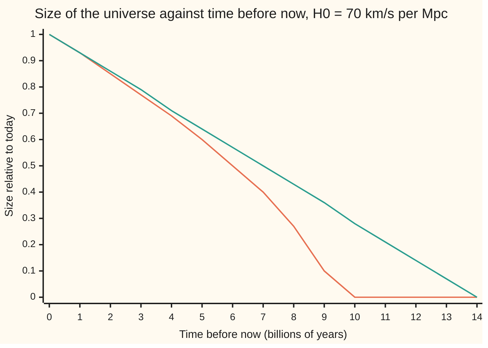
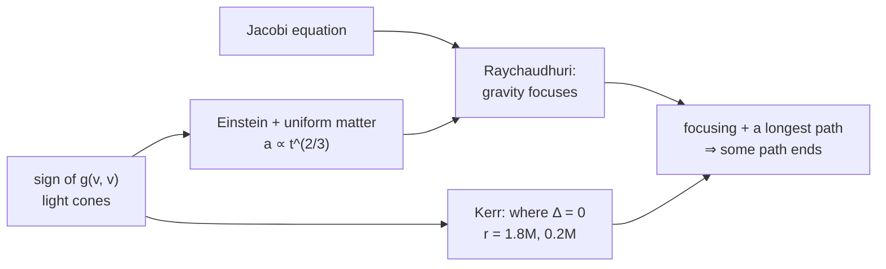

# Lorentzian geometry: light cones, an expanding universe, a spinning black hole, and why singularities are forced

[Syllabus](../../../SYLLABUS.md) → [Differential geometry and Lie groups](../README.md) → [Geometric Analysis and Physics](../README.md#s07) → Lorentzian geometry

---

## General Overview

Distant galaxies are moving away from us. A galaxy one megaparsec further away moves away 70 km/s faster (a megaparsec, Mpc, is 3.2616 million light-years). That ratio, 70 km/s per Mpc, is the Hubble rate $`H_0`$. Run the film backwards and everything was once together.

At a steady speed that was $`1/H_0`$ = 13.968 billion years ago. But matter pulls on matter, so the expansion was faster in the past. For a universe of matter only, Einstein's equations give an age of $`2/(3H_0)`$ = 9.312 billion years.

The geometry behind this is **Lorentzian**: a metric (a rule for the size of a small step) that gives time steps a negative square. The sign sorts every step. Negative: a clock can ride it. Zero: only light can. Positive: nothing can. The zero-square directions form the **light cone** at each event.

The same geometry describes a spinning black hole. With spin $`b = 0.6M`$ (both lengths, defined below), its horizons sit at $`1.8M`$ and $`0.2M`$: for 10 Suns, 26.58 km and 2.95 km.

Is the zero-size start only an artefact of a perfectly smooth model? Hawking and Penrose (1970) proved no; Penrose (1965) had already proved the same for a collapsing star. Gravity focuses free paths, as a lens focuses light. Add one global condition, and some free path must end.

**A Lorentzian metric sorts every step as timelike, null or spacelike by the sign of its square; with it, Einstein's equations make a matter universe grow like $`t^{2/3}`$, give a spinning black hole horizons at $`M \pm \sqrt{M^2 - b^2}`$, and, because gravity focuses free paths, force spacetime to contain paths that end.**

**What kind of fact this is:** the causal sorting is a definition. The Friedmann solution and the Kerr horizons are calculations, done on this card. The focusing equation is a local theorem, proved in a fold. The singularity theorems are global theorems, stated with sources, not proved. The matter-only universe is a model, too simple for the measured age.

### The picture: the size of the universe, run backwards



Orange line: a universe of matter only, $`a \propto t^{2/3}`$, which reaches zero size 9.312 billion years ago. Green line: a universe coasting at today's rate, which reaches zero 13.968 billion years ago. Both leave today at the same slope. Gravity bends the orange line down, below the green one: that bend is the focusing behind the singularity theorems.

---

## The formula

Reminders. $`g(v, v)`$ is the squared size of a step $`v`$ ([Riemannian metric](../05-Riemannian%20Geometry/01-riemannian-metrics.md)). The signature $`(-, +, +, +)`$ means one minus sign, for time ([Hodge star](../04-Differential%20Forms/09-hodge-star-and-maxwell-in-forms.md)). Ric is Ricci curvature ([Ricci and scalar curvature](../05-Riemannian%20Geometry/07-ricci-and-scalar-curvature.md)). Units: years and light-years, so light speed $`c = 1`$; for the black hole also Newton's constant $`G = 1`$.

**1. Causal character.** A step $`v`$ at an event is

```math
\text{timelike if } g(v, v) < 0, \qquad \text{null if } g(v, v) = 0, \qquad \text{spacelike if } g(v, v) > 0
```

**Read it aloud:** the sign of a step's square says whether a clock, only light, or nothing at all can travel it. In flat spacetime, $`g(v, v) = -\Delta t^2 + \Delta x^2 + \Delta y^2 + \Delta z^2`$. A clock riding a timelike step records the **proper time** $`\tau = \sqrt{-g(v, v)}`$.

A **time orientation** picks one half of every light cone as "future". The **causal future** $`J^+(A)`$ of an event $`A`$ is every event reachable from $`A`$ by a future-pointing path of timelike or null steps. The **chronological future** $`I^+(A)`$ allows timelike steps only. In flat spacetime $`J^+(A)`$ is the solid cone $`t \ge \lvert x \rvert`$.

**2. An expanding universe.** A flat universe, the same everywhere, has the metric (Friedmann–Lemaître–Robertson–Walker, FLRW)

```math
ds^2 = -dt^2 + a(t)^2 \left(dx^2 + dy^2 + dz^2\right), \qquad H = \frac{\dot a}{a}
```

Here $`a(t)`$ is the **scale factor**, the size of the universe relative to today, a dot is the rate of change in time $`t`$, and $`H`$ is the Hubble rate. Einstein's equations ([Einstein equations](02-einstein-equations-in-outline.md)) become the two **Friedmann equations**, with $`\rho`$ the density and $`p`$ the pressure:

```math
H^2 = \frac{8\pi G}{3}\,\rho, \qquad \frac{\ddot a}{a} = -\frac{4\pi G}{3}\,(\rho + 3p)
```

**Read it aloud:** the expansion rate squared is set by the density; the expansion slows down whenever density plus three times pressure is positive. For matter, $`p = 0`$ and the solution is

```math
a(t) = \left(\frac{t}{t_0}\right)^{2/3}, \qquad H = \frac{2}{3t}, \qquad t_0 = \frac{2}{3H_0}
```

**3. A spinning black hole.** The Kerr metric, in Boyer–Lindquist coordinates $`(t, r, \varphi, \theta)`$, with $`M`$ the mass and $`b`$ the spin length (angular momentum over mass), both as lengths:

```math
ds^2 = -\left(1 - \frac{2Mr}{\Sigma}\right) dt^2 - \frac{4Mbr\sin^2\varphi}{\Sigma}\, dt\, d\theta + \frac{\Sigma}{\Delta}\, dr^2 + \Sigma\, d\varphi^2 + \left(r^2 + b^2 + \frac{2Mb^2 r \sin^2\varphi}{\Sigma}\right)\sin^2\varphi\, d\theta^2
```

with $`\Sigma = r^2 + b^2\cos^2\varphi`$ and $`\Delta = r^2 - 2Mr + b^2`$. The horizons are where $`\Delta = 0`$, and the ergosurface (Step 3) is where the $`dt^2`$ term changes sign:

```math
r_\pm = M \pm \sqrt{M^2 - b^2}, \qquad r_E(\varphi) = M + \sqrt{M^2 - b^2\cos^2\varphi}
```

**Read it aloud:** the horizons sit at the mass plus or minus the root of mass squared minus spin squared; the ergosurface touches the outer horizon at the poles and bulges to $`2M`$ at the equator.

**4. Focusing.** For a family of free-falling observers with velocity $`u`$ and no rotation, the **expansion** $`\Theta`$ is the rate at which their shared volume grows, per unit volume. Raychaudhuri's equation gives

```math
\frac{d\Theta}{d\tau} \le -\frac{\Theta^2}{3} - \mathrm{Ric}(u, u)
```

**Read it aloud:** the expansion falls at least as fast as a third of its square plus the Ricci curvature along the motion. Ordinary matter makes $`\mathrm{Ric}(u, u) = 4\pi G(\rho + 3p) \ge 0`$, so gravity only focuses.

**5. The singularity theorems,** stated here and proved in the sources. "Singular" means **geodesically incomplete**: some free path (a geodesic) stops after a finite proper time or, for light, a finite parameter.

- **Penrose (1965).** Suppose spacetime has a non-compact Cauchy surface (a slice of "now" that every unstoppable timelike path crosses once), $`\mathrm{Ric}(k, k) \ge 0`$ for every null $`k`$, and a closed trapped surface (a closed surface whose outgoing and ingoing light rays both converge). Then some light ray is incomplete.
- **Hawking and Penrose (1970).** Suppose $`\mathrm{Ric}(v, v) \ge 0`$ for all timelike and null $`v`$, every free path meets some tidal curvature (the generic condition), and no timelike path closes on itself. Suppose also one of: a closed universe (a compact slice without edge), a closed trapped surface, or an event whose past light cone reconverges. Then some timelike or null geodesic is incomplete.

A trapped surface is where the bend of [Mean curvature flow](11-mean-curvature-flow.md) reappears. The expansion of light leaving a surface is the surface's mean curvature, taken along the light's direction. A round sphere in flat spacetime has positive expansion for its outgoing light and negative for its ingoing light, each equal in size to the sum of its two principal curvatures. Trapped means both are negative, which takes strong gravity, as just inside a black hole's horizon.

Said once: $`G`$ here is Newton's constant; $`\varphi`$ is measured down from the spin axis and $`\theta`$ round it, as on the globe (most books swap the two letters). Books write the spin length as $`a`$; here $`a`$ is the scale factor, so the spin is $`b`$. $`H`$ is the Hubble rate, not a Hamiltonian or a mean curvature, and $`\Delta`$ alone is Kerr's shorthand, not a Laplacian or a gap; $`\Delta t`$ is a time difference. $`\rho`$ is a density, not a radius of curvature. $`J`$ alone is the gap between neighbouring paths, as on the Jacobi card, while $`J^+(A)`$ is a causal future. $`R`$, in the fold, is the tidal matrix, not a radius.

| Symbol | Plain meaning | In our example | Push it up and the answer… |
| --- | --- | --- | --- |
| $`g`$, $`v`$, $`g(v, v)`$, $`\Delta t`$, $`\Delta x`$ | Lorentzian metric; a step between two events; its square, whose sign gives the causal character; the step's time and space parts | ship at 0.6 c for a year: $`(1, 0.6)`$, square −0.640 | — |
| $`\tau`$, $`\beta`$ | proper time on a clock; speed of a moving observer, as a fraction of $`c`$ | 0.800 years per year; 0.6 | $`\tau`$ falls as speed rises |
| $`A`$, $`J^+(A)`$, $`I^+(A)`$ | an event; events reachable from it by timelike or null paths; by timelike paths only | the solid cone $`t \ge \lvert x \rvert`$ | — |
| $`t`$, $`a(t)`$, $`t_0`$, $`H`$, $`H_0`$, $`n`$ | cosmic time; size relative to today; age; Hubble rate $`\dot a / a`$; its value today; trial exponent in $`a = t^n`$ | $`a = (t/t_0)^{2/3}`$, so $`n = 2/3`$; $`t_0`$ = 9.312 billion years; $`H_0`$ = 70 km/s per Mpc | the age falls as $`1/H_0`$ |
| $`\rho`$, $`p`$, $`\rho_c`$, $`G`$ | density; pressure; critical density $`3H_0^2/(8\pi G)`$; Newton's constant | $`p = 0`$; $`\rho_c`$ = 9.2039 × 10⁻²⁷ kg/m³ | more density, faster slowing |
| $`\Omega_m`$, $`\Omega_\Lambda`$ | shares of $`\rho_c`$ in matter and in dark energy ($`\Lambda`$) | 1 and 0 here; 0.315 and 0.685 measured | — |
| $`G_{\mu\nu}`$, $`T_{\mu\nu}`$, $`g_{tt}`$, $`g_{rr}`$, $`g^{rr}`$, Rm, Ric | Einstein tensor; energy-momentum tensor; components of $`g`$ and of its inverse; curvature tensor; Ricci curvature. $`\mu, \nu`$ run over the four coordinates | $`G_{tt}`$ = 1.333333 at $`t = 1`$ | — |
| $`M`$, $`b`$, $`M_\odot`$ | mass as a length, $`GM/c^2`$; spin length, angular momentum over mass; the Sun's mass | 14.766 km for 10 Suns; $`b = 0.6M`$ | more $`b`$: horizons close in, none past $`b = M`$ |
| $`r`$, $`\varphi`$, $`\theta`$, $`\Sigma`$, $`\Delta`$, $`\partial_t`$ | Boyer–Lindquist radius; angle from the spin axis; angle round it; the two shorthands above; the step "stay still" | — (chart labels) | — |
| $`r_+`$, $`r_-`$, $`r_E`$ | outer horizon; inner horizon; ergosurface | $`1.8M`$; $`0.2M`$; $`2M`$ at the equator | grow with $`M`$ |
| $`u`$, $`k`$, $`\Theta`$, $`\lambda`$ | velocity of a free-falling observer; a null step; expansion of a family of observers; a light ray's parameter | $`\Theta = 3H_0`$ today | — |
| $`J`$, $`B`$, $`R`$, $`\ell_i`$ | gap to a neighbouring path; its rate matrix, $`J' = BJ`$; tidal matrix; eigenvalues of $`B`$ | used in the fold | — |

### When it holds

- **The metric has exactly one minus sign.** With none, there are no light cones. A book using $`(+, -, -, -)`$ flips every sign: there a timelike step has a positive square.
- **The universe is uniform and holds only pressure-free matter.** Radiation ($`p = \rho/3`$) gives $`a \propto t^{1/2}`$ instead, and dark energy ($`p = -\rho`$) makes the expansion speed up.
- **The black hole is alone, uncharged and settled.** Then Kerr is the only possibility (the uniqueness theorems, stated without proof; Wald, chapter 12). Horizons need $`b \le M`$: at $`b = 1.2M`$, $`\Delta`$ never falls below $`0.44M^2`$.
- **Energy is positive: $`\mathrm{Ric}(v, v) \ge 0`$.** This drives focusing. Dark energy breaks it: today $`\mathrm{Ric}(u, u) = -1.5825\,H_0^2`$, and the Hawking–Penrose theorem no longer applies. The null version $`\mathrm{Ric}(k, k) \ge 0`$, which Penrose's theorem uses, still holds, because dark energy has $`\rho + p = 0`$.
- **The singularity theorems are global.** They need a condition on the whole spacetime. They say a path ends, not where, and not that curvature blows up there.

---

## Why it works



### Step 0: one minus sign turns distance into time, and shortest into longest

In a Riemannian space a geodesic (a straightest path) is locally the shortest. Flip the sign on time and this inverts. Between two events, a clock in free fall records the **most** proper time; a rocket trip out and back records less. The twin who travels comes home younger.

That inversion drives the singularity theorems. Gravity focuses free paths, and past a focal point a path stops being longest. If the global shape of spacetime also guarantees a longest path, the only way out is that some path ends.

### Step 1: the causal sorting does not depend on the observer

Take three steps of one year: a ship at 0.6 c, a light pulse, and a jump of two light-years. Their squares are −0.640, 0.000 and 3.000.

A ship moving at speed $`\beta`$ sees the step $`(\Delta t, \Delta x)`$ as $`\big((\Delta t - \beta \Delta x), (\Delta x - \beta \Delta t)\big)/\sqrt{1 - \beta^2}`$, a Lorentz boost. Its square is unchanged:

```math
\frac{-(\Delta t - \beta \Delta x)^2 + (\Delta x - \beta \Delta t)^2}{1 - \beta^2} = \frac{(1 - \beta^2)(-\Delta t^2 + \Delta x^2)}{1 - \beta^2} = -\Delta t^2 + \Delta x^2
```

So the sign belongs to the step, not to the observer. Seen from 0.6 c, the ship's step becomes (0.800, 0.000): at rest, with 0.800 years of proper time. The light pulse becomes (0.500, 0.500), still null.

The spacelike step becomes (−0.250, 1.750): its time order has reversed. So no signal can join spacelike-separated events, or some observer would see the effect before the cause.

### Step 2: Einstein's equations for a uniform universe give the Friedmann equations

Build the Einstein tensor $`G_{\mu\nu}`$ of the FLRW metric from its Christoffel symbols, as on [Einstein equations](02-einstein-equations-in-outline.md). Only two kinds of component survive:

```math
G_{tt} = 3\left(\frac{\dot a}{a}\right)^2, \qquad G_{xx} = -\left(2\frac{\ddot a}{a} + \frac{\dot a^2}{a^2}\right) a^2
```

Matter at rest has $`T_{tt} = \rho`$ and $`T_{xx} = p\,a^2`$. So $`G_{tt} = 8\pi G\,T_{tt}`$ is the first Friedmann equation, and combining both components gives the second.

For matter, $`p = 0`$, so $`G_{xx} = 0`$. Try $`a = t^n`$. Then $`\dot a / a = n/t`$ and $`\ddot a / a = n(n-1)/t^2`$, and $`G_{xx} = 0`$ reads $`2n(n-1) + n^2 = 0`$, that is $`n(3n - 2) = 0`$. So $`n = 2/3`$, and $`H = 2/(3t)`$.

The code builds both components from the metric alone by finite differences at $`t = 1`$. For $`a = t^{2/3}`$: $`G_{tt}`$ = 1.333333, which is $`3H^2 = 4/3`$, and $`G_{xx}`$ = 0.000000. For $`a = t^{1/2}`$: $`G_{xx}`$ = 0.250000, a third of $`G_{tt}`$ = 0.750000. That universe has pressure $`\rho/3`$: it holds radiation.

### Step 3: the Kerr horizons are where the radius turns timelike

A **horizon** is a surface light can cross only one way. A surface $`r = \text{constant}`$ is one-way exactly when it is null. Its normal direction $`dr`$ has square $`g^{rr} = \Delta/\Sigma`$, so the horizons are the roots of $`\Delta = r^2 - 2Mr + b^2 = 0`$: with $`b = 0.6M`$, $`r_+ = 1.8M`$ and $`r_- = 0.2M`$.

Between them $`\Delta < 0`$, so $`g_{rr} = \Sigma/\Delta`$ is negative: at $`r = M`$ on the equator it is −1.5625. The step "move in $`r`$" is timelike there. Inside, $`r`$ behaves like time and must keep falling, just as a clock cannot stop.

The **ergosurface** is where the step "stay still", $`\partial_t`$, turns spacelike: $`g_{tt} = 0`$, which solves to $`r_E`$. At $`r = 1.9M`$ on the equator $`g_{tt}`$ = 0.052632: outside the horizon, yet nothing can stay still, because the spin drags everything round. At $`r = 2.5M`$, $`g_{tt}`$ = −0.200000 and standing still is possible again.

The code finds the horizons a second way, without $`\Delta`$: bisection on $`g_{tt}\,g_{\theta\theta} - g_{t\theta}^2`$, built from the metric's own components. That combination equals $`-\Delta\sin^2\varphi`$. The roots come out at 1.800000 and 0.200000 at both 90° and 60° from the axis: the horizon belongs to the black hole, not to the angle chosen.

### Step 4: the Jacobi equation, averaged, says gravity focuses

On [Jacobi field](../05-Riemannian%20Geometry/09-jacobi-fields-and-comparison-theorems.md), the gap $`J`$ between neighbouring geodesics obeys $`J'' + \mathrm{Rm}(J, u)\,u = 0`$, and the same holds in spacetime. Follow all three space directions at once and take the trace: the result is an equation for the volume of a small cloud of observers, Raychaudhuri's equation (proved in the fold).

If $`\mathrm{Ric}(u, u) \ge 0`$, it gives $`d\Theta/d\tau \le -\Theta^2/3`$. Then $`1/\Theta`$ grows by at least $`1/3`$ per unit of proper time. A cloud that starts converging, $`\Theta_0 < 0`$, reaches $`\Theta = -\infty`$ within proper time $`3/\lvert\Theta_0\rvert`$: its neighbouring paths meet at a focal point.

Apply it to the universe, run backwards. Today $`\Theta = 3H_0`$, since volume grows as $`a^3`$. Backwards in time the cloud converges with $`\Theta_0 = -3H_0`$, so all matter meets within $`1/H_0`$ = 13.968 billion years. Matter makes $`\mathrm{Ric}(u, u) = \tfrac32 H^2 > 0`$, so the meeting comes sooner. The code runs Raychaudhuri's equation back by RK4 (a fourth-order step for differential equations): it reaches 1% of today's size 9.30299 billion years ago, as does the exact $`\tfrac23(1 - 0.01^{1.5})/H_0`$.

<details>
<summary>Detailed proof: Raychaudhuri's equation from the Jacobi equation</summary>

Take free-falling observers with unit velocity $`u`$, so $`g(u, u) = -1`$. The gap $`J`$ to a neighbour lies in the three space directions at right angles to $`u`$, an ordinary Euclidean space. Its rate of change is linear in the gap: $`J' = B J`$ for a 3 × 3 matrix $`B`$.

Differentiate once more and use the Jacobi equation, with $`R`$ the tidal matrix $`J \mapsto \mathrm{Rm}(J, u)\,u`$:

$`\displaystyle J'' = B' J + B J' = (B' + B^2)\, J = -R\, J`$

This holds for every gap $`J`$, so $`B' + B^2 + R = 0`$. Take the trace. The trace of $`B`$ is the expansion $`\Theta`$, and the trace of $`R`$ is $`\mathrm{Ric}(u, u)`$:

$`\displaystyle \frac{d\Theta}{d\tau} = -\mathrm{tr}(B^2) - \mathrm{Ric}(u, u)`$

With no rotation, $`B`$ is symmetric, with real eigenvalues $`\ell_1, \ell_2, \ell_3`$. Then $`\mathrm{tr}(B^2) = \ell_1^2 + \ell_2^2 + \ell_3^2 \ge (\ell_1 + \ell_2 + \ell_3)^2/3 = \Theta^2/3`$, by the Cauchy–Schwarz inequality, with equality when the eigenvalues agree, as in a uniform universe.

For the uniform universe, $`\Theta = 3H`$ and $`\dot H = \ddot a/a - H^2`$. The equation reads $`3\ddot a/a - 3H^2 = -3H^2 - \mathrm{Ric}(u, u)`$, so $`\ddot a/a = -\mathrm{Ric}(u, u)/3`$. With $`\mathrm{Ric}(u, u) = 4\pi G(\rho + 3p)`$ that is the second Friedmann equation.

For light the argument runs with two transverse directions and gives $`d\Theta/d\lambda \le -\Theta^2/2 - \mathrm{Ric}(k, k)`$, with $`\lambda`$ the ray's parameter: the form Penrose's theorem uses.

</details>

### Step 5: from focusing to the theorems

The proofs follow one plan. The full arguments are in Hawking and Penrose (1970) and in Wald, chapter 9.

1. **Focusing makes conjugate points.** By Step 4, positive energy plus some initial convergence (a trapped surface, a closed universe, a reconverging light cone) brings neighbouring geodesics together within a finite parameter: a conjugate point.
2. **Past a conjugate point a path is not longest,** the Lorentzian twin of "not shortest" on the Jacobi card.
3. **The global condition makes a longest path exist.** A Cauchy surface or a compact slice does the job that completeness does in [Hopf-Rinow](../05-Riemannian%20Geometry/10-hopf-rinow-and-completeness.md). A longest path has no conjugate point.
4. **Contradiction, unless a path ends.** The only escape is that some geodesic cannot be extended far enough to reach its conjugate point.

Lorentzian geometry has no Hopf–Rinow theorem tying distance to geodesics, so the theorems take incompleteness itself as the meaning of "singular".

---

## Worked numbers, by hand

The universe, with $`H_0`$ = 70 km/s per Mpc and 1 Mpc = 3.0856775814913673 × 10¹⁹ km:

| Step | Arithmetic | Value |
| --- | --- | --- |
| Hubble time | $`1/H_0 = 3.0857 \times 10^{19} \div 70`$ seconds, divided by $`3.15576 \times 10^{16}`$ seconds per billion years | 13.968 billion years |
| matter-only age | $`t_0 = \tfrac23 \times 13.968`$ | **9.312 billion years** |
| critical density | $`3H_0^2/(8\pi G)`$, with $`G`$ = 6.67430 × 10⁻¹¹ m³/(kg s²) | 9.2039 × 10⁻²⁷ kg/m³ |
| in protons | divide by the proton mass 1.67262192595 × 10⁻²⁷ kg | 5.50 per cubic metre |

A flat universe of matter only, expanding at this rate, began 9.312 billion years ago and holds 5.50 proton masses per cubic metre on average.

The black hole, with $`b = 0.6M`$. For 10 Suns, $`M = 10\, GM_\odot/c^2`$ = 14.766 km, with the Sun's $`GM_\odot`$ = 1.3271244 × 10²⁰ m³/s² (IAU 2015 nominal value, as on [Einstein equations](02-einstein-equations-in-outline.md)):

| Step | Arithmetic | Value |
| --- | --- | --- |
| outer horizon | $`r_+ = M + \sqrt{1 - 0.36}\, M`$ | **1.8M = 26.58 km** |
| inner horizon | $`r_- = M - \sqrt{1 - 0.36}\, M`$ | **0.2M = 2.95 km** |
| ergosurface, equator | $`r_E = M + \sqrt{M^2 - 0} = 2M`$ | 29.53 km |
| ergosurface, 45° from the axis | $`M + \sqrt{1 - 0.36 \times 0.5}\, M`$ | 1.905539 M |

Anything that crosses $`r`$ = 26.58 km cannot come back out. Here $`r`$ is the Boyer–Lindquist radius, a chart label, not a distance measured with a ruler.

### What breaks if you drop a piece

| Mistake | Comes out at | What went wrong |
| --- | --- | --- |
| Take the Hubble time as the age | 13.968 billion years | assumes no deceleration, as if $`\mathrm{Ric}(u, u) = 0`$; matter cuts it to two-thirds, 9.312 |
| Matter only, with the measured $`H_0`$ = 67.4 | 9.672 billion years | measured age 13.787; dark energy makes $`\mathrm{Ric}(u, u)`$ = −1.5825 $`H_0^2`$, so the energy condition fails |
| Use $`a = t^{1/2}`$ for matter | $`G_{xx}`$ = 0.250000, not 0 | that universe has pressure $`\rho/3`$: it is radiation |
| Spin past the limit, $`b = 1.2M`$ | $`\Delta \ge 0.44M^2`$: no horizon | Kerr's horizons need $`b \le M`$; the singularity would be visible |
| Take the ergosurface for the horizon | 29.53 km instead of 26.58 km | between the two, escape is still possible; only standing still is not |

---

## Code, from first principles, and it actually runs

The code takes **four independent roads**, each checked against a closed form. It builds the FLRW Einstein tensor from the metric alone by finite differences. It computes ages by Simpson's rule on the age integral, $`H_0 t_0 = \int_0^1 2u^2 / \sqrt{\Omega_m + \Omega_\Lambda u^6}\, du`$ with $`u = \sqrt{a}`$ (here $`u`$ is a stand-in variable, not a velocity). It runs Raychaudhuri's equation back by RK4. It finds the Kerr horizons and ergosurface by bisection on the metric's own components. The boosts of Step 1 check that the sign of $`g(v, v)`$ never changes.

### Python

```python
# Lorentzian geometry: sort vectors by the sign of g(v, v), solve Friedmann for a matter universe,
# find the horizons of a spinning black hole, and check the focusing behind the singularity theorems.
from math import sqrt, sin, cos, pi, asinh

def show(label, v, d=6):
    print(f"{label:<46}{(0.0 if abs(v) < 5e-13 else v):>14.{d}f}")

z = lambda v: 0.0 if abs(v) < 5e-13 else v  # print a tiny rounding leftover as 0

# ---- 1. causal character in flat spacetime, in years and light-years, so c = 1 ----
def eta(u, v):
    return -u[0] * v[0] + u[1] * v[1]
def boost(v, beta):  # the same two events seen from a ship moving at speed beta
    gam = 1 / sqrt(1 - beta * beta)
    return (gam * (v[0] - beta * v[1]), gam * (v[1] - beta * v[0]))
def kind(q):
    return "timelike" if q < -1e-12 else ("spacelike" if q > 1e-12 else "null")
vecs = (("ship at 0.6 c", (1.0, 0.6)), ("light pulse", (1.0, 1.0)), ("1 yr, 2 ly apart", (1.0, 2.0)))
for name, v in vecs:
    w = boost(v, 0.6)
    print(f"{name:<17} g = {z(eta(v, v)):6.3f} {kind(eta(v, v)):<9} | at 0.6 c: dt = {z(w[0]):6.3f}"
          f" dx = {z(w[1]):6.3f} g = {z(eta(w, w)):6.3f}")
show("proper time of the ship per year, years", sqrt(-eta(vecs[0][1], vecs[0][1])), 3)
w8 = boost(vecs[2][1], 0.8)
print(f"try: the 2 ly pair seen at 0.8 c: dt = {w8[0]:6.3f}, g = {eta(w8, w8):6.3f}")

# ---- 2. FLRW: Einstein tensor of -dt^2 + a(t)^2 (dx^2 + dy^2 + dz^2) from the metric alone ----
def frw(expo):
    return lambda p: [-1.0] + [p[0] ** (2 * expo)] * 3   # a = t^expo, so a^2 = t^(2 expo)
def shift(p, i, s):
    q = list(p); q[i] += s; return q
def christoffel(metric, p, h):  # G[l][j][k] = 1/2 g^ll (d_j g_lk + d_k g_lj - d_l g_jk), g diagonal
    g = metric(p)
    dg = [[(u - w) / (2 * h) for u, w in zip(metric(shift(p, m, h)), metric(shift(p, m, -h)))] for m in range(4)]
    d = lambda m, i, j: dg[m][i] if i == j else 0.0
    return [[[0.5 / g[l] * (d(j, l, k) + d(k, l, j) - d(l, j, k)) for k in range(4)] for j in range(4)] for l in range(4)]
def einstein(metric, p, h=1e-4):  # Ric_bd = d_a G^a_bd - d_d G^a_ba + G^a_ae G^e_bd - G^a_de G^e_ba
    G = christoffel(metric, p, h)
    dG = [[[[(u - w) / (2 * h) for u, w in zip(ru, rw)] for ru, rw in zip(A, B)]
           for A, B in zip(christoffel(metric, shift(p, i, h), h), christoffel(metric, shift(p, i, -h), h))]
          for i in range(4)]
    ric = [sum(dG[a][a][b][b] - dG[b][a][b][a] + sum(G[a][a][e] * G[e][b][b] - G[a][b][e] * G[e][b][a]
               for e in range(4)) for a in range(4)) for b in range(4)]
    g = metric(p)
    S = sum(r / gi for r, gi in zip(ric, g))
    return [r - 0.5 * S * gi for r, gi in zip(ric, g)]
for expo, name in ((2 / 3, "a = t^(2/3), dust"), (1 / 2, "a = t^(1/2), radiation")):
    Gt = einstein(frw(expo), [1.0, 0.3, 0.2, 0.1])
    show(f"{name}: G_tt at t = 1", Gt[0])
    show(f"  closed form 3 H^2 = 3 (expo / t)^2", 3 * expo * expo)
    show(f"{name}: G_xx at t = 1", Gt[1])
    show(f"  closed form -(2 a''/a + H^2) a^2", -(2 * expo * (expo - 1) + expo * expo))
dust, rad = einstein(frw(2 / 3), [1.0, 0.3, 0.2, 0.1]), einstein(frw(1 / 2), [1.0, 0.3, 0.2, 0.1])

# ---- 3. ages: H0 = 70 km/s per Mpc ----
MPC_KM, GYR_S, G_N, M_P = 3.0856775814913673e19, 3.15576e16, 6.67430e-11, 1.67262192595e-27
def hubble_time(H0):  # 1/H0 in billions of years
    return MPC_KM / H0 / GYR_S
H0s = 70 / MPC_KM  # per second
show("1 Mpc in millions of light-years", MPC_KM / 9.4607304725808e12 / 1e6, 4)
show("Hubble time 1/H0, Gyr", hubble_time(70), 3)
show("matter only: age 2/(3 H0), Gyr", 2 / 3 * hubble_time(70), 3)
rho_c = 3 * H0s ** 2 / (8 * pi * G_N)
show("critical density 3H^2/(8 pi G), 1e-27 kg/m^3", rho_c * 1e27, 4)
show("  protons per cubic metre", rho_c / M_P, 2)
def age_integral(Om, OL, n=2000):  # t0 H0 = integral of 2u^2/sqrt(Om + OL u^6), u = sqrt(a), Simpson
    f = lambda u: 2 * u * u / sqrt(Om + OL * u ** 6)
    return sum((1 if k in (0, n) else 4 if k % 2 else 2) * f(k / n) for k in range(n + 1)) / (3 * n)
show("matter only, H0 = 67.4: age, Gyr", 2 / 3 * hubble_time(67.4), 3)
lcdm = 2 / (3 * sqrt(0.685)) * asinh(sqrt(0.685 / 0.315)) * hubble_time(67.4)
show("with dark energy, H0 = 67.4: closed form, Gyr", lcdm, 3)
show("with dark energy, H0 = 67.4: by integral, Gyr", age_integral(0.315, 0.685) * hubble_time(67.4), 3)
show("measured age (Planck 2018), Gyr", 13.787, 3)
show("Ric(u,u) today / H0^2, matter only", 1.5 * 1.0, 4)
show("Ric(u,u) today / H0^2, with dark energy", 1.5 * (0.315 - 2 * 0.685), 4)

# ---- 4. Raychaudhuri, run backwards: dTheta/dt = -Theta^2/3 - Ric(u,u), da/dt = a Theta/3 ----
def back_to(a_stop, h=1e-5):  # units 1/H0; today a = 1, Theta = 3 H0; RK4 with time running back
    f = lambda a, th: (-a * th / 3, th * th / 3 + 1.5 / a ** 3)
    a, th, t = 1.0, 3.0, 0.0
    while True:
        k1 = f(a, th); k2 = f(a + h / 2 * k1[0], th + h / 2 * k1[1])
        k3 = f(a + h / 2 * k2[0], th + h / 2 * k2[1]); k4 = f(a + h * k3[0], th + h * k3[1])
        na = a + h / 6 * (k1[0] + 2 * k2[0] + 2 * k3[0] + k4[0])
        nt = th + h / 6 * (k1[1] + 2 * k2[1] + 2 * k3[1] + k4[1])
        if na < a_stop:
            return t + h * (a - a_stop) / (a - na)
        a, th, t = na, nt, t + h
ray = back_to(0.01)
exact = 2 / 3 * (1 - 0.01 ** 1.5)
show("back to a = 0.01: Raychaudhuri RK4, Gyr", ray * hubble_time(70), 5)
show("back to a = 0.01: exact (2/3)(1 - a^1.5), Gyr", exact * hubble_time(70), 5)
show("focusing bound 3/Theta = 1/H0, Gyr", hubble_time(70), 3)

# ---- 5. Kerr black hole, G = c = 1, M = 1; phi down from the spin axis, theta round it ----
def kerr(r, ph, b):  # g_tt, g_t-theta, g_theta-theta, g_rr
    S, D, s2 = r * r + (b * cos(ph)) ** 2, r * r - 2 * r + b * b, sin(ph) ** 2
    return (-(1 - 2 * r / S), -2 * b * r * s2 / S, (r * r + b * b + 2 * b * b * r * s2 / S) * s2, S / D)
def bisect(f, lo, hi):
    for _ in range(200):
        mid = (lo + hi) / 2
        lo, hi = (mid, hi) if f(lo) * f(mid) > 0 else (lo, mid)
    return (lo + hi) / 2
b = 0.6
det = lambda ph: (lambda r: kerr(r, ph, b)[0] * kerr(r, ph, b)[2] - kerr(r, ph, b)[1] ** 2)
show("outer horizon M + sqrt(M^2 - b^2), M", 1 + sqrt(1 - b * b))
show("inner horizon M - sqrt(M^2 - b^2), M", 1 - sqrt(1 - b * b))
for ph in (pi / 2, pi / 3):
    print(f"  from the metric at phi = {ph * 180 / pi:2.0f} deg: outer {bisect(det(ph), 1.0, 3.0):.6f} M,"
          f" inner {bisect(det(ph), 0.01, 1.0):.6f} M")
for ph in (pi / 2, pi / 4):
    show(f"ergosurface, phi = {ph * 180 / pi:2.0f} deg, closed form, M", 1 + sqrt(1 - (b * cos(ph)) ** 2))
    show(f"  from g_tt = 0, M", bisect(lambda r: kerr(r, ph, b)[0], 1.0, 3.0))
show("g_rr at r = 1.0 M (inside): d/dr is timelike", kerr(1.0, pi / 2, b)[3], 4)
show("g_tt at r = 1.9 M (ergosphere): d/dt spacelike", kerr(1.9, pi / 2, b)[0], 6)
show("g_tt at r = 2.5 M (outside): d/dt timelike", kerr(2.5, pi / 2, b)[0], 6)
Mm = 10 * 1.3271244e20 / 299792458.0 ** 2 / 1000   # 10 Suns, in km
show("10 Suns: M = GM/c^2, km", Mm, 3)
show("  outer horizon, km", (1 + sqrt(1 - b * b)) * Mm, 2)
show("  inner horizon, km", (1 - sqrt(1 - b * b)) * Mm, 2)
show("  ergosurface at the equator, km", 2 * Mm, 2)
show("b = 1.2 M: smallest Delta = b^2 - M^2", min(r * r - 2 * r + 1.44 for r in [k / 1000 for k in range(3001)]), 4)
show("try: b = 0.9 M, outer horizon, M", 1 + sqrt(1 - 0.81))
show("try: b = 0.9 M, inner horizon, M", 1 - sqrt(1 - 0.81))

# ---- chart: size of the universe against time before now, H0 = 70 ----
taus, t0, th = list(range(0, 15)), 2 / 3 * hubble_time(70), hubble_time(70)
print("chart Gyr ago " + " ".join(f"{t:5d}" for t in taus))
print("matter        " + " ".join(f"{max(0.0, 1 - t / t0) ** (2 / 3):5.2f}" for t in taus))
print("coasting      " + " ".join(f"{max(0.0, 1 - t / th):5.2f}" for t in taus))

assert abs(dust[0] - 4 / 3) < 1e-6 and abs(dust[1]) < 1e-6, "dust: G_tt = 3H^2 and no pressure"
assert abs(rad[1] - 0.25) < 1e-6, "radiation exponent leaves pressure G_xx = 1/4"
assert abs(age_integral(1.0, 0.0) - 2 / 3) < 1e-12, "matter age by integral"
assert abs(age_integral(0.315, 0.685) * hubble_time(67.4) - lcdm) < 1e-6, "dark-energy age, two roads"
assert abs(ray - exact) < 1e-6 and ray < 1.0, "Raychaudhuri run back agrees, inside the focusing bound"
assert abs(bisect(det(pi / 3), 1.0, 3.0) - 1.8) < 1e-12 and abs(bisect(det(pi / 2), 0.01, 1.0) - 0.2) < 1e-12, "horizons"
assert abs(bisect(lambda r: kerr(r, pi / 4, b)[0], 1.0, 3.0) - (1 + sqrt(0.82))) < 1e-12, "ergosurface"
assert abs(eta(w8, w8) - 3.0) < 1e-12 and w8[0] < 0, "boost keeps g(v, v), reverses the spacelike order"
print("ALL CHECKS PASS")
```

**Ran 2026-11-24 on macOS, Python 3.14.10, standard library only. All checks passed. Output, pasted from the run:**

```
ship at 0.6 c     g = -0.640 timelike  | at 0.6 c: dt =  0.800 dx =  0.000 g = -0.640
light pulse       g =  0.000 null      | at 0.6 c: dt =  0.500 dx =  0.500 g =  0.000
1 yr, 2 ly apart  g =  3.000 spacelike | at 0.6 c: dt = -0.250 dx =  1.750 g =  3.000
proper time of the ship per year, years                0.800
try: the 2 ly pair seen at 0.8 c: dt = -1.000, g =  3.000
a = t^(2/3), dust: G_tt at t = 1                    1.333333
  closed form 3 H^2 = 3 (expo / t)^2                1.333333
a = t^(2/3), dust: G_xx at t = 1                    0.000000
  closed form -(2 a''/a + H^2) a^2                  0.000000
a = t^(1/2), radiation: G_tt at t = 1               0.750000
  closed form 3 H^2 = 3 (expo / t)^2                0.750000
a = t^(1/2), radiation: G_xx at t = 1               0.250000
  closed form -(2 a''/a + H^2) a^2                  0.250000
1 Mpc in millions of light-years                      3.2616
Hubble time 1/H0, Gyr                                 13.968
matter only: age 2/(3 H0), Gyr                         9.312
critical density 3H^2/(8 pi G), 1e-27 kg/m^3          9.2039
  protons per cubic metre                               5.50
matter only, H0 = 67.4: age, Gyr                       9.672
with dark energy, H0 = 67.4: closed form, Gyr         13.796
with dark energy, H0 = 67.4: by integral, Gyr         13.796
measured age (Planck 2018), Gyr                       13.787
Ric(u,u) today / H0^2, matter only                    1.5000
Ric(u,u) today / H0^2, with dark energy              -1.5825
back to a = 0.01: Raychaudhuri RK4, Gyr              9.30299
back to a = 0.01: exact (2/3)(1 - a^1.5), Gyr        9.30299
focusing bound 3/Theta = 1/H0, Gyr                    13.968
outer horizon M + sqrt(M^2 - b^2), M                1.800000
inner horizon M - sqrt(M^2 - b^2), M                0.200000
  from the metric at phi = 90 deg: outer 1.800000 M, inner 0.200000 M
  from the metric at phi = 60 deg: outer 1.800000 M, inner 0.200000 M
ergosurface, phi = 90 deg, closed form, M           2.000000
  from g_tt = 0, M                                  2.000000
ergosurface, phi = 45 deg, closed form, M           1.905539
  from g_tt = 0, M                                  1.905539
g_rr at r = 1.0 M (inside): d/dr is timelike         -1.5625
g_tt at r = 1.9 M (ergosphere): d/dt spacelike      0.052632
g_tt at r = 2.5 M (outside): d/dt timelike         -0.200000
10 Suns: M = GM/c^2, km                               14.766
  outer horizon, km                                    26.58
  inner horizon, km                                     2.95
  ergosurface at the equator, km                       29.53
b = 1.2 M: smallest Delta = b^2 - M^2                 0.4400
try: b = 0.9 M, outer horizon, M                    1.435890
try: b = 0.9 M, inner horizon, M                    0.564110
chart Gyr ago     0     1     2     3     4     5     6     7     8     9    10    11    12    13    14
matter         1.00  0.93  0.85  0.77  0.69  0.60  0.50  0.40  0.27  0.10  0.00  0.00  0.00  0.00  0.00
coasting       1.00  0.93  0.86  0.79  0.71  0.64  0.57  0.50  0.43  0.36  0.28  0.21  0.14  0.07  0.00
ALL CHECKS PASS
```

### Rust

```rust
// Lorentzian geometry: sort vectors by the sign of g(v, v), solve Friedmann for a matter universe,
// find the horizons of a spinning black hole, and check the focusing behind the singularity theorems.
use std::f64::consts::PI;

fn z(v: f64) -> f64 { if v.abs() < 5e-13 { 0.0 } else { v } } // print a tiny rounding leftover as 0
fn show(label: &str, v: f64, d: usize) { println!("{:<46}{:>14.*}", label, d, z(v)); }

// ---- 1. causal character in flat spacetime, in years and light-years, so c = 1 ----
fn eta(u: (f64, f64), v: (f64, f64)) -> f64 { -u.0 * v.0 + u.1 * v.1 }
fn boost(v: (f64, f64), beta: f64) -> (f64, f64) { // the same two events seen from a ship moving at speed beta
    let gam = 1.0 / (1.0 - beta * beta).sqrt();
    (gam * (v.0 - beta * v.1), gam * (v.1 - beta * v.0))
}
fn kind(q: f64) -> &'static str { if q < -1e-12 { "timelike" } else if q > 1e-12 { "spacelike" } else { "null" } }

// ---- 2. FLRW: Einstein tensor of -dt^2 + a(t)^2 (dx^2 + dy^2 + dz^2) from the metric alone ----
fn frw(expo: f64, p: &[f64; 4]) -> [f64; 4] { let a2 = p[0].powf(2.0 * expo); [-1.0, a2, a2, a2] }
fn shift(p: &[f64; 4], i: usize, s: f64) -> [f64; 4] { let mut q = *p; q[i] += s; q }
type G3 = [[[f64; 4]; 4]; 4];
fn christoffel(expo: f64, p: &[f64; 4], h: f64) -> G3 { // g diagonal
    let g = frw(expo, p);
    let mut dg = [[0.0; 4]; 4];
    for m in 0..4 {
        let (u, w) = (frw(expo, &shift(p, m, h)), frw(expo, &shift(p, m, -h)));
        for i in 0..4 { dg[m][i] = (u[i] - w[i]) / (2.0 * h); }
    }
    let d = |m: usize, i: usize, j: usize| if i == j { dg[m][i] } else { 0.0 };
    let mut out = [[[0.0; 4]; 4]; 4];
    for l in 0..4 { for j in 0..4 { for k in 0..4 { out[l][j][k] = 0.5 / g[l] * (d(j, l, k) + d(k, l, j) - d(l, j, k)); } } }
    out
}
fn einstein(expo: f64, p: &[f64; 4]) -> [f64; 4] { // Ric_bd = d_a G^a_bd - d_d G^a_ba + G^a_ae G^e_bd - G^a_de G^e_ba
    let (h, mut ric) = (1e-4, [0.0; 4]);
    let gm = christoffel(expo, p, h);
    let mut dg = [[[[0.0; 4]; 4]; 4]; 4];
    for i in 0..4 {
        let (u, w) = (christoffel(expo, &shift(p, i, h), h), christoffel(expo, &shift(p, i, -h), h));
        for l in 0..4 { for j in 0..4 { for k in 0..4 { dg[i][l][j][k] = (u[l][j][k] - w[l][j][k]) / (2.0 * h); } } }
    }
    for b in 0..4 { for a in 0..4 {
        let mut s = dg[a][a][b][b] - dg[b][a][b][a];
        for e in 0..4 { s += gm[a][a][e] * gm[e][b][b] - gm[a][b][e] * gm[e][b][a]; }
        ric[b] += s;
    } }
    let g = frw(expo, p);
    let sc: f64 = (0..4).map(|i| ric[i] / g[i]).sum();
    [0, 1, 2, 3].map(|i| ric[i] - 0.5 * sc * g[i])
}

// ---- 3. ages: H0 = 70 km/s per Mpc ----
const MPC_KM: f64 = 3.0856775814913673e19;
const GYR_S: f64 = 3.15576e16;
fn hubble_time(h0: f64) -> f64 { MPC_KM / h0 / GYR_S } // 1/H0 in billions of years
fn age_integral(om: f64, ol: f64, n: usize) -> f64 { // t0 H0 = integral of 2u^2/sqrt(Om + OL u^6), Simpson
    let f = |u: f64| 2.0 * u * u / (om + ol * u.powf(6.0)).sqrt();
    let s: f64 = (0..=n).map(|k| (if k == 0 || k == n { 1.0 } else if k % 2 == 1 { 4.0 } else { 2.0 }) * f(k as f64 / n as f64)).sum();
    s / (3.0 * n as f64)
}

// ---- 4. Raychaudhuri, run backwards: dTheta/dt = -Theta^2/3 - Ric(u,u), da/dt = a Theta/3 ----
fn back_to(a_stop: f64, h: f64) -> f64 { // units 1/H0; today a = 1, Theta = 3 H0; RK4 with time running back
    let f = |a: f64, th: f64| (-a * th / 3.0, th * th / 3.0 + 1.5 / a.powf(3.0));
    let (mut a, mut th, mut t) = (1.0f64, 3.0f64, 0.0f64);
    loop {
        let k1 = f(a, th);
        let k2 = f(a + h / 2.0 * k1.0, th + h / 2.0 * k1.1);
        let k3 = f(a + h / 2.0 * k2.0, th + h / 2.0 * k2.1);
        let k4 = f(a + h * k3.0, th + h * k3.1);
        let na = a + h / 6.0 * (k1.0 + 2.0 * k2.0 + 2.0 * k3.0 + k4.0);
        let nt = th + h / 6.0 * (k1.1 + 2.0 * k2.1 + 2.0 * k3.1 + k4.1);
        if na < a_stop { return t + h * (a - a_stop) / (a - na); }
        a = na; th = nt; t += h;
    }
}

// ---- 5. Kerr black hole, G = c = 1, M = 1; phi down from the spin axis, theta round it ----
fn kerr(r: f64, ph: f64, b: f64) -> [f64; 4] { // g_tt, g_t-theta, g_theta-theta, g_rr
    let (s, d, s2) = (r * r + (b * ph.cos()).powi(2), r * r - 2.0 * r + b * b, ph.sin().powi(2));
    [-(1.0 - 2.0 * r / s), -2.0 * b * r * s2 / s, (r * r + b * b + 2.0 * b * b * r * s2 / s) * s2, s / d]
}
fn bisect(f: &dyn Fn(f64) -> f64, mut lo: f64, mut hi: f64) -> f64 {
    for _ in 0..200 { let mid = (lo + hi) / 2.0; if f(lo) * f(mid) > 0.0 { lo = mid; } else { hi = mid; } }
    (lo + hi) / 2.0
}

fn main() {
    let vecs = [("ship at 0.6 c", (1.0, 0.6)), ("light pulse", (1.0, 1.0)), ("1 yr, 2 ly apart", (1.0, 2.0))];
    for (name, v) in vecs {
        let w = boost(v, 0.6);
        println!("{:<17} g = {:6.3} {:<9} | at 0.6 c: dt = {:6.3} dx = {:6.3} g = {:6.3}",
                 name, z(eta(v, v)), kind(eta(v, v)), z(w.0), z(w.1), z(eta(w, w)));
    }
    show("proper time of the ship per year, years", (-eta(vecs[0].1, vecs[0].1)).sqrt(), 3);
    let w8 = boost(vecs[2].1, 0.8);
    println!("try: the 2 ly pair seen at 0.8 c: dt = {:6.3}, g = {:6.3}", w8.0, eta(w8, w8));

    let p = [1.0, 0.3, 0.2, 0.1];
    for (expo, name) in [(2.0 / 3.0, "a = t^(2/3), dust"), (0.5, "a = t^(1/2), radiation")] {
        let gt = einstein(expo, &p);
        show(&format!("{}: G_tt at t = 1", name), gt[0], 6);
        show("  closed form 3 H^2 = 3 (expo / t)^2", 3.0 * expo * expo, 6);
        show(&format!("{}: G_xx at t = 1", name), gt[1], 6);
        show("  closed form -(2 a''/a + H^2) a^2", -(2.0 * expo * (expo - 1.0) + expo * expo), 6);
    }
    let (dust, rad) = (einstein(2.0 / 3.0, &p), einstein(0.5, &p));

    let (g_n, m_p) = (6.67430e-11, 1.67262192595e-27);
    let h0s = 70.0 / MPC_KM; // per second
    show("1 Mpc in millions of light-years", MPC_KM / 9.4607304725808e12 / 1e6, 4);
    show("Hubble time 1/H0, Gyr", hubble_time(70.0), 3);
    show("matter only: age 2/(3 H0), Gyr", 2.0 / 3.0 * hubble_time(70.0), 3);
    let rho_c = 3.0 * h0s * h0s / (8.0 * PI * g_n);
    show("critical density 3H^2/(8 pi G), 1e-27 kg/m^3", rho_c * 1e27, 4);
    show("  protons per cubic metre", rho_c / m_p, 2);
    show("matter only, H0 = 67.4: age, Gyr", 2.0 / 3.0 * hubble_time(67.4), 3);
    let lcdm = 2.0 / (3.0 * 0.685f64.sqrt()) * (0.685f64 / 0.315).sqrt().asinh() * hubble_time(67.4);
    show("with dark energy, H0 = 67.4: closed form, Gyr", lcdm, 3);
    show("with dark energy, H0 = 67.4: by integral, Gyr", age_integral(0.315, 0.685, 2000) * hubble_time(67.4), 3);
    show("measured age (Planck 2018), Gyr", 13.787, 3);
    show("Ric(u,u) today / H0^2, matter only", 1.5 * 1.0, 4);
    show("Ric(u,u) today / H0^2, with dark energy", 1.5 * (0.315 - 2.0 * 0.685), 4);

    let ray = back_to(0.01, 1e-5);
    let exact = 2.0 / 3.0 * (1.0 - 0.01f64.powf(1.5));
    show("back to a = 0.01: Raychaudhuri RK4, Gyr", ray * hubble_time(70.0), 5);
    show("back to a = 0.01: exact (2/3)(1 - a^1.5), Gyr", exact * hubble_time(70.0), 5);
    show("focusing bound 3/Theta = 1/H0, Gyr", hubble_time(70.0), 3);

    let b = 0.6;
    let det = |ph: f64| move |r: f64| { let k = kerr(r, ph, b); k[0] * k[2] - k[1] * k[1] };
    show("outer horizon M + sqrt(M^2 - b^2), M", 1.0 + (1.0 - b * b).sqrt(), 6);
    show("inner horizon M - sqrt(M^2 - b^2), M", 1.0 - (1.0 - b * b).sqrt(), 6);
    for ph in [PI / 2.0, PI / 3.0] {
        println!("  from the metric at phi = {:2.0} deg: outer {:.6} M, inner {:.6} M",
                 ph * 180.0 / PI, bisect(&det(ph), 1.0, 3.0), bisect(&det(ph), 0.01, 1.0));
    }
    for ph in [PI / 2.0, PI / 4.0] {
        show(&format!("ergosurface, phi = {:2.0} deg, closed form, M", ph * 180.0 / PI), 1.0 + (1.0 - (b * ph.cos()).powi(2)).sqrt(), 6);
        show("  from g_tt = 0, M", bisect(&|r| kerr(r, ph, b)[0], 1.0, 3.0), 6);
    }
    show("g_rr at r = 1.0 M (inside): d/dr is timelike", kerr(1.0, PI / 2.0, b)[3], 4);
    show("g_tt at r = 1.9 M (ergosphere): d/dt spacelike", kerr(1.9, PI / 2.0, b)[0], 6);
    show("g_tt at r = 2.5 M (outside): d/dt timelike", kerr(2.5, PI / 2.0, b)[0], 6);
    let mm = 10.0 * 1.3271244e20 / 299792458.0f64.powi(2) / 1000.0; // 10 Suns, in km
    show("10 Suns: M = GM/c^2, km", mm, 3);
    show("  outer horizon, km", (1.0 + (1.0 - b * b).sqrt()) * mm, 2);
    show("  inner horizon, km", (1.0 - (1.0 - b * b).sqrt()) * mm, 2);
    show("  ergosurface at the equator, km", 2.0 * mm, 2);
    let dmin = (0..=3000).map(|k| { let r = k as f64 / 1000.0; r * r - 2.0 * r + 1.44 }).fold(f64::INFINITY, f64::min);
    show("b = 1.2 M: smallest Delta = b^2 - M^2", dmin, 4);
    show("try: b = 0.9 M, outer horizon, M", 1.0 + (1.0f64 - 0.81).sqrt(), 6);
    show("try: b = 0.9 M, inner horizon, M", 1.0 - (1.0f64 - 0.81).sqrt(), 6);

    let (t0, th) = (2.0 / 3.0 * hubble_time(70.0), hubble_time(70.0));
    let row = |f: &dyn Fn(f64) -> String| (0..15).map(|t| f(t as f64)).collect::<Vec<_>>().join(" ");
    println!("chart Gyr ago {}", row(&|t| format!("{:5}", t as i64)));
    println!("matter        {}", row(&|t| format!("{:5.2}", (1.0 - t / t0).max(0.0).powf(2.0 / 3.0))));
    println!("coasting      {}", row(&|t| format!("{:5.2}", (1.0 - t / th).max(0.0))));

    assert!((dust[0] - 4.0 / 3.0).abs() < 1e-6 && dust[1].abs() < 1e-6, "dust: G_tt = 3H^2 and no pressure");
    assert!((rad[1] - 0.25).abs() < 1e-6, "radiation exponent leaves pressure G_xx = 1/4");
    assert!((age_integral(1.0, 0.0, 2000) - 2.0 / 3.0).abs() < 1e-12, "matter age by integral");
    assert!((age_integral(0.315, 0.685, 2000) * hubble_time(67.4) - lcdm).abs() < 1e-6, "dark-energy age, two roads");
    assert!((ray - exact).abs() < 1e-6 && ray < 1.0, "Raychaudhuri run back agrees, inside the focusing bound");
    assert!((bisect(&det(PI / 3.0), 1.0, 3.0) - 1.8).abs() < 1e-12 && (bisect(&det(PI / 2.0), 0.01, 1.0) - 0.2).abs() < 1e-12, "horizons");
    assert!((bisect(&|r| kerr(r, PI / 4.0, b)[0], 1.0, 3.0) - (1.0 + 0.82f64.sqrt())).abs() < 1e-12, "ergosurface");
    assert!((eta(w8, w8) - 3.0).abs() < 1e-12 && w8.0 < 0.0, "boost keeps g(v, v), reverses the spacelike order");
    println!("ALL CHECKS PASS");
}
```

**Ran 2026-11-24 on macOS, rustc 1.98.1, no crates. All checks passed. Output, pasted from the run:**

```
ship at 0.6 c     g = -0.640 timelike  | at 0.6 c: dt =  0.800 dx =  0.000 g = -0.640
light pulse       g =  0.000 null      | at 0.6 c: dt =  0.500 dx =  0.500 g =  0.000
1 yr, 2 ly apart  g =  3.000 spacelike | at 0.6 c: dt = -0.250 dx =  1.750 g =  3.000
proper time of the ship per year, years                0.800
try: the 2 ly pair seen at 0.8 c: dt = -1.000, g =  3.000
a = t^(2/3), dust: G_tt at t = 1                    1.333333
  closed form 3 H^2 = 3 (expo / t)^2                1.333333
a = t^(2/3), dust: G_xx at t = 1                    0.000000
  closed form -(2 a''/a + H^2) a^2                  0.000000
a = t^(1/2), radiation: G_tt at t = 1               0.750000
  closed form 3 H^2 = 3 (expo / t)^2                0.750000
a = t^(1/2), radiation: G_xx at t = 1               0.250000
  closed form -(2 a''/a + H^2) a^2                  0.250000
1 Mpc in millions of light-years                      3.2616
Hubble time 1/H0, Gyr                                 13.968
matter only: age 2/(3 H0), Gyr                         9.312
critical density 3H^2/(8 pi G), 1e-27 kg/m^3          9.2039
  protons per cubic metre                               5.50
matter only, H0 = 67.4: age, Gyr                       9.672
with dark energy, H0 = 67.4: closed form, Gyr         13.796
with dark energy, H0 = 67.4: by integral, Gyr         13.796
measured age (Planck 2018), Gyr                       13.787
Ric(u,u) today / H0^2, matter only                    1.5000
Ric(u,u) today / H0^2, with dark energy              -1.5825
back to a = 0.01: Raychaudhuri RK4, Gyr              9.30299
back to a = 0.01: exact (2/3)(1 - a^1.5), Gyr        9.30299
focusing bound 3/Theta = 1/H0, Gyr                    13.968
outer horizon M + sqrt(M^2 - b^2), M                1.800000
inner horizon M - sqrt(M^2 - b^2), M                0.200000
  from the metric at phi = 90 deg: outer 1.800000 M, inner 0.200000 M
  from the metric at phi = 60 deg: outer 1.800000 M, inner 0.200000 M
ergosurface, phi = 90 deg, closed form, M           2.000000
  from g_tt = 0, M                                  2.000000
ergosurface, phi = 45 deg, closed form, M           1.905539
  from g_tt = 0, M                                  1.905539
g_rr at r = 1.0 M (inside): d/dr is timelike         -1.5625
g_tt at r = 1.9 M (ergosphere): d/dt spacelike      0.052632
g_tt at r = 2.5 M (outside): d/dt timelike         -0.200000
10 Suns: M = GM/c^2, km                               14.766
  outer horizon, km                                    26.58
  inner horizon, km                                     2.95
  ergosurface at the equator, km                       29.53
b = 1.2 M: smallest Delta = b^2 - M^2                 0.4400
try: b = 0.9 M, outer horizon, M                    1.435890
try: b = 0.9 M, inner horizon, M                    0.564110
chart Gyr ago     0     1     2     3     4     5     6     7     8     9    10    11    12    13    14
matter         1.00  0.93  0.85  0.77  0.69  0.60  0.50  0.40  0.27  0.10  0.00  0.00  0.00  0.00  0.00
coasting       1.00  0.93  0.86  0.79  0.71  0.64  0.57  0.50  0.43  0.36  0.28  0.21  0.14  0.07  0.00
ALL CHECKS PASS
```

### Lean

Lean proves the matter universe's growth at every time, the Kerr horizons for any spin up to the mass, and the boost's unchanged square.

- Take $`a(t) = (t/t_0)^{2/3}`$ with $`t_0 > 0`$. Then $`a(t_0) = 1`$, and at every time $`t > 0`$ the Hubble rate is $`H = 2/(3t)`$.
- Take the same $`a(t)`$. Then $`2\ddot a/a + (\dot a/a)^2 = 0`$ at every $`t > 0`$. This is $`G_{xx} = 0`$, the equation for pressure-free matter.
- Take $`H_0`$ as the Hubble rate today. Then the age is $`t_0 = 2/(3H_0)`$.
- Take $`0 \le b \le M`$. Then $`\Delta = r^2 - 2Mr + b^2`$ is zero exactly when $`r = M \pm \sqrt{M^2 - b^2}`$.
- Take a speed $`\beta`$ with $`\lvert\beta\rvert < 1`$ and any step $`(\Delta t, \Delta x)`$. Then the boosted step of Step 1 has the same square $`-\Delta t^2 + \Delta x^2`$.
- Take $`a = t^{1/2}`$. Then Step 2's formula gives $`G_{xx}`$ = 1/4 at $`t = 1`$, a third of $`G_{tt}`$ = 3/4: radiation, not matter.
- Take $`M = 5`$ and $`b = 3`$, so $`b = 0.6M`$. Then $`\Delta = 0`$ at $`r = 9`$ and $`r = 1`$, that is $`1.8M`$ and $`0.2M`$.
- Take the same black hole on the equator. Then $`g_{rr}`$ = −25/16 at $`r = M`$, and $`g_{tt}`$ = 1/19 at $`r = 1.9M`$ but −1/5 at $`r = 2.5M`$.
- Take $`b = 1.2M`$. Then $`\Delta`$ at $`r = M`$ is $`0.44M^2`$.
- Take Step 1's three one-year steps. Then their squares are −16/25, 0 and 3.
- Take the same steps seen from 0.6 c. Then they become (4/5, 0), (1/2, 1/2) and (−1/4, 7/4).

The Einstein tensor from the metric, the ergosurface, the Raychaudhuri run and the ages are left to the Python and Rust checks.

```lean
-- Lorentzian geometry: a matter-only universe a(t) = (t/t₀)^(2/3) solves the pressure-free Friedmann equation with H = 2/(3t), a Kerr black hole's horizons are r = M ± √(M² − b²), and a Lorentz boost keeps the sign of every step's square.
import Mathlib.Analysis.SpecialFunctions.Pow.Deriv
import Mathlib.Analysis.SpecialFunctions.Sqrt
import Mathlib.Tactic.NormNum

/-- A flat universe of pressure-free matter grows like `a(t) = (t/t₀)^(2/3)`: this scale factor is
`1` today (`t = t₀`), it solves the pressure-free Friedmann equation `G_xx = 0`, that is
`2 ä/a + (ȧ/a)² = 0`, at every time `t > 0`, its Hubble rate is `H = ȧ/a = 2/(3t)`, and so the
age is `t₀ = 2/(3 H₀)` with `H₀` the Hubble rate today. -/
theorem matter_universe_scale_factor_two_thirds (t₀ : ℝ) (ht₀ : 0 < t₀) (a : ℝ → ℝ)
    (ha : ∀ t, a t = (t / t₀) ^ ((2 : ℝ) / 3)) :
    a t₀ = 1 ∧
    (∀ t, 0 < t →
      deriv a t / a t = 2 / (3 * t) ∧
      2 * (deriv (deriv a) t / a t) + (deriv a t / a t) ^ 2 = 0) ∧
    t₀ = 2 / (3 * (deriv a t₀ / a t₀)) := by
  set c : ℝ := (2 : ℝ) / 3 with hcdef
  have hfun : a = fun t => (t / t₀) ^ c := funext ha
  subst hfun
  -- first derivative on t > 0
  have hd1 : ∀ x : ℝ, 0 < x →
      HasDerivAt (fun t => (t / t₀) ^ c) (c * (x / t₀) ^ (c - 1) / t₀) x := by
    intro x hx
    have hu : x / t₀ ≠ 0 := (div_pos hx ht₀).ne'
    have := ((hasDerivAt_id' x).div_const t₀).rpow_const (p := c) (Or.inl hu)
    convert this using 1
    ring
  have hd1' : ∀ x : ℝ, 0 < x → deriv (fun t => (t / t₀) ^ c) x = c * (x / t₀) ^ (c - 1) / t₀ :=
    fun x hx => (hd1 x hx).deriv
  have hd2 : ∀ x : ℝ, 0 < x →
      deriv (deriv (fun t => (t / t₀) ^ c)) x = c * ((c - 1) * (x / t₀) ^ (c - 1 - 1) / t₀) / t₀ := by
    intro x hx
    have hev : deriv (fun t => (t / t₀) ^ c) =ᶠ[nhds x] fun y => c * (y / t₀) ^ (c - 1) / t₀ := by
      filter_upwards [lt_mem_nhds hx] with y hy
      exact hd1' y hy
    rw [hev.deriv_eq]
    have hu : x / t₀ ≠ 0 := (div_pos hx ht₀).ne'
    have := ((((hasDerivAt_id' x).div_const t₀).rpow_const (p := c - 1) (Or.inl hu)).const_mul c).div_const t₀
    rw [this.deriv]
    ring
  have key : ∀ x : ℝ, 0 < x →
      deriv (fun t => (t / t₀) ^ c) x / (x / t₀) ^ c = 2 / (3 * x) ∧
      2 * (deriv (deriv (fun t => (t / t₀) ^ c)) x / (x / t₀) ^ c) +
        (deriv (fun t => (t / t₀) ^ c) x / (x / t₀) ^ c) ^ 2 = 0 := by
    intro x hx
    have hu : 0 < x / t₀ := div_pos hx ht₀
    have hp : 0 < (x / t₀) ^ c := Real.rpow_pos_of_pos hu c
    have e1 : (x / t₀) ^ (c - 1) = (x / t₀) ^ c / (x / t₀) := by
      rw [Real.rpow_sub hu, Real.rpow_one]
    have e2 : (x / t₀) ^ (c - 1 - 1) = (x / t₀) ^ c / (x / t₀) / (x / t₀) := by
      rw [Real.rpow_sub hu, Real.rpow_sub hu, Real.rpow_one]
    rw [hd1' x hx, hd2 x hx, e2, e1]
    have hx0 : x ≠ 0 := hx.ne'
    have ht0 : t₀ ≠ 0 := ht₀.ne'
    have hp0 : (x / t₀) ^ c ≠ 0 := hp.ne'
    constructor
    · rw [hcdef]; field_simp
    · rw [hcdef]; field_simp; ring
  refine ⟨?_, fun t ht => ?_, ?_⟩
  · simp [div_self ht₀.ne']
  · exact key t ht
  · have := (key t₀ ht₀).1
    rw [this]
    field_simp

/-- The horizons of a Kerr black hole of mass `M` and spin length `b`, with `0 ≤ b ≤ M`, are the
radii where `Δ = r² − 2Mr + b²` vanishes, and these are exactly `r = M ± √(M² − b²)`. -/
theorem kerr_horizons (M b r : ℝ) (hb : 0 ≤ b) (hbM : b ≤ M) :
    r ^ 2 - 2 * M * r + b ^ 2 = 0 ↔
      r = M + Real.sqrt (M ^ 2 - b ^ 2) ∨ r = M - Real.sqrt (M ^ 2 - b ^ 2) := by
  have hd : 0 ≤ M ^ 2 - b ^ 2 := by nlinarith
  have hs := Real.sq_sqrt hd
  constructor
  · intro h
    have : (r - (M + Real.sqrt (M ^ 2 - b ^ 2))) * (r - (M - Real.sqrt (M ^ 2 - b ^ 2))) = 0 := by
      nlinarith
    rcases mul_eq_zero.mp this with h1 | h1
    · left; linarith
    · right; linarith
  · rintro (h | h) <;> subst h <;> nlinarith

/-- The causal character of a step does not depend on the observer: a ship moving at speed `β`,
with `|β| < 1`, sees the step `(Δt, Δx)` as `((Δt − βΔx), (Δx − βΔt))/√(1 − β²)`, and the square
`−Δt² + Δx²` is unchanged. -/
theorem lorentz_boost_preserves_square (β Δt Δx : ℝ) (hβ : |β| < 1) :
    -((Δt - β * Δx) / Real.sqrt (1 - β ^ 2)) ^ 2 + ((Δx - β * Δt) / Real.sqrt (1 - β ^ 2)) ^ 2 =
      -Δt ^ 2 + Δx ^ 2 := by
  have hb2 : β ^ 2 < 1 := by
    have := sq_abs β
    nlinarith [abs_nonneg β]
  have hpos : 0 < 1 - β ^ 2 := by linarith
  have hs : Real.sqrt (1 - β ^ 2) ^ 2 = 1 - β ^ 2 := Real.sq_sqrt hpos.le
  have hne : Real.sqrt (1 - β ^ 2) ≠ 0 := (Real.sqrt_pos.mpr hpos).ne'
  rw [div_pow, div_pow, hs]
  field_simp
  ring

-- Step 2: a = t^n solves G_xx = 0 when 2n(n − 1) + n² = 0; n = 2/3 does, and G_tt = 3n² = 4/3 at t = 1.
example : (2 : ℚ) * (2 / 3) * (2 / 3 - 1) + (2 / 3) ^ 2 = 0 ∧ (3 : ℚ) * (2 / 3) ^ 2 = 4 / 3 := by
  norm_num

-- Step 2: a = t^(1/2) gives G_xx = 1/4, a third of G_tt = 3/4: pressure ρ/3, radiation, not matter.
example : -((2 : ℚ) * (1 / 2) * (1 / 2 - 1) + (1 / 2) ^ 2) = 1 / 4 ∧
    (3 : ℚ) * (1 / 2) ^ 2 = 3 / 4 ∧ (1 / 4 : ℚ) = (1 / 3) * (3 / 4) := by
  norm_num

-- Kerr with M = 5, b = 3 (so b = 0.6M): Δ vanishes at r = 9 = 1.8M and r = 1 = 0.2M.
example : (9 : ℚ) ^ 2 - 2 * 5 * 9 + 3 ^ 2 = 0 ∧ (1 : ℚ) ^ 2 - 2 * 5 * 1 + 3 ^ 2 = 0 ∧
    (9 : ℚ) = (9 / 5) * 5 ∧ (1 : ℚ) = (1 / 5) * 5 := by
  norm_num

-- Kerr with M = 5, b = 3, on the equator at r = M: g_rr = Σ/Δ = 25/(−16) = −1.5625.
example : (5 : ℚ) ^ 2 / ((5 : ℚ) ^ 2 - 2 * 5 * 5 + 3 ^ 2) = -25 / 16 := by
  norm_num

-- On the equator g_tt = −(1 − 2M/r): +1/19 at r = 1.9M (inside the ergosurface), −1/5 at r = 2.5M.
example : -(1 - 2 / (19 / 10 : ℚ)) = 1 / 19 ∧ -(1 - 2 / (5 / 2 : ℚ)) = -1 / 5 := by
  norm_num

-- Spin past the limit, M = 5, b = 6 (b = 1.2M): at r = M, Δ = 11 = 0.44 M².
example : (5 : ℚ) ^ 2 - 2 * 5 * 5 + 6 ^ 2 = 11 ∧ (11 : ℚ) = (44 / 100) * 5 ^ 2 := by
  norm_num

-- Step 1: squares of one-year steps: ship at 0.6 c, light pulse, 2 light-years apart.
example : -(1 : ℚ) ^ 2 + (3 / 5) ^ 2 = -16 / 25 ∧ -(1 : ℚ) ^ 2 + 1 ^ 2 = 0 ∧
    -(1 : ℚ) ^ 2 + 2 ^ 2 = 3 := by
  norm_num

-- Step 1: boosting at β = 3/5 (γ = 5/4) sends the ship's step to (4/5, 0), the light pulse to
-- (1/2, 1/2) and the spacelike step to (−1/4, 7/4), whose time order has reversed.
example : (5 / 4 : ℚ) * (1 - 3 / 5 * (3 / 5)) = 4 / 5 ∧ (5 / 4 : ℚ) * (3 / 5 - 3 / 5 * 1) = 0 ∧
    (5 / 4 : ℚ) * (1 - 3 / 5 * 1) = 1 / 2 ∧ (5 / 4 : ℚ) * (1 - 3 / 5 * 1) = 1 / 2 ∧
    (5 / 4 : ℚ) * (1 - 3 / 5 * 2) = -1 / 4 ∧ (5 / 4 : ℚ) * (2 - 3 / 5 * 1) = 7 / 4 ∧
    (1 : ℚ) / (1 - (3 / 5) ^ 2) = (5 / 4) ^ 2 := by
  norm_num

#print axioms matter_universe_scale_factor_two_thirds
#print axioms kerr_horizons
#print axioms lorentz_boost_preserves_square
```

**Checked 2026-11-24 on macOS, Lean 4.36.0-rc2, Mathlib v4.36.0-rc2. Every proof is complete and uses only Lean's standard axioms. Output, pasted from the run:**

```
'matter_universe_scale_factor_two_thirds' depends on axioms: [propext, Classical.choice, Quot.sound]
'kerr_horizons' depends on axioms: [propext, Classical.choice, Quot.sound]
'lorentz_boost_preserves_square' depends on axioms: [propext, Classical.choice, Quot.sound]
```

> [!TIP]
> **Try changing**
> - Guess first: does a faster observer reverse the spacelike pair by more? Set `boost(..., 0.8)`: $`\Delta t`$ = −1.000, and the square is still 3.000.
> - Guess first: where are the horizons at $`b = 0.9M`$? At 1.435890 M and 0.564110 M: they close in as spin grows, and meet at $`M`$ when $`b = M`$.
> - Guess first: how old is a matter-only universe with $`H_0`$ = 67.4? 9.672 billion years. Add dark energy ($`\Omega_m`$ = 0.315, $`\Omega_\Lambda`$ = 0.685) and it is 13.796.
> - Guess first: what does `frw(1 / 2)` give for $`G_{xx}`$? 0.250000: a radiation universe, with pressure.

---

## The usual mistake

> [!warning]
> **Reading "singularity" as "a point where curvature becomes infinite".** The theorems prove only that some free path cannot be continued past a finite time. They say nothing about where it ends or whether curvature blows up there. In the matter-only model the density does blow up, 9.312 billion years ago, but that comes from the model, not the theorem.
>
> Smaller traps:
> - **Treating the Hubble time as the age.** $`1/H_0`$ = 13.968 billion years; matter alone gives 9.312.
> - **Confusing the ergosurface with the horizon.** For 10 Suns they sit at 29.53 km and 26.58 km at the equator. A spacecraft between them can still escape.
> - **Mixing sign conventions.** In $`(+, -, -, -)`$ the ship's step has square +0.640, and "timelike" means positive.
> - **Thinking the Big Bang needs perfect symmetry.** The Hawking–Penrose theorem needs no symmetry, only $`\mathrm{Ric}(v, v) \ge 0`$ and its global conditions. Dark energy, with $`\mathrm{Ric}(u, u)`$ = −1.5825 $`H_0^2`$, shows the energy condition can fail.

---

## Where you meet it in real life

- **The age of the universe.** The Planck satellite's 2018 analysis of the cosmic microwave background gives $`H_0`$ = 67.4 km/s per Mpc, $`\Omega_m`$ = 0.315 and an age of 13.787 billion years. The Friedmann equations with those values give 13.796; matter alone gives 9.672.
- **Gravitational-wave detectors.** They read a merged black hole's mass and spin from its final ringing; $`r_+ = M + \sqrt{M^2 - b^2}`$ then places its horizon.
- **Energy from a spinning black hole.** In the ergosphere, between $`r_+`$ and $`r_E`$, a particle can carry negative energy into the hole: Penrose's process. A magnetic cousin is a leading model for the jets of active galaxies.
- **The 2020 Nobel Prize in Physics.** Roger Penrose shared it for showing that black-hole formation is a robust prediction of general relativity: the 1965 theorem on this card.

> **Say it back**
> A Lorentzian metric gives time steps a negative square, and that sign sorts every step as timelike, null or spacelike, for every observer. For a uniform matter universe, Einstein's equations become the Friedmann equations: size grows like $`t^{2/3}`$, and $`H_0`$ = 70 km/s per Mpc gives an age of 9.312 billion years. A spinning black hole has horizons where $`\Delta = 0`$: at $`1.8M`$ and $`0.2M`$ for $`b = 0.6M`$. Raychaudhuri's equation, the Jacobi equation averaged, says positive energy makes free paths focus. With a global condition that supplies a longest path, focusing forces some free path to end.

---

## What this builds on

- [Einstein equations](02-einstein-equations-in-outline.md): the field equations that the Friedmann metric and the Kerr metric solve.
- [Jacobi field](../05-Riemannian%20Geometry/09-jacobi-fields-and-comparison-theorems.md): the equation for the gap between neighbouring geodesics, and conjugate points; Raychaudhuri's equation is its trace.
- [Riemannian metric](../05-Riemannian%20Geometry/01-riemannian-metrics.md): a metric as a rule for step sizes; this card lets the square be negative.
- [Ricci and scalar curvature](../05-Riemannian%20Geometry/07-ricci-and-scalar-curvature.md): Ricci curvature as volume change, which becomes $`\mathrm{Ric}(u, u)`$ in the focusing equation.
- [Hopf-Rinow](../05-Riemannian%20Geometry/10-hopf-rinow-and-completeness.md): completeness and the existence of shortest paths, whose Lorentzian replacement is the global condition in the theorems.

The signature $`(-, +, +, +)`$ and the flat metric come from [Hodge star](../04-Differential%20Forms/09-hodge-star-and-maxwell-in-forms.md).

## Where this goes next

- Classical Fields, Relativity and Cosmology (a planned shelf): general relativity and cosmology in depth, built on this card's light cones, Friedmann equations and Kerr metric.

The question this card leaves open: is every singularity formed by collapse hidden inside a horizon (the cosmic censorship conjecture, open as of 2026-11-24), and what replaces the ending path when quantum effects are included?

---

## Sources

Verified 2026-11-24: every link below resolves to the publisher's page.

- Penrose, Roger. "Gravitational Collapse and Space-Time Singularities." *Physical Review Letters* 14 (1965): 57–59. [doi:10.1103/PhysRevLett.14.57](https://doi.org/10.1103/PhysRevLett.14.57). The first singularity theorem: a trapped surface and positive energy force an incomplete light ray.
- Hawking, S. W., and R. Penrose. "The singularities of gravitational collapse and cosmology." *Proceedings of the Royal Society A* 314 (1970): 529–548. [doi:10.1098/rspa.1970.0021](https://doi.org/10.1098/rspa.1970.0021). The general singularity theorem stated in Step 5, with its proof.
- Kerr, Roy P. "Gravitational Field of a Spinning Mass as an Example of Algebraically Special Metrics." *Physical Review Letters* 11 (1963): 237–238. [doi:10.1103/PhysRevLett.11.237](https://doi.org/10.1103/PhysRevLett.11.237). The spinning black-hole metric.
- Planck Collaboration. "Planck 2018 results. VI. Cosmological parameters." *Astronomy & Astrophysics* 641 (2020): A6. [doi:10.1051/0004-6361/201833910](https://doi.org/10.1051/0004-6361/201833910). The measured $`H_0`$ = 67.4, $`\Omega_m`$ = 0.315 and age 13.787 billion years.
- Wald, Robert M. *General Relativity*. University of Chicago Press, 1984. [Publisher's page](https://press.uchicago.edu/ucp/books/book/chicago/G/bo5952261.html). The FLRW metric and Friedmann equations (chapter 5), causal structure (chapter 8), Raychaudhuri's equation and the singularity theorems with proofs (chapter 9), the Kerr metric, its horizons and the uniqueness theorems (chapter 12).
