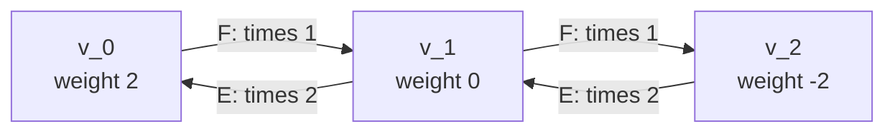

# Representations of sl(2): every one is a ladder of weights that steps by two

[Syllabus](../../../SYLLABUS.md) → [Differential geometry and Lie groups](../README.md) → [Roots, Weights and Representations](../README.md#s08) → Representations of sl(2)

---

## General Overview

Send a beam of silver atoms through an uneven magnet and it lands as two spots ([Spin one-half](../../13-Engineering%20mathematics/09-Quantum%20Mechanics%20in%20Outline/06-spin-and-two-state-systems.md)). A beam of spin-1 particles lands as three spots, evenly spaced. A spin-3/2 beam gives four. The count is always whole and the gaps are always equal.

Quarks show the same pattern when they combine. Every quark and antiquark carries spin 1/2. A quark with an antiquark makes either one state of spin 0 (the pion family of particles) or three states of spin 1 (the rho family): 2 × 2 = 3 + 1. Three quarks combine in two stages. Two of them pair up as before. The third joins the spin-1 pair, and those 6 states split again: 3 × 2 = 4 + 2. The four are the spin-3/2 Delta particles; the two have spin 1/2, the spin of the proton and the neutron.

All of this is one small piece of algebra. Spin is a rotation symmetry, and the rotation rates of spin form a three-dimensional Lie algebra, called sl(2) once complex combinations are allowed. Every way this algebra acts by matrices is built from ladders: rungs labelled by numbers called weights, joined by a step-up and a step-down matrix. A ladder must stop at both ends, which forces whole-number weights spaced by exactly two.

**Every irreducible representation of sl(2) is a ladder of n + 1 weights, n, n − 2, …, −n, for a whole number n; every finite-dimensional representation is a sum of such ladders, and two ladders multiply into ladders by the Clebsch-Gordan rule.**

**What kind of fact this is:** a theorem. The ladder classification, the Casimir value and the Clebsch-Gordan rule are proved on this card in Why it works. Complete reducibility (Weyl's theorem) is stated and cited from Humphreys, chapter II, not proved.

### The picture: spin 1 as a ladder



The three states of spin 1 are the three rungs. F moves one rung down; E moves one rung up and multiplies by 2. Past either end there is nothing.

---

## The formula

Notation first, in words.

- $`\mathfrak{sl}(2)`$ is the space of 2 by 2 complex matrices with trace 0 (the diagonal entries add to zero). It is a Lie algebra: its bracket is $`[A, B] = AB - BA`$ ([Lie algebra](../06-Lie%20Groups/02-lie-algebras-and-the-exponential-map.md)).
- Its standard basis is three matrices: $`H = \begin{pmatrix} 1 & 0 \\ 0 & -1 \end{pmatrix}`$, $`E = \begin{pmatrix} 0 & 1 \\ 0 & 0 \end{pmatrix}`$, $`F = \begin{pmatrix} 0 & 0 \\ 1 & 0 \end{pmatrix}`$.
- Their brackets are the whole structure: $`[H, E] = 2E`$, $`[H, F] = -2F`$, $`[E, F] = H`$.
- A **representation** sends each member $`X`$ of the algebra to a matrix $`\rho(X)`$ on a space $`V`$, keeping brackets: $`\rho([A, B]) = [\rho(A), \rho(B)]`$. On this card $`\rho(H)`$ is written $`H`$ again, and so on.
- A **weight** is an eigenvalue of $`H`$ ([Eigenvalues and eigenvectors](../../03-Algebra/07-Eigenvalues%20and%20Symmetric%20Matrices/02-eigenvalues-and-eigenvectors.md)): a number $`\lambda`$ with $`Hv = \lambda v`$ for some nonzero vector $`v`$, a **weight vector**.

The ladder $`V_n`$ has basis $`v_0, v_1, \ldots, v_n`$, and the three matrices act on it like this:

```math
H v_k = (n - 2k)\, v_k, \qquad E v_k = k(n - k + 1)\, v_{k-1}, \qquad F v_k = v_{k+1}, \qquad v_{-1} = v_{n+1} = 0
```

**Read it aloud:** rung $`k`$ has weight $`n - 2k`$; F steps one rung down, E steps one rung up and multiplies by $`k(n - k + 1)`$, and both fall off the ends to zero.

For spin 1, $`n = 2`$: weights 2, 0, −2, and E multiplies by $`1 \times 2 = 2`$ and $`2 \times 1 = 2`$.

The **Casimir element** $`C`$ is a fixed combination that takes one value on a whole ladder:

```math
C = H^2 + 2EF + 2FE = n(n + 2) \ \text{on every vector of } V_n
```

**Read it aloud:** square H, add twice EF and twice FE, and the result is the number n times n plus 2 on the whole ladder.

The **tensor product** $`V \otimes W`$ is the space of tables with a row per basis vector of $`V`$ and a column per basis vector of $`W`$ ([Tensor products](../../03-Algebra/11-Duals%2C%20Quotients%20and%20Tensors/03-tensor-products.md)). The algebra acts on it by $`X \otimes 1 + 1 \otimes X`$: act on the row label, then on the column label, and add. The **Clebsch-Gordan rule** splits it:

```math
V_m \otimes V_n \cong V_{m+n} \oplus V_{m+n-2} \oplus \cdots \oplus V_{\lvert m-n \rvert}
```

**Read it aloud:** a ladder of top weight m times a ladder of top weight n is one ladder each of top weights m + n, m + n − 2, and so on down to the difference of m and n.

| Symbol | Plain meaning | In our example | Push it up and the answer… |
| --- | --- | --- | --- |
| $`\mathfrak{sl}(2)`$; $`SU(2)`$, $`SO(3)`$ | 2 by 2 complex matrices of trace 0, with the bracket; the spin group (2 by 2 unitary matrices of determinant 1) and the rotation group of space | spin's three rotation rates, with complex combinations allowed | — |
| $`H`$; $`\sigma_x`$, $`\sigma_y`$, $`\sigma_z`$; ħ | the weight-reading matrix: twice spin along the magnet's axis, in units of ħ; the three Pauli matrices of spin 1/2, where $`H = \sigma_z`$; ħ, Planck's constant over 2π | diagonal 2, 0, −2 on spin 1 | — |
| $`E`$, $`F`$; $`c_k`$ | the step-up and step-down matrices; the number E multiplies rung $`k`$ by | E multiplies by 2 and 2 on spin 1 | — |
| $`[A, B]`$ | the bracket $`AB - BA`$ | $`[E, F] = H`$ | — |
| $`\rho`$; $`X`$, $`g`$; $`V`$, $`W`$; $`I`$ | the representation: algebra member $`X`$ to matrix $`\rho(X)`$; a group member; the spaces acted on; the identity matrix | 3 by 3 matrices for spin 1 | — |
| $`n`$, $`m`$; $`\ell`$ | top weights, whole numbers ($`m`$ for a second ladder); the degree of a spherical harmonic, with $`n = 2\ell`$ | 2 for spin 1, 1 for spin 1/2 | one more rung |
| $`V_n`$ | the ladder with top weight $`n`$, dimension $`n + 1`$ | $`V_2`$, three states | — |
| $`v_k`$, $`k`$; $`w_b`$ | rung number $`k`$, counted down from the top from 0; rung $`b`$ of a second ladder | $`v_1`$ has weight 0 | weight drops by 2 per rung |
| $`\lambda`$ | a weight before it is known to be whole | 1.5 in the broken ladder | — |
| $`j`$; $`J_z`$ | spin, $`n/2`$; the spin component along the magnet's axis in units of ħ, half the weight | 1; $`J_z = +1`$ on the top rung | $`j(j+1) = C/4`$ grows |
| $`C`$ | the Casimir element, $`H^2 + 2EF + 2FE`$ | 8 on spin 1 | 15 on spin 3/2 |
| $`\otimes`$, $`\oplus`$ | tensor product, two systems held together; direct sum, pieces side by side | spin 1 with spin 1/2 has 6 states, $`V_3 \oplus V_1`$ has 4 + 2 | dimensions multiply; dimensions add |

### When it holds

- **Finite dimension.** The ladder stops only because the space runs out. Drop finiteness and a top weight of 1.5 gives a ladder going down forever: no rung's E coefficient is ever zero.
- **The brackets, not just three matrices.** The step sizes are forced by $`[E, F] = H`$. Put 1 for every E coefficient on spin 1 and $`[E, F]`$ comes out with diagonal 1, 0, −1, not 2, 0, −2.
- **Complex numbers.** Weights are eigenvalues, and over the complex numbers every square matrix has one. The algebra of the group $`SU(2)`$ becomes $`\mathfrak{sl}(2)`$ once complex combinations are allowed: $`H`$ is the Pauli matrix $`\sigma_z`$ and $`E = (\sigma_x + i\sigma_y)/2`$.
- **A semisimple algebra, for the split into ladders.** $`\mathfrak{sl}(2)`$ is simple: no subspace of it except zero and the whole is kept when bracketed with every member. Weyl's theorem needs this. The algebra of multiples of E alone, acting on 2-vectors, keeps the line through $`(1, 0)`$ and no other line, so that space never splits.
- **The algebra's rule on a product.** A group member $`g`$ acts on $`V \otimes W`$ as $`g \otimes g`$, but an algebra member acts as $`X \otimes 1 + 1 \otimes X`$. Use $`X \otimes X`$ and the code's two roads disagree.

---

## Why it works

### Step 0: H sorts vectors, E and F move them

The bracket $`[H, E] = 2E`$ says: apply E, then read the weight, and the weight has gone up by 2. In symbols, if $`Hv = \lambda v`$ then

```math
H(Ev) = EHv + [H, E]v = (\lambda + 2)\, Ev
```

So E carries a weight-$`\lambda`$ vector to a weight-$`(\lambda + 2)`$ vector, or to zero. Likewise $`[H, F] = -2F`$ makes F lower the weight by 2. That is why weights step by two.

### Step 1: a finite space has a top rung

Take any weight vector. Apply E again and again. Each result is either zero or a weight vector of a new weight. Vectors of different weights are independent, and a finite space holds only finitely many independent vectors. So some application gives zero. The last nonzero vector $`v_0`$ has $`Ev_0 = 0`$: a **highest weight vector**, with weight $`\lambda`$.

### Step 2: walk down with F

Set $`v_k = F^k v_0`$. By Step 0, $`v_k`$ has weight $`\lambda - 2k`$. Going back up with E gives a multiple of the rung above:

```math
E v_k = k(\lambda - k + 1)\, v_{k-1}
```

<details>
<summary>Detailed proof: the step-up coefficient</summary>

Write $`E v_k = c_k v_{k-1}`$, with $`c_0 = 0`$ since $`Ev_0 = 0`$. Use $`EF = FE + [E, F] = FE + H`$:

$`\displaystyle E v_k = E F v_{k-1} = F E v_{k-1} + H v_{k-1} = c_{k-1} v_{k-1} + (\lambda - 2k + 2)\, v_{k-1}.`$

So $`c_k = c_{k-1} + \lambda - 2k + 2`$. Adding these steps from 1 to $`k`$:

$`\displaystyle c_k = \sum_{i=1}^{k} (\lambda + 2 - 2i) = k(\lambda + 2) - k(k + 1) = k(\lambda - k + 1).`$

</details>

### Step 3: the bottom must be reached exactly, so the top weight is whole

The space is finite, so some $`v_{m+1} = 0`$ while $`v_m \neq 0`$. Apply E to that zero vector:

```math
0 = E v_{m+1} = (m + 1)(\lambda - m)\, v_m
```

Since $`m + 1 \neq 0`$ and $`v_m \neq 0`$, the top weight is $`\lambda = m`$, a whole number. Call it $`n`$. The ladder has $`n + 1`$ rungs with weights $`n, n - 2, \ldots, -n`$, symmetric about zero. With $`\lambda = 1.5`$ no coefficient $`k(\lambda - k + 1)`$ is ever zero, so no finite ladder exists.

### Step 4: the ladder is a piece that cannot split

The span of $`v_0, \ldots, v_n`$ is kept by H, E and F, by the three rules above. It is **irreducible**: it holds no smaller kept piece except zero ([Representations](../../03-Algebra/12-Group%20Representations/01-representations-and-maschkes-theorem.md)). A kept piece contains some weight vector, which is a multiple of one rung; E lifts it to $`v_0`$ with nonzero factors, and F then rebuilds every rung. Any irreducible representation holds such a ladder by Steps 1 to 3, and the ladder is a kept piece, so it is the whole space. The rules mention only $`n`$, so every irreducible representation of dimension $`n + 1`$ is this one, $`V_n`$.

### Step 5: the Casimir reads the ladder's size

$`C = H^2 + 2EF + 2FE`$ brackets to zero with H, E and F, by a short bracket calculation. On an irreducible piece Schur's lemma then makes C one number: a matrix that commutes with all of an irreducible representation is a multiple of the identity ([Schur's lemma and orthogonality](../../03-Algebra/12-Group%20Representations/02-schurs-lemma-and-character-orthogonality.md)). Find the number on the top rung, where $`Ev_0 = 0`$ and $`EF = FE + H`$:

```math
C v_0 = n^2 v_0 + 2(FE + H) v_0 + 2FE v_0 = (n^2 + 2n)\, v_0
```

So $`C = n(n + 2)`$ on $`V_n`$: 3 on spin 1/2, 8 on spin 1, 15 on spin 3/2. Physicists divide by 4 and get $`j(j + 1)`$, the squared size of the spin in units of ħ².

### Step 6: every finite representation is a sum of ladders (stated)

Weyl's theorem says every finite-dimensional representation of $`\mathfrak{sl}(2)`$ is a direct sum of irreducible ones, so of ladders. Humphreys proves it algebraically with the Casimir (chapter II, section 6). Hall proves it through the compact group $`SU(2)`$, where averaging over the group finds a kept complement, as [Peter-Weyl](../../20-Harmonic%20analysis/08-Harmonic%20Analysis%20on%20Groups/04-peter-weyl-theorem.md) does for any compact group.

### Step 7: products of ladders split by adding weights

On $`V_m \otimes V_n`$, H acts as $`H \otimes 1 + 1 \otimes H`$, so the table entry for rung $`v_a`$ of the first ladder and rung $`w_b`$ of the second has weight $`(m - 2a) + (n - 2b)`$. Weights add.

By Step 6 the product is a sum of ladders. Each ladder contributes a full run of weights. So read the split off the weight list:

1. Take the largest weight left; that is the top of one ladder.
2. Remove that ladder's whole run: top, top − 2, …, −top.
3. Repeat until the list is empty.

For spin 1 with spin 1/2: weights $`\{2, 0, -2\} + \{1, -1\}`$ give 3, 1, 1, −1, −1, −3. Peel the ladder of 3, which removes 3, 1, −1, −3. Left are 1, −1: the ladder of 1. So $`V_2 \otimes V_1 = V_3 \oplus V_1`$, and 3 × 2 = 4 + 2.

In general the top weight $`m + n`$ appears once, the next one twice, and so on, up to $`\min(m, n) + 1`$ times. Peeling gives one ladder each of top weight $`m + n, m + n - 2, \ldots, \lvert m - n \rvert`$: the Clebsch-Gordan rule.

<details>
<summary>Detailed proof: the dimensions agree</summary>

Take $`m \geq n`$. The ladders have $`m + n + 1 - 2i`$ rungs for $`i = 0, 1, \ldots, n`$. Their total is

$`\displaystyle \sum_{i=0}^{n} (m + n + 1 - 2i) = (n + 1)(m + n + 1) - n(n + 1) = (m + 1)(n + 1),`$

which is the dimension of $`V_m \otimes V_n`$.

</details>

### Step 8: the group sees only some ladders

$`SU(2)`$ is simply connected, so by [Lie's theorems](../06-Lie%20Groups/11-lies-theorems-and-covering-groups.md) every ladder $`V_n`$ comes from a representation of the group. The full turn $`e^{i\pi H}`$ is $`-I`$ in $`SU(2)`$; on $`V_n`$ it multiplies every rung by $`(-1)^{n - 2k} = (-1)^n`$. The rotation group $`SO(3)`$ sends that full turn to $`I`$, so only even $`n`$, whole-number spins, are representations of $`SO(3)`$. Half-integer spins need $`SU(2)`$.

---

## Worked numbers, by hand

| Step | Arithmetic | Value |
| --- | --- | --- |
| spin 1 weights | $`n - 2k`$ for $`n = 2`$, $`k = 0, 1, 2`$ | 2, 0, −2 |
| step-up coefficients | $`k(n - k + 1)`$: $`1 \times 2`$, $`2 \times 1`$ | 2, 2 |
| $`EF`$ on the rungs | $`EFv_0 = Ev_1 = 2v_0`$, $`EFv_1 = Ev_2 = 2v_1`$, $`EFv_2 = 0`$ | diagonal 2, 2, 0 |
| $`FE`$ on the rungs | $`FEv_0 = 0`$, $`FEv_1 = F(2v_0) = 2v_1`$, $`FEv_2 = 2v_2`$ | diagonal 0, 2, 2 |
| $`[E, F]`$ | $`(2, 2, 0) - (0, 2, 2)`$ | 2, 0, −2, which is H |
| Casimir on $`v_0`$ | $`2^2 + 2 \times 2 + 2 \times 0`$ | 8 = 2 × 4 |
| $`j(j+1)`$ | $`8 / 4`$ | 2.00 |
| weights of $`V_2 \otimes V_1`$ | each of 2, 0, −2 plus each of 1, −1 | 3, 1, 1, −1, −1, −3 |
| peel the top | remove 3, 1, −1, −3 | 1, −1 left |
| the split | ladders of top 3 and 1 | $`\mathbf{V_3 \oplus V_1}`$ |
| dimensions | 3 × 2 against 4 + 2 | **6 = 6** |
| Casimir check | 3 × 5 = 15 on 4 vectors, 1 × 3 = 3 on 2 vectors | 4 + 2 |

Spin 1 joined with spin 1/2 is a spin-3/2 system plus a spin-1/2 system, nothing else. The same peeling gives two spin-1/2 quarks as $`V_2 \oplus V_0`$, 4 = 3 + 1, and three quarks as $`V_3 \oplus V_1 \oplus V_1`$, 8 = 4 + 2 + 2.

### What breaks if you drop a piece

| Mistake | Comes out at | What went wrong |
| --- | --- | --- |
| Top weight 1.5, no finiteness | E coefficients 1.5, 1.0, −1.5, −6.0, −12.5, never 0 | Only a whole-number top lets the ladder stop |
| Every E coefficient set to 1 | $`[E, F]`$ diagonal 1, 0, −1, not 2, 0, −2 | The coefficients come from the brackets |
| Dimensions of $`V_2 \otimes V_1`$ added | 3 + 2 = 5, not 6 | A product of systems multiplies states |
| Clebsch-Gordan list stepping by 1 | $`V_3 \oplus V_2 \oplus V_1`$: 9 states, not 6 | Weights step by two, so ladders do too |

The code prints all four.

---

## Code, from first principles, and it actually runs

The code builds each ladder $`V_n`$ from the three rules and checks the three brackets by multiplying matrices, for $`n`$ = 0 to 6. It confirms the Casimir is the single number $`n(n+2)`$. Then it splits three tensor products by two roads that share no step. Road one peels highest weights off the list of weights. Road two never looks at weights: it builds the Casimir matrix on the product and counts its eigenvectors for each value $`n(n+2)`$ by exact integer rank. The two roads must agree.

### Python

```python
# Representations of sl(2) -- the check behind the card.  Standard library only.
# V_n is built from the ladder rules, its brackets and Casimir are checked by
# matrix products, and each tensor product is split by two roads that share no
# step: peeling highest weights off the list of weights, and counting the
# Casimir's eigenvectors by exact integer ranks.  Spin 1 is V_2, spin 1/2 is V_1.

def rep(n):                              # basis v_0..v_n; v_k has weight n - 2k
    d = range(n + 1)
    H = [[n - 2 * i if i == j else 0 for j in d] for i in d]
    E = [[j * (n - j + 1) if i == j - 1 else 0 for j in d] for i in d]
    F = [[1 if i == j + 1 else 0 for j in d] for i in d]
    return H, E, F                       # E v_k = k(n-k+1) v_(k-1),  F v_k = v_(k+1)

def mul(A, B):
    return [[sum(A[i][k] * B[k][j] for k in range(len(B))) for j in range(len(B[0]))]
            for i in range(len(A))]

def lin(a, A, b, B):                     # a A + b B
    return [[a * x + b * y for x, y in zip(r, s)] for r, s in zip(A, B)]

def eye(d):
    return [[1 if i == j else 0 for j in range(d)] for i in range(d)]

def br(A, B):                            # the bracket [A, B] = AB - BA
    return lin(1, mul(A, B), -1, mul(B, A))

def casimir(H, E, F):                    # C = H^2 + 2EF + 2FE
    return lin(1, mul(H, H), 2, lin(1, mul(E, F), 1, mul(F, E)))

def kron(A, B):
    return [[a * b for a in ra for b in rb] for ra in A for rb in B]

def tensor(R, S):                        # X acts on V (x) W as X (x) 1 + 1 (x) X
    return tuple(lin(1, kron(X, eye(len(Y))), 1, kron(eye(len(X)), Y)) for X, Y in zip(R, S))

def gcd(a, b):
    while b:
        a, b = b, a % b
    return abs(a)

def rank(M):                             # fraction-free elimination on integers
    M, r = [row[:] for row in M], 0
    for c in range(len(M[0])):
        p = next((i for i in range(r, len(M)) if M[i][c]), None)
        if p is None:
            continue
        M[r], M[p] = M[p], M[r]
        for i in range(r + 1, len(M)):
            row = [M[r][c] * x - M[i][c] * y for x, y in zip(M[i], M[r])]
            g = 0
            for x in row:
                g = gcd(g, x)
            M[i] = [x // g for x in row] if g else row
        r += 1
    return r

def peel(ws):                            # road 1: strip whole ladders off the top
    ws, tops = sorted(ws), []
    while ws:
        top = ws[-1]
        tops.append(top)
        for w in range(top, -top - 1, -2):
            ws.remove(w)
    return tops

def by_casimir(R):                       # road 2: pieces V_n = dim ker(C - n(n+2)) / (n+1)
    C, d, tops = casimir(*R), len(R[0]), []
    for n in range(d - 1, -1, -1):
        k = d - rank(lin(1, C, -n * (n + 2), eye(d)))
        tops += [n] * (k // (n + 1))
        assert k % (n + 1) == 0
    return tops

def diag(M):
    return [M[i][i] for i in range(len(M))]

H, E, F = rep(2)
print("spin 1 = V_2, basis v_0, v_1, v_2")
print("H rows:", H, "  E rows:", E, "  F rows:", F)
print("E v_k = k(n-k+1) v_(k-1), coefficients for k = 1, 2:", [k * (2 - k + 1) for k in (1, 2)])
print("EF diagonal:", diag(mul(E, F)), "  FE diagonal:", diag(mul(F, E)), "  [E,F] diagonal:", diag(br(E, F)))
ok = all(br(R[0], R[1]) == lin(2, R[1], 0, R[1]) and br(R[0], R[2]) == lin(-2, R[2], 0, R[2])
         and br(R[1], R[2]) == R[0] for R in map(rep, range(7)))
print("[H,E] = 2E, [H,F] = -2F, [E,F] = H for n = 0..6:", "yes" if ok else "no")
for n in range(5):
    c = casimir(*rep(n))
    spin = str(n // 2) if n % 2 == 0 else f"{n}/2"
    same = "yes" if c == lin(c[0][0], eye(n + 1), 0, eye(n + 1)) else "no"
    print(f"V_{n}: dim {n + 1}, spin {spin}, weights {diag(rep(n)[0])}, C = {c[0][0]} on every vector: "
          f"{same}, j(j+1) = C/4 = {c[0][0] / 4:.2f}")
signs = []
for n in range(5):                       # e^(i pi H) multiplies a weight-w vector by (-1)^w
    s = {1 - 2 * (w % 2) for w in diag(rep(n)[0])}
    signs.append(s.pop() if len(s) == 1 else 0)
print("a full turn, e^(i pi H), multiplies all of V_n by one sign, n = 0..4:", signs)
cases = [("V_1 x V_1, two spin-1/2 quarks", [1, 1]), ("V_2 x V_1, spin 1 with spin 1/2", [2, 1]),
         ("V_1 x V_1 x V_1, three quarks", [1, 1, 1])]
found = []
for name, parts in cases:
    R = rep(parts[0])
    for m in parts[1:]:
        R = tensor(R, rep(m))
    ws, cas = sorted(diag(R[0]), reverse=True), casimir(*R)
    a, b = peel(ws), by_casimir(R)
    found.append((a, b))
    eig = ", ".join(f"{n * (n + 2)} on {len(ws) - rank(lin(1, cas, -n * (n + 2), eye(len(ws))))} vectors"
                    for n in sorted(set(a), reverse=True))
    print(f"{name}: dim {len(ws)}, weights {ws}")
    print(f"  peeled tops {a}; Casimir {eig}; pieces by Casimir {b}")
    print("  =", " + ".join(f"V_{n}" for n in a), " dims", " + ".join(str(n + 1) for n in a), "=", sum(n + 1 for n in a))
lam = 1.5
print("mistake 1, top weight 1.5: E F^k v_0 coefficients k(1.5-k+1), k = 1..5:",
      ", ".join(f"{k * (lam - k + 1):.1f}" for k in range(1, 6)), "-- never 0, no top rung")
print("  top weight 2 for contrast:", ", ".join(f"{k * (2 - k + 1):.1f}" for k in range(1, 4)))
E1 = [[1 if i == j - 1 else 0 for j in range(3)] for i in range(3)]
print("mistake 2, every E coefficient 1: diagonal of [E,F] =", diag(br(E1, F)), "but H =", diag(H))
print("mistake 3, dimensions added: 3 + 2 =", len(H) + len(rep(1)[0]), "but V_2 x V_1 has", len(tensor(rep(2), rep(1))[0]))
print("mistake 4, list stepping by 1: V_3 + V_2 + V_1 has", sum(len(rep(n)[0]) for n in (3, 2, 1)), "dims, not 6")
assert ok and diag(mul(E, F)) == [2, 2, 0] and diag(mul(F, E)) == [0, 2, 2]
assert all(casimir(*rep(n)) == lin(n * (n + 2), eye(n + 1), 0, eye(n + 1)) for n in range(7))
assert all(a == b for a, b in found)               # peeling agrees with the Casimir count
assert [a for a, b in found] == [[2, 0], [3, 1], [3, 1, 1]]
assert signs == [1, -1, 1, -1, 1]                 # a full turn is +1 or -1 on a whole ladder
assert br(E1, F) != H                             # unit E coefficients break [E, F] = H
assert all(k * (lam - k + 1) != 0 for k in range(1, 40))   # a top of 1.5 never stops
print("ALL CHECKS PASS")
```

**Ran 2026-11-24 on macOS, Python 3.14.10, standard library only. All checks passed. Output, pasted from the run:**

```
spin 1 = V_2, basis v_0, v_1, v_2
H rows: [[2, 0, 0], [0, 0, 0], [0, 0, -2]]   E rows: [[0, 2, 0], [0, 0, 2], [0, 0, 0]]   F rows: [[0, 0, 0], [1, 0, 0], [0, 1, 0]]
E v_k = k(n-k+1) v_(k-1), coefficients for k = 1, 2: [2, 2]
EF diagonal: [2, 2, 0]   FE diagonal: [0, 2, 2]   [E,F] diagonal: [2, 0, -2]
[H,E] = 2E, [H,F] = -2F, [E,F] = H for n = 0..6: yes
V_0: dim 1, spin 0, weights [0], C = 0 on every vector: yes, j(j+1) = C/4 = 0.00
V_1: dim 2, spin 1/2, weights [1, -1], C = 3 on every vector: yes, j(j+1) = C/4 = 0.75
V_2: dim 3, spin 1, weights [2, 0, -2], C = 8 on every vector: yes, j(j+1) = C/4 = 2.00
V_3: dim 4, spin 3/2, weights [3, 1, -1, -3], C = 15 on every vector: yes, j(j+1) = C/4 = 3.75
V_4: dim 5, spin 2, weights [4, 2, 0, -2, -4], C = 24 on every vector: yes, j(j+1) = C/4 = 6.00
a full turn, e^(i pi H), multiplies all of V_n by one sign, n = 0..4: [1, -1, 1, -1, 1]
V_1 x V_1, two spin-1/2 quarks: dim 4, weights [2, 0, 0, -2]
  peeled tops [2, 0]; Casimir 8 on 3 vectors, 0 on 1 vectors; pieces by Casimir [2, 0]
  = V_2 + V_0  dims 3 + 1 = 4
V_2 x V_1, spin 1 with spin 1/2: dim 6, weights [3, 1, 1, -1, -1, -3]
  peeled tops [3, 1]; Casimir 15 on 4 vectors, 3 on 2 vectors; pieces by Casimir [3, 1]
  = V_3 + V_1  dims 4 + 2 = 6
V_1 x V_1 x V_1, three quarks: dim 8, weights [3, 1, 1, 1, -1, -1, -1, -3]
  peeled tops [3, 1, 1]; Casimir 15 on 4 vectors, 3 on 4 vectors; pieces by Casimir [3, 1, 1]
  = V_3 + V_1 + V_1  dims 4 + 2 + 2 = 8
mistake 1, top weight 1.5: E F^k v_0 coefficients k(1.5-k+1), k = 1..5: 1.5, 1.0, -1.5, -6.0, -12.5 -- never 0, no top rung
  top weight 2 for contrast: 2.0, 2.0, 0.0
mistake 2, every E coefficient 1: diagonal of [E,F] = [1, 0, -1] but H = [2, 0, -2]
mistake 3, dimensions added: 3 + 2 = 5 but V_2 x V_1 has 6
mistake 4, list stepping by 1: V_3 + V_2 + V_1 has 9 dims, not 6
ALL CHECKS PASS
```

### Rust

Same numbers, same labels, built with `rustc --edition 2021 -O`.

```rust
// Representations of sl(2) -- the same check as the Python, in Rust.  No crates.
// V_n is built from the ladder rules, its brackets and Casimir are checked by
// matrix products, and each tensor product is split by two roads that share no
// step: peeling highest weights off the list of weights, and counting the
// Casimir's eigenvectors by exact integer ranks.  Spin 1 is V_2, spin 1/2 is V_1.
type M = Vec<Vec<i64>>;

fn rep(n: i64) -> (M, M, M) {            // basis v_0..v_n; v_k has weight n - 2k
    let d = (n + 1) as usize;
    let mut h = vec![vec![0; d]; d];
    let mut e = vec![vec![0; d]; d];
    let mut f = vec![vec![0; d]; d];
    for j in 0..d {
        h[j][j] = n - 2 * j as i64;
        if j > 0 { e[j - 1][j] = j as i64 * (n - j as i64 + 1) }   // E v_k = k(n-k+1) v_(k-1)
        if j + 1 < d { f[j + 1][j] = 1 }                          // F v_k = v_(k+1)
    }
    (h, e, f)
}

fn mul(a: &M, b: &M) -> M {
    (0..a.len()).map(|i| (0..b[0].len()).map(|j| (0..b.len()).map(|k| a[i][k] * b[k][j]).sum()).collect()).collect()
}

fn lin(x: i64, a: &M, y: i64, b: &M) -> M {    // x A + y B
    a.iter().zip(b).map(|(r, s)| r.iter().zip(s).map(|(p, q)| x * p + y * q).collect()).collect()
}

fn eye(d: usize) -> M { (0..d).map(|i| (0..d).map(|j| (i == j) as i64).collect()).collect() }

fn br(a: &M, b: &M) -> M { lin(1, &mul(a, b), -1, &mul(b, a)) }   // [A, B] = AB - BA

fn casimir(r: &(M, M, M)) -> M {               // C = H^2 + 2EF + 2FE
    lin(1, &mul(&r.0, &r.0), 2, &lin(1, &mul(&r.1, &r.2), 1, &mul(&r.2, &r.1)))
}

fn kron(a: &M, b: &M) -> M {
    let mut out = Vec::new();
    for ra in a { for rb in b { out.push(ra.iter().flat_map(|x| rb.iter().map(move |y| x * y)).collect()) } }
    out
}

fn tensor(r: &(M, M, M), s: &(M, M, M)) -> (M, M, M) {   // X (x) 1 + 1 (x) X
    let t = |x: &M, y: &M| lin(1, &kron(x, &eye(y.len())), 1, &kron(&eye(x.len()), y));
    (t(&r.0, &s.0), t(&r.1, &s.1), t(&r.2, &s.2))
}

fn gcd(mut a: i64, mut b: i64) -> i64 { while b != 0 { (a, b) = (b, a % b) } a.abs() }

fn rank(m0: &M) -> usize {                      // fraction-free elimination on integers
    let (mut m, mut r) = (m0.clone(), 0);
    for c in 0..m[0].len() {
        let p = match (r..m.len()).find(|&i| m[i][c] != 0) { Some(p) => p, None => continue };
        m.swap(r, p);
        for i in r + 1..m.len() {
            let row: Vec<i64> = (0..m[i].len()).map(|j| m[r][c] * m[i][j] - m[i][c] * m[r][j]).collect();
            let g = row.iter().fold(0, |g, &x| gcd(g, x));
            m[i] = if g != 0 { row.iter().map(|x| x / g).collect() } else { row };
        }
        r += 1;
    }
    r
}

fn peel(ws0: &[i64]) -> Vec<i64> {              // road 1: strip whole ladders off the top
    let (mut ws, mut tops) = (ws0.to_vec(), Vec::new());
    ws.sort();
    while let Some(&top) = ws.last() {
        tops.push(top);
        let mut w = top;
        while w >= -top { let i = ws.iter().position(|&x| x == w).unwrap(); ws.remove(i); w -= 2 }
    }
    tops
}

fn kernel(c: &M, n: i64) -> usize { c.len() - rank(&lin(1, c, -n * (n + 2), &eye(c.len()))) }

fn by_casimir(r: &(M, M, M)) -> Vec<i64> {      // road 2: pieces V_n = dim ker(C - n(n+2)) / (n+1)
    let (c, mut tops) = (casimir(r), Vec::new());
    for n in (0..c.len() as i64).rev() {
        let k = kernel(&c, n) as i64;
        assert!(k % (n + 1) == 0);
        for _ in 0..k / (n + 1) { tops.push(n) }
    }
    tops
}

fn diag(m: &M) -> Vec<i64> { (0..m.len()).map(|i| m[i][i]).collect() }
fn yn(b: bool) -> &'static str { if b { "yes" } else { "no" } }
fn join(v: Vec<String>, s: &str) -> String { v.join(s) }

fn main() {
    let (h, e, f) = rep(2);
    println!("spin 1 = V_2, basis v_0, v_1, v_2");
    println!("H rows: {:?}   E rows: {:?}   F rows: {:?}", h, e, f);
    println!("E v_k = k(n-k+1) v_(k-1), coefficients for k = 1, 2: {:?}", [1, 2].map(|k: i64| k * (2 - k + 1)));
    println!("EF diagonal: {:?}   FE diagonal: {:?}   [E,F] diagonal: {:?}", diag(&mul(&e, &f)), diag(&mul(&f, &e)), diag(&br(&e, &f)));
    let ok = (0..7).map(rep).all(|r| br(&r.0, &r.1) == lin(2, &r.1, 0, &r.1)
        && br(&r.0, &r.2) == lin(-2, &r.2, 0, &r.2) && br(&r.1, &r.2) == r.0);
    println!("[H,E] = 2E, [H,F] = -2F, [E,F] = H for n = 0..6: {}", yn(ok));
    for n in 0..5i64 {
        let c = casimir(&rep(n));
        let spin = if n % 2 == 0 { format!("{}", n / 2) } else { format!("{}/2", n) };
        let same = yn(c == lin(c[0][0], &eye(n as usize + 1), 0, &eye(n as usize + 1)));
        println!("V_{}: dim {}, spin {}, weights {:?}, C = {} on every vector: {}, j(j+1) = C/4 = {:.2}",
                 n, n + 1, spin, diag(&rep(n).0), c[0][0], same, c[0][0] as f64 / 4.0);
    }
    let signs: Vec<i64> = (0..5).map(|n| {   // e^(i pi H) multiplies a weight-w vector by (-1)^w
        let s: Vec<i64> = diag(&rep(n).0).iter().map(|w| 1 - 2 * w.rem_euclid(2)).collect();
        if s.iter().all(|&x| x == s[0]) { s[0] } else { 0 }
    }).collect();
    println!("a full turn, e^(i pi H), multiplies all of V_n by one sign, n = 0..4: {:?}", signs);
    let cases: [(&str, Vec<i64>); 3] = [("V_1 x V_1, two spin-1/2 quarks", vec![1, 1]),
        ("V_2 x V_1, spin 1 with spin 1/2", vec![2, 1]), ("V_1 x V_1 x V_1, three quarks", vec![1, 1, 1])];
    let mut found = Vec::new();
    for (name, parts) in cases.iter() {
        let mut r = rep(parts[0]);
        for &m in &parts[1..] { r = tensor(&r, &rep(m)) }
        let mut ws = diag(&r.0);
        ws.sort_by(|a, b| b.cmp(a));
        let cas = casimir(&r);
        let (a, b) = (peel(&ws), by_casimir(&r));
        let mut ns = a.clone();
        ns.dedup();
        let eig = join(ns.iter().map(|&n| format!("{} on {} vectors", n * (n + 2), kernel(&cas, n))).collect(), ", ");
        println!("{}: dim {}, weights {:?}", name, ws.len(), ws);
        println!("  peeled tops {:?}; Casimir {}; pieces by Casimir {:?}", a, eig, b);
        println!("  = {}  dims {} = {}", join(a.iter().map(|n| format!("V_{}", n)).collect(), " + "),
                 join(a.iter().map(|n| format!("{}", n + 1)).collect(), " + "), a.iter().map(|n| n + 1).sum::<i64>());
        found.push((a, b));
    }
    let lam = 1.5f64;
    let co = |l: f64, k: i64| k as f64 * (l - k as f64 + 1.0);
    println!("mistake 1, top weight 1.5: E F^k v_0 coefficients k(1.5-k+1), k = 1..5: {} -- never 0, no top rung",
             join((1..6).map(|k| format!("{:.1}", co(lam, k))).collect(), ", "));
    println!("  top weight 2 for contrast: {}", join((1..4).map(|k| format!("{:.1}", co(2.0, k))).collect(), ", "));
    let mut e1 = vec![vec![0i64; 3]; 3];
    e1[0][1] = 1;
    e1[1][2] = 1;
    println!("mistake 2, every E coefficient 1: diagonal of [E,F] = {:?} but H = {:?}", diag(&br(&e1, &f)), diag(&h));
    println!("mistake 3, dimensions added: 3 + 2 = {} but V_2 x V_1 has {}", h.len() + rep(1).0.len(), tensor(&rep(2), &rep(1)).0.len());
    println!("mistake 4, list stepping by 1: V_3 + V_2 + V_1 has {} dims, not 6", [3, 2, 1].iter().map(|&n| rep(n).0.len()).sum::<usize>());
    assert!(ok && diag(&mul(&e, &f)) == vec![2, 2, 0] && diag(&mul(&f, &e)) == vec![0, 2, 2]);
    assert!((0..7).all(|n: i64| casimir(&rep(n)) == lin(n * (n + 2), &eye(n as usize + 1), 0, &eye(n as usize + 1))));
    assert!(found.iter().all(|(a, b)| a == b));        // peeling agrees with the Casimir count
    assert!(found.iter().map(|(a, _)| a.clone()).collect::<Vec<_>>() == vec![vec![2, 0], vec![3, 1], vec![3, 1, 1]]);
    assert!(signs == vec![1, -1, 1, -1, 1]);           // a full turn is +1 or -1 on a whole ladder
    assert!(br(&e1, &f) != h);                         // unit E coefficients break [E, F] = H
    assert!((1..40).all(|k| co(lam, k) != 0.0));       // a top of 1.5 never stops
    println!("ALL CHECKS PASS");
}
```

**Ran 2026-11-24 on macOS, rustc 1.98.1, no crates. All checks passed. Output, pasted from the run:**

```
spin 1 = V_2, basis v_0, v_1, v_2
H rows: [[2, 0, 0], [0, 0, 0], [0, 0, -2]]   E rows: [[0, 2, 0], [0, 0, 2], [0, 0, 0]]   F rows: [[0, 0, 0], [1, 0, 0], [0, 1, 0]]
E v_k = k(n-k+1) v_(k-1), coefficients for k = 1, 2: [2, 2]
EF diagonal: [2, 2, 0]   FE diagonal: [0, 2, 2]   [E,F] diagonal: [2, 0, -2]
[H,E] = 2E, [H,F] = -2F, [E,F] = H for n = 0..6: yes
V_0: dim 1, spin 0, weights [0], C = 0 on every vector: yes, j(j+1) = C/4 = 0.00
V_1: dim 2, spin 1/2, weights [1, -1], C = 3 on every vector: yes, j(j+1) = C/4 = 0.75
V_2: dim 3, spin 1, weights [2, 0, -2], C = 8 on every vector: yes, j(j+1) = C/4 = 2.00
V_3: dim 4, spin 3/2, weights [3, 1, -1, -3], C = 15 on every vector: yes, j(j+1) = C/4 = 3.75
V_4: dim 5, spin 2, weights [4, 2, 0, -2, -4], C = 24 on every vector: yes, j(j+1) = C/4 = 6.00
a full turn, e^(i pi H), multiplies all of V_n by one sign, n = 0..4: [1, -1, 1, -1, 1]
V_1 x V_1, two spin-1/2 quarks: dim 4, weights [2, 0, 0, -2]
  peeled tops [2, 0]; Casimir 8 on 3 vectors, 0 on 1 vectors; pieces by Casimir [2, 0]
  = V_2 + V_0  dims 3 + 1 = 4
V_2 x V_1, spin 1 with spin 1/2: dim 6, weights [3, 1, 1, -1, -1, -3]
  peeled tops [3, 1]; Casimir 15 on 4 vectors, 3 on 2 vectors; pieces by Casimir [3, 1]
  = V_3 + V_1  dims 4 + 2 = 6
V_1 x V_1 x V_1, three quarks: dim 8, weights [3, 1, 1, 1, -1, -1, -1, -3]
  peeled tops [3, 1, 1]; Casimir 15 on 4 vectors, 3 on 4 vectors; pieces by Casimir [3, 1, 1]
  = V_3 + V_1 + V_1  dims 4 + 2 + 2 = 8
mistake 1, top weight 1.5: E F^k v_0 coefficients k(1.5-k+1), k = 1..5: 1.5, 1.0, -1.5, -6.0, -12.5 -- never 0, no top rung
  top weight 2 for contrast: 2.0, 2.0, 0.0
mistake 2, every E coefficient 1: diagonal of [E,F] = [1, 0, -1] but H = [2, 0, -2]
mistake 3, dimensions added: 3 + 2 = 5 but V_2 x V_1 has 6
mistake 4, list stepping by 1: V_3 + V_2 + V_1 has 9 dims, not 6
ALL CHECKS PASS
```

The two outputs match line for line.

### Lean

Lean proves the ladder, the Casimir value and the Clebsch-Gordan rule for every whole number $`n`$, and checks the worked numbers.

- Take a finite-dimensional irreducible representation of $`\mathfrak{sl}(2)`$. Then it has a basis $`v_0, \ldots, v_n`$ obeying the three ladder rules, for some whole number $`n`$.
- Take an irreducible representation of dimension $`n + 1`$. Then the Casimir $`C`$ multiplies every vector by $`n(n + 2)`$.
- Take irreducible representations of dimensions $`m + 1`$ and $`n + 1`$. Then their tensor product splits into irreducible pieces of dimensions $`m + n + 1 - 2i`$, for $`i`$ from 0 to $`\min(m, n)`$.
- $`H`$, $`E`$ and $`F`$ are the card's three matrices. On spin 1, the ladder matrices keep the three brackets, and $`C`$ is 8.
- The weights of $`V_2 \otimes V_1`$ are 3, 1, 1, −1, −1, −3. Also 2 × 2 = 3 + 1, 3 × 2 = 4 + 2, and $`V_3 \oplus V_2 \oplus V_1`$ has 9 states.

Weyl's theorem stays cited, not proved; the full-turn signs and the four mistakes are left to the Python and Rust checks.

```lean
-- Representations of sl(2): every finite-dimensional irreducible representation of sl(2, ℂ) is a ladder of weights n, n - 2, ..., -n, its Casimir is n(n + 2), and two ladders multiply into ladders by the Clebsch-Gordan rule.
import Mathlib.Algebra.Lie.Classical
import Mathlib.Algebra.Lie.Semisimple.Defs
import Mathlib.Algebra.Lie.Sl2
import Mathlib.Algebra.Lie.TensorProduct
import Mathlib.Algebra.DirectSum.Module
import Mathlib.LinearAlgebra.Dimension.Finrank
import Mathlib.LinearAlgebra.FiniteDimensional.Defs
import Mathlib.LinearAlgebra.Matrix.Notation
import Mathlib.Basic.Complex.Basic
import Mathlib.Analysis.Complex.Polynomial.Basic

open LieAlgebra.SpecialLinear
open scoped TensorProduct

/-! `sl2` is Mathlib's `sl (Fin 2) ℂ`, the 2 by 2 complex matrices of trace zero with the
bracket `⁅A, B⁆ = A * B - B * A`. A representation of it is a Lie module `M`; the bracket
`⁅X, m⁆` is the matrix of `X` acting on the vector `m`. On a tensor product `M ⊗[ℂ] N`,
Mathlib lets `X` act as `X ⊗ 1 + 1 ⊗ X`, the card's rule for the algebra. -/

/-- The card's `sl(2)`: 2 by 2 complex matrices of trace zero. -/
abbrev sl2 : Type := sl (Fin 2) ℂ

/-- The card's `H`, the matrix with diagonal `1, -1`. -/
noncomputable def H : sl2 := singleSubSingle (0 : Fin 2) 1 (1 : ℂ)

/-- The card's `E`, the matrix with a single `1` in row 0, column 1. -/
noncomputable def E : sl2 := single (0 : Fin 2) 1 (by decide) (1 : ℂ)

/-- The card's `F`, the matrix with a single `1` in row 1, column 0. -/
noncomputable def F : sl2 := single (1 : Fin 2) 0 (by decide) (1 : ℂ)

lemma sl2_triple : IsSl2Triple H E F where
  h_ne_zero := by
    intro h
    have := congrArg (fun x : sl2 => x.val 0 0) h
    simp [H, Matrix.single] at this
  lie_e_f := by
    apply Subtype.ext
    ext i j
    fin_cases i <;> fin_cases j <;>
      simp [H, E, F, Ring.lie_def, Matrix.single, Matrix.mul_apply]
  lie_h_e_nsmul := by
    apply Subtype.ext
    ext i j
    fin_cases i <;> fin_cases j <;>
      norm_num [H, E, Ring.lie_def, Matrix.single, Matrix.mul_apply]
  lie_h_f_nsmul := by
    apply Subtype.ext
    ext i j
    fin_cases i <;> fin_cases j <;>
      norm_num [H, F, Ring.lie_def, Matrix.single, Matrix.mul_apply]

lemma sl2_decomp (x : sl2) : x = x.val 0 0 • H + x.val 0 1 • E + x.val 1 0 • F := by
  have hx : Matrix.trace x.val = 0 := x.prop
  rw [Matrix.trace_fin_two] at hx
  apply Subtype.ext
  ext i j
  fin_cases i <;> fin_cases j <;> simp [H, E, F, Matrix.single]
  linear_combination hx

#print axioms sl2_triple
#print axioms sl2_decomp

section ladder

open LieModule

variable {V : Type*} [AddCommGroup V] [Module ℂ V] [LieRingModule sl2 V] [LieModule ℂ sl2 V]

lemma exists_lieSubmodule_of_HEF (S : Submodule ℂ V) (hH : ∀ v ∈ S, ⁅H, v⁆ ∈ S)
    (hE : ∀ v ∈ S, ⁅E, v⁆ ∈ S) (hF : ∀ v ∈ S, ⁅F, v⁆ ∈ S) :
    ∃ W : LieSubmodule ℂ sl2 V, (W : Submodule ℂ V) = S :=
  ⟨{ S with
      lie_mem := fun {x v} hv => by
        rw [sl2_decomp x, add_lie, add_lie, smul_lie, smul_lie, smul_lie]
        exact S.add_mem (S.add_mem (S.smul_mem _ (hH v hv)) (S.smul_mem _ (hE v hv)))
          (S.smul_mem _ (hF v hv)) }, rfl⟩

lemma ladder_eq_zero [FiniteDimensional ℂ V] {w : V} {k : ℕ}
    (P : sl2_triple.HasPrimitiveVectorWith w (k : ℂ)) (j : ℕ) (hj : k < j) :
    (toEnd ℂ sl2 V F ^ j) w = 0 := by
  obtain ⟨t, rfl⟩ := Nat.exists_eq_add_of_lt hj
  rw [show k + t + 1 = t + (k + 1) by ring, pow_add, Module.End.mul_apply,
    P.pow_toEnd_f_eq_zero_of_eq_nat rfl, map_zero]

lemma ladder_linIndep {w : V} {k : ℕ} (P : sl2_triple.HasPrimitiveVectorWith w (k : ℂ)) :
    LinearIndependent ℂ (fun j : Fin (k + 1) => (toEnd ℂ sl2 V F ^ (j : ℕ)) w) := by
  refine (toEnd ℂ sl2 V H).eigenvectors_linearIndependent'
    (fun j : Fin (k + 1) => (k : ℂ) - 2 * ((j : ℕ) : ℂ)) ?_ _ ?_
  · intro i j hij
    simp only [sub_right_inj, mul_eq_mul_left_iff, Nat.cast_inj] at hij
    exact Fin.ext (by simpa using hij)
  · intro j
    rw [Module.End.hasEigenvector_iff]
    refine ⟨?_, P.pow_toEnd_f_ne_zero_of_eq_nat rfl (Nat.lt_succ_iff.mp j.2)⟩
    rw [Module.End.mem_eigenspace_iff, toEnd_apply_apply, P.lie_h_pow_toEnd_f]

lemma ladder_mem_span [FiniteDimensional ℂ V] {w : V} {k : ℕ}
    (P : sl2_triple.HasPrimitiveVectorWith w (k : ℂ)) (j : ℕ) :
    (toEnd ℂ sl2 V F ^ j) w ∈
      Submodule.span ℂ (Set.range fun j : Fin (k + 1) => (toEnd ℂ sl2 V F ^ (j : ℕ)) w) := by
  by_cases hj : j ≤ k
  · exact Submodule.subset_span ⟨⟨j, Nat.lt_succ_of_le hj⟩, rfl⟩
  · rw [ladder_eq_zero P j (by omega)]
    exact Submodule.zero_mem _

lemma exists_ladder_lieSubmodule [FiniteDimensional ℂ V] {w : V} {k : ℕ}
    (P : sl2_triple.HasPrimitiveVectorWith w (k : ℂ)) :
    ∃ W : LieSubmodule ℂ sl2 V, (W : Submodule ℂ V) =
      Submodule.span ℂ (Set.range fun j : Fin (k + 1) => (toEnd ℂ sl2 V F ^ (j : ℕ)) w) := by
  set S := Submodule.span ℂ (Set.range fun j : Fin (k + 1) => (toEnd ℂ sl2 V F ^ (j : ℕ)) w)
  have key : ∀ X : sl2, (∀ j : ℕ, ⁅X, (toEnd ℂ sl2 V F ^ j) w⁆ ∈ S) → ∀ v ∈ S, ⁅X, v⁆ ∈ S := by
    intro X h v hv
    have : S ≤ S.comap (toEnd ℂ sl2 V X) :=
      Submodule.span_le.mpr (Set.range_subset_iff.mpr fun j => h j)
    exact this hv
  apply exists_lieSubmodule_of_HEF
  · refine key H fun j => ?_
    rw [P.lie_h_pow_toEnd_f]
    exact S.smul_mem _ (ladder_mem_span P j)
  · refine key E fun j => ?_
    rcases j with _ | j
    · simp only [pow_zero, Module.End.one_apply, P.lie_e]
      exact S.zero_mem
    · rw [P.lie_e_pow_succ_toEnd_f]
      exact S.smul_mem _ (ladder_mem_span P j)
  · refine key F fun j => ?_
    rw [P.lie_f_pow_toEnd_f]
    exact ladder_mem_span P (j + 1)

lemma irreducible_of_primitive [FiniteDimensional ℂ V] {w : V} {k : ℕ}
    (P : sl2_triple.HasPrimitiveVectorWith w (k : ℂ)) (hdim : Module.finrank ℂ V = k + 1) :
    LieModule.IsIrreducible ℂ sl2 V := by
  have li := ladder_linIndep P
  let b := basisOfLinearIndependentOfCardEqFinrank li (by simp [hdim])
  have hb : ∀ j, b j = (toEnd ℂ sl2 V F ^ (j : ℕ)) w := fun j => by
    simp [b, coe_basisOfLinearIndependentOfCardEqFinrank]
  have : Nontrivial V := ⟨⟨w, 0, P.ne_zero⟩⟩
  refine LieModule.IsIrreducible.mk fun N hN => ?_
  have : Nontrivial N := (LieSubmodule.nontrivial_iff_ne_bot ℂ sl2 V).mpr hN
  have : IsTriangularizable ℂ sl2 V := inferInstance
  have : FiniteDimensional ℂ N := inferInstance
  have : IsTriangularizable ℂ sl2 N := inferInstance
  obtain ⟨μ, u, hu0, Pu⟩ := sl2_triple.exists_hasPrimitiveVectorWith (R := ℂ) (M := N)
  have huH : ⁅H, (u : V)⁆ = μ • (u : V) := by
    rw [← LieSubmodule.coe_bracket, Pu.lie_h]; rfl
  have huE : ⁅E, (u : V)⁆ = 0 := by
    rw [← LieSubmodule.coe_bracket, Pu.lie_e]; rfl
  have hu0' : (u : V) ≠ 0 := by simpa using hu0
  have hrepr : ∀ x : V, ∀ j : Fin (k + 1),
      b.repr ⁅H, x⁆ j = ((k : ℂ) - 2 * ((j : ℕ) : ℂ)) * b.repr x j := by
    intro x j
    conv_lhs => rw [← b.sum_repr x]
    rw [lie_sum]
    simp_rw [lie_smul, hb, P.lie_h_pow_toEnd_f, smul_smul, ← hb]
    simp [Finsupp.single_apply, mul_comm]
  have hcoord : ∀ j : Fin (k + 1), ((k : ℂ) - 2 * ((j : ℕ) : ℂ) - μ) * b.repr (u : V) j = 0 := by
    intro j
    have := hrepr (u : V) j
    rw [huH, map_smul, Finsupp.smul_apply, smul_eq_mul] at this
    linear_combination -this
  obtain ⟨j0, hj0⟩ : ∃ j0, b.repr (u : V) j0 ≠ 0 := by
    by_contra! h
    exact hu0' (b.repr.injective (by ext j; simp [h j]))
  have hμ : μ = (k : ℂ) - 2 * ((j0 : ℕ) : ℂ) := by
    have := hcoord j0
    rw [mul_eq_zero, sub_eq_zero] at this
    exact (this.resolve_right hj0).symm
  have hu_eq : (u : V) = b.repr (u : V) j0 • (toEnd ℂ sl2 V F ^ (j0 : ℕ)) w := by
    rw [← hb]
    apply b.repr.injective
    ext j
    rw [map_smul, b.repr_self, Finsupp.smul_apply, Finsupp.single_apply]
    split_ifs with h
    · subst h; simp
    · have := hcoord j
      rw [hμ, mul_eq_zero] at this
      rcases this with h' | h'
      · exfalso
        apply h
        have : ((j : ℕ) : ℂ) = ((j0 : ℕ) : ℂ) := by linear_combination -h' / 2
        exact Fin.ext (by exact_mod_cast this.symm)
      · simp [h']
  have hj00 : (j0 : ℕ) = 0 := by
    by_contra hne
    obtain ⟨j', hj'⟩ := Nat.exists_eq_succ_of_ne_zero hne
    have hj'k : j' < k := by have := j0.2; omega
    rw [hu_eq, lie_smul, hj', P.lie_e_pow_succ_toEnd_f] at huE
    refine smul_ne_zero hj0 (smul_ne_zero ?_ (P.pow_toEnd_f_ne_zero_of_eq_nat rfl hj'k.le)) huE
    refine mul_ne_zero (Nat.cast_add_one_ne_zero j') ?_
    rw [sub_ne_zero]
    exact_mod_cast hj'k.ne'
  have hwN : w ∈ N := by
    have : w = (b.repr (u : V) j0)⁻¹ • (u : V) := by
      set c := b.repr (u : V) j0
      rw [hu_eq, smul_smul, inv_mul_cancel₀ hj0, one_smul, hj00, pow_zero, Module.End.one_apply]
    rw [this]
    exact N.smul_mem _ u.2
  have hvN : ∀ j : ℕ, (toEnd ℂ sl2 V F ^ j) w ∈ N := by
    intro j
    induction j with
    | zero => simpa using hwN
    | succ j ih =>
      rw [← P.lie_f_pow_toEnd_f]
      exact N.lie_mem ih
  rw [eq_top_iff]
  rintro x -
  have hspan : Submodule.span ℂ (Set.range b) ≤ (N : Submodule ℂ V) :=
    Submodule.span_le.mpr (Set.range_subset_iff.mpr fun j => by rw [hb]; exact hvN j)
  exact hspan (b.mem_span x)

end ladder

section ladder2

open LieModule

variable {V : Type*} [AddCommGroup V] [Module ℂ V] [LieRingModule sl2 V] [LieModule ℂ sl2 V]

lemma exists_irreducible_ladder [FiniteDimensional ℂ V] {w : V} {k : ℕ}
    (P : sl2_triple.HasPrimitiveVectorWith w (k : ℂ)) :
    ∃ W : LieSubmodule ℂ sl2 V, w ∈ W ∧ LieModule.IsIrreducible ℂ sl2 W ∧
      Module.finrank ℂ W = k + 1 := by
  obtain ⟨W, hW⟩ := exists_ladder_lieSubmodule P
  have hwW : w ∈ W := by
    rw [← LieSubmodule.mem_toSubmodule, hW]
    exact Submodule.subset_span ⟨0, by simp⟩
  have hdim : Module.finrank ℂ W = k + 1 := by
    have : Module.finrank ℂ W = Module.finrank ℂ (W : Submodule ℂ V) := rfl
    rw [this, hW, finrank_span_eq_card (ladder_linIndep P), Fintype.card_fin]
  refine ⟨W, hwW, ?_, hdim⟩
  let w' : W := ⟨w, hwW⟩
  have P' : sl2_triple.HasPrimitiveVectorWith w' (k : ℂ) :=
    { ne_zero := fun h => P.ne_zero (congrArg Subtype.val h)
      lie_h := Subtype.ext (by simp [w', P.lie_h])
      lie_e := Subtype.ext (by simp [w', P.lie_e]) }
  exact irreducible_of_primitive P' hdim

end ladder2

section tensor

open LieModule TensorProduct

variable {M N : Type*} [AddCommGroup M] [Module ℂ M] [LieRingModule sl2 M] [LieModule ℂ sl2 M]
  [AddCommGroup N] [Module ℂ N] [LieRingModule sl2 N] [LieModule ℂ sl2 N]

lemma exists_primitive_tensor [FiniteDimensional ℂ M] [FiniteDimensional ℂ N] (m n : ℕ)
    (a : ℕ → M) (b : ℕ → N)
    (ba : Module.Basis (Fin (m + 1)) ℂ M) (hba : ∀ i : Fin (m + 1), ba i = a i)
    (bb : Module.Basis (Fin (n + 1)) ℂ N) (hbb : ∀ i : Fin (n + 1), bb i = b i)
    (haH : ∀ i : ℕ, ⁅H, a i⁆ = ((m : ℂ) - 2 * i) • a i)
    (hbH : ∀ i : ℕ, ⁅H, b i⁆ = ((n : ℂ) - 2 * i) • b i)
    (haE0 : ⁅E, a 0⁆ = 0) (hbE0 : ⁅E, b 0⁆ = 0)
    (haE : ∀ i : ℕ, ⁅E, a (i + 1)⁆ = (((i : ℂ) + 1) * ((m : ℂ) - i)) • a i)
    (hbE : ∀ i : ℕ, ⁅E, b (i + 1)⁆ = (((i : ℂ) + 1) * ((n : ℂ) - i)) • b i)
    (s : ℕ) (hsm : s ≤ m) (hsn : s ≤ n) :
    ∃ w : M ⊗[ℂ] N, w ≠ 0 ∧ ⁅H, w⁆ = ((m : ℂ) + n - 2 * s) • w ∧ ⁅E, w⁆ = 0 := by
  classical
  let K : Submodule ℂ (M ⊗[ℂ] N) :=
    Submodule.span ℂ ↑((Finset.antidiagonal s).image fun p => a p.1 ⊗ₜ[ℂ] b p.2)
  let T : Submodule ℂ (M ⊗[ℂ] N) :=
    Submodule.span ℂ ↑((Finset.range s).image fun i => a i ⊗ₜ[ℂ] b (s - 1 - i))
  have hT : ∀ i j, i + j + 1 = s → a i ⊗ₜ[ℂ] b j ∈ T := by
    intro i j hij
    apply Submodule.subset_span
    simp only [Finset.coe_image, Set.mem_image, Finset.mem_coe, Finset.mem_range]
    exact ⟨i, by omega, by rw [show s - 1 - i = j by omega]⟩
  have hmaps : ∀ x ∈ K, toEnd ℂ sl2 (M ⊗[ℂ] N) E x ∈ T := by
    intro x hx
    have : K ≤ T.comap (toEnd ℂ sl2 (M ⊗[ℂ] N) E) := by
      rw [Submodule.span_le]
      simp only [Finset.coe_image, Set.image_subset_iff]
      rintro ⟨i, j⟩ hij
      simp only [Finset.mem_coe, Finset.mem_antidiagonal] at hij
      simp only [Set.mem_preimage, SetLike.mem_coe, Submodule.mem_comap, toEnd_apply_apply,
        TensorProduct.LieModule.lie_tmul_right]
      refine T.add_mem ?_ ?_
      · rcases i with _ | i
        · rw [haE0, TensorProduct.zero_tmul]; exact T.zero_mem
        · rw [haE, ← TensorProduct.smul_tmul']; exact T.smul_mem _ (hT i j (by omega))
      · rcases j with _ | j
        · rw [hbE0, TensorProduct.tmul_zero]; exact T.zero_mem
        · rw [hbE, TensorProduct.tmul_smul]; exact T.smul_mem _ (hT i j (by omega))
    exact this hx
  have hTdim : Module.finrank ℂ T ≤ s := by
    refine (finrank_span_finset_le_card _).trans ?_
    exact Finset.card_image_le.trans (by simp)
  let g : Fin (s + 1) → M ⊗[ℂ] N := fun j => a j ⊗ₜ[ℂ] b (s - j)
  have hg : LinearIndependent ℂ g := by
    have := (ba.tensorProduct bb).linearIndependent.comp
      (fun j : Fin (s + 1) => ((⟨j, by omega⟩ : Fin (m + 1)), (⟨s - j, by omega⟩ : Fin (n + 1))))
      (by
        intro i j h
        simp only [Prod.mk.injEq, Fin.mk.injEq] at h
        exact Fin.ext h.1)
    convert this using 1
    ext j
    simp [g, Module.Basis.tensorProduct_apply, hba, hbb]
  have hgK : Submodule.span ℂ (Set.range g) ≤ K := by
    rw [Submodule.span_le]
    rintro _ ⟨j, rfl⟩
    apply Submodule.subset_span
    simp only [Finset.coe_image, Set.mem_image, Finset.mem_coe, Finset.mem_antidiagonal]
    exact ⟨((j : ℕ), s - j), by omega, rfl⟩
  have hKdim : s + 1 ≤ Module.finrank ℂ K := by
    have := Submodule.finrank_mono hgK
    rwa [finrank_span_eq_card hg, Fintype.card_fin] at this
  let f : K →ₗ[ℂ] T := (toEnd ℂ sl2 (M ⊗[ℂ] N) E).restrict hmaps
  have hker : LinearMap.ker f ≠ ⊥ := LinearMap.ker_ne_bot_of_finrank_lt (by omega)
  obtain ⟨x, hx, hx0⟩ := (Submodule.ne_bot_iff _).mp hker
  have hKeig : K ≤ (toEnd ℂ sl2 (M ⊗[ℂ] N) H).eigenspace ((m : ℂ) + n - 2 * s) := by
    rw [Submodule.span_le]
    simp only [Finset.coe_image, Set.image_subset_iff]
    rintro ⟨i, j⟩ hij
    simp only [Finset.mem_coe, Finset.mem_antidiagonal] at hij
    rw [Set.mem_preimage, SetLike.mem_coe, Module.End.mem_eigenspace_iff, toEnd_apply_apply,
      TensorProduct.LieModule.lie_tmul_right, haH, hbH, ← TensorProduct.smul_tmul',
      TensorProduct.tmul_smul, ← add_smul]
    congr 1
    have : (i : ℂ) + j = s := by exact_mod_cast hij
    linear_combination -2 * this
  refine ⟨x, fun h => hx0 (Subtype.ext h), ?_, ?_⟩
  · exact Module.End.mem_eigenspace_iff.mp (hKeig x.2)
  · have := congrArg Subtype.val (LinearMap.mem_ker.mp hx)
    simpa [f] using this

end tensor

lemma cg_sum_aux (p : ℕ) : ∀ q : ℕ, p ≤ q →
    ∑ i ∈ Finset.range (p + 1), (p + q - 2 * i + 1) = (p + 1) * (q + 1) := by
  induction p with
  | zero => intro q _; simp
  | succ p ih =>
    intro q hq
    obtain ⟨q', rfl⟩ := Nat.exists_eq_add_of_lt (show 0 < q by omega)
    rw [Finset.sum_range_succ']
    have h := ih q' (by omega)
    rw [Finset.sum_congr rfl (g := fun i => p + q' - 2 * i + 1) (fun i hi => by
      simp only [Finset.mem_range] at hi
      omega), h]
    ring_nf
    omega

lemma cg_sum (m n : ℕ) :
    ∑ i : Fin (min m n + 1), (m + n - 2 * (i : ℕ) + 1) = (m + 1) * (n + 1) := by
  rw [Fin.sum_univ_eq_sum_range (fun i => m + n - 2 * i + 1)]
  rcases le_total m n with h | h
  · rw [min_eq_left h]
    exact cg_sum_aux m n h
  · rw [min_eq_right h, add_comm m n, mul_comm]
    exact cg_sum_aux n m h

#print axioms exists_lieSubmodule_of_HEF
#print axioms ladder_eq_zero
#print axioms ladder_linIndep
#print axioms ladder_mem_span
#print axioms exists_ladder_lieSubmodule
#print axioms irreducible_of_primitive
#print axioms exists_irreducible_ladder
#print axioms exists_primitive_tensor
#print axioms cg_sum_aux
#print axioms cg_sum

section

variable (M : Type*) [AddCommGroup M] [Module ℂ M] [LieRingModule sl2 M] [LieModule ℂ sl2 M]

/-- The ladder: every finite-dimensional irreducible representation of `sl(2)` has a whole
number `n` and a basis `v_0, ..., v_n` with `H v_k = (n - 2k) v_k`, `F v_k = v_(k+1)`,
`E v_0 = 0` and `E v_(k+1) = (k + 1)(n - k) v_k`, where `v_(n+1) = 0`. So its weights are
`n, n - 2, ..., -n` and its dimension is `n + 1`. -/
theorem irreducible_rep_is_weight_ladder [FiniteDimensional ℂ M]
    [LieModule.IsIrreducible ℂ sl2 M] :
    ∃ (n : ℕ) (v : ℕ → M),
      (∃ b : Module.Basis (Fin (n + 1)) ℂ M, ∀ k : Fin (n + 1), b k = v k) ∧
      (∀ k, n < k → v k = 0) ∧
      (∀ k : ℕ, ⁅H, v k⁆ = ((n : ℂ) - 2 * k) • v k) ∧
      (∀ k : ℕ, ⁅F, v k⁆ = v (k + 1)) ∧
      ⁅E, v 0⁆ = 0 ∧
      (∀ k : ℕ, ⁅E, v (k + 1)⁆ = (((k : ℂ) + 1) * ((n : ℂ) - k)) • v k) := by
  have : Nontrivial M := by
    by_contra h
    rw [not_nontrivial_iff_subsingleton] at h
    apply (bot_ne_top : (⊥ : LieSubmodule ℂ sl2 M) ≠ ⊤)
    ext x
    simp [Subsingleton.elim x 0]
  obtain ⟨μ, w, hw, P⟩ := sl2_triple.exists_hasPrimitiveVectorWith (R := ℂ) (M := M)
  obtain ⟨n, rfl⟩ := P.exists_nat
  obtain ⟨W, hW⟩ := exists_ladder_lieSubmodule P
  have hWtop : W = ⊤ := by
    refine (IsSimpleOrder.eq_bot_or_eq_top W).resolve_left fun h => hw ?_
    have : w ∈ W := by
      rw [← LieSubmodule.mem_toSubmodule, hW]
      exact Submodule.subset_span ⟨0, by simp⟩
    rw [h] at this
    exact (LieSubmodule.mem_bot w).mp this
  have hspan : ⊤ ≤ Submodule.span ℂ
      (Set.range fun j : Fin (n + 1) => (LieModule.toEnd ℂ sl2 M F ^ (j : ℕ)) w) := by
    rw [← hW, hWtop, LieSubmodule.top_toSubmodule]
  exact ⟨n, fun j => (LieModule.toEnd ℂ sl2 M F ^ j) w,
    ⟨Module.Basis.mk (ladder_linIndep P) hspan, fun j => Module.Basis.mk_apply _ _ _⟩,
    fun j hj => ladder_eq_zero P j hj, P.lie_h_pow_toEnd_f, P.lie_f_pow_toEnd_f, P.lie_e,
    P.lie_e_pow_succ_toEnd_f⟩

/-- The Casimir: on an irreducible representation of dimension `n + 1`, the combination
`C = H^2 + 2EF + 2FE` multiplies every vector by the single number `n(n + 2)`. -/
theorem casimir_eq_on_irreducible [FiniteDimensional ℂ M] [LieModule.IsIrreducible ℂ sl2 M]
    (n : ℕ) (hn : Module.finrank ℂ M = n + 1) (m : M) :
    ⁅H, ⁅H, m⁆⁆ + (2 : ℂ) • ⁅E, ⁅F, m⁆⁆ + (2 : ℂ) • ⁅F, ⁅E, m⁆⁆ = ((n : ℂ) * (n + 2)) • m := by
  obtain ⟨n', v, ⟨b, hb⟩, -, hH, hF, hE0, hE⟩ := irreducible_rep_is_weight_ladder M
  have hn' : n' = n := by
    have := Module.finrank_eq_card_basis b
    simp only [Fintype.card_fin] at this
    omega
  subst hn'
  let C : Module.End ℂ M := LieModule.toEnd ℂ sl2 M H * LieModule.toEnd ℂ sl2 M H +
    (2 : ℂ) • (LieModule.toEnd ℂ sl2 M E * LieModule.toEnd ℂ sl2 M F) +
    (2 : ℂ) • (LieModule.toEnd ℂ sl2 M F * LieModule.toEnd ℂ sl2 M E)
  have hC : C = ((n' : ℂ) * (n' + 2)) • LinearMap.id := by
    apply b.ext
    rintro ⟨j, hj⟩
    simp only [C, LinearMap.add_apply, LinearMap.smul_apply, Module.End.mul_apply,
      LieModule.toEnd_apply_apply, LinearMap.id_apply, hb]
    rw [hF, hE, hH, lie_smul, hH, smul_smul]
    rcases j with _ | j
    · rw [hE0, lie_zero, smul_zero, add_zero, smul_smul, ← add_smul]
      congr 1
      push_cast
      ring
    · rw [hE, lie_smul, hF, smul_smul, smul_smul, ← add_smul, ← add_smul]
      congr 1
      push_cast
      ring
  have := LinearMap.congr_fun hC m
  simpa [C] using this

/-- Clebsch-Gordan: if `M` and `N` are irreducible of dimensions `m + 1` and `n + 1`, then
`M ⊗ N` is the direct sum of one irreducible piece each of dimension `m + n - 2i + 1`,
for `i = 0, 1, ..., min(m, n)`: top weights `m + n, m + n - 2, ..., |m - n|`. -/
theorem clebsch_gordan (N : Type*) [AddCommGroup N] [Module ℂ N] [LieRingModule sl2 N]
    [LieModule ℂ sl2 N] [FiniteDimensional ℂ M] [FiniteDimensional ℂ N]
    [LieModule.IsIrreducible ℂ sl2 M] [LieModule.IsIrreducible ℂ sl2 N]
    (m n : ℕ) (hm : Module.finrank ℂ M = m + 1) (hn : Module.finrank ℂ N = n + 1) :
    ∃ W : Fin (min m n + 1) → LieSubmodule ℂ sl2 (M ⊗[ℂ] N),
      DirectSum.IsInternal (fun i => (W i : Submodule ℂ (M ⊗[ℂ] N))) ∧
      ∀ i, LieModule.IsIrreducible ℂ sl2 (W i) ∧
        Module.finrank ℂ (W i) = m + n - 2 * (i : ℕ) + 1 := by
  classical
  obtain ⟨m', a, ⟨ba, hba⟩, -, haH, -, haE0, haE⟩ := irreducible_rep_is_weight_ladder M
  obtain ⟨n', b, ⟨bb, hbb⟩, -, hbH, -, hbE0, hbE⟩ := irreducible_rep_is_weight_ladder N
  have hm' : m' = m := by
    have := Module.finrank_eq_card_basis ba
    simp only [Fintype.card_fin] at this
    omega
  have hn' : n' = n := by
    have := Module.finrank_eq_card_basis bb
    simp only [Fintype.card_fin] at this
    omega
  subst hm' hn'
  have hW : ∀ s : Fin (min m' n' + 1), ∃ W : LieSubmodule ℂ sl2 (M ⊗[ℂ] N),
      LieModule.IsIrreducible ℂ sl2 W ∧ Module.finrank ℂ W = m' + n' - 2 * (s : ℕ) + 1 := by
    intro s
    have hs := s.2
    have hsm : (s : ℕ) ≤ m' := by have := min_le_left m' n'; omega
    have hsn : (s : ℕ) ≤ n' := by have := min_le_right m' n'; omega
    obtain ⟨w, hw0, hwH, hwE⟩ := exists_primitive_tensor m' n' a b ba hba bb hbb haH hbH haE0
      hbE0 haE hbE s hsm hsn
    have P : sl2_triple.HasPrimitiveVectorWith w (((m' + n' - 2 * (s : ℕ) : ℕ) : ℂ)) :=
      { ne_zero := hw0
        lie_h := by
          rw [hwH]
          congr 1
          push_cast [show 2 * (s : ℕ) ≤ m' + n' by omega]
          ring
        lie_e := hwE }
    obtain ⟨W, -, hirr, hdim⟩ := exists_irreducible_ladder P
    exact ⟨W, hirr, hdim⟩
  choose W hWirr hWdim using hW
  refine ⟨W, ?_, fun i => ⟨hWirr i, hWdim i⟩⟩
  let C : Module.End ℂ (M ⊗[ℂ] N) :=
    LieModule.toEnd ℂ sl2 (M ⊗[ℂ] N) H * LieModule.toEnd ℂ sl2 (M ⊗[ℂ] N) H +
    (2 : ℂ) • (LieModule.toEnd ℂ sl2 (M ⊗[ℂ] N) E * LieModule.toEnd ℂ sl2 (M ⊗[ℂ] N) F) +
    (2 : ℂ) • (LieModule.toEnd ℂ sl2 (M ⊗[ℂ] N) F * LieModule.toEnd ℂ sl2 (M ⊗[ℂ] N) E)
  let lam : Fin (min m' n' + 1) → ℂ := fun s =>
    (((m' + n' - 2 * (s : ℕ) : ℕ) : ℂ)) * ((((m' + n' - 2 * (s : ℕ) : ℕ) : ℂ)) + 2)
  have hle : ∀ s, (W s : Submodule ℂ (M ⊗[ℂ] N)) ≤ C.eigenspace (lam s) := by
    intro s x hx
    have := hWirr s
    rw [Module.End.mem_eigenspace_iff]
    have := congrArg Subtype.val
      (casimir_eq_on_irreducible (W s) (m' + n' - 2 * (s : ℕ)) (hWdim s) ⟨x, hx⟩)
    simpa [C, lam] using this
  have hlam : Function.Injective lam := by
    intro s t hst
    simp only [lam] at hst
    have h1 : (m' + n' - 2 * (s : ℕ)) * ((m' + n' - 2 * (s : ℕ)) + 2) =
        (m' + n' - 2 * (t : ℕ)) * ((m' + n' - 2 * (t : ℕ)) + 2) := by
      exact_mod_cast hst
    have h2 : m' + n' - 2 * (s : ℕ) = m' + n' - 2 * (t : ℕ) := by
      by_contra hne
      rcases Nat.lt_or_gt_of_ne hne with h | h <;> nlinarith
    have := s.2
    have := t.2
    have := min_le_left m' n'
    exact Fin.ext (by omega)
  have hind : iSupIndep fun s => (W s : Submodule ℂ (M ⊗[ℂ] N)) :=
    (C.eigenspaces_iSupIndep.comp hlam).mono hle
  have htop : iSup (fun s => (W s : Submodule ℂ (M ⊗[ℂ] N))) = ⊤ := by
    apply Submodule.eq_top_of_finrank_eq
    have hinj : Function.Injective
        (DirectSum.coeLinearMap fun s => (W s : Submodule ℂ (M ⊗[ℂ] N))) :=
      hind.dfinsupp_lsum_injective
    have hWdim' : ∀ s, Module.finrank ℂ (W s : Submodule ℂ (M ⊗[ℂ] N)) =
        m' + n' - 2 * (s : ℕ) + 1 := hWdim
    rw [← DirectSum.range_coeLinearMap, LinearMap.finrank_range_of_inj hinj,
      Module.finrank_directSum]
    simp only [hWdim']
    rw [Module.finrank_tensorProduct, hm, hn, cg_sum]
  exact (DirectSum.isInternal_submodule_iff_iSupIndep_and_iSup_eq_top _).mpr ⟨hind, htop⟩

end

/-! The card's worked numbers, checked exactly. -/

-- H, E and F are the card's three matrices.
example : H.val = !![1, 0; 0, -1] := by
  ext i j; fin_cases i <;> fin_cases j <;> simp [H, Matrix.single]

example : E.val = !![0, 1; 0, 0] := by
  ext i j; fin_cases i <;> fin_cases j <;> simp [E, Matrix.single]

example : F.val = !![0, 0; 1, 0] := by
  ext i j; fin_cases i <;> fin_cases j <;> simp [F, Matrix.single]

-- Spin 1 as the ladder V_2: H = diag(2, 0, -2), E multiplies by 2 and 2, F steps down,
-- and the three brackets hold: [H, E] = 2E, [H, F] = -2F, [E, F] = H.
example :
    let H₂ : Matrix (Fin 3) (Fin 3) ℤ := !![2, 0, 0; 0, 0, 0; 0, 0, -2]
    let E₂ : Matrix (Fin 3) (Fin 3) ℤ := !![0, 2, 0; 0, 0, 2; 0, 0, 0]
    let F₂ : Matrix (Fin 3) (Fin 3) ℤ := !![0, 0, 0; 1, 0, 0; 0, 1, 0]
    H₂ * E₂ - E₂ * H₂ = 2 • E₂ ∧ H₂ * F₂ - F₂ * H₂ = -(2 • F₂) ∧ E₂ * F₂ - F₂ * E₂ = H₂ := by
  decide

-- The Casimir on spin 1: H^2 + 2EF + 2FE is 8 times the identity, 8 = 2 × (2 + 2).
example :
    let H₂ : Matrix (Fin 3) (Fin 3) ℤ := !![2, 0, 0; 0, 0, 0; 0, 0, -2]
    let E₂ : Matrix (Fin 3) (Fin 3) ℤ := !![0, 2, 0; 0, 0, 2; 0, 0, 0]
    let F₂ : Matrix (Fin 3) (Fin 3) ℤ := !![0, 0, 0; 1, 0, 0; 0, 1, 0]
    H₂ * H₂ + 2 • (E₂ * F₂) + 2 • (F₂ * E₂) = (8 : ℤ) • (1 : Matrix (Fin 3) (Fin 3) ℤ) := by
  decide

-- Casimir values n(n + 2): 3 on spin 1/2, 8 on spin 1, 15 on spin 3/2, 24 on spin 2.
example : 1 * (1 + 2) = 3 ∧ 2 * (2 + 2) = 8 ∧ 3 * (3 + 2) = 15 ∧ 4 * (4 + 2) = 24 := by
  norm_num

-- Weights of V_2 ⊗ V_1 are the sums of 2, 0, -2 with 1, -1: 3, 1, 1, -1, -1, -3,
-- which peel into the ladders 3, 1, -1, -3 and 1, -1.
example : ([2, 0, -2].flatMap fun a : ℤ => [1, -1].map (a + ·)) = [3, 1, 1, -1, -1, -3] := by
  decide

-- Dimensions of the Clebsch-Gordan splits: 2 × 2 = 3 + 1, 3 × 2 = 4 + 2, 2 × 2 × 2 = 4 + 2 + 2,
-- and the wrong list V_3 + V_2 + V_1 has 9 states, not 6.
example : 2 * 2 = 3 + 1 ∧ 3 * 2 = 4 + 2 ∧ 2 * 2 * 2 = 4 + 2 + 2 ∧ 4 + 3 + 2 = 9 := by
  norm_num

#print axioms irreducible_rep_is_weight_ladder
#print axioms casimir_eq_on_irreducible
#print axioms clebsch_gordan
```

**Checked 2026-11-24 on macOS, Lean 4.36.0-rc2, Mathlib v4.36.0-rc2. Every proof is complete and uses only Lean's standard axioms. Output, pasted from the run:**

```
'sl2_triple' depends on axioms: [propext, Classical.choice, Quot.sound]
'sl2_decomp' depends on axioms: [propext, Classical.choice, Quot.sound]
'exists_lieSubmodule_of_HEF' depends on axioms: [propext, Classical.choice, Quot.sound]
'ladder_eq_zero' depends on axioms: [propext, Classical.choice, Quot.sound]
'ladder_linIndep' depends on axioms: [propext, Classical.choice, Quot.sound]
'ladder_mem_span' depends on axioms: [propext, Classical.choice, Quot.sound]
'exists_ladder_lieSubmodule' depends on axioms: [propext, Classical.choice, Quot.sound]
'irreducible_of_primitive' depends on axioms: [propext, Classical.choice, Quot.sound]
'exists_irreducible_ladder' depends on axioms: [propext, Classical.choice, Quot.sound]
'exists_primitive_tensor' depends on axioms: [propext, Classical.choice, Quot.sound]
'cg_sum_aux' depends on axioms: [propext, Classical.choice, Quot.sound]
'cg_sum' depends on axioms: [propext, Classical.choice, Quot.sound]
'irreducible_rep_is_weight_ladder' depends on axioms: [propext, Classical.choice, Quot.sound]
'casimir_eq_on_irreducible' depends on axioms: [propext, Classical.choice, Quot.sound]
'clebsch_gordan' depends on axioms: [propext, Classical.choice, Quot.sound]
```

> [!TIP]
> **Try changing**
> Guess first, then run it. Some asserts are pinned to the card's numbers, so expect one to stop the program.
> - **A bigger product.** Add `("V_2 x V_2", [2, 2])` to `cases`. Guess first: which ladders? Weights 4, 2, 2, 0, 0, 0, −2, −2, −4 peel to $`V_4 \oplus V_2 \oplus V_0`$, 9 = 5 + 3 + 1, and the Casimir agrees: 24 on 5 vectors, 8 on 3, 0 on 1. The fourth assert stops the run, since it expects three cases.
> - **A whole-number top.** Set `lam = 3.0`. Guess first: where does the ladder stop? The coefficients read 3.0, 4.0, 3.0, 0.0: it stops after rung 3, the four rungs of $`V_3`$. The last assert stops the run.
> - **Longer ladders.** Change the Casimir loop to `for n in range(7):`. Guess first: the Casimir on $`V_6`$? It is 48, and spin 3 gives $`j(j+1) = 12.00`$.
> - **The group's rule on a product.** In `tensor`, return `kron(X, Y)` instead. Guess first: do the roads still agree? No. Two spin-1/2 quarks get weights 1, 1, −1, −1, and the Casimir count stops the run on the next product.

---

## The usual mistake

> [!warning]
> **Adding spins as numbers instead of splitting ladders.** Spin 1 with spin 1/2 is not "spin 3/2". It is spin 3/2 and spin 1/2 side by side, $`V_3 \oplus V_1`$, because the weight list 3, 1, 1, −1, −1, −3 holds one 1 and one −1 more than the ladder of 3 uses. Treating the product as one ladder loses 2 of the 6 states.
>
> - **Dimensions added.** $`V_2 \otimes V_1`$ has 3 × 2 = 6 states, not 3 + 2 = 5.
> - **Ladders stepping by 1.** $`V_3 \oplus V_2 \oplus V_1`$ has 9 states, more than the 6 available.
> - **Weight read as spin.** The weight is twice the spin component: weight 2 on spin 1 means $`J_z = +1`$ in units of ħ, not +2.
> - **Every E coefficient 1.** That breaks $`[E, F] = H`$: the diagonal comes out 1, 0, −1 instead of 2, 0, −2.

---

## Where you meet it in real life

- **Magnet experiments and atomic spectra.** A spin-$`j`$ particle in a magnetic field has $`2j + 1`$ energy levels or beam spots, evenly spaced: the $`n + 1`$ rungs of $`V_{2j}`$. Silver's two spots are $`V_1`$.
- **Particle families.** A quark and an antiquark, $`V_1 \otimes V_1 = V_2 \oplus V_0`$, give the spin-0 pions and the spin-1 rho mesons. Three quarks give $`V_3 \oplus V_1 \oplus V_1`$: the spin-3/2 Delta particles and the spin-1/2 proton and neutron. Isospin, which treats the up and down quarks as one doublet, uses the same algebra: the Deltas come in four charges, the nucleons in two.
- **Clebsch-Gordan tables.** The exact change of basis from table entries to ladder rungs is printed in the Particle Data Group's tables.
- **Spherical harmonics.** The $`2\ell + 1`$ wave patterns of degree $`\ell`$ on a sphere are the ladder $`V_{2\ell}`$ ([Peter-Weyl](../../20-Harmonic%20analysis/08-Harmonic%20Analysis%20on%20Groups/04-peter-weyl-theorem.md) uses them to split a weather map).
- **The strong force.** SU(3), the symmetry of three quark colours and eight gluons, holds three copies of this algebra, one per pair of colours. Its representations are read as ladders, one direction at a time.

> **Say it back**
> sl(2) is three matrices H, E and F with brackets [H, E] = 2E, [H, F] = −2F and [E, F] = H. H reads a weight, E steps it up by 2 and F steps it down by 2. In a finite space the ladder must stop at both ends, which forces a whole-number top weight n and n + 1 rungs from n down to −n. The Casimir is n(n + 2) on the whole ladder. A product of two ladders has weights that add, and peeling off the top ladder again and again gives the Clebsch-Gordan split, such as 3 × 2 = 4 + 2.

---

## What this builds on

- [Representation](../06-Lie%20Groups/05-representations-in-outline.md): a group acting by matrices, kept pieces, and the split of a space into pieces no move mixes.
- [Lie's theorems](../06-Lie%20Groups/11-lies-theorems-and-covering-groups.md): why every algebra representation comes from $`SU(2)`$, and why $`SO(3)`$ sees only whole spins.
- [Lie algebra](../06-Lie%20Groups/02-lie-algebras-and-the-exponential-map.md): the bracket $`[A, B] = AB - BA`$ and the algebra as rates of turning.
- [Representations](../../03-Algebra/12-Group%20Representations/01-representations-and-maschkes-theorem.md): irreducible pieces, and Maschke's theorem, the finite-group version of complete reducibility.
- [Eigenvalues and eigenvectors](../../03-Algebra/07-Eigenvalues%20and%20Symmetric%20Matrices/02-eigenvalues-and-eigenvectors.md): weights are eigenvalues of H, and eigenvectors of different eigenvalues are independent.
- [Tensor products](../../03-Algebra/11-Duals%2C%20Quotients%20and%20Tensors/03-tensor-products.md): the space of tables that holds two systems at once.
- [Spin one-half](../../13-Engineering%20mathematics/09-Quantum%20Mechanics%20in%20Outline/06-spin-and-two-state-systems.md): the physics of $`V_1`$, with the Pauli matrices and the two spots.

## Where this goes next

- [The Killing form and roots](02-killing-form-and-root-decomposition.md): a bigger algebra splits into root directions, each carrying its own copy of sl(2).
- [Root systems and Dynkin diagrams](03-root-systems-and-dynkin-diagrams.md): the integrality forced in Step 3 turns into the angle rules that classify every simple Lie algebra.
- [Highest weights](04-highest-weight-theorem-and-weyl-dimension-formula.md): one top weight per representation again, now a vector, with a formula for the dimension.

For sl(2) one number, the top weight, names every irreducible piece; how many numbers SU(3) needs, and why its eight gluons form one piece, is the question this card leaves open.

---

## Sources

Verified 2026-11-24: every link below resolves to the publisher's page.

- Hall, Brian C. *Lie Groups, Lie Algebras, and Representations*, 2nd ed. Springer, 2015. [doi:10.1007/978-3-319-13467-3](https://doi.org/10.1007/978-3-319-13467-3). Chapter 4 builds the representations of sl(2; C) by raising and lowering, and ties them to SU(2).
- Fulton, William, and Joe Harris. *Representation Theory: A First Course*. Springer, 1991. [Lecture 11, "Representations of sl2ℂ"](https://doi.org/10.1007/978-1-4612-0979-9_11). Weights, the ladder, and the splitting of tensor products.
- Humphreys, James E. *Introduction to Lie Algebras and Representation Theory*. Springer, 1972. [Chapter II, "Semisimple Lie Algebras"](https://doi.org/10.1007/978-1-4612-6398-2_2). Weyl's theorem on complete reducibility, proved with the Casimir, and the classification of sl(2) representations.
- Particle Data Group (R. L. Workman et al.). "Review of Particle Physics." *Progress of Theoretical and Experimental Physics* 2022, 083C01. [doi:10.1093/ptep/ptac097](https://doi.org/10.1093/ptep/ptac097). Spins and isospins of the pions, rho mesons, nucleons and Delta particles, and the Clebsch-Gordan tables.
