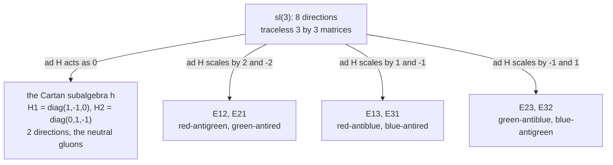

# The Killing form and roots: a Lie algebra split into directions that a torus scales

[Syllabus](../../../SYLLABUS.md) → [Differential geometry and Lie groups](../README.md) → [Roots, Weights and Representations](../README.md#s08) → The Killing form and roots

---

## General Overview

The strong force holds quarks together inside every proton. Its symmetry group is SU(3): the 3 by 3 complex matrices that keep lengths and have determinant 1. They act on a quark's three colours, red, green and blue. The group's Lie algebra (its space of velocities at the identity, [Lie algebra](../06-Lie%20Groups/02-lie-algebras-and-the-exponential-map.md)) has dimension 8. Each of the eight directions is one gluon, the particle that carries the force.

Eight directions in one heap are hard to study. This card splits them into pieces that behave simply. The tool is a **torus**: the diagonal matrices in the group, which only turn each colour's phase. Conjugate a gluon direction X by a torus element t (form $`t X t^{-1}`$) and six of the eight come back unchanged except for one scale factor each: a phase, a complex number of size 1. The other two do not move at all.

Write the torus element's three colour phases as angles $`\theta_1`$, $`\theta_2`$, $`\theta_3`$. The gluon that carries colour i and anticolour j then turns by the angle $`\theta_i - \theta_j`$. That rule, from the torus angles to the gluon's angle, is the gluon's **root**. In physics it is the gluon's colour charge. At the test matrix H = diag(1, −1, 0) (the diagonal matrix with entries 1, −1, 0) the red-antigreen gluon's root takes the value 2, and 8 = 2 + 6: two directions that do not move, and six with roots.

A second tool decides whether such a split exists at all. The **Killing form** is a symmetric pairing (a rule that takes two directions and gives one number, the same in either order) built from the algebra alone. Unlike a dot product, it can be negative. For these matrices it is 6 times the trace of the product. $`H^2`$ = diag(1, 1, 0) has trace 2, so H paired with itself gives 6 × 2 = 12. An algebra is **semisimple** when it has no solvable part (defined in Why it works); that is what the clean split needs. **Cartan's criterion** says an algebra is semisimple exactly when this form has no blind direction: no nonzero direction that pairs to zero with everything.

**The Killing form tests whether a Lie algebra is semisimple; when it is, a maximal torus acts on the algebra by commuting scalings, and the algebra splits into the torus's own directions plus one line for each root.**

**What kind of fact this is:** definitions (the Killing form, semisimple, Cartan subalgebra, root), a theorem stated with its easy half proved on this card in Why it works (Cartan's criterion), and a theorem proved here for sl(3) by direct computation and stated in general (the root space decomposition). The general proofs are in Humphreys, sections 4, 5 and 8.

### The picture: eight gluons, split by one diagonal matrix



Each arrow is labelled with the scale factor that H = diag(1, −1, 0) gives. The roots are the full rules behind those numbers, below.

---

## The formula

Notation first, in words. The algebra here is **sl(3)**: all 3 by 3 matrices whose diagonal adds to zero (whose **trace** is zero). It is the complex form of su(3), the gluon algebra: su(3) is the part where the matrix times i is Hermitian, and both have the same eight directions. Write $`\mathfrak{g}`$ for a Lie algebra and $`X`$, $`Y`$ for members of it. The **bracket** is $`[X, Y] = XY - YX`$.

The map $`\mathrm{ad}\,X`$ ("ad X") sends each $`Y`$ to $`[X, Y]`$. It is a linear map of the 8-dimensional space sl(3) to itself, so it is an 8 by 8 matrix once a basis is chosen. The **Killing form** multiplies two such matrices and takes the trace:

```math
B(X, Y) = \mathrm{tr}\,(\mathrm{ad}\,X\; \mathrm{ad}\,Y) \qquad\text{and, for } \mathfrak{sl}(3),\qquad B(X, Y) = 6\,\mathrm{tr}(XY)
```

**Read it aloud:** the Killing form of X and Y is the trace of ad X followed by ad Y; for sl(3) that is six times the trace of the matrix product.

For H = diag(1, −1, 0): $`H^2`$ = diag(1, 1, 0), trace 2, so $`B(H, H) = 12`$.

The **Cartan subalgebra** $`\mathfrak{h}`$ of sl(3) is the traceless diagonal matrices, with diagonal entries $`h_1`$, $`h_2`$, $`h_3`$. Write $`E_{ij}`$ for the matrix with a 1 in row i, column j and zeros elsewhere. Then

```math
[H, E_{ij}] = (h_i - h_j)\,E_{ij}, \qquad \mathfrak{sl}(3) = \mathfrak{h} \oplus \bigoplus_{i \ne j} \mathbb{C}\,E_{ij}, \qquad 8 = 2 + 6
```

**Read it aloud:** bracketing H with the unit matrix E i j only scales it, by h i minus h j; so sl(3) is the diagonal part plus six lines, one through each E i j.

The rule $`\alpha(H) = h_i - h_j`$ is a linear function of H: the **root** of $`E_{ij}`$, written $`e_i - e_j`$, where $`e_i(H) = h_i`$ reads off the i-th diagonal entry. The set of roots is $`\Phi`$. In general the decomposition reads $`\mathfrak{g} = \mathfrak{h} \oplus \bigoplus_{\alpha \in \Phi} \mathfrak{g}_\alpha`$, where the **root space** $`\mathfrak{g}_\alpha`$ is everything that every H scales by $`\alpha(H)`$.

Letters said once: B is the binormal on shelf 01 and E is the first fundamental form on shelf 02; here B is the Killing form and $`E_{ij}`$ a matrix unit. H here is a diagonal matrix, not a Hamiltonian or mean curvature. Physicists write hypercharge as Y; this card writes y, since Y is a member of the algebra.

| Symbol | Plain meaning | In our example | Push it up and the answer… |
| --- | --- | --- | --- |
| $`\mathfrak{g}`$; $`X`$, $`Y`$; $`I`$ | a Lie algebra; two of its members; the identity matrix. Here sl(3); also gl(3), all 3 by 3 matrices, and $`\mathfrak{b}`$, the upper triangular ones | sl(3), dimension 8 | a bigger algebra has more roots |
| $`[X, Y]`$; $`\mathfrak{a}`$ | the bracket $`XY - YX`$; an ideal, a subspace the bracket keeps inside itself | $`[E_{12}, E_{21}]`$ = diag(1, −1, 0) | — |
| $`\mathrm{ad}\,X`$ | the map $`Y \mapsto [X, Y]`$, an 8 by 8 matrix on sl(3) | ad H is diagonal | — |
| $`B(X, Y)`$; $`\mathrm{tr}`$ | the Killing form; the trace, the sum of the diagonal | $`B(H, H) = 12`$ | doubling X doubles B |
| $`\mathfrak{h}`$; $`H`$; $`h_i`$ | the Cartan subalgebra; a member of it; its diagonal entries | traceless diagonals; diag(1, −1, 0) | — |
| $`H_1`$, $`H_2`$ | a basis of $`\mathfrak{h}`$ | diag(1, −1, 0), diag(0, 1, −1) | — |
| $`E_{ij}`$ | 1 in row i, column j, zeros elsewhere: the gluon carrying colour i and anticolour j | $`E_{12}`$, red-antigreen | — |
| $`\alpha`$, $`e_i - e_j`$; $`\Phi`$ | a root, the linear function $`H \mapsto h_i - h_j`$; the set of all six | $`(e_1 - e_2)(H) = 2`$ | a bigger H, bigger root values |
| $`\mathfrak{g}_\alpha`$; $`\mathbb{C}E_{ij}`$ | the root space: directions every H scales by $`\alpha(H)`$; the complex multiples of $`E_{ij}`$ | the line through $`E_{12}`$ | — |
| $`t`$; $`t_i`$, $`\theta_i`$ | a torus element, a diagonal matrix of determinant 1; its entries, or their phase angles in SU(3) | $`2^H`$ = diag(2, 1/2, 1) | scales $`E_{ij}`$ by $`2^{\alpha(H)}`$ |
| $`e`$, $`f`$, $`h_\alpha`$; $`t_\alpha`$; $`(\alpha, \beta)`$ | the sl(2) inside root α: $`E_{ij}`$, $`E_{ji}`$, $`E_{ii} - E_{jj}`$; the member of $`\mathfrak{h}`$ standing for α; the Killing form carried over to roots | $`(\alpha, \alpha) = 1/3`$ | — |
| $`T_a`$; $`T_3`$, $`y`$; $`C_A`$ | physicists' gluon generators; isospin and hypercharge; the Killing form on one generator | $`B(T_a, T_a) = 3`$ | — |

### When it holds

- **Characteristic zero: complex or real numbers.** Cartan's criterion uses that zero traces force nilpotence: if tr(XY) = 0 for every Y in a suitable family, then X is nilpotent (some power of it is zero). Over the integers mod p this fails: on a p-dimensional space the identity has tr(I I) = p, which is 0 mod p, yet no power of I is zero.
- **A semisimple algebra.** Drop it and the form goes blind. gl(3) has a centre: the identity I commutes with everything, so ad I = 0 and $`B(I, X) = 0`$ for every X; the 9 by 9 determinant is 0.
- **A Cartan subalgebra, not just any diagonal element.** The test element must be **regular** (all root values nonzero). The singular diag(1, 1, −2) gives $`h_1 - h_2 = 0`$, so its zero part has dimension 4, and it is not abelian.
- **Complex scalars for the full split.** In real su(3) the torus turns phases, so ad H has eigenvalues $`\pm i(h_i - h_j)`$ and no real eigenvectors off the diagonal. The split needs the complex algebra sl(3), or the real sl(3) with real diagonal H, as here.
- **Local algebra, global group.** The split is a fact about the Lie algebra. It holds for SU(3) and for SU(3) divided by its centre alike: both have the same algebra.

---

## Why it works

### Step 0: commuting diagonalisable maps share eigenvectors

The torus is abelian: diagonal matrices commute. So the maps ad H, for H in $`\mathfrak{h}`$, commute with each other. Each one is diagonalisable. Commuting diagonalisable matrices can be diagonalised by one basis together ([Diagonalisation](../../03-Algebra/07-Eigenvalues%20and%20Symmetric%20Matrices/03-diagonalisation-and-matrix-powers.md)). That common eigenbasis is the root decomposition, and each eigenvalue, read as a function of H, is a root.

The Killing form is the referee. It decides whether such a torus is big enough to see the whole algebra.

### Step 1: the torus scales each E_ij

Take a diagonal matrix $`t`$ = diag($`t_1`$, $`t_2`$, $`t_3`$). Conjugating, $`t E_{ij} t^{-1}`$ multiplies row i by $`t_i`$ and column j by $`1/t_j`$, so

```math
t\,E_{ij}\,t^{-1} = \frac{t_i}{t_j}\,E_{ij}
```

**Read it aloud:** the torus element scales the unit matrix E i j by the ratio of its i-th and j-th diagonal entries.

Put $`t = 2^H`$, the diagonal matrix with entries $`2^{h_i}`$. Then the scale is $`2^{h_i - h_j}`$. For H = diag(1, −1, 0), $`t`$ = diag(2, 1/2, 1) and $`E_{12}`$ is scaled by 4 = $`2^2`$. This $`t`$ is not in SU(3), whose diagonal entries all have size 1. It lies in the complex torus: all diagonal complex matrices of determinant 1. Its real entries keep the arithmetic exact, and the exponent is the same. In SU(3) the torus is diag($`e^{i\theta_1}`$, $`e^{i\theta_2}`$, $`e^{i\theta_3}`$), and $`E_{ij}`$ turns by the phase $`e^{i(\theta_i - \theta_j)}`$. The same exponent appears either way.

Differentiating the scale at the identity gives the bracket: $`[H, E_{ij}] = (h_i - h_j)E_{ij}`$. A diagonal H commutes with every diagonal matrix, so $`\mathfrak{h}`$ gets eigenvalue 0. That is the whole split: two zero directions, six root directions.

### Step 2: the Killing form is invariant

Since ad is a Lie algebra map, $`\mathrm{ad}[X, Y] = \mathrm{ad}\,X\,\mathrm{ad}\,Y - \mathrm{ad}\,Y\,\mathrm{ad}\,X`$. The trace does not change when a product is cycled. Together these give

```math
B([X, Y], Z) = B(X, [Y, Z])
```

**Read it aloud:** moving the bracket from the left slot to the right slot leaves the Killing form unchanged.

Invariance makes root spaces pair only with their opposites. Take $`x`$ in $`\mathfrak{g}_\alpha`$ and $`y`$ in $`\mathfrak{g}_\beta`$. Then $`\alpha(H)B(x, y) = B([H, x], y) = -B(x, [H, y]) = -\beta(H)B(x, y)`$. So $`B(x, y) = 0`$ unless $`\alpha + \beta = 0`$. On sl(3): $`B(E_{12}, E_{21}) = 6`$ and $`B(E_{12}, E_{12}) = 0`$.

### Step 3: why the factor is 6

For diagonal H, ad H is diagonal with entries $`h_i - h_j`$ on the six $`E_{ij}`$ and 0 on $`\mathfrak{h}`$. Squaring and adding gives the trace:

```math
B(H, H) = \sum_{i \ne j} (h_i - h_j)^2 = 4 + 4 + 1 + 1 + 1 + 1 = 12 = 6\,\mathrm{tr}(H^2)
```

**Read it aloud:** the Killing form of H with itself is the sum of the squares of its six root values, here 12, which is six times the trace of H squared.

<details>
<summary>Detailed proof: the sum of root squares is 6 tr(H²) for any traceless diagonal H</summary>

Expand the square and count. Each $`h_i^2`$ appears in 4 of the 6 ordered pairs, and each ordered pair also contributes $`-2h_ih_j`$:

$`\displaystyle \sum_{i \ne j} (h_i - h_j)^2 = 4 \sum_i h_i^2 - 2 \sum_{i \ne j} h_i h_j = 6 \sum_i h_i^2 - 2 \Big(\sum_i h_i\Big)^2`$

The trace is zero, so the last term vanishes and the sum is $`6 \sum_i h_i^2 = 6\,\mathrm{tr}(H^2)`$. For every pair of matrices, not only diagonal ones, sl(3) is simple (no ideals but 0 and itself), so every invariant form on it is a multiple of one form. Both B and tr(XY) are invariant, and they agree on H with factor 6, so $`B = 6\,\mathrm{tr}(XY)`$ everywhere. The code also checks this pair by pair on all 64 basis pairs.

</details>

### Step 4: Cartan's criterion

Three words first. An **ideal** is a subspace $`\mathfrak{a}`$ with $`[X, a]`$ in $`\mathfrak{a}`$ for every X and every $`a`$ in $`\mathfrak{a}`$. An algebra is **solvable** when bracketing it with itself, again and again, reaches 0: the upper triangular $`\mathfrak{b}`$ goes to the strictly upper triangular matrices, then to the single corner $`E_{13}`$, then to 0. An algebra is **semisimple** when it has no nonzero solvable ideal.

**Cartan's criterion:** over the complex or real numbers, $`\mathfrak{g}`$ is semisimple exactly when B is **nondegenerate**: no nonzero X has $`B(X, Y) = 0`$ for all Y. In a basis, that means the matrix of all pairings has nonzero determinant. In the basis $`E_{ij}`$, $`H_1`$, $`H_2`$ of sl(3) that determinant is −5038848. Another basis multiplies it by the square of the change-of-basis determinant, so its size and even its sign belong to the basis: scaling $`E_{12}`$ by $`\sqrt{-1}`$ multiplies it by −1. Only the fact that it is nonzero belongs to sl(3).

The half "nondegenerate implies semisimple" fits here.

<details>
<summary>Detailed proof: a nondegenerate Killing form leaves no room for a solvable ideal</summary>

Suppose $`\mathfrak{g}`$ has a nonzero solvable ideal. The last nonzero step of its bracket chain is an ideal $`\mathfrak{a}`$ that is abelian: $`[a, a'] = 0`$ inside it.

Take $`x`$ in $`\mathfrak{a}`$ and any $`y`$. The map $`\mathrm{ad}\,x\,\mathrm{ad}\,y`$ sends all of $`\mathfrak{g}`$ into $`\mathfrak{a}`$, since $`\mathfrak{a}`$ is an ideal. It sends $`\mathfrak{a}`$ to 0, since $`[x, \mathfrak{a}] = 0`$. So applying it twice gives 0:

$`\displaystyle (\mathrm{ad}\,x\,\mathrm{ad}\,y)^2 = 0`$

A matrix whose square is 0 has only the eigenvalue 0, so its trace is 0. That trace is $`B(x, y)`$. So $`B(x, y) = 0`$ for all $`y`$: $`x`$ is a blind direction. A nondegenerate form has none, so no such ideal exists.

The other half, semisimple implies nondegenerate, needs **Cartan's solvability criterion**: $`\mathfrak{g}`$ is solvable exactly when $`B(X, Y) = 0`$ for every X in $`\mathfrak{g}`$ and Y in $`[\mathfrak{g}, \mathfrak{g}]`$. Its proof rests on Lie's theorem (a solvable complex algebra of matrices can be put in upper triangular form in one basis) and Engel's theorem (an algebra of nilpotent maps can be put in strictly upper triangular form). This card states those and does not prove them; Humphreys proves all three in sections 3 and 4.

</details>

### Step 5: the diagonal matrices are a Cartan subalgebra

A **Cartan subalgebra** of a semisimple algebra is a **maximal toral subalgebra**: abelian, with every ad H diagonalisable, and not inside a larger one with both properties. For sl(3) the traceless diagonals qualify. The test: the regular H = diag(1, −1, 0) commutes with nothing outside $`\mathfrak{h}`$. Its zero eigenspace, the **centralizer**, has dimension exactly 2. The rank of sl(3), the dimension of its Cartan subalgebra, is 2.

Every Cartan subalgebra of a complex semisimple algebra is conjugate to every other (Humphreys, section 16), so the roots do not depend on the choice.

### Step 6: each root carries a copy of sl(2)

For each root, $`e = E_{ij}`$, $`f = E_{ji}`$ and $`h_\alpha = [e, f] = E_{ii} - E_{jj}`$ satisfy $`[h_\alpha, e] = 2e`$ and $`[h_\alpha, f] = -2f`$. Those are the brackets of sl(2), the algebra of 2 by 2 traceless matrices ([Representations of sl(2)](01-representations-of-sl2.md)). So sl(3) holds three such copies, one for each pair $`\pm\alpha`$. The sl(2) card's whole-number eigenvalues then apply to each copy, so every root takes a whole-number value on every $`h_\alpha`$.

### Step 7: the Killing form measures the roots

Nondegeneracy lets each root α be written as a member $`t_\alpha`$ of $`\mathfrak{h}`$ with $`B(t_\alpha, H) = \alpha(H)`$. For sl(3), $`t_\alpha = 2h_\alpha / B(h_\alpha, h_\alpha)`$. Then $`(\alpha, \beta) = B(t_\alpha, t_\beta)`$ gives every root the squared length 1/3. For $`\alpha = e_1 - e_2`$ and $`\beta = e_2 - e_3`$, $`(\alpha, \beta) = -1/6`$, so the cosine of the angle is −1/2: 120° ($`2\pi/3`$ radians). Those lengths and angles are the data of [Root systems and Dynkin diagrams](03-root-systems-and-dynkin-diagrams.md).

---

## Worked numbers, by hand

| Step | Arithmetic | Value |
| --- | --- | --- |
| dimension of sl(3) | 9 entries, minus 1 for trace zero | 8 |
| $`B(H, H)`$ for H = diag(1, −1, 0) | 6 × tr(diag(1, 1, 0)) = 6 × 2 | **12** |
| the same, by root squares | 4 + 4 + 1 + 1 + 1 + 1 | 12 |
| $`B(H_1, H_2)`$ | 6 × tr(diag(0, −1, 0)) | −6 |
| $`B(E_{12}, E_{21})`$, $`B(E_{12}, E_{12})`$ | 6 × tr($`E_{11}`$), 6 × tr(0) | 6, 0 |
| each $`E_{ij}`$, $`E_{ji}`$ block | $`\begin{vmatrix} 0 & 6 \\ 6 & 0 \end{vmatrix}`$ | −36 |
| the $`\mathfrak{h}`$ block | 12 × 12 − (−6)² | 108 |
| determinant in the basis $`E_{ij}`$, $`H_1`$, $`H_2`$, Cartan's test | (−36)³ × 108 = −46656 × 108 | **−5038848**, not 0 |
| roots of $`E_{12}`$, $`E_{13}`$, $`E_{23}`$ at H | 1 − (−1), 1 − 0, −1 − 0 | 2, 1, −1 |
| the torus $`2^H`$ = diag(2, 1/2, 1) on $`E_{12}`$ | 2 ÷ (1/2) | 4 = $`2^2`$ |
| centralizer of H | 8 − 6 nonzero root values | 2 |
| $`(\alpha, \alpha)`$, $`(\alpha, \beta)`$ | 4/12, 4 × (−6)/(12 × 12) | 1/3, −1/6 |
| angle between neighbouring roots | cos = (−1/6)/(1/3) | **−1/2, 120°** |

The determinant is not zero, so sl(3) is semisimple, and its eight gluons split as 2 neutral plus 6 charged, each charged one scaled by its own root.

### What breaks if you drop a piece

| Mistake | Comes out at | What went wrong |
| --- | --- | --- |
| Using tr(XY) as the Killing form | $`B(H, H)`$ = 2 | The trace form is a different multiple; squared root lengths come out 6 times too big, though angles do not change |
| Testing gl(3) instead of sl(3) | determinant 0; $`B(I, X) = 0`$ for all 9 basis X | The identity is a centre, a solvable ideal, so gl(3) is not semisimple |
| Testing the upper triangular $`\mathfrak{b}`$ | determinant 0; $`B(\mathfrak{b}, [\mathfrak{b}, \mathfrak{b}]) = 0`$ | $`\mathfrak{b}`$ is solvable: Cartan's solvability criterion, not semisimplicity |
| Splitting by the singular diag(1, 1, −2) | zero part of dimension 4, with $`[E_{12}, E_{21}] \ne 0`$ | One root vanishes on it, so the zero part is not a Cartan subalgebra |

The code prints all four.

---

## Code, from first principles, and it actually runs

The code builds sl(3) as eight 3 by 3 matrices in exact fractions. It writes every bracket into the basis by its own elimination routine, so each ad X is an honest 8 by 8 matrix, and it gets the Killing form as a trace of two of those. It takes four independent roads. The Killing form is checked by brute force against 6 tr(XY) and against the sum of root squares. The determinant is checked by elimination against the block formula. Each root is checked as an ad eigenvalue against the scale from conjugating by the torus element $`2^H`$. Integer counts (dimensions, the number of roots) are asserted equal, since exactness is the point.

### Python

```python
# The Killing form and roots -- the check behind the card.  Only fractions is
# imported, for exact rational arithmetic.  The algebra is sl(3): traceless 3 by 3
# matrices, the eight gluon directions of the strong force.  The Killing form is
# computed by brute force from 8 by 8 ad matrices and checked against 6 tr(XY)
# and against a sum over roots; roots come from ad(H) and from conjugating by
# a torus element; Cartan's criterion is tested by exact determinants.
from fractions import Fraction as F

def E(i, j): return [[F(int(r == i and c == j)) for c in range(3)] for r in range(3)]
def diag(*d): return [[F(d[r]) if r == c else F(0) for c in range(3)] for r in range(3)]
def mul(a, b): return [[sum(a[r][k] * b[k][c] for k in range(len(b))) for c in range(len(b[0]))] for r in range(len(a))]
def add(a, b, s=1): return [[a[r][c] + s * b[r][c] for c in range(len(a[0]))] for r in range(len(a))]
def br(a, b): return add(mul(a, b), mul(b, a), -1)                  # the bracket [a, b] = ab - ba
def tr(a): return sum(a[i][i] for i in range(len(a)))
def flat(a): return [x for r in a for x in r]
def yn(c): return "yes" if c else "no"

def solve(cols, v):              # coordinates of v in the span of cols, by exact elimination
    n, m = len(cols), len(v)
    rows = [[cols[j][i] for j in range(n)] + [v[i]] for i in range(m)]
    piv, r = [], 0
    for c in range(n):
        p = next((i for i in range(r, m) if rows[i][c] != 0), None)
        if p is None: continue
        rows[r], rows[p] = rows[p], rows[r]
        rows[r] = [x / rows[r][c] for x in rows[r]]
        for i in range(m):
            if i != r and rows[i][c] != 0:
                rows[i] = [x - rows[i][c] * y for x, y in zip(rows[i], rows[r])]
        piv.append(c); r += 1
    assert all(rows[i][n] == 0 for i in range(r, m)), "bracket left the span"
    out = [F(0)] * n
    for i, c in enumerate(piv): out[c] = rows[i][n]
    return out

def ad(x, basis):                # the matrix of ad x = [x, .] in the given basis
    image = [solve([flat(b) for b in basis], flat(br(x, b))) for b in basis]
    return [[image[j][i] for j in range(len(basis))] for i in range(len(basis))]

def killing(x, y, basis): return tr(mul(ad(x, basis), ad(y, basis)))
def gram(basis): return [[killing(a, b, basis) for b in basis] for a in basis]

def reduce(m):                   # row-reduce a copy: (determinant, kernel dimension)
    m, d, r, free = [row[:] for row in m], F(1), 0, 0
    for c in range(len(m[0])):
        p = next((i for i in range(r, len(m)) if m[i][c] != 0), None)
        if p is None: free += 1; d = F(0); continue
        if p != r: m[r], m[p], d = m[p], m[r], -d
        d *= m[r][c]
        for i in range(len(m)):
            if i != r: m[i] = [x - m[i][c] / m[r][c] * y for x, y in zip(m[i], m[r])]
        r += 1
    return d, free

pairs = [(0, 1), (0, 2), (1, 0), (1, 2), (2, 0), (2, 1)]
name = {p: f"E{p[0]+1}{p[1]+1}" for p in pairs}
H1, H2, S = diag(1, -1, 0), diag(0, 1, -1), diag(1, 1, -2)
sl3 = [E(*p) for p in pairs] + [H1, H2]
G = gram(sl3)
six = all(G[i][j] == 6 * tr(mul(a, b)) for i, a in enumerate(sl3) for j, b in enumerate(sl3))
print("sl(3): dimension", len(sl3), "= 2 diagonal + 6 off-diagonal")
print("B(X,Y) = tr(ad X ad Y) by 8x8 ad matrices equals 6 tr(XY) on all 64 basis pairs:", yn(six))
print("B(H1,H1) =", G[6][6], " B(H2,H2) =", G[7][7], " B(H1,H2) =", G[6][7], " B(E12,E21) =", G[0][2], " B(E12,E12) =", G[0][0])
dG = reduce(G)[0]
print("Cartan's criterion: det of the 8x8 Killing matrix =", dG, "-> semisimple:", yn(dG != 0))
hb = G[6][6] * G[7][7] - G[6][7] ** 2
print("by blocks: three E_ij, E_ji pairs give", G[0][2] * G[2][0] * -1, "each, the H block", hb, ":", F(-36) ** 3, "x", hb, "=", F(-36) ** 3 * hb)
adH = ad(H1, sl3)
print("ad(H) for H = diag(1,-1,0) is diagonal in this basis:", yn(all(adH[i][j] == 0 for i in range(8) for j in range(8) if i != j)))
t, t_inv = diag(2, F(1, 2), 1), diag(F(1, 2), 2, 1)          # the torus element 2^H, determinant 1
for k, p in enumerate(pairs):
    scale = mul(mul(t, E(*p)), t_inv)[p[0]][p[1]]
    print(f"{name[p]}: ad(H) eigenvalue {adH[k][k]}, h{p[0]+1} - h{p[1]+1} = {H1[p[0]][p[0]] - H1[p[1]][p[1]]},"
          f" torus 2^H scales it by {scale} = 2^{adH[k][k]}")
    assert scale == F(2) ** int(adH[k][k]) and adH[k][k] == H1[p[0]][p[0]] - H1[p[1]][p[1]]
print("H1, H2: ad(H) eigenvalues", adH[6][6], adH[7][7], "; so ad(H) has 8 eigenvalues but",
      sum(1 for k in range(8) if adH[k][k] != 0), "roots")
roots_sq = sum(adH[k][k] ** 2 for k in range(6))
print("B(H,H) as a sum of root squares: 4+4+1+1+1+1 =", roots_sq, "; as 6 tr(H^2) = 6 x", tr(mul(H1, H1)), "=", 6 * tr(mul(H1, H1)))
cent = [reduce(ad(h, sl3))[1] for h in (H1, S)]
print("centralizer of regular diag(1,-1,0): dimension", cent[0], "; of singular diag(1,1,-2): dimension", cent[1])
ok = all(br(E(*p), E(p[1], p[0])) == add(E(p[0], p[0]), E(p[1], p[1]), -1)
         and br(add(E(p[0], p[0]), E(p[1], p[1]), -1), E(*p)) == add(E(*p), E(*p)) for p in pairs)
print("each root gives an sl(2): [e,f] = h and [h,e] = 2e for all six:", yn(ok))
ip_aa, ip_ab = 4 / G[6][6], 4 * G[6][7] / (G[6][6] * G[7][7])
print("root lengths by the Killing form: (a,a) =", ip_aa, " (a,b) =", ip_ab, " cos =", ip_ab / ip_aa, "-> 120 degrees")
T3, Y = diag(F(1, 2), F(-1, 2), 0), diag(F(1, 3), F(1, 3), F(-2, 3))
print("gluon colour charges (T3, y):", ", ".join(f"{name[p]} ({T3[p[0]][p[0]]-T3[p[1]][p[1]]}, {Y[p[0]][p[0]]-Y[p[1]][p[1]]})" for p in pairs))
T1 = add(E(0, 1), E(1, 0))
CA = [killing(T1, T1, sl3) / 4, killing(H1, H1, sl3) / 4, killing(S, S, sl3) / 12]   # T1, T3, T8 squared
print("B(T1,T1) =", CA[0], " B(T3,T3) =", CA[1], " B(T8,T8) =", CA[2], "= C_A, the 3 of three colours")
NF = 6                                                                               # quark flavours
print("QCD beta0 = 11 C_A/3 - 2 n_f/3 with n_f =", NF, "flavours:", F(11) * CA[2] / 3 - F(2) * NF / 3)
gl3 = [E(i, j) for i in range(3) for j in range(3)]
b3 = [E(i, j) for i in range(3) for j in range(3) if i <= j]
n3 = [E(i, j) for i in range(3) for j in range(3) if i < j]
print("mistake 1, trace form for the Killing form: tr(H^2) =", tr(mul(H1, H1)), "not", G[6][6])
print("mistake 2, gl(3): det of 9x9 Killing matrix =", reduce(gram(gl3))[0], "; B(I,X) = 0 for all 9 basis X:",
      yn(all(killing(diag(1, 1, 1), x, gl3) == 0 for x in gl3)))
print("mistake 3, upper triangular b: det of 6x6 Killing matrix =", reduce(gram(b3))[0], "; B(b,[b,b]) = 0, solvable:",
      yn(all(killing(x, y, b3) == 0 for x in b3 for y in n3)))
print("mistake 4, splitting by singular diag(1,1,-2): zero part of dimension", cent[1],
      "; it holds [E12,E21] = diag(1,-1,0), not 0:", yn(br(E(0, 1), E(1, 0)) == H1))
assert six and dG == -5038848 == F(-36) ** 3 * hb                                  # brute force against block formula
assert roots_sq == G[6][6] == 6 * tr(mul(H1, H1)) == 12                              # three roads to 12
assert cent == [2, 4] and ok and ip_ab / ip_aa == F(-1, 2) and CA == [3, 3, 3]
assert reduce(gram(gl3))[0] == 0 and reduce(gram(b3))[0] == 0
print("ALL CHECKS PASS")
```

**Ran 2026-11-24 on macOS, Python 3.14.10, standard library only. All checks passed. Output, pasted from the run:**

```
sl(3): dimension 8 = 2 diagonal + 6 off-diagonal
B(X,Y) = tr(ad X ad Y) by 8x8 ad matrices equals 6 tr(XY) on all 64 basis pairs: yes
B(H1,H1) = 12  B(H2,H2) = 12  B(H1,H2) = -6  B(E12,E21) = 6  B(E12,E12) = 0
Cartan's criterion: det of the 8x8 Killing matrix = -5038848 -> semisimple: yes
by blocks: three E_ij, E_ji pairs give -36 each, the H block 108 : -46656 x 108 = -5038848
ad(H) for H = diag(1,-1,0) is diagonal in this basis: yes
E12: ad(H) eigenvalue 2, h1 - h2 = 2, torus 2^H scales it by 4 = 2^2
E13: ad(H) eigenvalue 1, h1 - h3 = 1, torus 2^H scales it by 2 = 2^1
E21: ad(H) eigenvalue -2, h2 - h1 = -2, torus 2^H scales it by 1/4 = 2^-2
E23: ad(H) eigenvalue -1, h2 - h3 = -1, torus 2^H scales it by 1/2 = 2^-1
E31: ad(H) eigenvalue -1, h3 - h1 = -1, torus 2^H scales it by 1/2 = 2^-1
E32: ad(H) eigenvalue 1, h3 - h2 = 1, torus 2^H scales it by 2 = 2^1
H1, H2: ad(H) eigenvalues 0 0 ; so ad(H) has 8 eigenvalues but 6 roots
B(H,H) as a sum of root squares: 4+4+1+1+1+1 = 12 ; as 6 tr(H^2) = 6 x 2 = 12
centralizer of regular diag(1,-1,0): dimension 2 ; of singular diag(1,1,-2): dimension 4
each root gives an sl(2): [e,f] = h and [h,e] = 2e for all six: yes
root lengths by the Killing form: (a,a) = 1/3  (a,b) = -1/6  cos = -1/2 -> 120 degrees
gluon colour charges (T3, y): E12 (1, 0), E13 (1/2, 1), E21 (-1, 0), E23 (-1/2, 1), E31 (-1/2, -1), E32 (1/2, -1)
B(T1,T1) = 3  B(T3,T3) = 3  B(T8,T8) = 3 = C_A, the 3 of three colours
QCD beta0 = 11 C_A/3 - 2 n_f/3 with n_f = 6 flavours: 7
mistake 1, trace form for the Killing form: tr(H^2) = 2 not 12
mistake 2, gl(3): det of 9x9 Killing matrix = 0 ; B(I,X) = 0 for all 9 basis X: yes
mistake 3, upper triangular b: det of 6x6 Killing matrix = 0 ; B(b,[b,b]) = 0, solvable: yes
mistake 4, splitting by singular diag(1,1,-2): zero part of dimension 4 ; it holds [E12,E21] = diag(1,-1,0), not 0: yes
ALL CHECKS PASS
```

### Rust

Same numbers, same labels, built with `rustc --edition 2021 -O`. Fractions are a small struct of two 128-bit integers.

```rust
// The Killing form and roots -- the same check as the Python, in Rust.  No
// crates.  The algebra is sl(3): traceless 3 by 3 matrices, the eight gluon
// directions of the strong force.  Exact fractions are a small struct below.
// The Killing form comes from 8 by 8 ad matrices and is checked against 6 tr(XY)
// and a sum over roots; roots come from ad(H) and from a torus element.
use std::ops::{Add, Div, Mul, Neg, Sub};

#[derive(Clone, Copy, PartialEq, Debug)]
struct Q(i128, i128);                                // numerator, denominator > 0, lowest terms
fn gcd(a: i128, b: i128) -> i128 { if b == 0 { a.abs() } else { gcd(b, a % b) } }
fn q(n: i128, d: i128) -> Q { let g = gcd(n, d).max(1) * d.signum(); Q(n / g, d / g) }
impl Add for Q { type Output = Q; fn add(self, o: Q) -> Q { q(self.0 * o.1 + o.0 * self.1, self.1 * o.1) } }
impl Sub for Q { type Output = Q; fn sub(self, o: Q) -> Q { self + (-o) } }
impl Neg for Q { type Output = Q; fn neg(self) -> Q { Q(-self.0, self.1) } }
impl Mul for Q { type Output = Q; fn mul(self, o: Q) -> Q { q(self.0 * o.0, self.1 * o.1) } }
impl Div for Q { type Output = Q; fn div(self, o: Q) -> Q { q(self.0 * o.1, self.1 * o.0) } }
impl std::fmt::Display for Q {
    fn fmt(&self, f: &mut std::fmt::Formatter) -> std::fmt::Result {
        if self.1 == 1 { write!(f, "{}", self.0) } else { write!(f, "{}/{}", self.0, self.1) }
    }
}
const Z: Q = Q(0, 1);
fn n(x: i128) -> Q { Q(x, 1) }
type M = Vec<Vec<Q>>;
fn e(i: usize, j: usize) -> M { (0..3).map(|r| (0..3).map(|c| n((r == i && c == j) as i128)).collect()).collect() }
fn diag(d: [Q; 3]) -> M { (0..3).map(|r| (0..3).map(|c| if r == c { d[r] } else { Z }).collect()).collect() }
fn mul(a: &M, b: &M) -> M {
    (0..a.len()).map(|r| (0..b[0].len()).map(|c| (0..b.len()).fold(Z, |s, k| s + a[r][k] * b[k][c])).collect()).collect()
}
fn add(a: &M, b: &M, s: Q) -> M { a.iter().zip(b).map(|(x, y)| x.iter().zip(y).map(|(u, v)| *u + s * *v).collect()).collect() }
fn br(a: &M, b: &M) -> M { add(&mul(a, b), &mul(b, a), n(-1)) }       // the bracket [a, b] = ab - ba
fn tr(a: &M) -> Q { (0..a.len()).fold(Z, |s, i| s + a[i][i]) }
fn flat(a: &M) -> Vec<Q> { a.iter().flatten().copied().collect() }
fn yn(c: bool) -> &'static str { if c { "yes" } else { "no" } }

fn solve(cols: &[Vec<Q>], v: &[Q]) -> Vec<Q> {      // coordinates of v in the span of cols
    let (nc, m) = (cols.len(), v.len());
    let mut rows: Vec<Vec<Q>> = (0..m).map(|i| { let mut r: Vec<Q> = cols.iter().map(|c| c[i]).collect(); r.push(v[i]); r }).collect();
    let (mut piv, mut r) = (vec![], 0);
    for c in 0..nc {
        let p = match (r..m).find(|&i| rows[i][c] != Z) { Some(p) => p, None => continue };
        rows.swap(r, p);
        let lead = rows[r][c];
        rows[r] = rows[r].iter().map(|&x| x / lead).collect();
        for i in 0..m {
            let f = rows[i][c];
            if i != r && f != Z { rows[i] = (0..=nc).map(|k| rows[i][k] - f * rows[r][k]).collect() }
        }
        piv.push(c); r += 1;
    }
    assert!((r..m).all(|i| rows[i][nc] == Z), "bracket left the span");
    let mut out = vec![Z; nc];
    for (i, &c) in piv.iter().enumerate() { out[c] = rows[i][nc] }
    out
}
fn ad(x: &M, basis: &[M]) -> M {                     // the matrix of ad x = [x, .] in the basis
    let cols: Vec<Vec<Q>> = basis.iter().map(flat).collect();
    let image: Vec<Vec<Q>> = basis.iter().map(|b| solve(&cols, &flat(&br(x, b)))).collect();
    (0..basis.len()).map(|i| (0..basis.len()).map(|j| image[j][i]).collect()).collect()
}
fn killing(x: &M, y: &M, b: &[M]) -> Q { tr(&mul(&ad(x, b), &ad(y, b))) }
fn gram(b: &[M]) -> M { b.iter().map(|x| b.iter().map(|y| killing(x, y, b)).collect()).collect() }
fn reduce(m0: &M) -> (Q, usize) {                    // row-reduce a copy: (determinant, kernel dimension)
    let (mut m, mut d, mut r, mut free) = (m0.clone(), n(1), 0, 0);
    for c in 0..m[0].len() {
        let p = match (r..m.len()).find(|&i| m[i][c] != Z) { Some(p) => p, None => { free += 1; d = Z; continue } };
        if p != r { m.swap(r, p); d = -d }
        d = d * m[r][c];
        for i in 0..m.len() {
            let f = m[i][c] / m[r][c];
            if i != r { m[i] = (0..m[0].len()).map(|k| m[i][k] - f * m[r][k]).collect() }
        }
        r += 1;
    }
    (d, free)
}

fn main() {
    let pairs = [(0, 1), (0, 2), (1, 0), (1, 2), (2, 0), (2, 1)];
    let name = |p: (usize, usize)| format!("E{}{}", p.0 + 1, p.1 + 1);
    let (h1, h2, s) = (diag([n(1), n(-1), Z]), diag([Z, n(1), n(-1)]), diag([n(1), n(1), n(-2)]));
    let mut sl3: Vec<M> = pairs.iter().map(|&(i, j)| e(i, j)).collect();
    sl3.push(h1.clone()); sl3.push(h2.clone());
    let g = gram(&sl3);
    let six = (0..8).all(|i| (0..8).all(|j| g[i][j] == n(6) * tr(&mul(&sl3[i], &sl3[j]))));
    println!("sl(3): dimension {} = 2 diagonal + 6 off-diagonal", sl3.len());
    println!("B(X,Y) = tr(ad X ad Y) by 8x8 ad matrices equals 6 tr(XY) on all 64 basis pairs: {}", yn(six));
    println!("B(H1,H1) = {}  B(H2,H2) = {}  B(H1,H2) = {}  B(E12,E21) = {}  B(E12,E12) = {}", g[6][6], g[7][7], g[6][7], g[0][2], g[0][0]);
    let dg = reduce(&g).0;
    println!("Cartan's criterion: det of the 8x8 Killing matrix = {} -> semisimple: {}", dg, yn(dg != Z));
    let hb = g[6][6] * g[7][7] - g[6][7] * g[6][7];
    println!("by blocks: three E_ij, E_ji pairs give {} each, the H block {} : {} x {} = {}", -(g[0][2] * g[2][0]), hb, n(-36) * n(-36) * n(-36), hb, n(-36) * n(-36) * n(-36) * hb);
    let adh = ad(&h1, &sl3);
    println!("ad(H) for H = diag(1,-1,0) is diagonal in this basis: {}", yn((0..8).all(|i| (0..8).all(|j| i == j || adh[i][j] == Z))));
    let (t, t_inv) = (diag([n(2), q(1, 2), n(1)]), diag([q(1, 2), n(2), n(1)]));   // the torus element 2^H
    for (k, &p) in pairs.iter().enumerate() {
        let scale = mul(&mul(&t, &e(p.0, p.1)), &t_inv)[p.0][p.1];
        let diff = h1[p.0][p.0] - h1[p.1][p.1];
        println!("{}: ad(H) eigenvalue {}, h{} - h{} = {}, torus 2^H scales it by {} = 2^{}", name(p), adh[k][k], p.0 + 1, p.1 + 1, diff, scale, adh[k][k]);
        let a = adh[k][k].0 as i32;
        assert!(scale == if a >= 0 { n(1 << a) } else { q(1, 1 << -a) } && adh[k][k] == diff);
    }
    println!("H1, H2: ad(H) eigenvalues {} {} ; so ad(H) has 8 eigenvalues but {} roots", adh[6][6], adh[7][7],
             (0..8).filter(|&k| adh[k][k] != Z).count());
    let roots_sq = (0..6).fold(Z, |acc, k| acc + adh[k][k] * adh[k][k]);
    let trh2 = tr(&mul(&h1, &h1));
    println!("B(H,H) as a sum of root squares: 4+4+1+1+1+1 = {} ; as 6 tr(H^2) = 6 x {} = {}", roots_sq, trh2, n(6) * trh2);
    let cent = [reduce(&ad(&h1, &sl3)).1, reduce(&ad(&s, &sl3)).1];
    println!("centralizer of regular diag(1,-1,0): dimension {} ; of singular diag(1,1,-2): dimension {}", cent[0], cent[1]);
    let ok = pairs.iter().all(|&(i, j)| {
        let h = add(&e(i, i), &e(j, j), n(-1));
        br(&e(i, j), &e(j, i)) == h && br(&h, &e(i, j)) == add(&e(i, j), &e(i, j), n(1))
    });
    println!("each root gives an sl(2): [e,f] = h and [h,e] = 2e for all six: {}", yn(ok));
    let (ip_aa, ip_ab) = (n(4) / g[6][6], n(4) * g[6][7] / (g[6][6] * g[7][7]));
    println!("root lengths by the Killing form: (a,a) = {}  (a,b) = {}  cos = {} -> 120 degrees", ip_aa, ip_ab, ip_ab / ip_aa);
    let (t3, y) = (diag([q(1, 2), q(-1, 2), Z]), diag([q(1, 3), q(1, 3), q(-2, 3)]));
    let charges: Vec<String> = pairs.iter().map(|&p| format!("{} ({}, {})", name(p), t3[p.0][p.0] - t3[p.1][p.1], y[p.0][p.0] - y[p.1][p.1])).collect();
    println!("gluon colour charges (T3, y): {}", charges.join(", "));
    let t1 = add(&e(0, 1), &e(1, 0), n(1));
    let ca = [killing(&t1, &t1, &sl3) / n(4), killing(&h1, &h1, &sl3) / n(4), killing(&s, &s, &sl3) / n(12)];
    println!("B(T1,T1) = {}  B(T3,T3) = {}  B(T8,T8) = {} = C_A, the 3 of three colours", ca[0], ca[1], ca[2]);
    let nf = 6;                                                     // quark flavours
    println!("QCD beta0 = 11 C_A/3 - 2 n_f/3 with n_f = {} flavours: {}", nf, n(11) * ca[2] / n(3) - n(2) * n(nf) / n(3));
    let gl3: Vec<M> = (0..9).map(|k| e(k / 3, k % 3)).collect();
    let b3: Vec<M> = (0..9).filter(|k| k / 3 <= k % 3).map(|k| e(k / 3, k % 3)).collect();
    let n3: Vec<M> = (0..9).filter(|k| k / 3 < k % 3).map(|k| e(k / 3, k % 3)).collect();
    let (dgl, db) = (reduce(&gram(&gl3)).0, reduce(&gram(&b3)).0);
    let id = diag([n(1), n(1), n(1)]);
    println!("mistake 1, trace form for the Killing form: tr(H^2) = {} not {}", trh2, g[6][6]);
    println!("mistake 2, gl(3): det of 9x9 Killing matrix = {} ; B(I,X) = 0 for all 9 basis X: {}", dgl, yn(gl3.iter().all(|x| killing(&id, x, &gl3) == Z)));
    println!("mistake 3, upper triangular b: det of 6x6 Killing matrix = {} ; B(b,[b,b]) = 0, solvable: {}", db, yn(b3.iter().all(|x| n3.iter().all(|y| killing(x, y, &b3) == Z))));
    println!("mistake 4, splitting by singular diag(1,1,-2): zero part of dimension {} ; it holds [E12,E21] = diag(1,-1,0), not 0: {}",
             cent[1], yn(br(&e(0, 1), &e(1, 0)) == h1));
    let block = n(-36) * n(-36) * n(-36) * hb;
    assert!(six && dg == n(-5038848) && dg == block);              // brute force against block formula
    assert!(roots_sq == g[6][6] && g[6][6] == n(6) * trh2 && roots_sq == n(12));   // three roads to 12
    assert!(cent == [2, 4] && ok && ip_ab / ip_aa == q(-1, 2) && ca == [n(3), n(3), n(3)]);
    assert!(dgl == Z && db == Z);
    println!("ALL CHECKS PASS");
}
```

**Ran 2026-11-24 on macOS, rustc 1.98.1, no crates. All checks passed. Output, pasted from the run:**

```
sl(3): dimension 8 = 2 diagonal + 6 off-diagonal
B(X,Y) = tr(ad X ad Y) by 8x8 ad matrices equals 6 tr(XY) on all 64 basis pairs: yes
B(H1,H1) = 12  B(H2,H2) = 12  B(H1,H2) = -6  B(E12,E21) = 6  B(E12,E12) = 0
Cartan's criterion: det of the 8x8 Killing matrix = -5038848 -> semisimple: yes
by blocks: three E_ij, E_ji pairs give -36 each, the H block 108 : -46656 x 108 = -5038848
ad(H) for H = diag(1,-1,0) is diagonal in this basis: yes
E12: ad(H) eigenvalue 2, h1 - h2 = 2, torus 2^H scales it by 4 = 2^2
E13: ad(H) eigenvalue 1, h1 - h3 = 1, torus 2^H scales it by 2 = 2^1
E21: ad(H) eigenvalue -2, h2 - h1 = -2, torus 2^H scales it by 1/4 = 2^-2
E23: ad(H) eigenvalue -1, h2 - h3 = -1, torus 2^H scales it by 1/2 = 2^-1
E31: ad(H) eigenvalue -1, h3 - h1 = -1, torus 2^H scales it by 1/2 = 2^-1
E32: ad(H) eigenvalue 1, h3 - h2 = 1, torus 2^H scales it by 2 = 2^1
H1, H2: ad(H) eigenvalues 0 0 ; so ad(H) has 8 eigenvalues but 6 roots
B(H,H) as a sum of root squares: 4+4+1+1+1+1 = 12 ; as 6 tr(H^2) = 6 x 2 = 12
centralizer of regular diag(1,-1,0): dimension 2 ; of singular diag(1,1,-2): dimension 4
each root gives an sl(2): [e,f] = h and [h,e] = 2e for all six: yes
root lengths by the Killing form: (a,a) = 1/3  (a,b) = -1/6  cos = -1/2 -> 120 degrees
gluon colour charges (T3, y): E12 (1, 0), E13 (1/2, 1), E21 (-1, 0), E23 (-1/2, 1), E31 (-1/2, -1), E32 (1/2, -1)
B(T1,T1) = 3  B(T3,T3) = 3  B(T8,T8) = 3 = C_A, the 3 of three colours
QCD beta0 = 11 C_A/3 - 2 n_f/3 with n_f = 6 flavours: 7
mistake 1, trace form for the Killing form: tr(H^2) = 2 not 12
mistake 2, gl(3): det of 9x9 Killing matrix = 0 ; B(I,X) = 0 for all 9 basis X: yes
mistake 3, upper triangular b: det of 6x6 Killing matrix = 0 ; B(b,[b,b]) = 0, solvable: yes
mistake 4, splitting by singular diag(1,1,-2): zero part of dimension 4 ; it holds [E12,E21] = diag(1,-1,0), not 0: yes
ALL CHECKS PASS
```

The two outputs match line for line.

### Lean

Lean proves Cartan's criterion and the root space decomposition in general, and the factor 6 for sl(3).

- Take a finite-dimensional Lie algebra over a field of characteristic zero, such as the real or complex numbers. Then it is semisimple exactly when its Killing form is nondegenerate.
- Take such an algebra that is semisimple, with a Cartan subalgebra $`\mathfrak{h}`$ whose maps ad H have all their eigenvalues in the field. Then the zero root space is exactly $`\mathfrak{h}`$.
- Take the same algebra, a root α, and x in $`\mathfrak{g}_\alpha`$. Then $`[H, x] = \alpha(H)\,x`$ for every H in $`\mathfrak{h}`$.
- Take the same algebra and $`\mathfrak{h}`$. Then the root spaces are independent and together fill it: $`\mathfrak{g} = \mathfrak{h} \oplus \bigoplus_{\alpha \in \Phi} \mathfrak{g}_\alpha`$.
- Take the same algebra and a nonzero root α. Then its root space $`\mathfrak{g}_\alpha`$ is a single line.
- Take any X and Y in sl(3), over any field of characteristic zero. Then $`B(X, Y) = 6\,\mathrm{tr}(XY)`$.
- Lean also checks the hand arithmetic of the worked numbers: brackets, traces, block determinants and root lengths.

The 8 by 8 determinant, centralizer sizes, colour charges and the four mistakes are left to the Python and Rust checks.

```lean
-- The Killing form and roots: over a field of characteristic zero a finite-dimensional Lie algebra has no nonzero solvable ideal exactly when its Killing form is nondegenerate, and then a split Cartan subalgebra cuts the algebra into its own directions plus one line per root, with B = 6 tr(XY) on sl(3).
import Mathlib.Algebra.Lie.CartanCriterion
import Mathlib.Algebra.Lie.Weights.Killing
import Mathlib.Algebra.Lie.Classical
import Mathlib.LinearAlgebra.Matrix.Determinant.Basic
import Mathlib.Tactic

open LieAlgebra LieModule Module

namespace KillingFormRoots

theorem stdBasis_repr_apply' {K : Type*} [Field K] (A : Matrix (Fin 3) (Fin 3) K) (i j : Fin 3) :
    (Matrix.stdBasis K (Fin 3) (Fin 3)).repr A (i, j) = A i j := by
  simp [Matrix.stdBasis]

/-- Commutator map `A ↦ Z A - A Z` on 3 by 3 matrices. -/
noncomputable def commMap {K : Type*} [Field K] (Z : Matrix (Fin 3) (Fin 3) K) :
    Matrix (Fin 3) (Fin 3) K →ₗ[K] Matrix (Fin 3) (Fin 3) K :=
  LinearMap.mulLeft K Z - LinearMap.mulRight K Z

/-- Trace of `A ↦ [X, [Y, A]]` on all 3 by 3 matrices, for traceless `X`. -/
theorem trace_commMap_comp {K : Type*} [Field K] (X Y : Matrix (Fin 3) (Fin 3) K)
    (hX : Matrix.trace X = 0) :
    LinearMap.trace K (Matrix (Fin 3) (Fin 3) K) (commMap X ∘ₗ commMap Y) =
      6 * Matrix.trace (X * Y) := by
  rw [LinearMap.trace_eq_matrix_trace K (Matrix.stdBasis K (Fin 3) (Fin 3))]
  simp only [Matrix.trace, Matrix.diag, LinearMap.toMatrix_apply, Fintype.sum_prod_type,
    Matrix.stdBasis_eq_single, stdBasis_repr_apply', LinearMap.comp_apply, commMap,
    LinearMap.sub_apply, LinearMap.mulLeft_apply, LinearMap.mulRight_apply,
    Fin.sum_univ_three, Matrix.mul_apply, Matrix.sub_apply, Matrix.single_apply] at *
  simp
  linear_combination (-2 * (Y 0 0 + Y 1 1 + Y 2 2)) * hX

#print axioms stdBasis_repr_apply'
#print axioms trace_commMap_comp

/-- **Cartan's criterion.** Over a field of characteristic zero (the complex or real numbers), a
finite-dimensional Lie algebra is semisimple, meaning it has no nonzero solvable ideal (its solvable
radical is zero), exactly when its Killing form `B(X, Y) = tr(ad X ad Y)` is nondegenerate: no
nonzero `X` pairs to zero with every `Y`. -/
theorem semisimple_iff_killingForm_nondegenerate
    {K L : Type*} [Field K] [CharZero K] [LieRing L] [LieAlgebra K L] [FiniteDimensional K L] :
    HasTrivialRadical K L ↔ (killingForm K L).Nondegenerate := by
  constructor
  · intro _
    exact IsKilling.killingForm_nondegenerate K L
  · intro h
    have : IsKilling K L := ⟨by
      ext x
      simp only [LieIdeal.mem_killingCompl, LieSubmodule.mem_top, true_implies,
        LieSubmodule.mem_bot]
      exact ⟨fun hx => h.2 x hx, by rintro rfl; simp⟩⟩
    infer_instance

/-- **Root space decomposition.** Let `L` be a finite-dimensional semisimple Lie algebra over a field
of characteristic zero, and `H` a Cartan subalgebra whose maps `ad h` have all their eigenvalues in
the field (as over the complex numbers). Then `H` is exactly the part every `ad h` kills; each root
space `𝔤_α` is scaled by every `h` in `H` by the number `α(h)`; the root spaces are independent and
together fill `L`, so `L = 𝔥 ⊕ ⨁_{α ∈ Φ} 𝔤_α`; and each root space of a nonzero root is a single
line. -/
theorem root_space_decomposition
    {K L : Type*} [Field K] [CharZero K] [LieRing L] [LieAlgebra K L] [FiniteDimensional K L]
    [HasTrivialRadical K L]
    (H : LieSubalgebra K L) [H.IsCartanSubalgebra] [IsTriangularizable K H L] :
    rootSpace H 0 = H.toLieSubmodule ∧
    (∀ (α : Weight K H L) (h : H) (x : L), x ∈ rootSpace H α → ⁅(h : L), x⁆ = α h • x) ∧
    iSupIndep (fun α : Weight K H L => rootSpace H α) ∧
    (⨆ α : Weight K H L, rootSpace H α) = ⊤ ∧
    (∀ α : Weight K H L, α.IsNonZero → finrank K (rootSpace H α) = 1) := by
  refine ⟨rootSpace_zero_eq K L H, fun α h x hx => ?_, iSupIndep_genWeightSpace' K H L,
    iSup_genWeightSpace_eq_top' K H L, fun α hα => IsKilling.finrank_rootSpace_eq_one α hα⟩
  exact IsKilling.lie_eq_smul_of_mem_rootSpace hx h

/-- **The Killing form of sl(3) is six times the trace form.** On the traceless 3 by 3 matrices,
`B(X, Y) = tr(ad X ad Y) = 6 tr(XY)`. -/
theorem killingForm_sl3_eq_six_mul_trace {K : Type*} [Field K] [CharZero K]
    (X Y : SpecialLinear.sl (Fin 3) K) :
    killingForm K (SpecialLinear.sl (Fin 3) K) X Y = 6 * Matrix.trace (X.val * Y.val) := by
  let _ : LieRing (Matrix (Fin 3) (Fin 3) K) := LieRing.ofAssociativeRing
  have hmem : ∀ A, (commMap X.val ∘ₗ commMap Y.val) A ∈
      (SpecialLinear.sl (Fin 3) K).toSubmodule := by
    intro A
    change (commMap X.val ∘ₗ commMap Y.val) A ∈ LinearMap.ker (Matrix.traceLinearMap (Fin 3) K K)
    rw [LinearMap.mem_ker, Matrix.traceLinearMap_apply]
    have := matrix_trace_commutator_zero (Fin 3) K X.val (Y.val * A - A * Y.val)
    simpa [commMap, Ring.lie_def] using this
  have hres : ad K (SpecialLinear.sl (Fin 3) K) X ∘ₗ ad K (SpecialLinear.sl (Fin 3) K) Y =
      (commMap X.val ∘ₗ commMap Y.val).restrict (fun A _ => hmem A) := by
    ext A : 1
    apply Subtype.ext
    rw [LinearMap.coe_restrict_apply]
    simp [commMap, Ring.lie_def]
  rw [killingForm_apply_apply, hres]
  exact (LinearMap.trace_restrict_eq_of_forall_mem _ _ hmem).trans
    (trace_commMap_comp X.val Y.val X.2)

/-! The card's whole-number worked examples, on integer matrices. -/

/-- The test element `H = diag(1, -1, 0)`. -/
def Hd : Matrix (Fin 3) (Fin 3) ℤ := !![1, 0, 0; 0, -1, 0; 0, 0, 0]
/-- The second basis element `H₂ = diag(0, 1, -1)` of the Cartan subalgebra. -/
def H2 : Matrix (Fin 3) (Fin 3) ℤ := !![0, 0, 0; 0, 1, 0; 0, 0, -1]
/-- Matrix units `E₁₂`, `E₂₁`, `E₁₃`, `E₂₃`. -/
def E12 : Matrix (Fin 3) (Fin 3) ℤ := !![0, 1, 0; 0, 0, 0; 0, 0, 0]
def E21 : Matrix (Fin 3) (Fin 3) ℤ := !![0, 0, 0; 1, 0, 0; 0, 0, 0]
def E13 : Matrix (Fin 3) (Fin 3) ℤ := !![0, 0, 1; 0, 0, 0; 0, 0, 0]
def E23 : Matrix (Fin 3) (Fin 3) ℤ := !![0, 0, 0; 0, 0, 1; 0, 0, 0]

-- sl(3) has dimension 9 - 1 = 8 = 2 + 6.
example : 3 * 3 - 1 = 2 + 6 := by decide
-- The roots of E₁₂, E₁₃, E₂₃ at H = diag(1, -1, 0): 2, 1, -1.
example : Hd * E12 - E12 * Hd = 2 • E12 := by decide
example : Hd * E13 - E13 * Hd = 1 • E13 := by decide
example : Hd * E23 - E23 * Hd = (-1 : ℤ) • E23 := by decide
-- B(H, H) = 6 tr(H²) = 6 × 2 = 12, and by root squares 4 + 4 + 1 + 1 + 1 + 1 = 12.
example : 6 * Matrix.trace (Hd * Hd) = 12 := by decide
example : (2 : ℤ) ^ 2 + (-2) ^ 2 + 1 ^ 2 + (-1) ^ 2 + (-1) ^ 2 + 1 ^ 2 = 12 := by decide
-- B(H₁, H₂) = 6 tr(diag(0, -1, 0)) = -6; B(E₁₂, E₂₁) = 6; B(E₁₂, E₁₂) = 0.
example : 6 * Matrix.trace (Hd * H2) = -6 := by decide
example : 6 * Matrix.trace (E12 * E21) = 6 := by decide
example : 6 * Matrix.trace (E12 * E12) = 0 := by decide
-- [E₁₂, E₂₁] = diag(1, -1, 0).
example : E12 * E21 - E21 * E12 = Hd := by decide
-- Each E_ij, E_ji block has determinant -36; the 𝔥 block 12 × 12 - (-6)² = 108.
example : Matrix.det !![(0 : ℤ), 6; 6, 0] = -36 := by norm_num [Matrix.det_fin_two]
example : Matrix.det !![(12 : ℤ), -6; -6, 12] = 108 := by norm_num [Matrix.det_fin_two]
-- Cartan's test in the basis E_ij, H₁, H₂: (-36)³ × 108 = -46656 × 108 = -5038848, not 0.
example : (-36 : ℤ) ^ 3 * 108 = -5038848 := by norm_num
example : (-36 : ℤ) ^ 3 = -46656 := by norm_num
-- The torus 2^H = diag(2, 1/2, 1) scales E₁₂ by 2 ÷ (1/2) = 4 = 2².
example : (2 : ℚ) / (1 / 2) = 2 ^ 2 := by norm_num
-- Centralizer of H: 8 - 6 nonzero root values = 2.
example : 8 - 6 = 2 := by decide
-- Root lengths: (α, α) = 4/12 = 1/3, (α, β) = 4 × (-6)/(12 × 12) = -1/6, cos = -1/2.
example : (4 : ℚ) / 12 = 1 / 3 := by norm_num
example : (4 : ℚ) * (-6) / (12 * 12) = -1 / 6 := by norm_num
example : ((-1 : ℚ) / 6) / (1 / 3) = -1 / 2 := by norm_num
-- Asymptotic freedom: 11 C_A/3 - 2 n_f/3 with C_A = 3 and n_f = 6 is 7.
example : (11 : ℚ) * 3 / 3 - 2 * 6 / 3 = 7 := by norm_num

#print axioms semisimple_iff_killingForm_nondegenerate
#print axioms root_space_decomposition
#print axioms killingForm_sl3_eq_six_mul_trace

end KillingFormRoots
```

**Checked 2026-11-24 on macOS, Lean 4.36.0-rc2, Mathlib v4.36.0-rc2. Every proof is complete and uses only Lean's standard axioms. Output, pasted from the run:**

```
'KillingFormRoots.stdBasis_repr_apply'' depends on axioms: [propext, Classical.choice, Quot.sound]
'KillingFormRoots.trace_commMap_comp' depends on axioms: [propext, Classical.choice, Quot.sound]
'KillingFormRoots.semisimple_iff_killingForm_nondegenerate' depends on axioms: [propext, Classical.choice, Quot.sound]
'KillingFormRoots.root_space_decomposition' depends on axioms: [propext, Classical.choice, Quot.sound]
'KillingFormRoots.killingForm_sl3_eq_six_mul_trace' depends on axioms: [propext, Classical.choice, Quot.sound]
```

> [!TIP]
> **Try changing**
> Guess first, then run the Python.
> - **A different test element.** Change `adH = ad(H1, sl3)` to `adH = ad(diag(1, 0, -1), sl3)`. Guess first: are the roots of $`E_{12}`$ still 2? No: it prints eigenvalue 1, while the fixed torus $`2^H`$ still scales by 4, so the assert in the loop stops the run. A root is a function of H, and each H reads off different values.
> - **A different second basis matrix.** Change `diag(0, 1, -1)` in the `H1, H2, S` line to `diag(1, 0, -1)`. Guess first: does the determinant change? No, it stays −5038848, since this change of basis has determinant 1. But $`B(H_1, H_2)`$ becomes 6 and the cosine 1/2: those two matrices belong to $`e_1 - e_2`$ and $`e_1 - e_3`$, 60° apart, so the cosine assert stops the run.
> - **A non-singular element in the place of the singular one.** Change `diag(1, 1, -2)` to `diag(1, 0, -1)`. Guess first: its centralizer has dimension 2, since all six root values are nonzero. The centralizer assert stops the run, and $`B(T_8, T_8)`$ prints 1, since the code's 1/12 factor belongs to diag(1, 1, −2).
> - **More quark flavours.** Set `NF = 17`. Guess first: the coefficient becomes −1/3, negative, so the strong force would no longer weaken at short distances.

---

## The usual mistake

> [!warning]
> **Treating the root decomposition as a property of any diagonal matrix.** The split needs a regular element of a Cartan subalgebra. With the singular diag(1, 1, −2), two root values vanish, and the "zero part" has dimension 4, not 2. It even contains $`[E_{12}, E_{21}]`$ = diag(1, −1, 0), so it is not abelian and not a torus. Check that every root value is nonzero before reading off roots.
>
> - **Using the trace form tr(XY) as the Killing form.** It gives $`B(H, H)`$ = 2, not 12. Nondegeneracy survives and angles do not change, but every squared root length is off by the factor 6.
> - **Testing gl(3).** All 3 by 3 matrices have a centre, the identity, so the determinant is 0 and Cartan's criterion says "not semisimple". The gluon algebra is the traceless part.
> - **Counting 8 roots.** ad H has 8 eigenvalues, but the two zeros belong to $`\mathfrak{h}`$. A root is nonzero by definition: there are 6.
> - **Expecting real eigenvectors in su(3).** The real gluon algebra has the torus turning phases, eigenvalues $`\pm i(h_i - h_j)`$. The split lives in the complex algebra sl(3).

---

## Where you meet it in real life

- **Gluon colour charges.** The six charged gluons carry colour charge (isospin $`T_3`$, hypercharge y) equal to their roots read on $`T_3`$ = diag(1/2, −1/2, 0) and y = diag(1/3, 1/3, −2/3). They come out as (±1, 0), (±1/2, ±1): a hexagon, with the two neutral gluons at its centre.
- **The 3 in the strong coupling.** For the physicists' generators $`T_a`$ (half the standard Hermitian matrices), the Killing form gives $`B(T_a, T_a) = 3`$, the constant $`C_A`$, the number of colours. It enters the coefficient that makes the strong force weaken at short distances (asymptotic freedom): $`11 C_A/3 - 2 \times 6/3 = 7`$ with six quark flavours. Gross and Wilczek, and Politzer, computed this in 1973.
- **The quark model.** The flavour symmetry of the light quarks is another SU(3). Its eight lightest mesons sit on the same hexagon plus centre as the gluons, since both are the adjoint representation, the algebra acting on itself by ad.
- **Classifying symmetry groups.** Every complex simple Lie algebra, and so every compact simple Lie group up to covering, is pinned down by its roots. The classification starts from this split.

> **Say it back**
> The Killing form pairs two directions of a Lie algebra by the trace of ad X then ad Y; for sl(3) it is 6 tr(XY). Cartan's criterion says the algebra is semisimple exactly when that form has no blind direction; for sl(3) its determinant is −5038848 in the basis $`E_{ij}`$, $`H_1`$, $`H_2`$, and only its being nonzero belongs to the algebra. The traceless diagonal matrices form a Cartan subalgebra: a torus whose conjugation scales each $`E_{ij}`$ by $`2^{h_i - h_j}`$. So the eight gluons split as 2 neutral directions plus 6 root lines, with roots $`e_i - e_j`$. The Killing form then measures the roots: each has squared length 1/3, and neighbours meet at 120°.

---

## What this builds on

- [Representations of sl(2)](01-representations-of-sl2.md): the algebra of e, f, h that every root carries, and why its eigenvalues are whole numbers.
- [Lie algebra](../06-Lie%20Groups/02-lie-algebras-and-the-exponential-map.md): the tangent space at the identity and the bracket XY − YX, used here for SU(3).
- [Bilinear forms](../../03-Algebra/07-Eigenvalues%20and%20Symmetric%20Matrices/12-bilinear-forms-and-sylvesters-law.md): a form as a matrix of pairings, and nondegeneracy as a nonzero determinant.
- [Diagonalisation](../../03-Algebra/07-Eigenvalues%20and%20Symmetric%20Matrices/03-diagonalisation-and-matrix-powers.md): a basis of eigenvectors, and why commuting diagonalisable maps share one.

## Where this goes next

- [Root systems and Dynkin diagrams](03-root-systems-and-dynkin-diagrams.md): the six roots of sl(3) as a hexagon, the 120° angle as a single bond, and the classification of every simple algebra.
- [Highest weights](04-highest-weight-theorem-and-weyl-dimension-formula.md): the same torus acting on any representation, its scale factors called weights, and every irreducible one grown from a highest weight.

The roots of sl(3) have one length and meet at 120°, but which patterns of lengths and angles can any semisimple algebra have?

---

## Sources

Verified 2026-11-24: every link below resolves to the publisher's page.

- Humphreys, James E. *Introduction to Lie Algebras and Representation Theory*. Graduate Texts in Mathematics 9, Springer, 1972. [doi:10.1007/978-1-4612-6398-2](https://doi.org/10.1007/978-1-4612-6398-2). Engel and Lie in sections 3 and 4, Cartan's criteria and the Killing form in sections 4 and 5, the root space decomposition in section 8.
- Fulton, William, and Joe Harris. *Representation Theory: A First Course*. Graduate Texts in Mathematics 129, Springer, 1991. [doi:10.1007/978-1-4612-0979-9](https://doi.org/10.1007/978-1-4612-0979-9). sl(3) worked by hand, then the Killing form and roots in general.
- Hall, Brian C. *Lie Groups, Lie Algebras, and Representations*, 2nd ed. Graduate Texts in Mathematics 222, Springer, 2015. [doi:10.1007/978-3-319-13467-3](https://doi.org/10.1007/978-3-319-13467-3). The matrix-group route to semisimple algebras and their roots, with sl(3) as the running example.
- Gross, David J., and Frank Wilczek. "Ultraviolet Behavior of Non-Abelian Gauge Theories." *Physical Review Letters* 30 (1973): 1343–1346. [doi:10.1103/PhysRevLett.30.1343](https://doi.org/10.1103/PhysRevLett.30.1343). Asymptotic freedom, where the group constant 3 enters.
- Politzer, H. David. "Reliable Perturbative Results for Strong Interactions?" *Physical Review Letters* 30 (1973): 1346–1349. [doi:10.1103/PhysRevLett.30.1346](https://doi.org/10.1103/PhysRevLett.30.1346). The same result, found independently.
