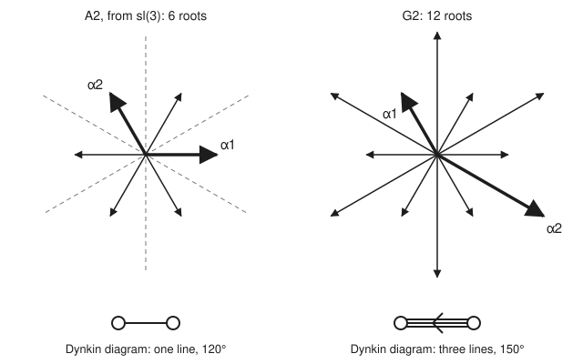

# Root systems and Dynkin diagrams: four infinite families and five exceptions

[Syllabus](../../../SYLLABUS.md) → [Differential geometry and Lie groups](../README.md) → [Roots, Weights and Representations](../README.md#s08) → Root systems and Dynkin diagrams

---

## General Overview

The strong force holds the quarks inside every proton together. Its symmetry group is SU(3): each quark carries one of three colours, and eight gluons carry colour between them. The Lie algebra of SU(3), made complex, is sl(3): the 3 by 3 matrices with trace zero, 8 dimensions in all.

[The Killing form and roots](02-killing-form-and-root-decomposition.md) split those 8 dimensions. Two are colour-neutral: the diagonal matrices. Each of the other six carries a **root**, a vector recording how that direction shifts colour. The roots are $`e_i - e_j`$ for colours $`i \neq j`$, with $`e_1, e_2, e_3`$ the coordinate vectors. All six have the same length and sit 60° apart: the corners of a hexagon.

This card keeps only the six arrows. Four rules hold for them, and the rules are so tight that only a short list of arrow patterns exists. Two arrows, the **simple roots**, fix the whole pattern. Their angles and lengths fit in a 2 by 2 table of whole numbers, the **Cartan matrix**, and in a drawing of dots and lines, the **Dynkin diagram**.

For sl(3) the table is `[[2, -1], [-1, 2]]` and the diagram is two dots joined by one line. Every finite-dimensional simple Lie algebra over the complex numbers has such a diagram. It lies in one of four infinite families, A, B, C and D, or is one of five exceptions: G2, F4, E6, E7 and E8.

**A root system is a finite set of arrows closed under its own mirror reflections, with whole-number angle data; a choice of simple roots turns it into a Cartan matrix and a Dynkin diagram, and the positive-definite diagrams are exactly the families A, B, C, D and the exceptions G2, F4, E6, E7, E8.**

**What kind of fact this is:** root system, Cartan matrix and Dynkin diagram are definitions. The short list of angles, the existence of simple roots and the list of diagrams are theorems, proved or sketched on this card in Why it works. That each diagram belongs to exactly one simple Lie algebra (the Cartan–Killing classification with Serre's theorem) is stated with a named source, not proved.

### The picture: two root systems, to scale

<p align="center"></p>

Left, A2 from sl(3): six roots of length $`\sqrt{2}`$, and three dashed mirror lines cutting the plane into 6 wedges. Right, G2: six short roots of length $`\sqrt{2}`$ and six long ones of length $`\sqrt{6}`$. Thick arrows are simple roots, 120° apart in A2 and 150° apart in G2. The G2 diagram's arrow points to the short root.

---

## The formula

Notation first, in words. $`E`$ is a real space with a dot product, written $`(\beta, \alpha)`$; for sl(3) it is the plane $`x + y + z = 0`$. A **reflection** $`s_\alpha`$ is the mirror image across the line (or plane) square to (at right angles to) $`\alpha`$.

[The Killing form and roots](02-killing-form-and-root-decomposition.md) measured the roots of sl(3) with the Killing form and found squared length 1/3. Any positive multiple of that form gives the same angles and the same reflection numbers, so this card multiplies it by 6: the roots become $`e_i - e_j`$, of squared length 2.

A **root system** is a finite set $`\Phi`$ of vectors in $`E`$ obeying four rules:

- **R1.** $`\Phi`$ spans $`E`$, and $`0`$ is not in $`\Phi`$.
- **R2.** The only multiples of a root $`\alpha`$ in $`\Phi`$ are $`\alpha`$ and $`-\alpha`$.
- **R3.** Every reflection $`s_\alpha`$ maps $`\Phi`$ onto itself.
- **R4.** Every number $`\langle \beta, \alpha \rangle`$ below is a whole number.

```math
s_\alpha(\beta) = \beta - \langle \beta, \alpha \rangle \, \alpha, \qquad \langle \beta, \alpha \rangle = \frac{2 (\beta, \alpha)}{(\alpha, \alpha)} \in \mathbb{Z}
```

**Read it aloud:** to reflect $`\beta`$ in the mirror of $`\alpha`$, subtract $`\alpha`$ a whole number of times, and that number is twice the shadow of $`\beta`$ on $`\alpha`$, measured in units of $`\alpha`$.

For sl(3), take $`\alpha = e_1 - e_2`$ and $`\beta = e_2 - e_3`$. Then $`(\beta, \alpha) = -1`$ and $`(\alpha, \alpha) = 2`$, so $`\langle \beta, \alpha \rangle = -1`$ and $`s_\alpha(\beta) = \beta + \alpha = e_1 - e_3`$, another root.

Pick the simple roots $`\alpha_1, \dots, \alpha_\ell`$ (Why it works, Step 2). The **Cartan matrix** collects their numbers:

```math
A_{ij} = \langle \alpha_i, \alpha_j \rangle = \frac{2 (\alpha_i, \alpha_j)}{(\alpha_j, \alpha_j)}, \qquad A_{A_2} = \begin{pmatrix} 2 & -1 \\ -1 & 2 \end{pmatrix}, \qquad A_{G_2} = \begin{pmatrix} 2 & -1 \\ -3 & 2 \end{pmatrix}
```

**Read it aloud:** row $`i`$, column $`j`$ is twice the dot product of simple roots $`i`$ and $`j`$, over the squared length of root $`j`$.

The **Dynkin diagram** draws the matrix. One dot per simple root. Dots $`i`$ and $`j`$ are joined by $`A_{ij} A_{ji}`$ lines: 0, 1, 2 or 3. When two joined roots have different lengths, an arrow on the lines points to the shorter one. In G2, $`A_{12} A_{21} = (-1)(-3) = 3`$: three lines.

The size of the Lie algebra $`\mathfrak{g}`$ follows from the roots: one dimension per root, plus $`\ell`$ colour-neutral ones.

```math
\dim \mathfrak{g} = \lvert \Phi \rvert + \ell, \qquad \text{for } A_n: \; n(n + 1) + n = n(n + 2)
```

**Read it aloud:** the dimension is the number of roots plus the rank. For sl(3), $`6 + 2 = 8`$: the eight gluons.

| Symbol | Plain meaning | In our example | Push it up and the answer… |
| --- | --- | --- | --- |
| $`E`$ | the real space the roots live in, with a dot product | the plane $`x + y + z = 0`$ | — |
| $`e_1, e_2, e_3`$ | the coordinate vectors, one per quark colour | $`e_1 = (1, 0, 0)`$ | — |
| $`\Phi`$; $`\lvert \Phi \rvert`$ | the set of roots; how many | the six $`e_i - e_j`$; 6 | more roots, a bigger algebra |
| $`\alpha`$, $`\beta`$; $`\theta`$ | two roots; the angle between them | $`e_1 - e_2`$ and $`e_2 - e_3`$; 120° | — |
| $`(\beta, \alpha)`$ | the dot product | $`-1`$ | — |
| $`\langle \beta, \alpha \rangle`$ | the reflection number, twice the shadow of $`\beta`$ on $`\alpha`$ | $`-1`$ | for two roots that are not ± each other, only 0, ±1, ±2 or ±3 occur |
| $`s_\alpha`$; $`s_i`$ | the mirror reflection across the line square to $`\alpha`$; $`s_i`$ is $`s_{\alpha_i}`$ | $`s_{\alpha_1}`$ swaps colours 1 and 2 | — |
| $`\Phi^+`$; $`t`$ | the positive roots: those with a positive dot product with a chosen direction $`t`$ | $`e_1 - e_2`$, $`e_2 - e_3`$, $`e_1 - e_3`$; $`t = (4, 2, 1)`$ | — |
| $`\alpha_1, \dots, \alpha_\ell`$; $`\ell`$; $`\varepsilon_i`$ | the simple roots; their number, the rank; the simple roots scaled to length 1. In the proofs, $`\gamma`$, $`\beta'`$ are more roots, $`v`$ a combination with coefficients $`a_i`$, $`b_j`$, and $`k`$, $`p`$, $`q`$, $`a`$, $`b`$, $`c`$ whole numbers counting steps or dots | $`e_1 - e_2`$, $`e_2 - e_3`$; 2 | one more dot on the diagram |
| $`A_{ij}`$ | the Cartan matrix entry | `[[2, -1], [-1, 2]]` | more negative, more lines |
| $`W`$; $`m_{ij}`$ | the Weyl group: all products of the reflections; $`m_{ij}`$, the rounds after which $`s_i s_j`$ returns to the start, written $`m`$ when there are two dots | $`S_3`$, the 6 shuffles of three colours; $`m_{12} = 3`$ | more lines, larger $`m_{ij}`$ and a larger $`W`$ |
| $`\mathfrak{g}`$; $`\dim`$; $`n`$ | the Lie algebra; its dimension; the rank in a family name such as $`A_n`$ | sl(3); 8 | — |

### When it holds

- **A semisimple Lie algebra over the complex numbers.** That is what gives roots at all. A solvable algebra, such as the upper-triangular matrices, has no root system ([The Killing form and roots](02-killing-form-and-root-decomposition.md)).
- **Whole-number reflection numbers, R4.** Ten arrows 36° apart pass R1 to R3, but neighbours give $`\langle \beta, \alpha \rangle = 2\cos 36° = 1.618033988750`$. That pentagon symmetry belongs to no Lie algebra.
- **A choice of simple roots.** The simple roots depend on which side counts as positive. A different choice gives the same Cartan matrix up to renumbering, because the Weyl group carries one choice to the other.
- **A connected diagram for a simple algebra.** Two dots with no line between them give $`A_1 \times A_1`$, two copies of sl(2) side by side, not one simple algebra.
- **A positive-definite dot product.** Allow a zero direction and new diagrams appear: three dots in a triangle have Cartan determinant 0. These affine diagrams belong to infinite-dimensional algebras.

---

## Why it works

### Step 0: whole numbers allow only a handful of angles

Multiply the two reflection numbers of a pair of roots at angle $`\theta`$:

```math
\langle \beta, \alpha \rangle \langle \alpha, \beta \rangle = \frac{4 (\alpha, \beta)^2}{(\alpha, \alpha)(\beta, \beta)} = 4 \cos^2 \theta
```

**Read it aloud:** the product of the two reflection numbers is four times the squared cosine of the angle between the roots.

Both factors are whole numbers, and $`4\cos^2\theta`$ lies between 0 and 4. So it is 0, 1, 2, 3 or 4. That allows only 90°, 60° or 120°, 45° or 135°, 30° or 150°, and 0° or 180°. When the product is 2 or 3, the two lengths differ by a factor $`\sqrt{2}`$ or $`\sqrt{3}`$.

A2 uses only the values 1 and 4: angles 60°, 120° and 180°. G2 uses 0, 1, 3 and 4: angles 30°, 60°, 90°, 120°, 150° and 180°. This one fact is what makes a finite list possible.

### Step 1: why a Lie algebra's roots obey the rules

Each root $`\alpha`$ of a semisimple algebra comes with its own copy of sl(2) ([The Killing form and roots](02-killing-form-and-root-decomposition.md)). That copy acts on all the root directions. Its weights form ladders that step by 2 and are symmetric about 0 ([Representations of sl(2)](01-representations-of-sl2.md)).

The weight of the direction $`\beta`$ under the copy for $`\alpha`$ is exactly $`\langle \beta, \alpha \rangle`$. Weights are whole numbers: that is R4. A ladder symmetric about 0 maps the roots $`\beta + k\alpha`$ onto themselves under the mirror of $`\alpha`$: that is R3. R1 has another reason: a colour-neutral direction on which every root is zero would commute with the whole algebra, and a semisimple algebra has no such centre, so the roots span E. R2 needs one more sl(2) argument, stated here, not proved: Humphreys, section 8, in Sources.

### Step 2: simple roots, a basis that reaches every root

Pick a direction $`t`$ square to no root. It need not lie in $`E`$: the roots lie in $`E`$, so only the shadow of $`t`$ in $`E`$ counts. A root is **positive** when its dot product with $`t`$ is positive; that is $`\Phi^+`$, exactly half the roots. A positive root is **simple** when it is not the sum of two positive roots.

For sl(3), with $`t = (4, 2, 1)`$, the positive roots are $`e_1 - e_2`$, $`e_2 - e_3`$ and $`e_1 - e_3`$. The last is the sum of the first two, so the simple roots are $`\alpha_1 = e_1 - e_2`$ and $`\alpha_2 = e_2 - e_3`$.

Two facts make simple roots useful. Every positive root is a sum of simple roots with whole, non-negative coefficients. And the simple roots are a basis of $`E`$. So the rank $`\ell`$ is the dimension of $`E`$: 2 here.

<details>
<summary>Detailed proof: simple roots meet at obtuse angles and form a basis</summary>

Every positive root is a sum of simple ones. Suppose not, and take a failing positive root $`\gamma`$ with the smallest dot product with $`t`$. It is not simple, so $`\gamma = \beta + \beta'`$ with both positive. Each has a smaller dot product with $`t`$, so each is a sum of simple roots, and so is $`\gamma`$. That contradicts the choice.

Two simple roots meet at 90° or more. If $`(\alpha_i, \alpha_j) > 0`$ with $`i \neq j`$, the reflection number $`\langle \alpha_i, \alpha_j \rangle`$ is positive, and Step 0 forces one of the two numbers to be 1. Say $`\langle \alpha_i, \alpha_j \rangle = 1`$. Then $`s_{\alpha_j}(\alpha_i) = \alpha_i - \alpha_j`$ is a root by R3. If it is positive, then $`\alpha_i = (\alpha_i - \alpha_j) + \alpha_j`$ is a sum of two positive roots, so $`\alpha_i`$ is not simple. If it is negative, $`\alpha_j = (\alpha_j - \alpha_i) + \alpha_i`$ fails in the same way. So $`(\alpha_i, \alpha_j) \le 0`$.

Vectors on one side of $`t`$ that pairwise meet at 90° or more are linearly independent. Suppose a combination is zero; move the negative terms across to get $`v = \sum a_i \alpha_i = \sum b_j \alpha_j`$, with all $`a_i, b_j \ge 0`$ and the two index sets disjoint. Then

$`\displaystyle (v, v) = \sum a_i b_j (\alpha_i, \alpha_j) \le 0,`$

so $`v = 0`$. Taking the dot product with $`t`$ gives $`\sum a_i (\alpha_i, t) = 0`$ with every term non-negative, so every $`a_i`$ is 0, and likewise every $`b_j`$. The simple roots span $`E`$, by R1 and the first fact, so they are a basis.

</details>

The checks run this in reverse: start from the simple roots and keep adding simple roots while the result is still a root. For every system here, that lands exactly on the positive roots.

### Step 3: the Weyl group, a group made of mirrors

The **Weyl group** $`W`$ is every product of the reflections $`s_\alpha`$. The simple reflections alone already produce all of it. For sl(3), $`s_{\alpha_1}`$ swaps colours 1 and 2 and $`s_{\alpha_2}`$ swaps colours 2 and 3. Products of those two swaps give all 3! = 6 shuffles of three colours: $`W = S_3`$.

A presentation (generators plus rules, as in [Presentations](../../03-Algebra/08-Groups/15-group-presentations.md)) gives $`W`$ from the diagram. Its generators are the simple reflections $`s_i`$, and its relations are

```math
s_i^2 = 1, \qquad (s_i s_j)^{m_{ij}} = 1, \qquad m_{ij} = 2, 3, 4, 6 \text{ for } 0, 1, 2, 3 \text{ lines}
```

**Read it aloud:** each mirror undoes itself, and two neighbouring mirrors, applied in turn, return to the start after $`m_{ij}`$ rounds.

This is a **Coxeter presentation**, stated here, not proved. With two dots it gives the symmetry group of a regular $`m`$-sided polygon, of order $`2m`$: 6 for A2 ($`m = 3`$) and 12 for G2 ($`m = 6`$). Closing the two mirrors under products by brute force gives the same 6 and 12.

$`W`$ acts on the roots, so orbit-stabiliser applies ([Group actions](../../03-Algebra/08-Groups/08-group-actions-and-counting.md)). In A2 the orbit of $`\alpha_1`$ is all 6 roots and only the identity fixes it: $`6 \times 1 = 6`$. In G2 the orbit of the short root $`\alpha_1`$ is the 6 short roots, and 2 elements fix it: $`6 \times 2 = 12`$. Roots of different lengths never share an orbit, because mirrors keep lengths.

### Step 4: the diagram gives back the roots

The Cartan matrix holds every angle and length ratio among the simple roots. So it fixes the simple roots up to a rotation and a scaling. The reflections then produce every root: in a root system, each root is the image of a simple root under $`W`$. In A2, $`s_{\alpha_1}(\alpha_2) = \alpha_1 + \alpha_2`$, and with the negatives that is all six.

**Serre's theorem** says the Cartan matrix also rebuilds the Lie algebra: generators for each dot, with relations read off the matrix, give a finite-dimensional simple algebra with this root system. A companion theorem, proved in the same book, says two algebras with the same diagram are isomorphic. The card states this; Serre's book in Sources proves it.

So classifying simple Lie algebras is the same task as classifying connected Dynkin diagrams.

### Step 5: only positive-definite diagrams survive

Scale every simple root to length 1. Their dot products are then fixed by the line counts: $`-\cos(\pi/m)`$, which is 0, $`-1/2`$, $`-\sqrt{2}/2`$ or $`-\sqrt{3}/2`$. These are dot products of real vectors that form a basis. So the matrix of them must be **positive definite**: every non-zero combination has positive squared length.

That one condition throws out almost every diagram. Three dots in a triangle fail, with Cartan determinant 0. So does E8 with its long arm made one dot longer. Removing dots keeps a diagram positive definite, so every piece of a valid diagram is valid.

<details>
<summary>Detailed proof in outline: the positive-definite diagrams</summary>

Write $`\varepsilon_1, \dots, \varepsilon_\ell`$ for the simple roots scaled to length 1. For joined dots, $`4(\varepsilon_i, \varepsilon_j)^2`$ is the number of lines.

1. **No loops.** For dots $`1, \dots, k`$ in a loop, the vector $`v = \varepsilon_1 + \dots + \varepsilon_k`$ has $`(v, v) = k + 2 \sum_{i < j} (\varepsilon_i, \varepsilon_j)`$. Each of the at least $`k`$ joined pairs adds at most $`-1`$, so $`(v, v) \le 0`$. A loop is impossible, and the diagram is a tree.
2. **At most three lines meet at a dot.** The dots joined to $`\varepsilon`$ are not joined to each other, so they are an orthonormal set. Their squared dot products with $`\varepsilon`$ add up to less than 1, because $`\varepsilon`$ is not in their span. Each line adds $`1/4`$, so there are at most 3 lines.
3. **A triple line allows nothing else.** By rule 2, a dot with three lines has no other neighbour: the diagram is G2.
4. **A chain can be shrunk to one dot.** Replace a single-line chain by the sum of its vectors. It has length 1 and the same lines to the rest. So, by rule 2, a diagram has at most one branch dot or one double line, not both, and not two of either.
5. **The double line.** A double line between chains of $`p \le q`$ dots stays positive only for $`p = 1`$ (B and C) or $`p = q = 2`$ (F4).
6. **The branch.** A branch dot with arms of $`a \le b \le c`$ further dots stays positive only for $`a = b = 1`$ (D), or $`a = 1, b = 2, c \le 4`$ (E6, E7, E8).

What is left is the list: $`A_n`$, $`B_n`$, $`C_n`$, $`D_n`$, $`E_6`$, $`E_7`$, $`E_8`$, $`F_4`$, $`G_2`$. The full proof, with the computations of steps 5 and 6, is in Humphreys, section 11.4, in Sources.

</details>

The checks do not trust the outline. They grow every connected diagram one dot at a time, keep the positive-definite ones, and remove copies that differ only in numbering. They count shapes without arrows, so B and C count once. For ranks 1 to 9 they find 1, 3, 2, 4, 3, 4, 4, 4 and 3 shapes. The list predicts the same counts. Rank 9 has only the shapes of A, B (= C) and D: E stops at 8.

### The nine systems the checks build

Each system is built in whole-number coordinates (F4 and E8 doubled to avoid halves), tested against R1 to R4, and given simple roots, a Cartan matrix and a diagram.

| Type | Rank | Roots | Positive | Short roots | Dimension | Cartan det | Lines | Arms at the branch | Weyl group |
| --- | ---: | ---: | ---: | ---: | ---: | ---: | --- | --- | ---: |
| A2 | 2 | 6 | 3 | 6 | 8 | 3 | 1 | — | 6 |
| G2 | 2 | 12 | 6 | 6 | 14 | 1 | 3 | — | 12 |
| B3 | 3 | 18 | 9 | 6 | 21 | 2 | 1, 2 | — | 48 |
| C3 | 3 | 18 | 9 | 12 | 21 | 2 | 1, 2 | — | 48 |
| D4 | 4 | 24 | 12 | 24 | 28 | 4 | 1, 1, 1 | 1, 1, 1 | 192 |
| F4 | 4 | 48 | 24 | 24 | 52 | 1 | 1, 1, 2 | — | 1152 |
| E6 | 6 | 72 | 36 | 72 | 78 | 3 | five single | 1, 2, 2 | — |
| E7 | 7 | 126 | 63 | 126 | 133 | 2 | six single | 1, 2, 3 | — |
| E8 | 8 | 240 | 120 | 240 | 248 | 1 | seven single | 1, 2, 4 | — |

B3 and C3 share a diagram shape and a dimension, 21, but not an algebra: B3, from so(7), has 6 short roots, and C3, from sp(6), has 12. The arrow on the double line records which. The family dimensions match their formulas: $`B_n`$ and $`C_n`$ have $`n(2n + 1)`$, so 21 at $`n = 3`$; $`D_n`$ has $`n(2n - 1)`$, so 28 at $`n = 4`$. B3's Weyl group is the signed shuffles of three coordinates, $`2^3 \times 3! = 48`$. D4's is the signed shuffles of four coordinates with an even number of sign flips, $`2^3 \times 4! = 192`$. The E Weyl groups are too large to list element by element here, so the checks skip them.

---

## Worked numbers, by hand

| Step | Arithmetic | Value |
| --- | --- | --- |
| the roots of sl(3) | $`e_i - e_j`$ for the 3 × 2 ordered pairs of colours | 6 roots |
| positive side, $`t = (4, 2, 1)`$ | keep the roots with a positive dot product with $`t`$ | $`e_1 - e_2`$, $`e_2 - e_3`$, $`e_1 - e_3`$: 3 positive |
| simple roots | $`e_1 - e_3`$ is the sum of the other two | $`\alpha_1 = (1, -1, 0)`$, $`\alpha_2 = (0, 1, -1)`$ |
| dot products | $`(\alpha_1, \alpha_2) = -1`$, $`(\alpha_1, \alpha_1) = (\alpha_2, \alpha_2) = 2`$ | angle 120° |
| Cartan matrix | $`2 \times (-1) / 2 = -1`$ off the diagonal | `[[2, -1], [-1, 2]]` |
| its determinant | $`2 \times 2 - (-1)(-1)`$ | 3 |
| lines on the diagram | $`(-1) \times (-1)`$ | 1 |
| Weyl group | Coxeter $`m = 3`$, order $`2m`$ | 6 = 3! |
| dimension of sl(3) | 6 roots + rank 2 | **8** |
| G2 simple roots | short $`(0, 1, -1)`$, long $`(1, -2, 1)`$: dot product $`-3`$, lengths squared 2 and 6 | angle 150° |
| G2 Cartan matrix | $`2(-3)/6 = -1`$ and $`2(-3)/2 = -3`$ | `[[2, -1], [-3, 2]]` |
| G2 lines and Weyl group | $`(-1)(-3) = 3`$ lines, so $`m = 6`$ and order 12 | 3 lines; 12 |
| E8 by counting | $`4 \times 28 = 112`$ roots $`\pm e_i \pm e_j`$, plus $`2^7 = 128`$ with all coordinates ±1/2 | 240 roots, dimension **248** |

The eight gluons are the 6 roots plus the 2 colour-neutral directions, so sl(3) has dimension 8, which is $`n(n + 2)`$ at $`n = 2`$.

### What breaks if you drop a piece

| Mistake | Comes out at | What went wrong |
| --- | --- | --- |
| Ten arrows 36° apart taken as roots | $`2\cos 36° = 1.618033988750`$ | Mirrors close up, but R4 fails: no Lie algebra |
| Three dots joined in a triangle | Cartan determinant 0 | Not positive definite: a loop is forbidden |
| E8's long arm made one dot longer | Cartan determinant 0 | Not positive definite: E stops at 8 |
| Weyl group taken as every symmetry of the hexagon | 12, not 6 | Turning by 60° keeps the roots but is no product of mirrors |
| Dimension of sl(3) counted from roots only | 6, not 8 | The 2 colour-neutral directions have no root |

The code prints every row.

---

## Code, from first principles, and it actually runs

The checks build the nine root systems in whole-number coordinates and test R1 to R4 exactly. They take four independent roads. The positive roots are grown back from the simple roots. The Weyl group is closed by brute force and compared with the Coxeter count $`2m`$ and with orbit times stabiliser. Root counts and dimensions are compared with counting formulas. The list of diagrams is compared with a brute-force search for positive-definite diagrams up to rank 9. Nothing imported knows any root system: `itertools` only lists orderings and combinations.

### Python

```python
# Root systems and Dynkin diagrams -- the check behind the card.  Standard library only.
# Roots are integer vectors (F4 and E8 doubled), so every axiom is tested exactly.  Roads:
# simple roots against the roots grown back from them, the Weyl group by closure against
# its Coxeter count, counts against formulas, the diagram list against a brute-force search.
import math
from itertools import permutations, product

def dot(a, b): return sum(x * y for x, y in zip(a, b))
def add(a, b, k=1): return tuple(x + k * y for x, y in zip(a, b))
def reflect(b, a): return add(b, a, -(2 * dot(b, a) // dot(a, a)))  # s_a(b)
def e(i, n, s=1): return tuple(s if k == i else 0 for k in range(n))
def signs(k): return product((1, -1), repeat=k)
def yn(c): return "yes" if c else "no"
def det(m):                    # Bareiss elimination, exact; each pivot is a leading minor, never 0 here
    m, prev, n = [r[:] for r in m], 1, len(m)
    for k in range(n - 1):
        for i in range(k + 1, n):
            for j in range(k + 1, n):
                m[i][j] = (m[i][j] * m[k][k] - m[i][k] * m[k][j]) // prev
        prev = m[k][k]
    return m[n - 1][n - 1]

def analyse(roots):                            # axioms, positive and simple roots, Cartan matrix
    R, n = set(roots), len(roots[0])
    r2 = all(b in (a, add(a, a, -2)) for a in roots for b in roots if dot(a, b) ** 2 == dot(a, a) * dot(b, b))
    r4 = all(2 * dot(b, a) % dot(a, a) == 0 for a in roots for b in roots)
    r3 = r4 and all(reflect(b, a) in R for a in roots for b in roots)
    t = [2 ** (n - 1 - k) for k in range(n)]                  # a direction square to no root
    pos = {a for a in roots if dot(a, t) > 0}
    simple = sorted((a for a in pos if not any(add(a, b, -1) in pos for b in pos)),
                    key=lambda a: (dot(a, a), [-x for x in a]))
    grown, front = set(simple), set(simple)
    while front:                                              # add simple roots while still a root
        front = {add(b, s) for b in front for s in simple} & R - grown
        grown |= front
    C = [[2 * dot(a, b) // dot(b, b) for b in simple] for a in simple]
    r1 = e(0, n, 0) not in R and det(C) != 0 and grown == pos
    short = sum(dot(a, a) == min(dot(b, b) for b in roots) for a in roots)
    return dict(ok=(r1, r2, r3, r4), grown=grown == pos, pos=pos, simple=simple, C=C, short=short)
def shape(C):                                  # bonds, and arm lengths at a branch dot
    n = len(C); nb = lambda i: [j for j in range(n) if j != i and C[i][j]]
    bonds = sorted(C[i][j] * C[j][i] for i in range(n) for j in range(i + 1, n) if C[i][j])
    arms = []
    for b in [i for i in range(n) if len(nb(i)) == 3]:
        for s in nb(b):
            prev, cur, k = b, s, 1
            while len(nb(cur)) == 2:
                prev, cur, k = cur, [j for j in nb(cur) if j != prev][0], k + 1
            arms.append(k)
    return bonds, sorted(arms)

def weyl(roots, simple):                       # closure of the simple reflections, as shuffles of roots
    ix = {a: i for i, a in enumerate(roots)}
    gens = [tuple(ix[reflect(b, s)] for b in roots) for s in simple]
    seen = front = {tuple(range(len(roots)))}
    while front:
        front = {tuple(g[i] for i in p) for p in front for g in gens} - seen
        seen = seen | front
    return seen
A2 = [add(e(i, 3), e(j, 3), -1) for i in range(3) for j in range(3) if i != j]
G2 = A2 + [tuple(s * (3 * x - 1) for x in e(i, 3)) for i in range(3) for s in (1, -1)]
pairs = lambda n, c: [add(e(i, n, c * s), e(j, n, c * u)) for i in range(n) for j in range(i + 1, n) for s, u in signs(2)]
B3 = pairs(3, 1) + [e(i, 3, s) for i in range(3) for s in (1, -1)]
C3 = pairs(3, 1) + [e(i, 3, 2 * s) for i in range(3) for s in (1, -1)]
F4 = pairs(4, 2) + [e(i, 4, 2 * s) for i in range(4) for s in (1, -1)] + list(signs(4))
E8 = pairs(8, 2) + [v for v in signs(8) if v.count(-1) % 2 == 0]
E7 = [a for a in E8 if dot(a, (1,) * 8) == 0]
E6 = [a for a in E7 if dot(a, (-2, -2) + (0,) * 6) == 0]
systems = [("A2", A2), ("G2", G2), ("B3", B3), ("C3", C3), ("D4", pairs(4, 1)), ("F4", F4), ("E6", E6), ("E7", E7), ("E8", E8)]
info = {name: analyse(roots) for name, roots in systems}
for name, roots in systems[:2]:
    d = info[name]; W = weyl(roots, d["simple"]); i = roots.index(d["simple"][0])
    ang = sorted({round(math.degrees(math.acos(dot(a, b) / math.sqrt(dot(a, a) * dot(b, b))))) for a in roots for b in roots if a != b})
    four = sorted({4 * dot(a, b) ** 2 // (dot(a, a) * dot(b, b)) for a in roots for b in roots})
    m = {0: 2, 1: 3, 2: 4, 3: 6}[d["C"][0][1] * d["C"][1][0]]
    orbit, stab = len({p[i] for p in W}), sum(p[i] == i for p in W)
    print(f"{name}: {len(roots)} roots, {len(d['pos'])} positive, simple roots {d['simple'][0]} and {d['simple'][1]}")
    print(f"{name} axioms R1 R2 R3 R4: {' '.join(yn(x) for x in d['ok'])}; positive roots grown from the simple two: {yn(d['grown'])}")
    print(f"{name} angles between roots (degrees): {ang}; 4cos^2 values: {four}")
    print(f"{name} Cartan matrix {d['C']}, determinant {det(d['C'])}, bonds {shape(d['C'])[0]}")
    print(f"{name} Weyl group by closure: {len(W)}; Coxeter count 2m with m = {m}: {2 * m}; orbit of alpha1 {orbit} x stabiliser {stab} = {orbit * stab}")
    assert len(W) == 2 * m == orbit * stab and all(d["ok"]) and d["grown"]
print(f"A2 dimension: {len(A2)} roots + rank 2 = {len(A2) + 2}; n(n + 2) at n = 2: {2 * 4}; 3! = {math.factorial(3)}")
print("type rank roots positive short dimension det bonds arms Weyl")
for name, roots in systems:
    d = info[name]; r = len(d["simple"]); b, a = shape(d["C"])
    d["W"] = len(weyl(roots, d["simple"])) if len(roots) <= 48 else 0
    print(f"{name} {r} {len(roots)} {len(d['pos'])} {d['short']} {len(roots) + r} {det(d['C'])} {b} {a} {d['W'] or '-'}")
    assert all(d["ok"]) and d["grown"] and len(b) == r - 1      # axioms hold; the diagram is a tree
assert info["A2"]["C"] == [[2, -1], [-1, 2]] and info["G2"]["C"] == [[2, -1], [-3, 2]]
assert len(A2) + 2 == 2 * (2 + 2) and info["A2"]["W"] == math.factorial(3)
assert [len(B3) + 3, len(C3) + 3, len(pairs(4, 1)) + 4] == [3 * 7, 3 * 7, 4 * 7]   # n(2n+1), n(2n+1), n(2n-1)
assert info["B3"]["W"] == 2 ** 3 * 6 and info["D4"]["W"] == 2 ** 3 * 24   # signed shuffles
print(f"E8 roots by counting: 4 x C(8,2) + 2^7 = {4 * 28} + {2 ** 7} = {4 * 28 + 2 ** 7}; dimension {len(E8) + 8}")
assert len(E8) == 4 * math.comb(8, 2) + 2 ** 7 and shape(info["E8"]["C"])[1] == [1, 2, 4]

def posdef(M):                                 # Cholesky on the form with -cos(pi/m) off the diagonal
    n, c = len(M), [0.0, 0.5, math.sqrt(2) / 2, math.sqrt(3) / 2]
    a = [[1.0 if i == j else -c[M[i][j]] for j in range(n)] for i in range(n)]
    L = [[0.0] * n for _ in range(n)]
    for i in range(n):
        for j in range(i + 1):
            s = a[i][j] - sum(L[i][k] * L[j][k] for k in range(j))
            if i == j and s < 1e-9: return False
            L[i][j] = math.sqrt(s) if i == j else s / L[j][j]
    return True

canon = lambda M: min(tuple(M[p[i]][p[j]] for j in range(len(M)) for i in range(j)) for p in permutations(range(len(M))))
reps, brute = [[[0]]], [1]
for n in range(2, 10):                         # grow every connected diagram one dot at a time
    found = {}
    for M in reps:
        for ext in product(range(4), repeat=n - 1):
            N = [row + [x] for row, x in zip(M, ext)] + [list(ext) + [0]]
            if any(ext) and posdef(N): found.setdefault(canon(N), N)
    reps = list(found.values()); brute.append(len(reps))
listed = [1 + (n >= 2) + (n >= 4) + (n in (6, 7, 8)) + (n == 4) + (n == 2) for n in range(1, 10)]
print(f"connected positive-definite diagrams, ranks 1 to 9, brute force: {brute}")
print(f"the same ranks, counted from the list A, B = C, D, E, F4, G2:   {listed}")
assert brute == listed

ten = [(math.cos(k * math.pi / 5), math.sin(k * math.pi / 5)) for k in range(10)]
close = all(any(abs(r[0] - v[0] + 2 * dot(v, a) * a[0]) + abs(r[1] - v[1] + 2 * dot(v, a) * a[1]) < 1e-9 for r in ten) for a in ten for v in ten)
gold = 2 * dot(ten[1], ten[0])
print(f"mistake 1, ten roots 36 degrees apart: reflections close up {yn(close)}, but 2cos(36 deg) = {gold:.12f}, not whole")
assert close and abs(gold - (1 + math.sqrt(5)) / 2) < 1e-12 and abs(gold - round(gold)) > 0.1
tri = [[2, -1, -1], [-1, 2, -1], [-1, -1, 2]]
e9 = [[2 if i == j else -1 if abs(i - j) == 1 and max(i, j) < 8 or {i, j} == {2, 8} else 0 for j in range(9)] for i in range(9)]
print(f"mistake 2, three dots in a triangle: Cartan determinant {det(tri)}; E8's long arm made one dot longer: {det(e9)}")
assert det(tri) == 0 and det(e9) == 0 and not posdef([[0, 1, 1], [1, 0, 1], [1, 1, 0]])
G = lambda p: [[dot(A2[p[i]], A2[p[j]]) for j in range(6)] for i in range(6)]
sym = sum(G(p) == G(range(6)) for p in permutations(range(6)))
print(f"mistake 3, every symmetry of the hexagon: {sym}, but the Weyl group has {info['A2']['W']}")
print(f"mistake 4, dimension of sl(3) as roots only: {len(A2)}, not {len(A2) + 2}")
assert sym == 2 * info["A2"]["W"]
xy = lambda a: f"({(a[0] - a[1]) / math.sqrt(2):.3f}, {(a[0] + a[1] - 2 * a[2]) / math.sqrt(6):.3f})"
print("figure, A2 roots:", " ".join(xy(a) for a in A2))
print("figure, G2 long roots:", " ".join(xy(a) for a in G2[6:]))
print("ALL CHECKS PASS")
```

**Ran 2026-11-24 on macOS, Python 3.14.10, standard library only. All checks passed. Output, pasted from the run:**

```
A2: 6 roots, 3 positive, simple roots (1, -1, 0) and (0, 1, -1)
A2 axioms R1 R2 R3 R4: yes yes yes yes; positive roots grown from the simple two: yes
A2 angles between roots (degrees): [60, 120, 180]; 4cos^2 values: [1, 4]
A2 Cartan matrix [[2, -1], [-1, 2]], determinant 3, bonds [1]
A2 Weyl group by closure: 6; Coxeter count 2m with m = 3: 6; orbit of alpha1 6 x stabiliser 1 = 6
G2: 12 roots, 6 positive, simple roots (0, 1, -1) and (1, -2, 1)
G2 axioms R1 R2 R3 R4: yes yes yes yes; positive roots grown from the simple two: yes
G2 angles between roots (degrees): [30, 60, 90, 120, 150, 180]; 4cos^2 values: [0, 1, 3, 4]
G2 Cartan matrix [[2, -1], [-3, 2]], determinant 1, bonds [3]
G2 Weyl group by closure: 12; Coxeter count 2m with m = 6: 12; orbit of alpha1 6 x stabiliser 2 = 12
A2 dimension: 6 roots + rank 2 = 8; n(n + 2) at n = 2: 8; 3! = 6
type rank roots positive short dimension det bonds arms Weyl
A2 2 6 3 6 8 3 [1] [] 6
G2 2 12 6 6 14 1 [3] [] 12
B3 3 18 9 6 21 2 [1, 2] [] 48
C3 3 18 9 12 21 2 [1, 2] [] 48
D4 4 24 12 24 28 4 [1, 1, 1] [1, 1, 1] 192
F4 4 48 24 24 52 1 [1, 1, 2] [] 1152
E6 6 72 36 72 78 3 [1, 1, 1, 1, 1] [1, 2, 2] -
E7 7 126 63 126 133 2 [1, 1, 1, 1, 1, 1] [1, 2, 3] -
E8 8 240 120 240 248 1 [1, 1, 1, 1, 1, 1, 1] [1, 2, 4] -
E8 roots by counting: 4 x C(8,2) + 2^7 = 112 + 128 = 240; dimension 248
connected positive-definite diagrams, ranks 1 to 9, brute force: [1, 3, 2, 4, 3, 4, 4, 4, 3]
the same ranks, counted from the list A, B = C, D, E, F4, G2:   [1, 3, 2, 4, 3, 4, 4, 4, 3]
mistake 1, ten roots 36 degrees apart: reflections close up yes, but 2cos(36 deg) = 1.618033988750, not whole
mistake 2, three dots in a triangle: Cartan determinant 0; E8's long arm made one dot longer: 0
mistake 3, every symmetry of the hexagon: 12, but the Weyl group has 6
mistake 4, dimension of sl(3) as roots only: 6, not 8
figure, A2 roots: (1.414, 0.000) (0.707, 1.225) (-1.414, 0.000) (-0.707, 1.225) (-0.707, -1.225) (0.707, -1.225)
figure, G2 long roots: (2.121, 1.225) (-2.121, -1.225) (-2.121, 1.225) (2.121, -1.225) (0.000, -2.449) (0.000, 2.449)
ALL CHECKS PASS
```

### Rust

Same numbers, same labels, built with `rustc --edition 2021 -O`.

```rust
// Root systems and Dynkin diagrams -- the same check as the Python, in Rust.  No crates.
// Roots are integer vectors (F4 and E8 doubled), so every axiom is tested exactly.  Roads:
// simple roots against the roots grown back from them, the Weyl group by closure against
// its Coxeter count, counts against formulas, the diagram list against a brute-force search.
use std::collections::{BTreeMap, BTreeSet};
type V = Vec<i64>;
fn dot(a: &[i64], b: &[i64]) -> i64 { a.iter().zip(b).map(|(x, y)| x * y).sum() }
fn add(a: &[i64], b: &[i64], k: i64) -> V { a.iter().zip(b).map(|(x, y)| x + k * y).collect() }
fn reflect(b: &[i64], a: &[i64]) -> V { add(b, a, -(2 * dot(b, a) / dot(a, a))) } // s_a(b)
fn e(i: usize, n: usize, s: i64) -> V { (0..n).map(|k| if k == i { s } else { 0 }).collect() }
fn signs(k: usize) -> Vec<V> { (0..1usize << k).map(|m| (0..k).map(|j| if m >> (k - 1 - j) & 1 == 1 { -1 } else { 1 }).collect()).collect() }
fn yn(c: bool) -> &'static str { if c { "yes" } else { "no" } }
fn tup(a: &[i64]) -> String { format!("({})", a.iter().map(|x| x.to_string()).collect::<Vec<_>>().join(", ")) }

fn det(m: &[V]) -> i64 {          // Bareiss elimination, exact; each pivot is a leading minor, never 0 here
    let (mut m, mut prev, n) = (m.to_vec(), 1, m.len());
    for k in 0..n - 1 { for i in k + 1..n { for j in k + 1..n { m[i][j] = (m[i][j] * m[k][k] - m[i][k] * m[k][j]) / prev; } }
        prev = m[k][k]; }
    m[n - 1][n - 1]
}
struct Info { ok: [bool; 4], grown: bool, pos: usize, simple: Vec<V>, c: Vec<V>, short: usize, w: usize }
fn analyse(roots: &[V]) -> Info {    // axioms, positive and simple roots, Cartan matrix
    let (r, n) = (roots.iter().cloned().collect::<BTreeSet<V>>(), roots[0].len());
    let all2 = |f: &dyn Fn(&V, &V) -> bool| roots.iter().all(|a| roots.iter().all(|b| f(a, b)));
    let r2 = all2(&|a, b| dot(a, b).pow(2) != dot(a, a) * dot(b, b) || *b == *a || *b == add(a, a, -2));
    let r4 = all2(&|a, b| 2 * dot(b, a) % dot(a, a) == 0);
    let r3 = r4 && all2(&|a, b| r.contains(&reflect(b, a)));
    let t: V = (0..n).map(|k| 1i64 << (n - 1 - k)).collect();     // a direction square to no root
    let pos: BTreeSet<V> = roots.iter().filter(|a| dot(a, &t) > 0).cloned().collect();
    let mut simple: Vec<V> = pos.iter().filter(|a| !pos.iter().any(|b| pos.contains(&add(a, b, -1)))).cloned().collect();
    simple.sort_by_key(|a| (dot(a, a), a.iter().map(|x| -x).collect::<V>()));
    let (mut grown, mut front): (BTreeSet<V>, BTreeSet<V>) = (simple.iter().cloned().collect(), simple.iter().cloned().collect());
    while !front.is_empty() {                                    // add simple roots while still a root
        front = front.iter().flat_map(|b| simple.iter().map(move |s| add(b, s, 1)))
            .filter(|v| r.contains(v) && !grown.contains(v)).collect();
        grown.extend(front.iter().cloned());
    }
    let c: Vec<V> = simple.iter().map(|a| simple.iter().map(|b| 2 * dot(a, b) / dot(b, b)).collect()).collect();
    let r1 = !r.contains(&e(0, n, 0)) && det(&c) != 0 && grown == pos;
    let mn = roots.iter().map(|b| dot(b, b)).min().unwrap();
    let short = roots.iter().filter(|a| dot(a, a) == mn).count();
    Info { ok: [r1, r2, r3, r4], grown: grown == pos, pos: pos.len(), simple, c, short, w: 0 }
}
fn shape(c: &[V]) -> (Vec<i64>, Vec<usize>) {    // bonds, and arm lengths at a branch dot
    let n = c.len();
    let nb = |i: usize| (0..n).filter(|&j| j != i && c[i][j] != 0).collect::<Vec<usize>>();
    let mut bonds: Vec<i64> = (0..n).flat_map(|i| (i + 1..n).filter(move |&j| c[i][j] != 0).map(move |j| c[i][j] * c[j][i])).collect();
    bonds.sort(); let mut arms = vec![];
    for b in (0..n).filter(|&i| nb(i).len() == 3) {
        for s in nb(b) {
            let (mut prev, mut cur, mut k) = (b, s, 1);
            while nb(cur).len() == 2 { let nx = nb(cur).into_iter().find(|&j| j != prev).unwrap(); prev = cur; cur = nx; k += 1; }
            arms.push(k);
        }
    }
    arms.sort(); (bonds, arms)
}
fn weyl(roots: &[V], simple: &[V]) -> BTreeSet<Vec<usize>> {   // closure of the simple reflections
    let ix: BTreeMap<V, usize> = roots.iter().cloned().zip(0..).collect();
    let gens: Vec<Vec<usize>> = simple.iter().map(|s| roots.iter().map(|b| ix[&reflect(b, s)]).collect()).collect();
    let mut front: BTreeSet<Vec<usize>> = [(0..roots.len()).collect()].into_iter().collect(); let mut seen = front.clone();
    while !front.is_empty() {
        front = front.iter().flat_map(|p| gens.iter().map(move |g| p.iter().map(|&i| g[i]).collect::<Vec<usize>>()))
            .filter(|p| !seen.contains(p)).collect();
        seen.extend(front.iter().cloned());
    }
    seen
}
fn perms(n: usize) -> Vec<Vec<usize>> {          // every ordering of 0..n
    if n == 0 { return vec![vec![]]; }
    perms(n - 1).into_iter().flat_map(|p| (0..n).map(move |k| { let mut q = p.clone(); q.insert(k, n - 1); q })).collect()
}
fn posdef(m: &[Vec<usize>]) -> bool {           // Cholesky on the form with -cos(pi/m) off the diagonal
    let (n, c) = (m.len(), [0.0, 0.5, 2f64.sqrt() / 2.0, 3f64.sqrt() / 2.0]);
    let mut l = vec![vec![0.0f64; n]; n];
    for i in 0..n {
        for j in 0..=i {
            let s = (if i == j { 1.0 } else { -c[m[i][j]] }) - (0..j).map(|k| l[i][k] * l[j][k]).fold(0.0, |x, y| x + y);
            if i == j && s < 1e-9 { return false; }
            l[i][j] = if i == j { s.sqrt() } else { s / l[j][j] };
        }
    }
    true
}

fn main() {
    let a2: Vec<V> = (0..3).flat_map(|i| (0..3).filter(move |&j| j != i).map(move |j| add(&e(i, 3, 1), &e(j, 3, 1), -1))).collect();
    let mut g2 = a2.clone(); for i in 0..3 { for s in [1, -1] { g2.push(e(i, 3, 1).iter().map(|x| s * (3 * x - 1)).collect()); } }
    let pairs = |n: usize, c: i64| -> Vec<V> { let mut o = vec![];
        for i in 0..n { for j in i + 1..n { for su in signs(2) { o.push(add(&e(i, n, c * su[0]), &e(j, n, c * su[1]), 1)); } } } o };
    let axes = |n: usize, c: i64| -> Vec<V> { (0..n).flat_map(|i| [1, -1].into_iter().map(move |s| e(i, n, c * s))).collect() };
    let (b3, c3) = ([pairs(3, 1), axes(3, 1)].concat(), [pairs(3, 1), axes(3, 2)].concat());
    let e8 = [pairs(8, 2), signs(8).into_iter().filter(|v| v.iter().filter(|&&x| x == -1).count() % 2 == 0).collect()].concat();
    let e7: Vec<V> = e8.iter().filter(|a| dot(a, &[1; 8]) == 0).cloned().collect();
    let e6: Vec<V> = e7.iter().filter(|a| dot(a, &[-2, -2, 0, 0, 0, 0, 0, 0]) == 0).cloned().collect();
    let systems = [("A2", a2.clone()), ("G2", g2.clone()), ("B3", b3.clone()), ("C3", c3.clone()), ("D4", pairs(4, 1)),
                   ("F4", [pairs(4, 2), axes(4, 2), signs(4)].concat()), ("E6", e6), ("E7", e7), ("E8", e8.clone())];
    let mut info: Vec<Info> = systems.iter().map(|(_, r)| analyse(r)).collect();
    for (k, (name, roots)) in systems[..2].iter().enumerate() {
        let d = &info[k]; let w = weyl(roots, &d.simple); let i = roots.iter().position(|a| *a == d.simple[0]).unwrap();
        let mut ang = BTreeSet::new(); let mut four = BTreeSet::new();
        for a in roots { for b in roots {
            let n2 = dot(a, a) * dot(b, b);
            if a != b { ang.insert((dot(a, b) as f64 / (n2 as f64).sqrt()).acos().to_degrees().round() as i64); }
            four.insert(4 * dot(a, b).pow(2) / n2);
        } }
        let m = match d.c[0][1] * d.c[1][0] { 0 => 2, 1 => 3, 2 => 4, _ => 6 };
        let (orbit, stab) = (w.iter().map(|p| p[i]).collect::<BTreeSet<usize>>().len(), w.iter().filter(|p| p[i] == i).count());
        println!("{}: {} roots, {} positive, simple roots {} and {}", name, roots.len(), d.pos, tup(&d.simple[0]), tup(&d.simple[1]));
        println!("{} axioms R1 R2 R3 R4: {}; positive roots grown from the simple two: {}", name, d.ok.iter().map(|&x| yn(x)).collect::<Vec<_>>().join(" "), yn(d.grown));
        println!("{} angles between roots (degrees): {:?}; 4cos^2 values: {:?}", name, ang.iter().collect::<Vec<_>>(), four.iter().collect::<Vec<_>>());
        println!("{} Cartan matrix {:?}, determinant {}, bonds {:?}", name, d.c, det(&d.c), shape(&d.c).0);
        println!("{} Weyl group by closure: {}; Coxeter count 2m with m = {}: {}; orbit of alpha1 {} x stabiliser {} = {}", name, w.len(), m, 2 * m, orbit, stab, orbit * stab);
        assert!(w.len() == 2 * m && 2 * m == orbit * stab && d.ok.iter().all(|&x| x) && d.grown);
    }
    println!("A2 dimension: {} roots + rank 2 = {}; n(n + 2) at n = 2: {}; 3! = {}", a2.len(), a2.len() + 2, 2 * 4, 3 * 2 * 1);
    println!("type rank roots positive short dimension det bonds arms Weyl");
    for (k, (name, roots)) in systems.iter().enumerate() {
        let d = &mut info[k]; let r = d.simple.len(); let (b, a) = shape(&d.c);
        d.w = if roots.len() <= 48 { weyl(roots, &d.simple).len() } else { 0 };
        println!("{} {} {} {} {} {} {} {:?} {:?} {}", name, r, roots.len(), d.pos, d.short, roots.len() + r, det(&d.c), b, a, if d.w > 0 { d.w.to_string() } else { "-".to_string() });
        assert!(d.ok.iter().all(|&x| x) && d.grown && b.len() == r - 1);   // axioms hold; the diagram is a tree
    }
    assert!(info[0].c == vec![vec![2, -1], vec![-1, 2]] && info[1].c == vec![vec![2, -1], vec![-3, 2]]);
    assert!(a2.len() + 2 == 2 * (2 + 2) && info[0].w == 3 * 2 * 1);
    assert!([b3.len() + 3, c3.len() + 3, pairs(4, 1).len() + 4] == [3 * 7, 3 * 7, 4 * 7]); // n(2n+1), n(2n+1), n(2n-1)
    assert!(info[2].w == 8 * 6 && info[4].w == 8 * 24);                                     // signed shuffles
    println!("E8 roots by counting: 4 x C(8,2) + 2^7 = {} + {} = {}; dimension {}", 4 * 28, 1 << 7, 4 * 28 + (1 << 7), e8.len() + 8);
    assert!(e8.len() == 4 * (8 * 7 / 2) + (1 << 7) && shape(&info[8].c).1 == vec![1, 2, 4]);
    let (mut reps, mut brute): (Vec<Vec<Vec<usize>>>, Vec<usize>) = (vec![vec![vec![0]]], vec![1]);
    for n in 2..10usize {                         // grow every connected diagram one dot at a time
        let ps = perms(n);
        let mut found: BTreeMap<Vec<usize>, Vec<Vec<usize>>> = BTreeMap::new();
        for m in &reps {
            for code in 1..1usize << (2 * (n - 1)) {
                let ext: Vec<usize> = (0..n - 1).map(|i| code >> (2 * (n - 2 - i)) & 3).collect();
                let mut nm: Vec<Vec<usize>> = m.iter().zip(&ext).map(|(row, &x)| [row.clone(), vec![x]].concat()).collect(); nm.push([ext.clone(), vec![0]].concat());
                if posdef(&nm) {
                    let key = ps.iter().map(|p| (0..n).flat_map(|j| (0..j).map(move |i| (i, j))).map(|(i, j)| nm[p[i]][p[j]]).collect::<Vec<usize>>()).min().unwrap();
                    found.entry(key).or_insert(nm);
                }
            }
        }
        reps = found.into_values().collect(); brute.push(reps.len());
    }
    let listed: Vec<usize> = (1..10usize).map(|n| 1 + (n >= 2) as usize + (n >= 4) as usize + [6, 7, 8].contains(&n) as usize + (n == 4) as usize + (n == 2) as usize).collect();
    println!("connected positive-definite diagrams, ranks 1 to 9, brute force: {:?}", brute);
    println!("the same ranks, counted from the list A, B = C, D, E, F4, G2:   {:?}", listed);
    assert!(brute == listed);
    let pi = std::f64::consts::PI; let ten: Vec<[f64; 2]> = (0..10).map(|k| [(k as f64 * pi / 5.0).cos(), (k as f64 * pi / 5.0).sin()]).collect();
    let fd = |a: &[f64; 2], b: &[f64; 2]| a[0] * b[0] + a[1] * b[1];
    let close = ten.iter().all(|a| ten.iter().all(|v| ten.iter().any(|r|
        (r[0] - v[0] + 2.0 * fd(v, a) * a[0]).abs() + (r[1] - v[1] + 2.0 * fd(v, a) * a[1]).abs() < 1e-9)));
    let gold = 2.0 * fd(&ten[1], &ten[0]);
    println!("mistake 1, ten roots 36 degrees apart: reflections close up {}, but 2cos(36 deg) = {:.12}, not whole", yn(close), gold);
    assert!(close && (gold - (1.0 + 5f64.sqrt()) / 2.0).abs() < 1e-12 && (gold - gold.round()).abs() > 0.1);
    let tri: Vec<V> = vec![vec![2, -1, -1], vec![-1, 2, -1], vec![-1, -1, 2]];
    let e9: Vec<V> = (0..9i64).map(|i| (0..9i64).map(|j| if i == j { 2 } else if ((i - j).abs() == 1 && i.max(j) < 8) || (i.min(j), i.max(j)) == (2, 8) { -1 } else { 0 }).collect()).collect();
    println!("mistake 2, three dots in a triangle: Cartan determinant {}; E8's long arm made one dot longer: {}", det(&tri), det(&e9));
    assert!(det(&tri) == 0 && det(&e9) == 0 && !posdef(&[vec![0, 1, 1], vec![1, 0, 1], vec![1, 1, 0]]));
    let gram = |p: &[usize]| -> Vec<V> { (0..6).map(|i| (0..6).map(|j| dot(&a2[p[i]], &a2[p[j]])).collect()).collect() };
    let sym = perms(6).iter().filter(|p| gram(p) == gram(&[0, 1, 2, 3, 4, 5])).count();
    println!("mistake 3, every symmetry of the hexagon: {}, but the Weyl group has {}", sym, info[0].w);
    println!("mistake 4, dimension of sl(3) as roots only: {}, not {}", a2.len(), a2.len() + 2);
    assert!(sym == 2 * info[0].w);
    let xy = |a: &V| format!("({:.3}, {:.3})", (a[0] - a[1]) as f64 / 2f64.sqrt(), (a[0] + a[1] - 2 * a[2]) as f64 / 6f64.sqrt());
    println!("figure, A2 roots: {}", a2.iter().map(xy).collect::<Vec<_>>().join(" "));
    println!("figure, G2 long roots: {}", g2[6..].iter().map(xy).collect::<Vec<_>>().join(" "));
    println!("ALL CHECKS PASS");
}
```

**Ran 2026-11-24 on macOS, rustc 1.98.1, no crates. All checks passed. Output, pasted from the run:**

```
A2: 6 roots, 3 positive, simple roots (1, -1, 0) and (0, 1, -1)
A2 axioms R1 R2 R3 R4: yes yes yes yes; positive roots grown from the simple two: yes
A2 angles between roots (degrees): [60, 120, 180]; 4cos^2 values: [1, 4]
A2 Cartan matrix [[2, -1], [-1, 2]], determinant 3, bonds [1]
A2 Weyl group by closure: 6; Coxeter count 2m with m = 3: 6; orbit of alpha1 6 x stabiliser 1 = 6
G2: 12 roots, 6 positive, simple roots (0, 1, -1) and (1, -2, 1)
G2 axioms R1 R2 R3 R4: yes yes yes yes; positive roots grown from the simple two: yes
G2 angles between roots (degrees): [30, 60, 90, 120, 150, 180]; 4cos^2 values: [0, 1, 3, 4]
G2 Cartan matrix [[2, -1], [-3, 2]], determinant 1, bonds [3]
G2 Weyl group by closure: 12; Coxeter count 2m with m = 6: 12; orbit of alpha1 6 x stabiliser 2 = 12
A2 dimension: 6 roots + rank 2 = 8; n(n + 2) at n = 2: 8; 3! = 6
type rank roots positive short dimension det bonds arms Weyl
A2 2 6 3 6 8 3 [1] [] 6
G2 2 12 6 6 14 1 [3] [] 12
B3 3 18 9 6 21 2 [1, 2] [] 48
C3 3 18 9 12 21 2 [1, 2] [] 48
D4 4 24 12 24 28 4 [1, 1, 1] [1, 1, 1] 192
F4 4 48 24 24 52 1 [1, 1, 2] [] 1152
E6 6 72 36 72 78 3 [1, 1, 1, 1, 1] [1, 2, 2] -
E7 7 126 63 126 133 2 [1, 1, 1, 1, 1, 1] [1, 2, 3] -
E8 8 240 120 240 248 1 [1, 1, 1, 1, 1, 1, 1] [1, 2, 4] -
E8 roots by counting: 4 x C(8,2) + 2^7 = 112 + 128 = 240; dimension 248
connected positive-definite diagrams, ranks 1 to 9, brute force: [1, 3, 2, 4, 3, 4, 4, 4, 3]
the same ranks, counted from the list A, B = C, D, E, F4, G2:   [1, 3, 2, 4, 3, 4, 4, 4, 3]
mistake 1, ten roots 36 degrees apart: reflections close up yes, but 2cos(36 deg) = 1.618033988750, not whole
mistake 2, three dots in a triangle: Cartan determinant 0; E8's long arm made one dot longer: 0
mistake 3, every symmetry of the hexagon: 12, but the Weyl group has 6
mistake 4, dimension of sl(3) as roots only: 6, not 8
figure, A2 roots: (1.414, 0.000) (0.707, 1.225) (-1.414, 0.000) (-0.707, 1.225) (-0.707, -1.225) (0.707, -1.225)
figure, G2 long roots: (2.121, 1.225) (-2.121, -1.225) (-2.121, 1.225) (2.121, -1.225) (0.000, -2.449) (0.000, 2.449)
ALL CHECKS PASS
```

The two outputs match line for line.

### Lean

Lean proves Step 0's angle rule and Step 5's list of diagrams in full, for every rank, plus the worked numbers.

- Take any two roots of a finite set obeying R3 and R4. Then the product of their two reflection numbers, $`4\cos^2\theta`$, is 0, 1, 2, 3 or 4.
- Take a square table of whole numbers with at least one row. Then it is a connected positive-definite Cartan matrix exactly when, after renumbering its dots, it is on Step 5's list.
- Take a root system obeying R1 to R4 with a connected diagram, and any choice of simple roots. Then its Cartan matrix, after renumbering, is on Step 5's list.
- Take $`\alpha = e_1 - e_2`$ and $`\beta = e_2 - e_3`$. Then $`s_\alpha(\beta) = e_1 - e_3`$, another root.
- Take the A2 and G2 simple roots. Then their Cartan matrices are `[[2, -1], [-1, 2]]` and `[[2, -1], [-3, 2]]`, with 1 and 3 lines.
- The Cartan determinants are exact: 2 for B3 and C3, 4 for D4 and 1 for F4. Three dots in a triangle give 0.
- The counting arithmetic matches: dimensions 8, 21, 28 and 248, E8's 240 roots, and Weyl orders 6, 12, 48 and 192.

Building the nine root systems, growing their roots, closing the Weyl groups and the brute-force diagram search are left to the Python and Rust checks.

```lean
-- Root systems and Dynkin diagrams: the connected positive-definite Cartan matrices are exactly those of types A, B, C, D, E6, E7, E8, F4 and G2, and every root system's Cartan matrix is one of them.
import Mathlib.LinearAlgebra.Matrix.Cartan.Basic
import Mathlib.LinearAlgebra.RootSystem.CartanMatrix
import Mathlib.LinearAlgebra.RootSystem.Finite.Lemmas

open Matrix CartanMatrix

/-! ## Part A: general tools -/

/-- A nonnegative nonzero test vector on which the Cartan matrix is nonpositive (on the support)
rules out positive-definiteness. -/
lemma dyn_forbid {ι : Type*} [Fintype ι] [DecidableEq ι] {N : Matrix ι ι ℤ}
    (hN : N.IsFiniteCartan) (v : ι → ℤ)
    (hv0 : ∀ i, 0 ≤ v i) (hv1 : v ≠ 0) (hloc : ∀ i, 0 < v i → (N *ᵥ v) i ≤ 0) : False := by
  obtain ⟨d, hd, hpd⟩ := hN.exists_posDef
  have h1 := hpd.dotProduct_mulVec_pos hv1
  rw [star_trivial, ← mulVec_mulVec] at h1
  have h3 : diagonal d *ᵥ (N *ᵥ v) = fun i => d i * (N *ᵥ v) i := by
    ext i; simp [mulVec_diagonal]
  rw [h3] at h1
  have h2 : v ⬝ᵥ (fun i => d i * (N *ᵥ v) i) ≤ 0 := by
    simp only [dotProduct]
    apply Finset.sum_nonpos
    intro i _
    rcases (hv0 i).lt_or_eq with h | h
    · have := hloc i h
      have := hd i
      have h4 : d i * (N *ᵥ v) i ≤ 0 := mul_nonpos_of_nonneg_of_nonpos this.le ‹_›
      exact mul_nonpos_of_nonneg_of_nonpos h.le h4
    · rw [← h]; simp
  linarith

lemma dyn_loc {ι : Type*} [Fintype ι] [DecidableEq ι] {N : Matrix ι ι ℤ}
    (hN : N.IsFiniteCartan) {v : ι → ℤ} (hv0 : ∀ i, 0 ≤ v i) (i : ι) (L : Finset ι)
    (hi : i ∉ L) : (N *ᵥ v) i ≤ 2 * v i + ∑ j ∈ L, N i j * v j := by
  have h1 : (N *ᵥ v) i = ∑ j, N i j * v j := rfl
  rw [h1, ← Finset.sum_add_sum_compl (insert i L), Finset.sum_insert hi, hN.diag]
  have : ∑ j ∈ (insert i L)ᶜ, N i j * v j ≤ 0 := Finset.sum_nonpos fun j hj => by
    have hji : j ≠ i := by intro h; simp [h] at hj
    exact mul_nonpos_of_nonpos_of_nonneg (hN.offDiag_nonpos i j hji.symm) (hv0 j)
  linarith

lemma dyn_loc1 {ι : Type*} [Fintype ι] [DecidableEq ι] {N : Matrix ι ι ℤ}
    (hN : N.IsFiniteCartan) {v : ι → ℤ} (hv0 : ∀ i, 0 ≤ v i) (i a : ι) (ha : a ≠ i) :
    (N *ᵥ v) i ≤ 2 * v i + N i a * v a := by
  simpa using dyn_loc hN hv0 i {a} (by simpa using ha.symm)

lemma dyn_loc2 {ι : Type*} [Fintype ι] [DecidableEq ι] {N : Matrix ι ι ℤ}
    (hN : N.IsFiniteCartan) {v : ι → ℤ} (hv0 : ∀ i, 0 ≤ v i) (i a b : ι) (ha : a ≠ i)
    (hb : b ≠ i) (hab : a ≠ b) :
    (N *ᵥ v) i ≤ 2 * v i + N i a * v a + N i b * v b := by
  have := dyn_loc hN hv0 i {a, b} (by simp [ha.symm, hb.symm])
  rw [Finset.sum_pair hab] at this
  linarith

lemma dyn_loc3 {ι : Type*} [Fintype ι] [DecidableEq ι] {N : Matrix ι ι ℤ}
    (hN : N.IsFiniteCartan) {v : ι → ℤ} (hv0 : ∀ i, 0 ≤ v i) (i a b c : ι) (ha : a ≠ i)
    (hb : b ≠ i) (hc : c ≠ i) (hab : a ≠ b) (hac : a ≠ c) (hbc : b ≠ c) :
    (N *ᵥ v) i ≤ 2 * v i + N i a * v a + N i b * v b + N i c * v c := by
  have := dyn_loc hN hv0 i {a, b, c} (by simp [ha.symm, hb.symm, hc.symm])
  rw [Finset.sum_insert (by simp [hab, hac]), Finset.sum_pair hbc] at this
  linarith

lemma dyn_loc4 {ι : Type*} [Fintype ι] [DecidableEq ι] {N : Matrix ι ι ℤ}
    (hN : N.IsFiniteCartan) {v : ι → ℤ} (hv0 : ∀ i, 0 ≤ v i) (i a b c e : ι) (ha : a ≠ i)
    (hb : b ≠ i) (hc : c ≠ i) (he : e ≠ i) (hab : a ≠ b) (hac : a ≠ c) (hae : a ≠ e)
    (hbc : b ≠ c) (hbe : b ≠ e) (hce : c ≠ e) :
    (N *ᵥ v) i ≤ 2 * v i + N i a * v a + N i b * v b + N i c * v c + N i e * v e := by
  have := dyn_loc hN hv0 i {a, b, c, e} (by simp [ha.symm, hb.symm, hc.symm, he.symm])
  rw [Finset.sum_insert (by simp [hab, hac, hae]), Finset.sum_insert (by simp [hbc, hbe]),
    Finset.sum_pair hce] at this
  linarith

/-- Reindexing keeps a finite-type Cartan matrix finite type. -/
lemma dyn_isFiniteCartan_submatrix {ι κ : Type*} [Fintype ι] [DecidableEq ι] [Fintype κ]
    [DecidableEq κ] {M : Matrix ι ι ℤ} (hM : M.IsFiniteCartan) (f : κ → ι)
    (hf : Function.Injective f) : (M.submatrix f f).IsFiniteCartan where
  diag i := by simp [hM.diag]
  offDiag_nonpos i j hij := hM.offDiag_nonpos _ _ (hf.ne hij)
  zero_comm i j := hM.zero_comm _ _
  exists_posDef := by
    obtain ⟨d, hd, hpd⟩ := hM.exists_posDef
    refine ⟨d ∘ f, fun i => hd _, ?_⟩
    have : diagonal (d ∘ f) * M.submatrix f f = (diagonal d * M).submatrix f f := by
      ext i j; simp [diagonal_mul]
    rw [this]
    exact hpd.submatrix hf

lemma dyn_isFiniteCartan_reindex {ι κ : Type*} [Fintype ι] [DecidableEq ι] [Fintype κ]
    [DecidableEq κ] {M : Matrix ι ι ℤ} (hM : M.IsFiniteCartan) (e : ι ≃ κ) :
    (M.reindex e e).IsFiniteCartan :=
  dyn_isFiniteCartan_submatrix hM e.symm e.symm.injective

/-- Connectedness of the diagram, in the form used by `isIndecomposable_iff_reflTransGen`. -/
def DConn {ι : Type*} (M : Matrix ι ι ℤ) : Prop :=
  ∀ i j, Relation.ReflTransGen (fun i j => M i j ≠ 0) i j

lemma dyn_conn_reindex {ι κ : Type*} {M : Matrix ι ι ℤ} (hM : DConn M) (e : ι ≃ κ) :
    DConn (M.reindex e e) := by
  intro i j
  have := hM (e.symm i) (e.symm j)
  have key : ∀ a b, Relation.ReflTransGen (fun i j => M i j ≠ 0) a b →
      Relation.ReflTransGen (fun i j => M.reindex e e i j ≠ 0) (e a) (e b) := by
    intro a b h
    induction h with
    | refl => exact .refl
    | tail _ h2 ih => exact ih.tail (by simpa using h2)
  simpa using key _ _ this

/-- The list of connected Dynkin diagrams, exactly as in the main statement. -/
def DL {ι : Type*} [Fintype ι] [DecidableEq ι] (M : Matrix ι ι ℤ) : Prop :=
      (∃ n, 1 ≤ n ∧ ∃ e : ι ≃ Fin n, M.reindex e e = A n) ∨
      (∃ n, 2 ≤ n ∧ ∃ e : ι ≃ Fin n, M.reindex e e = B n) ∨
      (∃ n, 2 ≤ n ∧ ∃ e : ι ≃ Fin n, M.reindex e e = C n) ∨
      (∃ n, 4 ≤ n ∧ ∃ e : ι ≃ Fin n, M.reindex e e = D n) ∨
      (∃ n, (n = 6 ∨ n = 7 ∨ n = 8) ∧ ∃ e : ι ≃ Fin n, M.reindex e e = E n) ∨
      (∃ e : ι ≃ Fin 4, M.reindex e e = F₄) ∨
      (∃ e : ι ≃ Fin 2, M.reindex e e = G₂)

lemma dyn_DL_of_reindex {ι κ : Type*} [Fintype ι] [DecidableEq ι] [Fintype κ] [DecidableEq κ]
    {M : Matrix ι ι ℤ} (f : ι ≃ κ) (h : DL (M.reindex f f)) : DL M := by
  have key : ∀ {m : Type} (e : κ ≃ m), (M.reindex f f).reindex e e = M.reindex (f.trans e) (f.trans e) := by
    intro m e; ext i j; simp
  rcases h with ⟨n, hn, e, he⟩ | ⟨n, hn, e, he⟩ | ⟨n, hn, e, he⟩ | ⟨n, hn, e, he⟩ | ⟨n, hn, e, he⟩ |
    ⟨e, he⟩ | ⟨e, he⟩ <;> rw [key] at he
  · exact Or.inl ⟨n, hn, _, he⟩
  · exact Or.inr <| Or.inl ⟨n, hn, _, he⟩
  · exact Or.inr <| Or.inr <| Or.inl ⟨n, hn, _, he⟩
  · exact Or.inr <| Or.inr <| Or.inr <| Or.inl ⟨n, hn, _, he⟩
  · exact Or.inr <| Or.inr <| Or.inr <| Or.inr <| Or.inl ⟨n, hn, _, he⟩
  · exact Or.inr <| Or.inr <| Or.inr <| Or.inr <| Or.inr <| Or.inl ⟨_, he⟩
  · exact Or.inr <| Or.inr <| Or.inr <| Or.inr <| Or.inr <| Or.inr ⟨_, he⟩

/-! ## Part B: leaves, extensions and the induction skeleton -/

lemma dyn_first_step {α : Type*} {R : α → α → Prop} {a b : α}
    (h : Relation.ReflTransGen R a b) (hab : a ≠ b) : ∃ c, c ≠ a ∧ R a c := by
  induction h using Relation.ReflTransGen.head_induction_on with
  | refl => exact absurd rfl hab
  | head h1 h2 ih =>
    rename_i a' c
    by_cases hc : c = a'
    · subst hc; exact ih hab
    · exact ⟨c, hc, h1⟩

lemma dyn_le_neg_one {ι : Type*} [Fintype ι] [DecidableEq ι] {M : Matrix ι ι ℤ}
    (hM : M.IsFiniteCartan) {i j : ι} (hij : i ≠ j) (h : M i j ≠ 0) : M i j ≤ -1 := by
  have := hM.offDiag_nonpos i j hij; omega

lemma dyn_exists_leaf {n : ℕ} {M : Matrix (Fin (n+2)) (Fin (n+2)) ℤ} (hM : M.IsFiniteCartan)
    (hc : DConn M) : ∃ z s, s ≠ z ∧ M z s ≠ 0 ∧ ∀ t, t ≠ z → t ≠ s → M z t = 0 := by
  have nb : ∀ i, ∃ j, j ≠ i ∧ M i j ≠ 0 := by
    intro i
    obtain ⟨j, hj⟩ : ∃ j : Fin (n+2), j ≠ i := by
      by_cases h : i = 0
      · exact ⟨1, by rw [h]; exact Fin.ne_of_val_ne (by simp)⟩
      · exact ⟨0, Ne.symm h⟩
    exact dyn_first_step (hc i j) (Ne.symm hj)
  by_contra H
  push Not at H
  apply dyn_forbid hM (fun _ => 1) (fun _ => by norm_num) (by
    intro h; have := congrFun h 0; simp at this)
  intro i _
  obtain ⟨a, ha, hMa⟩ := nb i
  obtain ⟨b, hb, hba, hMb⟩ := H i a ha hMa
  have h1 := dyn_le_neg_one hM (Ne.symm ha) hMa
  have h2 := dyn_le_neg_one hM (Ne.symm hb) hMb
  have := dyn_loc2 hM (v := fun _ => 1) (fun _ => by norm_num) i a b ha hb (Ne.symm hba)
  simp only [mul_one] at this
  linarith

lemma dyn_conn_remove_leaf {n : ℕ} {M : Matrix (Fin (n+2)) (Fin (n+2)) ℤ}
    (hM : M.IsFiniteCartan) (hc : DConn M) (s0 : Fin (n+1))
    (hrow : ∀ t : Fin (n+1), t ≠ s0 → M (Fin.last _) t.castSucc = 0) :
    DConn (M.submatrix Fin.castSucc Fin.castSucc) := by
  have hcol : ∀ t : Fin (n+1), t ≠ s0 → M t.castSucc (Fin.last _) = 0 := fun t ht =>
    (hM.zero_comm _ _).2 (hrow t ht)
  intro x0 y0
  have key : ∀ y, Relation.ReflTransGen (fun i j => M i j ≠ 0) x0.castSucc y →
      (∀ y0, y = y0.castSucc →
        Relation.ReflTransGen (fun i j => M.submatrix Fin.castSucc Fin.castSucc i j ≠ 0) x0 y0) ∧
      (y = Fin.last _ →
        Relation.ReflTransGen (fun i j => M.submatrix Fin.castSucc Fin.castSucc i j ≠ 0) x0 s0) := by
    intro y h
    induction h with
    | refl =>
      refine ⟨fun y0 hy => ?_, fun hy => absurd hy (Fin.castSucc_ne_last _)⟩
      rw [Fin.castSucc_inj.1 hy]
    | tail h1 h2 ih =>
      rename_i w y
      induction w using Fin.lastCases with
      | last =>
        refine ⟨fun y0 hy => ?_, fun _ => ih.2 rfl⟩
        subst hy
        by_cases hy0 : y0 = s0
        · rw [hy0]; exact ih.2 rfl
        · exact absurd (hrow y0 hy0) h2
      | cast w0 =>
        refine ⟨fun y0 hy => ?_, fun hy => ?_⟩
        · subst hy
          exact (ih.1 w0 rfl).tail (by simpa using h2)
        · subst hy
          by_cases hw : w0 = s0
          · rw [← hw]; exact ih.1 w0 rfl
          · exact absurd (hcol w0 hw) h2
  exact (key _ (hc _ _)).1 y0 rfl

/-- The five possible weights of a new edge. -/
def DPQ (p q : ℤ) : Prop :=
  (p = -1 ∧ q = -1) ∨ (p = -1 ∧ q = -2) ∨ (p = -2 ∧ q = -1) ∨ (p = -1 ∧ q = -3) ∨
    (p = -3 ∧ q = -1)

lemma dyn_pq {ι : Type*} [Fintype ι] [DecidableEq ι] {N : Matrix ι ι ℤ}
    (hN : N.IsFiniteCartan) (a b : ι) (hab : a ≠ b) (h : N a b ≠ 0) : DPQ (N a b) (N b a) := by
  have hp := dyn_le_neg_one hN hab h
  have hq := dyn_le_neg_one hN (Ne.symm hab) ((hN.zero_comm a b).not.1 h)
  have hpq : N a b * N b a ≤ 3 := by
    by_contra hcon
    push Not at hcon
    let v : ι → ℤ := fun i => if i = a then -N a b else if i = b then 2 else 0
    have hva : v a = -N a b := by simp [v]
    have hvb : v b = 2 := by simp [v, Ne.symm hab]
    have hv0 : ∀ i, 0 ≤ v i := by
      intro i; simp only [v]; split_ifs <;> omega
    apply dyn_forbid hN v hv0 (fun h0 => by have := congrFun h0 b; rw [hvb] at this; simp at this)
    intro i hi
    by_cases hia : i = a
    · subst hia
      have := dyn_loc1 hN hv0 i b (Ne.symm hab)
      rw [hva, hvb] at this; linarith
    by_cases hib : i = b
    · subst hib
      have := dyn_loc1 hN hv0 i a hab
      rw [hva, hvb] at this; nlinarith
    · simp [v, hia, hib] at hi
  have h1 : -3 ≤ N a b := by nlinarith
  have h2 : -3 ≤ N b a := by nlinarith
  unfold DPQ
  interval_cases (N a b) <;> interval_cases (N b a) <;> simp_all

/-- Adding one new vertex (index `k`) to `X`, joined to vertex `s` only, with entries `p` in
column `k` and `q` in row `k`. -/
def dmk {k : ℕ} (X : Matrix (Fin k) (Fin k) ℤ) (s : ℕ) (p q : ℤ) :
    Matrix (Fin (k+1)) (Fin (k+1)) ℤ :=
  Matrix.of fun i j =>
    if hi : i.val < k then
      if hj : j.val < k then X ⟨i, hi⟩ ⟨j, hj⟩ else if i.val = s then p else 0
    else if hj : j.val < k then (if j.val = s then q else 0) else 2

/-- Extend an equivalence by fixing the last index. -/
def dext {m k : ℕ} (e : Fin m ≃ Fin k) : Fin (m+1) ≃ Fin (k+1) :=
  finSuccEquivLast.trans ((Equiv.optionCongr e).trans finSuccEquivLast.symm)

lemma dext_symm_castSucc {m k : ℕ} (e : Fin m ≃ Fin k) (i : Fin k) :
    (dext e).symm i.castSucc = (e.symm i).castSucc := by
  rw [Equiv.symm_apply_eq]; simp [dext]

lemma dext_symm_last {m k : ℕ} (e : Fin m ≃ Fin k) : (dext e).symm (Fin.last k) = Fin.last m := by
  rw [Equiv.symm_apply_eq]; simp [dext]

lemma dyn_reindex_dmk {m k : ℕ} (M : Matrix (Fin (m+1)) (Fin (m+1)) ℤ) (e : Fin m ≃ Fin k)
    (s0 : Fin m) (hd : M (Fin.last m) (Fin.last m) = 2)
    (hrow : ∀ t : Fin m, t ≠ s0 → M (Fin.last m) t.castSucc = 0)
    (hcol : ∀ t : Fin m, t ≠ s0 → M t.castSucc (Fin.last m) = 0) :
    M.reindex (dext e) (dext e) = dmk ((M.submatrix Fin.castSucc Fin.castSucc).reindex e e)
      (e s0).val (M s0.castSucc (Fin.last m)) (M (Fin.last m) s0.castSucc) := by
  ext i j
  induction i using Fin.lastCases with
  | last =>
    induction j using Fin.lastCases with
    | last => simp [dmk, dext_symm_last, hd]
    | cast j =>
      simp only [reindex_apply, submatrix_apply, dext_symm_last, dext_symm_castSucc, dmk, of_apply,
        Fin.val_last, lt_irrefl, dite_false, Fin.val_castSucc, Fin.is_lt, dite_true]
      by_cases hj : j = e s0
      · subst hj; simp
      · have h1 : ¬ (j.val = (e s0).val) := fun h => hj (Fin.ext h)
        have h2 : e.symm j ≠ s0 := fun h => hj (by rw [← h]; simp)
        simp only [h1, ite_false]; exact hrow _ h2
  | cast i =>
    induction j using Fin.lastCases with
    | last =>
      simp only [reindex_apply, submatrix_apply, dext_symm_last, dext_symm_castSucc, dmk, of_apply,
        Fin.val_last, lt_irrefl, dite_false, Fin.val_castSucc, Fin.is_lt, dite_true]
      by_cases hi : i = e s0
      · subst hi; simp
      · have h1 : ¬ (i.val = (e s0).val) := fun h => hi (Fin.ext h)
        have h2 : e.symm i ≠ s0 := fun h => hi (by rw [← h]; simp)
        simp only [h1, ite_false]; exact hcol _ h2
    | cast j =>
      simp [dmk, dext_symm_castSucc]


/-! ## Part C: forbidden windows -/

/-- The check that a small pattern is not of finite type, decided by computation. -/
def DCheck {r : ℕ} (P : Matrix (Fin r) (Fin r) ℤ) (w : Fin r → ℤ) : Prop :=
  (∀ a, P a a = 2) ∧ (∀ a, 0 ≤ w a) ∧ (∃ a, w a ≠ 0) ∧ (∀ a, 0 < w a → (P *ᵥ w) a ≤ 0)

instance {r : ℕ} (P : Matrix (Fin r) (Fin r) ℤ) (w : Fin r → ℤ) : Decidable (DCheck P w) := by
  unfold DCheck; infer_instance

/-- The pattern with the given weighted edges and `2` on the diagonal. -/
def dpat {r : ℕ} (E : List (Fin r × Fin r × ℤ)) : Matrix (Fin r) (Fin r) ℤ :=
  Matrix.of fun a b => if a = b then 2 else
    ((E.find? fun e => decide (e.1 = a ∧ e.2.1 = b)).map fun e => e.2.2).getD 0

lemma dyn_window {n r : ℕ} {N : Matrix (Fin n) (Fin n) ℤ} (hN : N.IsFiniteCartan)
    (f : Fin r → Fin n) (hf : (List.ofFn fun a => (f a).val).Nodup)
    (E : List (Fin r × Fin r × ℤ)) (w : Fin r → ℤ) (hw : DCheck (dpat E) w)
    (hE : ∀ e ∈ E, N (f e.1) (f e.2.1) ≤ e.2.2) : False := by
  have hinj : Function.Injective f := by
    intro a b h
    have : Function.Injective fun a => (f a).val := List.nodup_ofFn.1 hf
    exact this (by simp [h])
  obtain ⟨hPd, hw0, ⟨a0, ha0⟩, hwl⟩ := hw
  have hS := dyn_isFiniteCartan_submatrix hN f hinj
  apply dyn_forbid hS w hw0 (fun h => ha0 (congrFun h a0))
  intro a ha
  refine le_trans ?_ (hwl a ha)
  simp only [mulVec, dotProduct, submatrix_apply]
  apply Finset.sum_le_sum
  intro b _
  by_cases hab : a = b
  · subst hab; rw [hN.diag, hPd]
  apply mul_le_mul_of_nonneg_right _ (hw0 b)
  show N (f a) (f b) ≤ dpat E a b
  unfold dpat
  rw [of_apply, if_neg hab]
  have key : ∀ o : Option (Fin r × Fin r × ℤ),
      E.find? (fun e => decide (e.1 = a ∧ e.2.1 = b)) = o →
      N (f a) (f b) ≤ (o.map fun e => e.2.2).getD 0 := by
    intro o ho
    cases o with
    | none => exact hN.offDiag_nonpos _ _ (hinj.ne hab)
    | some e =>
      have hmem := List.mem_of_find?_eq_some ho
      have hprop := List.find?_some ho
      simp only [decide_eq_true_eq] at hprop
      obtain ⟨h1, h2⟩ := hprop
      have := hE e hmem
      rw [h1, h2] at this
      simpa using this
  exact key _ rfl

def eG2a : List (Fin 3 × Fin 3 × ℤ) := [(0, 1, -1), (1, 0, -1), (1, 2, -1), (2, 1, -3)]
lemma eG2a_check : DCheck (dpat eG2a) ![1, 2, 3] := by decide
def eG2b : List (Fin 3 × Fin 3 × ℤ) := [(0, 1, -1), (1, 0, -1), (1, 2, -3), (2, 1, -1)]
lemma eG2b_check : DCheck (dpat eG2b) ![1, 2, 1] := by decide
def eStA : List (Fin 4 × Fin 4 × ℤ) := [(0, 1, -1), (0, 2, -1), (0, 3, -1), (1, 0, -1), (2, 0, -1), (3, 0, -2)]
lemma eStA_check : DCheck (dpat eStA) ![2, 1, 1, 2] := by decide
def eStB : List (Fin 4 × Fin 4 × ℤ) := [(0, 1, -1), (0, 2, -1), (0, 3, -2), (1, 0, -1), (2, 0, -1), (3, 0, -1)]
lemma eStB_check : DCheck (dpat eStB) ![2, 1, 1, 1] := by decide
def eF4 : List (Fin 5 × Fin 5 × ℤ) := [(0, 1, -1), (1, 0, -1), (1, 2, -1), (2, 1, -1), (2, 3, -2), (3, 2, -1), (3, 4, -1), (4, 3, -1)]
lemma eF4_check : DCheck (dpat eF4) ![1, 2, 3, 2, 1] := by decide
def eW5a : List (Fin 3 × Fin 3 × ℤ) := [(0, 1, -2), (1, 0, -1), (1, 2, -1), (2, 1, -2)]
lemma eW5a_check : DCheck (dpat eW5a) ![1, 1, 1] := by decide
def eW5b : List (Fin 3 × Fin 3 × ℤ) := [(0, 1, -2), (1, 0, -1), (1, 2, -2), (2, 1, -1)]
lemma eW5b_check : DCheck (dpat eW5b) ![2, 2, 1] := by decide
def eB3a : List (Fin 5 × Fin 5 × ℤ) := [(0, 1, -1), (0, 2, -1), (0, 3, -1), (1, 0, -1), (2, 0, -1), (3, 0, -1), (3, 4, -1), (4, 3, -2)]
lemma eB3a_check : DCheck (dpat eB3a) ![2, 1, 1, 2, 2] := by decide
def eB3b : List (Fin 5 × Fin 5 × ℤ) := [(0, 1, -1), (0, 2, -1), (0, 3, -1), (1, 0, -1), (2, 0, -1), (3, 0, -1), (3, 4, -2), (4, 3, -1)]
lemma eB3b_check : DCheck (dpat eB3b) ![2, 1, 1, 2, 1] := by decide
def eD4 : List (Fin 5 × Fin 5 × ℤ) := [(0, 1, -1), (0, 2, -1), (0, 3, -1), (0, 4, -1), (1, 0, -1), (2, 0, -1), (3, 0, -1), (4, 0, -1)]
lemma eD4_check : DCheck (dpat eD4) ![2, 1, 1, 1, 1] := by decide
def eE7 : List (Fin 8 × Fin 8 × ℤ) := [(0, 1, -1), (0, 2, -1), (0, 5, -1), (1, 0, -1), (2, 0, -1), (2, 3, -1), (3, 2, -1), (3, 4, -1), (4, 3, -1), (5, 0, -1), (5, 6, -1), (6, 5, -1), (6, 7, -1), (7, 6, -1)]
lemma eE7_check : DCheck (dpat eE7) ![4, 2, 3, 2, 1, 3, 2, 1] := by decide
def eE8 : List (Fin 9 × Fin 9 × ℤ) := [(0, 1, -1), (0, 2, -1), (0, 4, -1), (1, 0, -1), (2, 0, -1), (2, 3, -1), (3, 2, -1), (4, 0, -1), (4, 5, -1), (5, 4, -1), (5, 6, -1), (6, 5, -1), (6, 7, -1), (7, 6, -1), (7, 8, -1), (8, 7, -1)]
lemma eE8_check : DCheck (dpat eE8) ![6, 3, 4, 2, 5, 4, 3, 2, 1] := by decide

macro "dyn_nodup" : tactic => `(tactic| (simp [List.ofFn_succ, List.nodup_cons] <;> omega))

syntax "dyn_edges" "[" Lean.Parser.Tactic.simpLemma,* "]" "[" Lean.Parser.Tactic.simpLemma,* "]" :
  tactic
macro_rules
  | `(tactic| dyn_edges [$pat,*] [$fam,*]) => `(tactic| (
      simp only [$pat,*, List.forall_mem_cons, List.not_mem_nil, IsEmpty.forall_iff, implies_true,
        forall_const, and_true, Matrix.cons_val, Matrix.cons_val_zero, Fin.isValue] <;>
      (repeat' apply And.intro) <;> simp [dmk, $fam,*] <;> (try split_ifs) <;> omega))

lemma dyn_mult_split {p q : ℤ} (h : DPQ p q) (hm : ¬(p = -1 ∧ q = -1)) :
    (p = -1 ∧ q ≤ -2) ∨ (p ≤ -2 ∧ q = -1) := by
  unfold DPQ at h; omega

/-! ## Part D: relabelling, and the extensions of type A -/

lemma dyn_relabel {k : ℕ} (X : Matrix (Fin k) (Fin k) ℤ) (e : Fin k ≃ Fin k) (s : ℕ) (hs : s < k)
    (p q : ℤ) : (dmk X s p q).reindex (dext e) (dext e) =
      dmk (X.reindex e e) (e ⟨s, hs⟩).val p q := by
  have key : ∀ t : Fin k, ((e.symm t).val = s ↔ t.val = (e ⟨s, hs⟩).val) := by
    intro t
    constructor
    · intro h; rw [← Fin.ext_iff]; rw [← Equiv.symm_apply_eq]; exact Fin.ext h
    · intro h; rw [← Fin.ext_iff] at h; rw [h]; simp
  ext i j
  induction i using Fin.lastCases with
  | last =>
    induction j using Fin.lastCases with
    | last => simp [dmk, dext_symm_last]
    | cast j => simp [dmk, dext_symm_last, dext_symm_castSucc, key]
  | cast i =>
    induction j using Fin.lastCases with
    | last => simp [dmk, dext_symm_last, dext_symm_castSucc, key]
    | cast j => simp [dmk, dext_symm_castSucc]

lemma dyn_transfer {n m : ℕ} {N : Matrix (Fin n) (Fin n) ℤ} {Y : Matrix (Fin m) (Fin m) ℤ}
    (σ : Fin n ≃ Fin m) (h : N.reindex σ σ = Y) (hN : N.IsFiniteCartan)
    (hY : Y.IsFiniteCartan → DL Y) : DL N := by
  apply dyn_DL_of_reindex σ
  rw [h]
  apply hY
  rw [← h]
  exact dyn_isFiniteCartan_reindex hN σ

/-- A permutation given by a table and its inverse table. -/
def dperm {n : ℕ} (f g : Fin n → Fin n) (h1 : ∀ i, g (f i) = i) (h2 : ∀ i, f (g i) = i) :
    Fin n ≃ Fin n := ⟨f, g, h1, h2⟩

lemma dyn_A_rev (k : ℕ) : (A k).reindex Fin.revPerm Fin.revPerm = A k := by
  ext i j
  simp only [reindex_apply, submatrix_apply, Fin.revPerm_symm, Fin.revPerm_apply, A, of_apply,
    Fin.ext_iff, Fin.val_rev]
  split_ifs <;> omega

syntax "dyn_mat" "[" Lean.Parser.Tactic.simpLemma,* "]" : tactic
macro_rules
  | `(tactic| dyn_mat [$fam,*]) => `(tactic| ((ext i j) <;>
      (simp only [reindex_apply, submatrix_apply, Equiv.refl_symm, Equiv.refl_apply, dmk, of_apply,
        Fin.mk.injEq, Fin.ext_iff, $fam,*]) <;>
      split_ifs <;> (try simp only [true_or, or_true, not_true_eq_false, and_true, true_and] at *) <;>
      omega))

lemma dyn_ext_A_last (k : ℕ) (hk : 1 ≤ k) (p q : ℤ) (hpq : DPQ p q)
    (hN : (dmk (A k) (k-1) p q).IsFiniteCartan) : DL (dmk (A k) (k-1) p q) := by
  rcases hpq with ⟨rfl, rfl⟩ | ⟨rfl, rfl⟩ | ⟨rfl, rfl⟩ | ⟨rfl, rfl⟩ | ⟨rfl, rfl⟩
  · exact Or.inl ⟨k+1, by omega, Equiv.refl _, by dyn_mat [A]⟩
  · exact Or.inr <| Or.inr <| Or.inl ⟨k+1, by omega, Equiv.refl _, by dyn_mat [A, C]⟩
  · exact Or.inr <| Or.inl ⟨k+1, by omega, Equiv.refl _, by dyn_mat [A, B]⟩
  · rcases Nat.lt_or_ge k 2 with h | h
    · obtain rfl : k = 1 := by omega
      exact Or.inr <| Or.inr <| Or.inr <| Or.inr <| Or.inr <| Or.inr ⟨Equiv.swap 0 1, by decide⟩
    · obtain ⟨K, rfl⟩ : ∃ K, k = K + 2 := ⟨k - 2, by omega⟩
      exact (dyn_window hN ![⟨K, by omega⟩, ⟨K+1, by omega⟩, ⟨K+2, by omega⟩] (by dyn_nodup)
        eG2a _ eG2a_check (by dyn_edges [eG2a] [A])).elim
  · rcases Nat.lt_or_ge k 2 with h | h
    · obtain rfl : k = 1 := by omega
      exact Or.inr <| Or.inr <| Or.inr <| Or.inr <| Or.inr <| Or.inr ⟨Equiv.refl _, by decide⟩
    · obtain ⟨K, rfl⟩ : ∃ K, k = K + 2 := ⟨k - 2, by omega⟩
      exact (dyn_window hN ![⟨K, by omega⟩, ⟨K+1, by omega⟩, ⟨K+2, by omega⟩] (by dyn_nodup)
        eG2b _ eG2b_check (by dyn_edges [eG2b] [A])).elim

lemma dyn_ext_A_half (k s : ℕ) (h1 : 2 ≤ s) (h2 : 2 * s + 1 ≤ k)
    (hN : (dmk (A k) s (-1) (-1)).IsFiniteCartan) : DL (dmk (A k) s (-1) (-1)) := by
  rcases Nat.lt_or_ge s 3 with hs | hs
  · have hs2 : s = 2 := by omega
    rcases Nat.lt_or_ge k 8 with hk | hk
    · subst hs2
      interval_cases k
      · exact Or.inr <| Or.inr <| Or.inr <| Or.inr <| Or.inl ⟨6, by omega,
          dperm ![0, 2, 3, 4, 5, 1] ![0, 5, 1, 2, 3, 4] (by decide) (by decide), by decide⟩
      · exact Or.inr <| Or.inr <| Or.inr <| Or.inr <| Or.inl ⟨7, by omega,
          dperm ![0, 2, 3, 4, 5, 6, 1] ![0, 6, 1, 2, 3, 4, 5] (by decide) (by decide), by decide⟩
      · exact Or.inr <| Or.inr <| Or.inr <| Or.inr <| Or.inl ⟨8, by omega,
          dperm ![0, 2, 3, 4, 5, 6, 7, 1] ![0, 7, 1, 2, 3, 4, 5, 6] (by decide) (by decide),
          by decide⟩
    · subst hs2
      obtain ⟨K, rfl⟩ : ∃ K, k = K + 8 := ⟨k - 8, by omega⟩
      exact (dyn_window hN ![⟨2, by omega⟩, ⟨K+8, by omega⟩, ⟨1, by omega⟩, ⟨0, by omega⟩,
        ⟨3, by omega⟩, ⟨4, by omega⟩, ⟨5, by omega⟩, ⟨6, by omega⟩, ⟨7, by omega⟩] (by dyn_nodup)
        eE8 _ eE8_check (by dyn_edges [eE8] [A])).elim
  · obtain ⟨S, rfl⟩ : ∃ S, s = S + 3 := ⟨s - 3, by omega⟩
    obtain ⟨T, rfl⟩ : ∃ T, k = S + T + 7 := ⟨k - S - 7, by omega⟩
    exact (dyn_window hN ![⟨S+3, by omega⟩, ⟨S+T+7, by omega⟩, ⟨S+2, by omega⟩, ⟨S+1, by omega⟩,
        ⟨S, by omega⟩, ⟨S+4, by omega⟩, ⟨S+5, by omega⟩, ⟨S+6, by omega⟩] (by dyn_nodup)
        eE7 _ eE7_check (by dyn_edges [eE7] [A])).elim

lemma dyn_A_rev_dmk (k s : ℕ) (hs : s < k) (p q : ℤ) :
    (dmk (A k) s p q).reindex (dext Fin.revPerm) (dext Fin.revPerm) = dmk (A k) (k-1-s) p q := by
  rw [dyn_relabel _ _ s hs, dyn_A_rev]
  simp only [Fin.revPerm_apply, Fin.val_rev]
  congr 1
  omega

lemma dyn_ext_A_mult (k s : ℕ) (h1 : 1 ≤ s) (h2 : s + 2 ≤ k) (p q : ℤ) (hpq : DPQ p q)
    (hm : ¬(p = -1 ∧ q = -1)) (hN : (dmk (A k) s p q).IsFiniteCartan) : False := by
  obtain ⟨S, rfl⟩ : ∃ S, s = S + 1 := ⟨s - 1, by omega⟩
  obtain ⟨T, rfl⟩ : ∃ T, k = S + T + 3 := ⟨k - S - 3, by omega⟩
  rcases dyn_mult_split hpq hm with ⟨hp, hq⟩ | ⟨hp, hq⟩
  · exact dyn_window hN ![⟨S+1, by omega⟩, ⟨S, by omega⟩, ⟨S+2, by omega⟩, ⟨S+T+3, by omega⟩]
      (by dyn_nodup) eStA _ eStA_check (by dyn_edges [eStA] [A, hp, hq])
  · exact dyn_window hN ![⟨S+1, by omega⟩, ⟨S, by omega⟩, ⟨S+2, by omega⟩, ⟨S+T+3, by omega⟩]
      (by dyn_nodup) eStB _ eStB_check (by dyn_edges [eStB] [A, hp, hq])

lemma dyn_ext_A (k : ℕ) (hk : 1 ≤ k) (s : ℕ) (hs : s < k) (p q : ℤ) (hpq : DPQ p q)
    (hN : (dmk (A k) s p q).IsFiniteCartan) : DL (dmk (A k) s p q) := by
  -- reversing the path sends `s` to `k - 1 - s`
  have rev : ∀ s', s' < k → ((dmk (A k) (k-1-s') p q).IsFiniteCartan →
      DL (dmk (A k) (k-1-s') p q)) → (dmk (A k) s' p q).IsFiniteCartan →
      DL (dmk (A k) s' p q) := fun s' hs' hD hN' =>
    dyn_transfer _ (dyn_A_rev_dmk k s' hs' p q) hN' hD
  have last : ∀ p q, DPQ p q → (dmk (A k) (k-1) p q).IsFiniteCartan →
      DL (dmk (A k) (k-1) p q) := fun p q hpq hN => dyn_ext_A_last k hk p q hpq hN
  rcases Nat.lt_or_ge (s + 1) k with hs1 | hs1
  · rcases Nat.eq_zero_or_pos s with hs0 | hs0
    · subst hs0
      exact rev 0 (by omega) (by simpa using last p q hpq) hN
    by_cases hm : p = -1 ∧ q = -1
    · obtain ⟨rfl, rfl⟩ := hm
      have hD : ∀ s', s' + 2 = k → (dmk (A k) s' (-1) (-1)).IsFiniteCartan →
          DL (dmk (A k) s' (-1) (-1)) := by
        intro s' hs' _
        refine Or.inr <| Or.inr <| Or.inr <| Or.inl ⟨k+1, by omega, Equiv.refl _, ?_⟩
        subst hs'
        dyn_mat [A, D]
      rcases Nat.lt_or_ge (s + 2) k with hs2 | hs2
      · rcases Nat.lt_or_ge s 2 with hs3 | hs3
        · obtain rfl : s = 1 := by omega
          exact rev 1 hs (hD _ (by omega)) hN
        · rcases Nat.lt_or_ge (k - 1 - s) 2 with hs4 | hs4
          · exact rev s hs (hD _ (by omega)) hN
          rcases Nat.lt_or_ge k (2 * s + 1) with hs5 | hs5
          · exact rev s hs (fun h => dyn_ext_A_half k (k-1-s) hs4 (by omega) h) hN
          · exact dyn_ext_A_half k s hs3 hs5 hN
      · exact hD s (by omega) hN
    · exact (dyn_ext_A_mult k s hs0 (by omega) p q hpq hm hN).elim
  · obtain rfl : s = k - 1 := by omega
    exact last p q hpq hN

/-! ## Part F: the extensions of type B -/

/-- Move the new last vertex to the front. -/
def dshift (k : ℕ) : Fin (k+1) ≃ Fin (k+1) :=
  dperm (fun i => if h : i.val < k then ⟨i.val + 1, by omega⟩ else ⟨0, by omega⟩)
    (fun i => if h : 0 < i.val then ⟨i.val - 1, by omega⟩ else ⟨k, by omega⟩)
    (fun i => by
      apply Fin.ext
      by_cases h : i.val < k
      · simp [h]
      · simp [h]; omega)
    (fun i => by
      apply Fin.ext
      by_cases h : 0 < i.val
      · have h2 : i.val - 1 < k := by omega
        simp [h, h2]; omega
      · simp [h]; omega)

lemma dshift_symm_val (k : ℕ) (i : Fin (k+1)) :
    ((dshift k).symm i).val = if 0 < i.val then i.val - 1 else k := by
  simp only [dshift, dperm, Equiv.coe_fn_symm_mk]
  split_ifs <;> rfl

macro "dyn_ne" : tactic => `(tactic| (rw [Ne, Fin.ext_iff]; dsimp only; omega))

syntax "dyn_vec" "[" Lean.Parser.Tactic.simpLemma,* "]" : tactic
macro_rules
  | `(tactic| dyn_vec [$fam,*]) => `(tactic| (
      simp (disch := omega) only [dmk, of_apply, Fin.mk.injEq, dif_pos, dif_neg, if_pos, if_neg,
        ite_true, ite_false, dite_true, dite_false, true_or, or_true, and_true, true_and, $fam,*] <;>
      (try split_ifs) <;> first | omega | linarith))

lemma dyn_B_U1 (k : ℕ) (hk : 2 ≤ k) (p q x : ℤ) (hx0 : 1 ≤ x) (hx1 : p * x ≤ -2)
    (hx2 : x + q ≤ 0) (hN : (dmk (B k) 0 p q).IsFiniteCartan) : False := by
  obtain ⟨v, hv⟩ : ∃ v : Fin (k+1) → ℤ,
    v = fun i => if i.val = k then x else if i.val + 1 < k then 2 else 1 := ⟨_, rfl⟩
  have hv0 : ∀ i, 0 ≤ v i := by intro i; rw [hv]; dsimp only; split_ifs <;> omega
  refine dyn_forbid hN v hv0 (fun h => by
    have := congrFun h ⟨k, by omega⟩; rw [hv] at this; simp at this; omega) ?_
  intro i _
  have hi := i.isLt
  rcases Nat.lt_or_ge i.val k with h1 | h1
  · rcases Nat.eq_zero_or_pos i.val with h2 | h2
    · refine le_trans (dyn_loc2 hN hv0 i ⟨k, by omega⟩ ⟨1, by omega⟩ (by dyn_ne)
        (by dyn_ne) (by dyn_ne)) ?_
      clear hN hv0; subst hv; dyn_vec [B]
    · rcases Nat.lt_or_ge (i.val + 1) k with h3 | h3
      · refine le_trans (dyn_loc2 hN hv0 i ⟨i.val - 1, by omega⟩ ⟨i.val + 1, by omega⟩
          (by dyn_ne) (by dyn_ne) (by dyn_ne)) ?_
        clear hN hv0; subst hv; dyn_vec [B]
      · refine le_trans (dyn_loc1 hN hv0 i ⟨i.val - 1, by omega⟩ (by dyn_ne)) ?_
        clear hN hv0; subst hv; dyn_vec [B]
  · refine le_trans (dyn_loc1 hN hv0 i ⟨0, by omega⟩ (by dyn_ne)) ?_
    clear hN hv0; subst hv; dyn_vec [B]

/-- A fork at `s` (leaves `s - 1` and the new vertex) and the double edge at the far end. -/
lemma dyn_B_U2 (k s : ℕ) (h1 : 1 ≤ s) (h2 : s + 3 ≤ k)
    (hN : (dmk (B k) s (-1) (-1)).IsFiniteCartan) : False := by
  obtain ⟨v, hv⟩ : ∃ v : Fin (k+1) → ℤ, v = fun i => if i.val = k then 1 else
    if i.val + 1 = s then 1 else if s ≤ i.val ∧ i.val + 2 ≤ k then 2 else
    if i.val + 1 = k then 1 else 0 := ⟨_, rfl⟩
  have hv0 : ∀ i, 0 ≤ v i := by intro i; rw [hv]; dsimp only; split_ifs <;> omega
  refine dyn_forbid hN v hv0 (fun h => by
    have := congrFun h ⟨k, by omega⟩; rw [hv] at this; simp at this) ?_
  intro i hpos
  have hi := i.isLt
  have hsupp : i.val = k ∨ i.val + 1 = s ∨ (s ≤ i.val ∧ i.val + 2 ≤ k) ∨ i.val + 1 = k := by
    rw [hv] at hpos; dsimp only at hpos; split_ifs at hpos <;> omega
  rcases hsupp with h3 | h3 | ⟨h3, h4⟩ | h3
  · refine le_trans (dyn_loc1 hN hv0 i ⟨s, by omega⟩ (by dyn_ne)) ?_
    clear hN hv0 hpos; subst hv; dyn_vec [B]
  · refine le_trans (dyn_loc1 hN hv0 i ⟨s, by omega⟩ (by dyn_ne)) ?_
    clear hN hv0 hpos; subst hv; dyn_vec [B]
  · rcases Nat.eq_or_lt_of_le h3 with h5 | h5
    · refine le_trans (dyn_loc3 hN hv0 i ⟨s - 1, by omega⟩ ⟨k, by omega⟩ ⟨s + 1, by omega⟩
        (by dyn_ne) (by dyn_ne) (by dyn_ne) (by dyn_ne) (by dyn_ne) (by dyn_ne)) ?_
      clear hN hv0 hpos; subst hv; dyn_vec [B]
    · refine le_trans (dyn_loc2 hN hv0 i ⟨i.val - 1, by omega⟩ ⟨i.val + 1, by omega⟩
        (by dyn_ne) (by dyn_ne) (by dyn_ne)) ?_
      clear hN hv0 hpos; subst hv; dyn_vec [B]
  · refine le_trans (dyn_loc1 hN hv0 i ⟨i.val - 1, by omega⟩ (by dyn_ne)) ?_
    clear hN hv0 hpos; subst hv; dyn_vec [B]

lemma dyn_B_shift (k : ℕ) (hk : 2 ≤ k) :
    (dmk (B k) 0 (-1) (-1)).reindex (dshift k) (dshift k) = B (k+1) := by
  ext i j
  simp only [reindex_apply, submatrix_apply, dmk, of_apply, B, Fin.mk.injEq, dshift_symm_val,
    Fin.ext_iff]
  split_ifs <;> omega

lemma dyn_ext_B (k : ℕ) (hk : 2 ≤ k) (s : ℕ) (hs : s < k) (p q : ℤ) (hpq : DPQ p q)
    (hN : (dmk (B k) s p q).IsFiniteCartan) : DL (dmk (B k) s p q) := by
  rcases Nat.eq_zero_or_pos s with rfl | hs0
  · -- the simple end
    by_cases hm : p = -1 ∧ q = -1
    · obtain ⟨rfl, rfl⟩ := hm
      exact Or.inr <| Or.inl ⟨k+1, by omega, dshift k, dyn_B_shift k hk⟩
    rcases dyn_mult_split hpq hm with ⟨rfl, hq⟩ | ⟨hp, rfl⟩
    · exact (dyn_B_U1 k hk (-1) q 2 (by norm_num) (by norm_num) (by omega) hN).elim
    · exact (dyn_B_U1 k hk p (-1) 1 (by norm_num) (by omega) (by norm_num) hN).elim
  rcases Nat.lt_or_ge (s + 1) k with hs1 | hs1
  · -- an inner vertex
    by_cases hm : p = -1 ∧ q = -1
    · obtain ⟨rfl, rfl⟩ := hm
      rcases Nat.lt_or_ge (s + 2) k with hs2 | hs2
      · exact (dyn_B_U2 k s hs0 (by omega) hN).elim
      · obtain rfl : s = k - 2 := by omega
        obtain ⟨K, rfl⟩ : ∃ K, k = K + 3 := ⟨k - 3, by omega⟩
        exact (dyn_window hN ![⟨K+1, by omega⟩, ⟨K, by omega⟩, ⟨K+3, by omega⟩, ⟨K+2, by omega⟩]
          (by dyn_nodup) eStB _ eStB_check (by dyn_edges [eStB] [B])).elim
    · obtain ⟨S, rfl⟩ : ∃ S, s = S + 1 := ⟨s - 1, by omega⟩
      obtain ⟨T, rfl⟩ : ∃ T, k = S + T + 3 := ⟨k - S - 3, by omega⟩
      rcases dyn_mult_split hpq hm with ⟨hp, hq⟩ | ⟨hp, hq⟩
      · exact (dyn_window hN ![⟨S+1, by omega⟩, ⟨S, by omega⟩, ⟨S+2, by omega⟩, ⟨S+T+3, by omega⟩]
          (by dyn_nodup) eStA _ eStA_check (by dyn_edges [eStA] [B, hp, hq])).elim
      · exact (dyn_window hN ![⟨S+1, by omega⟩, ⟨S, by omega⟩, ⟨S+2, by omega⟩, ⟨S+T+3, by omega⟩]
          (by dyn_nodup) eStB _ eStB_check (by dyn_edges [eStB] [B, hp, hq])).elim
  · -- the double end
    obtain rfl : s = k - 1 := by omega
    by_cases hm : p = -1 ∧ q = -1
    · obtain ⟨rfl, rfl⟩ := hm
      rcases Nat.lt_or_ge k 4 with hk4 | hk4
      · interval_cases k
        · exact Or.inr <| Or.inr <| Or.inl ⟨3, by omega,
            dperm ![2, 1, 0] ![2, 1, 0] (by decide) (by decide), by decide⟩
        · exact Or.inr <| Or.inr <| Or.inr <| Or.inr <| Or.inr <| Or.inl ⟨Equiv.refl _, by decide⟩
      · obtain ⟨K, rfl⟩ : ∃ K, k = K + 4 := ⟨k - 4, by omega⟩
        exact (dyn_window hN ![⟨K, by omega⟩, ⟨K+1, by omega⟩, ⟨K+2, by omega⟩, ⟨K+3, by omega⟩,
          ⟨K+4, by omega⟩] (by dyn_nodup) eF4 _ eF4_check (by dyn_edges [eF4] [B])).elim
    · obtain ⟨K, rfl⟩ : ∃ K, k = K + 2 := ⟨k - 2, by omega⟩
      rcases dyn_mult_split hpq hm with ⟨hp, hq⟩ | ⟨hp, hq⟩
      · exact (dyn_window hN ![⟨K, by omega⟩, ⟨K+1, by omega⟩, ⟨K+2, by omega⟩]
          (by dyn_nodup) eW5a _ eW5a_check (by dyn_edges [eW5a] [B, hp, hq])).elim
      · exact (dyn_window hN ![⟨K, by omega⟩, ⟨K+1, by omega⟩, ⟨K+2, by omega⟩]
          (by dyn_nodup) eW5b _ eW5b_check (by dyn_edges [eW5b] [B, hp, hq])).elim

/-! ## Part H: type C by transposing -/

lemma dyn_DL_transpose {n : ℕ} {M : Matrix (Fin n) (Fin n) ℤ} (h : DL M) : DL Mᵀ := by
  have key : ∀ {m : ℕ} (e : Fin n ≃ Fin m), Mᵀ.reindex e e = (M.reindex e e)ᵀ := by
    intro m e; rw [transpose_reindex]
  rcases h with ⟨k, hk, e, he⟩ | ⟨k, hk, e, he⟩ | ⟨k, hk, e, he⟩ | ⟨k, hk, e, he⟩ |
    ⟨k, hk, e, he⟩ | ⟨e, he⟩ | ⟨e, he⟩
  · exact Or.inl ⟨k, hk, e, by rw [key, he, A_transpose]⟩
  · exact Or.inr <| Or.inr <| Or.inl ⟨k, hk, e, by rw [key, he, B_transpose]⟩
  · exact Or.inr <| Or.inl ⟨k, hk, e, by rw [key, he, C_transpose]⟩
  · exact Or.inr <| Or.inr <| Or.inr <| Or.inl ⟨k, hk, e, by rw [key, he, D_transpose]⟩
  · exact Or.inr <| Or.inr <| Or.inr <| Or.inr <| Or.inl ⟨k, hk, e, by rw [key, he, E_transpose]⟩
  · refine Or.inr <| Or.inr <| Or.inr <| Or.inr <| Or.inr <| Or.inl ⟨e.trans Fin.revPerm, ?_⟩
    have : Mᵀ.reindex (e.trans Fin.revPerm) (e.trans Fin.revPerm) =
        ((Mᵀ).reindex e e).reindex Fin.revPerm Fin.revPerm := by ext i j; simp
    rw [this, key, he]; decide
  · refine Or.inr <| Or.inr <| Or.inr <| Or.inr <| Or.inr <| Or.inr ⟨e.trans (Equiv.swap 0 1), ?_⟩
    have : Mᵀ.reindex (e.trans (Equiv.swap 0 1)) (e.trans (Equiv.swap 0 1)) =
        ((Mᵀ).reindex e e).reindex (Equiv.swap 0 1) (Equiv.swap 0 1) := by ext i j; simp
    rw [this, key, he]; decide

lemma dyn_dmk_transpose {k : ℕ} (X : Matrix (Fin k) (Fin k) ℤ) (s : ℕ) (p q : ℤ) :
    (dmk X s p q)ᵀ = dmk Xᵀ s q p := by
  ext i j
  simp only [transpose_apply, dmk, of_apply]
  split_ifs <;> rfl

lemma dyn_DPQ_swap {p q : ℤ} (h : DPQ p q) : DPQ q p := by
  unfold DPQ at *; omega

lemma dyn_ext_C (k : ℕ) (hk : 2 ≤ k) (s : ℕ) (hs : s < k) (p q : ℤ) (hpq : DPQ p q)
    (hN : (dmk (C k) s p q).IsFiniteCartan) : DL (dmk (C k) s p q) := by
  have e1 : dmk (C k) s p q = (dmk (B k) s q p)ᵀ := by
    rw [dyn_dmk_transpose, B_transpose]
  rw [e1] at hN ⊢
  exact dyn_DL_transpose (dyn_ext_B k hk s hs q p (dyn_DPQ_swap hpq) (by simpa using hN.transpose))

/-! ## Part I: the extensions of type D -/

set_option maxHeartbeats 1000000 in
lemma dyn_D_U2 (k : ℕ) (hk : 4 ≤ k) (p q x : ℤ) (hx0 : 1 ≤ x) (hx1 : p * x ≤ -2)
    (hx2 : x + q ≤ 0) (hN : (dmk (D k) 0 p q).IsFiniteCartan) : False := by
  obtain ⟨v, hv⟩ : ∃ v : Fin (k+1) → ℤ,
    v = fun i => if i.val = k then x else if i.val + 3 ≤ k then 2 else 1 := ⟨_, rfl⟩
  have hv0 : ∀ i, 0 ≤ v i := by intro i; rw [hv]; dsimp only; split_ifs <;> omega
  refine dyn_forbid hN v hv0 (fun h => by
    have := congrFun h ⟨k, by omega⟩; rw [hv] at this; simp at this; omega) ?_
  intro i _
  have hi := i.isLt
  rcases Nat.lt_or_ge i.val k with h1 | h1
  · rcases Nat.eq_zero_or_pos i.val with h2 | h2
    · refine le_trans (dyn_loc2 hN hv0 i ⟨k, by omega⟩ ⟨1, by omega⟩ (by dyn_ne)
        (by dyn_ne) (by dyn_ne)) ?_
      clear hN hv0; subst hv; dyn_vec [D]
    · rcases Nat.lt_or_ge (i.val + 3) k with h3 | h3
      · refine le_trans (dyn_loc2 hN hv0 i ⟨i.val - 1, by omega⟩ ⟨i.val + 1, by omega⟩
          (by dyn_ne) (by dyn_ne) (by dyn_ne)) ?_
        clear hN hv0; subst hv; dyn_vec [D]
      · rcases Nat.eq_or_lt_of_le h3 with h4 | h4
        · refine le_trans (dyn_loc3 hN hv0 i ⟨k - 4, by omega⟩ ⟨k - 2, by omega⟩ ⟨k - 1, by omega⟩
            (by dyn_ne) (by dyn_ne) (by dyn_ne) (by dyn_ne) (by dyn_ne) (by dyn_ne)) ?_
          clear hN hv0; subst hv; dyn_vec [D]
        · refine le_trans (dyn_loc1 hN hv0 i ⟨k - 3, by omega⟩ (by dyn_ne)) ?_
          clear hN hv0; subst hv; dyn_vec [D]
  · refine le_trans (dyn_loc1 hN hv0 i ⟨0, by omega⟩ (by dyn_ne)) ?_
    clear hN hv0; subst hv; dyn_vec [D]

set_option maxHeartbeats 1000000 in
/-- A second branch point at `s`. -/
lemma dyn_D_U3 (k s : ℕ) (h1 : 1 ≤ s) (h2 : s + 4 ≤ k)
    (hN : (dmk (D k) s (-1) (-1)).IsFiniteCartan) : False := by
  obtain ⟨v, hv⟩ : ∃ v : Fin (k+1) → ℤ, v = fun i => if i.val = k then 1 else
    if i.val + 1 = s then 1 else if s ≤ i.val ∧ i.val + 3 ≤ k then 2 else
    if s ≤ i.val then 1 else 0 := ⟨_, rfl⟩
  have hv0 : ∀ i, 0 ≤ v i := by intro i; rw [hv]; dsimp only; split_ifs <;> omega
  refine dyn_forbid hN v hv0 (fun h => by
    have := congrFun h ⟨k, by omega⟩; rw [hv] at this; simp at this) ?_
  intro i hpos
  have hi := i.isLt
  have hsupp : i.val = k ∨ i.val + 1 = s ∨ (s ≤ i.val ∧ i.val + 3 ≤ k) ∨
      (i.val + 3 > k ∧ i.val < k) := by
    rw [hv] at hpos; dsimp only at hpos; split_ifs at hpos <;> omega
  rcases hsupp with h3 | h3 | ⟨h3, h4⟩ | ⟨h3, h4⟩
  · refine le_trans (dyn_loc1 hN hv0 i ⟨s, by omega⟩ (by dyn_ne)) ?_
    clear hN hv0 hpos; subst hv; dyn_vec [D]
  · refine le_trans (dyn_loc1 hN hv0 i ⟨s, by omega⟩ (by dyn_ne)) ?_
    clear hN hv0 hpos; subst hv; dyn_vec [D]
  · rcases Nat.eq_or_lt_of_le h3 with h5 | h5
    · refine le_trans (dyn_loc3 hN hv0 i ⟨s - 1, by omega⟩ ⟨k, by omega⟩ ⟨s + 1, by omega⟩
        (by dyn_ne) (by dyn_ne) (by dyn_ne) (by dyn_ne) (by dyn_ne) (by dyn_ne)) ?_
      clear hN hv0 hpos; subst hv; dyn_vec [D]
    · rcases Nat.eq_or_lt_of_le h4 with h6 | h6
      · refine le_trans (dyn_loc3 hN hv0 i ⟨k - 4, by omega⟩ ⟨k - 2, by omega⟩ ⟨k - 1, by omega⟩
          (by dyn_ne) (by dyn_ne) (by dyn_ne) (by dyn_ne) (by dyn_ne) (by dyn_ne)) ?_
        clear hN hv0 hpos; subst hv; dyn_vec [D]
      · refine le_trans (dyn_loc2 hN hv0 i ⟨i.val - 1, by omega⟩ ⟨i.val + 1, by omega⟩
          (by dyn_ne) (by dyn_ne) (by dyn_ne)) ?_
        clear hN hv0 hpos; subst hv; dyn_vec [D]
  · refine le_trans (dyn_loc1 hN hv0 i ⟨k - 3, by omega⟩ (by dyn_ne)) ?_
    clear hN hv0 hpos; subst hv; dyn_vec [D]

lemma dyn_D_shift (k : ℕ) (hk : 4 ≤ k) :
    (dmk (D k) 0 (-1) (-1)).reindex (dshift k) (dshift k) = D (k+1) := by
  obtain ⟨K, rfl⟩ : ∃ K, k = K + 4 := ⟨k - 4, by omega⟩
  ext ⟨i, hi⟩ ⟨j, hj⟩
  simp only [reindex_apply, submatrix_apply, dshift, dperm, Equiv.coe_fn_symm_mk]
  rcases i with _ | i <;> rcases j with _ | j <;>
    simp [dmk, D] <;> (try split_ifs) <;> omega

set_option maxHeartbeats 1000000 in
lemma dyn_ext_D_leaf (k : ℕ) (hk : 4 ≤ k) (s : ℕ) (hs : s = k - 2 ∨ s = k - 1) (p q : ℤ)
    (hpq : DPQ p q) (hN : (dmk (D k) s p q).IsFiniteCartan) : DL (dmk (D k) s p q) := by
  by_cases hm : p = -1 ∧ q = -1
  · obtain ⟨rfl, rfl⟩ := hm
    rcases Nat.lt_or_ge k 8 with hk8 | hk8
    · interval_cases k <;> rcases hs with rfl | rfl
      · exact Or.inr <| Or.inr <| Or.inr <| Or.inl ⟨5, by omega,
          dperm ![3, 2, 1, 4, 0] ![4, 2, 1, 0, 3] (by decide) (by decide), by decide⟩
      · exact Or.inr <| Or.inr <| Or.inr <| Or.inl ⟨5, by omega,
          dperm ![3, 2, 4, 1, 0] ![4, 3, 1, 0, 2] (by decide) (by decide), by decide⟩
      · exact Or.inr <| Or.inr <| Or.inr <| Or.inr <| Or.inl ⟨6, by omega,
          dperm ![0, 2, 3, 4, 1, 5] ![0, 4, 1, 2, 3, 5] (by decide) (by decide), by decide⟩
      · exact Or.inr <| Or.inr <| Or.inr <| Or.inr <| Or.inl ⟨6, by omega,
          dperm ![0, 2, 3, 1, 4, 5] ![0, 3, 1, 2, 4, 5] (by decide) (by decide), by decide⟩
      · exact Or.inr <| Or.inr <| Or.inr <| Or.inr <| Or.inl ⟨7, by omega,
          dperm ![6, 5, 4, 3, 2, 1, 0] ![6, 5, 4, 3, 2, 1, 0] (by decide) (by decide), by decide⟩
      · exact Or.inr <| Or.inr <| Or.inr <| Or.inr <| Or.inl ⟨7, by omega,
          dperm ![6, 5, 4, 3, 1, 2, 0] ![6, 4, 5, 3, 2, 1, 0] (by decide) (by decide), by decide⟩
      · exact Or.inr <| Or.inr <| Or.inr <| Or.inr <| Or.inl ⟨8, by omega,
          dperm ![7, 6, 5, 4, 3, 2, 1, 0] ![7, 6, 5, 4, 3, 2, 1, 0] (by decide) (by decide),
          by decide⟩
      · exact Or.inr <| Or.inr <| Or.inr <| Or.inr <| Or.inl ⟨8, by omega,
          dperm ![7, 6, 5, 4, 3, 1, 2, 0] ![7, 5, 6, 4, 3, 2, 1, 0] (by decide) (by decide),
          by decide⟩
    · obtain ⟨K, rfl⟩ : ∃ K, k = K + 8 := ⟨k - 8, by omega⟩
      rcases hs with rfl | rfl
      · exact (dyn_window hN ![⟨K+5, by omega⟩, ⟨K+7, by omega⟩, ⟨K+6, by omega⟩, ⟨K+8, by omega⟩,
          ⟨K+4, by omega⟩, ⟨K+3, by omega⟩, ⟨K+2, by omega⟩, ⟨K+1, by omega⟩, ⟨K, by omega⟩]
          (by dyn_nodup) eE8 _ eE8_check (by dyn_edges [eE8] [D])).elim
      · exact (dyn_window hN ![⟨K+5, by omega⟩, ⟨K+6, by omega⟩, ⟨K+7, by omega⟩, ⟨K+8, by omega⟩,
          ⟨K+4, by omega⟩, ⟨K+3, by omega⟩, ⟨K+2, by omega⟩, ⟨K+1, by omega⟩, ⟨K, by omega⟩]
          (by dyn_nodup) eE8 _ eE8_check (by dyn_edges [eE8] [D])).elim
  · obtain ⟨K, rfl⟩ : ∃ K, k = K + 4 := ⟨k - 4, by omega⟩
    rcases dyn_mult_split hpq hm with ⟨hp, hq⟩ | ⟨hp, hq⟩ <;> rcases hs with rfl | rfl
    · exact (dyn_window hN ![⟨K+1, by omega⟩, ⟨K, by omega⟩, ⟨K+3, by omega⟩, ⟨K+2, by omega⟩,
        ⟨K+4, by omega⟩] (by dyn_nodup) eB3a _ eB3a_check (by dyn_edges [eB3a] [D, hp, hq])).elim
    · exact (dyn_window hN ![⟨K+1, by omega⟩, ⟨K, by omega⟩, ⟨K+2, by omega⟩, ⟨K+3, by omega⟩,
        ⟨K+4, by omega⟩] (by dyn_nodup) eB3a _ eB3a_check (by dyn_edges [eB3a] [D, hp, hq])).elim
    · exact (dyn_window hN ![⟨K+1, by omega⟩, ⟨K, by omega⟩, ⟨K+3, by omega⟩, ⟨K+2, by omega⟩,
        ⟨K+4, by omega⟩] (by dyn_nodup) eB3b _ eB3b_check (by dyn_edges [eB3b] [D, hp, hq])).elim
    · exact (dyn_window hN ![⟨K+1, by omega⟩, ⟨K, by omega⟩, ⟨K+2, by omega⟩, ⟨K+3, by omega⟩,
        ⟨K+4, by omega⟩] (by dyn_nodup) eB3b _ eB3b_check (by dyn_edges [eB3b] [D, hp, hq])).elim

set_option maxHeartbeats 1000000 in
lemma dyn_ext_D (k : ℕ) (hk : 4 ≤ k) (s : ℕ) (hs : s < k) (p q : ℤ) (hpq : DPQ p q)
    (hN : (dmk (D k) s p q).IsFiniteCartan) : DL (dmk (D k) s p q) := by
  rcases Nat.eq_zero_or_pos s with rfl | hs0
  · by_cases hm : p = -1 ∧ q = -1
    · obtain ⟨rfl, rfl⟩ := hm
      exact Or.inr <| Or.inr <| Or.inr <| Or.inl ⟨k+1, by omega, dshift k, dyn_D_shift k hk⟩
    rcases dyn_mult_split hpq hm with ⟨rfl, hq⟩ | ⟨hp, rfl⟩
    · exact (dyn_D_U2 k hk (-1) q 2 (by norm_num) (by norm_num) (by omega) hN).elim
    · exact (dyn_D_U2 k hk p (-1) 1 (by norm_num) (by omega) (by norm_num) hN).elim
  rcases Nat.lt_or_ge (s + 2) k with hs1 | hs1
  · by_cases hm : p = -1 ∧ q = -1
    · obtain ⟨rfl, rfl⟩ := hm
      rcases Nat.lt_or_ge (s + 3) k with hs2 | hs2
      · exact (dyn_D_U3 k s hs0 (by omega) hN).elim
      · obtain rfl : s = k - 3 := by omega
        obtain ⟨K, rfl⟩ : ∃ K, k = K + 4 := ⟨k - 4, by omega⟩
        exact (dyn_window hN ![⟨K+1, by omega⟩, ⟨K, by omega⟩, ⟨K+2, by omega⟩, ⟨K+3, by omega⟩,
          ⟨K+4, by omega⟩] (by dyn_nodup) eD4 _ eD4_check (by dyn_edges [eD4] [D])).elim
    · rcases Nat.lt_or_ge (s + 3) k with hs2 | hs2
      · obtain ⟨S, rfl⟩ : ∃ S, s = S + 1 := ⟨s - 1, by omega⟩
        obtain ⟨T, rfl⟩ : ∃ T, k = S + T + 5 := ⟨k - S - 5, by omega⟩
        rcases dyn_mult_split hpq hm with ⟨hp, hq⟩ | ⟨hp, hq⟩
        · exact (dyn_window hN ![⟨S+1, by omega⟩, ⟨S, by omega⟩, ⟨S+2, by omega⟩,
            ⟨S+T+5, by omega⟩] (by dyn_nodup) eStA _ eStA_check (by dyn_edges [eStA] [D, hp, hq])).elim
        · exact (dyn_window hN ![⟨S+1, by omega⟩, ⟨S, by omega⟩, ⟨S+2, by omega⟩,
            ⟨S+T+5, by omega⟩] (by dyn_nodup) eStB _ eStB_check (by dyn_edges [eStB] [D, hp, hq])).elim
      · obtain rfl : s = k - 3 := by omega
        obtain ⟨K, rfl⟩ : ∃ K, k = K + 4 := ⟨k - 4, by omega⟩
        rcases dyn_mult_split hpq hm with ⟨hp, hq⟩ | ⟨hp, hq⟩
        · exact (dyn_window hN ![⟨K+1, by omega⟩, ⟨K, by omega⟩, ⟨K+2, by omega⟩,
            ⟨K+4, by omega⟩] (by dyn_nodup) eStA _ eStA_check (by dyn_edges [eStA] [D, hp, hq])).elim
        · exact (dyn_window hN ![⟨K+1, by omega⟩, ⟨K, by omega⟩, ⟨K+2, by omega⟩,
            ⟨K+4, by omega⟩] (by dyn_nodup) eStB _ eStB_check (by dyn_edges [eStB] [D, hp, hq])).elim
  · exact dyn_ext_D_leaf k hk s (by omega) p q hpq hN

/-! ## Part K: extensions of E6, E7, E8, F4 and G2 (finite case checks) -/

lemma dyn_forbid_dec {n : ℕ} {N : Matrix (Fin n) (Fin n) ℤ} (hN : N.IsFiniteCartan) (w : Fin n → ℤ)
    (h : (∀ i, 0 ≤ w i) ∧ (∃ i, w i ≠ 0) ∧ (∀ i, 0 < w i → (N *ᵥ w) i ≤ 0)) : False := by
  obtain ⟨h1, ⟨i, hi⟩, h3⟩ := h
  exact dyn_forbid hN w h1 (fun h0 => hi (congrFun h0 i)) h3

set_option maxHeartbeats 4000000 in
lemma dyn_ext_E6 (s : ℕ) (hs : s < 6) (p q : ℤ) (hpq : DPQ p q)
    (hN : (dmk (E 6) s p q).IsFiniteCartan) : DL (dmk (E 6) s p q) := by
  interval_cases s <;>
    rcases hpq with ⟨rfl, rfl⟩ | ⟨rfl, rfl⟩ | ⟨rfl, rfl⟩ | ⟨rfl, rfl⟩ | ⟨rfl, rfl⟩
  · exact Or.inr <| Or.inr <| Or.inr <| Or.inr <| Or.inl ⟨7, by omega,
      dperm ![5, 1, 4, 3, 2, 0, 6] ![5, 1, 4, 3, 2, 0, 6] (by decide) (by decide), by decide⟩
  · exact (dyn_forbid_dec hN ![2, 1, 2, 2, 1, 0, 2] (by decide)).elim
  · exact (dyn_forbid_dec hN ![2, 1, 2, 2, 1, 0, 1] (by decide)).elim
  · exact (dyn_forbid_dec hN ![2, 0, 1, 0, 0, 0, 3] (by decide)).elim
  · exact (dyn_forbid_dec hN ![2, 0, 1, 0, 0, 0, 1] (by decide)).elim
  · exact (dyn_forbid_dec hN ![1, 2, 2, 3, 2, 1, 1] (by decide)).elim
  · exact (dyn_forbid_dec hN ![0, 2, 1, 2, 1, 0, 2] (by decide)).elim
  · exact (dyn_forbid_dec hN ![0, 2, 1, 2, 1, 0, 1] (by decide)).elim
  · exact (dyn_forbid_dec hN ![0, 2, 0, 1, 0, 0, 3] (by decide)).elim
  · exact (dyn_forbid_dec hN ![0, 2, 0, 1, 0, 0, 1] (by decide)).elim
  · exact (dyn_forbid_dec hN ![1, 1, 2, 2, 1, 0, 1] (by decide)).elim
  · exact (dyn_forbid_dec hN ![1, 0, 2, 1, 0, 0, 2] (by decide)).elim
  · exact (dyn_forbid_dec hN ![1, 0, 2, 1, 0, 0, 1] (by decide)).elim
  · exact (dyn_forbid_dec hN ![1, 0, 2, 0, 0, 0, 3] (by decide)).elim
  · exact (dyn_forbid_dec hN ![1, 0, 2, 0, 0, 0, 1] (by decide)).elim
  · exact (dyn_forbid_dec hN ![0, 1, 1, 2, 1, 0, 1] (by decide)).elim
  · exact (dyn_forbid_dec hN ![0, 1, 1, 2, 0, 0, 2] (by decide)).elim
  · exact (dyn_forbid_dec hN ![0, 1, 1, 2, 0, 0, 1] (by decide)).elim
  · exact (dyn_forbid_dec hN ![0, 1, 0, 2, 0, 0, 3] (by decide)).elim
  · exact (dyn_forbid_dec hN ![0, 1, 0, 2, 0, 0, 1] (by decide)).elim
  · exact (dyn_forbid_dec hN ![0, 1, 1, 2, 2, 1, 1] (by decide)).elim
  · exact (dyn_forbid_dec hN ![0, 0, 0, 1, 2, 1, 2] (by decide)).elim
  · exact (dyn_forbid_dec hN ![0, 0, 0, 1, 2, 1, 1] (by decide)).elim
  · exact (dyn_forbid_dec hN ![0, 0, 0, 1, 2, 0, 3] (by decide)).elim
  · exact (dyn_forbid_dec hN ![0, 0, 0, 1, 2, 0, 1] (by decide)).elim
  · exact Or.inr <| Or.inr <| Or.inr <| Or.inr <| Or.inl ⟨7, by omega,
      dperm ![0, 1, 2, 3, 4, 5, 6] ![0, 1, 2, 3, 4, 5, 6] (by decide) (by decide), by decide⟩
  · exact (dyn_forbid_dec hN ![0, 1, 1, 2, 2, 2, 2] (by decide)).elim
  · exact (dyn_forbid_dec hN ![0, 1, 1, 2, 2, 2, 1] (by decide)).elim
  · exact (dyn_forbid_dec hN ![0, 0, 0, 0, 1, 2, 3] (by decide)).elim
  · exact (dyn_forbid_dec hN ![0, 0, 0, 0, 1, 2, 1] (by decide)).elim

set_option maxHeartbeats 4000000 in
lemma dyn_ext_E7 (s : ℕ) (hs : s < 7) (p q : ℤ) (hpq : DPQ p q)
    (hN : (dmk (E 7) s p q).IsFiniteCartan) : DL (dmk (E 7) s p q) := by
  interval_cases s <;>
    rcases hpq with ⟨rfl, rfl⟩ | ⟨rfl, rfl⟩ | ⟨rfl, rfl⟩ | ⟨rfl, rfl⟩ | ⟨rfl, rfl⟩
  · exact (dyn_forbid_dec hN ![2, 2, 3, 4, 3, 2, 1, 1] (by decide)).elim
  · exact (dyn_forbid_dec hN ![2, 1, 2, 2, 1, 0, 0, 2] (by decide)).elim
  · exact (dyn_forbid_dec hN ![2, 1, 2, 2, 1, 0, 0, 1] (by decide)).elim
  · exact (dyn_forbid_dec hN ![2, 0, 1, 0, 0, 0, 0, 3] (by decide)).elim
  · exact (dyn_forbid_dec hN ![2, 0, 1, 0, 0, 0, 0, 1] (by decide)).elim
  · exact (dyn_forbid_dec hN ![1, 2, 2, 3, 2, 1, 0, 1] (by decide)).elim
  · exact (dyn_forbid_dec hN ![0, 2, 1, 2, 1, 0, 0, 2] (by decide)).elim
  · exact (dyn_forbid_dec hN ![0, 2, 1, 2, 1, 0, 0, 1] (by decide)).elim
  · exact (dyn_forbid_dec hN ![0, 2, 0, 1, 0, 0, 0, 3] (by decide)).elim
  · exact (dyn_forbid_dec hN ![0, 2, 0, 1, 0, 0, 0, 1] (by decide)).elim
  · exact (dyn_forbid_dec hN ![1, 1, 2, 2, 1, 0, 0, 1] (by decide)).elim
  · exact (dyn_forbid_dec hN ![1, 0, 2, 1, 0, 0, 0, 2] (by decide)).elim
  · exact (dyn_forbid_dec hN ![1, 0, 2, 1, 0, 0, 0, 1] (by decide)).elim
  · exact (dyn_forbid_dec hN ![1, 0, 2, 0, 0, 0, 0, 3] (by decide)).elim
  · exact (dyn_forbid_dec hN ![1, 0, 2, 0, 0, 0, 0, 1] (by decide)).elim
  · exact (dyn_forbid_dec hN ![0, 1, 1, 2, 1, 0, 0, 1] (by decide)).elim
  · exact (dyn_forbid_dec hN ![0, 1, 1, 2, 0, 0, 0, 2] (by decide)).elim
  · exact (dyn_forbid_dec hN ![0, 1, 1, 2, 0, 0, 0, 1] (by decide)).elim
  · exact (dyn_forbid_dec hN ![0, 1, 0, 2, 0, 0, 0, 3] (by decide)).elim
  · exact (dyn_forbid_dec hN ![0, 1, 0, 2, 0, 0, 0, 1] (by decide)).elim
  · exact (dyn_forbid_dec hN ![0, 1, 1, 2, 2, 1, 0, 1] (by decide)).elim
  · exact (dyn_forbid_dec hN ![0, 0, 0, 1, 2, 1, 0, 2] (by decide)).elim
  · exact (dyn_forbid_dec hN ![0, 0, 0, 1, 2, 1, 0, 1] (by decide)).elim
  · exact (dyn_forbid_dec hN ![0, 0, 0, 1, 2, 0, 0, 3] (by decide)).elim
  · exact (dyn_forbid_dec hN ![0, 0, 0, 1, 2, 0, 0, 1] (by decide)).elim
  · exact (dyn_forbid_dec hN ![0, 1, 1, 2, 2, 2, 1, 1] (by decide)).elim
  · exact (dyn_forbid_dec hN ![0, 0, 0, 0, 1, 2, 1, 2] (by decide)).elim
  · exact (dyn_forbid_dec hN ![0, 0, 0, 0, 1, 2, 1, 1] (by decide)).elim
  · exact (dyn_forbid_dec hN ![0, 0, 0, 0, 1, 2, 0, 3] (by decide)).elim
  · exact (dyn_forbid_dec hN ![0, 0, 0, 0, 1, 2, 0, 1] (by decide)).elim
  · exact Or.inr <| Or.inr <| Or.inr <| Or.inr <| Or.inl ⟨8, by omega,
      dperm ![0, 1, 2, 3, 4, 5, 6, 7] ![0, 1, 2, 3, 4, 5, 6, 7] (by decide) (by decide), by decide⟩
  · exact (dyn_forbid_dec hN ![0, 1, 1, 2, 2, 2, 2, 2] (by decide)).elim
  · exact (dyn_forbid_dec hN ![0, 1, 1, 2, 2, 2, 2, 1] (by decide)).elim
  · exact (dyn_forbid_dec hN ![0, 0, 0, 0, 0, 1, 2, 3] (by decide)).elim
  · exact (dyn_forbid_dec hN ![0, 0, 0, 0, 0, 1, 2, 1] (by decide)).elim

set_option maxHeartbeats 4000000 in
lemma dyn_ext_E8 (s : ℕ) (hs : s < 8) (p q : ℤ) (hpq : DPQ p q)
    (hN : (dmk (E 8) s p q).IsFiniteCartan) : DL (dmk (E 8) s p q) := by
  interval_cases s <;>
    rcases hpq with ⟨rfl, rfl⟩ | ⟨rfl, rfl⟩ | ⟨rfl, rfl⟩ | ⟨rfl, rfl⟩ | ⟨rfl, rfl⟩
  · exact (dyn_forbid_dec hN ![2, 2, 3, 4, 3, 2, 1, 0, 1] (by decide)).elim
  · exact (dyn_forbid_dec hN ![2, 1, 2, 2, 1, 0, 0, 0, 2] (by decide)).elim
  · exact (dyn_forbid_dec hN ![2, 1, 2, 2, 1, 0, 0, 0, 1] (by decide)).elim
  · exact (dyn_forbid_dec hN ![2, 0, 1, 0, 0, 0, 0, 0, 3] (by decide)).elim
  · exact (dyn_forbid_dec hN ![2, 0, 1, 0, 0, 0, 0, 0, 1] (by decide)).elim
  · exact (dyn_forbid_dec hN ![1, 2, 2, 3, 2, 1, 0, 0, 1] (by decide)).elim
  · exact (dyn_forbid_dec hN ![0, 2, 1, 2, 1, 0, 0, 0, 2] (by decide)).elim
  · exact (dyn_forbid_dec hN ![0, 2, 1, 2, 1, 0, 0, 0, 1] (by decide)).elim
  · exact (dyn_forbid_dec hN ![0, 2, 0, 1, 0, 0, 0, 0, 3] (by decide)).elim
  · exact (dyn_forbid_dec hN ![0, 2, 0, 1, 0, 0, 0, 0, 1] (by decide)).elim
  · exact (dyn_forbid_dec hN ![1, 1, 2, 2, 1, 0, 0, 0, 1] (by decide)).elim
  · exact (dyn_forbid_dec hN ![1, 0, 2, 1, 0, 0, 0, 0, 2] (by decide)).elim
  · exact (dyn_forbid_dec hN ![1, 0, 2, 1, 0, 0, 0, 0, 1] (by decide)).elim
  · exact (dyn_forbid_dec hN ![1, 0, 2, 0, 0, 0, 0, 0, 3] (by decide)).elim
  · exact (dyn_forbid_dec hN ![1, 0, 2, 0, 0, 0, 0, 0, 1] (by decide)).elim
  · exact (dyn_forbid_dec hN ![0, 1, 1, 2, 1, 0, 0, 0, 1] (by decide)).elim
  · exact (dyn_forbid_dec hN ![0, 1, 1, 2, 0, 0, 0, 0, 2] (by decide)).elim
  · exact (dyn_forbid_dec hN ![0, 1, 1, 2, 0, 0, 0, 0, 1] (by decide)).elim
  · exact (dyn_forbid_dec hN ![0, 1, 0, 2, 0, 0, 0, 0, 3] (by decide)).elim
  · exact (dyn_forbid_dec hN ![0, 1, 0, 2, 0, 0, 0, 0, 1] (by decide)).elim
  · exact (dyn_forbid_dec hN ![0, 1, 1, 2, 2, 1, 0, 0, 1] (by decide)).elim
  · exact (dyn_forbid_dec hN ![0, 0, 0, 1, 2, 1, 0, 0, 2] (by decide)).elim
  · exact (dyn_forbid_dec hN ![0, 0, 0, 1, 2, 1, 0, 0, 1] (by decide)).elim
  · exact (dyn_forbid_dec hN ![0, 0, 0, 1, 2, 0, 0, 0, 3] (by decide)).elim
  · exact (dyn_forbid_dec hN ![0, 0, 0, 1, 2, 0, 0, 0, 1] (by decide)).elim
  · exact (dyn_forbid_dec hN ![0, 1, 1, 2, 2, 2, 1, 0, 1] (by decide)).elim
  · exact (dyn_forbid_dec hN ![0, 0, 0, 0, 1, 2, 1, 0, 2] (by decide)).elim
  · exact (dyn_forbid_dec hN ![0, 0, 0, 0, 1, 2, 1, 0, 1] (by decide)).elim
  · exact (dyn_forbid_dec hN ![0, 0, 0, 0, 1, 2, 0, 0, 3] (by decide)).elim
  · exact (dyn_forbid_dec hN ![0, 0, 0, 0, 1, 2, 0, 0, 1] (by decide)).elim
  · exact (dyn_forbid_dec hN ![0, 1, 1, 2, 2, 2, 2, 1, 1] (by decide)).elim
  · exact (dyn_forbid_dec hN ![0, 0, 0, 0, 0, 1, 2, 1, 2] (by decide)).elim
  · exact (dyn_forbid_dec hN ![0, 0, 0, 0, 0, 1, 2, 1, 1] (by decide)).elim
  · exact (dyn_forbid_dec hN ![0, 0, 0, 0, 0, 1, 2, 0, 3] (by decide)).elim
  · exact (dyn_forbid_dec hN ![0, 0, 0, 0, 0, 1, 2, 0, 1] (by decide)).elim
  · exact (dyn_forbid_dec hN ![2, 3, 4, 6, 5, 4, 3, 2, 1] (by decide)).elim
  · exact (dyn_forbid_dec hN ![0, 1, 1, 2, 2, 2, 2, 2, 2] (by decide)).elim
  · exact (dyn_forbid_dec hN ![0, 1, 1, 2, 2, 2, 2, 2, 1] (by decide)).elim
  · exact (dyn_forbid_dec hN ![0, 0, 0, 0, 0, 0, 1, 2, 3] (by decide)).elim
  · exact (dyn_forbid_dec hN ![0, 0, 0, 0, 0, 0, 1, 2, 1] (by decide)).elim

set_option maxHeartbeats 4000000 in
lemma dyn_ext_F4 (s : ℕ) (hs : s < 4) (p q : ℤ) (hpq : DPQ p q)
    (hN : (dmk (F₄) s p q).IsFiniteCartan) : DL (dmk (F₄) s p q) := by
  interval_cases s <;>
    rcases hpq with ⟨rfl, rfl⟩ | ⟨rfl, rfl⟩ | ⟨rfl, rfl⟩ | ⟨rfl, rfl⟩ | ⟨rfl, rfl⟩
  · exact (dyn_forbid_dec hN ![2, 3, 2, 1, 1] (by decide)).elim
  · exact (dyn_forbid_dec hN ![2, 2, 1, 0, 2] (by decide)).elim
  · exact (dyn_forbid_dec hN ![2, 2, 1, 0, 1] (by decide)).elim
  · exact (dyn_forbid_dec hN ![2, 1, 0, 0, 3] (by decide)).elim
  · exact (dyn_forbid_dec hN ![2, 1, 0, 0, 1] (by decide)).elim
  · exact (dyn_forbid_dec hN ![1, 2, 1, 0, 1] (by decide)).elim
  · exact (dyn_forbid_dec hN ![0, 2, 1, 0, 2] (by decide)).elim
  · exact (dyn_forbid_dec hN ![0, 2, 1, 0, 1] (by decide)).elim
  · exact (dyn_forbid_dec hN ![1, 2, 0, 0, 3] (by decide)).elim
  · exact (dyn_forbid_dec hN ![1, 2, 0, 0, 1] (by decide)).elim
  · exact (dyn_forbid_dec hN ![0, 2, 2, 1, 1] (by decide)).elim
  · exact (dyn_forbid_dec hN ![0, 1, 1, 0, 1] (by decide)).elim
  · exact (dyn_forbid_dec hN ![0, 2, 2, 0, 1] (by decide)).elim
  · exact (dyn_forbid_dec hN ![0, 0, 2, 1, 3] (by decide)).elim
  · exact (dyn_forbid_dec hN ![0, 0, 2, 1, 1] (by decide)).elim
  · exact (dyn_forbid_dec hN ![2, 4, 3, 2, 1] (by decide)).elim
  · exact (dyn_forbid_dec hN ![0, 1, 1, 1, 1] (by decide)).elim
  · exact (dyn_forbid_dec hN ![0, 2, 2, 2, 1] (by decide)).elim
  · exact (dyn_forbid_dec hN ![0, 0, 1, 2, 3] (by decide)).elim
  · exact (dyn_forbid_dec hN ![0, 0, 1, 2, 1] (by decide)).elim

set_option maxHeartbeats 4000000 in
lemma dyn_ext_G2 (s : ℕ) (hs : s < 2) (p q : ℤ) (hpq : DPQ p q)
    (hN : (dmk (G₂) s p q).IsFiniteCartan) : DL (dmk (G₂) s p q) := by
  interval_cases s <;>
    rcases hpq with ⟨rfl, rfl⟩ | ⟨rfl, rfl⟩ | ⟨rfl, rfl⟩ | ⟨rfl, rfl⟩ | ⟨rfl, rfl⟩
  · exact (dyn_forbid_dec hN ![2, 1, 1] (by decide)).elim
  · exact (dyn_forbid_dec hN ![2, 1, 1] (by decide)).elim
  · exact (dyn_forbid_dec hN ![2, 1, 1] (by decide)).elim
  · exact (dyn_forbid_dec hN ![2, 1, 1] (by decide)).elim
  · exact (dyn_forbid_dec hN ![2, 1, 1] (by decide)).elim
  · exact (dyn_forbid_dec hN ![3, 2, 1] (by decide)).elim
  · exact (dyn_forbid_dec hN ![1, 1, 1] (by decide)).elim
  · exact (dyn_forbid_dec hN ![2, 2, 1] (by decide)).elim
  · exact (dyn_forbid_dec hN ![1, 1, 1] (by decide)).elim
  · exact (dyn_forbid_dec hN ![1, 2, 1] (by decide)).elim

lemma dyn_ext_E (k : ℕ) (hk : k = 6 ∨ k = 7 ∨ k = 8) (s : ℕ) (hs : s < k) (p q : ℤ)
    (hpq : DPQ p q) (hN : (dmk (E k) s p q).IsFiniteCartan) : DL (dmk (E k) s p q) := by
  rcases hk with rfl | rfl | rfl
  · exact dyn_ext_E6 s hs p q hpq hN
  · exact dyn_ext_E7 s hs p q hpq hN
  · exact dyn_ext_E8 s hs p q hpq hN

lemma dyn_ext_F (s : ℕ) (hs : s < 4) (p q : ℤ) (hpq : DPQ p q)
    (hN : (dmk F₄ s p q).IsFiniteCartan) : DL (dmk F₄ s p q) := dyn_ext_F4 s hs p q hpq hN

lemma dyn_ext_G (s : ℕ) (hs : s < 2) (p q : ℤ) (hpq : DPQ p q)
    (hN : (dmk G₂ s p q).IsFiniteCartan) : DL (dmk G₂ s p q) := dyn_ext_G2 s hs p q hpq hN

lemma dyn_main (n : ℕ) :
    ∀ M : Matrix (Fin (n+1)) (Fin (n+1)) ℤ, M.IsFiniteCartan → DConn M → DL M := by
  induction n with
  | zero =>
    intro M hM _
    refine Or.inl ⟨1, le_rfl, Equiv.refl _, ?_⟩
    ext i j
    fin_cases i; fin_cases j
    simp [hM.diag, A]
  | succ n ih =>
    intro M hM hc
    obtain ⟨z, s, hsz, hzs, hleaf⟩ := dyn_exists_leaf hM hc
    let τ := Equiv.swap z (Fin.last (n+1))
    let M1 := M.reindex τ τ
    apply dyn_DL_of_reindex τ
    have h1 : M1.IsFiniteCartan := dyn_isFiniteCartan_reindex hM τ
    have hc1 : DConn M1 := dyn_conn_reindex hc τ
    have hτs : τ s ≠ Fin.last (n+1) := by
      intro h
      have : s = z := by
        have := congrArg τ.symm h
        simpa [τ, Equiv.swap_apply_right] using this
      exact hsz this
    obtain ⟨s0, hs0⟩ : ∃ s0 : Fin (n+1), τ s = s0.castSucc :=
      ⟨(τ s).castPred hτs, by simp⟩
    have hM1 : ∀ i j, M1 i j = M (τ i) (τ j) := by
      intro i j; simp [M1, τ, Equiv.symm_swap]
    have hlast : τ (Fin.last (n+1)) = z := by simp [τ]
    have hτs' : τ s0.castSucc = s := by rw [← hs0]; simp [τ]
    have hrow : ∀ t : Fin (n+1), t ≠ s0 → M1 (Fin.last _) t.castSucc = 0 := by
      intro t ht
      rw [hM1, hlast]
      apply hleaf
      · intro h
        have : t.castSucc = Fin.last (n+1) := by
          have := congrArg τ h; simpa [τ] using this
        exact Fin.castSucc_ne_last _ this
      · intro h
        apply ht
        rw [← hτs'] at h
        exact Fin.castSucc_inj.1 (τ.injective h)
    have hcol : ∀ t : Fin (n+1), t ≠ s0 → M1 t.castSucc (Fin.last _) = 0 := fun t ht =>
      (h1.zero_comm _ _).2 (hrow t ht)
    have hne : M1 (Fin.last _) s0.castSucc ≠ 0 := by rw [hM1, hlast, hτs']; exact hzs
    have hpq := dyn_pq h1 s0.castSucc (Fin.last _) (Fin.castSucc_ne_last _)
      ((h1.zero_comm _ _).not.2 hne)
    have hd : M1 (Fin.last _) (Fin.last _) = 2 := h1.diag _
    have hM2 := dyn_isFiniteCartan_submatrix h1 Fin.castSucc (Fin.castSucc_injective _)
    have hc2 := dyn_conn_remove_leaf h1 hc1 s0 hrow
    have key : ∀ {k : ℕ} (e : Fin (n+1) ≃ Fin k) (X : Matrix (Fin k) (Fin k) ℤ),
        (M1.submatrix Fin.castSucc Fin.castSucc).reindex e e = X →
        (∀ s, s < k → (dmk X s (M1 s0.castSucc (Fin.last _)) (M1 (Fin.last _) s0.castSucc)).IsFiniteCartan →
          DL (dmk X s (M1 s0.castSucc (Fin.last _)) (M1 (Fin.last _) s0.castSucc))) → DL M1 := by
      intro k e X hX hext
      apply dyn_DL_of_reindex (dext e)
      have := dyn_reindex_dmk M1 e s0 hd hrow hcol
      rw [hX] at this
      rw [this]
      apply hext _ (e s0).isLt
      rw [← this]
      exact dyn_isFiniteCartan_reindex h1 _
    rcases ih _ hM2 hc2 with ⟨k, hk, e, he⟩ | ⟨k, hk, e, he⟩ | ⟨k, hk, e, he⟩ | ⟨k, hk, e, he⟩ |
      ⟨k, hk, e, he⟩ | ⟨e, he⟩ | ⟨e, he⟩
    · exact key e _ he fun s hs hN => dyn_ext_A k hk s hs _ _ hpq hN
    · exact key e _ he fun s hs hN => dyn_ext_B k hk s hs _ _ hpq hN
    · exact key e _ he fun s hs hN => dyn_ext_C k hk s hs _ _ hpq hN
    · exact key e _ he fun s hs hN => dyn_ext_D k hk s hs _ _ hpq hN
    · exact key e _ he fun s hs hN => dyn_ext_E k hk s hs _ _ hpq hN
    · exact key e _ he fun s hs hN => dyn_ext_F s hs _ _ hpq hN
    · exact key e _ he fun s hs hN => dyn_ext_G s hs _ _ hpq hN

lemma dyn_forward {ι : Type*} [Fintype ι] [DecidableEq ι] [Nonempty ι] (M : Matrix ι ι ℤ)
    (hM : M.IsFiniteCartan) (hI : M.IsIndecomposable) : DL M := by
  obtain ⟨n, hn⟩ : ∃ n, Fintype.card ι = n + 1 :=
    Nat.exists_eq_succ_of_ne_zero Fintype.card_ne_zero
  let e : ι ≃ Fin (n+1) := (Fintype.equivFin ι).trans (finCongr hn)
  apply dyn_DL_of_reindex e
  refine dyn_main n _ (dyn_isFiniteCartan_reindex hM e) (dyn_conn_reindex ?_ e)
  exact (isIndecomposable_iff_reflTransGen M).1 hI

/-! ## Part R: the listed matrices are connected and of finite type -/

lemma dyn_Q_succ {n : ℕ} (S : Matrix (Fin (n+1)) (Fin (n+1)) ℤ) (x : Fin (n+1) → ℤ) :
    x ⬝ᵥ (S *ᵥ x) = (x ∘ Fin.castSucc) ⬝ᵥ (S.submatrix Fin.castSucc Fin.castSucc *ᵥ
      (x ∘ Fin.castSucc)) + (∑ i : Fin n, x i.castSucc * (S i.castSucc (Fin.last n) +
        S (Fin.last n) i.castSucc)) * x (Fin.last n) +
      S (Fin.last n) (Fin.last n) * x (Fin.last n) ^ 2 := by
  simp only [dotProduct, mulVec, Fin.sum_univ_castSucc, submatrix_apply, Function.comp_apply,
    mul_add, add_mul, Finset.sum_add_distrib, Finset.mul_sum, Finset.sum_mul]
  have h1 : ∑ i : Fin n, x (Fin.last n) * (S (Fin.last n) i.castSucc * x i.castSucc) =
      ∑ i : Fin n, x i.castSucc * S (Fin.last n) i.castSucc * x (Fin.last n) :=
    Finset.sum_congr rfl (fun i _ => by ring)
  have h2 : ∑ i : Fin n, x i.castSucc * (S i.castSucc (Fin.last n) * x (Fin.last n)) =
      ∑ i : Fin n, x i.castSucc * S i.castSucc (Fin.last n) * x (Fin.last n) :=
    Finset.sum_congr rfl (fun i _ => by ring)
  rw [h1, h2]; ring

lemma dyn_cross_sum {n : ℕ} (y : Fin (n+1) → ℤ) (c : ℤ) (f : Fin (n+1) → ℤ)
    (hf : ∀ i, f i = if i = Fin.last n then c else 0) : ∑ i, y i * f i = c * y (Fin.last n) := by
  simp only [hf, mul_ite, mul_zero, Finset.sum_ite_eq', Finset.mem_univ, if_true]
  ring

lemma dyn_ne_zero_split {n : ℕ} {x : Fin (n+1) → ℤ} (hx : x ≠ 0) (ht : x (Fin.last n) = 0) :
    x ∘ Fin.castSucc ≠ 0 := by
  intro h
  apply hx
  funext i
  induction i using Fin.lastCases with
  | last => exact ht
  | cast i => exact congrFun h i

lemma dyn_A_sub (n : ℕ) : (A (n+1)).submatrix Fin.castSucc Fin.castSucc = A n := by
  ext i j; simp [A]

lemma dyn_A_inv (n : ℕ) : ∀ x : Fin (n+1) → ℤ,
    ((n:ℤ)+2) * x (Fin.last n) ^ 2 ≤ ((n:ℤ)+1) * (x ⬝ᵥ (A (n+1) *ᵥ x)) ∧
      (x ≠ 0 → 0 < x ⬝ᵥ (A (n+1) *ᵥ x)) := by
  induction n with
  | zero =>
    intro x
    have hQ : x ⬝ᵥ (A 1 *ᵥ x) = 2 * x 0 ^ 2 := by
      simp [dotProduct, mulVec, A]; ring
    have hl : (Fin.last 0) = 0 := rfl
    rw [hQ, hl]
    refine ⟨by push_cast; nlinarith, fun hx => ?_⟩
    have : x 0 ≠ 0 := fun h => hx (funext fun i => by fin_cases i; exact h)
    positivity
  | succ n ih =>
    intro x
    obtain ⟨h1, h2⟩ := ih (x ∘ Fin.castSucc)
    have hc : ∀ i : Fin (n+1), A (n+2) i.castSucc (Fin.last (n+1)) +
        A (n+2) (Fin.last (n+1)) i.castSucc = if i = Fin.last n then -2 else 0 := by
      intro i
      simp only [A, of_apply, Fin.ext_iff, Fin.val_castSucc, Fin.val_last]
      split_ifs <;> omega
    have hQ : x ⬝ᵥ (A (n+2) *ᵥ x) = (x ∘ Fin.castSucc) ⬝ᵥ (A (n+1) *ᵥ (x ∘ Fin.castSucc)) -
        2 * x (Fin.last n).castSucc * x (Fin.last (n+1)) + 2 * x (Fin.last (n+1)) ^ 2 := by
      rw [dyn_Q_succ, dyn_A_sub, dyn_cross_sum _ (-2) _ hc]
      simp [A]; ring
    rw [hQ]
    set a := x (Fin.last n).castSucc
    set t := x (Fin.last (n+1))
    set Q := (x ∘ Fin.castSucc) ⬝ᵥ (A (n+1) *ᵥ (x ∘ Fin.castSucc))
    have ha : (x ∘ Fin.castSucc) (Fin.last n) = a := rfl
    rw [ha] at h1
    have hn : (0:ℤ) ≤ n := by positivity
    have key : ((n:ℤ)+3) * t ^ 2 ≤ ((n:ℤ)+2) * (Q - 2 * a * t + 2 * t ^ 2) := by
      nlinarith [sq_nonneg (((n:ℤ)+2) * a - ((n:ℤ)+1) * t)]
    refine ⟨by push_cast; linarith, fun hx => ?_⟩
    by_cases ht : t = 0
    · have := h2 (dyn_ne_zero_split hx ht)
      rw [ht]; linarith
    · have : 0 < t ^ 2 := by positivity
      nlinarith

/-- Positive-definiteness from the quadratic form, for a path with one end edge changed. -/
lemma dyn_pd_path_end (n : ℕ) (S : Matrix (Fin (n+2)) (Fin (n+2)) ℤ) (α β γ : ℤ)
    (hS : S.IsHermitian) (hsub : S.submatrix Fin.castSucc Fin.castSucc = α • A (n+1))
    (hcross : ∀ i : Fin (n+1), S i.castSucc (Fin.last (n+1)) + S (Fin.last (n+1)) i.castSucc =
      if i = Fin.last n then β else 0)
    (hll : S (Fin.last (n+1)) (Fin.last (n+1)) = γ) (hα : 0 < α)
    (hpos : ∀ a t Q : ℤ, ((n:ℤ)+2) * a ^ 2 ≤ ((n:ℤ)+1) * Q → t ≠ 0 →
      0 < α * Q + β * a * t + γ * t ^ 2) : S.PosDef := by
  rw [posDef_iff_dotProduct_mulVec]
  refine ⟨hS, fun x hx => ?_⟩
  rw [star_trivial, dyn_Q_succ, hsub, dyn_cross_sum _ β _ hcross, hll, smul_mulVec,
    dotProduct_smul, smul_eq_mul]
  obtain ⟨h1, h2⟩ := dyn_A_inv n (x ∘ Fin.castSucc)
  by_cases ht : x (Fin.last (n+1)) = 0
  · rw [ht]
    have := h2 (dyn_ne_zero_split hx ht)
    simp only [mul_zero, add_zero, ne_eq, OfNat.ofNat_ne_zero, not_false_eq_true,
      zero_pow]
    positivity
  · have := hpos _ _ _ h1 ht
    simp only [Function.comp_apply] at this ⊢
    linarith

lemma dyn_B_pd (n : ℕ) :
    (diagonal (fun i : Fin (n+2) => if i = Fin.last (n+1) then (2:ℤ) else 1) * B (n+2)).PosDef := by
  apply dyn_pd_path_end n _ 1 (-4) 4
  · ext i j
    simp only [conjTranspose_apply, star_trivial, diagonal_mul, B, of_apply, Fin.ext_iff,
      Fin.val_last]
    split_ifs <;> omega
  · ext i j
    simp only [submatrix_apply, diagonal_mul, B, A, of_apply, one_smul, Fin.ext_iff,
      Fin.val_castSucc, Fin.val_last]
    split_ifs <;> omega
  · intro i
    simp only [diagonal_mul, B, of_apply, Fin.ext_iff, Fin.val_castSucc, Fin.val_last]
    split_ifs <;> omega
  · simp [diagonal_mul, B]
  · norm_num
  · intro a t Q h ht
    have : 0 < t ^ 2 := by positivity
    have hn : (0:ℤ) ≤ n := by positivity
    have h' := mul_le_mul_of_nonneg_left h (by positivity : (0:ℤ) ≤ (n:ℤ) + 2)
    have key : (((n:ℤ)+1) * ((n:ℤ)+2)) * (1 * Q + -4 * a * t + 4 * t ^ 2) ≥
        (((n:ℤ)+2) * a - 2 * ((n:ℤ)+1) * t) ^ 2 + 4 * ((n:ℤ)+1) * t ^ 2 := by
      nlinarith
    have hpos : 0 < (((n:ℤ)+2) * a - 2 * ((n:ℤ)+1) * t) ^ 2 + 4 * ((n:ℤ)+1) * t ^ 2 := by
      positivity
    exact pos_of_mul_pos_right (lt_of_lt_of_le hpos key) (by positivity)

lemma dyn_C_pd (n : ℕ) :
    (diagonal (fun i : Fin (n+2) => if i = Fin.last (n+1) then (1:ℤ) else 2) * C (n+2)).PosDef := by
  apply dyn_pd_path_end n _ 2 (-4) 2
  · ext i j
    simp only [conjTranspose_apply, star_trivial, diagonal_mul, C, of_apply, Fin.ext_iff,
      Fin.val_last]
    split_ifs <;> omega
  · ext i j
    simp only [submatrix_apply, diagonal_mul, C, A, Matrix.smul_apply, of_apply, smul_eq_mul, Fin.ext_iff,
      Fin.val_castSucc, Fin.val_last]
    split_ifs <;> omega
  · intro i
    simp only [diagonal_mul, C, of_apply, Fin.ext_iff, Fin.val_castSucc, Fin.val_last]
    split_ifs <;> omega
  · simp [diagonal_mul, C]
  · norm_num
  · intro a t Q h ht
    have : 0 < t ^ 2 := by positivity
    have hn : (0:ℤ) ≤ n := by positivity
    have h' := mul_le_mul_of_nonneg_left h (by positivity : (0:ℤ) ≤ (n:ℤ) + 2)
    have key : (((n:ℤ)+1) * ((n:ℤ)+2)) * (2 * Q + -4 * a * t + 2 * t ^ 2) ≥
        2 * (((n:ℤ)+2) * a - ((n:ℤ)+1) * t) ^ 2 + 2 * ((n:ℤ)+1) * t ^ 2 := by
      nlinarith
    have hpos : 0 < 2 * (((n:ℤ)+2) * a - ((n:ℤ)+1) * t) ^ 2 + 2 * ((n:ℤ)+1) * t ^ 2 := by
      positivity
    exact pos_of_mul_pos_right (lt_of_lt_of_le hpos key) (by positivity)

lemma dyn_A_Q_succ (n : ℕ) (x : Fin (n+2) → ℤ) : x ⬝ᵥ (A (n+2) *ᵥ x) =
    (x ∘ Fin.castSucc) ⬝ᵥ (A (n+1) *ᵥ (x ∘ Fin.castSucc)) -
      2 * x (Fin.last n).castSucc * x (Fin.last (n+1)) + 2 * x (Fin.last (n+1)) ^ 2 := by
  have hc : ∀ i : Fin (n+1), A (n+2) i.castSucc (Fin.last (n+1)) +
      A (n+2) (Fin.last (n+1)) i.castSucc = if i = Fin.last n then -2 else 0 := by
    intro i
    simp only [A, of_apply, Fin.ext_iff, Fin.val_castSucc, Fin.val_last]
    split_ifs <;> omega
  rw [dyn_Q_succ, dyn_A_sub, dyn_cross_sum _ (-2) _ hc]
  simp [A]; ring

lemma dyn_D_pd (n : ℕ) : (D (n+4)).PosDef := by
  rw [posDef_iff_dotProduct_mulVec]
  refine ⟨?_, fun x hx => ?_⟩
  · ext i j
    simp only [conjTranspose_apply, star_trivial]
    exact congrFun (congrFun (D_transpose (n+4)) i) j
  have hsub : (D (n+4)).submatrix Fin.castSucc Fin.castSucc = A (n+3) := by
    ext i j
    simp only [submatrix_apply, D, A, of_apply, Fin.ext_iff, Fin.val_castSucc]
    split_ifs <;> omega
  have hc : ∀ i : Fin (n+3), D (n+4) i.castSucc (Fin.last (n+3)) +
      D (n+4) (Fin.last (n+3)) i.castSucc =
        if i = (Fin.last (n+1)).castSucc then -2 else 0 := by
    intro i
    simp only [D, of_apply, Fin.ext_iff, Fin.val_castSucc, Fin.val_last, or_true, true_or,
      and_true, true_and]
    split_ifs <;> omega
  have hcs : ∀ (y : Fin (n+3) → ℤ), ∑ i, y i * (if i = (Fin.last (n+1)).castSucc then -2 else 0) =
      -2 * y (Fin.last (n+1)).castSucc := by
    intro y
    simp only [mul_ite, mul_zero, Finset.sum_ite_eq', Finset.mem_univ, if_true]; ring
  rw [star_trivial, dyn_Q_succ, hsub]
  simp only [hc, hcs]
  rw [dyn_A_Q_succ (n+1)]
  have hll : D (n+4) (Fin.last (n+3)) (Fin.last (n+3)) = 2 := by simp [D]
  rw [hll]
  obtain ⟨h1, h2⟩ := dyn_A_inv (n+1) ((x ∘ Fin.castSucc) ∘ Fin.castSucc)
  simp only [Function.comp_apply] at h1 h2 ⊢
  set b := x (Fin.last (n+1)).castSucc.castSucc
  set c := x (Fin.last (n+2)).castSucc
  set t := x (Fin.last (n+3))
  set Q := ((x ∘ Fin.castSucc) ∘ Fin.castSucc) ⬝ᵥ (A (n+2) *ᵥ ((x ∘ Fin.castSucc) ∘ Fin.castSucc))
  have hn : (0:ℤ) ≤ n := by positivity
  by_cases hct : c = 0 ∧ t = 0
  · obtain ⟨hc0, ht0⟩ := hct
    have hy : (x ∘ Fin.castSucc) ∘ Fin.castSucc ≠ 0 := by
      apply dyn_ne_zero_split (dyn_ne_zero_split hx ht0)
      exact hc0
    have := h2 hy
    rw [hc0, ht0]; push_cast at this ⊢; linarith
  · have hpos : 0 < c ^ 2 + t ^ 2 := by
      rcases not_and_or.1 hct with h | h
      · have : 0 < c ^ 2 := by positivity
        positivity
      · have : 0 < t ^ 2 := by positivity
        positivity
    have h' := mul_le_mul_of_nonneg_left h1 (by positivity : (0:ℤ) ≤ (n:ℤ) + 1 + 2)
    have key : ((((n:ℤ)+2)) * ((n:ℤ)+3)) * (Q - 2 * b * c + 2 * c ^ 2 + -2 * b * t + 2 * t ^ 2) ≥
        (((n:ℤ)+3) * b - ((n:ℤ)+2) * (c + t)) ^ 2 + ((n:ℤ)+2) ^ 2 * (c - t) ^ 2 +
          2 * ((n:ℤ)+2) * (c ^ 2 + t ^ 2) := by
      push_cast at h'
      nlinarith
    have hp2 : 0 < (((n:ℤ)+3) * b - ((n:ℤ)+2) * (c + t)) ^ 2 + ((n:ℤ)+2) ^ 2 * (c - t) ^ 2 +
          2 * ((n:ℤ)+2) * (c ^ 2 + t ^ 2) := by positivity
    have := pos_of_mul_pos_right (lt_of_lt_of_le hp2 key) (by positivity)
    linarith

lemma dyn_E6_pd : (E 6).PosDef := by
  rw [posDef_iff_dotProduct_mulVec]
  refine ⟨by decide, fun x hx => ?_⟩
  have hQ : star x ⬝ᵥ ((E 6) *ᵥ x) = x 0 * (2 * x 0) + x 0 * (-1 * x 2) + x 1 * (2 * x 1) + x 1 * (-1 * x 3) + x 2 * (-1 * x 0) + x 2 * (2 * x 2) + x 2 * (-1 * x 3) + x 3 * (-1 * x 1) + x 3 * (-1 * x 2) + x 3 * (2 * x 3) + x 3 * (-1 * x 4) + x 4 * (-1 * x 3) + x 4 * (2 * x 4) + x 4 * (-1 * x 5) + x 5 * (-1 * x 4) + x 5 * (2 * x 5) := by
    simp [dotProduct, mulVec, Fin.sum_univ_succ, diagonal_mul, E]
    ring
  rw [hQ]
  have key : 60 * (x 0 * (2 * x 0) + x 0 * (-1 * x 2) + x 1 * (2 * x 1) + x 1 * (-1 * x 3) + x 2 * (-1 * x 0) + x 2 * (2 * x 2) + x 2 * (-1 * x 3) + x 3 * (-1 * x 1) + x 3 * (-1 * x 2) + x 3 * (2 * x 3) + x 3 * (-1 * x 4) + x 4 * (-1 * x 3) + x 4 * (2 * x 4) + x 4 * (-1 * x 5) + x 5 * (-1 * x 4) + x 5 * (2 * x 5)) = 30 * (2 * x 0 + -1 * x 2) ^ 2 + 30 * (2 * x 1 + -1 * x 3) ^ 2 + 10 * (3 * x 2 + -2 * x 3) ^ 2 + 2 * (5 * x 3 + -6 * x 4) ^ 2 + 3 * (4 * x 4 + -5 * x 5) ^ 2 + 45 * (x 5) ^ 2 := by ring
  by_contra hle
  push Not at hle
  have e0 : (2 * x 0 + -1 * x 2) = 0 := by
    have : (2 * x 0 + -1 * x 2) ^ 2 ≤ 0 := by linarith [sq_nonneg (2 * x 0 + -1 * x 2), sq_nonneg (2 * x 1 + -1 * x 3), sq_nonneg (3 * x 2 + -2 * x 3), sq_nonneg (5 * x 3 + -6 * x 4), sq_nonneg (4 * x 4 + -5 * x 5), sq_nonneg (x 5)]
    exact pow_eq_zero_iff (two_ne_zero) |>.1 (le_antisymm this (sq_nonneg _))
  have e1 : (2 * x 1 + -1 * x 3) = 0 := by
    have : (2 * x 1 + -1 * x 3) ^ 2 ≤ 0 := by linarith [sq_nonneg (2 * x 0 + -1 * x 2), sq_nonneg (2 * x 1 + -1 * x 3), sq_nonneg (3 * x 2 + -2 * x 3), sq_nonneg (5 * x 3 + -6 * x 4), sq_nonneg (4 * x 4 + -5 * x 5), sq_nonneg (x 5)]
    exact pow_eq_zero_iff (two_ne_zero) |>.1 (le_antisymm this (sq_nonneg _))
  have e2 : (3 * x 2 + -2 * x 3) = 0 := by
    have : (3 * x 2 + -2 * x 3) ^ 2 ≤ 0 := by linarith [sq_nonneg (2 * x 0 + -1 * x 2), sq_nonneg (2 * x 1 + -1 * x 3), sq_nonneg (3 * x 2 + -2 * x 3), sq_nonneg (5 * x 3 + -6 * x 4), sq_nonneg (4 * x 4 + -5 * x 5), sq_nonneg (x 5)]
    exact pow_eq_zero_iff (two_ne_zero) |>.1 (le_antisymm this (sq_nonneg _))
  have e3 : (5 * x 3 + -6 * x 4) = 0 := by
    have : (5 * x 3 + -6 * x 4) ^ 2 ≤ 0 := by linarith [sq_nonneg (2 * x 0 + -1 * x 2), sq_nonneg (2 * x 1 + -1 * x 3), sq_nonneg (3 * x 2 + -2 * x 3), sq_nonneg (5 * x 3 + -6 * x 4), sq_nonneg (4 * x 4 + -5 * x 5), sq_nonneg (x 5)]
    exact pow_eq_zero_iff (two_ne_zero) |>.1 (le_antisymm this (sq_nonneg _))
  have e4 : (4 * x 4 + -5 * x 5) = 0 := by
    have : (4 * x 4 + -5 * x 5) ^ 2 ≤ 0 := by linarith [sq_nonneg (2 * x 0 + -1 * x 2), sq_nonneg (2 * x 1 + -1 * x 3), sq_nonneg (3 * x 2 + -2 * x 3), sq_nonneg (5 * x 3 + -6 * x 4), sq_nonneg (4 * x 4 + -5 * x 5), sq_nonneg (x 5)]
    exact pow_eq_zero_iff (two_ne_zero) |>.1 (le_antisymm this (sq_nonneg _))
  have e5 : (x 5) = 0 := by
    have : (x 5) ^ 2 ≤ 0 := by linarith [sq_nonneg (2 * x 0 + -1 * x 2), sq_nonneg (2 * x 1 + -1 * x 3), sq_nonneg (3 * x 2 + -2 * x 3), sq_nonneg (5 * x 3 + -6 * x 4), sq_nonneg (4 * x 4 + -5 * x 5), sq_nonneg (x 5)]
    exact pow_eq_zero_iff (two_ne_zero) |>.1 (le_antisymm this (sq_nonneg _))
  have z0 : x 0 = 0 := by omega
  have z1 : x 1 = 0 := by omega
  have z2 : x 2 = 0 := by omega
  have z3 : x 3 = 0 := by omega
  have z4 : x 4 = 0 := by omega
  have z5 : x 5 = 0 := by omega
  apply hx
  funext i
  fin_cases i <;> first | exact z0 | exact z1 | exact z2 | exact z3 | exact z4 | exact z5

lemma dyn_E7_pd : (E 7).PosDef := by
  rw [posDef_iff_dotProduct_mulVec]
  refine ⟨by decide, fun x hx => ?_⟩
  have hQ : star x ⬝ᵥ ((E 7) *ᵥ x) = x 0 * (2 * x 0) + x 0 * (-1 * x 2) + x 1 * (2 * x 1) + x 1 * (-1 * x 3) + x 2 * (-1 * x 0) + x 2 * (2 * x 2) + x 2 * (-1 * x 3) + x 3 * (-1 * x 1) + x 3 * (-1 * x 2) + x 3 * (2 * x 3) + x 3 * (-1 * x 4) + x 4 * (-1 * x 3) + x 4 * (2 * x 4) + x 4 * (-1 * x 5) + x 5 * (-1 * x 4) + x 5 * (2 * x 5) + x 5 * (-1 * x 6) + x 6 * (-1 * x 5) + x 6 * (2 * x 6) := by
    simp [dotProduct, mulVec, Fin.sum_univ_succ, diagonal_mul, E]
    ring
  rw [hQ]
  have key : 60 * (x 0 * (2 * x 0) + x 0 * (-1 * x 2) + x 1 * (2 * x 1) + x 1 * (-1 * x 3) + x 2 * (-1 * x 0) + x 2 * (2 * x 2) + x 2 * (-1 * x 3) + x 3 * (-1 * x 1) + x 3 * (-1 * x 2) + x 3 * (2 * x 3) + x 3 * (-1 * x 4) + x 4 * (-1 * x 3) + x 4 * (2 * x 4) + x 4 * (-1 * x 5) + x 5 * (-1 * x 4) + x 5 * (2 * x 5) + x 5 * (-1 * x 6) + x 6 * (-1 * x 5) + x 6 * (2 * x 6)) = 30 * (2 * x 0 + -1 * x 2) ^ 2 + 30 * (2 * x 1 + -1 * x 3) ^ 2 + 10 * (3 * x 2 + -2 * x 3) ^ 2 + 2 * (5 * x 3 + -6 * x 4) ^ 2 + 3 * (4 * x 4 + -5 * x 5) ^ 2 + 5 * (3 * x 5 + -4 * x 6) ^ 2 + 40 * (x 6) ^ 2 := by ring
  by_contra hle
  push Not at hle
  have e0 : (2 * x 0 + -1 * x 2) = 0 := by
    have : (2 * x 0 + -1 * x 2) ^ 2 ≤ 0 := by linarith [sq_nonneg (2 * x 0 + -1 * x 2), sq_nonneg (2 * x 1 + -1 * x 3), sq_nonneg (3 * x 2 + -2 * x 3), sq_nonneg (5 * x 3 + -6 * x 4), sq_nonneg (4 * x 4 + -5 * x 5), sq_nonneg (3 * x 5 + -4 * x 6), sq_nonneg (x 6)]
    exact pow_eq_zero_iff (two_ne_zero) |>.1 (le_antisymm this (sq_nonneg _))
  have e1 : (2 * x 1 + -1 * x 3) = 0 := by
    have : (2 * x 1 + -1 * x 3) ^ 2 ≤ 0 := by linarith [sq_nonneg (2 * x 0 + -1 * x 2), sq_nonneg (2 * x 1 + -1 * x 3), sq_nonneg (3 * x 2 + -2 * x 3), sq_nonneg (5 * x 3 + -6 * x 4), sq_nonneg (4 * x 4 + -5 * x 5), sq_nonneg (3 * x 5 + -4 * x 6), sq_nonneg (x 6)]
    exact pow_eq_zero_iff (two_ne_zero) |>.1 (le_antisymm this (sq_nonneg _))
  have e2 : (3 * x 2 + -2 * x 3) = 0 := by
    have : (3 * x 2 + -2 * x 3) ^ 2 ≤ 0 := by linarith [sq_nonneg (2 * x 0 + -1 * x 2), sq_nonneg (2 * x 1 + -1 * x 3), sq_nonneg (3 * x 2 + -2 * x 3), sq_nonneg (5 * x 3 + -6 * x 4), sq_nonneg (4 * x 4 + -5 * x 5), sq_nonneg (3 * x 5 + -4 * x 6), sq_nonneg (x 6)]
    exact pow_eq_zero_iff (two_ne_zero) |>.1 (le_antisymm this (sq_nonneg _))
  have e3 : (5 * x 3 + -6 * x 4) = 0 := by
    have : (5 * x 3 + -6 * x 4) ^ 2 ≤ 0 := by linarith [sq_nonneg (2 * x 0 + -1 * x 2), sq_nonneg (2 * x 1 + -1 * x 3), sq_nonneg (3 * x 2 + -2 * x 3), sq_nonneg (5 * x 3 + -6 * x 4), sq_nonneg (4 * x 4 + -5 * x 5), sq_nonneg (3 * x 5 + -4 * x 6), sq_nonneg (x 6)]
    exact pow_eq_zero_iff (two_ne_zero) |>.1 (le_antisymm this (sq_nonneg _))
  have e4 : (4 * x 4 + -5 * x 5) = 0 := by
    have : (4 * x 4 + -5 * x 5) ^ 2 ≤ 0 := by linarith [sq_nonneg (2 * x 0 + -1 * x 2), sq_nonneg (2 * x 1 + -1 * x 3), sq_nonneg (3 * x 2 + -2 * x 3), sq_nonneg (5 * x 3 + -6 * x 4), sq_nonneg (4 * x 4 + -5 * x 5), sq_nonneg (3 * x 5 + -4 * x 6), sq_nonneg (x 6)]
    exact pow_eq_zero_iff (two_ne_zero) |>.1 (le_antisymm this (sq_nonneg _))
  have e5 : (3 * x 5 + -4 * x 6) = 0 := by
    have : (3 * x 5 + -4 * x 6) ^ 2 ≤ 0 := by linarith [sq_nonneg (2 * x 0 + -1 * x 2), sq_nonneg (2 * x 1 + -1 * x 3), sq_nonneg (3 * x 2 + -2 * x 3), sq_nonneg (5 * x 3 + -6 * x 4), sq_nonneg (4 * x 4 + -5 * x 5), sq_nonneg (3 * x 5 + -4 * x 6), sq_nonneg (x 6)]
    exact pow_eq_zero_iff (two_ne_zero) |>.1 (le_antisymm this (sq_nonneg _))
  have e6 : (x 6) = 0 := by
    have : (x 6) ^ 2 ≤ 0 := by linarith [sq_nonneg (2 * x 0 + -1 * x 2), sq_nonneg (2 * x 1 + -1 * x 3), sq_nonneg (3 * x 2 + -2 * x 3), sq_nonneg (5 * x 3 + -6 * x 4), sq_nonneg (4 * x 4 + -5 * x 5), sq_nonneg (3 * x 5 + -4 * x 6), sq_nonneg (x 6)]
    exact pow_eq_zero_iff (two_ne_zero) |>.1 (le_antisymm this (sq_nonneg _))
  have z0 : x 0 = 0 := by omega
  have z1 : x 1 = 0 := by omega
  have z2 : x 2 = 0 := by omega
  have z3 : x 3 = 0 := by omega
  have z4 : x 4 = 0 := by omega
  have z5 : x 5 = 0 := by omega
  have z6 : x 6 = 0 := by omega
  apply hx
  funext i
  fin_cases i <;> first | exact z0 | exact z1 | exact z2 | exact z3 | exact z4 | exact z5 | exact z6

lemma dyn_E8_pd : (E 8).PosDef := by
  rw [posDef_iff_dotProduct_mulVec]
  refine ⟨by decide, fun x hx => ?_⟩
  have hQ : star x ⬝ᵥ ((E 8) *ᵥ x) = x 0 * (2 * x 0) + x 0 * (-1 * x 2) + x 1 * (2 * x 1) + x 1 * (-1 * x 3) + x 2 * (-1 * x 0) + x 2 * (2 * x 2) + x 2 * (-1 * x 3) + x 3 * (-1 * x 1) + x 3 * (-1 * x 2) + x 3 * (2 * x 3) + x 3 * (-1 * x 4) + x 4 * (-1 * x 3) + x 4 * (2 * x 4) + x 4 * (-1 * x 5) + x 5 * (-1 * x 4) + x 5 * (2 * x 5) + x 5 * (-1 * x 6) + x 6 * (-1 * x 5) + x 6 * (2 * x 6) + x 6 * (-1 * x 7) + x 7 * (-1 * x 6) + x 7 * (2 * x 7) := by
    simp [dotProduct, mulVec, Fin.sum_univ_succ, diagonal_mul, E]
    ring
  rw [hQ]
  have key : 60 * (x 0 * (2 * x 0) + x 0 * (-1 * x 2) + x 1 * (2 * x 1) + x 1 * (-1 * x 3) + x 2 * (-1 * x 0) + x 2 * (2 * x 2) + x 2 * (-1 * x 3) + x 3 * (-1 * x 1) + x 3 * (-1 * x 2) + x 3 * (2 * x 3) + x 3 * (-1 * x 4) + x 4 * (-1 * x 3) + x 4 * (2 * x 4) + x 4 * (-1 * x 5) + x 5 * (-1 * x 4) + x 5 * (2 * x 5) + x 5 * (-1 * x 6) + x 6 * (-1 * x 5) + x 6 * (2 * x 6) + x 6 * (-1 * x 7) + x 7 * (-1 * x 6) + x 7 * (2 * x 7)) = 30 * (2 * x 0 + -1 * x 2) ^ 2 + 30 * (2 * x 1 + -1 * x 3) ^ 2 + 10 * (3 * x 2 + -2 * x 3) ^ 2 + 2 * (5 * x 3 + -6 * x 4) ^ 2 + 3 * (4 * x 4 + -5 * x 5) ^ 2 + 5 * (3 * x 5 + -4 * x 6) ^ 2 + 10 * (2 * x 6 + -3 * x 7) ^ 2 + 30 * (x 7) ^ 2 := by ring
  by_contra hle
  push Not at hle
  have e0 : (2 * x 0 + -1 * x 2) = 0 := by
    have : (2 * x 0 + -1 * x 2) ^ 2 ≤ 0 := by linarith [sq_nonneg (2 * x 0 + -1 * x 2), sq_nonneg (2 * x 1 + -1 * x 3), sq_nonneg (3 * x 2 + -2 * x 3), sq_nonneg (5 * x 3 + -6 * x 4), sq_nonneg (4 * x 4 + -5 * x 5), sq_nonneg (3 * x 5 + -4 * x 6), sq_nonneg (2 * x 6 + -3 * x 7), sq_nonneg (x 7)]
    exact pow_eq_zero_iff (two_ne_zero) |>.1 (le_antisymm this (sq_nonneg _))
  have e1 : (2 * x 1 + -1 * x 3) = 0 := by
    have : (2 * x 1 + -1 * x 3) ^ 2 ≤ 0 := by linarith [sq_nonneg (2 * x 0 + -1 * x 2), sq_nonneg (2 * x 1 + -1 * x 3), sq_nonneg (3 * x 2 + -2 * x 3), sq_nonneg (5 * x 3 + -6 * x 4), sq_nonneg (4 * x 4 + -5 * x 5), sq_nonneg (3 * x 5 + -4 * x 6), sq_nonneg (2 * x 6 + -3 * x 7), sq_nonneg (x 7)]
    exact pow_eq_zero_iff (two_ne_zero) |>.1 (le_antisymm this (sq_nonneg _))
  have e2 : (3 * x 2 + -2 * x 3) = 0 := by
    have : (3 * x 2 + -2 * x 3) ^ 2 ≤ 0 := by linarith [sq_nonneg (2 * x 0 + -1 * x 2), sq_nonneg (2 * x 1 + -1 * x 3), sq_nonneg (3 * x 2 + -2 * x 3), sq_nonneg (5 * x 3 + -6 * x 4), sq_nonneg (4 * x 4 + -5 * x 5), sq_nonneg (3 * x 5 + -4 * x 6), sq_nonneg (2 * x 6 + -3 * x 7), sq_nonneg (x 7)]
    exact pow_eq_zero_iff (two_ne_zero) |>.1 (le_antisymm this (sq_nonneg _))
  have e3 : (5 * x 3 + -6 * x 4) = 0 := by
    have : (5 * x 3 + -6 * x 4) ^ 2 ≤ 0 := by linarith [sq_nonneg (2 * x 0 + -1 * x 2), sq_nonneg (2 * x 1 + -1 * x 3), sq_nonneg (3 * x 2 + -2 * x 3), sq_nonneg (5 * x 3 + -6 * x 4), sq_nonneg (4 * x 4 + -5 * x 5), sq_nonneg (3 * x 5 + -4 * x 6), sq_nonneg (2 * x 6 + -3 * x 7), sq_nonneg (x 7)]
    exact pow_eq_zero_iff (two_ne_zero) |>.1 (le_antisymm this (sq_nonneg _))
  have e4 : (4 * x 4 + -5 * x 5) = 0 := by
    have : (4 * x 4 + -5 * x 5) ^ 2 ≤ 0 := by linarith [sq_nonneg (2 * x 0 + -1 * x 2), sq_nonneg (2 * x 1 + -1 * x 3), sq_nonneg (3 * x 2 + -2 * x 3), sq_nonneg (5 * x 3 + -6 * x 4), sq_nonneg (4 * x 4 + -5 * x 5), sq_nonneg (3 * x 5 + -4 * x 6), sq_nonneg (2 * x 6 + -3 * x 7), sq_nonneg (x 7)]
    exact pow_eq_zero_iff (two_ne_zero) |>.1 (le_antisymm this (sq_nonneg _))
  have e5 : (3 * x 5 + -4 * x 6) = 0 := by
    have : (3 * x 5 + -4 * x 6) ^ 2 ≤ 0 := by linarith [sq_nonneg (2 * x 0 + -1 * x 2), sq_nonneg (2 * x 1 + -1 * x 3), sq_nonneg (3 * x 2 + -2 * x 3), sq_nonneg (5 * x 3 + -6 * x 4), sq_nonneg (4 * x 4 + -5 * x 5), sq_nonneg (3 * x 5 + -4 * x 6), sq_nonneg (2 * x 6 + -3 * x 7), sq_nonneg (x 7)]
    exact pow_eq_zero_iff (two_ne_zero) |>.1 (le_antisymm this (sq_nonneg _))
  have e6 : (2 * x 6 + -3 * x 7) = 0 := by
    have : (2 * x 6 + -3 * x 7) ^ 2 ≤ 0 := by linarith [sq_nonneg (2 * x 0 + -1 * x 2), sq_nonneg (2 * x 1 + -1 * x 3), sq_nonneg (3 * x 2 + -2 * x 3), sq_nonneg (5 * x 3 + -6 * x 4), sq_nonneg (4 * x 4 + -5 * x 5), sq_nonneg (3 * x 5 + -4 * x 6), sq_nonneg (2 * x 6 + -3 * x 7), sq_nonneg (x 7)]
    exact pow_eq_zero_iff (two_ne_zero) |>.1 (le_antisymm this (sq_nonneg _))
  have e7 : (x 7) = 0 := by
    have : (x 7) ^ 2 ≤ 0 := by linarith [sq_nonneg (2 * x 0 + -1 * x 2), sq_nonneg (2 * x 1 + -1 * x 3), sq_nonneg (3 * x 2 + -2 * x 3), sq_nonneg (5 * x 3 + -6 * x 4), sq_nonneg (4 * x 4 + -5 * x 5), sq_nonneg (3 * x 5 + -4 * x 6), sq_nonneg (2 * x 6 + -3 * x 7), sq_nonneg (x 7)]
    exact pow_eq_zero_iff (two_ne_zero) |>.1 (le_antisymm this (sq_nonneg _))
  have z0 : x 0 = 0 := by omega
  have z1 : x 1 = 0 := by omega
  have z2 : x 2 = 0 := by omega
  have z3 : x 3 = 0 := by omega
  have z4 : x 4 = 0 := by omega
  have z5 : x 5 = 0 := by omega
  have z6 : x 6 = 0 := by omega
  have z7 : x 7 = 0 := by omega
  apply hx
  funext i
  fin_cases i <;> first | exact z0 | exact z1 | exact z2 | exact z3 | exact z4 | exact z5 | exact z6 | exact z7

lemma dyn_F4_pd : (diagonal ![1, 1, 2, 2] * F₄).PosDef := by
  rw [posDef_iff_dotProduct_mulVec]
  refine ⟨by decide, fun x hx => ?_⟩
  have hQ : star x ⬝ᵥ ((diagonal ![1, 1, 2, 2] * F₄) *ᵥ x) = x 0 * (2 * x 0) + x 0 * (-1 * x 1) + x 1 * (-1 * x 0) + x 1 * (2 * x 1) + x 1 * (-2 * x 2) + x 2 * (-2 * x 1) + x 2 * (4 * x 2) + x 2 * (-2 * x 3) + x 3 * (-2 * x 2) + x 3 * (4 * x 3) := by
    simp [dotProduct, mulVec, Fin.sum_univ_succ, diagonal_mul, F₄]
    ring
  rw [hQ]
  have key : 6 * (x 0 * (2 * x 0) + x 0 * (-1 * x 1) + x 1 * (-1 * x 0) + x 1 * (2 * x 1) + x 1 * (-2 * x 2) + x 2 * (-2 * x 1) + x 2 * (4 * x 2) + x 2 * (-2 * x 3) + x 3 * (-2 * x 2) + x 3 * (4 * x 3)) = 3 * (2 * x 0 + -1 * x 1) ^ 2 + 1 * (3 * x 1 + -4 * x 2) ^ 2 + 2 * (2 * x 2 + -3 * x 3) ^ 2 + 6 * (x 3) ^ 2 := by ring
  by_contra hle
  push Not at hle
  have e0 : (2 * x 0 + -1 * x 1) = 0 := by
    have : (2 * x 0 + -1 * x 1) ^ 2 ≤ 0 := by linarith [sq_nonneg (2 * x 0 + -1 * x 1), sq_nonneg (3 * x 1 + -4 * x 2), sq_nonneg (2 * x 2 + -3 * x 3), sq_nonneg (x 3)]
    exact pow_eq_zero_iff (two_ne_zero) |>.1 (le_antisymm this (sq_nonneg _))
  have e1 : (3 * x 1 + -4 * x 2) = 0 := by
    have : (3 * x 1 + -4 * x 2) ^ 2 ≤ 0 := by linarith [sq_nonneg (2 * x 0 + -1 * x 1), sq_nonneg (3 * x 1 + -4 * x 2), sq_nonneg (2 * x 2 + -3 * x 3), sq_nonneg (x 3)]
    exact pow_eq_zero_iff (two_ne_zero) |>.1 (le_antisymm this (sq_nonneg _))
  have e2 : (2 * x 2 + -3 * x 3) = 0 := by
    have : (2 * x 2 + -3 * x 3) ^ 2 ≤ 0 := by linarith [sq_nonneg (2 * x 0 + -1 * x 1), sq_nonneg (3 * x 1 + -4 * x 2), sq_nonneg (2 * x 2 + -3 * x 3), sq_nonneg (x 3)]
    exact pow_eq_zero_iff (two_ne_zero) |>.1 (le_antisymm this (sq_nonneg _))
  have e3 : (x 3) = 0 := by
    have : (x 3) ^ 2 ≤ 0 := by linarith [sq_nonneg (2 * x 0 + -1 * x 1), sq_nonneg (3 * x 1 + -4 * x 2), sq_nonneg (2 * x 2 + -3 * x 3), sq_nonneg (x 3)]
    exact pow_eq_zero_iff (two_ne_zero) |>.1 (le_antisymm this (sq_nonneg _))
  have z0 : x 0 = 0 := by omega
  have z1 : x 1 = 0 := by omega
  have z2 : x 2 = 0 := by omega
  have z3 : x 3 = 0 := by omega
  apply hx
  funext i
  fin_cases i <;> first | exact z0 | exact z1 | exact z2 | exact z3

lemma dyn_G2_pd : (diagonal ![1, 3] * G₂).PosDef := by
  rw [posDef_iff_dotProduct_mulVec]
  refine ⟨by decide, fun x hx => ?_⟩
  have hQ : star x ⬝ᵥ ((diagonal ![1, 3] * G₂) *ᵥ x) = x 0 * (2 * x 0) + x 0 * (-3 * x 1) + x 1 * (-3 * x 0) + x 1 * (6 * x 1) := by
    simp [dotProduct, mulVec, Fin.sum_univ_succ, diagonal_mul, G₂]
    ring
  rw [hQ]
  have key : 2 * (x 0 * (2 * x 0) + x 0 * (-3 * x 1) + x 1 * (-3 * x 0) + x 1 * (6 * x 1)) = 1 * (2 * x 0 + -3 * x 1) ^ 2 + 3 * (x 1) ^ 2 := by ring
  by_contra hle
  push Not at hle
  have e0 : (2 * x 0 + -3 * x 1) = 0 := by
    have : (2 * x 0 + -3 * x 1) ^ 2 ≤ 0 := by linarith [sq_nonneg (2 * x 0 + -3 * x 1), sq_nonneg (x 1)]
    exact pow_eq_zero_iff (two_ne_zero) |>.1 (le_antisymm this (sq_nonneg _))
  have e1 : (x 1) = 0 := by
    have : (x 1) ^ 2 ≤ 0 := by linarith [sq_nonneg (2 * x 0 + -3 * x 1), sq_nonneg (x 1)]
    exact pow_eq_zero_iff (two_ne_zero) |>.1 (le_antisymm this (sq_nonneg _))
  have z0 : x 0 = 0 := by omega
  have z1 : x 1 = 0 := by omega
  apply hx
  funext i
  fin_cases i <;> first | exact z0 | exact z1

/-! ## Part T: every listed matrix is connected and of finite type -/

lemma dyn_conn_of {n : ℕ} (M : Matrix (Fin (n+1)) (Fin (n+1)) ℤ)
    (hsym : ∀ i j, M i j ≠ 0 → M j i ≠ 0)
    (hroot : ∀ i, Relation.ReflTransGen (fun i j => M i j ≠ 0) 0 i) : M.IsIndecomposable := by
  rw [isIndecomposable_iff_reflTransGen]
  intro i j
  have rev : ∀ a b, Relation.ReflTransGen (fun i j => M i j ≠ 0) a b →
      Relation.ReflTransGen (fun i j => M i j ≠ 0) b a := by
    intro a b h
    induction h with
    | refl => exact .refl
    | tail _ hbc ih => exact Relation.ReflTransGen.head (hsym _ _ hbc) ih
  exact (rev _ _ (hroot i)).trans (hroot j)

lemma dyn_path_reach {n : ℕ} (M : Matrix (Fin (n+1)) (Fin (n+1)) ℤ) (b : ℕ)
    (hstep : ∀ i : ℕ, (h : i + 1 ≤ b) → (hb : b < n + 1) →
      M ⟨i, by omega⟩ ⟨i+1, by omega⟩ ≠ 0) :
    ∀ m : ℕ, (hm : m ≤ b) → (hb : b < n + 1) →
      Relation.ReflTransGen (fun i j => M i j ≠ 0) 0 ⟨m, by omega⟩ := by
  intro m
  induction m with
  | zero => intro _ _; exact .refl
  | succ m ih =>
    intro hm hb
    exact (ih (by omega) hb).tail (hstep m hm hb)

lemma dyn_A_fin (n : ℕ) (hn : 1 ≤ n) : (A n).IsFiniteCartan ∧ (A n).IsIndecomposable := by
  obtain ⟨m, rfl⟩ : ∃ m, n = m + 1 := ⟨n - 1, by omega⟩
  refine ⟨⟨fun i => by simp [A], fun i j h => A_apply_le_zero_of_ne _ i j h,
    fun i j => by
      rw [show A (m+1) j i = A (m+1) i j by
        simpa using congrFun (congrFun (A_transpose (m+1)) i) j], ⟨fun _ => 1, fun _ => one_pos, ?_⟩⟩, ?_⟩
  · rw [diagonal_one, one_mul, posDef_iff_dotProduct_mulVec]
    refine ⟨?_, fun x hx => by rw [star_trivial]; exact (dyn_A_inv m x).2 hx⟩
    ext i j; simp only [conjTranspose_apply, star_trivial]
    exact congrFun (congrFun (A_transpose (m+1)) i) j
  · apply dyn_conn_of
    · intro i j h; rwa [← A_transpose, transpose_apply] at h
    · intro i
      have := dyn_path_reach (A (m+1)) m (fun i h hb => by simp [A]) i.val (by omega) (by omega)
      simpa using this

lemma dyn_B_fin (n : ℕ) (hn : 2 ≤ n) : (B n).IsFiniteCartan ∧ (B n).IsIndecomposable := by
  obtain ⟨m, rfl⟩ : ∃ m, n = m + 2 := ⟨n - 2, by omega⟩
  refine ⟨⟨fun i => by simp, fun i j h => B_off_diag_nonpos _ i j h,
    fun i j => ?_, ⟨_, fun i => ?_, dyn_B_pd m⟩⟩, ?_⟩
  · simp only [B, of_apply, Fin.ext_iff]; split_ifs <;> (try simp) <;> omega
  · split_ifs <;> norm_num
  · apply dyn_conn_of
    · intro i j; simp only [B, of_apply, Fin.ext_iff]; split_ifs <;> (try simp) <;> omega
    · intro i
      have := dyn_path_reach (B (m+2)) (m+1) (fun i h hb => by
        simp only [B, of_apply, Fin.mk.injEq]; split_ifs <;> omega) i.val (by omega) (by omega)
      simpa using this

lemma dyn_C_fin (n : ℕ) (hn : 2 ≤ n) : (C n).IsFiniteCartan ∧ (C n).IsIndecomposable := by
  obtain ⟨m, rfl⟩ : ∃ m, n = m + 2 := ⟨n - 2, by omega⟩
  refine ⟨⟨fun i => by simp, fun i j h => C_off_diag_nonpos _ i j h,
    fun i j => ?_, ⟨_, fun i => ?_, dyn_C_pd m⟩⟩, ?_⟩
  · simp only [C, of_apply, Fin.ext_iff]; split_ifs <;> (try simp) <;> omega
  · split_ifs <;> norm_num
  · apply dyn_conn_of
    · intro i j; simp only [C, of_apply, Fin.ext_iff]; split_ifs <;> (try simp) <;> omega
    · intro i
      have := dyn_path_reach (C (m+2)) (m+1) (fun i h hb => by
        simp only [C, of_apply, Fin.mk.injEq]; split_ifs <;> omega) i.val (by omega) (by omega)
      simpa using this

lemma dyn_D_fin (n : ℕ) (hn : 4 ≤ n) : (D n).IsFiniteCartan ∧ (D n).IsIndecomposable := by
  obtain ⟨m, rfl⟩ : ∃ m, n = m + 4 := ⟨n - 4, by omega⟩
  refine ⟨⟨fun i => by simp, fun i j h => D_off_diag_nonpos _ i j h,
    fun i j => by
      rw [show D (m+4) j i = D (m+4) i j by
        simpa using congrFun (congrFun (D_transpose (m+4)) i) j], ⟨fun _ => 1, fun _ => one_pos, ?_⟩⟩, ?_⟩
  · rw [diagonal_one, one_mul]; exact dyn_D_pd m
  · apply dyn_conn_of
    · intro i j h; rwa [← D_transpose, transpose_apply] at h
    · intro i
      have hp := dyn_path_reach (D (m+4)) (m+1) (fun i h hb => by
        simp only [D, of_apply, Fin.mk.injEq, or_true, true_or, and_true, true_and]
        split_ifs <;> omega)
      rcases Nat.lt_or_ge i.val (m+2) with hi | hi
      · simpa using hp i.val (by omega) (by omega)
      · have h1 := hp (m+1) le_rfl (by omega)
        refine h1.tail ?_
        simp only [D, of_apply, Fin.ext_iff, Fin.val_mk, or_true, true_or, and_true, true_and]
        split_ifs <;> omega

lemma dyn_E_fin (n : ℕ) (hn : n = 6 ∨ n = 7 ∨ n = 8) :
    (E n).IsFiniteCartan ∧ (E n).IsIndecomposable := by
  have key : ∀ n, (E n).PosDef → (E n).IsIndecomposable →
      (E n).IsFiniteCartan ∧ (E n).IsIndecomposable := fun n hpd hI =>
    ⟨⟨fun i => by simp, fun i j h => E_off_diag_nonpos _ i j h,
      fun i j => by
        rw [show E n j i = E n i j by simpa using congrFun (congrFun (E_transpose n) i) j],
      ⟨fun _ => 1, fun _ => one_pos, by rw [diagonal_one, one_mul]; exact hpd⟩⟩, hI⟩
  rcases hn with rfl | rfl | rfl
  · exact key 6 dyn_E6_pd isIndecomposable_E_six
  · exact key 7 dyn_E7_pd isIndecomposable_E_seven
  · exact key 8 dyn_E8_pd isIndecomposable_E_eight

lemma dyn_F_fin : F₄.IsFiniteCartan ∧ F₄.IsIndecomposable :=
  ⟨⟨fun i => by simp, fun i j h => F₄_off_diag_nonpos i j h,
    by intro i j; fin_cases i <;> fin_cases j <;> decide,
    ⟨![1, 1, 2, 2], by decide, dyn_F4_pd⟩⟩, isIndecomposable_F₄⟩

lemma dyn_G_fin : G₂.IsFiniteCartan ∧ G₂.IsIndecomposable :=
  ⟨⟨fun i => by simp, fun i j h => G₂_off_diag_nonpos i j h,
    by intro i j; fin_cases i <;> fin_cases j <;> decide,
    ⟨![1, 3], by decide, dyn_G2_pd⟩⟩, isIndecomposable_G₂⟩

lemma dyn_back {ι : Type*} [Fintype ι] [DecidableEq ι] {m : ℕ} (M : Matrix ι ι ℤ)
    (X : Matrix (Fin m) (Fin m) ℤ) (e : ι ≃ Fin m) (he : M.reindex e e = X)
    (hX : X.IsFiniteCartan ∧ X.IsIndecomposable) : M.IsFiniteCartan ∧ M.IsIndecomposable := by
  have hM : M = X.reindex e.symm e.symm := by rw [← he]; ext i j; simp
  rw [hM]
  refine ⟨dyn_isFiniteCartan_reindex hX.1 _, ?_⟩
  rw [isIndecomposable_iff_reflTransGen]
  exact dyn_conn_reindex ((isIndecomposable_iff_reflTransGen X).1 hX.2) _


/-- The classification of Dynkin diagrams. A whole-number Cartan matrix with a positive-definite
symmetrised form (`IsFiniteCartan`) whose diagram is connected (`IsIndecomposable`) is, after
renumbering its dots, the Cartan matrix of exactly one of the types on the list: `A n` (n ≥ 1),
`B n` (n ≥ 2), `C n` (n ≥ 2), `D n` (n ≥ 4), `E 6`, `E 7`, `E 8`, `F₄` or `G₂`; and every
matrix on that list is a connected positive-definite Cartan matrix. -/
theorem connected_positive_definite_cartan_matrix_iff_dynkin_list
    {ι : Type*} [Fintype ι] [DecidableEq ι] [Nonempty ι] (M : Matrix ι ι ℤ) :
    (M.IsFiniteCartan ∧ M.IsIndecomposable) ↔
      (∃ n, 1 ≤ n ∧ ∃ e : ι ≃ Fin n, M.reindex e e = A n) ∨
      (∃ n, 2 ≤ n ∧ ∃ e : ι ≃ Fin n, M.reindex e e = B n) ∨
      (∃ n, 2 ≤ n ∧ ∃ e : ι ≃ Fin n, M.reindex e e = C n) ∨
      (∃ n, 4 ≤ n ∧ ∃ e : ι ≃ Fin n, M.reindex e e = D n) ∨
      (∃ n, (n = 6 ∨ n = 7 ∨ n = 8) ∧ ∃ e : ι ≃ Fin n, M.reindex e e = E n) ∨
      (∃ e : ι ≃ Fin 4, M.reindex e e = F₄) ∨
      (∃ e : ι ≃ Fin 2, M.reindex e e = G₂) := by
  constructor
  · rintro ⟨h1, h2⟩
    exact dyn_forward M h1 h2
  · rintro (⟨n, hn, e, he⟩ | ⟨n, hn, e, he⟩ | ⟨n, hn, e, he⟩ | ⟨n, hn, e, he⟩ | ⟨n, hn, e, he⟩ |
      ⟨e, he⟩ | ⟨e, he⟩)
    · exact dyn_back M _ e he (dyn_A_fin n hn)
    · exact dyn_back M _ e he (dyn_B_fin n hn)
    · exact dyn_back M _ e he (dyn_C_fin n hn)
    · exact dyn_back M _ e he (dyn_D_fin n hn)
    · exact dyn_back M _ e he (dyn_E_fin n hn)
    · exact dyn_back M _ e he dyn_F_fin
    · exact dyn_back M _ e he dyn_G_fin

/-- Step 0, only a handful of angles. For any two roots of a finite root system with whole-number
reflection numbers (R4), the product of the two reflection numbers, which is `4 cos² θ`, is one of
0, 1, 2, 3 or 4. -/
theorem reflection_number_product_mem_zero_to_four
    {ι M N : Type*} [AddCommGroup M] [Module ℝ M] [AddCommGroup N] [Module ℝ N]
    (P : RootPairing ι ℝ M N) [Finite ι] [P.IsCrystallographic] (i j : ι) :
    P.pairing i j * P.pairing j i ∈ ({0, 1, 2, 3, 4} : Set ℝ) := by
  have h := P.coxeterWeightIn_mem_set_of_isCrystallographic i j
  have e : P.pairing i j * P.pairing j i = ((P.coxeterWeightIn ℤ i j : ℤ) : ℝ) := by
    have := P.algebraMap_coxeterWeightIn ℤ i j
    rw [algebraMap_int_eq, eq_intCast] at this
    rw [this]; rfl
  rw [e]
  simp only [Set.mem_insert_iff, Set.mem_singleton_iff] at h ⊢
  rcases h with h | h | h | h | h <;> simp [h]

/-- From roots to the list. Take a finite real root system obeying R1 to R4 (`IsRootSystem`,
`IsReduced`, `IsCrystallographic`) that is irreducible (it comes from a simple algebra, so its
diagram is connected), and any choice of simple roots `b`. Its Cartan matrix, after renumbering the
simple roots, is one of `A n`, `B n`, `C n`, `D n`, `E 6`, `E 7`, `E 8`, `F₄` or `G₂`. -/
theorem root_system_cartan_matrix_mem_dynkin_list
    {ι M N : Type*} [AddCommGroup M] [Module ℝ M] [AddCommGroup N] [Module ℝ N]
    (P : RootPairing ι ℝ M N) [Finite ι] [P.IsRootSystem] [P.IsCrystallographic]
    [P.IsReduced] [P.IsIrreducible] (b : P.Base) :
      (∃ n, 1 ≤ n ∧ ∃ e : b.support ≃ Fin n, b.cartanMatrix.reindex e e = A n) ∨
      (∃ n, 2 ≤ n ∧ ∃ e : b.support ≃ Fin n, b.cartanMatrix.reindex e e = B n) ∨
      (∃ n, 2 ≤ n ∧ ∃ e : b.support ≃ Fin n, b.cartanMatrix.reindex e e = C n) ∨
      (∃ n, 4 ≤ n ∧ ∃ e : b.support ≃ Fin n, b.cartanMatrix.reindex e e = D n) ∨
      (∃ n, (n = 6 ∨ n = 7 ∨ n = 8) ∧ ∃ e : b.support ≃ Fin n, b.cartanMatrix.reindex e e = E n) ∨
      (∃ e : b.support ≃ Fin 4, b.cartanMatrix.reindex e e = F₄) ∨
      (∃ e : b.support ≃ Fin 2, b.cartanMatrix.reindex e e = G₂) := by
  classical
  have : Nonempty ι := by
    by_contra h
    rw [not_nonempty_iff] at h
    have := RootPairing.IsIrreducible.nontrivial P
    have h2 := RootPairing.IsRootSystem.span_root_eq_top (P := P)
    rw [Set.range_eq_empty, Submodule.span_empty] at h2
    exact bot_ne_top h2
  have : Nonempty b.support := (b.support_nonempty).to_subtype
  exact (connected_positive_definite_cartan_matrix_iff_dynkin_list b.cartanMatrix).1
    ⟨b.cartanMatrix_isFiniteCartan, b.cartanMatrix_isIndecomposable⟩

-- A2 from sl(3): alpha1 = e1 - e2, alpha2 = e2 - e3, dot product -1, squared lengths 2.
example : dotProduct ![(1 : ℤ), -1, 0] ![0, 1, -1] = -1 ∧
    dotProduct ![(1 : ℤ), -1, 0] ![1, -1, 0] = 2 ∧
    dotProduct ![(0 : ℤ), 1, -1] ![0, 1, -1] = 2 := by decide
-- Reflecting e2 - e3 in the mirror of e1 - e2 gives e1 - e3, another root.
example : ![(0 : ℤ), 1, -1] - (-1 : ℤ) • ![1, -1, 0] = ![1, 0, -1] := by decide
-- The A2 Cartan matrix [[2, -1], [-1, 2]], determinant 3, one line.
example : A 2 = !![2, -1; -1, 2] := by decide
example : (A 2).det = 3 := by decide
example : A 2 0 1 * A 2 1 0 = 1 := by decide
-- G2: short (0, 1, -1), long (1, -2, 1), dot product -3, squared lengths 2 and 6.
example : dotProduct ![(0 : ℤ), 1, -1] ![1, -2, 1] = -3 ∧
    dotProduct ![(0 : ℤ), 1, -1] ![0, 1, -1] = 2 ∧
    dotProduct ![(1 : ℤ), -2, 1] ![1, -2, 1] = 6 := by decide
-- Cartan entries 2(-3)/6 = -1 and 2(-3)/2 = -3: the card's G2 matrix, short root first,
-- is Mathlib's G₂ transposed (Mathlib lists the long root first); three lines, determinant 1.
example : (2 * -3 : ℤ) / 6 = -1 ∧ (2 * -3 : ℤ) / 2 = -3 := by decide
example : G₂.transpose = !![2, -1; -3, 2] := by decide
example : G₂ 0 1 * G₂ 1 0 = 3 := by decide
example : G₂.det = 1 := by decide
-- The table's Cartan determinants: B3 2, C3 2, D4 4, F4 1.
example : (B 3).det = 2 := by decide
example : (C 3).det = 2 := by decide
example : (D 4).det = 4 := by decide
example : F₄.det = 1 := by decide
-- Three dots in a triangle: Cartan determinant 0, not positive definite.
example : (!![2, -1, -1; -1, 2, -1; -1, -1, 2] : Matrix (Fin 3) (Fin 3) ℤ).det = 0 := by
  norm_num [Matrix.det_fin_three]
-- Dimensions: sl(3) is 6 roots + rank 2 = 8 = n(n + 2) at n = 2; B3 and C3 18 + 3 = 21 = 3 * 7;
-- D4 24 + 4 = 28 = 4 * 7; E8 has 4 * C(8, 2) + 2^7 = 240 roots and dimension 248.
example : 6 + 2 = 2 * (2 + 2) ∧ 18 + 3 = 3 * (2 * 3 + 1) ∧ 24 + 4 = 4 * (2 * 4 - 1) := by decide
example : 4 * Nat.choose 8 2 + 2 ^ 7 = 240 ∧ 240 + 8 = 248 := by decide
-- Weyl group orders: A2 is 2m = 6 = 3!, G2 is 2m = 12, B3 is 2^3 * 3! = 48, D4 is 2^3 * 4! = 192.
example : 2 * 3 = Nat.factorial 3 ∧ 2 * 6 = 12 ∧ 2 ^ 3 * Nat.factorial 3 = 48 ∧
    2 ^ 3 * Nat.factorial 4 = 192 := by decide

#print axioms dyn_forbid
#print axioms dyn_loc
#print axioms dyn_loc1
#print axioms dyn_loc2
#print axioms dyn_loc3
#print axioms dyn_loc4
#print axioms dyn_isFiniteCartan_submatrix
#print axioms dyn_isFiniteCartan_reindex
#print axioms dyn_conn_reindex
#print axioms dyn_DL_of_reindex
#print axioms dyn_first_step
#print axioms dyn_le_neg_one
#print axioms dyn_exists_leaf
#print axioms dyn_conn_remove_leaf
#print axioms dyn_pq
#print axioms dext_symm_castSucc
#print axioms dext_symm_last
#print axioms dyn_reindex_dmk
#print axioms dyn_window
#print axioms eG2a_check
#print axioms eG2b_check
#print axioms eStA_check
#print axioms eStB_check
#print axioms eF4_check
#print axioms eW5a_check
#print axioms eW5b_check
#print axioms eB3a_check
#print axioms eB3b_check
#print axioms eD4_check
#print axioms eE7_check
#print axioms eE8_check
#print axioms dyn_mult_split
#print axioms dyn_relabel
#print axioms dyn_transfer
#print axioms dyn_A_rev
#print axioms dyn_ext_A_last
#print axioms dyn_ext_A_half
#print axioms dyn_A_rev_dmk
#print axioms dyn_ext_A_mult
#print axioms dyn_ext_A
#print axioms dshift_symm_val
#print axioms dyn_B_U1
#print axioms dyn_B_U2
#print axioms dyn_B_shift
#print axioms dyn_ext_B
#print axioms dyn_DL_transpose
#print axioms dyn_dmk_transpose
#print axioms dyn_DPQ_swap
#print axioms dyn_ext_C
#print axioms dyn_D_U2
#print axioms dyn_D_U3
#print axioms dyn_D_shift
#print axioms dyn_ext_D_leaf
#print axioms dyn_ext_D
#print axioms dyn_forbid_dec
#print axioms dyn_ext_E6
#print axioms dyn_ext_E7
#print axioms dyn_ext_E8
#print axioms dyn_ext_F4
#print axioms dyn_ext_G2
#print axioms dyn_ext_E
#print axioms dyn_ext_F
#print axioms dyn_ext_G
#print axioms dyn_main
#print axioms dyn_forward
#print axioms dyn_Q_succ
#print axioms dyn_cross_sum
#print axioms dyn_ne_zero_split
#print axioms dyn_A_sub
#print axioms dyn_A_inv
#print axioms dyn_pd_path_end
#print axioms dyn_B_pd
#print axioms dyn_C_pd
#print axioms dyn_A_Q_succ
#print axioms dyn_D_pd
#print axioms dyn_E6_pd
#print axioms dyn_E7_pd
#print axioms dyn_E8_pd
#print axioms dyn_F4_pd
#print axioms dyn_G2_pd
#print axioms dyn_conn_of
#print axioms dyn_path_reach
#print axioms dyn_A_fin
#print axioms dyn_B_fin
#print axioms dyn_C_fin
#print axioms dyn_D_fin
#print axioms dyn_E_fin
#print axioms dyn_F_fin
#print axioms dyn_G_fin
#print axioms dyn_back
#print axioms connected_positive_definite_cartan_matrix_iff_dynkin_list
#print axioms reflection_number_product_mem_zero_to_four
#print axioms root_system_cartan_matrix_mem_dynkin_list
```

**Checked 2026-11-24 on macOS, Lean 4.36.0-rc2, Mathlib v4.36.0-rc2. Every proof is complete and uses only Lean's standard axioms. Output, pasted from the run:**

```
'dyn_forbid' depends on axioms: [propext, Classical.choice, Quot.sound]
'dyn_loc' depends on axioms: [propext, Classical.choice, Quot.sound]
'dyn_loc1' depends on axioms: [propext, Classical.choice, Quot.sound]
'dyn_loc2' depends on axioms: [propext, Classical.choice, Quot.sound]
'dyn_loc3' depends on axioms: [propext, Classical.choice, Quot.sound]
'dyn_loc4' depends on axioms: [propext, Classical.choice, Quot.sound]
'dyn_isFiniteCartan_submatrix' depends on axioms: [propext, Classical.choice, Quot.sound]
'dyn_isFiniteCartan_reindex' depends on axioms: [propext, Classical.choice, Quot.sound]
'dyn_conn_reindex' depends on axioms: [propext, Quot.sound]
'dyn_DL_of_reindex' depends on axioms: [propext, Classical.choice, Quot.sound]
'dyn_first_step' depends on axioms: [propext, Classical.choice, Quot.sound]
'dyn_le_neg_one' depends on axioms: [propext, Classical.choice, Quot.sound]
'dyn_exists_leaf' depends on axioms: [propext, Classical.choice, Quot.sound]
'dyn_conn_remove_leaf' depends on axioms: [propext, Classical.choice, Quot.sound]
'dyn_pq' depends on axioms: [propext, Classical.choice, Quot.sound]
'dext_symm_castSucc' depends on axioms: [propext, Classical.choice, Quot.sound]
'dext_symm_last' depends on axioms: [propext, Classical.choice, Quot.sound]
'dyn_reindex_dmk' depends on axioms: [propext, Classical.choice, Quot.sound]
'dyn_window' depends on axioms: [propext, Classical.choice, Quot.sound]
'eG2a_check' depends on axioms: [propext, Classical.choice, Quot.sound]
'eG2b_check' depends on axioms: [propext, Classical.choice, Quot.sound]
'eStA_check' depends on axioms: [propext, Classical.choice, Quot.sound]
'eStB_check' depends on axioms: [propext, Classical.choice, Quot.sound]
'eF4_check' depends on axioms: [propext, Classical.choice, Quot.sound]
'eW5a_check' depends on axioms: [propext, Classical.choice, Quot.sound]
'eW5b_check' depends on axioms: [propext, Classical.choice, Quot.sound]
'eB3a_check' depends on axioms: [propext, Classical.choice, Quot.sound]
'eB3b_check' depends on axioms: [propext, Classical.choice, Quot.sound]
'eD4_check' depends on axioms: [propext, Classical.choice, Quot.sound]
'eE7_check' depends on axioms: [propext, Classical.choice, Quot.sound]
'eE8_check' depends on axioms: [propext, Classical.choice, Quot.sound]
'dyn_mult_split' depends on axioms: [propext, Classical.choice, Quot.sound]
'dyn_relabel' depends on axioms: [propext, Classical.choice, Quot.sound]
'dyn_transfer' depends on axioms: [propext, Classical.choice, Quot.sound]
'dyn_A_rev' depends on axioms: [propext, Quot.sound]
'dyn_ext_A_last' depends on axioms: [propext, Classical.choice, Quot.sound]
'dyn_ext_A_half' depends on axioms: [propext, Classical.choice, Quot.sound]
'dyn_A_rev_dmk' depends on axioms: [propext, Classical.choice, Quot.sound]
'dyn_ext_A_mult' depends on axioms: [propext, Classical.choice, Quot.sound]
'dyn_ext_A' depends on axioms: [propext, Classical.choice, Quot.sound]
'dshift_symm_val' depends on axioms: [propext, Classical.choice, Quot.sound]
'dyn_B_U1' depends on axioms: [propext, Classical.choice, Quot.sound]
'dyn_B_U2' depends on axioms: [propext, Classical.choice, Quot.sound]
'dyn_B_shift' depends on axioms: [propext, Classical.choice, Quot.sound]
'dyn_ext_B' depends on axioms: [propext, Classical.choice, Quot.sound]
'dyn_DL_transpose' depends on axioms: [propext, Classical.choice, Quot.sound]
'dyn_dmk_transpose' depends on axioms: [propext, Quot.sound]
'dyn_DPQ_swap' depends on axioms: [propext, Classical.choice, Quot.sound]
'dyn_ext_C' depends on axioms: [propext, Classical.choice, Quot.sound]
'dyn_D_U2' depends on axioms: [propext, Classical.choice, Quot.sound]
'dyn_D_U3' depends on axioms: [propext, Classical.choice, Quot.sound]
'dyn_D_shift' depends on axioms: [propext, Classical.choice, Quot.sound]
'dyn_ext_D_leaf' depends on axioms: [propext, Classical.choice, Quot.sound]
'dyn_ext_D' depends on axioms: [propext, Classical.choice, Quot.sound]
'dyn_forbid_dec' depends on axioms: [propext, Classical.choice, Quot.sound]
'dyn_ext_E6' depends on axioms: [propext, Classical.choice, Quot.sound]
'dyn_ext_E7' depends on axioms: [propext, Classical.choice, Quot.sound]
'dyn_ext_E8' depends on axioms: [propext, Classical.choice, Quot.sound]
'dyn_ext_F4' depends on axioms: [propext, Classical.choice, Quot.sound]
'dyn_ext_G2' depends on axioms: [propext, Classical.choice, Quot.sound]
'dyn_ext_E' depends on axioms: [propext, Classical.choice, Quot.sound]
'dyn_ext_F' depends on axioms: [propext, Classical.choice, Quot.sound]
'dyn_ext_G' depends on axioms: [propext, Classical.choice, Quot.sound]
'dyn_main' depends on axioms: [propext, Classical.choice, Quot.sound]
'dyn_forward' depends on axioms: [propext, Classical.choice, Quot.sound]
'dyn_Q_succ' depends on axioms: [propext, Classical.choice, Quot.sound]
'dyn_cross_sum' depends on axioms: [propext, Classical.choice, Quot.sound]
'dyn_ne_zero_split' depends on axioms: [propext, Quot.sound]
'dyn_A_sub' depends on axioms: [propext, Quot.sound]
'dyn_A_inv' depends on axioms: [propext, Classical.choice, Quot.sound]
'dyn_pd_path_end' depends on axioms: [propext, Classical.choice, Quot.sound]
'dyn_B_pd' depends on axioms: [propext, Classical.choice, Quot.sound]
'dyn_C_pd' depends on axioms: [propext, Classical.choice, Quot.sound]
'dyn_A_Q_succ' depends on axioms: [propext, Classical.choice, Quot.sound]
'dyn_D_pd' depends on axioms: [propext, Classical.choice, Quot.sound]
'dyn_E6_pd' depends on axioms: [propext, Classical.choice, Quot.sound]
'dyn_E7_pd' depends on axioms: [propext, Classical.choice, Quot.sound]
'dyn_E8_pd' depends on axioms: [propext, Classical.choice, Quot.sound]
'dyn_F4_pd' depends on axioms: [propext, Classical.choice, Quot.sound]
'dyn_G2_pd' depends on axioms: [propext, Classical.choice, Quot.sound]
'dyn_conn_of' depends on axioms: [propext, Classical.choice, Quot.sound]
'dyn_path_reach' depends on axioms: [propext, Quot.sound]
'dyn_A_fin' depends on axioms: [propext, Classical.choice, Quot.sound]
'dyn_B_fin' depends on axioms: [propext, Classical.choice, Quot.sound]
'dyn_C_fin' depends on axioms: [propext, Classical.choice, Quot.sound]
'dyn_D_fin' depends on axioms: [propext, Classical.choice, Quot.sound]
'dyn_E_fin' depends on axioms: [propext, Classical.choice, Quot.sound]
'dyn_F_fin' depends on axioms: [propext, Classical.choice, Quot.sound]
'dyn_G_fin' depends on axioms: [propext, Classical.choice, Quot.sound]
'dyn_back' depends on axioms: [propext, Classical.choice, Quot.sound]
'connected_positive_definite_cartan_matrix_iff_dynkin_list' depends on axioms: [propext, Classical.choice, Quot.sound]
'reflection_number_product_mem_zero_to_four' depends on axioms: [propext, Classical.choice, Quot.sound]
'root_system_cartan_matrix_mem_dynkin_list' depends on axioms: [propext, Classical.choice, Quot.sound]
```

> [!TIP]
> **Try changing**
> Guess first, then run it.
> - **Long roots first.** In `analyse`, change the sort key `(dot(a, a), ...)` to `(-dot(a, a), ...)`. Guess: does G2 change? Its Cartan matrix prints as `[[2, -3], [-1, 2]]`: the same diagram with the dots renumbered, determinant still 1. The assert pinned to short-first stops the run.
> - **A bad positive side.** Set `t = [1] * n`. Guess: what goes wrong for sl(3)? Every root $`e_i - e_j`$ is square to $`(1, 1, 1)`$, so no root counts as positive. There are no simple roots, and the run crashes in `det` on an empty matrix.
> - **Break a mirror.** In the G2 line, change `3 * x - 1` to `4 * x - 1`. Guess: which rule fails? R3: a reflection lands outside the set, and the run stops with a `KeyError` while building the Weyl group.
> - **Strengthen the triple line.** In `posdef`, change `math.sqrt(3) / 2` to `0.9`. Guess: do the counts move? No: G2 alone stays positive definite, every larger diagram with a triple line still fails, and the run passes.

---

## The usual mistake

> [!warning]
> **Treating the Weyl group as every symmetry of the root picture.** The hexagon of sl(3) has 12 symmetries, but the Weyl group has 6. A turn by 60° maps roots to roots, yet no product of mirrors gives it: products of two mirrors turn only by multiples of 120°. The Weyl group is made from the reflections $`s_\alpha`$ alone.
>
> - **Reading the Cartan matrix the wrong way round.** Row $`i`$, column $`j`$ divides by the squared length of root $`j`$. With the long root first, G2 reads `[[2, -3], [-1, 2]]`: a renumbering, not a new algebra.
> - **Forgetting the arrow.** B3 and C3 have the same dots and lines and dimension 21, but B3 has 6 short roots and C3 has 12.
> - **Counting roots as the dimension.** sl(3) has 6 roots but dimension 8: the 2 colour-neutral gluons have no root.
> - **Accepting any reflection-closed set.** Ten arrows 36° apart give the reflection number $`1.618033988750`$, not a whole number.

---

## Where you meet it in real life

- **The strong force.** The eight gluons of SU(3) are sl(3)'s 6 roots plus its 2 colour-neutral directions. A gluon with root $`e_1 - e_2`$ turns colour 2 into colour 1, which is why each charged gluon carries a colour and an anti-colour.
- **Grand unified theories.** Candidate symmetry groups for particle physics, such as SU(5) or the exceptional E6, are compared by their Dynkin diagrams. Removing a dot from a diagram shows one way a smaller group sits inside the larger one.
- **A magnet that shows E8.** In 2010, neutron scattering on cobalt niobate, a chain magnet tuned near a quantum critical point, found two sharp excitations. E8's spectrum predicts that the ratio of their energies is the golden ratio, 1.618033988750. The measured ratio rose with the magnetic field and came close to it near 5 tesla, just below the critical field of 5.5 tesla; the paper reports it as a plotted curve, not a single number.
- **Sphere packing.** The 240 roots of E8 are the shortest vectors of the E8 lattice: in that packing of 8-dimensional spheres, each sphere touches 240 others.

> **Say it back**
> A root system is a finite set of arrows that each arrow's mirror maps to itself, with whole-number reflection numbers. Those whole numbers allow only five values of $`4\cos^2\theta`$, so only a handful of angles, and the possible shapes are few. A chosen side makes the positive roots, and the simple roots among them form a basis that reaches every root. Their reflection numbers fill the Cartan matrix, and the Dynkin diagram draws it as dots and lines. Only positive-definite diagrams survive: the families A, B, C, D and the exceptions G2, F4, E6, E7, E8, and Serre's theorem gives exactly one simple Lie algebra for each.

---

## What this builds on

- [The Killing form and roots](02-killing-form-and-root-decomposition.md): splits sl(3) into 2 colour-neutral directions and six root directions, and gives each root its own sl(2). This card starts from those six roots.
- [Representations of sl(2)](01-representations-of-sl2.md): the weight ladders behind R3 and R4, one root at a time.
- [Presentations](../../03-Algebra/08-Groups/15-group-presentations.md): a group named by generators and rules. The Weyl group's Coxeter presentation is one, read off the diagram.
- [Group actions](../../03-Algebra/08-Groups/08-group-actions-and-counting.md): orbit times stabiliser equals the group's size. Here it counts the Weyl group from the roots it moves.

## Where this goes next

- [Highest weights](04-highest-weight-theorem-and-weyl-dimension-formula.md): every irreducible representation is fixed by its top weight, and the Weyl group and positive roots of this card give its dimension.

This card classifies the algebras but builds none of their representations: which highest weights occur, and how big is each representation they make?

---

## Sources

Verified 2026-11-24: every link below resolves to the publisher's page.

- Humphreys, James E. *Introduction to Lie Algebras and Representation Theory*. Graduate Texts in Mathematics 9, Springer, 1972. [doi:10.1007/978-1-4612-6398-2](https://doi.org/10.1007/978-1-4612-6398-2). Sections 9 to 11: the axioms, simple roots, the Weyl group and the full classification proof.
- Hall, Brian C. *Lie Groups, Lie Algebras, and Representations: An Elementary Introduction*, 2nd ed. Graduate Texts in Mathematics 222, Springer, 2015. [doi:10.1007/978-3-319-13467-3](https://doi.org/10.1007/978-3-319-13467-3). Chapter 8: root systems with A2 and G2 drawn, Dynkin diagrams and the classification.
- Bourbaki, Nicolas. *Lie Groups and Lie Algebras, Chapters 4–6*. Springer, 2002. [doi:10.1007/978-3-540-89394-3](https://doi.org/10.1007/978-3-540-89394-3). Coxeter presentations of Weyl groups, and the plates listing every root system's roots and Cartan matrix.
- Serre, Jean-Pierre. *Complex Semisimple Lie Algebras*. Springer, 2001. [doi:10.1007/978-3-642-56884-8](https://doi.org/10.1007/978-3-642-56884-8). Serre's theorem: the Cartan matrix rebuilds the Lie algebra.
- Coldea, R., D. A. Tennant, et al. "Quantum Criticality in an Ising Chain: Experimental Evidence for Emergent E8 Symmetry." *Science* 327 (2010), 177–180. [doi:10.1126/science.1180085](https://doi.org/10.1126/science.1180085). The cobalt niobate experiment and its golden-ratio energy ratio.
