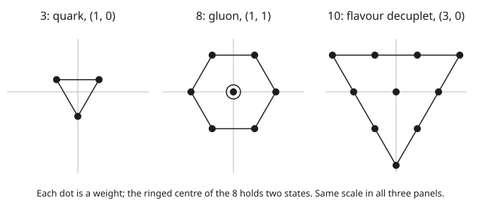

# Highest weights: every irreducible representation is fixed by its top weight, and Weyl's formula gives its size

[Syllabus](../../../SYLLABUS.md) → [Differential geometry and Lie groups](../README.md) → [Roots, Weights and Representations](../README.md#s08) → Highest weights

---

## General Overview

A quark carries one of three colour charges, called red, green and blue. The strong force does not care which colour is which: any rotation of the three colours that keeps lengths and has determinant 1 is a symmetry. Those rotations form the group $`SU(3)`$, the 3-by-3 complex matrices $`U`$ with $`U^* U = I`$ and determinant 1 ([Lie group](../06-Lie%20Groups/01-lie-groups-and-matrix-groups.md)).

Physics then asks for sizes. A quark has 3 colour states. A gluon, the particle that carries the force, has 8. A quark with an antiquark has 3 × 3 = 9 combined states, and exactly one of them is colourless. That one colourless state is why mesons exist.

Each of these is an **irreducible representation** of $`SU(3)`$: a space the group acts on that cannot be split into smaller pieces the group keeps apart ([Representation](../06-Lie%20Groups/05-representations-in-outline.md)). This card answers two questions about all of them at once:

- **Which irreducible representations exist?** Each one has a single "top" state, and the list of whole-number labels of that state, a pair $`(a, b)`$ for $`SU(3)`$, names the representation completely.
- **How big is each one?** Weyl's dimension formula reads the size straight off the label: $`(a + 1)(b + 1)(a + b + 2)/2`$. The quark $`(1, 0)`$ gives 3 and the gluon $`(1, 1)`$ gives 8. The same group, used for the quark flavours up, down and strange instead of colours, gives $`(3, 0)`$ = 10: the ten-member family of particles called the baryon decuplet.

**Every irreducible representation of a compact, connected, simply connected Lie group (one in which every loop shrinks to a point), such as SU(3), has one highest weight, a list of whole numbers that can be any dominant list and that fixes the representation exactly, and Weyl's formula turns that list into the representation's size.**

**What kind of fact this is:** a theorem. Uniqueness, and the whole-number and dominance conditions, are proved on this card in Why it works. Existence is proved for $`SU(3)`$ by an explicit construction, and in general only in outline. Weyl's character formula is stated with a named source and checked on ten representations; the dimension formula is derived from it in a fold.

### The picture: three representations as weight diagrams

<p align="center"></p>

Each dot is a **weight**: a label telling how the diagonal colour rotations act on one state. The highest weight is the dot furthest along the direction 60° above the horizontal, up and to the right; in the 8 it is the hexagon's upper right corner, not its rightmost dot. Every other dot is reached from it by stepping down along fixed directions. The 8 has 7 dots but 8 states, because its centre holds two.

---

## The formula

### Words first

- **The diagonal part.** Inside $`SU(3)`$ sit the diagonal matrices with entries $`e^{i\theta_1}, e^{i\theta_2}, e^{i\theta_3}`$ and $`\theta_1 + \theta_2 + \theta_3 = 0`$. They commute, so in any representation they can be diagonalised together.
- **Weight.** A state on which that diagonal matrix acts as multiplication by $`e^{i(\mu_1\theta_1 + \mu_2\theta_2 + \mu_3\theta_3)}`$ has weight $`\mu = (\mu_1, \mu_2, \mu_3)`$, three whole numbers. Adding 1 to all three changes nothing, since the $`\theta`$'s sum to 0. So the card records a weight by its two **labels** $`(\mu_1 - \mu_2,\ \mu_2 - \mu_3)`$. A red quark has $`\mu = (1, 0, 0)`$, labels $`(1, 0)`$.
- **Roots.** The weights of the 8, other than zero, are the **roots**: the six differences $`e_i - e_j`$ of colours, where $`e_1 = (1, 0, 0)`$ and so on ([The Killing form and roots](02-killing-form-and-root-decomposition.md)). Three are **positive**: $`\alpha_1 = e_1 - e_2`$, $`\alpha_2 = e_2 - e_3`$ and $`\alpha_1 + \alpha_2`$, with labels $`(2, -1)`$, $`(-1, 2)`$ and $`(1, 1)`$.
- **Raising and lowering.** The matrix $`E_{ij}`$ with a single 1 in row $`i`$, column $`j`$ turns colour $`j`$ into colour $`i`$. It moves every weight by $`e_i - e_j`$. For $`i < j`$ it raises; for $`i > j`$ it lowers.
- **Highest weight.** A state that every raising operator sends to zero is a **highest weight vector**. Its weight $`\lambda`$ is the **highest weight**.
- **Dominant.** A weight is **dominant integral** when both labels are whole numbers at least 0. Write it $`\lambda = (a, b)`$.
- **Rho.** $`\rho`$ is half the sum of the positive roots. Its labels are $`(1, 1)`$.
- **Pairing.** $`\langle \mu, \alpha\rangle`$ reads one number off a weight for each positive root: the first label for $`\alpha_1`$, the second for $`\alpha_2`$, their sum for $`\alpha_1 + \alpha_2`$.

### The highest weight theorem

For a compact, connected, simply connected Lie group such as $`SU(3)`$:

1. Every finite-dimensional irreducible representation has exactly one highest weight, and its highest weight vector is unique up to a scalar.
2. That highest weight is dominant integral.
3. Two irreducible representations with the same highest weight are the same, after a change of basis.
4. Every dominant integral weight is the highest weight of one irreducible representation, written $`V(\lambda)`$.

So the irreducible representations of $`SU(3)`$ are listed exactly by the pairs $`(a, b)`$ of whole numbers.

### Weyl's dimension formula

```math
\dim V(\lambda) = \prod_{\alpha > 0} \frac{\langle \lambda + \rho, \alpha\rangle}{\langle \rho, \alpha\rangle}
```

**Read it aloud:** shift the highest weight by rho, read off one number for each positive root, multiply them, and divide by the same product for rho alone.

For $`SU(3)`$, $`\lambda + \rho`$ has labels $`(a + 1, b + 1)`$, and the three positive roots read off $`a + 1`$, $`b + 1`$ and $`a + b + 2`$. Rho alone reads off 1, 1 and 2:

```math
\dim V(a, b) = \frac{(a + 1)(b + 1)(a + b + 2)}{2}
```

**Read it aloud:** one more than each label, times two more than their sum, halved.

For the gluons, $`(1, 1)`$: $`2 \times 2 \times 4 / 2 = 8`$.

### Weyl's character formula

The **character** $`\chi_\lambda`$ of $`V(\lambda)`$ is the trace of the diagonal matrix acting on it. Write $`z_k = e^{i\theta_k}`$ for the three diagonal entries. For $`SU(3)`$ the character is a ratio of two 3-by-3 determinants:

```math
\chi_{(a,b)}(z_1, z_2, z_3) = \frac{\det\big[z_k^{\,l_j}\big]}{\det\big[z_k^{\,3 - j}\big]}, \qquad (l_1, l_2, l_3) = (a + b + 2,\ b + 1,\ 0)
```

**Read it aloud:** build a 3-by-3 table of each $`z_k`$ raised to the shifted exponents, take its determinant, and divide by the same determinant for the trivial representation.

In general, with $`W`$ the **Weyl group** (here the six ways to reorder the three colours) and $`\varepsilon(w)`$ its sign:

```math
\chi_\lambda = \frac{\sum_{w \in W} \varepsilon(w)\, e^{w(\lambda + \rho)}}{\sum_{w \in W} \varepsilon(w)\, e^{w\rho}}
```

**Read it aloud:** the character is an alternating sum over the reorderings of the shifted highest weight, divided by the same sum for rho.

| Symbol | Plain meaning | In our example | Push it up and the answer… |
| --- | --- | --- | --- |
| $`SU(3)`$, $`U`$, $`I`$ | 3-by-3 complex matrices keeping lengths, determinant 1; a member; the identity | rotations of 3 colours | — |
| $`\theta_k`$, $`z_k`$; $`q`$, $`t`$ | the diagonal phases, summing to 0, and $`z_k = e^{i\theta_k}`$; variables of the limit in Step 6 | the check puts $`z = (1, 2, 3)`$ | — |
| $`\mu`$, $`e_k`$ | a weight $`(\mu_1, \mu_2, \mu_3)`$, recorded by its labels; the colour weights | red quark: $`e_1`$, labels $`(1, 0)`$ | — |
| $`\alpha`$, $`\alpha_1`$, $`\alpha_2`$ | roots; the two simple positive roots | labels $`(2, -1)`$, $`(-1, 2)`$ | — |
| $`E_{ij}`$ | turns colour $`j`$ into colour $`i`$; raises if $`i < j`$ | $`E_{21}`$: red to green | — |
| $`\lambda = (a, b)`$ | the highest weight's two labels | $`(1, 1)`$ for gluons | a bigger representation |
| $`\rho`$; $`\langle \mu, \alpha\rangle`$; $`(\mu, \alpha)`$ | half the sum of the positive roots; the number a weight shows to a positive root; the dot product, equal to $`\langle \mu, \alpha\rangle`$ for $`SU(3)`$ | $`\rho = (1, 1)`$; $`\langle \lambda + \rho, \alpha_1 + \alpha_2\rangle = 4`$ | — |
| $`V(\lambda)`$, $`\dim`$; $`M(\lambda)`$, $`L(\lambda)`$ | the irreducible representation with top $`\lambda`$ and its size; the Verma module and its irreducible quotient | $`\dim V(1, 1) = 8`$ | — |
| $`\chi_\lambda`$, $`l_j`$ | trace of the diagonal matrix on $`V(\lambda)`$; shifted exponents | the determinant ratio at $`z = (1, 2, 3)`$ is 60: $`\chi_{(1,1)}`$ times $`(z_1 z_2 z_3)^b`$, which is 1 on $`SU(3)`$ | — |
| $`W`$, $`w`$, $`\varepsilon(w)`$ | the Weyl group of reorderings; one of them; its sign, +1 for an even reordering | reorder red, green, blue | — |
| $`x_k`$, $`y_k`$ | quark and antiquark colour states, written as variables | $`x_1 y_3`$: red with anti-blue | — |
| $`v`$, $`V`$, $`V'`$, $`S`$ | a highest weight vector; representations in the proof | $`v = x_1 y_3`$ | — |

### When it holds

- **Finite-dimensional representations.** Drop this and every weight is a highest weight of something infinite (a Verma module, below). The weight $`(-3, 0)`$ fed to Weyl's product still gives 1.000, though no finite-dimensional representation has that top.
- **Whole-number labels.** The labels come from $`e^{i\theta}`$ returning to 1 after a full turn. Feed $`(1/2, 0)`$ to the product and it gives 1.875 states, which is no count.
- **A compact connected group, or its complexified Lie algebra** (the same matrices with complex entries allowed, here the traceless 3-by-3 complex matrices). Compactness gives complete reducibility: every representation is a sum of irreducible ones ([Peter-Weyl](../../20-Harmonic%20analysis/08-Harmonic%20Analysis%20on%20Groups/04-peter-weyl-theorem.md), Step 1). A group like the real 2-by-2 matrices of determinant 1 has infinite-dimensional unitary representations, and some of them (the principal series) have no highest weight at all.
- **Simply connected, for part 4.** In a group with a loop that does not shrink, the allowed weights are those of its own diagonal part, a smaller set. $`SO(3)`$ keeps only the even $`n`$ of [Representations of sl(2)](01-representations-of-sl2.md) (Step 8), and $`SU(3)`$ divided by its centre loses the quark $`(1, 0)`$, on which the centre acts by a cube root of 1 other than 1.
- **Semisimple, for the full list.** Semisimple means no continuous family of elements commutes with everything: the centre is finite, three multiples of $`I`$ for $`SU(3)`$. Equivalently, the Lie algebra has no nonzero solvable ideal, as in [The Killing form and roots](02-killing-form-and-root-decomposition.md). $`U(3)`$ adds a determinant factor: the labels then need a third number, the total charge, to name a representation.

---

## Why it works

### Step 0: diagonalise the commuting part, then climb

The diagonal matrices commute, so every representation splits into **weight spaces**, one per weight. The raising operators $`E_{12}`$, $`E_{23}`$, $`E_{13}`$ move a state up between weight spaces. A finite space has finitely many weights, so climbing must stop. Where it stops is a highest weight vector. Everything else is built back down from it.

### Step 1: raising and lowering move weights by roots

Conjugating $`E_{ij}`$ by a diagonal matrix multiplies it by $`e^{i(\theta_i - \theta_j)}`$. So if a state $`v`$ has weight $`\mu`$, then $`E_{ij} v`$ has weight $`\mu + e_i - e_j`$. This is the root decomposition of [The Killing form and roots](02-killing-form-and-root-decomposition.md), seen inside a representation.

### Step 2: a highest weight vector generates everything

Take an irreducible $`V`$ and a highest weight vector $`v`$ of weight $`\lambda`$. Apply lowering operators in every order. The span of the results is kept by the whole Lie algebra: lowering keeps it by construction, the diagonal part keeps it by Step 1, and a raising operator commuted past the lowering ones lands back in it. By irreducibility, the span is all of $`V`$.

Every state in it has weight $`\lambda`$ minus a sum of positive roots. Only $`v`$ itself has weight exactly $`\lambda`$. So the top weight space has size 1, and no other weight is higher. That is part 1.

### Step 3: the labels are whole numbers at least 0

The three matrices $`E_{12}`$, $`E_{21}`$ and their bracket form a copy of $`sl(2)`$. Under it, $`v`$ is a top state, and the eigenvalue it shows is the first label $`a`$. [Representations of sl(2)](01-representations-of-sl2.md) proved that a finite-dimensional $`sl(2)`$ representation has a whole-number top eigenvalue at least 0, with a string of $`a + 1`$ states below it. The same holds for $`E_{23}`$, $`E_{32}`$ and $`b`$. That is part 2.

### Step 4: one top, one representation

Let $`V`$ and $`V'`$ be irreducible, with highest weight vectors $`v`$ and $`v'`$ of the same weight $`\lambda`$. In $`V \oplus V'`$ the pair $`(v, v')`$ is again a highest weight vector, and it generates a representation $`S`$. By Step 2, $`S`$ has a top weight space of size 1, so it is irreducible: any splitting would have to put $`(v, v')`$ wholly in one piece. Projecting $`S`$ onto $`V`$ and onto $`V'`$ gives nonzero maps between irreducibles, isomorphisms by Schur's lemma, which says a nonzero map between irreducibles that respects the action is invertible ([Character tables](../../03-Algebra/12-Group%20Representations/03-character-tables.md) uses the same lemma). So $`V`$ and $`V'`$ are the same. That is part 3.

### Step 5: existence, built for SU(3) and outlined in general

For $`SU(3)`$, write quark states as variables $`x_1, x_2, x_3`$ and antiquark states as $`y_1, y_2, y_3`$. Polynomials with degree $`a`$ in the $`x`$'s and degree $`b`$ in the $`y`$'s carry the action

```math
E_{ij} = x_i \frac{\partial}{\partial x_j} - y_j \frac{\partial}{\partial y_i}
```

**Read it aloud:** turn one quark of colour $`j`$ into colour $`i`$, and one antiquark of anti-$`i`$ into anti-$`j`$, with a minus sign.

The monomial $`x_1^{a} y_3^{b}`$, red quarks and anti-blue antiquarks, has labels $`(a, b)`$, and both simple raising operators $`E_{12}`$ and $`E_{23}`$ kill it, so their bracket $`E_{13}`$ does too. Lowering from it generates a representation with a one-dimensional top, which is irreducible because compact groups split completely. So every $`(a, b)`$ occurs. The code does exactly this, by exact elimination in whole numbers.

For the gluons, start at $`x_1 y_3`$. Lowering gives $`E_{21}(x_1 y_3) = x_2 y_3`$ and $`E_{32}(x_1 y_3) = -x_1 y_2`$. One more step reaches weight zero twice: $`x_3 y_3 - x_2 y_2`$ and $`x_1 y_1 - x_2 y_2`$. The sum $`x_1 y_1 + x_2 y_2 + x_3 y_3`$ is never reached. It is the colourless singlet, and the 8 is everything traceless.

In general the construction is the **Verma module** $`M(\lambda)`$: all formal strings of lowering operators applied to a symbol $`v`$ that the raising operators kill. It is infinite, but it has a unique largest proper subrepresentation. The quotient $`L(\lambda)`$ is irreducible, and it is finite-dimensional exactly when $`\lambda`$ is dominant integral (Humphreys, sec. 20 to 21, in Sources). Then $`L(\lambda)`$ is $`V(\lambda)`$. That is part 4.

### Step 6: Weyl's dimension formula from the character formula

Weyl proved the character formula by integrating over the group with his integration formula. The proof is long and is not given here. Hall gives an algebraic proof in ch. 10 and Weyl's integration proof in ch. 12. The code checks it on all ten pairs with $`a + b \le 3`$, against the character of the representation it builds.

The size of $`V(\lambda)`$ is its character at the identity, where all $`z_k = 1`$. There both determinants vanish, so the size is a limit.

<details>
<summary>Detailed derivation: the dimension formula as a limit of the character formula</summary>

Put $`z = (q^2, q, 1)`$ and let $`q \to 1`$. Each determinant is then a Vandermonde determinant in powers of $`q`$:

$`\displaystyle \det\big[z_k^{\,l_j}\big] = \prod_{j < k} \big(q^{l_j} - q^{l_k}\big), \qquad \det\big[z_k^{\,3-j}\big] = \prod_{j < k} \big(q^{3 - j} - q^{3 - k}\big)`$

Each factor $`q^m - q^n`$ behaves like $`(m - n)(q - 1)`$ near $`q = 1`$. The three factors of $`(q - 1)`$ cancel top and bottom, leaving

$`\displaystyle \dim V(a, b) = \prod_{j < k} \frac{l_j - l_k}{k - j} = \frac{(a + 1)(a + b + 2)(b + 1)}{1 \cdot 2 \cdot 1}`$

since $`l_1 - l_2 = a + 1`$, $`l_1 - l_3 = a + b + 2`$ and $`l_2 - l_3 = b + 1`$.

In general, evaluate both alternating sums at the point $`t\rho`$, with $`(\mu, \alpha)`$ the dot product. Weyl's denominator identity writes $`\sum_w \varepsilon(w)\, e^{(w\mu, t\rho)}`$ as $`\prod_{\alpha > 0} \big(e^{t(\mu, \alpha)/2} - e^{-t(\mu, \alpha)/2}\big)`$, after swapping the roles of $`\mu`$ and $`\rho`$. Each factor is $`t(\mu, \alpha)`$ to first order. Dividing the product for $`\mu = \lambda + \rho`$ by the product for $`\mu = \rho`$ and letting $`t \to 0`$ leaves the product of $`(\lambda + \rho, \alpha)/(\rho, \alpha)`$. Each $`\langle \mu, \alpha\rangle`$ is $`(\mu, \alpha)`$ times $`2/(\alpha, \alpha)`$, a constant that cancels top and bottom, so this is the dimension formula. For $`SU(3)`$ every root has $`(\alpha, \alpha) = 2`$, and the two pairings agree.

</details>

### A second road to the size

$`V(a, b)`$ is also the traceless part of $`a`$ quarks and $`b`$ antiquarks, symmetrised. Polynomials of degree $`a`$ in the three quark variables, the states of $`a`$ quarks symmetrised, number $`\binom{a + 2}{2}`$. Removing the trace part, which is one degree lower on each side, leaves

```math
\dim V(a, b) = \binom{a + 2}{2}\binom{b + 2}{2} - \binom{a + 1}{2}\binom{b + 1}{2}
```

**Read it aloud:** all symmetric quark-antiquark states, minus those that are a colourless pair times something smaller.

For the gluons: 9 − 1 = 8. This count shares no arithmetic with Weyl's product, and the checks find the two agree.

---

## Worked numbers, by hand

| Step | Arithmetic | Value |
| --- | --- | --- |
| dominant weights with $`a + b \le 3`$ | all whole pairs | (0, 0), (1, 0), (0, 1), (2, 0), (1, 1), (0, 2), (3, 0), (2, 1), (1, 2), (0, 3) |
| quarks $`(1, 0)`$ | 2 × 1 × 3 / 2 | **3** |
| gluons $`(1, 1)`$ | 2 × 2 × 4 / 2 | **8** |
| flavour decuplet $`(3, 0)`$ | 4 × 1 × 5 / 2 | **10** |
| gluons by tensors | 9 − 1 | 8 |
| flavour decuplet by tensors | 10 − 0 | 10 |
| quark times antiquark | 3 × 3 = 8 + 1 | **9** |
| three quarks | 3 × 3 × 3 = 10 + 8 + 8 + 1 | **27** |

All ten sizes, by the code: 1, 3, 3, 6, 8, 6, 10, 15, 15, 10.

A quark-antiquark pair has 9 colour states, and exactly 1 is colourless; three quarks have 27, and again exactly 1 is colourless.

### What breaks if you drop a piece

| Mistake | Comes out at | What went wrong |
| --- | --- | --- |
| Non-dominant $`(-3, 0)`$ in Weyl's product | 1.000 | No finite-dimensional representation has that top; the product is ±1 here only by symmetry |
| Half-integer $`(1/2, 0)`$ | 1.875 | Labels must be whole numbers |
| Dropping $`\rho`$ for the quark | 0.000 states | The shift by rho is the formula |
| Counting dots in the 8 | 7, not 8 | The centre weight holds two states |

The code prints all four.

---

## Code, from first principles, and it actually runs

The code lists the ten dominant weights with $`a + b \le 3`$ and finds each size by four independent roads: Weyl's product, the traceless tensor count, building the representation from $`x_1^a y_3^b`$ by lowering operators with exact elimination, and Weyl's character formula as a ratio of determinants against the built representation's own character at $`z = (1, 2, 3)`$. The built side is multiplied by $`(z_1 z_2 z_3)^b`$, which is 1 on $`SU(3)`$. Both sides are then polynomials, so whole numbers stand in for the phases. It then splits tensor products by peeling off highest weights.

### Python

```python
# Highest weights and Weyl's dimension formula -- the check behind the card.
# Standard library only.  The group is SU(3); a highest weight is a pair (a, b)
# of whole numbers.  Each size is found four ways: Weyl's product, a count of
# traceless tensors, building the representation from its top vector by
# lowering operators, and Weyl's character formula as a ratio of determinants.
from math import comb, gcd

def weyl(a, b):                      # product over the 3 positive roots
    return (a + 1) * (b + 1) * (a + b + 2) / 2

def weyl_no_rho(a, b):               # the same product with the + rho shift left out
    return a * b * (a + b) / 2

def tensors(a, b):                   # Sym^a(3) x Sym^b(3bar), minus the trace part
    return comb(a + 2, 2) * comb(b + 2, 2) - comb(a + 1, 2) * comb(b + 1, 2)

# A state is a polynomial in x1, x2, x3 (quark) and y1, y2, y3 (antiquark):
# a dict from the six exponents to a whole-number coefficient.
def E(i, j, poly):                   # E_ij = x_i d/dx_j - y_j d/dy_i
    out = {}
    for m, c in poly.items():
        for src, dst, sign in ((j, i, 1), (3 + i, 3 + j, -1)):
            if m[src]:
                n = list(m); n[src] -= 1; n[dst] += 1
                out[tuple(n)] = out.get(tuple(n), 0) + sign * c * m[src]
    return {k: v for k, v in out.items() if v}

def build(a, b):                     # span of everything lowering reaches from the top
    rows, queue = {}, []             # rows: weight (exponent of x minus exponent of y)
    def insert(w):                   # exact elimination in whole numbers
        m = next(iter(w))
        wt = tuple(m[k] - m[3 + k] for k in range(3))
        for piv, r in rows.get(wt, []):
            if piv in w:
                c, d = w[piv], r[piv]
                w = {k: d * w.get(k, 0) - c * r.get(k, 0) for k in set(w) | set(r)}
                w = {k: v for k, v in w.items() if v}
                if not w:
                    return
        g = 0
        for v in w.values():
            g = gcd(g, v)
        w = {k: v // g for k, v in w.items()}
        rows.setdefault(wt, []).append((max(w), w))
        queue.append(w)
    top = {(a, 0, 0, 0, 0, b): 1}    # x1^a y3^b: the highest weight vector
    assert not E(0, 1, top) and not E(1, 2, top)   # both raising operators kill it
    insert(top)
    while queue:
        p = queue.pop()
        for i, j in ((1, 0), (2, 1)):  # the two lowering operators
            q = E(i, j, p)
            if q:
                insert(q)
    return {wt: len(r) for wt, r in rows.items()}

def labels(mu):                      # a weight in the (a, b) coordinates
    return (mu[0] - mu[1], mu[1] - mu[2])

def det3(M):
    return (M[0][0] * (M[1][1] * M[2][2] - M[1][2] * M[2][1])
            - M[0][1] * (M[1][0] * M[2][2] - M[1][2] * M[2][0])
            + M[0][2] * (M[1][0] * M[2][1] - M[1][1] * M[2][0]))

def weyl_character(a, b, z):         # Weyl's formula: alternating sum over alternating sum
    lam = (a + b, b, 0)
    num = det3([[zi ** (lam[j] + 2 - j) for j in range(3)] for zi in z])
    den = det3([[zi ** (2 - j) for j in range(3)] for zi in z])
    assert num % den == 0
    return num // den

def built_character(ch, b, z):       # sum of multiplicity times z^(weight + b)
    return sum(n * z[0] ** (m[0] + b) * z[1] ** (m[1] + b) * z[2] ** (m[2] + b)
               for m, n in ch.items())

def by_labels(ch):
    out = {}
    for m, n in ch.items():
        out[labels(m)] = out.get(labels(m), 0) + n
    return out

def times(c1, c2):                   # character of a tensor product
    out = {}
    for w1, n1 in c1.items():
        for w2, n2 in c2.items():
            w = (w1[0] + w2[0], w1[1] + w2[1])
            out[w] = out.get(w, 0) + n1 * n2
    return out

def split(ch):                       # peel off highest weights, one at a time
    ch, parts = dict(ch), []
    while any(ch.values()):
        top = max((w for w, n in ch.items() if n), key=lambda w: (w[0] + w[1], w[0]))
        parts.append(top)
        for w, n in by_labels(build(*top)).items():
            ch[w] -= n
    return parts

z = (1, 2, 3)
print("(a, b)  Weyl  tensors  built  character at z = (1, 2, 3): built, Weyl")
squares = 0
for s in range(4):
    for a in range(s, -1, -1):
        b = s - a
        ch = build(a, b)
        d, cb, cw = sum(ch.values()), built_character(ch, b, z), weyl_character(a, b, z)
        print(f"({a}, {b})  {int(weyl(a, b)):4d}  {tensors(a, b):7d}  {d:5d}  {cb:6d}, {cw}")
        assert weyl(a, b) == tensors(a, b) == d and cb == cw
        squares += d * d
for a, b in ((1, 0), (1, 1), (3, 0)):
    print(f"by hand, ({a}, {b}): Weyl {a + 1} x {b + 1} x {a + b + 2} / 2 = {int(weyl(a, b))}; "
          f"tensors {comb(a + 2, 2) * comb(b + 2, 2)} - {comb(a + 1, 2) * comb(b + 1, 2)}")
print(f"matrix entries of these ten, the sum of size squared: {squares}")
adj = by_labels(build(1, 1))
print(f"adjoint (1, 1): {len(adj)} distinct weights, {sum(adj.values())} states, "
      f"weight (0, 0) held {adj[(0, 0)]} times")
q, qb = by_labels(build(1, 0)), by_labels(build(0, 1))
for name, ch in (("3 x 3bar", times(q, qb)), ("3 x 3", times(q, q)),
                 ("3 x 3 x 3", times(times(q, q), q))):
    parts = split(ch)
    sizes = " + ".join(str(int(weyl(*p))) for p in parts) + f" = {sum(ch.values())}"
    print(f"{name} = {parts} -> {sizes}; colourless singlets: {parts.count((0, 0))}")
assert split(times(q, qb)) == [(1, 1), (0, 0)]
assert split(times(times(q, q), q)) == [(3, 0), (1, 1), (1, 1), (0, 0)]
for name, ab in (("3", (1, 0)), ("8", (1, 1)), ("10", (3, 0))):
    pts = sorted(((p, p + 2 * r), n) for (p, r), n in by_labels(build(*ab)).items())
    print(f"figure, {name}: " + " ".join(f"({X},{Y})x{n}" for (X, Y), n in pts))
print(f"mistake 1, non-dominant (-3, 0) in Weyl's product: {weyl(-3, 0):.3f}, no such representation")
print(f"mistake 2, half-integer (1/2, 0) in Weyl's product: {weyl(0.5, 0):.3f}, not a count")
print(f"mistake 3, dropping rho for the quark (1, 0): {weyl_no_rho(1, 0):.3f} states")
print(f"mistake 4, counting weight points for the adjoint: {len(adj)}, not {sum(adj.values())}")
assert len(adj) == 7 and adj[(0, 0)] == 2
print("ALL CHECKS PASS")
```

**Ran 2026-11-24 on macOS, Python 3.14.10, standard library only. All checks passed. Output, pasted from the run:**

```
(a, b)  Weyl  tensors  built  character at z = (1, 2, 3): built, Weyl
(0, 0)     1        1      1       1, 1
(1, 0)     3        3      3       6, 6
(0, 1)     3        3      3      11, 11
(2, 0)     6        6      6      25, 25
(1, 1)     8        8      8      60, 60
(0, 2)     6        6      6      85, 85
(3, 0)    10       10     10      90, 90
(2, 1)    15       15     15     239, 239
(1, 2)    15       15     15     444, 444
(0, 3)    10       10     10     575, 575
by hand, (1, 0): Weyl 2 x 1 x 3 / 2 = 3; tensors 3 - 0
by hand, (1, 1): Weyl 2 x 2 x 4 / 2 = 8; tensors 9 - 1
by hand, (3, 0): Weyl 4 x 1 x 5 / 2 = 10; tensors 10 - 0
matrix entries of these ten, the sum of size squared: 805
adjoint (1, 1): 7 distinct weights, 8 states, weight (0, 0) held 2 times
3 x 3bar = [(1, 1), (0, 0)] -> 8 + 1 = 9; colourless singlets: 1
3 x 3 = [(2, 0), (0, 1)] -> 6 + 3 = 9; colourless singlets: 0
3 x 3 x 3 = [(3, 0), (1, 1), (1, 1), (0, 0)] -> 10 + 8 + 8 + 1 = 27; colourless singlets: 1
figure, 3: (-1,1)x1 (0,-2)x1 (1,1)x1
figure, 8: (-2,0)x1 (-1,-3)x1 (-1,3)x1 (0,0)x2 (1,-3)x1 (1,3)x1 (2,0)x1
figure, 10: (-3,3)x1 (-2,0)x1 (-1,-3)x1 (-1,3)x1 (0,-6)x1 (0,0)x1 (1,-3)x1 (1,3)x1 (2,0)x1 (3,3)x1
mistake 1, non-dominant (-3, 0) in Weyl's product: 1.000, no such representation
mistake 2, half-integer (1/2, 0) in Weyl's product: 1.875, not a count
mistake 3, dropping rho for the quark (1, 0): 0.000 states
mistake 4, counting weight points for the adjoint: 7, not 8
ALL CHECKS PASS
```

### Rust

Same numbers, same labels, built with `rustc --edition 2021 -O`.

```rust
// Highest weights and Weyl's dimension formula -- the same check as the Python,
// in Rust.  No crates.  The group is SU(3); a highest weight is a pair (a, b) of
// whole numbers.  Each size is found four ways: Weyl's product, a count of
// traceless tensors, building the representation from its top vector by
// lowering operators, and Weyl's character formula as a ratio of determinants.
use std::collections::BTreeMap;
type Poly = BTreeMap<[i64; 6], i64>; // exponents of x1 x2 x3 y1 y2 y3 -> coefficient
type Char = BTreeMap<(i64, i64), i64>; // weight in (a, b) coordinates -> multiplicity

fn weyl(a: f64, b: f64) -> f64 { (a + 1.0) * (b + 1.0) * (a + b + 2.0) / 2.0 }
fn weyl_no_rho(a: f64, b: f64) -> f64 { a * b * (a + b) / 2.0 }
fn comb2(n: i64) -> i64 { n * (n - 1) / 2 }
fn tensors(a: i64, b: i64) -> i64 { comb2(a + 2) * comb2(b + 2) - comb2(a + 1) * comb2(b + 1) }
fn gcd(a: i64, b: i64) -> i64 { if b == 0 { a.abs() } else { gcd(b, a % b) } }

fn e_op(i: usize, j: usize, poly: &Poly) -> Poly { // E_ij = x_i d/dx_j - y_j d/dy_i
    let mut out = Poly::new();
    for (m, &c) in poly {
        for (src, dst, sign) in [(j, i, 1), (3 + i, 3 + j, -1)] {
            if m[src] > 0 {
                let mut n = *m;
                n[src] -= 1;
                n[dst] += 1;
                *out.entry(n).or_insert(0) += sign * c * m[src];
            }
        }
    }
    out.retain(|_, v| *v != 0);
    out
}

// span of everything lowering reaches from the top; returns weight -> multiplicity
fn build(a: i64, b: i64) -> BTreeMap<[i64; 3], i64> {
    let mut rows: BTreeMap<[i64; 3], Vec<([i64; 6], Poly)>> = BTreeMap::new();
    let mut queue: Vec<Poly> = Vec::new();
    let insert = |mut w: Poly, rows: &mut BTreeMap<[i64; 3], Vec<([i64; 6], Poly)>>, queue: &mut Vec<Poly>| {
        let m = *w.keys().next().unwrap();
        let wt = [m[0] - m[3], m[1] - m[4], m[2] - m[5]];
        for (piv, r) in rows.get(&wt).map(|v| v.as_slice()).unwrap_or(&[]) {
            if let Some(&c) = w.get(piv) {
                let d = r[piv];
                let mut nw = Poly::new();
                for (k, v) in &w { *nw.entry(*k).or_insert(0) += d * v }
                for (k, v) in r { *nw.entry(*k).or_insert(0) -= c * v }
                nw.retain(|_, v| *v != 0);
                if nw.is_empty() { return }
                w = nw;
            }
        }
        let g = w.values().fold(0, |g, &v| gcd(g, v));
        for v in w.values_mut() { *v /= g }
        let piv = *w.keys().next_back().unwrap();
        rows.entry(wt).or_default().push((piv, w.clone()));
        queue.push(w);
    };
    let mut top = Poly::new();
    top.insert([a, 0, 0, 0, 0, b], 1); // x1^a y3^b: the highest weight vector
    assert!(e_op(0, 1, &top).is_empty() && e_op(1, 2, &top).is_empty());
    insert(top, &mut rows, &mut queue);
    while let Some(p) = queue.pop() {
        for (i, j) in [(1, 0), (2, 1)] { // the two lowering operators
            let q = e_op(i, j, &p);
            if !q.is_empty() { insert(q, &mut rows, &mut queue) }
        }
    }
    rows.into_iter().map(|(k, v)| (k, v.len() as i64)).collect()
}

fn det3(m: [[i64; 3]; 3]) -> i64 {
    m[0][0] * (m[1][1] * m[2][2] - m[1][2] * m[2][1]) - m[0][1] * (m[1][0] * m[2][2] - m[1][2] * m[2][0])
        + m[0][2] * (m[1][0] * m[2][1] - m[1][1] * m[2][0])
}

fn weyl_character(a: i64, b: i64, z: [i64; 3]) -> i64 { // alternating sum over alternating sum
    let lam = [a + b, b, 0];
    let (mut num, mut den) = ([[0i64; 3]; 3], [[0i64; 3]; 3]);
    for i in 0..3 {
        for j in 0..3 {
            num[i][j] = z[i].pow((lam[j] + 2 - j as i64) as u32);
            den[i][j] = z[i].pow((2 - j) as u32);
        }
    }
    let (n, d) = (det3(num), det3(den));
    assert!(n % d == 0);
    n / d
}

fn built_character(ch: &BTreeMap<[i64; 3], i64>, b: i64, z: [i64; 3]) -> i64 {
    ch.iter().map(|(m, n)| n * (0..3).map(|k| z[k].pow((m[k] + b) as u32)).product::<i64>()).sum()
}

fn by_labels(ch: &BTreeMap<[i64; 3], i64>) -> Char {
    let mut out = Char::new();
    for (m, n) in ch { *out.entry((m[0] - m[1], m[1] - m[2])).or_insert(0) += n }
    out
}

fn times(c1: &Char, c2: &Char) -> Char { // character of a tensor product
    let mut out = Char::new();
    for (w1, n1) in c1 {
        for (w2, n2) in c2 { *out.entry((w1.0 + w2.0, w1.1 + w2.1)).or_insert(0) += n1 * n2 }
    }
    out
}

fn split(ch: &Char) -> Vec<(i64, i64)> { // peel off highest weights, one at a time
    let (mut ch, mut parts) = (ch.clone(), Vec::new());
    while ch.values().any(|&n| n != 0) {
        let top = *ch.iter().filter(|(_, &n)| n != 0).map(|(w, _)| w)
            .max_by_key(|w| (w.0 + w.1, w.0)).unwrap();
        parts.push(top);
        for (w, n) in by_labels(&build(top.0, top.1)) { *ch.entry(w).or_insert(0) -= n }
    }
    parts
}

fn show(parts: &[(i64, i64)]) -> String {
    let s: Vec<String> = parts.iter().map(|p| format!("({}, {})", p.0, p.1)).collect();
    format!("[{}]", s.join(", "))
}

fn main() {
    let z = [1, 2, 3];
    println!("(a, b)  Weyl  tensors  built  character at z = (1, 2, 3): built, Weyl");
    let mut squares = 0;
    for s in 0..4 {
        for a in (0..=s).rev() {
            let b = s - a;
            let ch = build(a, b);
            let d: i64 = ch.values().sum();
            let (cb, cw) = (built_character(&ch, b, z), weyl_character(a, b, z));
            let w = weyl(a as f64, b as f64);
            println!("({}, {})  {:4}  {:7}  {:5}  {:6}, {}", a, b, w as i64, tensors(a, b), d, cb, cw);
            assert!(w == tensors(a, b) as f64 && tensors(a, b) == d && cb == cw);
            squares += d * d;
        }
    }
    for (a, b) in [(1, 0), (1, 1), (3, 0)] {
        println!("by hand, ({}, {}): Weyl {} x {} x {} / 2 = {}; tensors {} - {}", a, b, a + 1, b + 1, a + b + 2,
                 weyl(a as f64, b as f64) as i64, comb2(a + 2) * comb2(b + 2), comb2(a + 1) * comb2(b + 1));
    }
    println!("matrix entries of these ten, the sum of size squared: {}", squares);
    let adj = by_labels(&build(1, 1));
    let adj_states: i64 = adj.values().sum::<i64>();
    println!("adjoint (1, 1): {} distinct weights, {} states, weight (0, 0) held {} times",
             adj.len(), adj_states, adj[&(0, 0)]);
    let (q, qb) = (by_labels(&build(1, 0)), by_labels(&build(0, 1)));
    let qqq = times(&times(&q, &q), &q);
    for (name, ch) in [("3 x 3bar", times(&q, &qb)), ("3 x 3", times(&q, &q)), ("3 x 3 x 3", qqq.clone())] {
        let parts = split(&ch);
        let sizes: Vec<String> = parts.iter().map(|p| format!("{}", weyl(p.0 as f64, p.1 as f64) as i64)).collect();
        println!("{} = {} -> {} = {}; colourless singlets: {}", name, show(&parts), sizes.join(" + "), ch.values().sum::<i64>(),
                 parts.iter().filter(|&&p| p == (0, 0)).count());
    }
    assert!(split(&times(&q, &qb)) == vec![(1, 1), (0, 0)]);
    assert!(split(&qqq) == vec![(3, 0), (1, 1), (1, 1), (0, 0)]);
    for (name, ab) in [("3", (1, 0)), ("8", (1, 1)), ("10", (3, 0))] {
        let mut pts: Vec<((i64, i64), i64)> =
            by_labels(&build(ab.0, ab.1)).iter().map(|(&(p, r), &n)| ((p, p + 2 * r), n)).collect();
        pts.sort();
        let s: Vec<String> = pts.iter().map(|((xx, yy), n)| format!("({},{})x{}", xx, yy, n)).collect();
        println!("figure, {}: {}", name, s.join(" "));
    }
    println!("mistake 1, non-dominant (-3, 0) in Weyl's product: {:.3}, no such representation", weyl(-3.0, 0.0));
    println!("mistake 2, half-integer (1/2, 0) in Weyl's product: {:.3}, not a count", weyl(0.5, 0.0));
    println!("mistake 3, dropping rho for the quark (1, 0): {:.3} states", weyl_no_rho(1.0, 0.0));
    println!("mistake 4, counting weight points for the adjoint: {}, not {}", adj.len(), adj_states);
    assert!(adj.len() == 7 && adj[&(0, 0)] == 2);
    println!("ALL CHECKS PASS");
}
```

**Ran 2026-11-24 on macOS, rustc 1.98.1, no crates. All checks passed. Output, pasted from the run:**

```
(a, b)  Weyl  tensors  built  character at z = (1, 2, 3): built, Weyl
(0, 0)     1        1      1       1, 1
(1, 0)     3        3      3       6, 6
(0, 1)     3        3      3      11, 11
(2, 0)     6        6      6      25, 25
(1, 1)     8        8      8      60, 60
(0, 2)     6        6      6      85, 85
(3, 0)    10       10     10      90, 90
(2, 1)    15       15     15     239, 239
(1, 2)    15       15     15     444, 444
(0, 3)    10       10     10     575, 575
by hand, (1, 0): Weyl 2 x 1 x 3 / 2 = 3; tensors 3 - 0
by hand, (1, 1): Weyl 2 x 2 x 4 / 2 = 8; tensors 9 - 1
by hand, (3, 0): Weyl 4 x 1 x 5 / 2 = 10; tensors 10 - 0
matrix entries of these ten, the sum of size squared: 805
adjoint (1, 1): 7 distinct weights, 8 states, weight (0, 0) held 2 times
3 x 3bar = [(1, 1), (0, 0)] -> 8 + 1 = 9; colourless singlets: 1
3 x 3 = [(2, 0), (0, 1)] -> 6 + 3 = 9; colourless singlets: 0
3 x 3 x 3 = [(3, 0), (1, 1), (1, 1), (0, 0)] -> 10 + 8 + 8 + 1 = 27; colourless singlets: 1
figure, 3: (-1,1)x1 (0,-2)x1 (1,1)x1
figure, 8: (-2,0)x1 (-1,-3)x1 (-1,3)x1 (0,0)x2 (1,-3)x1 (1,3)x1 (2,0)x1
figure, 10: (-3,3)x1 (-2,0)x1 (-1,-3)x1 (-1,3)x1 (0,-6)x1 (0,0)x1 (1,-3)x1 (1,3)x1 (2,0)x1 (3,3)x1
mistake 1, non-dominant (-3, 0) in Weyl's product: 1.000, no such representation
mistake 2, half-integer (1/2, 0) in Weyl's product: 1.875, not a count
mistake 3, dropping rho for the quark (1, 0): 0.000 states
mistake 4, counting weight points for the adjoint: 7, not 8
ALL CHECKS PASS
```

The two outputs match line for line.

### Lean

Lean proves the size arithmetic for every dominant integral weight $`(a, b)`$, not the highest weight theorem itself, and checks the worked numbers.

- Take any dominant integral weight $`(a, b)`$. Then Weyl's product over the three positive roots, shifted by $`\rho`$, equals $`(a + 1)(b + 1)(a + b + 2)/2`$.
- Take any dominant integral weight $`(a, b)`$. Then all symmetric quark-antiquark states minus the trace part number exactly $`(a + 1)(b + 1)(a + b + 2)/2`$.
- Take any dominant integral weight $`(a, b)`$. Then $`(a + 1)(b + 1)(a + b + 2)`$ is even, so the size is a whole number.
- The worked sums hold: 3, 8 and 10 by Weyl's product, and 9 − 1 = 8 and 10 − 0 = 10 by tensors.
- The products hold too: 3 × 3 = 8 + 1, 3 × 3 = 6 + 3 and 3 × 3 × 3 = 10 + 8 + 8 + 1.
- The ten sizes with $`a + b \le 3`$ match the code's table, and their squares add to 805.
- The first Try changing guess holds: $`(2, 2)`$ has size 27.

Building each representation, counting its states and checking the character formula are left to the Python and Rust checks.

```lean
-- Highest weights: Weyl's dimension formula for SU(3) is a whole number and agrees with the traceless tensor count, checked on the card's quark, gluon and decuplet sizes.
import Mathlib.Data.Nat.Choose.Basic
import Mathlib.Algebra.BigOperators.Fin
import Mathlib.Tactic.NormNum
import Mathlib.Tactic.Ring
import Mathlib.Tactic.FieldSimp

/-- Helper: `(n + 1).choose 2`, read as a rational number, is `(n + 1) n / 2`. -/
theorem succ_choose_two_cast (n : ℕ) : ((n + 1).choose 2 : ℚ) = (n + 1) * n / 2 := by
  have h : (n + 1) * n.choose 1 = (n + 1).choose 2 * 2 := Nat.add_one_mul_choose_eq n 1
  rw [Nat.choose_one_right] at h
  have h' : ((n + 1 : ℕ) : ℚ) * n = ((n + 1).choose 2 : ℚ) * 2 := by exact_mod_cast h
  push_cast at h'
  rw [eq_div_iff (by norm_num)]
  exact h'.symm

#print axioms succ_choose_two_cast

/-- Weyl's dimension formula for SU(3) gives the same size as the second road: for every
dominant integral highest weight `(a, b)` (two whole numbers at least 0), the Weyl size
`(a + 1)(b + 1)(a + b + 2)/2` equals the number of symmetric states of `a` quarks and `b`
antiquarks, `C(a + 2, 2) C(b + 2, 2)`, minus the trace part, `C(a + 1, 2) C(b + 1, 2)`. -/
theorem weyl_dimension_su3_eq_traceless_tensor_count (a b : ℕ) :
    ((a + 1 : ℚ) * (b + 1) * (a + b + 2)) / 2 =
      ((a + 2).choose 2 * (b + 2).choose 2 : ℚ) - ((a + 1).choose 2 * (b + 1).choose 2 : ℚ) := by
  rw [succ_choose_two_cast (a + 1), succ_choose_two_cast (b + 1),
    succ_choose_two_cast a, succ_choose_two_cast b]
  push_cast
  ring

/-- Weyl's product over the three positive roots of SU(3), `α₁`, `α₂` and `α₁ + α₂`, read
through the labels: a positive root with label coefficients `(c₁, c₂)` reads `c₁ x + c₂ y` off a
weight with labels `(x, y)`, and `ρ` has labels `(1, 1)`. Shifting `(a, b)` by `ρ`, multiplying
the three readings and dividing by the same product for `ρ` alone gives
`(a + 1)(b + 1)(a + b + 2)/2`. -/
theorem weyl_product_over_positive_roots_su3 (a b : ℕ) :
    (∏ c : Fin 3, ((![1, 0, 1] c : ℚ) * (a + 1) + (![0, 1, 1] c : ℚ) * (b + 1)) /
        ((![1, 0, 1] c : ℚ) * 1 + (![0, 1, 1] c : ℚ) * 1)) =
      ((a + 1 : ℚ) * (b + 1) * (a + b + 2)) / 2 := by
  simp only [Fin.prod_univ_three]
  simp
  ring

/-- Weyl's formula counts states: for every dominant integral weight `(a, b)` the product
`(a + 1)(b + 1)(a + b + 2)` is even, so the size it gives is a whole number. -/
theorem weyl_dimension_su3_is_whole_number (a b : ℕ) :
    2 ∣ (a + 1) * (b + 1) * (a + b + 2) := by
  rcases Nat.mod_two_eq_zero_or_one a with ha | ha <;>
    rcases Nat.mod_two_eq_zero_or_one b with hb | hb <;>
    · apply Nat.dvd_of_mod_eq_zero
      simp [Nat.mul_mod, Nat.add_mod, ha, hb]

-- Quarks (1, 0): 2 × 1 × 3 / 2 = 3.
example : (1 + 1) * (0 + 1) * (1 + 0 + 2) / 2 = 3 := by norm_num
-- Gluons (1, 1): 2 × 2 × 4 / 2 = 8.
example : (1 + 1) * (1 + 1) * (1 + 1 + 2) / 2 = 8 := by norm_num
-- Flavour decuplet (3, 0): 4 × 1 × 5 / 2 = 10.
example : (3 + 1) * (0 + 1) * (3 + 0 + 2) / 2 = 10 := by norm_num
-- Gluons by tensors: 9 − 1 = 8.
example : (1 + 2).choose 2 * (1 + 2).choose 2 - (1 + 1).choose 2 * (1 + 1).choose 2 = 8 := by decide
-- Decuplet by tensors: 10 − 0 = 10.
example : (3 + 2).choose 2 * (0 + 2).choose 2 - (3 + 1).choose 2 * (0 + 1).choose 2 = 10 := by decide
-- Quark times antiquark, sizes by Weyl's formula: 3 × 3 = 8 + 1.
example : ((1 + 1) * (0 + 1) * (1 + 0 + 2) / 2) * ((0 + 1) * (1 + 1) * (0 + 1 + 2) / 2) =
    (1 + 1) * (1 + 1) * (1 + 1 + 2) / 2 + (0 + 1) * (0 + 1) * (0 + 0 + 2) / 2 := by norm_num
-- Quark times quark, sizes by Weyl's formula: 3 × 3 = 6 + 3.
example : ((1 + 1) * (0 + 1) * (1 + 0 + 2) / 2) * ((1 + 1) * (0 + 1) * (1 + 0 + 2) / 2) =
    (2 + 1) * (0 + 1) * (2 + 0 + 2) / 2 + (0 + 1) * (1 + 1) * (0 + 1 + 2) / 2 := by norm_num
-- Three quarks, sizes by Weyl's formula: 3 × 3 × 3 = 10 + 8 + 8 + 1.
example : ((1 + 1) * (0 + 1) * (1 + 0 + 2) / 2) ^ 3 =
    (3 + 1) * (0 + 1) * (3 + 0 + 2) / 2 + (1 + 1) * (1 + 1) * (1 + 1 + 2) / 2 +
      (1 + 1) * (1 + 1) * (1 + 1 + 2) / 2 + (0 + 1) * (0 + 1) * (0 + 0 + 2) / 2 := by norm_num
-- The ten sizes with a + b ≤ 3, in the card's order: 1, 3, 3, 6, 8, 6, 10, 15, 15, 10.
example : (List.map (fun p : ℕ × ℕ => (p.1 + 1) * (p.2 + 1) * (p.1 + p.2 + 2) / 2)
    [(0, 0), (1, 0), (0, 1), (2, 0), (1, 1), (0, 2), (3, 0), (2, 1), (1, 2), (0, 3)]) =
    [1, 3, 3, 6, 8, 6, 10, 15, 15, 10] := by decide
-- Their sizes squared add to 805.
example : (List.map (fun p : ℕ × ℕ => ((p.1 + 1) * (p.2 + 1) * (p.1 + p.2 + 2) / 2) ^ 2)
    [(0, 0), (1, 0), (0, 1), (2, 0), (1, 1), (0, 2), (3, 0), (2, 1), (1, 2), (0, 3)]).sum =
    805 := by decide
-- Try changing: (2, 2) has size 3 × 3 × 6 / 2 = 27.
example : (2 + 1) * (2 + 1) * (2 + 2 + 2) / 2 = 27 := by norm_num

#print axioms weyl_dimension_su3_eq_traceless_tensor_count
#print axioms weyl_product_over_positive_roots_su3
#print axioms weyl_dimension_su3_is_whole_number
```

**Checked 2026-11-24 on macOS, Lean 4.36.0-rc2, Mathlib v4.36.0-rc2. Every proof is complete and uses only Lean's standard axioms. Output, pasted from the run:**

```
'succ_choose_two_cast' depends on axioms: [propext, Classical.choice, Quot.sound]
'weyl_dimension_su3_eq_traceless_tensor_count' depends on axioms: [propext, Classical.choice, Quot.sound]
'weyl_product_over_positive_roots_su3' depends on axioms: [propext, Classical.choice, Quot.sound]
'weyl_dimension_su3_is_whole_number' depends on axioms: [propext]
```

> [!TIP]
> **Try changing**
> - **Guess first:** what size does $`(2, 2)`$ have? Change `range(4)` to `range(5)`. The new rows include (2, 2) at 27, and all four roads still agree.
> - **Guess first:** what if only one lowering operator is used? Change `((1, 0), (2, 1))` in `build` to `((1, 0),)`. The quark comes out at 2 states, a single $`sl(2)`$ string, and the assert in the main loop stops the run.
> - **Guess first:** can the start be any state? Change the top to `(0, a, 0, 0, 0, b)`, green instead of red. A raising operator no longer kills it, and the assert inside `build` stops the run.
> - **Guess first:** why is the size a limit? Set `z = (1, 1, 1)`. Both determinants are 0, and the division fails.

---

## The usual mistake

> [!warning]
> **Counting weights instead of states.** A weight diagram's dots are not the representation's size. The 8 has 7 dots: its centre carries two independent states, $`x_1 y_1 - x_2 y_2`$ and $`x_3 y_3 - x_2 y_2`$. Larger representations have centres carrying more.
>
> - **Feeding any weight to the formula.** $`(-3, 0)`$ gives 1.000 and $`(1/2, 0)`$ gives 1.875. The formula is only a size for dominant integral weights.
> - **Forgetting rho.** Without the shift, the quark comes out at 0.000 states instead of 3.
> - **Taking 3 and 3-bar as one representation.** Both have 3 states, but their tops differ, $`(1, 0)`$ against $`(0, 1)`$. Quark times quark is 6 + 3-bar, with 0 colourless states; quark times antiquark holds 1.

---

## Where you meet it in real life

- **Why hadrons have two or three quarks.** Observed particles carry no net colour, a rule called confinement that experiment supports but that, as of 2026-11-24, is not proved from the theory. Quark times antiquark has 1 colourless state: mesons. Three quarks have 1: baryons, such as the proton. Two quarks have 0, so no two-quark particle is seen.
- **Gluons.** The force carriers sit in the 8, the adjoint representation $`(1, 1)`$: the group acting on its own Lie algebra. A ninth, colourless gluon would need the group $`U(3)`$, not $`SU(3)`$.
- **The decuplet and the omega-minus.** The light quark flavours up, down and strange obey an approximate $`SU(3)`$ of their own (Gell-Mann, 1962). Its $`(3, 0)`$ has 10 members. When the scheme was proposed one member was missing; its discovery as a hyperon with strangeness minus three in 1964 (Barnes and others) confirmed the scheme.
- **Fourier analysis on the group.** Every irreducible representation of $`SU(3)`$ is a $`V(a, b)`$. By [Peter-Weyl](../../20-Harmonic%20analysis/08-Harmonic%20Analysis%20on%20Groups/04-peter-weyl-theorem.md), the matrix entries of all of them form a basis of the finite-energy functions on $`SU(3)`$. The ten with $`a + b \le 3`$ already give 805 basis functions, the sum of their sizes squared.

> **Say it back**
> Inside $`SU(3)`$ the diagonal matrices commute, so every representation splits into weights. Raising operators climb the weights, and in an irreducible representation the climb ends at one highest weight vector, from which lowering builds everything. Its labels $`(a, b)`$ are whole numbers at least 0, and every such pair occurs exactly once. Weyl's formula gives the size, $`(a + 1)(b + 1)(a + b + 2)/2`$: 3 quark colours, 8 gluons, and 10 in the flavour decuplet. Splitting 3 × 3-bar into 8 + 1 finds the one colourless meson state.

---

## What this builds on

- [Root systems and Dynkin diagrams](03-root-systems-and-dynkin-diagrams.md): the positive roots, simple roots and Weyl group that the formula runs over.
- [Representations of sl(2)](01-representations-of-sl2.md): whole-number tops and strings, used for each simple root in Step 3.
- [Character tables](../../03-Algebra/12-Group%20Representations/03-character-tables.md): characters as traces, and Schur's lemma.
- [Peter-Weyl](../../20-Harmonic%20analysis/08-Harmonic%20Analysis%20on%20Groups/04-peter-weyl-theorem.md): complete reducibility for compact groups, and the matrix entries as a basis.

## Where this goes next

- Lie algebras in depth (planned): the full proof of Weyl's character formula, and weight multiplicities by Freudenthal's and Kostant's formulas.

The theorem names and sizes every irreducible piece; it leaves open how many times a given weight occurs inside $`V(\lambda)`$, the multiplicity that made the gluon diagram's centre double.

---

## Sources

Verified 2026-11-24: every link below resolves to the publisher's page.

- Hall, Brian C. *Lie Groups, Lie Algebras, and Representations*, 2nd ed. Springer, 2015. [DOI 10.1007/978-3-319-13467-3](https://doi.org/10.1007/978-3-319-13467-3). The highest weight theorem for $`sl(3)`$ and in general, with Weyl's character and dimension formulas proved.
- Fulton, William, and Joe Harris. *Representation Theory: A First Course*. Springer, 1991. [DOI 10.1007/978-1-4612-0979-9](https://doi.org/10.1007/978-1-4612-0979-9). Lectures 12 and 13 build the representations of $`sl(3)`$ by hand; Lecture 24 gives Weyl's character formula.
- Humphreys, James E. *Introduction to Lie Algebras and Representation Theory*. Springer, 1972. [DOI 10.1007/978-1-4612-6398-2](https://doi.org/10.1007/978-1-4612-6398-2). Sections 20 to 24: Verma modules in their standard-cyclic form, existence and finiteness, and Weyl's formulas.
- Gell-Mann, M. "Symmetries of Baryons and Mesons." *Physical Review* 125, 1067 (1962). [DOI 10.1103/PhysRev.125.1067](https://doi.org/10.1103/PhysRev.125.1067). The approximate flavour $`SU(3)`$ of the light hadrons.
- Barnes, V. E., and others. "Observation of a Hyperon with Strangeness Minus Three." *Physical Review Letters* 12, 204 (1964). [DOI 10.1103/PhysRevLett.12.204](https://doi.org/10.1103/PhysRevLett.12.204). The discovery of the omega-minus, the decuplet's missing member.
