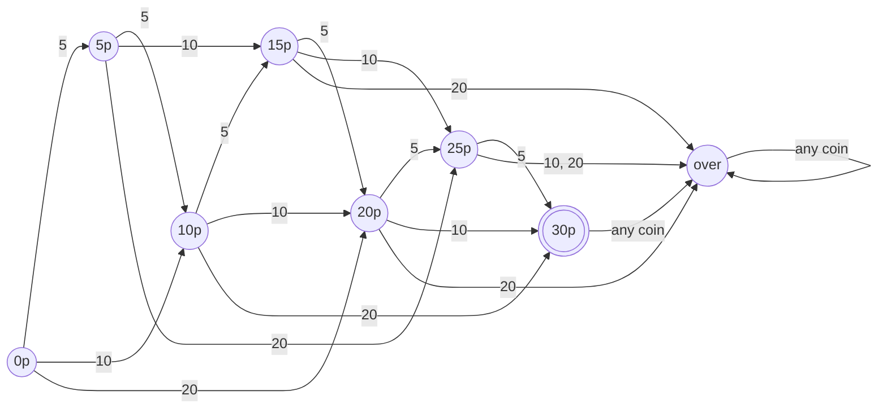
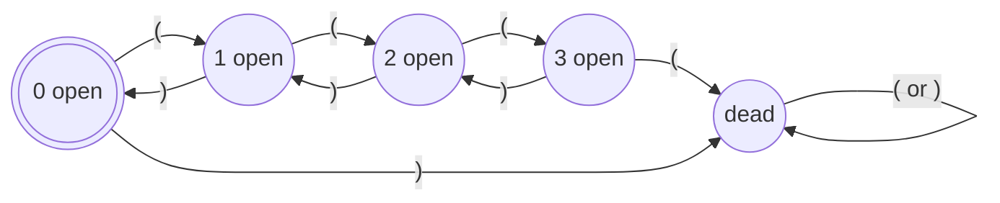

# Finite automata: fixed memory reads once and decides accept or reject

[Syllabus](../../../SYLLABUS.md) → [Computability and complexity](../README.md) → [Models of Computation](../README.md#s01) → Finite automata

---

## General Overview

A coffee machine sells a cup for 30p. It takes 5p, 10p and 20p coins and gives no change. Coins drop in one at a time, and the machine must decide whether the coffee is paid for.

The machine does not keep a list of the coins. It keeps one number, the credit so far: 0p, 5p, 10p, and so on up to 30p, plus one more setting, "over", for a customer who has put in too much. Eight settings in all. A 10p, two 5p and a 10p move it 0p → 10p → 15p → 20p → 30p, and the cup is paid for.

Those eight settings are the machine's whole memory. Eight settings fit in 3 bits, however many coins arrive. A machine like this is a **finite automaton** (plural automata): a fixed set of settings, called **states**, and a rule that moves it from one state to the next as each symbol arrives.

Fixed memory is cheap and fast, but limited. A bracket checker must match every "(" with a later ")", and no machine with a fixed number of states can do that at every depth.

**A finite automaton reads its input once, left to right, moving between a fixed number of states, and accepts the input exactly when it ends in an accepting state; the patterns it can recognise are those where a bounded summary of the past is enough.**

**What kind of fact this is:** the machine and its language are definitions. Two theorems are proved on this card in Why it works: the coin machine accepts exactly the coin sequences worth 30p, and no finite automaton checks balanced brackets of every depth.

### The picture: the coin machine

Each circle is a state, named by the credit. Each arrow is labelled by the coin that causes it. The double circle is the accepting state.



The machine starts at 0p. Every state has exactly one arrow for every coin, so there is never a choice to make.

---

## The formula

- An **alphabet** $`\Sigma`$ (capital sigma) is a finite set of symbols. Here $`\Sigma = \{5, 10, 20\}`$: each symbol is a coin, named by its value in pence.
- A **string** $`w`$ is a finite sequence of symbols, such as `10 5 5 10`. Its **length** $`\lvert w\rvert`$ is how many symbols it has, written $`n`$ on this shelf.
- The **empty string** $`\varepsilon`$ (epsilon) has no symbols: no coins inserted. Elsewhere in the library $`\varepsilon`$ is a small allowance; on this shelf it is the empty string.
- $`\Sigma^*`$ (sigma star) is the set of all strings over $`\Sigma`$, of every length, including $`\varepsilon`$.
- A **language** $`L`$ is any set of strings, that is, any subset of $`\Sigma^*`$ ([Sets](../../01-Foundations/07-Sets/01-sets-and-membership.md)). "Coin sequences worth exactly 30p" is a language.

A **finite automaton** (more fully, a deterministic finite automaton) is five things:

```math
M = (Q,\ \Sigma,\ \delta,\ q_0,\ F)
```

**Read it aloud:** a machine M is a finite set of states, an alphabet, a rule for moving, a start state and a set of accepting states.

The rule $`\delta`$ (delta) is a function ([Functions](../../01-Foundations/08-Relations%20and%20Functions/02-functions.md)): it takes a state $`q`$ and a symbol $`a`$ and returns exactly one next state, $`\delta(q, a)`$. Later shelves reuse $`\delta`$ for a failure probability; here it is always the rule. For the coin machine:

```math
\delta(q, a) = \begin{cases} q + a & \text{if } q \ne \text{over and } q + a \le 30 \\ \text{over} & \text{otherwise} \end{cases}
```

**Read it aloud:** add the coin to the credit, unless that passes 30p or the machine is already over, in which case go to "over".

To run the machine on a whole string, apply the rule once per symbol. Write $`\hat\delta(q, w)`$ (delta hat) for the state reached from $`q`$ after reading all of $`w`$, and $`wa`$ for the string $`w`$ followed by one more symbol $`a`$:

```math
\hat\delta(q, \varepsilon) = q, \qquad \hat\delta(q, wa) = \delta(\hat\delta(q, w), a)
```

**Read it aloud:** reading nothing leaves the state alone; reading one more symbol takes one more step from wherever the string so far ended.

The machine's language $`L(M)`$ is every string that ends in an accepting state:

```math
L(M) = \{\, w \in \Sigma^* : \hat\delta(q_0, w) \in F \,\}
```

**Read it aloud:** the language of M is the set of strings that drive M from its start state into an accepting state.

A language is **regular** when some finite automaton accepts exactly it. The coin language is regular, because the machine above accepts it.

| Symbol | Plain meaning | In our example | Push it up and the answer… |
| --- | --- | --- | --- |
| $`\Sigma`$ | the alphabet: the symbols the machine can read | the coins 5, 10, 20 | more arrows leave every state |
| $`a`$, $`w`$ | one symbol; a string: a finite sequence of symbols | one coin, such as 10; `10 5 5 10` | — |
| $`\lvert w\rvert`$, $`n`$ | the length of $`w`$ | 4 coins | one more step per symbol, no more memory |
| $`\varepsilon`$ | the empty string, length 0 | no coins inserted | — |
| $`\Sigma^*`$ | every string over $`\Sigma`$ | every possible coin sequence | — |
| $`M`$ | a machine: its states, alphabet, rule, start state and accepting states | the coin machine | — |
| $`Q`$, $`q`$, $`N`$ | the finite set of states; one state; how many states there are | 0p, 5p, …, 30p, over: $`N = 8`$ | more patterns fit, more bits of memory |
| $`q_0`$ | the start state | 0p | — |
| $`F`$ | the accepting states | 30p only | more strings accepted |
| $`\delta(q, a)`$, $`\hat\delta(q, w)`$ | the rule: one state and one symbol give the next state; the state after reading all of $`w`$ from $`q`$ | $`\delta(15, 10) = 25`$; $`\hat\delta(0, \text{10 5 5 10}) = 30`$ | — |
| $`L`$, $`L(M)`$ | a language; the language machine M accepts | coin sequences worth exactly 30p | — |
| $`s(w)`$, $`c(k)`$ | the total of the coins in $`w`$; how many coin sequences are worth $`k`$ 5p units | $`s(\text{10 5 5 10}) = 30`$; $`c(6) = 18`$ | a higher price: more sequences accepted |

### When it holds

- **Finitely many states.** This is the fixed memory. Allow a counter that can grow without limit and the machine is no longer a finite automaton; it can then check brackets, which no finite automaton can.
- **Exactly one move for every state and symbol.** The "over" state is there for this. Remove it and an overpayment has no move; the complement trick in Why it works then fails, accepting 23 strings instead of 1,075. Allowing several moves gives [Guessing machines](02-nondeterminism-and-the-subset-construction.md), which turn out to be no stronger.
- **One pass, left to right, read only.** The machine never goes back and never writes. Moving both ways on a tape and writing on it gives [Turing machines](07-turing-machines.md).
- **The verdict comes at the end.** Passing through 30p and then taking another coin ends in "over", which is a reject. The machine judges the whole string, not a prefix.

---

## Why it works

### Step 0: the state is a summary that is enough for the future

The machine forgets the order of the coins. After `20 10` and after `10 20` it is in the same state, 30p. That loss does no harm, because every future verdict depends only on the credit, never on how it was made up.

That is the whole idea: a summary of the past that is enough to finish the job and takes only finitely many values.

### Step 1: the machine tracks the credit exactly

Claim: after reading any string $`w`$, the machine is in state "sum of $`w`$" when that sum is at most 30p, and in "over" otherwise.

The proof is induction on the length of $`w`$: true for the empty string, and each coin keeps it true. So $`L(M)`$ is exactly the coin sequences worth 30p, the first theorem.

<details>
<summary>Detailed proof: the state always equals the capped credit</summary>

Write $`s(w)`$ for the sum of the coins in $`w`$. The claim is: $`\hat\delta(0, w) = s(w)`$ if $`s(w) \le 30`$, and $`\hat\delta(0, w) = \text{over}`$ if $`s(w) > 30`$.

For the empty string, $`\hat\delta(0, \varepsilon) = 0 = s(\varepsilon)`$, and 0 is at most 30.

Suppose the claim holds for $`w`$, and add one coin $`a`$. Sums only grow, since every coin is positive. If $`s(w) > 30`$, the machine is in "over", stays there, and $`s(wa) > 30`$ too. If $`s(w) \le 30`$, the machine is in state $`s(w)`$, and the rule sends it to $`s(w) + a = s(wa)`$ when that is at most 30, and to "over" when it is more.

Either way the claim holds for $`wa`$. By induction it holds for every string. Then $`\hat\delta(0, w) = 30`$ exactly when $`s(w) = 30`$, so $`L(M)`$ is the set of coin sequences worth exactly 30p.

</details>

How many such sequences are there? Count in 5p units, so 30p is 6 units and the coins are 1, 2 and 4 units. Sort the sequences worth $`k`$ units by their last coin. The coins before it are worth $`k - 1`$, $`k - 2`$ or $`k - 4`$ units, so the counts $`c(k)`$ obey:

```math
c(k) = c(k-1) + c(k-2) + c(k-4), \qquad c(0) = 1
```

**Read it aloud:** the ways to make k units are the ways ending in a 5p, plus those ending in a 10p, plus those ending in a 20p. A term with a negative argument counts as 0.

That gives 1, 1, 2, 3, 6, 10, 18 for 0p to 30p: 18 sequences.

### Step 2: the cost is one step per symbol and no extra memory

The machine makes one move per coin: a string of length $`n`$ takes $`n`$ steps. Its memory is one state out of 8, which is 3 bits, whatever $`n`$ is. Nothing else about the input is stored.

### Step 3: small machines combine into bigger ones

Suppose the shop adds a rule: at most 3 coins, so the slot does not jam. A second machine B counts coins: 0, 1, 2, 3, or "4 or more", five states.

To check both rules at once, run the two machines side by side. The **product machine** has a pair of states, one from each machine, and moves both parts on every coin. It accepts when the coin machine says 30p and B says 3 or fewer. That gives 8 × 5 = 40 pairs, of which 19 can be reached from the start. It accepts 6 sequences, such as `10 20` and `5 5 20`.

The same pairs with a different accepting set give "either rule passes" (union). Swapping the accepting and rejecting states of a complete machine gives "not exactly 30p" (complement). So regular languages are **closed** under intersection, union and complement: combining regular languages this way always gives another regular language ([Set operations](../../01-Foundations/07-Sets/03-set-operations.md)).

<details>
<summary>Detailed proof: the product machine accepts the intersection</summary>

Let $`M_1 = (Q_1, \Sigma, \delta_1, p_0, F_1)`$ and $`M_2 = (Q_2, \Sigma, \delta_2, r_0, F_2)`$ read the same alphabet. Build $`P`$ with states the pairs $`(p, r)`$, start $`(p_0, r_0)`$, and rule $`\delta((p, r), a) = (\delta_1(p, a), \delta_2(r, a))`$ ([Ordered pairs and the Cartesian product](../../01-Foundations/07-Sets/05-ordered-pairs-and-cartesian-product.md)).

By induction on the length of $`w`$, exactly as in Step 1, $`\hat\delta((p_0, r_0), w) = (\hat\delta_1(p_0, w), \hat\delta_2(r_0, w))`$: each half of the pair moves as its own machine would.

With accepting pairs $`F_1 \times F_2`$, $`P`$ accepts $`w`$ exactly when both machines do: $`L(P) = L(M_1) \cap L(M_2)`$. With accepting pairs "first in $`F_1`$ or second in $`F_2`$" it accepts the union. For the complement, keep $`M_1`$ and take $`Q_1`$ minus $`F_1`$ as the accepting set: because every string reaches exactly one state, it lands outside $`F_1`$ exactly when $`M_1`$ rejects it. The proof needs every state to have a move on every symbol.

</details>

### Step 4: fixed memory cannot check brackets of every depth

A bracket checker reads "(" and ")" and accepts strings where every bracket closes in order, such as `(()())`. A finite version keeps the number of open brackets: 0, 1, 2 or 3, plus a "dead" state for a stray ")" or a fourth open bracket. That is 5 states, and it is correct up to depth 3.



It rejects `(((())))`, which is balanced but 4 deep. More states push the limit back, but never remove it. Here is why, for any machine with $`N`$ states.

Feed the machine 0, 1, 2, …, $`N`$ open brackets. That is $`N + 1`$ inputs and only $`N`$ states, so two of them, $`i`$ opens and $`j`$ opens with $`i < j`$, end in the same state ([Pigeonhole](../../01-Foundations/08-Relations%20and%20Functions/08-pigeonhole-principle.md)). From that state, the machine cannot tell them apart. Now add $`i`$ closing brackets to each:

- $`i`$ opens then $`i`$ closes is balanced.
- $`j`$ opens then $`i`$ closes is not, because $`j - i`$ brackets stay open.

Both strings end in the same state, so the machine gives them the same verdict, and it is wrong on one of them. That is the second theorem: no finite automaton accepts exactly the balanced bracket strings, so that language is not regular.

On the depth-3 machine, the states after 0 to 5 opens are 0, 1, 2, 3, dead, dead. The first repeat is at 4 and 5 opens. It rejects both `(((())))` and `((((())))`, and the first is balanced.

<details>
<summary>Detailed proof: the balanced brackets are not regular</summary>

Suppose a finite automaton $`M`$ with $`N`$ states accepts exactly the balanced strings. Let $`q_k = \hat\delta(q_0, (^k)`$, where $`(^k`$ means $`k`$ open brackets in a row (on this shelf $`a^k`$ is $`k`$ copies of a symbol, not a power).

The $`N + 1`$ states $`q_0, \dots, q_N`$ are drawn from only $`N`$, so $`q_i = q_j`$ for some $`i < j`$.

From the definition of $`\hat\delta`$, the state after a string $`xy`$ depends only on the state after $`x`$ and on $`y`$. So $`(^i )^i`$ and $`(^j )^i`$ end in the same state, and $`M`$ accepts both or rejects both. The first is balanced and the second is not, since its open-bracket count ends at $`j - i > 0`$. Either way $`M`$ is wrong on one string, which contradicts the assumption. So no such $`M`$ exists.

</details>

### Which patterns fixed memory can handle

The test is Step 0's question: is a bounded summary of the past enough?

| Fixed memory can | Why a bounded summary is enough |
| --- | --- |
| a total, capped as in the coin machine | the credit takes 8 values |
| "an even number of 1s" | one bit: even or odd |
| "ends in `ing`" | the last three letters seen |
| any combination of these by and, or, not | product machines, Step 3 |

| Fixed memory cannot | What would need unbounded memory |
| --- | --- |
| balanced brackets of every depth | the number of open brackets |
| $`a^n b^n`$: some a's, then the same number of b's | the number of a's so far |
| palindromes: strings that read the same backwards | the whole first half |

The general tools for proving "cannot", the pumping lemma and the Myhill-Nerode classes, are on [Pumping and Myhill-Nerode](04-pumping-lemma-and-myhill-nerode.md). The bracket argument above is their simplest case.

---

## Worked numbers, by hand

| Step | Arithmetic | Value |
| --- | --- | --- |
| states | 0p to 30p in 5p steps, plus over | 8, in 3 bits |
| run `10 5 5 10` | 0 → 10 → 15 → 20 → 30 | 4 steps, accept |
| run `20 5 10` | 0 → 20 → 25 → over, as 25 + 10 = 35 passes 30 | 3 steps, reject |
| run `10 10` | 0 → 10 → 20, and the input ends | 2 steps, reject |
| longest accepted string | six 5p coins; any 7 coins make at least 35p | 6 coins |
| count by $`c(k)`$, 5p units | 1, 1, 2, 3, 6, 10, then 10 + 6 + 2 | **18** |
| by length | 2, 4, 6, 5 and 1 strings of 2 to 6 coins | 18 |
| product, at most 3 coins | 2 strings of 2 coins + 4 of 3 coins | **6** |
| complement, 0 to 6 coins | all 1,093 sequences of 0 to 6 coins, minus 18 | **1,075** |

Exactly 18 coin sequences buy the coffee, and 6 of them use 3 coins or fewer; a machine with 8 states and one move per coin finds every one.

### What breaks if you drop a piece

| Mistake | Comes out at | What went wrong |
| --- | --- | --- |
| Complement by swapping accepting states, on a machine with no "over" state | accepts 23 strings of 0 to 6 coins, not 1,075 | an overpayment has no move, so it stays rejected; the 23 are the totals 0p to 25p, 1 + 1 + 2 + 3 + 6 + 10 |
| "Either rule passes" used for "both rules pass" | 52 accepted on 0 to 8 coins, not 6 | union, not intersection: every string of 3 coins or fewer passes the second rule alone |
| Bracket checker built for depth 3, given depth 4 | rejects `(((())))`; wrong on 1 of 511 strings up to 8 symbols | the fixed-memory hypothesis: 5 states run out, as the pigeonhole argument says they must |

The code prints all three.

---

## Code, from first principles, and it actually runs

Nothing is imported. The code runs the coin machine on all 9,841 sequences of 0 to 8 coins and finds its language by three independent roads: the machine, adding each sequence's coins, and the recurrence $`c(k)`$. It checks the product machine against brute force. It runs the depth-3 bracket machine against an unbounded counter on all 511 bracket strings up to 8 symbols, checks the balanced count against the Catalan numbers (which count balanced strings by their pairs), and runs the pigeonhole construction.

### Python

```python
# Finite automata -- the check behind the card.  Nothing is imported.
# A coin machine reads 5p, 10p and 20p coins and accepts exactly 30p.  Its
# language is found three ways: running the machine, adding up each coin
# sequence, and a counting recurrence.  Then a product machine, a complement,
# and a bracket checker with fixed memory that the pigeonhole argument fools.
COINS, TARGET, OVER, DEPTH = [5, 10, 20], 30, -1, 3       # DEPTH: the bracket machine's limit
STATES = list(range(0, TARGET + 1, 5)) + [OVER]

def name(q):
    return "over" if q == OVER else str(q)

def step(q, a):                          # the rule delta(q, a): one coin, one move
    return OVER if q == OVER or q + a > TARGET else q + a

def run(w):                              # feed the coins one at a time, keep the trail
    trail = [0]
    for a in w:
        trail.append(step(trail[-1], a))
    return trail

def strings(alphabet, n):                # every string of length n, in a fixed order
    out = [[]]
    for _ in range(n):
        out = [w + [a] for w in out for a in alphabet]
    return out

def upto(alphabet, n):
    return [w for k in range(n + 1) for w in strings(alphabet, k)]

def text(w):
    return " ".join(str(a) for a in w)

bits = (len(STATES) - 1).bit_length()
print(f"coin machine: alphabet {COINS}; states {' '.join(name(q) for q in STATES)}; start 0; accept {TARGET}")
print(f"{len(STATES)} states fit in {bits} bits, however many coins arrive")
print("state: after 5, after 10, after 20")
for q in STATES:
    print(f"  {name(q)}: {', '.join(name(step(q, a)) for a in COINS)}")
for w in ([10, 5, 5, 10], [20, 5, 10], [10, 10]):
    t = run(w)
    verdict = "accept" if t[-1] == TARGET else "reject"
    print(f"run {text(w)}: {' -> '.join(name(q) for q in t)}, {len(w)} steps, {verdict}")

ALL = upto(COINS, 8)
by_machine = [w for w in ALL if run(w)[-1] == TARGET]          # road one: the machine
by_sum = [w for w in ALL if sum(w) == TARGET]                   # road two: add the coins
c = [1]                                                         # road three: in 5p units,
for k in range(1, TARGET // 5 + 1):                             # last coin 5p, 10p or 20p
    c.append(sum(c[k - d] for d in (1, 2, 4) if k - d >= 0))
print(f"coin sequences of 0 to 8 coins checked: {len(ALL)}")
print(f"accepted by the machine: {len(by_machine)}; by adding the coins: {len(by_sum)}")
print(f"recurrence c(k) = c(k-1) + c(k-2) + c(k-4), k in 5p units: {' '.join(str(x) for x in c)}")
for n in range(1, 9):
    found = [text(w) for w in by_machine if len(w) == n]
    if found:
        print(f"  {n} coins ({len(found)}): {' | '.join(found)}")
longest = max(len(w) for w in by_machine)
print(f"longest accepted: {longest} coins; any {longest + 1} coins make at least {5 * (longest + 1)}p")

def count_step(k, a):                    # machine B: how many coins, 0 1 2 3 or 4+
    return min(k + 1, 4)

pairs, todo = {(0, 0)}, [(0, 0)]          # product machine: run both side by side
while todo:
    q, k = todo.pop()
    for a in COINS:
        nxt = (step(q, a), count_step(k, a))
        if nxt not in pairs:
            pairs.add(nxt)
            todo.append(nxt)

def product_accepts(w):
    q, k = 0, 0
    for a in w:
        q, k = step(q, a), count_step(k, a)
    return q == TARGET and k <= 3

both = [w for w in ALL if product_accepts(w)]
both_brute = [w for w in by_sum if len(w) <= 3]
either = [w for w in ALL if w in by_sum or len(w) <= 3]
print(f"product machine, exactly {TARGET}p AND at most 3 coins: {len(STATES)} x 5 = {len(STATES) * 5} pairs, {len(pairs)} reachable")
print(f"  accepted by the product: {len(both)}; by brute force: {len(both_brute)}: {' | '.join(text(w) for w in both)}")
six = upto(COINS, 6)
flipped = [w for w in six if run(w)[-1] != TARGET]
partial = [w for w in six if OVER not in run(w) and run(w)[-1] != TARGET]
print(f"complement on 0 to 6 coins: {len(six)} strings - {len(by_machine)} = {len(flipped)} accepted after swapping accept states")
print(f"mistake 1, swap accept states with no over state: accepts {len(partial)}, not {len(flipped)}")
print(f"mistake 2, accept if either test passes: {len(either)} accepted on 0 to 8 coins, not {len(both)}")
print(f"empty string: in the complement {'yes' if [] in flipped else 'no'}; left out, the complement counts {len([w for w in flipped if w])}, not {len(flipped)}")

def bracket_dfa(w, depth):               # fixed memory: open count 0..depth, else dead (OVER)
    q = 0
    for s in w:
        if q == OVER:
            break
        q = q + 1 if s == "(" else q - 1
        if q < 0 or q > depth:
            q = OVER
    return q

def depth(w):                            # deepest nesting, read off prefix counts
    return max(w[:t].count("(") - w[:t].count(")") for t in range(len(w) + 1))

def counter_ok(w):                       # unbounded memory: an integer counter
    d = 0
    for s in w:
        d += 1 if s == "(" else -1
        if d < 0:
            return False
    return d == 0

B = ["".join(w) for w in upto(["(", ")"], 8)]
good = [w for w in B if counter_ok(w)]
dfa = [w for w in B if bracket_dfa(w, DEPTH) == 0]
wrong = [w for w in B if counter_ok(w) != (bracket_dfa(w, DEPTH) == 0)]
print(f"brackets, 0 to 8 symbols: {len(B)} strings; balanced by the counter: {len(good)}; "
      f"depth-{DEPTH} machine accepts {len(dfa)}")
print(f"mistake 3, depth-{DEPTH} machine ({DEPTH + 2} states) wrong on {len(wrong)}: {' '.join(wrong)}")
seen = [bracket_dfa("(" * i, DEPTH) for i in range(DEPTH + 3)]
i, j = next((a, b) for b in range(DEPTH + 3) for a in range(b) if seen[a] == seen[b])
print(f"pigeonhole: after 0 to {DEPTH + 2} opens the states are {' '.join('dead' if q == OVER else str(q) for q in seen)}; "
      f"first repeat at {i} and {j} opens")
x, y = "(" * i + ")" * i, "(" * j + ")" * i
for w in (x, y):
    print(f"  {w}: balanced {'yes' if counter_ok(w) else 'no'}, machine {'accept' if bracket_dfa(w, DEPTH) == 0 else 'reject'}")
cat = [1]                                                       # Catalan numbers, by their
for n in range(4):                                              # own recurrence
    cat.append(sum(cat[t] * cat[n - t] for t in range(n + 1)))
assert by_machine == by_sum                                     # road one against road two
assert len(by_sum) == c[-1]                                     # road two against road three
assert both == both_brute                                       # product against brute force
assert pairs == {(run(w)[-1], min(len(w), 4)) for w in ALL}     # reachable pairs, by brute force
assert len(flipped) + len([w for w in by_sum if len(w) <= 6]) == len(six)
assert len(partial) == sum(c[:-1])                              # totals 0p to 25p, counted
assert [] in flipped and [] not in by_machine                   # no coins: the complement accepts
assert len(good) == sum(cat)                                    # counter against Catalan
assert wrong == [w for w in good if depth(w) > DEPTH]           # wrong exactly when too deep
assert bracket_dfa(y, DEPTH) == bracket_dfa(x, DEPTH)                   # same state, same answer,
assert counter_ok(x) != counter_ok(y)                           # but only one is balanced
print("ALL CHECKS PASS")
```

**Ran 2026-11-19 on macOS, Python 3.14.10, standard library only. All checks passed. Output, pasted from the run:**

```
coin machine: alphabet [5, 10, 20]; states 0 5 10 15 20 25 30 over; start 0; accept 30
8 states fit in 3 bits, however many coins arrive
state: after 5, after 10, after 20
  0: 5, 10, 20
  5: 10, 15, 25
  10: 15, 20, 30
  15: 20, 25, over
  20: 25, 30, over
  25: 30, over, over
  30: over, over, over
  over: over, over, over
run 10 5 5 10: 0 -> 10 -> 15 -> 20 -> 30, 4 steps, accept
run 20 5 10: 0 -> 20 -> 25 -> over, 3 steps, reject
run 10 10: 0 -> 10 -> 20, 2 steps, reject
coin sequences of 0 to 8 coins checked: 9841
accepted by the machine: 18; by adding the coins: 18
recurrence c(k) = c(k-1) + c(k-2) + c(k-4), k in 5p units: 1 1 2 3 6 10 18
  2 coins (2): 10 20 | 20 10
  3 coins (4): 5 5 20 | 5 20 5 | 10 10 10 | 20 5 5
  4 coins (6): 5 5 10 10 | 5 10 5 10 | 5 10 10 5 | 10 5 5 10 | 10 5 10 5 | 10 10 5 5
  5 coins (5): 5 5 5 5 10 | 5 5 5 10 5 | 5 5 10 5 5 | 5 10 5 5 5 | 10 5 5 5 5
  6 coins (1): 5 5 5 5 5 5
longest accepted: 6 coins; any 7 coins make at least 35p
product machine, exactly 30p AND at most 3 coins: 8 x 5 = 40 pairs, 19 reachable
  accepted by the product: 6; by brute force: 6: 10 20 | 20 10 | 5 5 20 | 5 20 5 | 10 10 10 | 20 5 5
complement on 0 to 6 coins: 1093 strings - 18 = 1075 accepted after swapping accept states
mistake 1, swap accept states with no over state: accepts 23, not 1075
mistake 2, accept if either test passes: 52 accepted on 0 to 8 coins, not 6
empty string: in the complement yes; left out, the complement counts 1074, not 1075
brackets, 0 to 8 symbols: 511 strings; balanced by the counter: 23; depth-3 machine accepts 22
mistake 3, depth-3 machine (5 states) wrong on 1: (((())))
pigeonhole: after 0 to 5 opens the states are 0 1 2 3 dead dead; first repeat at 4 and 5 opens
  (((()))): balanced yes, machine reject
  ((((()))): balanced no, machine reject
ALL CHECKS PASS
```

### Rust

Same numbers, same labels, built with `rustc --edition 2021 -O`.

```rust
// Finite automata -- the same check as the Python, in Rust.  No crates.
// A coin machine reads 5p, 10p and 20p coins and accepts exactly 30p.  Its
// language is found three ways: running the machine, adding up each coin
// sequence, and a counting recurrence.  Then a product machine, a complement,
// and a bracket checker with fixed memory that the pigeonhole argument fools.
const COINS: [i64; 3] = [5, 10, 20];
const TARGET: i64 = 30;
const OVER: i64 = -1;
const DEPTH: i64 = 3;                            // the bracket machine's limit

fn name(q: i64) -> String { if q == OVER { "over".to_string() } else { q.to_string() } }

fn step(q: i64, a: i64) -> i64 {                 // the rule delta(q, a): one coin, one move
    if q == OVER || q + a > TARGET { OVER } else { q + a }
}

fn run(w: &[i64]) -> Vec<i64> {                  // feed the coins one at a time, keep the trail
    let mut trail = vec![0];
    for &a in w { let q = *trail.last().unwrap(); trail.push(step(q, a)); }
    trail
}

fn strings<T: Clone>(alphabet: &[T], n: usize) -> Vec<Vec<T>> {  // every string of length n
    let mut out: Vec<Vec<T>> = vec![vec![]];
    for _ in 0..n {
        let mut next = Vec::new();
        for w in &out {
            for a in alphabet { let mut v = w.clone(); v.push(a.clone()); next.push(v); }
        }
        out = next;
    }
    out
}

fn upto<T: Clone>(alphabet: &[T], n: usize) -> Vec<Vec<T>> {
    (0..=n).flat_map(|k| strings(alphabet, k)).collect()
}

fn text(w: &[i64]) -> String { w.iter().map(|a| a.to_string()).collect::<Vec<_>>().join(" ") }

fn joined(ws: &[Vec<i64>]) -> String { ws.iter().map(|w| text(w)).collect::<Vec<_>>().join(" | ") }

fn count_step(k: i64) -> i64 { (k + 1).min(4) }  // machine B: how many coins, 0 1 2 3 or 4+

fn product_accepts(w: &[i64]) -> bool {
    let (mut q, mut k) = (0, 0);
    for &a in w { q = step(q, a); k = count_step(k); }
    q == TARGET && k <= 3
}

fn bracket_dfa(w: &str, depth: i64) -> i64 {     // fixed memory: open count 0..depth, else dead (OVER)
    let mut q = 0;
    for s in w.chars() {
        if q == OVER { break; }
        q = if s == '(' { q + 1 } else { q - 1 };
        if q < 0 || q > depth { q = OVER; }
    }
    q
}

fn depth(w: &str) -> i64 {                       // deepest nesting, read off prefix counts
    (0..=w.len()).map(|t| w[..t].matches('(').count() as i64 - w[..t].matches(')').count() as i64).max().unwrap()
}

fn counter_ok(w: &str) -> bool {                 // unbounded memory: an integer counter
    let mut d = 0;
    for s in w.chars() {
        d += if s == '(' { 1 } else { -1 };
        if d < 0 { return false; }
    }
    d == 0
}

fn verdict(ok: bool) -> &'static str { if ok { "accept" } else { "reject" } }

fn main() {
    let mut states: Vec<i64> = (0..=TARGET / 5).map(|k| 5 * k).collect();
    states.push(OVER);
    let bits = 64 - ((states.len() - 1) as u64).leading_zeros();
    let names: Vec<String> = states.iter().map(|&q| name(q)).collect();
    println!("coin machine: alphabet {:?}; states {}; start 0; accept {}", COINS, names.join(" "), TARGET);
    println!("{} states fit in {} bits, however many coins arrive", states.len(), bits);
    println!("state: after 5, after 10, after 20");
    for &q in &states {
        let row: Vec<String> = COINS.iter().map(|&a| name(step(q, a))).collect();
        println!("  {}: {}", name(q), row.join(", "));
    }
    for w in [vec![10, 5, 5, 10], vec![20, 5, 10], vec![10, 10]] {
        let t = run(&w);
        let trail: Vec<String> = t.iter().map(|&q| name(q)).collect();
        println!("run {}: {}, {} steps, {}", text(&w), trail.join(" -> "), w.len(), verdict(*t.last().unwrap() == TARGET));
    }
    let all = upto(&COINS, 8);
    let by_machine: Vec<Vec<i64>> = all.iter().filter(|w| *run(w).last().unwrap() == TARGET).cloned().collect();
    let by_sum: Vec<Vec<i64>> = all.iter().filter(|w| w.iter().sum::<i64>() == TARGET).cloned().collect();  // road two
    let mut c: Vec<i64> = vec![1];                                // road three: in 5p units
    for k in 1..=(TARGET / 5) as usize {
        c.push([1usize, 2, 4].iter().filter(|&&d| d <= k).map(|&d| c[k - d]).sum());
    }
    println!("coin sequences of 0 to 8 coins checked: {}", all.len());
    println!("accepted by the machine: {}; by adding the coins: {}", by_machine.len(), by_sum.len());
    let cs: Vec<String> = c.iter().map(|x| x.to_string()).collect();
    println!("recurrence c(k) = c(k-1) + c(k-2) + c(k-4), k in 5p units: {}", cs.join(" "));
    for n in 1..=8 {
        let found: Vec<Vec<i64>> = by_machine.iter().filter(|w| w.len() == n).cloned().collect();
        if !found.is_empty() { println!("  {} coins ({}): {}", n, found.len(), joined(&found)); }
    }
    let longest = by_machine.iter().map(|w| w.len()).max().unwrap();
    println!("longest accepted: {} coins; any {} coins make at least {}p", longest, longest + 1, 5 * (longest + 1));
    let mut pairs: Vec<(i64, i64)> = vec![(0, 0)];               // product machine: run both side by side
    let mut todo = vec![(0i64, 0i64)];
    while let Some((q, k)) = todo.pop() {
        for &a in &COINS {
            let nxt = (step(q, a), count_step(k));
            if !pairs.contains(&nxt) { pairs.push(nxt); todo.push(nxt); }
        }
    }
    let both: Vec<Vec<i64>> = all.iter().filter(|w| product_accepts(w)).cloned().collect();
    let both_brute: Vec<Vec<i64>> = by_sum.iter().filter(|w| w.len() <= 3).cloned().collect();
    let either = all.iter().filter(|w| by_sum.contains(w) || w.len() <= 3).count();
    println!("product machine, exactly {}p AND at most 3 coins: {} x 5 = {} pairs, {} reachable", TARGET, states.len(), states.len() * 5, pairs.len());
    println!("  accepted by the product: {}; by brute force: {}: {}", both.len(), both_brute.len(), joined(&both));
    let six = upto(&COINS, 6);
    let flipped = six.iter().filter(|w| *run(w).last().unwrap() != TARGET).count();
    let partial = six.iter().filter(|w| { let t = run(w); !t.contains(&OVER) && *t.last().unwrap() != TARGET }).count();
    println!("complement on 0 to 6 coins: {} strings - {} = {} accepted after swapping accept states", six.len(), by_machine.len(), flipped);
    println!("mistake 1, swap accept states with no over state: accepts {}, not {}", partial, flipped);
    println!("mistake 2, accept if either test passes: {} accepted on 0 to 8 coins, not {}", either, both.len());
    let (no_coins, nonempty) = (*run(&[]).last().unwrap() != TARGET, six.iter().filter(|w| !w.is_empty() && *run(w).last().unwrap() != TARGET).count());
    println!("empty string: in the complement {}; left out, the complement counts {}, not {}", if no_coins { "yes" } else { "no" }, nonempty, flipped);
    let b: Vec<String> = upto(&['(', ')'], 8).iter().map(|w| w.iter().collect()).collect();
    let good = b.iter().filter(|w| counter_ok(w)).count();
    let dfa = b.iter().filter(|w| bracket_dfa(w, DEPTH) == 0).count();
    let wrong: Vec<String> = b.iter().filter(|w| counter_ok(w) != (bracket_dfa(w, DEPTH) == 0)).cloned().collect();
    println!("brackets, 0 to 8 symbols: {} strings; balanced by the counter: {}; depth-{} machine accepts {}", b.len(), good, DEPTH, dfa);
    println!("mistake 3, depth-{} machine ({} states) wrong on {}: {}", DEPTH, DEPTH + 2, wrong.len(), wrong.join(" "));
    let top = (DEPTH + 3) as usize;
    let seen: Vec<i64> = (0..top).map(|i| bracket_dfa(&"(".repeat(i), DEPTH)).collect();
    let (i, j) = (0..top).flat_map(|b| (0..b).map(move |a| (a, b))).find(|&(a, b)| seen[a] == seen[b]).unwrap();
    let ss: Vec<String> = seen.iter().map(|&q| if q == OVER { "dead".to_string() } else { q.to_string() }).collect();
    println!("pigeonhole: after 0 to {} opens the states are {}; first repeat at {} and {} opens", DEPTH + 2, ss.join(" "), i, j);
    let (x, y) = ("(".repeat(i) + &")".repeat(i), "(".repeat(j) + &")".repeat(i));
    for w in [&x, &y] {
        println!("  {}: balanced {}, machine {}", w, if counter_ok(w) { "yes" } else { "no" }, verdict(bracket_dfa(w, DEPTH) == 0));
    }
    let mut cat: Vec<i64> = vec![1];                              // Catalan numbers, by their own recurrence
    for n in 0..4 { cat.push((0..=n).map(|t| cat[t] * cat[n - t]).sum()); }
    assert!(by_machine == by_sum);                                // road one against road two
    assert!(by_sum.len() as i64 == *c.last().unwrap());           // road two against road three
    assert!(both == both_brute);                                  // product against brute force
    let mut brute: Vec<(i64, i64)> = all.iter().map(|w| (*run(w).last().unwrap(), (w.len() as i64).min(4))).collect();
    brute.sort(); brute.dedup(); pairs.sort();
    assert!(pairs == brute);                                      // reachable pairs, by brute force
    assert!(flipped + by_sum.iter().filter(|w| w.len() <= 6).count() == six.len());
    assert!(partial as i64 == c[..c.len() - 1].iter().sum::<i64>()); // totals 0p to 25p, counted
    assert!(no_coins && !by_machine.contains(&vec![]));          // no coins: the complement accepts
    assert!(good as i64 == cat.iter().sum::<i64>());             // counter against Catalan
    let deep: Vec<String> = b.iter().filter(|w| counter_ok(w) && depth(w) > DEPTH).cloned().collect();
    assert!(wrong == deep);                                       // wrong exactly when too deep
    assert!(bracket_dfa(&y, DEPTH) == bracket_dfa(&x, DEPTH));    // same state, same answer,
    assert!(counter_ok(&x) != counter_ok(&y));                    // but only one is balanced
    println!("ALL CHECKS PASS");
}
```

**Ran 2026-11-19 on macOS, rustc 1.98.1, no crates. All checks passed. Output, pasted from the run:**

```
coin machine: alphabet [5, 10, 20]; states 0 5 10 15 20 25 30 over; start 0; accept 30
8 states fit in 3 bits, however many coins arrive
state: after 5, after 10, after 20
  0: 5, 10, 20
  5: 10, 15, 25
  10: 15, 20, 30
  15: 20, 25, over
  20: 25, 30, over
  25: 30, over, over
  30: over, over, over
  over: over, over, over
run 10 5 5 10: 0 -> 10 -> 15 -> 20 -> 30, 4 steps, accept
run 20 5 10: 0 -> 20 -> 25 -> over, 3 steps, reject
run 10 10: 0 -> 10 -> 20, 2 steps, reject
coin sequences of 0 to 8 coins checked: 9841
accepted by the machine: 18; by adding the coins: 18
recurrence c(k) = c(k-1) + c(k-2) + c(k-4), k in 5p units: 1 1 2 3 6 10 18
  2 coins (2): 10 20 | 20 10
  3 coins (4): 5 5 20 | 5 20 5 | 10 10 10 | 20 5 5
  4 coins (6): 5 5 10 10 | 5 10 5 10 | 5 10 10 5 | 10 5 5 10 | 10 5 10 5 | 10 10 5 5
  5 coins (5): 5 5 5 5 10 | 5 5 5 10 5 | 5 5 10 5 5 | 5 10 5 5 5 | 10 5 5 5 5
  6 coins (1): 5 5 5 5 5 5
longest accepted: 6 coins; any 7 coins make at least 35p
product machine, exactly 30p AND at most 3 coins: 8 x 5 = 40 pairs, 19 reachable
  accepted by the product: 6; by brute force: 6: 10 20 | 20 10 | 5 5 20 | 5 20 5 | 10 10 10 | 20 5 5
complement on 0 to 6 coins: 1093 strings - 18 = 1075 accepted after swapping accept states
mistake 1, swap accept states with no over state: accepts 23, not 1075
mistake 2, accept if either test passes: 52 accepted on 0 to 8 coins, not 6
empty string: in the complement yes; left out, the complement counts 1074, not 1075
brackets, 0 to 8 symbols: 511 strings; balanced by the counter: 23; depth-3 machine accepts 22
mistake 3, depth-3 machine (5 states) wrong on 1: (((())))
pigeonhole: after 0 to 5 opens the states are 0 1 2 3 dead dead; first repeat at 4 and 5 opens
  (((()))): balanced yes, machine reject
  ((((()))): balanced no, machine reject
ALL CHECKS PASS
```

The two outputs match line for line.

### Lean

Lean proves the card's three theorems for every machine and every coin sequence, and checks the worked numbers.

- No finite automaton, with any number of states, accepts exactly the balanced bracket strings.
- The 8-state coin machine accepts a coin sequence exactly when its coins add up to 30p.
- Regular languages are closed under intersection, union and complement.
- The worked numbers come out as the card says: 18 accepted sequences, 1,075 in the complement, 6 in the product.
- The depth-3 bracket machine has 5 states and rejects `(((())))`, which is balanced.

Counting strings up to 8 coins or 8 brackets, the 19 reachable pairs and the three mistakes are left to the Python and Rust checks.

```lean
-- Finite automata: no machine with finitely many states accepts exactly the balanced bracket strings, the eight-state coin machine accepts exactly the coin sequences worth 30p, and regular languages are closed under and, or and not.
import Mathlib.Computability.DFA
import Mathlib.Combinatorics.Enumerative.DyckWord

open DyckStep

/-! ## The bracket language

`DyckStep.U` is the open bracket "(" and `DyckStep.D` is the closing bracket ")".
Mathlib's `DyckWord` is a bracket string with as many closes as opens in which no prefix
has more closes than opens: exactly the balanced bracket strings. -/

/-- The balanced bracket strings, as a language over the alphabet `{(, )}`. -/
def balanced : Language DyckStep := {w | ∃ p : DyckWord, p.toList = w}

/-- `n` opens followed by `n` closes is a balanced bracket string. -/
theorem replicate_U_append_replicate_D_mem_balanced (n : ℕ) :
    ∃ p : DyckWord, p.toList = List.replicate n U ++ List.replicate n D := by
  induction n with
  | zero => exact ⟨0, rfl⟩
  | succ n ih =>
    obtain ⟨p, hp⟩ := ih
    refine ⟨p.nest, ?_⟩
    show [U] ++ p.toList ++ [D] = _
    rw [hp, List.replicate_succ, List.replicate_succ']
    simp

#print axioms replicate_U_append_replicate_D_mem_balanced

/-- Fixed memory cannot check brackets of every depth: no finite automaton, that is, no
machine with finitely many states and exactly one move for every state and symbol, reading
its input once and judging it by the state it ends in, accepts exactly the balanced bracket
strings. -/
theorem no_finite_automaton_accepts_balanced_brackets
    {σ : Type*} [Fintype σ] (M : DFA DyckStep σ) : M.accepts ≠ balanced := by
  intro hM
  have hcard : Fintype.card (Fin (Fintype.card σ + 1)) > Fintype.card σ := by simp
  obtain ⟨i, j, hij, heq⟩ := Fintype.exists_ne_map_eq_of_card_lt
    (fun n : Fin (Fintype.card σ + 1) => M.eval (List.replicate n.val U)) hcard
  obtain ⟨p, hp⟩ := replicate_U_append_replicate_D_mem_balanced i.val
  have hacc : List.replicate i.val U ++ List.replicate i.val D ∈ M.accepts := by
    rw [hM]; exact ⟨p, hp⟩
  have hacc' : List.replicate j.val U ++ List.replicate i.val D ∈ M.accepts := by
    rw [DFA.mem_accepts] at hacc ⊢
    simp only [DFA.eval] at hacc ⊢
    rw [DFA.evalFrom_of_append] at hacc ⊢
    simp only [DFA.eval] at heq
    rw [← heq]; exact hacc
  rw [hM] at hacc'
  obtain ⟨q, hq⟩ := hacc'
  have h := q.count_U_eq_count_D
  rw [hq] at h
  simp [List.count_replicate] at h
  exact hij (Fin.ext h.symm)

/-! ## The coin machine

The alphabet is the three coins. A state `some k` means a credit of `5 * k` pence,
for `k = 0, …, 6` (0p to 30p), and `none` is the state "over". That is 8 states. -/

/-- The coins the machine takes: 5p, 10p and 20p. -/
inductive Coin
  | five
  | ten
  | twenty
  deriving DecidableEq

/-- The value of a coin in pence. -/
def Coin.value : Coin → ℕ
  | .five => 5
  | .ten => 10
  | .twenty => 20

/-- The rule δ(q, a): add the coin to the credit, unless that passes 30p or the machine is
already over, in which case go to "over". -/
def coinStep : Option (Fin 7) → Coin → Option (Fin 7)
  | none, _ => none
  | some k, a =>
      if h : 5 * k.val + a.value ≤ 30 then some ⟨(5 * k.val + a.value) / 5, by omega⟩ else none

/-- The coin machine: start at 0p, accept at 30p only. -/
def coinMachine : DFA Coin (Option (Fin 7)) where
  step := coinStep
  start := some 0
  accept := {q | q = some 6}

/-- From credit `5 * k`, the coin machine reaches 30p exactly when the remaining coins add
up to `30 - 5 * k`. -/
theorem coinMachine_evalFrom_some (k : Fin 7) (w : List Coin) :
    coinMachine.evalFrom (some k) w = some 6 ↔ 5 * k.val + (w.map Coin.value).sum = 30 := by
  induction w generalizing k with
  | nil =>
    simp only [DFA.evalFrom_nil, List.map_nil, List.sum_nil, add_zero, Option.some.injEq]
    constructor
    · rintro rfl; rfl
    · intro h; ext; simp; omega
  | cons a w ih =>
    rw [DFA.evalFrom_cons]
    show coinMachine.evalFrom (coinStep (some k) a) w = some 6 ↔ _
    simp only [coinStep, List.map_cons, List.sum_cons]
    split_ifs with h
    · rw [ih]
      simp only
      cases a <;> simp only [Coin.value] at h ⊢ <;> omega
    · have hnone : ∀ v : List Coin, coinMachine.evalFrom none v = none := by
        intro v
        induction v with
        | nil => rfl
        | cons b v ihv => rw [DFA.evalFrom_cons]; exact ihv
      rw [hnone]
      simp only [reduceCtorEq, false_iff]
      omega

#print axioms coinMachine_evalFrom_some

/-- The coin machine accepts exactly the coin sequences worth 30p: a string of coins is
accepted if and only if its coins add up to exactly 30 pence. -/
theorem coinMachine_accepts_iff_worth_30p (w : List Coin) :
    w ∈ coinMachine.accepts ↔ (w.map Coin.value).sum = 30 := by
  rw [DFA.mem_accepts]
  show coinMachine.evalFrom (some 0) w = some 6 ↔ _
  rw [coinMachine_evalFrom_some]
  simp

/-! ## Combining machines -/

/-- Regular languages are closed under intersection, union and complement: if two languages
are each accepted by some finite automaton, then so are the strings in both (`⊓`), the
strings in either (`+`, union of languages), and the strings not in the first (`ᶜ`). -/
theorem regular_closed_under_and_or_not {α : Type*} {L₁ L₂ : Language α}
    (h₁ : L₁.IsRegular) (h₂ : L₂.IsRegular) :
    (L₁ ⊓ L₂).IsRegular ∧ (L₁ + L₂).IsRegular ∧ L₁ᶜ.IsRegular := by
  exact ⟨h₁.inf h₂, h₁.add h₂, h₁.compl⟩

/-! ## The card's worked numbers -/

-- The coin machine has 8 states.
example : Fintype.card (Option (Fin 7)) = 8 := by decide

-- δ(15, 10) = 25: state 3 (15p) on a 10p coin goes to state 5 (25p).
example : coinStep (some 3) .ten = some 5 := by decide

-- Run `10 5 5 10`: 0 → 10 → 15 → 20 → 30, accept.
example : coinMachine.eval [.ten, .five, .five, .ten] = some 6 := by decide

-- Run `20 5 10`: 0 → 20 → 25 → over, reject.
example : coinMachine.eval [.twenty, .five, .ten] = none := by decide

-- Run `10 10`: 0 → 10 → 20, the input ends, reject.
example : coinMachine.eval [.ten, .ten] = some 4 := by decide

/-- Every string of exactly `n` symbols over the alphabet `l`. -/
def stringsOfLength {α : Type*} (l : List α) : ℕ → List (List α)
  | 0 => [[]]
  | n + 1 => (stringsOfLength l n).flatMap fun w => l.map fun a => a :: w

/-- Every coin sequence of 0 to `n` coins. -/
def coinStrings (n : ℕ) : List (List Coin) :=
  (List.range (n + 1)).flatMap (stringsOfLength [.five, .ten, .twenty])

-- There are 1,093 coin sequences of 0 to 6 coins.
example : (coinStrings 6).length = 1093 := by decide +kernel

-- Exactly 18 of them buy the coffee.
example : (coinStrings 6).countP (fun w => coinMachine.eval w = some 6) = 18 := by decide +kernel

-- By length: 2, 4, 6, 5 and 1 accepted strings of 2 to 6 coins.
example : ([2, 3, 4, 5, 6].map fun n =>
    (stringsOfLength [.five, .ten, .twenty] n).countP (fun w => coinMachine.eval w = some 6))
    = [2, 4, 6, 5, 1] := by decide +kernel

-- The complement machine (swap accepting and rejecting states) accepts 1,093 - 18 = 1,075.
example : (coinStrings 6).countP (fun w => coinMachine.eval w ≠ some 6) = 1075 := by decide +kernel

/-- Machine B counts coins: 0, 1, 2, 3, or "4 or more" (state 4); it accepts 3 or fewer. -/
def coinCount : DFA Coin (Fin 5) where
  step k _ := if k.val < 4 then k + 1 else 4
  start := 0
  accept := {k | k.val ≤ 3}

-- The product machine, exactly 30p and at most 3 coins, accepts 6 sequences
-- (its accepting pairs: first part 30p, second part at most 3 coins).
example : (coinStrings 6).countP (fun w =>
    ((coinMachine.inter coinCount).eval w).1 = some 6 ∧
      ((coinMachine.inter coinCount).eval w).2.val ≤ 3) = 6 := by
  decide +kernel

/-- The depth-3 bracket machine: `some k` is k open brackets (k = 0 to 3), `none` is "dead". -/
def depth3 : DFA DyckStep (Option (Fin 4)) where
  step
    | none, _ => none
    | some k, U => if k.val < 3 then some (k + 1) else none
    | some k, D => if k.val = 0 then none else some (k - 1)
  start := some 0
  accept := {q | q = some 0}

-- It has 5 states.
example : Fintype.card (Option (Fin 4)) = 5 := by decide

-- It accepts `(()())`.
example : depth3.eval [U, U, D, U, D, D] = some 0 := by decide

-- It rejects `(((())))`, which is balanced but 4 deep.
example : depth3.eval [U, U, U, U, D, D, D, D] = none := by decide

-- After 0 to 5 opens the states are 0, 1, 2, 3, dead, dead.
example : (List.range 6).map (fun n => depth3.eval (List.replicate n U))
    = [some 0, some 1, some 2, some 3, none, none] := by decide

#print axioms no_finite_automaton_accepts_balanced_brackets
#print axioms coinMachine_accepts_iff_worth_30p
#print axioms regular_closed_under_and_or_not
```

**Checked 2026-11-19 on macOS, Lean 4.36.0-rc2, Mathlib v4.36.0-rc2. Every proof is complete and uses only Lean's standard axioms. Output, pasted from the run:**

```
'replicate_U_append_replicate_D_mem_balanced' depends on axioms: [propext, Classical.choice, Quot.sound]
'coinMachine_evalFrom_some' depends on axioms: [propext, Classical.choice, Quot.sound]
'no_finite_automaton_accepts_balanced_brackets' depends on axioms: [propext, Classical.choice, Quot.sound]
'coinMachine_accepts_iff_worth_30p' depends on axioms: [propext, Classical.choice, Quot.sound]
'regular_closed_under_and_or_not' depends on axioms: [propext, Classical.choice, Quot.sound]
```

> [!TIP]
> **Try changing**
> - Guess first: how many coin sequences buy a 35p coffee? Set `TARGET = 35`. The machine grows to 9 states, now 4 bits, and accepts **31**, the longest being 7 coins. The product with "at most 3 coins" accepts 6: the six orders of `5 10 20`.
> - Guess first: a cheaper 25p coffee. Set `TARGET = 25`. Now 7 states and **10** sequences, matching $`c(5) = 10`$; 5 of them use 3 coins or fewer.
> - Guess first: how often is a depth-2 bracket checker wrong? Set `DEPTH = 2`. It has 4 states and is wrong on **7** of the 511 strings, all balanced and at least 3 deep. The pigeonhole repeat moves to 3 and 4 opens.
> - Guess first: does a 50p coin change the count? Set `COINS = [5, 10, 20, 50]`. Every state gains a fourth arrow, straight to "over", and the machine still accepts **18**. The complement on 0 to 6 coins grows to 5,443, because there are more ways to overpay.

---

## The usual mistake

> [!warning]
> **Thinking enough states will fix any pattern.** A bigger machine only moves the failure further out. Every finite automaton has some number of states $`N`$, and the pigeonhole argument then gives a bracket string of at most $`2N`$ symbols that it gets wrong. Fixed memory means a bound that does not grow with the input, however large that bound is.
>
> Smaller traps:
> - **Swapping accepting states on an incomplete machine.** Without the "over" state the complement accepts 23 strings of 0 to 6 coins instead of 1,075. Add the missing "dead" state first.
> - **Trusting short tests.** The depth-3 bracket machine is right on every string of up to 7 symbols. Its first error, `(((())))`, has 8.
> - **Treating the empty string as nothing.** $`\varepsilon`$ is a real input of length 0. It leaves the machine in its start state, so it is accepted exactly when the start state is accepting. The coin machine rejects it: no coins, no coffee. So its complement accepts it: leave $`\varepsilon`$ out, and the complement on 0 to 6 coins counts 1,074 strings, not 1,075.

---

## Where you meet it in real life

- **Vending and ticket machines.** Coin logic is a state machine: credit states, one move per coin, a dispense state. The 30p machine on this card is a small one.
- **Compilers.** The first stage of a compiler, the lexer, cuts source code into words such as numbers, names and keywords. Each word pattern is a finite automaton, run once over the text.
- **Search and input checks.** A search pattern for a postcode or a date can be turned into an automaton before it runs ([Regular expressions](03-regular-expressions-and-pattern-matching.md)).
- **Network connections.** A TCP connection (the protocol behind most web traffic) moves through named states such as LISTEN and ESTABLISHED as packets arrive, one move per event.

> **Say it back**
> A finite automaton has a fixed set of states, a start state, some accepting states, and a rule giving one next state for each state and symbol. It reads the input once, one step per symbol, and accepts if it ends in an accepting state. The coin machine uses 8 states to accept exactly the 18 coin sequences worth 30p. Machines run side by side handle "and", "or" and "not", so regular languages are closed under all three. No fixed number of states can check brackets of every depth, because two different depths must share a state.

---

## What this builds on

- [Sets](../../01-Foundations/07-Sets/01-sets-and-membership.md): a language is a set of strings, and a machine is a membership test for it, answering yes or no.
- [Functions](../../01-Foundations/08-Relations%20and%20Functions/02-functions.md): the rule $`\delta`$ is a function. Every state and symbol gets exactly one next state, which is what "deterministic" means.

## Where this goes next

- [Guessing machines](02-nondeterminism-and-the-subset-construction.md): lets a machine have several moves, or none, and shows that tracking sets of states turns it back into a machine like the one on this card.
- [Regular expressions](03-regular-expressions-and-pattern-matching.md): a way to write patterns with "or", joining and repetition, and the proof that they describe exactly the regular languages.
- [Pumping and Myhill-Nerode](04-pumping-lemma-and-myhill-nerode.md): turns the bracket argument into general tools for proving a language is not regular, and for finding the fewest states a machine needs.
- [Grammars and a stack](05-context-free-grammars-and-pushdown-automata.md): adds a stack, an unbounded pile of memory, which is exactly what the bracket checker lacks.

The question this card leaves open: fixed memory fails on nesting, so what is the least extra memory that handles it, and what does each extra kind of memory buy?

---

## Sources

Verified 2026-11-19: every link below resolves to the publisher's page.

- McCulloch, Warren S., and Walter Pitts. "A Logical Calculus of the Ideas Immanent in Nervous Activity." *Bulletin of Mathematical Biophysics* 5, no. 4 (1943): 115–133. [doi:10.1007/BF02478259](https://doi.org/10.1007/BF02478259). Nets of on-off units with fixed state: the earliest model behind finite automata.
- Huffman, David A. "The Synthesis of Sequential Switching Circuits." *Journal of the Franklin Institute* 257, no. 3 (1954): 161–190. [doi:10.1016/0016-0032(54)90574-8](https://doi.org/10.1016/0016-0032%2854%2990574-8). State tables for circuits with memory, the hardware form of the coin machine.
- Kleene, Stephen C. "Representation of Events in Nerve Nets and Finite Automata." In *Automata Studies*, Princeton University Press (1956): 3–42. [doi:10.1515/9781400882618-002](https://doi.org/10.1515/9781400882618-002). Names the "regular events" that finite automata recognise.
- Rabin, Michael O., and Dana Scott. "Finite Automata and Their Decision Problems." *IBM Journal of Research and Development* 3, no. 2 (1959): 114–125. [doi:10.1147/rd.32.0114](https://doi.org/10.1147/rd.32.0114). The definition used here (states, a move table, a start state and accepting states, over a fixed alphabet), closure under the operations of Step 3, and the nondeterministic machines of Guessing machines.
- Sipser, Michael. *Introduction to the Theory of Computation*, 3rd ed. Cengage. [Publisher page](https://www.cengage.com/c/introduction-to-the-theory-of-computation-3e-sipser/9781133187790/). The standard textbook route, chapter 1, "Regular Languages".
