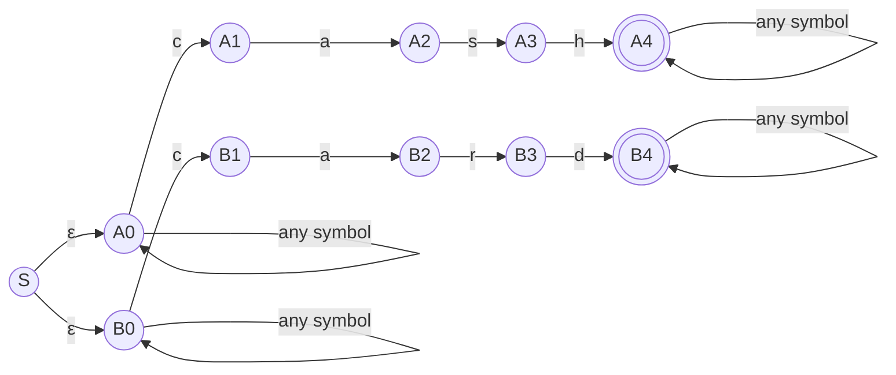

# Guessing machines: allowed every move at once, and no more powerful

[Syllabus](../../../SYLLABUS.md) → [Computability and complexity](../README.md) → [Models of Computation](../README.md#s01) → Guessing machines

---

## General Overview

A coffee shop's till writes one line per sale: `09:14 latte 3.20 card`, `09:20 cashback 5.00`, `09:31 cart refund 2.80`. The owner wants a filter that flags every line mentioning "cash" or "card" anywhere.

A finite automaton can do this: a machine with a fixed set of states that reads the line once, left to right, and ends by saying accept or reject ([Finite automata](01-finite-automata-and-regular-languages.md)). But designing one by hand is fiddly. At every "c" it must decide: is this the start of "cash", the start of "card", or nothing?

A **guessing machine** skips that decision. At every "c" it is allowed to guess. It may also run two watchers at once, one for "cash" and one for "card".

It accepts a line if *some* sequence of guesses ends in an accepting state. The formal name is a **nondeterministic finite automaton**, or NFA. The ordinary kind, with exactly one move per symbol, is a **deterministic finite automaton**, or DFA.

A guessing machine is easy to design but cannot be run as it stands: a real chip or program cannot know in advance which guess will turn out right. This card shows how to turn it into an ordinary DFA.

The trick is to stop guessing and keep a list of **every state the guesses could have reached so far**. That list is a set of states, and there are only finitely many sets, so the list itself is the state of an ordinary machine. The method is called the **subset construction**.

For the till filter, the guessing machine has 11 states. The subset construction could in principle need 2,048 sets, but only 21 are ever reached. The ordinary machine built from them agrees with the guessing machine on all 137,257 test strings.

**A guessing machine is turned into an ordinary one by tracking the set of states it could be in, so guessing never lets a finite automaton recognize anything new; it only lets the description be shorter, sometimes exponentially shorter.**

**What kind of fact this is:** a theorem, proved on this card in Why it works. Michael Rabin and Dana Scott proved it in 1959. The lower bound in Step 4 is a theorem too, proved there. The guessing machine itself is a definition.

### The picture: the guessing machine for the till



Schematic. Watcher A looks for "cash" and watcher B for "card". The number in each state's name counts the letters of its word matched so far. The double circles, A4 and B4, accept.

The guesses are visible at A0 and B0. On a "c" each one may stay put or step forward. The start state S has two arrows marked ε: it starts both watchers without reading anything.

---

## The formula

Notation from [Finite automata](01-finite-automata-and-regular-languages.md), in one line: an alphabet $`\Sigma`$ of symbols, a string $`w`$ of them, a machine with states $`Q`$, start $`q_0`$, accepting states $`F`$ and a rule $`\delta(q, a)`$ for the move from state $`q`$ on symbol $`a`$.

Two things are new for a guessing machine:

- **The rule gives a set.** $`\delta(q, a)`$ is the set of states the machine may move to. It may hold several states (a guess) or none (that guess dies). Here $`\delta(\mathrm{A0}, c) = \{\mathrm{A0}, \mathrm{A1}\}`$.
- **ε-moves.** The symbol $`\varepsilon`$ is the empty string: no symbols at all. An **ε-move** changes state without reading anything, like S to A0.

The **ε-closure** $`E(T)`$ of a set of states $`T`$ is $`T`$ plus every state reachable from it by ε-moves alone. Here $`E(\{\mathrm{S}\}) = \{\mathrm{S}, \mathrm{A0}, \mathrm{B0}\}`$.

The subset construction builds a DFA called $`D`$. Its states are sets of the guessing machine's states. Its rule is:

```math
\delta_D(T, a) = E\Big(\bigcup_{q \in T} \delta(q, a)\Big)
```

**Read it aloud:** from the set $`T`$ on symbol $`a`$, collect every place any member of $`T`$ may move on $`a`$, then add whatever ε-moves reach from there.

It starts at, and decides by:

```math
T_0 = E(\{q_0\}), \qquad D \text{ accepts at } T \text{ exactly when } T \cap F \neq \varnothing
```

**Read it aloud:** start from the start state and everything its ε-moves reach; at the end, accept if any state in the set is accepting.

Worked once: from $`\{\mathrm{A0}, \mathrm{B0}\}`$ on "c", A0 may go to A0 or A1 and B0 to B0 or B1. No ε-moves leave those, so the new set is $`\{\mathrm{A0}, \mathrm{A1}, \mathrm{B0}, \mathrm{B1}\}`$.

The new machine's states are subsets of $`Q`$, so they are members of the power set $`P(Q)`$ ([Subsets and the power set](../../01-Foundations/07-Sets/02-subsets-and-power-set.md)). With $`N`$ states that is the ceiling:

```math
\text{states of } D \le 2^{N}
```

**Read it aloud:** the ordinary machine never needs more states than there are subsets of the guessing machine's states. Here $`2^{11} = 2048`$, and 21 are reached.

| Symbol | Plain meaning | In our example | Push it up and the answer… |
| --- | --- | --- | --- |
| $`\Sigma`$ | the alphabet: every symbol a log line can hold | 39 symbols: a to z, 0 to 9, space, period, colon | the DFA table gets more columns; the sets stay the same |
| $`w`$ | a string: one log line, symbol by symbol | `paid ccard` | a longer trace, the same machine |
| $`Q`$, $`N`$ | the guessing machine's states, and how many | S, A0 to A4, B0 to B4; $`N = 11`$ | each extra state doubles the ceiling $`2^N`$ |
| $`q_0`$, $`F`$ | the start state, and the accepting states | S; A4 and B4 | more accepting states: more lines accepted |
| $`\delta(q, a)`$ | the guessing rule: the set of states $`q`$ may move to on $`a`$ | $`\delta(\mathrm{A0}, c) = \{\mathrm{A0}, \mathrm{A1}\}`$ | more guesses alive at once |
| $`\varepsilon`$ | the empty string; an ε-move reads nothing | S to A0, S to B0 | — |
| $`E(T)`$ | ε-closure: $`T`$ plus all that ε-moves reach | $`E(\{\mathrm{S}\}) = \{\mathrm{S}, \mathrm{A0}, \mathrm{B0}\}`$ | — |
| $`T`$, $`T_w`$, $`T_0`$ | a set of guessing-machine states: one state of $`D`$; $`T_w`$ is the set after reading $`w`$, $`T_0`$ the set at the start | $`\{\mathrm{A0}, \mathrm{A2}, \mathrm{B0}, \mathrm{B2}\}`$ after "ca" | — |
| $`D`$, $`\delta_D(T, a)`$ | the ordinary machine built from the sets, and its rule, built by the formula | $`\{\mathrm{A0}, \mathrm{B0}\}`$ on c gives $`\{\mathrm{A0}, \mathrm{A1}, \mathrm{B0}, \mathrm{B1}\}`$ | — |
| $`P(Q)`$, $`2^N`$ | the power set of $`Q`$, and its size | 2,048 possible sets | the worst-case size of $`D`$ |
| $`k`$ | Step 4's pattern: the $`k`$-th symbol from the end is c | $`k = 3`$: 4 guessing states, 8 ordinary ones | the ordinary machine doubles for each step up |
| $`\cup`$, $`\cap`$, $`\varnothing`$ | union, intersection, the empty set | the sets above | — |

### When it holds

- **Finitely many states.** The construction needs a finite list of possible sets. A machine with unbounded memory, such as a bracket checker with a stack, falls outside it ([Grammars and a stack](05-context-free-grammars-and-pushdown-automata.md)).
- **Each move reads one symbol or none, left to right.** Then the set after each symbol depends only on the set before it and the symbol. That is what lets one table lookup replace all the guesses.
- **Accept when some guess accepts.** The test is "the set meets $`F`$". Testing "every state in the set is in $`F`$" rejects `09:14 latte 3.20 card`, because the waiting watchers A0 and B0 are still in the set.
- **Room for up to $`2^N`$ states.** Usually few sets are reached: 21 of 2,048 here. But some patterns use them all. "The 10th symbol from the end is c" takes 11 guessing states and 1,024 ordinary ones.

---

## Why it works

### Step 0: keep every guess instead of making one

A guess is a choice, and the right choice depends on symbols not read yet. So do not choose. Carry every state that some sequence of guesses could have reached.

Two different guess sequences that reach the same state have the same future. So only the *set* of reached states matters, not the paths that led there. With finitely many states there are finitely many sets.

### Step 1: the set is exactly the reachable states

Write $`T_w`$ for the set the DFA holds after reading $`w`$. The claim: $`T_w`$ is exactly the set of states the guessing machine can reach by some path that reads $`w`$, with ε-moves allowed anywhere.

For the empty string this is the definition of $`T_0`$: the start plus its ε-moves. Adding one symbol $`a`$, a path that reads $`w`$ then $`a`$ must stand in $`T_w`$ just before the $`a`$. Then it takes one $`a`$-move, then any ε-moves. That is the formula, term by term.

<details>
<summary>Detailed proof: the set after w is the set of states reachable on w</summary>

Call a state $`q`$ reachable on $`w`$ if some path from $`q_0`$ reads the symbols of $`w`$ in order, with any number of ε-moves before, between and after them, and ends at $`q`$. Write $`R_w`$ for the set of such states. The proof is by induction on the length of $`w`$.

Length 0. A path that reads no symbol uses ε-moves only, so $`R_\varepsilon = E(\{q_0\}) = T_0`$.

From $`w`$ to $`wa`$. Take a path that reads $`wa`$ and ends at $`q`$. Cut it just before its $`a`$-move, at a state $`p`$. The first part reads $`w`$, so $`p`$ is in $`R_w`$, which is $`T_w`$ by induction. The $`a`$-move goes from $`p`$ to some $`r`$ in $`\delta(p, a)`$. The rest is ε-moves from $`r`$ to $`q`$. So $`q`$ is in the ε-closure of the union, which is $`\delta_D(T_w, a)`$:

$`\displaystyle R_{wa} \subseteq E\Big(\bigcup_{p \in T_w} \delta(p, a)\Big) = T_{wa}`$

Conversely, any $`q`$ in $`T_{wa}`$ comes from some $`p`$ in $`T_w`$, an $`a`$-move and ε-moves. Joining a path for $`p`$ to those moves gives a path for $`q`$ that reads $`wa`$. So $`T_{wa} \subseteq R_{wa}`$, and the two sets are equal.

</details>

### Step 2: the verdicts agree

The guessing machine accepts $`w`$ when some path reading $`w`$ ends in $`F`$. By Step 1 the ends of those paths are exactly the members of $`T_w`$. So it accepts exactly when $`T_w`$ meets $`F`$, which is the DFA's test.

### Step 3: the new machine is a real finite automaton

Every $`T_w`$ is a subset of $`Q`$, so there are at most $`2^N`$ of them. The DFA has a finite state list, one start, one move per symbol and a fixed set of accepting states. It is an ordinary DFA.

For the till, the 21 sets can be counted by hand. After the start set, A0 and B0 are always present. The last few symbols read fix the partial matches: none, {A1, B1}, {A2, B2}, {A3} or {B3}, 5 kinds. A4 and B4 are each present or not. That gives 1 + 5 × 2 × 2 = 21 sets, and the 5 × 3 = 15 that hold A4 or B4 accept.

The other direction is free. A DFA is a guessing machine that never has more than one choice. So the two kinds of machine recognize exactly the same sets of strings: the **regular languages** of [Finite automata](01-finite-automata-and-regular-languages.md).

### Step 4: the price can be every subset

Guessing buys no power, but it can buy a lot of size. Take the alphabet `c` and `x` and the rule "the $`k`$-th symbol from the end is c". A guessing machine needs $`k + 1`$ states: wait, guess "this c is the one", then count $`k - 1`$ more symbols.

Any DFA for it needs at least $`2^k`$ states. For $`k = 3`$, the 8 strings of length 3 must reach 8 different states. The subset construction reaches exactly $`2^k`$ sets, so it is as small as possible here.

<details>
<summary>Detailed proof: k-th from the end needs 2 to the power k states</summary>

Take two different strings $`u`$ and $`v`$ of length $`k`$ over `c` and `x`. They differ somewhere: say at the $`j`$-th symbol from the end, $`u`$ has c and $`v`$ has x.

Append $`k - j`$ copies of x to both. Now that position is the $`k`$-th from the end. The longer $`u`$ must be accepted and the longer $`v`$ rejected.

A DFA's future depends only on its current state. If $`u`$ and $`v`$ led to the same state, the same suffix would give the same verdict. So they lead to different states.

There are $`2^k`$ strings of length $`k`$, pairwise forced apart, so at least $`2^k`$ states. The general method behind this argument is on [Pumping and Myhill-Nerode](04-pumping-lemma-and-myhill-nerode.md).

</details>

---

## Worked numbers, by hand

The line `paid ccard` has a doubled "c", a common typo. Run the subset construction on it, one symbol at a time.

| Step | Arithmetic | Value |
| --- | --- | --- |
| start | $`E(\{\mathrm{S}\})`$: S's ε-moves add A0 and B0 | {S, A0, B0} |
| read p, a, i, d, space | S has no moves on symbols and drops out; A0 and B0 wait | {A0, B0} |
| read c | A0 goes to A0 or A1; B0 goes to B0 or B1 | {A0, A1, B0, B1} |
| read c again | A1 and B1 need an "a", so they die; A0 and B0 guess again | {A0, A1, B0, B1} |
| read a | A1 goes to A2, B1 goes to B2 | {A0, A2, B0, B2} |
| read r | A2 needs an "s" and dies; B2 goes to B3 | {A0, B0, B3} |
| read d | B3 goes to B4 | {A0, B0, B4} |
| verdict | B4 is in $`F`$ | **accept** |

The final set holds B4, so some sequence of guesses found "card", and the line is flagged. The second "c" was the one that started the winning guess.

### What breaks if you drop a piece

| Mistake | Comes out at | What went wrong |
| --- | --- | --- |
| One pointer per word that resets to the start on a mismatch | rejects `09:40 paid ccard 4.10`; wrong on 30 of 137,257 short strings | the reset throws away the "c" that starts the real match |
| Start at {S} without its ε-moves | rejects `09:14 latte 3.20 card` | the watchers never start, so every set is empty |
| Accept only when every state in the set accepts | rejects `09:14 latte 3.20 card` | one good guess is enough; the waiting watchers are always in the set |
| A DFA for "3rd from the end is c" with 4 states, as many as the guessing machine | two of the 8 strings of length 3 share a state, such as ccx and cxx; the ending x then gives ccxx and cxxx one verdict, though ccxx must be accepted and cxxx rejected | 4 states are too few: the 8 strings end in 8 different sets, and each needs its own state |

The code prints every row.

---

## Code, from first principles, and it actually runs

The code builds the till's guessing machine and runs the subset construction from the start set, building only the sets it reaches. It then takes three independent roads to every verdict.

The first is the DFA table. The second is a search that tries every sequence of guesses in turn and never forms a set. The third is a written-out scan for "cash" and "card", with no pattern library. The roads must agree on all 137,257 strings of length 0 to 6 over the letters c, a, s, h, r, d and x, where x stands for every other symbol. A two-arrow test machine, a symbol move followed by an ε-move, checks the closure inside the rule, which the till machine needs only at the start. Last, it builds the "k-th from the end" machines and counts their subset states.

### Python

```python
# Guessing machines -- the check behind the card.  Nothing is imported.
# A guessing machine (NFA) watches a payment log for "cash" or "card".  The
# subset construction turns it into an ordinary machine (DFA) whose states are
# sets of guessing-machine states.  Three roads must agree on every string:
# the DFA, a search that tries every guess in turn, and a written-out scan.
SIGMA = "abcdefghijklmnopqrstuvwxyz0123456789 .:"      # 39 symbols in the log
NAMES = ["S", "A0", "A1", "A2", "A3", "A4", "B0", "B1", "B2", "B3", "B4"]
EPS = ""                                               # the label of an epsilon-move

def payment_nfa():                       # S, then A watches for cash, B for card
    d = {}
    def add(p, a, q):
        d.setdefault((p, a), set()).add(q)
    for q in (1, 6):
        add(0, EPS, q)                       # S guesses: run A and B, both at once
    for base, word in ((1, "cash"), (6, "card")):
        for a in SIGMA:
            add(base, a, base)                         # not started yet: wait
            add(base + 4, a, base + 4)                 # word seen: stay happy
        for i, ch in enumerate(word):
            add(base + i, ch, base + i + 1)            # one more letter matched
    return d, 0, {5, 10}

def closure(d, states):                  # add everything epsilon-moves reach
    seen, todo = set(states), list(states)
    while todo:
        for q in d.get((todo.pop(), EPS), ()):
            if q not in seen:
                seen.add(q)
                todo.append(q)
    return frozenset(seen)

def step(d, states, a):
    return closure(d, {q for p in states for q in d.get((p, a), ())})

def subset_construction(d, start, alphabet):          # road one
    first = closure(d, {start})
    table, seen, todo = {}, {first}, [first]
    while todo:
        T = todo.pop()
        for a in alphabet:
            U = step(d, T, a)
            table[(T, a)] = U
            if U not in seen:
                seen.add(U)
                todo.append(U)
    return first, table

def run(first, table, w):                # follow the DFA table, one symbol a step
    T = first
    for a in w:
        T = table[(T, a)]
    return T

def dfa_accepts(first, table, accept, w):
    return bool(run(first, table, w) & accept)

def guess_accepts(d, accept, p, w, i=0):              # road two: try every guess
    if i == len(w) and p in accept:
        return True
    if any(guess_accepts(d, accept, q, w, i) for q in d.get((p, EPS), ())):
        return True
    return i < len(w) and any(guess_accepts(d, accept, q, w, i + 1)
                              for q in d.get((p, w[i]), ()))

def contains(w, word):                                # road three: plain scan
    return any(all(w[s + j] == word[j] for j in range(len(word))) for s in range(len(w) - len(word) + 1))

def naive(w):                            # the usual mistake: reset on a mismatch
    for word in ("cash", "card"):
        k = 0
        for a in w:
            k = k + 1 if a == word[k] else 0
            if k == len(word):
                return True
    return False

def show(T): return "{" + " ".join(NAMES[q] for q in sorted(T)) + "}"
def yn(b): return "yes" if b else "no"

d, s, F = payment_nfa()
first, table = subset_construction(d, s, SIGMA)
reached = sorted({T for (T, a) in table}, key=lambda T: sorted(T))
happy = [T for T in reached if T & F]
print(f"guessing machine: {len(NAMES)} states, {len(SIGMA)} symbols, {2 ** len(NAMES)} possible sets")
print(f"subset construction reaches {len(reached)} sets, {len(happy)} of them accepting; "
      f"table {len(reached)} x {len(SIGMA)} = {len(reached) * len(SIGMA)} entries")
for T in reached:
    print(f"  set {show(T)}{' accept' if T & F else ''}")
kinds = sorted({show(T - {1, 5, 6, 10}) for T in reached if 0 not in T})   # drop A0, A4, B0, B4
print(f"after the start set, partial matches beside A0 B0 A4 B4: {len(kinds)} kinds, {' '.join(kinds)}")
w, T = "paid ccard", first
print(f"trace of '{w}': start {show(T)}")
for a in w:
    T = table[(T, a)]
    print(f"  read '{a}' -> {show(T)}")
logs = ["09:14 latte 3.20 card", "09:20 cashback 5.00", "09:31 cart refund 2.80",
        "09:40 paid ccard 4.10", "09:52 voucher 1.50"]
verdicts = []
for line in logs:
    v = [dfa_accepts(first, table, F, line), guess_accepts(d, F, s, line),
         contains(line, "cash") or contains(line, "card"), naive(line)]
    verdicts.append(v)
    print(f"log '{line}': dfa {yn(v[0])}, guesses {yn(v[1])}, scan {yn(v[2])}, reset-scan {yn(v[3])}")
small, words = "cashrdx", [""]                    # x stands for every other symbol
for n in range(6):
    words += [u + a for u in words if len(u) == n for a in small]
agree = sum(dfa_accepts(first, table, F, u) == guess_accepts(d, F, s, u)
            == (contains(u, "cash") or contains(u, "card")) for u in words)
naive_wrong = sum(naive(u) != dfa_accepts(first, table, F, u) for u in words)
print(f"all {len(words)} strings over '{small}' up to length 6: three roads agree on {agree}; "
      f"the reset-scan disagrees on {naive_wrong}")
T = frozenset({s})                               # two more mistakes, on the card line
for a in logs[0]:
    T = step(d, T, a)
no_closure, all_must = bool(T & F), run(first, table, logs[0]) <= F
print(f"mistakes on '{logs[0]}': start without epsilon-moves {yn(no_closure)}, "
      f"every guess must accept {yn(all_must)}")
growth = []
for k in range(1, 11):                   # "the k-th symbol from the end is c"
    dk = {(i, a): {0} if i == 0 else {i + 1} for i in range(k) for a in "cx"}   # 0 waits, 1.. count
    dk[(0, "c")] = {0, 1}                                     # at a c, guess "this is the one"
    fk, tk = subset_construction(dk, 0, "cx")
    growth.append(len({T for (T, a) in tk}))
    if k == 3:                           # where the 8 strings of length 3 end up
        ends = {run(fk, tk, a + b + c) for a in "cx" for b in "cx" for c in "cx"}
        pair = ["accept" if dfa_accepts(fk, tk, {3}, u) else "reject" for u in ("ccxx", "cxxx")]
    print(f"k = {k:2}: guessing machine {k + 1:2} states, subset machine {growth[-1]:4} states")
assert agree == len(words) == 137257                          # three roads, every string
assert [v[0] for v in verdicts] == [True, True, False, True, False]
assert all(v[0] == v[1] == v[2] for v in verdicts) and not verdicts[3][3]
assert growth == [2 ** k for k in range(1, 11)]               # the blow-up is real
assert len(reached) == 1 + 5 * 2 * 2 and len(happy) == 5 * 3 and naive_wrong > 0   # the count by hand
assert step({(0, "c"): {1}, (1, EPS): {2}}, {0}, "c") == {1, 2}   # epsilon after a symbol: closure needed
print(f"k = 3: the 8 strings of length 3 end in {len(ends)} different sets; with 4 states two share one, "
      f"such as ccx and cxx, yet the ending x needs ccxx {pair[0]}, cxxx {pair[1]}")
assert not no_closure and not all_must and len(ends) == 8 and pair == ["accept", "reject"]   # each piece is needed
print("ALL CHECKS PASS")
```

**Ran 2026-11-19 on macOS, Python 3.14.10, standard library only. All checks passed. Output, pasted from the run:**

```
guessing machine: 11 states, 39 symbols, 2048 possible sets
subset construction reaches 21 sets, 15 of them accepting; table 21 x 39 = 819 entries
  set {S A0 B0}
  set {A0 A1 A4 B0 B1} accept
  set {A0 A1 A4 B0 B1 B4} accept
  set {A0 A1 B0 B1}
  set {A0 A1 B0 B1 B4} accept
  set {A0 A2 A4 B0 B2} accept
  set {A0 A2 A4 B0 B2 B4} accept
  set {A0 A2 B0 B2}
  set {A0 A2 B0 B2 B4} accept
  set {A0 A3 A4 B0} accept
  set {A0 A3 A4 B0 B4} accept
  set {A0 A3 B0}
  set {A0 A3 B0 B4} accept
  set {A0 A4 B0} accept
  set {A0 A4 B0 B3} accept
  set {A0 A4 B0 B3 B4} accept
  set {A0 A4 B0 B4} accept
  set {A0 B0}
  set {A0 B0 B3}
  set {A0 B0 B3 B4} accept
  set {A0 B0 B4} accept
after the start set, partial matches beside A0 B0 A4 B4: 5 kinds, {A1 B1} {A2 B2} {A3} {B3} {}
trace of 'paid ccard': start {S A0 B0}
  read 'p' -> {A0 B0}
  read 'a' -> {A0 B0}
  read 'i' -> {A0 B0}
  read 'd' -> {A0 B0}
  read ' ' -> {A0 B0}
  read 'c' -> {A0 A1 B0 B1}
  read 'c' -> {A0 A1 B0 B1}
  read 'a' -> {A0 A2 B0 B2}
  read 'r' -> {A0 B0 B3}
  read 'd' -> {A0 B0 B4}
log '09:14 latte 3.20 card': dfa yes, guesses yes, scan yes, reset-scan yes
log '09:20 cashback 5.00': dfa yes, guesses yes, scan yes, reset-scan yes
log '09:31 cart refund 2.80': dfa no, guesses no, scan no, reset-scan no
log '09:40 paid ccard 4.10': dfa yes, guesses yes, scan yes, reset-scan no
log '09:52 voucher 1.50': dfa no, guesses no, scan no, reset-scan no
all 137257 strings over 'cashrdx' up to length 6: three roads agree on 137257; the reset-scan disagrees on 30
mistakes on '09:14 latte 3.20 card': start without epsilon-moves no, every guess must accept no
k =  1: guessing machine  2 states, subset machine    2 states
k =  2: guessing machine  3 states, subset machine    4 states
k =  3: guessing machine  4 states, subset machine    8 states
k =  4: guessing machine  5 states, subset machine   16 states
k =  5: guessing machine  6 states, subset machine   32 states
k =  6: guessing machine  7 states, subset machine   64 states
k =  7: guessing machine  8 states, subset machine  128 states
k =  8: guessing machine  9 states, subset machine  256 states
k =  9: guessing machine 10 states, subset machine  512 states
k = 10: guessing machine 11 states, subset machine 1024 states
k = 3: the 8 strings of length 3 end in 8 different sets; with 4 states two share one, such as ccx and cxx, yet the ending x needs ccxx accept, cxxx reject
ALL CHECKS PASS
```

### Rust

Same numbers, same labels, built with `rustc --edition 2021 -O`. Sets are bit masks: bit $`q`$ is on when state $`q`$ is in the set.

```rust
// Guessing machines -- the same check as the Python, in Rust.  No crates.
// A guessing machine (NFA) watches a payment log for "cash" or "card".  The
// subset construction turns it into an ordinary machine (DFA) whose states are
// sets of guessing-machine states, kept here as bit masks (bit q = state q).
// Three roads must agree on every string: the DFA, a search that tries every
// guess in turn, and a written-out scan.
use std::collections::HashMap;

const SIGMA: &str = "abcdefghijklmnopqrstuvwxyz0123456789 .:"; // 39 symbols
const NAMES: [&str; 11] = ["S", "A0", "A1", "A2", "A3", "A4", "B0", "B1", "B2", "B3", "B4"];
const EPS: char = '\0'; // the label of an epsilon-move

type Nfa = HashMap<(usize, char), Vec<usize>>;

fn add(d: &mut Nfa, p: usize, a: char, q: usize) { let v = d.entry((p, a)).or_default(); if !v.contains(&q) { v.push(q) } }

fn payment_nfa() -> Nfa { // S, then A watches for cash, B for card
    let mut d = Nfa::new();
    for q in [1, 6] { add(&mut d, 0, EPS, q) } // S guesses: run A and B, both at once
    for (base, word) in [(1, "cash"), (6, "card")] {
        for a in SIGMA.chars() {
            add(&mut d, base, a, base); // not started yet: wait
            add(&mut d, base + 4, a, base + 4); // word seen: stay happy
        }
        for (i, ch) in word.chars().enumerate() { add(&mut d, base + i, ch, base + i + 1) }
    }
    d
}

fn moves(d: &Nfa, p: usize, a: char) -> &[usize] { d.get(&(p, a)).map(|v| v.as_slice()).unwrap_or(&[]) }

fn closure(d: &Nfa, set: u32) -> u32 { // add everything epsilon-moves reach
    let (mut seen, mut todo) = (set, members(set));
    while let Some(p) = todo.pop() {
        for &q in moves(d, p, EPS) {
            if seen >> q & 1 == 0 { seen |= 1 << q; todo.push(q) }
        }
    }
    seen
}

fn step(d: &Nfa, set: u32, a: char) -> u32 {
    let out = members(set).iter().flat_map(|&p| moves(d, p, a)).fold(0, |o, &q| o | 1 << q);
    closure(d, out)
}

fn subset_construction(d: &Nfa, start: usize, alphabet: &str) -> (u32, HashMap<(u32, char), u32>) {
    let first = closure(d, 1 << start); // road one
    let (mut table, mut seen, mut todo) = (HashMap::new(), vec![first], vec![first]);
    while let Some(t) = todo.pop() {
        for a in alphabet.chars() {
            let u = step(d, t, a);
            table.insert((t, a), u);
            if !seen.contains(&u) { seen.push(u); todo.push(u) }
        }
    }
    (first, table)
}

fn run(first: u32, table: &HashMap<(u32, char), u32>, w: &str) -> u32 { // follow the DFA table
    w.chars().fold(first, |t, a| table[&(t, a)])
}

fn dfa_accepts(first: u32, table: &HashMap<(u32, char), u32>, accept: u32, w: &str) -> bool {
    run(first, table, w) & accept != 0
}

fn guess_accepts(d: &Nfa, accept: u32, p: usize, w: &[char], i: usize) -> bool { // road two
    if i == w.len() && accept >> p & 1 == 1 { return true }
    if moves(d, p, EPS).iter().any(|&q| guess_accepts(d, accept, q, w, i)) { return true }
    i < w.len() && moves(d, p, w[i]).iter().any(|&q| guess_accepts(d, accept, q, w, i + 1))
}

fn contains(w: &[char], word: &str) -> bool { // road three: plain scan
    let word: Vec<char> = word.chars().collect();
    w.len() >= word.len() && (0..=w.len() - word.len()).any(|s| (0..word.len()).all(|j| w[s + j] == word[j]))
}

fn naive(w: &[char]) -> bool { // the usual mistake: reset on a mismatch
    for word in ["cash", "card"] {
        let word: Vec<char> = word.chars().collect();
        let mut k = 0;
        for &a in w {
            k = if a == word[k] { k + 1 } else { 0 };
            if k == word.len() { return true }
        }
    }
    false
}

fn members(t: u32) -> Vec<usize> { (0..32).filter(|q| t >> q & 1 == 1).collect() }
fn show(t: u32) -> String { format!("{{{}}}", members(t).iter().map(|&q| NAMES[q]).collect::<Vec<_>>().join(" ")) }
fn yn(b: bool) -> &'static str { if b { "yes" } else { "no" } }

fn main() {
    let (d, s, f) = (payment_nfa(), 0usize, (1u32 << 5) | (1 << 10));
    let (first, table) = subset_construction(&d, s, SIGMA);
    let mut reached: Vec<u32> = table.keys().map(|k| k.0).collect();
    reached.sort_by_key(|&t| members(t)); reached.dedup();
    let happy = reached.iter().filter(|&&t| t & f != 0).count();
    println!("guessing machine: {} states, {} symbols, {} possible sets", NAMES.len(), SIGMA.len(), 1 << NAMES.len());
    println!("subset construction reaches {} sets, {} of them accepting; table {} x {} = {} entries",
             reached.len(), happy, reached.len(), SIGMA.len(), reached.len() * SIGMA.len());
    for &t in &reached { println!("  set {}{}", show(t), if t & f != 0 { " accept" } else { "" }) }
    let mut kinds: Vec<String> = reached.iter().filter(|&&t| t & 1 == 0).map(|&t| show(t & !(1 << 1 | 1 << 5 | 1 << 6 | 1 << 10))).collect();
    kinds.sort(); kinds.dedup(); // drop A0, A4, B0, B4
    println!("after the start set, partial matches beside A0 B0 A4 B4: {} kinds, {}", kinds.len(), kinds.join(" "));
    let (w, mut t) = ("paid ccard", first);
    println!("trace of '{}': start {}", w, show(t));
    for a in w.chars() { t = table[&(t, a)]; println!("  read '{}' -> {}", a, show(t)) }
    let logs = ["09:14 latte 3.20 card", "09:20 cashback 5.00", "09:31 cart refund 2.80",
                "09:40 paid ccard 4.10", "09:52 voucher 1.50"];
    let mut verdicts = Vec::new();
    for line in logs {
        let c: Vec<char> = line.chars().collect();
        let v = [dfa_accepts(first, &table, f, line), guess_accepts(&d, f, s, &c, 0),
                 contains(&c, "cash") || contains(&c, "card"), naive(&c)];
        println!("log '{}': dfa {}, guesses {}, scan {}, reset-scan {}", line, yn(v[0]), yn(v[1]), yn(v[2]), yn(v[3]));
        verdicts.push(v);
    }
    let small = "cashrdx"; // x stands for every other symbol
    let mut words: Vec<String> = vec![String::new()];
    for n in 0..6 {
        let longer: Vec<String> = words.iter().filter(|u| u.len() == n)
            .flat_map(|u| small.chars().map(move |a| format!("{}{}", u, a))).collect();
        words.extend(longer);
    }
    let (mut agree, mut naive_wrong) = (0, 0);
    for u in &words {
        let c: Vec<char> = u.chars().collect();
        let a = dfa_accepts(first, &table, f, u);
        if a == guess_accepts(&d, f, s, &c, 0) && a == (contains(&c, "cash") || contains(&c, "card")) { agree += 1 }
        if naive(&c) != a { naive_wrong += 1 }
    }
    println!("all {} strings over '{}' up to length 6: three roads agree on {}; the reset-scan disagrees on {}",
             words.len(), small, agree, naive_wrong);
    let mut t = 1u32 << s; // two more mistakes, on the card line
    for a in logs[0].chars() { t = step(&d, t, a) }
    let (no_closure, all_must) = (t & f != 0, run(first, &table, logs[0]) & !f == 0);
    println!("mistakes on '{}': start without epsilon-moves {}, every guess must accept {}", logs[0], yn(no_closure), yn(all_must));
    let (mut ends, mut pair): (Vec<u32>, Vec<&str>) = (Vec::new(), Vec::new());
    let mut growth = Vec::new();
    for k in 1..=10usize { // "the k-th symbol from the end is c"
        let mut dk = Nfa::new();
        for a in "cx".chars() { add(&mut dk, 0, a, 0); for i in 1..k { add(&mut dk, i, a, i + 1) } } // 0 waits, 1.. count
        add(&mut dk, 0, 'c', 1); // at a c, guess "this is the one"
        let (fk, tk) = subset_construction(&dk, 0, "cx");
        if k == 3 { // where the 8 strings of length 3 end up
            for u in ["ccc", "ccx", "cxc", "cxx", "xcc", "xcx", "xxc", "xxx"] { ends.push(run(fk, &tk, u)) }
            ends.sort(); ends.dedup();
            pair = ["ccxx", "cxxx"].iter().map(|u| if dfa_accepts(fk, &tk, 1 << 3, u) { "accept" } else { "reject" }).collect();
        }
        let mut sets: Vec<u32> = tk.keys().map(|k| k.0).collect();
        sets.sort(); sets.dedup();
        growth.push(sets.len());
        println!("k = {:2}: guessing machine {:2} states, subset machine {:4} states", k, k + 1, sets.len());
    }
    assert!(agree == words.len() && words.len() == 137257); // three roads, every string
    assert!(verdicts.iter().map(|v| v[0]).collect::<Vec<_>>() == vec![true, true, false, true, false]);
    assert!(verdicts.iter().all(|v| v[0] == v[1] && v[1] == v[2]) && !verdicts[3][3]);
    assert!(growth == (1..=10).map(|k| 1usize << k).collect::<Vec<_>>()); // the blow-up is real
    assert!(reached.len() == 1 + 5 * 2 * 2 && happy == 5 * 3 && naive_wrong > 0); // the count by hand
    let mut tiny = Nfa::new(); add(&mut tiny, 0, 'c', 1); add(&mut tiny, 1, EPS, 2);
    assert!(step(&tiny, 1 << 0, 'c') == 1 << 1 | 1 << 2); // epsilon after a symbol: closure needed
    println!("k = 3: the 8 strings of length 3 end in {} different sets; with 4 states two share one, such as ccx and cxx, yet the ending x needs ccxx {}, cxxx {}",
        ends.len(), pair[0], pair[1]);
    assert!(!no_closure && !all_must && ends.len() == 8 && pair == ["accept", "reject"]); // each piece is needed
    println!("ALL CHECKS PASS");
}
```

**Ran 2026-11-19 on macOS, rustc 1.98.1, no crates. All checks passed. Output, pasted from the run:**

```
guessing machine: 11 states, 39 symbols, 2048 possible sets
subset construction reaches 21 sets, 15 of them accepting; table 21 x 39 = 819 entries
  set {S A0 B0}
  set {A0 A1 A4 B0 B1} accept
  set {A0 A1 A4 B0 B1 B4} accept
  set {A0 A1 B0 B1}
  set {A0 A1 B0 B1 B4} accept
  set {A0 A2 A4 B0 B2} accept
  set {A0 A2 A4 B0 B2 B4} accept
  set {A0 A2 B0 B2}
  set {A0 A2 B0 B2 B4} accept
  set {A0 A3 A4 B0} accept
  set {A0 A3 A4 B0 B4} accept
  set {A0 A3 B0}
  set {A0 A3 B0 B4} accept
  set {A0 A4 B0} accept
  set {A0 A4 B0 B3} accept
  set {A0 A4 B0 B3 B4} accept
  set {A0 A4 B0 B4} accept
  set {A0 B0}
  set {A0 B0 B3}
  set {A0 B0 B3 B4} accept
  set {A0 B0 B4} accept
after the start set, partial matches beside A0 B0 A4 B4: 5 kinds, {A1 B1} {A2 B2} {A3} {B3} {}
trace of 'paid ccard': start {S A0 B0}
  read 'p' -> {A0 B0}
  read 'a' -> {A0 B0}
  read 'i' -> {A0 B0}
  read 'd' -> {A0 B0}
  read ' ' -> {A0 B0}
  read 'c' -> {A0 A1 B0 B1}
  read 'c' -> {A0 A1 B0 B1}
  read 'a' -> {A0 A2 B0 B2}
  read 'r' -> {A0 B0 B3}
  read 'd' -> {A0 B0 B4}
log '09:14 latte 3.20 card': dfa yes, guesses yes, scan yes, reset-scan yes
log '09:20 cashback 5.00': dfa yes, guesses yes, scan yes, reset-scan yes
log '09:31 cart refund 2.80': dfa no, guesses no, scan no, reset-scan no
log '09:40 paid ccard 4.10': dfa yes, guesses yes, scan yes, reset-scan no
log '09:52 voucher 1.50': dfa no, guesses no, scan no, reset-scan no
all 137257 strings over 'cashrdx' up to length 6: three roads agree on 137257; the reset-scan disagrees on 30
mistakes on '09:14 latte 3.20 card': start without epsilon-moves no, every guess must accept no
k =  1: guessing machine  2 states, subset machine    2 states
k =  2: guessing machine  3 states, subset machine    4 states
k =  3: guessing machine  4 states, subset machine    8 states
k =  4: guessing machine  5 states, subset machine   16 states
k =  5: guessing machine  6 states, subset machine   32 states
k =  6: guessing machine  7 states, subset machine   64 states
k =  7: guessing machine  8 states, subset machine  128 states
k =  8: guessing machine  9 states, subset machine  256 states
k =  9: guessing machine 10 states, subset machine  512 states
k = 10: guessing machine 11 states, subset machine 1024 states
k = 3: the 8 strings of length 3 end in 8 different sets; with 4 states two share one, such as ccx and cxx, yet the ending x needs ccxx accept, cxxx reject
ALL CHECKS PASS
```

The two outputs match line for line.

### Lean

Lean proves the subset construction correct for any guessing machine with finitely many states, and Step 4's lower bound for every $`k \ge 1`$.

- Take a guessing machine with finitely many states, ε-moves allowed. Then the DFA from the subset construction accepts exactly the same strings, so its language is regular.
- Take a guessing machine with $`N`$ states. Then the subset construction reaches at most $`2^N`$ sets.
- Take the letters c and x and any $`k \ge 1`$. Then a guessing machine with $`k + 1`$ states recognizes "the $`k`$-th symbol from the end is c".
- Take any DFA for that same pattern and $`k`$. Then it has at least $`2^k`$ states.
- The hand counts hold: $`2^{11} = 2048`$, $`1 + 5 \times 2 \times 2 = 21`$, $`5 \times 3 = 15`$ and $`21 \times 39 = 819`$.
- There are 137,257 strings of length 0 to 6 over 7 letters, and 8 of length 3 over c and x.
- The string ccxx has c third from the end, so it is in the language.

The till's 21 reached sets, the three roads' agreement and the exact $`2^k`$ subset counts are left to the Python and Rust checks.

```lean
-- Guessing machines: tracking the set of states a guessing machine (an NFA with ε-moves) could be in gives an ordinary DFA with the same language and at most 2^N reached states, and "the k-th symbol from the end is c" needs only k + 1 guessing states but at least 2^k ordinary ones.
import Mathlib.Computability.EpsilonNFA
import Mathlib.Data.Set.Card
import Mathlib.Algebra.BigOperators.Group.Finset.Basic
import Mathlib.Tactic.NormNum
import Mathlib.Data.Fintype.Pi
import Mathlib.Data.Fintype.Powerset

open Set

universe u v

variable {α : Type u} {σ : Type}

/-- The card's subset construction. Its states are sets `T` of guessing-machine states.
It starts at `E(start)`, moves by `δ_D(T, a) = E(⋃ q ∈ T, δ(q, a))`, and accepts at `T`
exactly when `T` meets the accepting states `F`. -/
def subsetDFA (M : εNFA α σ) : DFA α (Set σ) where
  step T a := M.εClosure (⋃ q ∈ T, M.step q (some a))
  start := M.εClosure M.start
  accept := {T | ∃ q ∈ T, q ∈ M.accept}

/-- Helper: the subset machine's state after reading `x` is exactly the set of states the
guessing machine could be in. -/
theorem subsetDFA_eval (M : εNFA α σ) (x : List α) : (subsetDFA M).eval x = M.eval x := by
  induction x using List.reverseRecOn with
  | nil => rfl
  | append_singleton x a ih =>
    rw [DFA.eval_append_singleton, εNFA.eval_append_singleton, ← ih]
    ext s
    simp only [subsetDFA, εNFA.mem_stepSet_iff]
    rw [εNFA.mem_εClosure_iff_exists]
    simp only [Set.mem_iUnion, exists_prop]
    constructor
    · rintro ⟨t, ⟨q, hq, ht⟩, hs⟩
      exact ⟨q, hq, (M.mem_εClosure_iff_exists).2 ⟨t, ht, hs⟩⟩
    · rintro ⟨q, hq, hs⟩
      obtain ⟨t, ht, hs⟩ := (M.mem_εClosure_iff_exists).1 hs
      exact ⟨t, ⟨q, hq, ht⟩, hs⟩

#print axioms subsetDFA_eval

/-- Subset construction (Rabin and Scott, 1959). For a guessing machine with finitely many
states, ε-moves allowed, which accepts when some guess accepts, the ordinary machine built from
the sets of states it could be in accepts exactly the same strings. So guessing never lets a
finite automaton recognize anything new: the language is regular. -/
theorem subset_construction_accepts_same_language [Fintype σ] (M : εNFA α σ) :
    (subsetDFA M).accepts = M.accepts ∧ M.accepts.IsRegular := by
  have h : (subsetDFA M).accepts = M.accepts := by
    ext x
    rw [DFA.mem_accepts, subsetDFA_eval]
    exact ⟨fun ⟨q, h1, h2⟩ => ⟨q, h2, h1⟩, fun ⟨q, h1, h2⟩ => ⟨q, h2, h1⟩⟩
  classical
  exact ⟨h, Set σ, inferInstance, subsetDFA M, h⟩

/-- The price is bounded: the sets the subset construction actually reaches number at most
`2^N`, where `N` is the number of guessing-machine states. -/
theorem subset_construction_reached_sets_le [Fintype σ] (M : εNFA α σ) :
    (Set.range (subsetDFA M).eval).ncard ≤ 2 ^ Fintype.card σ := by
  classical
  calc (Set.range (subsetDFA M).eval).ncard ≤ Nat.card (Set σ) := Set.ncard_le_card _
    _ = 2 ^ Fintype.card σ := by rw [Nat.card_eq_fintype_card, Fintype.card_set]

/-- The two-letter alphabet of the card's Step 4: the letters `c` and `x`. -/
inductive CX
  | c
  | x
  deriving DecidableEq

instance : Fintype CX := ⟨{CX.c, CX.x}, fun a => by cases a <;> decide⟩

/-- "The k-th symbol from the end is c": strings `u ++ c :: v` with `v` of length `k - 1`. -/
def kthFromEndC (k : ℕ) : Language CX :=
  {w | ∃ u v : List CX, w = u ++ CX.c :: v ∧ v.length = k - 1}

/-- Helper: the empty string has no `c` anywhere. -/
theorem endP_nil (n : ℕ) :
    ¬ ∃ u v : List CX, ([] : List CX) = u ++ CX.c :: v ∧ v.length = n := by
  rintro ⟨u, v, h, -⟩
  simp at h

#print axioms endP_nil

/-- Helper: `w ++ [a]` ends in `c` exactly when `a = c`. -/
theorem endP_zero (w : List CX) (a : CX) :
    (∃ u v : List CX, w ++ [a] = u ++ CX.c :: v ∧ v.length = 0) ↔ a = CX.c := by
  constructor
  · rintro ⟨u, v, h, hv⟩
    rw [List.length_eq_zero_iff] at hv
    subst hv
    exact List.singleton_inj.mp (List.append_inj' h rfl).2
  · rintro rfl
    exact ⟨w, [], rfl, rfl⟩

#print axioms endP_zero

/-- Helper: a `c` with `n + 1` symbols after it in `w ++ [a]` is a `c` with `n` symbols after
it in `w`. -/
theorem endP_succ (w : List CX) (a : CX) (n : ℕ) :
    (∃ u v : List CX, w ++ [a] = u ++ CX.c :: v ∧ v.length = n + 1) ↔
      ∃ u v : List CX, w = u ++ CX.c :: v ∧ v.length = n := by
  constructor
  · rintro ⟨u, v, h, hv⟩
    rcases List.eq_nil_or_concat v with rfl | ⟨L, b, rfl⟩
    · simp at hv
    · refine ⟨u, L, ?_, by simpa using hv⟩
      have : w ++ [a] = (u ++ CX.c :: L) ++ [b] := by rw [h]; simp
      exact (List.append_inj' this rfl).1
  · rintro ⟨u, v, rfl, hv⟩
    exact ⟨u, v ++ [a], by simp, by simp [hv]⟩

#print axioms endP_succ

/-- Helper: the `k + 1`-state guessing machine. State `0` loops on every letter and guesses
on `c` by moving to state `1`; state `i ≥ 1` moves to `i + 1` on every letter; state `k` accepts. -/
def kthNFA (k : ℕ) : NFA CX (Fin (k + 1)) where
  step i a := {j | (i.val = 0 ∧ j.val = 0) ∨ (i.val = 0 ∧ a = CX.c ∧ j.val = 1) ∨
    (1 ≤ i.val ∧ j.val = i.val + 1)}
  start := {j | j.val = 0}
  accept := {j | j.val = k}

/-- Helper: state `j ≥ 1` is reachable on `w` exactly when `w` has a `c` with `j - 1`
symbols after it. -/
theorem kthNFA_eval (k : ℕ) (w : List CX) (j : Fin (k + 1)) :
    j ∈ (kthNFA k).eval w ↔
      j.val = 0 ∨ (1 ≤ j.val ∧ ∃ u v : List CX, w = u ++ CX.c :: v ∧ v.length = j.val - 1) := by
  induction w using List.reverseRecOn generalizing j with
  | nil =>
    simp only [NFA.eval_nil, kthNFA, Set.mem_ofPred_eq]
    constructor
    · intro h
      exact Or.inl h
    · rintro (h | ⟨-, h⟩)
      · exact h
      · exact absurd h (endP_nil _)
  | append_singleton w a ih =>
    rw [NFA.eval_append_singleton, NFA.mem_stepSet]
    have h0 : (⟨0, by omega⟩ : Fin (k + 1)) ∈ (kthNFA k).eval w := (ih _).2 (Or.inl rfl)
    constructor
    · rintro ⟨i, hi, hj⟩
      simp only [kthNFA, Set.mem_ofPred_eq] at hj
      rcases hj with ⟨-, hj⟩ | ⟨-, rfl, hj⟩ | ⟨hi1, hj⟩
      · exact Or.inl hj
      · right
        refine ⟨by omega, ?_⟩
        rw [hj]
        exact (endP_zero w _).2 rfl
      · right
        refine ⟨by omega, ?_⟩
        obtain ⟨m, hm⟩ : ∃ m, i.val = m + 1 := ⟨i.val - 1, by omega⟩
        have hjm : j.val - 1 = m + 1 := by omega
        rw [hjm, endP_succ]
        rcases (ih i).1 hi with h | ⟨-, h⟩
        · omega
        · rw [hm] at h
          simpa using h
    · rintro (hj | ⟨hj1, hP⟩)
      · exact ⟨⟨0, by omega⟩, h0, Or.inl ⟨rfl, hj⟩⟩
      · obtain ⟨m, hm⟩ : ∃ m, j.val = m + 1 := ⟨j.val - 1, by omega⟩
        rw [hm] at hP
        cases m with
        | zero =>
          have ha := (endP_zero w a).1 hP
          exact ⟨⟨0, by omega⟩, h0, Or.inr (Or.inl ⟨rfl, ha, hm⟩)⟩
        | succ m =>
          have hP' : ∃ u v : List CX, w ++ [a] = u ++ CX.c :: v ∧ v.length = m + 1 := by
            simpa using hP
          rw [endP_succ] at hP'
          refine ⟨⟨m + 1, by omega⟩, (ih _).2 (Or.inr ⟨by simp, by simpa using hP'⟩), ?_⟩
          exact Or.inr (Or.inr ⟨Nat.le_add_left 1 m, hm⟩)

#print axioms kthNFA_eval

/-- Helper: for `k ≥ 1`, `w` is in the language exactly when it has length at least `k` and
its symbol at position `length - k` is `c`. -/
theorem kth_mem_iff (k : ℕ) (hk : 1 ≤ k) (w : List CX) :
    w ∈ kthFromEndC k ↔ k ≤ w.length ∧ w[w.length - k]? = some CX.c := by
  constructor
  · rintro ⟨u, v, rfl, hv⟩
    have hlen : (u ++ CX.c :: v).length - k = u.length := by simp; omega
    refine ⟨by simp; omega, ?_⟩
    rw [hlen]
    simp
  · rintro ⟨hle, hget⟩
    obtain ⟨hn, hc⟩ := List.getElem?_eq_some_iff.1 hget
    refine ⟨w.take (w.length - k), w.drop (w.length - k + 1), ?_, ?_⟩
    · rw [← hc, ← List.drop_eq_getElem_cons hn, List.take_append_drop]
    · simp
      omega

#print axioms kth_mem_iff

/-- The price can be every subset. For `k ≥ 1`, a guessing machine with `k + 1` states
recognizes "the k-th symbol from the end is c", but every ordinary machine (DFA) that
recognizes it has at least `2^k` states. -/
theorem kth_from_end_needs_two_pow_states (k : ℕ) (hk : 1 ≤ k) :
    (∃ M : NFA CX (Fin (k + 1)), M.accepts = kthFromEndC k) ∧
      ∀ (τ : Type v) [Fintype τ] (D : DFA CX τ), D.accepts = kthFromEndC k →
        2 ^ k ≤ Fintype.card τ := by
  refine ⟨⟨kthNFA k, ?_⟩, ?_⟩
  · ext w
    constructor
    · rintro ⟨j, hj, hw⟩
      simp only [kthNFA, Set.mem_ofPred_eq] at hj
      rcases (kthNFA_eval k w j).1 hw with h | ⟨-, h⟩
      · omega
      · rw [hj] at h
        exact h
    · intro hw
      exact ⟨Fin.last k, rfl, (kthNFA_eval k w _).2 (Or.inr ⟨by simp; omega, hw⟩)⟩
  · intro τ _ D hD
    classical
    let f : (Fin k → CX) → τ := fun x => D.eval (List.ofFn x)
    have hf : Function.Injective f := by
      intro x y hxy
      by_contra hne
      obtain ⟨i, hi⟩ : ∃ i, x i ≠ y i := Function.ne_iff.1 hne
      have key : ∀ z : Fin k → CX,
          (List.ofFn z ++ List.replicate i.val CX.x) ∈ kthFromEndC k ↔ z i = CX.c := by
        intro z
        rw [kth_mem_iff k hk]
        simp [List.getElem?_append_left, i.isLt]
      have hacc : ∀ z : Fin k → CX, (List.ofFn z ++ List.replicate i.val CX.x) ∈ D.accepts ↔
          D.evalFrom (f z) (List.replicate i.val CX.x) ∈ D.accept := by
        intro z
        rw [DFA.mem_accepts, DFA.eval, DFA.evalFrom_of_append]
        rfl
      have hx := key x
      have hy := key y
      rw [← hD, hacc] at hx hy
      rw [hxy] at hx
      have hxy' : x i = CX.c ↔ y i = CX.c := hx.symm.trans hy
      cases hxi : x i <;> cases hyi : y i <;> simp_all
    have hcard : Fintype.card (Fin k → CX) = 2 ^ k := by
      rw [Fintype.card_fun, Fintype.card_fin]
      rfl
    rw [← hcard]
    exact Fintype.card_le_of_injective f hf

/-! The card's whole-number worked examples. -/

-- The till's guessing machine has 11 states, so 2,048 possible sets.
example : 2 ^ 11 = 2048 := by norm_num

-- The 21 reached sets counted by hand: the start set, then 5 kinds of partial match,
-- times A4 present or not, times B4 present or not; 15 of them hold A4 or B4.
example : 1 + 5 * 2 * 2 = 21 := by norm_num
example : 5 * 3 = 15 := by norm_num
example : 21 < 2 ^ 11 := by norm_num

-- The DFA table has 21 rows and 39 symbol columns.
example : 21 * 39 = 819 := by norm_num

-- All strings of length 0 to 6 over the 7 letters c, a, s, h, r, d, x.
example : (∑ n ∈ Finset.range 7, 7 ^ n) = 137257 := by decide

-- "k-th from the end is c" for k = 1 to 10: 2^k subset states, 1,024 at k = 10.
example : (List.range 10).map (fun k => 2 ^ (k + 1)) =
    [2, 4, 8, 16, 32, 64, 128, 256, 512, 1024] := by decide

-- For k = 3 there are 8 strings of length 3 over c and x, against 4 guessing states.
example : Fintype.card (Fin 3 → CX) = 8 := by decide
example : 4 < 2 ^ 3 := by norm_num

-- The card's pair: ccxx has c third from the end, so it is in the language.
example : [CX.c, CX.c, CX.x, CX.x] ∈ kthFromEndC 3 := ⟨[CX.c], [CX.x, CX.x], rfl, rfl⟩

#print axioms subset_construction_accepts_same_language
#print axioms subset_construction_reached_sets_le
#print axioms kth_from_end_needs_two_pow_states
```

**Checked 2026-11-19 on macOS, Lean 4.36.0-rc2, Mathlib v4.36.0-rc2. Every proof is complete and uses only Lean's standard axioms. Output, pasted from the run:**

```
'subsetDFA_eval' depends on axioms: [propext, Quot.sound]
'endP_nil' depends on axioms: [propext]
'endP_zero' depends on axioms: [propext]
'endP_succ' depends on axioms: [propext, Classical.choice, Quot.sound]
'kthNFA_eval' depends on axioms: [propext, Classical.choice, Quot.sound]
'kth_mem_iff' depends on axioms: [propext, Classical.choice, Quot.sound]
'subset_construction_accepts_same_language' depends on axioms: [propext, Classical.choice, Quot.sound]
'subset_construction_reached_sets_le' depends on axioms: [propext, Classical.choice, Quot.sound]
'kth_from_end_needs_two_pow_states' depends on axioms: [propext, Classical.choice, Quot.sound]
```

> [!TIP]
> **Try changing**
> Guess first, then run it. The asserts are pinned to the till example, so some experiments stop the program on purpose.
> - **Watch the same word twice.** Change `(6, "card")` to `(6, "cash")` in `payment_nfa`. Guess the number of sets first. Answer: 9 sets, 4 accepting. The written-out scan still looks for "card", so the first assert stops the run.
> - **Let a found word be forgotten.** Delete the line `add(base + 4, a, base + 4)`. The machine now accepts only lines that *end* in "cash" or "card". Answer: 8 sets, 2 accepting, and the roads agree on only 137,047 strings.
> - **Push the blow-up further.** Change both `range(1, 11)` to `range(1, 15)`. Answer: at k = 14, 15 guessing states need 16,384 subset states, and the run still finishes in seconds.

---

## The usual mistake

> [!warning]
> **Writing the scanner by hand with one pointer and resetting it on a mismatch.** It reads `ccard`, matches the first "c", sees a second "c" where it wanted "a", and goes back to the start. That throws away the second "c", which begins the real match. So it rejects `09:40 paid ccard 4.10`, and it is wrong on 30 of the 137,257 short test strings. The subset construction never forgets a live guess, so it cannot make this mistake.
>
> - **Forgetting the ε-closure at the start.** Starting at {S} alone, the first symbol empties the set, and `09:14 latte 3.20 card` is rejected.
> - **Accepting only when every guess agrees.** The waiting watchers A0 and B0 never accept, so this test rejects every line, the card line included.
> - **Building all 2,048 sets.** Only sets reachable from the start matter. Building from the start outwards gives 21 rows, a table of 819 entries.
> - **Thinking guessing adds power.** For finite automata it adds none: Step 3. It changes only the size: up to $`2^N`$ states.

---

## Where you meet it in real life

- **Text search tools.** Ken Thompson's 1968 search method compiles a pattern into a guessing machine and tracks the set of live states as it reads. The Unix search tool grep descends from this work.
- **Compilers.** The first stage of a compiler, the lexer, splits source code into words such as names and numbers. Lexer generators turn the word patterns into a guessing machine, then into a DFA by the subset construction, so the lexer does one table lookup per character.
- **Keyword filters.** Watching a log, a message stream or network traffic for many keywords at once is the till filter at scale. The dedicated keyword algorithms are in the algorithms wing.
- **Checking designs.** Tools that check a protocol or a circuit against a specification often meet guessing machines. Before they can compare, complement or count, they determinize them by this construction.

> **Say it back**
> A guessing machine may have several moves, or none, on a symbol, and may move on ε without reading. It accepts if some sequence of guesses ends in an accepting state. The subset construction replaces the guesses by the set of states they could have reached, updated one symbol at a time. That set is a state of an ordinary machine, so guessing machines recognize exactly the regular languages. The price is size: up to 2 to the power N states, and "the k-th symbol from the end is c" really needs them all.

---

## What this builds on

- [Finite automata](01-finite-automata-and-regular-languages.md): the deterministic machine, its states, rule and accepting states, and the regular languages it defines.
- [Subsets and the power set](../../01-Foundations/07-Sets/02-subsets-and-power-set.md): a set of N members has 2 to the power N subsets, which is the ceiling on the new machine's size.

## Where this goes next

- [Regular expressions](03-regular-expressions-and-pattern-matching.md): patterns built from joining, choice and repetition. Each one turns into a guessing machine with ε-moves, and this card turns that into a DFA.
- [Pumping and Myhill-Nerode](04-pumping-lemma-and-myhill-nerode.md): the smallest DFA for a language. It merges the 15 accepting sets here, which all behave alike, and it proves lower bounds like Step 4's.
- [Grammars and a stack](05-context-free-grammars-and-pushdown-automata.md): machines with a stack. There, guessing does add power.

For finite automata, guessing is free in power. For machines whose running time is capped by a polynomial in the input length, whether guessing helps is the P versus NP question, unproved as of 2026-11-11.

---

## Sources

Verified 2026-11-19: every link below resolves to the publisher's page.

- Rabin, Michael O., and Dana Scott. "Finite Automata and Their Decision Problems." *IBM Journal of Research and Development* 3, no. 2 (1959): 114–125. [doi:10.1147/rd.32.0114](https://doi.org/10.1147/rd.32.0114). Defines nondeterministic automata and proves the subset construction.
- Thompson, Ken. "Regular Expression Search Algorithm." *Communications of the ACM* 11, no. 6 (1968): 419–422. [doi:10.1145/363347.363387](https://doi.org/10.1145/363347.363387). Searches text by tracking the set of live states, the method in the code.
- Moore, F. R. "On the Bounds for State-Set Size in the Proofs of Equivalence Between Deterministic, Nondeterministic, and Two-Way Finite Automata." *IEEE Transactions on Computers* C-20, no. 10 (1971): 1211–1214. [doi:10.1109/T-C.1971.223108](https://doi.org/10.1109/T-C.1971.223108). Shows that the subset construction's exponential size can be forced.
- Sipser, Michael. *Introduction to the Theory of Computation*, 3rd ed. Cengage, 2013. [Publisher page](https://www.cengage.com/c/introduction-to-the-theory-of-computation-3e-sipser/9781133187790/). Section 1.2 gives the construction with ε-closures and the equivalence proof.
