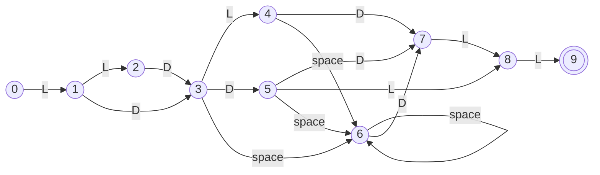

# Regular expressions: patterns and machines describe the same string sets

[Syllabus](../../../SYLLABUS.md) → [Computability and complexity](../README.md) → [Models of Computation](../README.md#s01) → Regular expressions

---

## General Overview

A delivery form has a box for a UK postcode. People type `SW1A 1AA`, `M1 1AE`, or `SW1A1AA` with the space left out. The form should accept all three, and reject `SW1A 1A`, which has lost a letter.

The rule fits on one line. Call a capital letter L, a digit D and a space `_`. Then a postcode shape is:

```
L(L|ε)D(L|D|ε)_*DLL
```

Read it left to right, where `|` means "or", `ε` means nothing at all and `*` means "repeated any number of times". A letter. Maybe a second letter. A digit. Maybe a letter or a digit. Any number of spaces, zero included. Then digit, letter, letter. That line is a **regular expression**, or **pattern**: a short description of a set of strings.

A pattern only describes. Something has to read the text and decide. This card turns the pattern into a **finite automaton** (a machine with a fixed number of states that reads one symbol at a time, from [Finite automata](01-finite-automata-and-regular-languages.md)). It runs the machine on the form's text. Then it turns the machine back into a pattern.

The postcode pattern becomes a machine with 30 states. A guess-free version has 10. Reading `SW1A 1AA` takes eight steps, one per character, and ends in an accepting state. Turned back into a pattern, the machine gives a longer line that accepts exactly the same strings: 23 of them up to length 9.

**Every pattern can be compiled into a finite automaton, and every finite automaton can be read back as a pattern, so the two describe exactly the same sets of strings.**

**What kind of fact this is:** a theorem (Kleene's theorem, 1956), proved on this card in Why it works. The compiling recipe (Thompson's construction) and the reading-back recipe (state elimination) are methods; the compiled machine's size and the cost of running it are counted on this card.

### The picture: the postcode pattern as a guess-free machine



State 0 is the start and state 9, drawn as a double circle, accepts. A missing arrow means reject. State 5 is where the machine has read two digits, as in `M11`: the second digit may still be part of the first half, as in `M11 1AE`, or may already start the second half, as in `M1 1AE` typed without its space.

---

## The formula

Notation from [Finite automata](01-finite-automata-and-regular-languages.md), in one line: an alphabet $`\Sigma`$ of symbols, here $`\Sigma = \{L, D, \_\}`$; a string $`w`$ of length $`n`$; the empty string $`\varepsilon`$; and the language $`L(M)`$, the set of strings a machine $`M`$ accepts. New here: a pattern $`R`$ names a language too, written $`L(R)`$. This $`L`$, for language, is not the letter symbol L of the postcode.

A pattern is built from single symbols and $`\varepsilon`$ by three operations. This card introduces them:

```math
L(R \mid S) = L(R) \cup L(S), \qquad L(RS) = \{\, xy : x \in L(R),\ y \in L(S) \,\}, \qquad L(R^{*}) = \{\varepsilon\} \cup L(R) \cup L(RR) \cup L(RRR) \cup \cdots
```

**Read it aloud:** the bar means "either one"; writing two patterns side by side, called **joining**, means "one, then the other"; the **star** means "the same pattern, any number of times, zero included".

So `_*` matches no space, one space, two spaces, and so on. `(L|ε)` matches one letter or nothing.

Kleene's theorem says the two ways of describing languages reach the same sets:

```math
\{\, L(R) : R \text{ a pattern} \,\} = \{\, L(M) : M \text{ a finite automaton} \,\}
```

**Read it aloud:** a set of strings has a pattern exactly when some fixed-memory machine accepts it.

Such a set is called **regular**. Going from machine to pattern uses one rule, applied once per state removed:

```math
R_{ij} \leftarrow R_{ij} \mid R_{ik}\,(R_{kk})^{*}\,R_{kj}
```

**Read it aloud:** after removing state $`k`$, the new label from $`i`$ to $`j`$ is the old direct route, or go from $`i`$ into $`k`$, circle at $`k`$ any number of times, then leave for $`j`$.

| Symbol | Plain meaning | In our example | Push it up and the answer… |
| --- | --- | --- | --- |
| $`\Sigma`$ | the alphabet: symbols allowed | L, D and `_` | more arrows, same number of Thompson states |
| $`w`$, $`n`$ | a string, and its length | `SW1A 1AA` reads LLDL`_`DLL, $`n = 8`$ | one more step of work per symbol |
| $`\varepsilon`$ | the empty string, or the pattern matching only it | the missing letter in `M1 1AE` | — |
| $`R`$, $`S`$ | patterns | the postcode line | — |
| $`R \mid S`$ | either: a string of $`R`$ or of $`S`$ | `(L\|D\|ε)` | the language grows |
| $`RS`$ | joining: a string of $`R`$, then one of $`S`$ | `DLL` | strings get longer |
| $`R^{*}`$ | star: $`R`$ repeated, zero or more times | `_*`, any number of spaces | the language becomes infinite |
| $`L(R)`$, $`L(M)`$ | the set of strings a pattern names, or a machine accepts | 23 strings up to length 9 | — |
| $`M`$ | a finite automaton | the 10-state machine above | — |
| $`m`$ | pieces in the pattern: symbols, $`\varepsilon`$s, bars, stars | 15 | Thompson's machine gets 2 states per piece |
| $`R_{ij}`$ | the pattern on the arrow from state $`i`$ to state $`j`$ | `L` from state 0 to state 1 | — |
| $`k`$ | the state being removed | state 2 of the `_*DLL` machine, the space loop | — |

### When it holds

- **Only the three operations.** Many software libraries add a **backreference**, a request to repeat exactly what an earlier part matched, such as "two equal halves". That set has no finite machine. Two different first halves of the same length need different states, since each is completed by itself and not by the other, and longer halves soon outnumber any fixed set of states. This is the class-counting method of [Pumping and Myhill-Nerode](04-pumping-lemma-and-myhill-nerode.md). So the theorem does not cover such "patterns".
- **A finite alphabet.** A class such as "any capital letter" is shorthand for a 26-way bar, so treating it as one symbol L changes nothing. An alphabet with no end would need infinitely many arrows.
- **Whole strings, not pieces of text.** $`L(R)`$ holds whole strings. Searching text for a match somewhere inside is a different pattern (Step 4); confusing the two lets `SEND TO SW1A 1AA TODAY` through a form.
- **The cost bound needs the live-state run**, which tracks every state a guess could be in (Step 2). A machine that tries one guess at a time and backs up on failure gives the same yes or no, but $`(aa^{*})^{*}b`$, over the letters a and b, on 20 a's costs it 6,291,455 steps, against 159 live-state visits.
- **Fixed memory.** A pattern built for brackets nested 3 deep rejects `(((())))`, nested 4 deep. No single pattern handles every depth; that needs a stack ([Grammars and a stack](05-context-free-grammars-and-pushdown-automata.md)).

---

## Why it works

### Step 0: build machines the way patterns are built

A pattern is made from tiny pieces by three operations. So build a machine for each tiny piece, and a way to glue machines for each operation. Then any pattern compiles, piece by piece.

The glue is the **free move**, also called an ε-move: an arrow the machine may follow without reading anything. [Guessing machines](02-nondeterminism-and-the-subset-construction.md) introduced free moves and proved they add no power. Going backwards, remove states one at a time, and write on each surviving arrow a pattern for every route it replaces.

### Step 1: pattern to machine, by Thompson's construction

Every machine built here has one entry state and one exit state, with no arrow into its entry and none out of its exit. The recipe has five rules:

1. **One symbol, such as L.** Two new states, one arrow labelled L.
2. **The empty string ε.** Two new states, one free move.
3. **Either, $`R \mid S`$.** A new entry with free moves into the entries of $`R`$ and $`S`$. Free moves from both exits to a new exit.
4. **Joining, $`RS`$.** A free move from the exit of $`R`$ to the entry of $`S`$. No new states.
5. **Star, $`R^{*}`$.** A new entry and exit. Free moves from the entry into $`R`$ and straight to the exit, which allows zero rounds. Free moves from the exit of $`R`$ back to its entry, for another round, and on to the new exit.

Each rule except joining adds exactly two states. The postcode pattern has $`m = 15`$ pieces, counting every symbol, ε, bar and star once. So its machine has 30 states. It has 34 arrows, 25 of them free moves.

<details>
<summary>Detailed proof: the machine accepts exactly the strings the pattern names</summary>

Argue by induction on how the pattern was built. The claim for each piece: a path from its entry to its exit spells $`w`$ exactly when $`w`$ is in $`L(R)`$, where free moves spell nothing.

Rules 1 and 2 have one path, spelling the symbol or nothing.

For rule 3, every path from the new entry starts with a free move into the machine for $`R`$ or for $`S`$. No arrow leads back into the new entry, so the path stays inside that machine until it reaches its exit. By the claim for the parts, the paths spell exactly $`L(R) \cup L(S)`$.

For rule 4, the only arrow out of the machine for $`R`$ is the free move into $`S`$. So a path splits at that arrow into an $`R`$-path and an $`S`$-path, spelling $`xy`$ with $`x`$ in $`L(R)`$ and $`y`$ in $`L(S)`$.

For rule 5, a path either takes the skip arrow, spelling $`\varepsilon`$, or passes through the machine for $`R`$ some number $`t \ge 1`$ of times. Each pass spells a string of $`L(R)`$, so the path spells $`t`$ such strings joined. That is exactly $`L(R^{*})`$.

The step that needs care is the shape of each finished piece: no arrow into its entry and none out of its exit. Every rule keeps that true for the piece it builds. So a path that enters a smaller piece can leave it only through that piece's exit, and paths never jump between pieces in a way the pattern does not allow.

</details>

### Step 2: run every guess at once

A machine with free moves may have several possible states at once. Run it by keeping the whole set of **live states**: every state some route could be in. Before reading, take the entry and everything reachable from it by free moves. For each symbol, follow its arrows from every live state, then add free moves again. Accept if the exit is live at the end.

For `SW1A 1AA`, read as LLDL`_`DLL, the live-state counts after each symbol are 7, 3, 13, 6, 4, 2, 2, 1. The jump to 13 after the digit `1` is the machine keeping every reading open: the first half may be over, a letter or digit may follow, and the spaces may start. The final live state is the exit, so the form accepts.

The cost is counted, not timed. At most $`2m`$ states are live, so reading $`n`$ symbols visits at most $`2m \times n`$ states: never more than 30 per symbol for the postcode, however long the text.

The subset construction from [Guessing machines](02-nondeterminism-and-the-subset-construction.md) turns each reachable live set into one state of a guess-free machine. For the postcode that gives the 10 states drawn above, one move per symbol.

### Step 3: machine to pattern, by state elimination

Now go backwards. Add a new start with a free move into state 0, and a new finish with a free move out of each accepting state. Label every arrow with a pattern: at first, a symbol or ε. Then remove the old states one at a time with the rule

```math
R_{ij} \leftarrow R_{ij} \mid R_{ik}\,(R_{kk})^{*}\,R_{kj}
```

When only the new start and the new finish remain, the one arrow between them carries the pattern.

Here is the rule by hand on the second half of a postcode, `_*DLL`. Its guess-free machine has 5 states:

| state | read | next |
| --- | --- | --- |
| 0, before any space | D | 1 |
| 0 | `_` | 2 |
| 1, after the digit | L | 3 |
| 2, after one or more spaces | D | 1 |
| 2 | `_` | 2 |
| 3, after one letter | L | 4, accepting |

The code removes the states from the highest number down.

1. Remove state 4, then state 3. The route from state 1 to the finish becomes LL.
2. Remove state 2, which has a loop labelled `_`. Routes enter it from state 0 by `_` and leave to state 1 by D. The rule turns the label from 0 to 1 into `D|__*D`: the direct digit, or a space, more spaces, then the digit.
3. Remove state 1. The route from 0 to the finish becomes `(D|__*D)LL`, and removing state 0 leaves that label on the last arrow.

That is not the text `_*DLL`, but it names the same strings: no space, or one space followed by more. Reading back gives an equal pattern, not the original text.

<details>
<summary>Detailed proof: removing a state keeps every route</summary>

Take any path from the new start to the new finish in the machine before state $`k`$ is removed. Cut it at each visit to $`k`$. Between visits, the path runs along arrows not touching $`k`$.

Each stretch through $`k`$ looks like: arrive from some $`i`$, take the loop at $`k`$ some number of times, leave to some $`j`$. The strings such a stretch spells are exactly $`L(R_{ik}(R_{kk})^{*}R_{kj})`$. Adding that to the label on the arrow from $`i`$ to $`j`$ with a bar keeps every one of these strings, and adds no others.

So removing $`k`$ leaves the set of spelled strings unchanged. After every old state is gone, the single arrow's label names exactly $`L(M)`$.

</details>

### Step 4: searching text is one more star

A form needs the whole box to match. A search tool needs a match anywhere in a line. Searching for $`R`$ is matching $`\Sigma^{*}R`$ (any text at all, then a match of $`R`$) at each end point: in the live-state run, add the entry's free-move closure back in before every symbol, so a new attempt starts at each position.

On `SEND TO SW1A 1AA TODAY` the exit is live after 16 characters. Checked one start at a time, two matches end there: `SW1A 1AA` from position 8 and `W1A 1AA` from position 9, counting from 0, since `W1A` is also a valid first half. As a whole string, the note is rejected.

### Step 5: both directions together

Step 1 compiles any pattern into a machine with the same language. Step 3 reads any machine back as a pattern with the same language. Together they are Kleene's theorem. The code checks it on every string of L, D and `_` up to length 9, all 29,524 of them: the pattern, both machines, the read-back pattern and a rule written in words with no pattern at all each accept the same 23.

That 23 can be counted by hand. Each shape is a first half, some spaces, then DLL, so a first half of length $`h`$ leaves room for 0 to $`6 - h`$ spaces within length 9:

- One first half has length 2 (LD): 0 to 4 spaces, so 5 strings.
- Three have length 3 (LDD, LDL, LLD): 0 to 3 spaces, 4 strings each, so 12.
- Two have length 4 (LLDD, LLDL): 0 to 2 spaces, 3 strings each, so 6.

The total is 5 + 12 + 6 = 23, as the code prints.

---

## Worked numbers, by hand

The guess-free machine reads `SW1A 1AA`.

| Step | Arithmetic | Value |
| --- | --- | --- |
| Turn characters into symbols | S, W letters; 1 digit; A letter; space; 1 digit; A, A letters | LLDL`_`DLL |
| Read L, L | state 0 to 1, then 1 to 2 | state 2 |
| Read D | 2 to 3: first half could end here | state 3 |
| Read L | 3 to 4: a first half like `SW1A` | state 4 |
| Read `_` | 4 to 6: in the gap | state 6 |
| Read D, L, L | 6 to 7, 7 to 8, 8 to 9 | **state 9: accept** |
| Same text, live-state machine | live counts 7, 3, 13, 6, 4, 2, 2, 1 | exit live: accept |
| Thompson size | 15 pieces × 2 | 30 states |
| Strings passing, up to length 9 | 5 + 12 + 6 | **23** |

Eight characters take eight moves on the 10-state machine, and the run ends on the double circle, so the form takes the postcode.

### What breaks if you drop a piece

| Mistake | Comes out at | What went wrong |
| --- | --- | --- |
| One space `_` in place of `_*` | 6 of the 23 pass; `SW1A1AA` rejected | the star allows zero spaces and many; one space allows exactly one |
| Elimination without the loop $`(R_{kk})^{*}`$ | 12 pass, 11 lost, such as LD`__`DLL | routes that circle a state vanish, so two spaces fail |
| Backtracking on $`(aa^{*})^{*}b`$, 20 a's | 6,291,455 steps, against 159 | trying each way to split the a's in turn: about $`3 \times 2^{21}`$ |
| Bracket pattern built for depth 3 | `(((())))` rejected; 18 states, depth 4 needs 24 | fixed memory: each extra depth needs more states |

The code prints all four.

---

## Code, from first principles, and it actually runs

The code imports nothing, so no library regular-expression engine is used. It writes the pattern as a small tree, compiles it by Thompson's construction, runs the live-state machine, builds the guess-free machine and reads it back by state elimination. It takes four roads to the same set of postcode shapes: the live-state machine, the guess-free machine, a backtracking reader that works on the pattern directly, and the read-back pattern. All four are compared with a fifth, a rule written in words with no pattern at all, on all 29,524 short strings. A closed form, $`3 \times 2^{n+1} - 1`$ steps against $`8n - 1`$, checks the backtracking cost. It comes from one choice at the first a: end its block there, leaving a full search of the other $`n - 1`$ a's, or run on into a longer block, which repeats that search. Counting every call, each extra a doubles the count and adds 1.

### Python

```python
# Regular expressions -- the check behind the card.  Nothing is imported: no re.  A postcode
# shape is a pattern over L (capital letter), D (digit) and _ (space).  It is compiled into a
# machine (Thompson), run, made guess-free (subset construction) and read back (elimination).
EPS = ('eps',)
def sym(c): return ('sym', c)
def cat(a, b): return None if a is None or b is None else b if a == EPS else a if b == EPS else ('cat', a, b)
def alt(a, b): return b if a is None else a if b is None or a == b else ('alt', a, b)
def star(a): return EPS if a in (None, EPS) else a if a[0] == 'star' else ('star', a)
def seq(*rs): return EPS if not rs else cat(rs[0], seq(*rs[1:]))   # None means "no route at all"
def show(r, p=0):                     # write a pattern out, brackets only where needed
    k = r[0]
    if k in ('eps', 'sym'): return 'ε' if k == 'eps' else r[1]
    if k == 'star': return show(r[1], 3) + '*'
    s = show(r[1], 2) + show(r[2], 2) if k == 'cat' else show(r[1], 1) + '|' + show(r[2], 1)
    return '(' + s + ')' if (k == 'cat' and p > 2) or (k == 'alt' and p > 1) else s
def pieces(r): return (r[0] != 'cat') + sum(pieces(x) for x in r[1:] if isinstance(x, tuple))  # all but joins
def thompson(r, m):                   # m = [states used, arrows]; returns (entry, exit)
    k = r[0]
    if k == 'cat':                    # joining: exit of the first -> entry of the second
        a, b = thompson(r[1], m), thompson(r[2], m)
        m[1].append((a[1], None, b[0]))
        return a[0], b[1]
    s, e = m[0], m[0] + 1; m[0] += 2  # every other piece gets a new entry s and exit e
    if k in ('eps', 'sym'): m[1].append((s, r[1] if k == 'sym' else None, e))
    elif k == 'alt':
        a, b = thompson(r[1], m), thompson(r[2], m)
        m[1] += [(s, None, a[0]), (s, None, b[0]), (a[1], None, e), (b[1], None, e)]
    else:                             # star: skip it, or go round again
        a = thompson(r[1], m)
        m[1] += [(s, None, a[0]), (s, None, e), (a[1], None, a[0]), (a[1], None, e)]
    return s, e
def compile_nfa(r):                   # the machine: (state count, arrows, entry, exit)
    m = [0, []]
    s, e = thompson(r, m)
    return m[0], m[1], s, e
def close(states, arrows):            # add every state reachable by free moves
    out, todo = set(states), list(states)
    while todo:
        q = todo.pop()
        new = {b for a, c, b in arrows if a == q and c is None} - out
        out |= new; todo += new
    return frozenset(out)
def step(states, c, arrows): return close({b for a, x, b in arrows if a in states and x == c}, arrows)
def nfa_accepts(nfa, w, trace=None):  # run every guess at once: keep the set of live states
    cur = close({nfa[2]}, nfa[1])
    for c in w:
        cur = step(cur, c, nfa[1])
        if trace is not None: trace.append(len(cur))
    return nfa[3] in cur
def search_ends(nfa, w):              # searching text: a fresh start at every position
    start = cur = close({nfa[2]}, nfa[1])
    out = []
    for i, c in enumerate(w):
        cur = step(cur, c, nfa[1]) | start
        if nfa[3] in cur: out.append(i + 1)
    return out
def subset_dfa(nfa, sigma):           # each guess-free state is a set of Thompson states
    first = close({nfa[2]}, nfa[1])
    names, delta, todo = {first: 0}, {}, [first]
    while todo:
        cur = todo.pop(0)
        for c in sigma:
            nxt = step(cur, c, nfa[1])
            if nxt:
                if nxt not in names: names[nxt] = len(names); todo.append(nxt)
                delta[(names[cur], c)] = names[nxt]
    return len(names), delta, {i for st, i in names.items() if nfa[3] in st}
def dfa_accepts(d, w, q=0):           # one state at a time; -1 means "fell off the machine"
    for c in w: q = d[1].get((q, c), -1)
    return q in d[2]
def read_back(d, keep_loop=True):     # state elimination: machine -> pattern
    n, delta, acc = d
    R = {(i, j): None for i in range(n + 2) for j in range(n + 2)}
    R[(n, 0)] = EPS                   # new start n, new finish n + 1
    for q in acc: R[(q, n + 1)] = EPS
    for (q, c), t in delta.items(): R[(q, t)] = alt(R[(q, t)], sym(c))
    for k in reversed(range(n)):      # remove state k, rerouting every path through it
        rest = [i for i in range(n + 2) if i < k or i >= n]
        loop = star(R[(k, k)]) if keep_loop else EPS
        for i in rest:
            for j in rest: R[(i, j)] = alt(R[(i, j)], seq(R[(i, k)], loop, R[(k, j)]))
    return R[(n, n + 1)]
def backtrack(r, w, i, k, cnt):       # how most regex libraries run: try, undo, retry
    cnt[0] += 1
    t = r[0]
    if t in ('eps', 'sym'): return k(i) if t == 'eps' else w[i:i + 1] == r[1] and k(i + 1)
    if t == 'cat': return backtrack(r[1], w, i, lambda j: backtrack(r[2], w, j, k, cnt), cnt)
    if t == 'alt': return backtrack(r[1], w, i, k, cnt) or backtrack(r[2], w, i, k, cnt)
    return backtrack(r[1], w, i, lambda j: j > i and backtrack(r, w, j, k, cnt), cnt) or k(i)
def matches(r, w): return backtrack(r, w, 0, lambda j: j == len(w), [0])   # reads the pattern itself
def by_words(w): return len(w) >= 5 and w[-3:] == 'DLL' and w[:-3].rstrip('_') in ('LD', 'LDD', 'LDL', 'LLD', 'LLDD', 'LLDL')  # the rule in words
def classes(text): return ''.join('L' if c.isupper() else 'D' if c.isdigit() else '_' if c == ' ' else '?' for c in text)
def strings_of(sigma, n): return [''] if n == 0 else [w + c for w in strings_of(sigma, n - 1) for c in sigma]
def yn(ok): return 'accept' if ok else 'reject'
L, D, SP = sym('L'), sym('D'), sym('_')
POST, N = seq(L, alt(L, EPS), D, alt(L, alt(D, EPS)), star(SP), D, L, L), 9
back = read_back(dfa := subset_dfa(nfa := compile_nfa(POST), 'LD_'))
print(f"pattern {show(POST)}: {pieces(POST)} pieces, so {2 * pieces(POST)} Thompson states")
print(f"Thompson machine: {nfa[0]} states, {len(nfa[1])} arrows, {sum(e[1] is None for e in nfa[1])} of them free moves")
for text in ['SW1A 1AA', 'M1 1AE', 'SW1A1AA', 'SW1A 1A']:
    ok = nfa_accepts(nfa, classes(text), tr := [])
    print(f"{text:9} reads {classes(text):9} live states after each symbol {tr}: {yn(ok)}")
print(f"guess-free machine: {dfa[0]} states, accepting {sorted(dfa[2])}")
for q in range(dfa[0]):
    print(f"  state {q}: " + (', '.join(f"{c} -> {dfa[1][(q, c)]}" for c in 'LD_' if (q, c) in dfa[1]) or 'no moves'))
print(f"read back: {show(back)}")
print(f"round trip of {show(small := seq(star(SP), D, L, L))} through a {(sd := subset_dfa(compile_nfa(small), 'LD_'))[0]}-state machine: {show(read_back(sd))}")
words = [w for n in range(N + 1) for w in strings_of('LD_', n)]
spec = [by_words(w) for w in words]
roads = {'Thompson machine': [nfa_accepts(nfa, w) for w in words], 'guess-free machine': [dfa_accepts(dfa, w) for w in words],
         'pattern read directly': [matches(POST, w) for w in words], 'pattern read back': [matches(back, w) for w in words]}
groups = [sum(s and len(w) - w.count('_') == h + 3 for w, s in zip(words, spec)) for h in (2, 3, 4)]
print(f"all {len(words)} strings of L, D, _ up to length {N}: {sum(spec)} pass the rule in words; first half 2, 3, 4 long: {groups}")
for name, got in roads.items():
    print(f"  {name:22} accepts {sum(got)}, disagrees with the rule on {sum(a != b for a, b in zip(got, spec))}")
note = 'SEND TO SW1A 1AA TODAY'
found = search_ends(nfa, classes(note))
starts = [j for j in range(found[0]) if by_words(classes(note)[j:found[0]])]
print(f"search {note!r}: a match ends at {found}; it can start at {starts}: {[note[j:found[0]] for j in starts]}")
print(f"the whole note as a postcode: {yn(nfa_accepts(nfa, classes(note)))}")
one = seq(L, alt(L, EPS), D, alt(L, alt(D, EPS)), SP, D, L, L)
print(f"mistake 1, one space in place of _*: accepts {sum(matches(one, w) for w in words)}; SW1A1AA: {yn(matches(one, 'LLDLDLL'))}")
bad = read_back(dfa, keep_loop=False)
miss = [w for w, s in zip(words, spec) if s and not matches(bad, w)]
print(f"mistake 2, elimination without the loop: accepts {sum(matches(bad, w) for w in words)}, loses {len(miss)}, e.g. {miss[0]}")
evil, cost = seq(star(seq(sym('a'), star(sym('a')))), sym('b')), []
for n in (5, 10, 15, 20):
    ok = backtrack(evil, 'a' * n, 0, lambda j: j == n, cnt := [0])
    cost.append((n, cnt[0], sum(tr) if nfa_accepts(compile_nfa(evil), 'a' * n, tr := []) == ok else -1))
    print(f"mistake 3, {show(evil)} on {n} a's: backtracking takes {cnt[0]:,} steps, the live-state run {cost[-1][2]}")
def depth(k): return EPS if k == 0 else star(seq(sym('('), depth(k - 1), sym(')')))
b3 = compile_nfa(depth(3))
print(f"mistake 4, depth-3 pattern, {b3[0]} states (depth 4 needs {compile_nfa(depth(4))[0]}): "
      f"((())) {yn(nfa_accepts(b3, '((()))'))}, (((()))) {yn(nfa_accepts(b3, '(((())))'))}")
for name, got in roads.items(): assert got == spec, name           # four roads against the rule in words
assert nfa[0] == 2 * pieces(POST) and dfa[0] == 10                  # Thompson's count, from the pattern alone
assert starts == [8, 9] and not nfa_accepts(nfa, classes(note))     # search finds it; a whole match does not
assert all(c == 3 * 2 ** (n + 1) - 1 and t == 8 * n - 1 for n, c, t in cost)  # exponential against linear
assert nfa_accepts(b3, '((()))') and not nfa_accepts(b3, '(((())))')  # fixed depth, fixed memory
print("ALL CHECKS PASS")
```

**Ran 2026-11-19 on macOS, Python 3.14.10, standard library only. All checks passed. Output, pasted from the run:**

```
pattern L(L|ε)D(L|D|ε)_*DLL: 15 pieces, so 30 Thompson states
Thompson machine: 30 states, 34 arrows, 25 of them free moves
SW1A 1AA  reads LLDL_DLL  live states after each symbol [7, 3, 13, 6, 4, 2, 2, 1]: accept
M1 1AE    reads LD_DLL    live states after each symbol [7, 13, 4, 2, 2, 1]: accept
SW1A1AA   reads LLDLDLL   live states after each symbol [7, 3, 13, 6, 2, 2, 1]: accept
SW1A 1A   reads LLDL_DL   live states after each symbol [7, 3, 13, 6, 4, 2, 2]: reject
guess-free machine: 10 states, accepting [9]
  state 0: L -> 1
  state 1: L -> 2, D -> 3
  state 2: D -> 3
  state 3: L -> 4, D -> 5, _ -> 6
  state 4: D -> 7, _ -> 6
  state 5: L -> 8, D -> 7, _ -> 6
  state 6: D -> 7, _ -> 6
  state 7: L -> 8
  state 8: L -> 9
  state 9: no moves
read back: L(D(__*DLL|D(LL|DLL|__*DLL)|L(DLL|__*DLL))|LD(__*DLL|D(LL|DLL|__*DLL)|L(DLL|__*DLL)))
round trip of _*DLL through a 5-state machine: (D|__*D)LL
all 29524 strings of L, D, _ up to length 9: 23 pass the rule in words; first half 2, 3, 4 long: [5, 12, 6]
  Thompson machine       accepts 23, disagrees with the rule on 0
  guess-free machine     accepts 23, disagrees with the rule on 0
  pattern read directly  accepts 23, disagrees with the rule on 0
  pattern read back      accepts 23, disagrees with the rule on 0
search 'SEND TO SW1A 1AA TODAY': a match ends at [16]; it can start at [8, 9]: ['SW1A 1AA', 'W1A 1AA']
the whole note as a postcode: reject
mistake 1, one space in place of _*: accepts 6; SW1A1AA: reject
mistake 2, elimination without the loop: accepts 12, loses 11, e.g. LD__DLL
mistake 3, (aa*)*b on 5 a's: backtracking takes 191 steps, the live-state run 39
mistake 3, (aa*)*b on 10 a's: backtracking takes 6,143 steps, the live-state run 79
mistake 3, (aa*)*b on 15 a's: backtracking takes 196,607 steps, the live-state run 119
mistake 3, (aa*)*b on 20 a's: backtracking takes 6,291,455 steps, the live-state run 159
mistake 4, depth-3 pattern, 18 states (depth 4 needs 24): ((())) accept, (((()))) reject
ALL CHECKS PASS
```

### Rust

Same numbers, same labels, built with `rustc --edition 2021 -O`.

```rust
// Regular expressions -- the same check as the Python, in Rust.  No crates, no regex.  A postcode
// shape is a pattern over L (capital letter), D (digit) and _ (space).  It is compiled into a
// machine (Thompson), run, made guess-free (subset construction) and read back (elimination).
use std::{cell::Cell, collections::{BTreeSet, HashMap}};
#[derive(Clone, PartialEq)]
enum Re { Eps, Sym(char), Cat(Box<Re>, Box<Re>), Alt(Box<Re>, Box<Re>), Star(Box<Re>) }
use Re::*;
type P = Option<Re>;                  // None means "no route at all"
fn bx(r: Re) -> Box<Re> { Box::new(r) }
fn sym(c: char) -> P { Some(Sym(c)) }
fn cat(a: P, b: P) -> P { match (a, b) { (Some(Eps), b) => b, (a, Some(Eps)) => a, (Some(a), Some(b)) => Some(Cat(bx(a), bx(b))), _ => None } }
fn alt(a: P, b: P) -> P { match (a, b) { (None, b) => b, (a, None) => a, (Some(a), Some(b)) => Some(if a == b { a } else { Alt(bx(a), bx(b)) }) } }
fn star(a: P) -> P { match a { None | Some(Eps) => Some(Eps), Some(Star(x)) => Some(Star(x)), Some(x) => Some(Star(bx(x))) } }
fn seq(rs: Vec<P>) -> P { let mut out = Some(Eps); for r in rs.into_iter().rev() { out = cat(r, out) } out }
fn show(r: &Re, p: u8) -> String {    // write a pattern out, brackets only where needed
    match r {
        Eps => "ε".to_string(), Sym(c) => c.to_string(),
        Star(a) => show(a, 3) + "*",
        Cat(a, b) => { let s = show(a, 2) + &show(b, 2); if p > 2 { format!("({})", s) } else { s } }
        Alt(a, b) => { let s = show(a, 1) + "|" + &show(b, 1); if p > 1 { format!("({})", s) } else { s } }
    }
}
fn pieces(r: &Re) -> usize { match r { Eps | Sym(_) => 1, Star(a) => 1 + pieces(a), Cat(a, b) => pieces(a) + pieces(b), Alt(a, b) => 1 + pieces(a) + pieces(b) } }
type Arrow = (usize, Option<char>, usize); type Set = BTreeSet<usize>;
struct Nfa { n: usize, arrows: Vec<Arrow>, s: usize, e: usize }
fn thompson(r: &Re, n: &mut usize, ar: &mut Vec<Arrow>) -> (usize, usize) {
    if let Cat(a, b) = r {            // joining: exit of the first -> entry of the second
        let (x, y) = (thompson(a, n, ar), thompson(b, n, ar));
        ar.push((x.1, None, y.0));
        return (x.0, y.1);
    }
    let (s, e) = (*n, *n + 1);        // every other piece gets a new entry s and exit e
    *n += 2;
    match r {
        Eps | Sym(_) => ar.push((s, if let Sym(c) = r { Some(*c) } else { None }, e)),
        Alt(a, b) => { let (x, y) = (thompson(a, n, ar), thompson(b, n, ar)); ar.extend([(s, None, x.0), (s, None, y.0), (x.1, None, e), (y.1, None, e)]) }
        Star(a) => { let x = thompson(a, n, ar); ar.extend([(s, None, x.0), (s, None, e), (x.1, None, x.0), (x.1, None, e)]) }   // skip, or go round again
        Cat(..) => unreachable!(),
    }
    (s, e)
}
fn compile_nfa(r: &Re) -> Nfa { let (mut n, mut ar) = (0, Vec::new()); let (s, e) = thompson(r, &mut n, &mut ar); Nfa { n, arrows: ar, s, e } }
fn close(states: Set, ar: &[Arrow]) -> Set {   // add every state reachable by free moves
    let (mut out, mut todo): (Set, Vec<usize>) = (states.clone(), states.into_iter().collect());
    while let Some(q) = todo.pop() { for &(a, c, b) in ar { if a == q && c.is_none() && out.insert(b) { todo.push(b) } } }
    out
}
fn step(st: &Set, c: char, ar: &[Arrow]) -> Set { close(ar.iter().filter(|x| st.contains(&x.0) && x.1 == Some(c)).map(|x| x.2).collect(), ar) }
fn nfa_accepts(m: &Nfa, w: &[char], trace: &mut Vec<usize>) -> bool {   // keep the set of live states
    let mut cur = close(Set::from([m.s]), &m.arrows);
    for &c in w { cur = step(&cur, c, &m.arrows); trace.push(cur.len()) }
    cur.contains(&m.e)
}
fn search_ends(m: &Nfa, w: &[char]) -> Vec<usize> {   // searching text: a fresh start at every position
    let start = close(Set::from([m.s]), &m.arrows);
    let (mut cur, mut out) = (start.clone(), Vec::new());
    for (i, &c) in w.iter().enumerate() { cur = step(&cur, c, &m.arrows).union(&start).copied().collect(); if cur.contains(&m.e) { out.push(i + 1) } }
    out
}
struct Dfa { n: usize, delta: HashMap<(usize, char), usize>, acc: Set }
fn subset_dfa(m: &Nfa, sigma: &str) -> Dfa {   // each guess-free state is a set of Thompson states
    let (mut names, mut delta, mut i) = (vec![close(Set::from([m.s]), &m.arrows)], HashMap::new(), 0);
    while i < names.len() {
        for c in sigma.chars() {
            let nxt = step(&names[i], c, &m.arrows);
            if nxt.is_empty() { continue } let t = match names.iter().position(|x| *x == nxt) { Some(t) => t, None => { names.push(nxt); names.len() - 1 } };
            delta.insert((i, c), t);
        }
        i += 1;
    }
    let acc = (0..names.len()).filter(|&q| names[q].contains(&m.e)).collect();
    Dfa { n: names.len(), delta, acc }
}
fn dfa_accepts(d: &Dfa, w: &[char]) -> bool {   // one state at a time; None means "fell off the machine"
    let mut q = Some(0);
    for &c in w { q = q.and_then(|x| d.delta.get(&(x, c)).copied()) }
    q.map_or(false, |x| d.acc.contains(&x))
}
fn read_back(d: &Dfa, keep_loop: bool) -> P {   // state elimination: machine -> pattern
    let n = d.n;
    let mut r: Vec<Vec<P>> = vec![vec![None; n + 2]; n + 2];
    r[n][0] = Some(Eps);              // new start n, new finish n + 1
    for &q in &d.acc { r[q][n + 1] = Some(Eps) }
    for q in 0..n { for c in "LD_".chars() { if let Some(&t) = d.delta.get(&(q, c)) { r[q][t] = alt(r[q][t].clone(), sym(c)) } } }
    for k in (0..n).rev() {           // remove state k, rerouting every path through it
        let rest: Vec<usize> = (0..n + 2).filter(|&i| i < k || i >= n).collect();
        let lp = if keep_loop { star(r[k][k].clone()) } else { Some(Eps) };
        for &i in &rest { for &j in &rest { r[i][j] = alt(r[i][j].clone(), seq(vec![r[i][k].clone(), lp.clone(), r[k][j].clone()])) } }
    }
    r[n][n + 1].clone()
}
fn bt(r: &Re, w: &[char], i: usize, k: &dyn Fn(usize) -> bool, cnt: &Cell<u64>) -> bool {   // try, undo, retry
    cnt.set(cnt.get() + 1);
    match r {
        Eps => k(i),
        Sym(c) => i < w.len() && w[i] == *c && k(i + 1),
        Cat(a, b) => bt(a, w, i, &|j| bt(b, w, j, k, cnt), cnt),
        Alt(a, b) => bt(a, w, i, k, cnt) || bt(b, w, i, k, cnt),
        Star(a) => bt(a, w, i, &|j| j > i && bt(r, w, j, k, cnt), cnt) || k(i),
    }
}
fn matches(r: &Re, w: &[char]) -> bool { bt(r, w, 0, &|j| j == w.len(), &Cell::new(0)) }   // reads the pattern itself
fn by_words(w: &str) -> bool { w.len() >= 5 && w.ends_with("DLL") && ["LD", "LDD", "LDL", "LLD", "LLDD", "LLDL"].contains(&w[..w.len() - 3].trim_end_matches('_')) }   // the rule in words
fn classes(t: &str) -> String { t.chars().map(|c| if c.is_ascii_uppercase() { 'L' } else if c.is_ascii_digit() { 'D' } else if c == ' ' { '_' } else { '?' }).collect() }
fn ch(s: &str) -> Vec<char> { s.chars().collect() }
fn yn(ok: bool) -> &'static str { if ok { "accept" } else { "reject" } }
fn commas(x: u64) -> String { let s = x.to_string(); let mut o = String::new(); for (i, c) in s.chars().enumerate() { if i > 0 && (s.len() - i) % 3 == 0 { o.push(',') } o.push(c) } o }
fn depth(k: u32) -> P { if k == 0 { Some(Eps) } else { star(seq(vec![sym('('), depth(k - 1), sym(')')])) } }
fn main() {
    let (l, d, sp) = (|| sym('L'), || sym('D'), || sym('_'));
    let post = seq(vec![l(), alt(l(), Some(Eps)), d(), alt(l(), alt(d(), Some(Eps))), star(sp()), d(), l(), l()]).unwrap();
    let (nfa, nmax) = (compile_nfa(&post), 9);
    let dfa = subset_dfa(&nfa, "LD_"); let back = read_back(&dfa, true).unwrap();
    println!("pattern {}: {} pieces, so {} Thompson states", show(&post, 0), pieces(&post), 2 * pieces(&post));
    println!("Thompson machine: {} states, {} arrows, {} of them free moves", nfa.n, nfa.arrows.len(), nfa.arrows.iter().filter(|a| a.1.is_none()).count());
    for text in ["SW1A 1AA", "M1 1AE", "SW1A1AA", "SW1A 1A"] {
        let mut tr = Vec::new();
        let ok = nfa_accepts(&nfa, &ch(&classes(text)), &mut tr);
        println!("{:9} reads {:9} live states after each symbol {:?}: {}", text, classes(text), tr, yn(ok));
    }
    println!("guess-free machine: {} states, accepting {:?}", dfa.n, dfa.acc.iter().collect::<Vec<_>>());
    for q in 0..dfa.n {
        let mv: Vec<String> = "LD_".chars().filter_map(|c| dfa.delta.get(&(q, c)).map(|t| format!("{} -> {}", c, t))).collect();
        println!("  state {}: {}", q, if mv.is_empty() { "no moves".to_string() } else { mv.join(", ") });
    }
    println!("read back: {}", show(&back, 0));
    let small = seq(vec![star(sp()), d(), l(), l()]).unwrap(); let sd = subset_dfa(&compile_nfa(&small), "LD_");
    println!("round trip of {} through a {}-state machine: {}", show(&small, 0), sd.n, show(&read_back(&sd, true).unwrap(), 0));
    let (mut words, mut layer) = (vec![String::new()], vec![String::new()]);
    for _ in 0..nmax { layer = layer.iter().flat_map(|w| "LD_".chars().map(move |c| format!("{}{}", w, c))).collect(); words.extend(layer.clone()) }
    let spec: Vec<bool> = words.iter().map(|w| by_words(w)).collect();
    let roads: Vec<(&str, Vec<bool>)> = vec![
        ("Thompson machine", words.iter().map(|w| nfa_accepts(&nfa, &ch(w), &mut Vec::new())).collect()),
        ("guess-free machine", words.iter().map(|w| dfa_accepts(&dfa, &ch(w))).collect()),
        ("pattern read directly", words.iter().map(|w| matches(&post, &ch(w))).collect()),
        ("pattern read back", words.iter().map(|w| matches(&back, &ch(w))).collect())];
    let groups: Vec<usize> = [2, 3, 4].iter().map(|&h| words.iter().zip(&spec).filter(|(w, &s)| s && w.len() - w.matches('_').count() == h + 3).count()).collect();
    println!("all {} strings of L, D, _ up to length {}: {} pass the rule in words; first half 2, 3, 4 long: {:?}", words.len(), nmax, spec.iter().filter(|&&s| s).count(), groups);
    for (name, got) in &roads {
        println!("  {:22} accepts {}, disagrees with the rule on {}", name, got.iter().filter(|&&g| g).count(), got.iter().zip(&spec).filter(|(a, b)| a != b).count());
    }
    let note = "SEND TO SW1A 1AA TODAY";
    let found = search_ends(&nfa, &ch(&classes(note)));
    let starts: Vec<usize> = (0..found[0]).filter(|&j| by_words(&classes(note)[j..found[0]])).collect();
    let quoted: Vec<String> = starts.iter().map(|&j| format!("'{}'", &note[j..found[0]])).collect();
    println!("search '{}': a match ends at {:?}; it can start at {:?}: [{}]", note, found, starts, quoted.join(", "));
    let whole = nfa_accepts(&nfa, &ch(&classes(note)), &mut Vec::new()); println!("the whole note as a postcode: {}", yn(whole));
    let one = seq(vec![l(), alt(l(), Some(Eps)), d(), alt(l(), alt(d(), Some(Eps))), sp(), d(), l(), l()]).unwrap();
    println!("mistake 1, one space in place of _*: accepts {}; SW1A1AA: {}", words.iter().filter(|w| matches(&one, &ch(w))).count(), yn(matches(&one, &ch("LLDLDLL"))));
    let bad = read_back(&dfa, false).unwrap();
    let miss: Vec<&String> = words.iter().zip(&spec).filter(|(w, &s)| s && !matches(&bad, &ch(w))).map(|(w, _)| w).collect();
    println!("mistake 2, elimination without the loop: accepts {}, loses {}, e.g. {}", words.iter().filter(|w| matches(&bad, &ch(w))).count(), miss.len(), miss[0]);
    let (evil, mut cost) = (seq(vec![star(seq(vec![sym('a'), star(sym('a'))])), sym('b')]).unwrap(), Vec::new());
    for n in [5usize, 10, 15, 20] {
        let (w, cnt, mut tr) = (vec!['a'; n], Cell::new(0u64), Vec::new());
        let ok = bt(&evil, &w, 0, &|j| j == n, &cnt);
        let live = if nfa_accepts(&compile_nfa(&evil), &w, &mut tr) == ok { tr.iter().sum::<usize>() as i64 } else { -1 };
        cost.push((n, cnt.get(), live));
        println!("mistake 3, {} on {} a's: backtracking takes {} steps, the live-state run {}", show(&evil, 0), n, commas(cnt.get()), live);
    }
    let b3 = compile_nfa(&depth(3).unwrap());
    let (ok3, ok4) = (nfa_accepts(&b3, &ch("((()))"), &mut Vec::new()), nfa_accepts(&b3, &ch("(((())))"), &mut Vec::new()));
    println!("mistake 4, depth-3 pattern, {} states (depth 4 needs {}): ((())) {}, (((()))) {}", b3.n, compile_nfa(&depth(4).unwrap()).n, yn(ok3), yn(ok4));
    for (name, got) in &roads { assert!(*got == spec, "{}", name) }      // four roads against the rule in words
    assert!(nfa.n == 2 * pieces(&post) && dfa.n == 10);                   // Thompson's count, from the pattern alone
    assert!(starts == vec![8, 9] && !whole);                              // search finds it; a whole match does not
    assert!(cost.iter().all(|&(n, c, t)| c == 3 * (1u64 << (n + 1)) - 1 && t == 8 * n as i64 - 1));   // exponential against linear
    assert!(ok3 && !ok4);                                                 // fixed depth, fixed memory
    println!("ALL CHECKS PASS");
}
```

**Ran 2026-11-19 on macOS, rustc 1.98.1, no crates. All checks passed. Output, pasted from the run:**

```
pattern L(L|ε)D(L|D|ε)_*DLL: 15 pieces, so 30 Thompson states
Thompson machine: 30 states, 34 arrows, 25 of them free moves
SW1A 1AA  reads LLDL_DLL  live states after each symbol [7, 3, 13, 6, 4, 2, 2, 1]: accept
M1 1AE    reads LD_DLL    live states after each symbol [7, 13, 4, 2, 2, 1]: accept
SW1A1AA   reads LLDLDLL   live states after each symbol [7, 3, 13, 6, 2, 2, 1]: accept
SW1A 1A   reads LLDL_DL   live states after each symbol [7, 3, 13, 6, 4, 2, 2]: reject
guess-free machine: 10 states, accepting [9]
  state 0: L -> 1
  state 1: L -> 2, D -> 3
  state 2: D -> 3
  state 3: L -> 4, D -> 5, _ -> 6
  state 4: D -> 7, _ -> 6
  state 5: L -> 8, D -> 7, _ -> 6
  state 6: D -> 7, _ -> 6
  state 7: L -> 8
  state 8: L -> 9
  state 9: no moves
read back: L(D(__*DLL|D(LL|DLL|__*DLL)|L(DLL|__*DLL))|LD(__*DLL|D(LL|DLL|__*DLL)|L(DLL|__*DLL)))
round trip of _*DLL through a 5-state machine: (D|__*D)LL
all 29524 strings of L, D, _ up to length 9: 23 pass the rule in words; first half 2, 3, 4 long: [5, 12, 6]
  Thompson machine       accepts 23, disagrees with the rule on 0
  guess-free machine     accepts 23, disagrees with the rule on 0
  pattern read directly  accepts 23, disagrees with the rule on 0
  pattern read back      accepts 23, disagrees with the rule on 0
search 'SEND TO SW1A 1AA TODAY': a match ends at [16]; it can start at [8, 9]: ['SW1A 1AA', 'W1A 1AA']
the whole note as a postcode: reject
mistake 1, one space in place of _*: accepts 6; SW1A1AA: reject
mistake 2, elimination without the loop: accepts 12, loses 11, e.g. LD__DLL
mistake 3, (aa*)*b on 5 a's: backtracking takes 191 steps, the live-state run 39
mistake 3, (aa*)*b on 10 a's: backtracking takes 6,143 steps, the live-state run 79
mistake 3, (aa*)*b on 15 a's: backtracking takes 196,607 steps, the live-state run 119
mistake 3, (aa*)*b on 20 a's: backtracking takes 6,291,455 steps, the live-state run 159
mistake 4, depth-3 pattern, 18 states (depth 4 needs 24): ((())) accept, (((()))) reject
ALL CHECKS PASS
```

The two outputs match line for line.

### Lean

Lean proves Kleene's theorem for any finite alphabet, the backreference limit and the read-back rule, and checks the postcode numbers.

- Take a finite alphabet. Then a set of strings has a pattern exactly when some finite automaton accepts it. Lean's patterns also allow a piece naming no strings at all, which the empty set needs.
- Take an alphabet with two different symbols. Then no finite automaton accepts the set of strings made of two equal halves, which a backreference asks for.
- Take any patterns $`R`$ and $`S`$. Then $`S \mid RR^{*}S`$ names the same strings as $`R^{*}S`$. With $`R`$ a space and $`S`$ the digit D, this is `D|__*D` against `_*D`.
- The postcode pattern accepts the shapes of `SW1A 1AA`, `M1 1AE` and `SW1A1AA`, and rejects the shape of `SW1A 1A`.
- With one space `_` in place of `_*`, the shape of `SW1A1AA` is rejected.
- Of all 29,524 strings of L, D and `_` up to length 9, exactly 23 match the postcode pattern.

Machine sizes, live-state counts, the read-back text, search, backtracking costs and the other mistakes are left to the Python and Rust checks.

```lean
-- Regular expressions: a set of strings over a finite alphabet has a pattern exactly when a finite machine accepts it.
import Mathlib.Computability.RegularExpressions
import Mathlib.Computability.DFA
import Mathlib.Computability.MyhillNerode
import Mathlib.Algebra.BigOperators.Ring.Finset
import Mathlib.Tactic.Abel
import Mathlib.Data.Set.Finite.Powerset
import Mathlib.Basic.Finite.Prod

open Computability

namespace KleeneProof

theorem mem_finset_sum {α ι : Type} (s : Finset ι) (f : ι → Language α) (w : List α) :
    w ∈ ∑ i ∈ s, f i ↔ ∃ i ∈ s, w ∈ f i := by
  classical
  induction s using Finset.induction_on with
  | empty => simp
  | insert i s hi ih =>
    rw [Finset.sum_insert hi, Language.mem_add, ih]
    simp

theorem pat_add {α : Type} {L M : Language α} (h1 : ∃ R : RegularExpression α, R.matches' = L)
    (h2 : ∃ R : RegularExpression α, R.matches' = M) :
    ∃ R : RegularExpression α, R.matches' = L + M := by
  obtain ⟨R, rfl⟩ := h1
  obtain ⟨S, rfl⟩ := h2
  exact ⟨R + S, RegularExpression.matches'_add R S⟩

theorem pat_mul {α : Type} {L M : Language α} (h1 : ∃ R : RegularExpression α, R.matches' = L)
    (h2 : ∃ R : RegularExpression α, R.matches' = M) :
    ∃ R : RegularExpression α, R.matches' = L * M := by
  obtain ⟨R, rfl⟩ := h1
  obtain ⟨S, rfl⟩ := h2
  exact ⟨R * S, RegularExpression.matches'_mul R S⟩

theorem pat_star {α : Type} {L : Language α} (h1 : ∃ R : RegularExpression α, R.matches' = L) :
    ∃ R : RegularExpression α, R.matches' = L∗ := by
  obtain ⟨R, rfl⟩ := h1
  exact ⟨R.star, RegularExpression.matches'_star R⟩

theorem pat_sum {α ι : Type} (s : Finset ι) (f : ι → Language α)
    (h : ∀ i, ∃ R : RegularExpression α, R.matches' = f i) :
    ∃ R : RegularExpression α, R.matches' = ∑ i ∈ s, f i := by
  classical
  induction s using Finset.induction_on with
  | empty => exact ⟨0, by simp⟩
  | insert i s hi ih =>
    rw [Finset.sum_insert hi]
    exact pat_add (h i) ih

theorem sum_split {β ι : Type} [AddCommMonoid β] [Fintype ι] [DecidableEq ι] (f : ι → β)
    (k : ι) : ∑ j, f j = f k + ∑ j : {j : ι // j ≠ k}, f j.1 := by
  rw [← Finset.add_sum_erase _ _ (Finset.mem_univ k),
    Finset.sum_subtype (Finset.univ.erase k) (p := fun j => j ≠ k) (by simp)]

/-- Solving a finite system of language equations by eliminating one unknown at a time. -/
theorem pat_of_system {α : Type} (n : ℕ) : ∀ (ι : Type) [Fintype ι] [DecidableEq ι],
    Fintype.card ι = n →
    ∀ (X : ι → Language α) (A : ι → ι → Language α) (B : ι → Language α),
    (∀ i j, ∃ R : RegularExpression α, R.matches' = A i j) →
    (∀ i, ∃ R : RegularExpression α, R.matches' = B i) →
    (∀ i j, [] ∉ A i j) →
    (∀ i, X i = ∑ j, A i j * X j + B i) →
    ∀ i, ∃ R : RegularExpression α, R.matches' = X i := by
  induction n with
  | zero =>
    intro ι _ _ hc X A B _ _ _ _ i
    have : Nonempty ι := ⟨i⟩
    exact absurd hc Fintype.card_ne_zero
  | succ n ih =>
    intro ι _ _ hc X A B hA hB hε hX i₀
    let k := i₀
    let ι' := {j : ι // j ≠ k}
    have hc' : Fintype.card ι' = n := by
      simp [ι', Fintype.card_subtype_compl, hc]
    have hsplit : ∀ i, X i = A i k * X k + (∑ j : ι', A i j * X j + B i) := by
      intro i
      rw [hX i, sum_split _ k, add_assoc]
    have hk : X k = (A k k)∗ * (∑ j : ι', A k j * X j + B k) :=
      (Language.self_eq_mul_add_iff (hε k k)).mp (hsplit k)
    let A' : ι' → ι' → Language α := fun i j => A i j + A i k * (A k k)∗ * A k j
    let B' : ι' → Language α := fun i => B i + A i k * (A k k)∗ * B k
    have hX' : ∀ i : ι', X i = ∑ j, A' i j * X j + B' i := by
      intro i
      rw [hsplit i]
      conv_lhs => rw [hk]
      simp only [A', B', add_mul, Finset.sum_add_distrib, mul_add, Finset.mul_sum, mul_assoc]
      abel
    have hA' : ∀ i j, ∃ R : RegularExpression α, R.matches' = A' i j := fun i j =>
      pat_add (hA i j) (pat_mul (pat_mul (hA i k) (pat_star (hA k k))) (hA k j))
    have hB' : ∀ i, ∃ R : RegularExpression α, R.matches' = B' i := fun i =>
      pat_add (hB i) (pat_mul (pat_mul (hA i k) (pat_star (hA k k))) (hB k))
    have hε' : ∀ i j, [] ∉ A' i j := by
      intro i j h
      rcases (Language.mem_add _ _ _).mp h with h | h
      · exact hε i j h
      · obtain ⟨u, hu, v, -, huv⟩ := Language.mem_mul.mp h
        obtain ⟨u', hu', v', -, huv'⟩ := Language.mem_mul.mp hu
        rw [List.append_eq_nil_iff] at huv
        rw [huv.1, List.append_eq_nil_iff] at huv'
        exact hε i k (huv'.1 ▸ hu')
    have h' := ih ι' hc' (fun i => X i) A' B' hA' hB' hε' hX'
    show ∃ R : RegularExpression α, R.matches' = X k
    rw [hk]
    exact pat_mul (pat_star (hA k k)) (pat_add (pat_sum _ _ fun j => pat_mul (hA k j) (h' j)) (hB k))


theorem pat_of_isRegular {α : Type} [Fintype α] (L : Language α) (h : L.IsRegular) :
    ∃ R : RegularExpression α, R.matches' = L := by
  classical
  obtain ⟨σ, _, M, rfl⟩ := h
  let X : σ → Language α := fun q => {w | M.evalFrom q w ∈ M.accept}
  let A : σ → σ → Language α := fun p q =>
    ∑ a ∈ Finset.univ.filter (fun a => M.step p a = q), ({[a]} : Language α)
  let B : σ → Language α := fun p => if p ∈ M.accept then 1 else 0
  have memA : ∀ p q u, u ∈ A p q ↔ ∃ a, M.step p a = q ∧ u = [a] := by
    intro p q u
    simp only [A, mem_finset_sum, Finset.mem_filter, Finset.mem_univ, true_and]
    rfl
  have hA : ∀ p q, ∃ R : RegularExpression α, R.matches' = A p q := fun p q =>
    pat_sum _ _ fun a => ⟨RegularExpression.char a, RegularExpression.matches'_char a⟩
  have hB : ∀ p, ∃ R : RegularExpression α, R.matches' = B p := by
    intro p
    by_cases hp : p ∈ M.accept
    · exact ⟨1, by simp [B, hp]⟩
    · exact ⟨0, by simp [B, hp]⟩
  have hε : ∀ p q, [] ∉ A p q := by
    intro p q h
    obtain ⟨a, -, ha⟩ := (memA p q []).mp h
    exact absurd ha (by simp)
  have hX : ∀ p, X p = ∑ q, A p q * X q + B p := by
    intro p
    ext w
    rw [Language.mem_add, mem_finset_sum]
    simp only [Finset.mem_univ, true_and, Language.mem_mul, memA]
    cases w with
    | nil =>
      constructor
      · intro hw
        right
        have hp : p ∈ M.accept := hw
        simp [B, hp, Language.mem_one]
      · rintro (⟨q, u, ⟨a, -, rfl⟩, v, -, huv⟩ | hw)
        · simp at huv
        · by_cases hp : p ∈ M.accept
          · exact hp
          · simp [B, hp] at hw
    | cons a w =>
      constructor
      · intro hw
        left
        exact ⟨M.step p a, [a], ⟨a, rfl, rfl⟩, w, hw, rfl⟩
      · rintro (⟨q, u, ⟨b, hb, rfl⟩, v, hv, huv⟩ | hw)
        · simp only [List.singleton_append, List.cons.injEq] at huv
          obtain ⟨rfl, rfl⟩ := huv
          show M.evalFrom (M.step p b) v ∈ M.accept
          rw [hb]
          exact hv
        · by_cases hp : p ∈ M.accept
          · simp [B, hp, Language.mem_one] at hw
          · simp [B, hp] at hw
  exact pat_of_system _ σ rfl X A B hA hB hε hX M.start

theorem fin_zero {α : Type} : (Set.range (0 : Language α).leftQuotient).Finite := by
  apply (Set.finite_singleton (0 : Language α)).subset
  rintro _ ⟨u, rfl⟩
  ext w
  simp [Language.mem_leftQuotient]

theorem fin_one {α : Type} : (Set.range (1 : Language α).leftQuotient).Finite := by
  apply ((Set.finite_singleton (0 : Language α)).insert 1).subset
  rintro _ ⟨u, rfl⟩
  cases u with
  | nil => left; rfl
  | cons a u =>
    right
    ext w
    simp [Language.mem_leftQuotient, Language.mem_one]

theorem fin_char {α : Type} (a : α) :
    (Set.range ({[a]} : Language α).leftQuotient).Finite := by
  apply ((((Set.finite_singleton (0 : Language α)).insert 1)).insert {[a]}).subset
  rintro _ ⟨u, rfl⟩
  by_cases h0 : u = []
  · subst h0; left; rfl
  by_cases h1 : u = [a]
  · subst h1
    right; left
    ext w
    rw [Language.mem_leftQuotient, Language.mem_one]
    show [a] ++ w ∈ ({[a]} : Set (List α)) ↔ _
    simp
  · right; right
    ext w
    simp only [Language.mem_leftQuotient]
    constructor
    · intro h
      rcases List.append_eq_singleton_iff.mp h with h | h
      · exact absurd h.1 h0
      · exact absurd h.1 h1
    · intro h
      exact absurd h (Language.notMem_zero _)

theorem fin_add {α : Type} {L M : Language α} (h1 : (Set.range L.leftQuotient).Finite)
    (h2 : (Set.range M.leftQuotient).Finite) : (Set.range (L + M).leftQuotient).Finite := by
  apply (h1.image2 (· + ·) h2).subset
  rintro _ ⟨u, rfl⟩
  exact ⟨_, ⟨u, rfl⟩, _, ⟨u, rfl⟩, rfl⟩

theorem fin_mul {α : Type} {L M : Language α} (h1 : (Set.range L.leftQuotient).Finite)
    (h2 : (Set.range M.leftQuotient).Finite) : (Set.range (L * M).leftQuotient).Finite := by
  apply (h1.image2 (fun (q : Language α) (T : Set (Language α)) => q * M + ⨆ t : T, t.1)
    h2.finite_subsets).subset
  rintro _ ⟨u, rfl⟩
  refine ⟨L.leftQuotient u, ⟨u, rfl⟩,
    {t | ∃ v, (∃ p ∈ L, p ++ v = u) ∧ t = M.leftQuotient v}, ?_, ?_⟩
  · intro t ht
    obtain ⟨v, -, rfl⟩ := ht
    exact ⟨v, rfl⟩
  · ext w
    rw [Language.mem_add, Language.mem_iSup, Language.mem_leftQuotient, Language.mem_mul,
      Language.mem_mul]
    constructor
    · rintro (⟨t, ht, y, hy, rfl⟩ | ⟨⟨_, v, ⟨p, hp, rfl⟩, rfl⟩, hw⟩)
      · exact ⟨u ++ t, ht, y, hy, by simp⟩
      · exact ⟨p, hp, v ++ w, hw, by simp⟩
    · rintro ⟨x, hx, y, hy, hxy⟩
      rcases List.append_eq_append_iff.mp hxy with ⟨a', rfl, rfl⟩ | ⟨c', rfl, rfl⟩
      · exact Or.inr ⟨⟨_, a', ⟨x, hx, rfl⟩, rfl⟩, hy⟩
      · exact Or.inl ⟨c', hx, y, hy, rfl⟩

theorem append_mem_kstar {α : Type} {L : Language α} {x y : List α} (hx : x ∈ L∗)
    (hy : y ∈ L∗) : x ++ y ∈ L∗ := by
  obtain ⟨X, rfl, hX⟩ := Language.mem_kstar.mp hx
  obtain ⟨Y, rfl, hY⟩ := Language.mem_kstar.mp hy
  refine Language.mem_kstar.mpr ⟨X ++ Y, by simp, ?_⟩
  intro z hz
  rcases List.mem_append.mp hz with h | h
  exacts [hX z h, hY z h]

theorem mem_kstar_of_mem {α : Type} {L : Language α} {x : List α} (hx : x ∈ L) : x ∈ L∗ :=
  Language.mem_kstar.mpr ⟨[x], by simp, by simpa using hx⟩

theorem star_split {α : Type} (L : Language α) : ∀ ys : List (List α), (∀ y ∈ ys, y ∈ L) →
    ∀ u w : List α, u ++ w = ys.flatten → u ≠ [] →
    ∃ p v t s, p ∈ L∗ ∧ p ++ v = u ∧ v ++ t ∈ L ∧ s ∈ L∗ ∧ w = t ++ s
  | [], _, u, w, h, hu => by
    simp only [List.flatten_nil, List.append_eq_nil_iff] at h
    exact absurd h.1 hu
  | y :: ys, hy, u, w, h, hu => by
    have hy0 : y ∈ L := hy y (by simp)
    have hys : ys.flatten ∈ L∗ :=
      Language.join_mem_kstar fun z hz => hy z (List.mem_cons_of_mem _ hz)
    rw [List.flatten_cons] at h
    rcases List.append_eq_append_iff.mp h with ⟨a', rfl, rfl⟩ | ⟨c', rfl, h2⟩
    · exact ⟨[], u, a', ys.flatten, Language.nil_mem_kstar _, rfl, hy0, hys, rfl⟩
    · by_cases hc : c' = []
      · subst hc
        simp only [List.nil_append] at h2
        exact ⟨[], y, [], ys.flatten, Language.nil_mem_kstar _, by simp, by simpa using hy0,
          hys, by simp [h2]⟩
      · obtain ⟨p, v, t, s, hp, hpv, hvt, hs, hw⟩ :=
          star_split L ys (fun z hz => hy z (List.mem_cons_of_mem _ hz)) c' w h2.symm hc
        exact ⟨y ++ p, v, t, s, append_mem_kstar (mem_kstar_of_mem hy0) hp, by simp [hpv],
          hvt, hs, hw⟩

theorem fin_star {α : Type} {L : Language α} (h1 : (Set.range L.leftQuotient).Finite) :
    (Set.range (L∗).leftQuotient).Finite := by
  apply ((h1.finite_subsets.image
    (fun (T : Set (Language α)) => ⨆ t : T, t.1 * L∗)).insert (L∗)).subset
  rintro _ ⟨u, rfl⟩
  by_cases hu : u = []
  · subst hu; left; rfl
  right
  refine ⟨{t | ∃ v, (∃ p ∈ L∗, p ++ v = u) ∧ t = L.leftQuotient v}, ?_, ?_⟩
  · intro t ht
    obtain ⟨v, -, rfl⟩ := ht
    exact ⟨v, rfl⟩
  · ext w
    rw [Language.mem_iSup, Language.mem_leftQuotient]
    constructor
    · rintro ⟨⟨_, v, ⟨p, hp, rfl⟩, rfl⟩, hw⟩
      obtain ⟨t, ht, s, hs, rfl⟩ := Language.mem_mul.mp hw
      have : p ++ v ++ (t ++ s) = p ++ ((v ++ t) ++ s) := by simp
      rw [this]
      exact append_mem_kstar hp (append_mem_kstar (mem_kstar_of_mem ht) hs)
    · intro h
      obtain ⟨ys, hys, hy⟩ := Language.mem_kstar.mp h
      obtain ⟨p, v, t, s, hp, hpv, hvt, hs, rfl⟩ := star_split L ys hy u w hys hu
      exact ⟨⟨_, v, ⟨p, hp, hpv⟩, rfl⟩, Language.mem_mul.mpr ⟨t, hvt, s, hs, rfl⟩⟩

theorem fin_of_pattern {α : Type} (R : RegularExpression α) :
    (Set.range R.matches'.leftQuotient).Finite := by
  induction R with
  | zero => exact fin_zero
  | epsilon => exact fin_one
  | char a => exact fin_char a
  | plus P Q hP hQ => exact fin_add hP hQ
  | comp P Q hP hQ => exact fin_mul hP hQ
  | star P hP => exact fin_star hP

theorem replicate_halves {α : Type} {a b : α} (hab : a ≠ b) (m n : ℕ) (w : List α)
    (h : (List.replicate m a ++ [b]) ++ (List.replicate n a ++ [b]) = w ++ w) : m = n := by
  classical
  have hx : b ∉ List.replicate m a := by simp [List.mem_replicate, Ne.symm hab]
  have hy : b ∉ List.replicate n a := by simp [List.mem_replicate, Ne.symm hab]
  rcases List.eq_nil_or_concat w with rfl | ⟨w', c, rfl⟩
  · simp at h
  simp only [List.concat_eq_append] at h
  have h' : (List.replicate m a ++ b :: List.replicate n a) ++ [b] =
      (w' ++ c :: w') ++ [c] := by simpa using h
  obtain ⟨h3, h4⟩ := List.append_inj' h' rfl
  simp only [List.cons.injEq, and_true] at h4
  subst h4
  have hcount := congrArg (List.count b) h3
  simp only [List.count_append, List.count_cons_self, List.count_eq_zero.mpr hx,
    List.count_eq_zero.mpr hy] at hcount
  have hw' : b ∉ w' := List.count_eq_zero.mp (by omega)
  rcases List.append_eq_append_iff.mp h3 with ⟨as, h5, h6⟩ | ⟨bs, h5, h6⟩
  · cases as with
    | nil =>
      simp only [List.append_nil, List.nil_append, List.cons.injEq, true_and] at h5 h6
      have := congrArg List.length (h5.symm.trans h6.symm)
      simpa using this
    | cons c as =>
      simp only [List.cons_append, List.cons.injEq] at h6
      exact absurd (h5 ▸ List.mem_append_right _ (h6.1 ▸ List.mem_cons_self)) hw'
  · cases bs with
    | nil =>
      simp only [List.append_nil, List.nil_append, List.cons.injEq, true_and] at h5 h6
      have := congrArg List.length (h5.trans h6)
      simpa using this
    | cons c bs =>
      simp only [List.cons_append, List.cons.injEq] at h6
      exact absurd (h5 ▸ List.mem_append_right _ (h6.1 ▸ List.mem_cons_self)) hx

#print axioms mem_finset_sum
#print axioms pat_add
#print axioms pat_mul
#print axioms pat_star
#print axioms pat_sum
#print axioms sum_split
#print axioms pat_of_system
#print axioms pat_of_isRegular
#print axioms fin_zero
#print axioms fin_one
#print axioms fin_char
#print axioms fin_add
#print axioms fin_mul
#print axioms append_mem_kstar
#print axioms mem_kstar_of_mem
#print axioms star_split
#print axioms fin_star
#print axioms fin_of_pattern
#print axioms replicate_halves

end KleeneProof

/-- Kleene's theorem. Over a finite alphabet, a set of strings is named by some pattern
(built from symbols, the empty string, either, joining and star) exactly when some finite
automaton with finitely many states accepts it: patterns and machines describe the same sets. -/
theorem pattern_iff_finite_automaton {α : Type} [Fintype α] (L : Language α) :
    (∃ R : RegularExpression α, R.matches' = L) ↔ L.IsRegular := by
  constructor
  · rintro ⟨R, rfl⟩
    exact Language.IsRegular.of_finite_range_leftQuotient (KleeneProof.fin_of_pattern R)
  · exact KleeneProof.pat_of_isRegular L

/-- A backreference is not a pattern. Over an alphabet with two different symbols, the set of
strings made of two equal halves, `w` then `w` again, is accepted by no finite automaton. -/
theorem two_equal_halves_not_regular {α : Type} (a b : α) (hab : a ≠ b) :
    ¬ Language.IsRegular ({x | ∃ w : List α, x = w ++ w} : Language α) := by
  intro h
  replace h := Language.isRegular_iff_finite_range_leftQuotient.mp h
  have hinj : Function.Injective (fun n : ℕ =>
      Language.leftQuotient {x | ∃ w : List α, x = w ++ w} (List.replicate n a ++ [b])) := by
    intro m n hmn
    have hmem : (List.replicate n a ++ [b]) ∈
        Language.leftQuotient {x | ∃ w : List α, x = w ++ w} (List.replicate n a ++ [b]) :=
      ⟨_, rfl⟩
    have hmem' : (List.replicate n a ++ [b]) ∈
        Language.leftQuotient {x | ∃ w : List α, x = w ++ w} (List.replicate m a ++ [b]) :=
      cast (congrArg (fun L : Language α => List.replicate n a ++ [b] ∈ L) hmn).symm hmem
    obtain ⟨w, hw⟩ := hmem'
    exact KleeneProof.replicate_halves hab m n w hw
  apply Set.infinite_range_of_injective hinj
  apply h.subset
  rintro _ ⟨n, rfl⟩
  exact ⟨_, rfl⟩

/-- Reading back gives an equal pattern, not the same text. The pattern `S | R R* S` (go straight
to `S`, or take one `R`, then more, then `S`) names the same strings as `R* S`; with `R` a space
and `S` the digit D, this is `(D|__*D)` against `_*D`. -/
theorem read_back_same_strings {α : Type} (R S : RegularExpression α) :
    (S + R * R.star * S).matches' = (R.star * S).matches' := by
  simp only [RegularExpression.matches'_add, RegularExpression.matches'_mul,
    RegularExpression.matches'_star]
  conv_rhs => rw [← Language.one_add_self_mul_kstar_eq_kstar]
  rw [add_mul, one_mul]

/-! The card's postcode pattern `L(L|ε)D(L|D|ε)_*DLL` over the symbols L (letter), D (digit)
and `_` (space). -/

inductive Sym
  | L
  | D
  | sp
  deriving DecidableEq

open Sym RegularExpression

/-- The postcode pattern `L(L|ε)D(L|D|ε)_*DLL`. -/
def post : RegularExpression Sym :=
  char L * (char L + 1) * char D * (char L + char D + 1) * (char sp).star *
    char D * char L * char L

/-- Mistake 1: one space in place of `_*`. -/
def oneSpace : RegularExpression Sym :=
  char L * (char L + 1) * char D * (char L + char D + 1) * char sp *
    char D * char L * char L

-- SW1A 1AA reads LLDL_DLL: accept.
example : [L, L, D, L, sp, D, L, L] ∈ post.matches' := by decide
-- M1 1AE reads LD_DLL: accept.
example : [L, D, sp, D, L, L] ∈ post.matches' := by decide
-- SW1A1AA reads LLDLDLL: accept.
example : [L, L, D, L, D, L, L] ∈ post.matches' := by decide
-- SW1A 1A reads LLDL_DL: reject.
example : [L, L, D, L, sp, D, L] ∉ post.matches' := by decide
-- Mistake 1: one space in place of `_*` rejects SW1A1AA.
example : [L, L, D, L, D, L, L] ∉ oneSpace.matches' := by decide

/-- Every string of L, D and `_` of length exactly `n`. -/
def words : ℕ → List (List Sym)
  | 0 => [[]]
  | n + 1 => (words n).flatMap fun w => [L :: w, D :: w, sp :: w]

-- There are 29,524 strings of L, D and `_` up to length 9.
example : ((List.range 10).flatMap words).length = 29524 := by decide +kernel
-- Exactly 23 of them match the postcode pattern.
example : (((List.range 10).flatMap words).filter fun w => post.rmatch w).length = 23 := by
  decide +kernel

#print axioms pattern_iff_finite_automaton
#print axioms two_equal_halves_not_regular
#print axioms read_back_same_strings
```

**Checked 2026-11-19 on macOS, Lean 4.36.0-rc2, Mathlib v4.36.0-rc2. Every proof is complete and uses only Lean's standard axioms. Output, pasted from the run:**

```
'KleeneProof.mem_finset_sum' depends on axioms: [propext, Classical.choice, Quot.sound]
'KleeneProof.pat_add' does not depend on any axioms
'KleeneProof.pat_mul' does not depend on any axioms
'KleeneProof.pat_star' does not depend on any axioms
'KleeneProof.pat_sum' depends on axioms: [propext, Classical.choice, Quot.sound]
'KleeneProof.sum_split' depends on axioms: [propext, Classical.choice, Quot.sound]
'KleeneProof.pat_of_system' depends on axioms: [propext, Classical.choice, Quot.sound]
'KleeneProof.pat_of_isRegular' depends on axioms: [propext, Classical.choice, Quot.sound]
'KleeneProof.fin_zero' depends on axioms: [propext, Classical.choice, Quot.sound]
'KleeneProof.fin_one' depends on axioms: [propext, Classical.choice, Quot.sound]
'KleeneProof.fin_char' depends on axioms: [propext, Classical.choice, Quot.sound]
'KleeneProof.fin_add' depends on axioms: [propext, Classical.choice, Quot.sound]
'KleeneProof.fin_mul' depends on axioms: [propext, Classical.choice, Quot.sound]
'KleeneProof.append_mem_kstar' depends on axioms: [propext]
'KleeneProof.mem_kstar_of_mem' depends on axioms: [propext, Quot.sound]
'KleeneProof.star_split' depends on axioms: [propext, Quot.sound]
'KleeneProof.fin_star' depends on axioms: [propext, Classical.choice, Quot.sound]
'KleeneProof.fin_of_pattern' depends on axioms: [propext, Classical.choice, Quot.sound]
'KleeneProof.replicate_halves' depends on axioms: [propext, Classical.choice, Quot.sound]
'pattern_iff_finite_automaton' depends on axioms: [propext, Classical.choice, Quot.sound]
'two_equal_halves_not_regular' depends on axioms: [propext, Classical.choice, Quot.sound]
'read_back_same_strings' depends on axioms: [propext, Classical.choice, Quot.sound]
```

> [!TIP]
> **Try changing**
> Guess first, then run it.
> - **Longer strings.** Set `N` to 10. Guess first: how many strings pass now? 29 of 88,573, and all four roads still agree. The loop-less read-back now loses 17.
> - **Harder backtracking.** Add 22 to the list `(5, 10, 15, 20)`. Guess first: about how many steps? 25,165,823 for backtracking, 175 for the live-state run. Two more a's give backtracking four times the steps.
> - **Another address.** Set `note` to `'SEND TO M1 1AE TODAY'`. Guess first: how many starts? One, at position 8, since a space comes before `M1`. The third assert stops the run, as it expects two.
> - **Deeper brackets.** Build `b3` from `depth(4)`. Guess first: does `(((())))` pass? Yes, now with 24 states, and the last assert stops the run.

---

## The usual mistake

> [!warning]
> **Searching when the form needs a whole match.** Most library calls search: they report a match anywhere inside the text. A form that checks a postcode that way accepts `SEND TO SW1A 1AA TODAY`, because a postcode sits inside it, from position 8 (`W1A 1AA`, from position 9, would pass too). The form must match the whole box. Libraries mark that with start and end anchors, often written `^` and `$`.
>
> - **One space where any number belongs.** Writing `_` for `_*` lets only 6 of the 23 shapes through and rejects `SW1A1AA`.
> - **Dropping the loop when reading back.** Leaving out $`(R_{kk})^{*}`$ gives a pattern that loses 11 of the 23, every postcode with two spaces or more.
> - **Trusting a backtracking engine with a nested star.** $`(aa^{*})^{*}b`$ costs 6,291,455 steps on 20 a's, and the count doubles with each extra a. A live-state run takes 159.
> - **Reading a shape as a real postcode.** The pattern describes shapes (23 of up to 9 characters), not real addresses: `ZZ9Z 9ZZ` passes. Only a lookup in the list of real postcodes settles that.

---

## Where you meet it in real life

- **Web forms.** Postcode, phone number and date boxes check shape with a pattern before anything is posted. The whole-box match is the point of this card's usual mistake.
- **Search tools.** Line-search programs and text editors find patterns in files. Thompson's 1968 method of compiling a pattern into a machine and running all guesses at once came from that use.
- **Compilers.** The first stage of a compiler, the **lexer**, cuts program text into words: names, numbers, symbols. Each kind of word is a pattern, and a lexer generator compiles them all into one guess-free machine.
- **Denial of service by pattern.** A crafted input can make a backtracking engine run for an exponential number of steps, as $`(aa^{*})^{*}b`$ does here. Engines built on the live-state run avoid the problem, since their work grows in proportion to the text.

> **Say it back**
> A pattern describes a set of strings with three operations: either, joining and star. Thompson's construction compiles any pattern into a machine with two states per piece, glued by free moves. Running every guess at once reads text in one pass, and the subset construction makes the machine guess-free. State elimination removes states one at a time and turns any machine back into a pattern. So patterns and fixed-memory machines describe exactly the same sets of strings, which is Kleene's theorem.

---

## What this builds on

- [Finite automata](01-finite-automata-and-regular-languages.md): the fixed-memory machine, its states and arrows, and the language it accepts.
- [Guessing machines](02-nondeterminism-and-the-subset-construction.md): free moves, and the subset construction that turns the 30-state machine into the 10-state one.

## Where this goes next

- [Pumping and Myhill-Nerode](04-pumping-lemma-and-myhill-nerode.md): proofs that some sets, such as balanced brackets of any depth, have no pattern and no finite machine.
- [Grammars and a stack](05-context-free-grammars-and-pushdown-automata.md): add a stack to the machine and nesting of any depth becomes possible.
- [The language ladder](06-chomsky-hierarchy-and-the-language-ladder.md): where regular sets sit among the classes that more memory buys.

Patterns and machines agree on what they can describe; the question left open is how to prove that a given set, such as "brackets nested to any depth", lies outside both.

---

## Sources

Verified 2026-11-19: every link below resolves to the publisher's page.

- Kleene, S. C. "Representation of Events in Nerve Nets and Finite Automata." In *Automata Studies*, Princeton University Press, 1956. [DOI 10.1515/9781400882618-002](https://doi.org/10.1515/9781400882618-002). The original theorem that patterns and finite machines describe the same sets.
- McNaughton, R., and H. Yamada. "Regular Expressions and State Graphs for Automata." *IRE Transactions on Electronic Computers* EC-9 (1), 1960. [DOI 10.1109/TEC.1960.5221603](https://doi.org/10.1109/TEC.1960.5221603). Both directions as explicit constructions, pattern to machine and back.
- Brzozowski, J. A., and E. J. McCluskey. "Signal Flow Graph Techniques for Sequential Circuit State Diagrams." *IEEE Transactions on Electronic Computers* EC-12 (2), 1963. [DOI 10.1109/PGEC.1963.263416](https://doi.org/10.1109/PGEC.1963.263416). The state-elimination method of reading a machine back as a pattern.
- Thompson, K. "Programming Techniques: Regular Expression Search Algorithm." *Communications of the ACM* 11 (6), 1968. [DOI 10.1145/363347.363387](https://doi.org/10.1145/363347.363387). Compiling a pattern piece by piece and running every guess at once, for text search.
- Sipser, M. *Introduction to the Theory of Computation*, 3rd ed. Cengage, 2013. [Publisher page](https://www.cengage.com/c/introduction-to-the-theory-of-computation-3e-sipser/9781133187790/). A textbook proof of both directions, with the generalized machine used for elimination.
