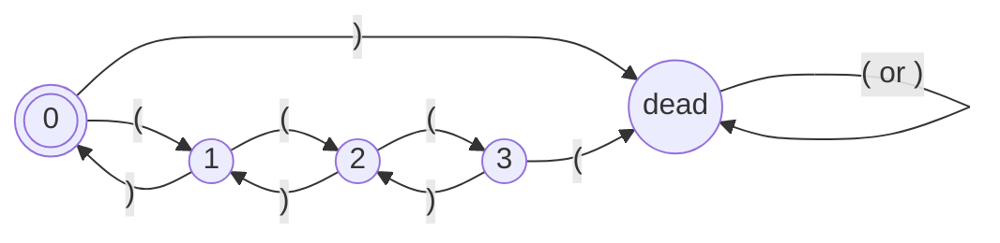

# Pumping and Myhill-Nerode: proving fixed memory is not enough

[Syllabus](../../../SYLLABUS.md) → [Computability and complexity](../README.md) → [Models of Computation](../README.md#s01) → Pumping and Myhill-Nerode

---

## General Overview

A spreadsheet will not run a formula until its brackets match. Take this one:

`=IF(A1>0,SUM((B1+C1)*(D1-E1)),0)`

Drop everything except the brackets and `((()()))` is left. The checker reads it one character at a time and keeps a count of open brackets: 1, 2, 3, 2, 3, 2, 1, 0. The count never goes below 0 and ends at 0, so the formula passes. Its deepest point is 3.

A coffee machine's coin logic is a fixed-memory machine: it needs only a few states, because the price caps how much it must remember. A finite automaton is the same kind of machine: a fixed set of states and a rule for each letter. [Finite automata](01-finite-automata-and-regular-languages.md) already built a 5-state checker for depth 3 and showed, by pigeonhole, that no finite automaton checks every depth. This card turns that one argument into two general tools and asks two questions about the bracket checker.

- **Can a fixed-memory machine check every formula, however deep?** No. The card proves it two ways: the pumping lemma, and the Myhill-Nerode theorem.
- **If the depth is capped at 3, what is the smallest machine that works?** Exactly 5 states, and no machine with 4 can do it. Myhill-Nerode gives the number, and a splitting procedure builds the machine.

**A machine with p states cannot tell more than p situations apart, so a pattern with infinitely many situations needs unbounded memory, and a pattern with N situations needs exactly N states.**

**What kind of fact this is:** two theorems, both proved on this card in Why it works. The pumping lemma is a one-way test: failing it proves a pattern is not regular, but passing it proves nothing.

### The picture: the smallest depth-3 checker



Each state is the number of open brackets. State 0, the double circle, is the start and the only accepting state. A close bracket at depth 0, or a fourth open bracket, sends the machine to "dead", which rejects whatever follows. Five states, and the card proves no machine does it with fewer.

---

## The formula

Notation from [Finite automata](01-finite-automata-and-regular-languages.md), in one line each: an alphabet $`\Sigma`$ is the set of letters, here the two brackets. A string $`w`$ is a finite row of letters, $`|w|`$ is its length, and $`\varepsilon`$ is the empty string. A language $`L`$ is a set of strings. A language is **regular** when some finite automaton accepts exactly its strings.

New notation on this card: $`(^n`$ means $`n`$ copies of the open bracket, and $`y^i`$ means $`i`$ copies of the string $`y`$. These are copies, not powers.

**The pumping lemma.** Every regular language has a pumping length $`p`$:

```math
\text{for every } w \in L \text{ with } |w| \ge p:\quad \exists\, x, y, z:\ w = xyz,\quad |xy| \le p,\quad |y| \ge 1,\quad xy^iz \in L \text{ for every } i \ge 0
```

**Read it aloud:** every long enough string in the language has a non-empty piece near its start that can be deleted or repeated any number of times, and the result stays in the language.

**Myhill-Nerode.** Two strings $`x`$ and $`y`$ are **equivalent for** $`L`$ when no ending tells them apart:

```math
x \equiv_L y \iff \text{for every string } z:\ \big(xz \in L \iff yz \in L\big)
```

**Read it aloud:** x and y are equivalent when every ending z either completes both into the language or completes neither.

```math
L \text{ is regular} \iff \equiv_L \text{ has finitely many classes } N, \text{ and then the smallest machine for } L \text{ has exactly } N \text{ states}
```

**Read it aloud:** a pattern needs fixed memory exactly when strings fall into finitely many groups by their futures, and the number of groups is the number of states the best machine needs.

The relation $`\equiv_L`$ is an equivalence relation: reflexive, symmetric and transitive, so it cuts all strings into classes that do not overlap ([Equivalence relations and partitions](../../01-Foundations/08-Relations%20and%20Functions/06-equivalence-relations-and-partitions.md)). On this card, the letters $`x`$, $`y`$ and $`z`$ have one job in the pumping lemma and another in Myhill-Nerode. Each section says which.

| Symbol | Plain meaning | In our example | Push it up and the answer… |
| --- | --- | --- | --- |
| $`\Sigma`$, $`\varepsilon`$ | the alphabet: the letters a string may use; the empty string, length 0 | the two brackets; an empty formula | — |
| $`w`$, $`\lvert w\rvert`$ | a string, and its length | `((()()))`, length 8 | longer strings need more steps |
| $`L`$ | the language: the strings to accept | brackets that match, depth at most 3 | more strings to accept |
| $`M = (Q, \Sigma, \delta, q_0, F)`$ | a machine: states $`Q`$, alphabet $`\Sigma`$, rule $`\delta(q, a)`$: the next state after letter $`a`$ in state $`q`$, start $`q_0`$, accepting states $`F`$ | states 0, 1, 2, 3, dead; start 0; accept 0 | — |
| $`p`$ | the pumping length: at most the number of states | 5 | the lemma only speaks about longer strings |
| $`x, y, z`$ (pumping) | a split of $`w`$: start, repeatable piece, rest | `((`, `()`, `()))` | — |
| $`i`$ | how many copies of $`y`$ go in | 0 to 3 | the pumped string grows by $`\lvert y\rvert`$ each time |
| $`s, t`$; $`k`$ | the two positions where the run repeats a state; $`k = t - s`$, the length of $`y`$ | 2 and 4; $`k = 2`$ | — |
| $`(^n`$ | $`n`$ open brackets in a row | $`(^5`$ is `(((((` | — |
| $`x \equiv_L y`$ | x and y have the same futures | `(` and `(()` | — |
| $`z`$ (Myhill-Nerode) | a test ending added after x and after y | `)` tells `(` from `((` | — |
| $`d`$, $`N`$ | the depth cap, and the number of classes | 3 and 5 | $`N = d + 2`$: one more state per level |

### When it holds

- **A regular language, for pumping.** The lemma speaks only about regular languages. Use it backwards: show that no $`p`$ works, and the language is not regular. Passing the lemma proves nothing; the code shows a language that passes and is not regular.
- **A string at least $`p`$ long.** Shorter strings may have no repeatable piece. The machine visits fewer than $`p + 1`$ states on them, so the pigeonhole step has nothing to work on.
- **Every split, not one split.** The lemma promises that *some* split pumps. To refute it, every allowed split must fail. Pick one split yourself and you prove nothing.
- **A deterministic, complete machine, for the state count.** "Exactly N states" counts a machine with one next state for every state and letter, the dead state included. Drop the dead state and the count reads 4, not 5.

---

## Why it works

### Step 0: a machine forgets how it got somewhere

A machine with $`p`$ states that reads $`p`$ letters visits $`p + 1`$ states, counting the start. Two of them must be the same state ([Pigeonhole](../../01-Foundations/08-Relations%20and%20Functions/08-pigeonhole-principle.md)).

Once in a state, the machine has no record of the road it took. Everything after depends on the state alone. Both proofs below use this one fact.

### Step 1: the pumping lemma, by running the machine

Run the 5-state checker on the formula's brackets, `((()()))`. It passes through states 0, 1, 2, 3, 2, 3, 2, 1, 0.

State 2 appears after 2 letters and again after 4 letters. So split the string there:

- $`x`$ = `((`, the letters before the first visit;
- $`y`$ = `()`, the loop from state 2 back to state 2;
- $`z`$ = `()))`, the rest.

The loop $`y`$ starts and ends in state 2. Skip it, or go round it 2 or 3 times, and the machine still reaches state 2 after it, then reads $`z`$ the same way. The pumped strings `((()))`, `((()()))`, `((()()()))` and `((()()()()))` are all accepted. Each is a real formula shape, such as a `SUM` with one, two, three or four bracketed terms.

In general: take any $`w`$ in $`L`$ with $`|w| \ge p`$. Among the first $`p + 1`$ states of the run, two match, at positions $`s < t \le p`$. Set $`x`$ to the first $`s`$ letters, $`y`$ to the letters between $`s`$ and $`t`$, and $`z`$ to the rest. Then $`|xy| = t \le p`$, $`|y| = t - s \ge 1`$, and $`xy^iz`$ ends in the same state as $`w`$ for every $`i`$.

### Step 2: unlimited brackets are not regular

Now drop the depth cap: accept every bracket string that matches, however deep. Suppose some machine with $`p`$ states accepts exactly these.

Take $`w = (^p\,)^p`$: $`p`$ open brackets, then $`p`$ close brackets. It matches and has length $`2p`$. The lemma gives a split with $`|xy| \le p`$, so $`x`$ and $`y`$ sit inside the open brackets. Then $`y = (^k`$ for some $`k \ge 1`$.

Pump with $`i = 0`$: $`xz = (^{p-k}\,)^p`$. It closes $`k`$ more brackets than it opened, so it does not match. The lemma said it must be accepted. No $`p`$ escapes this, so no fixed-memory machine checks unlimited brackets.

The code makes the argument concrete for $`p = 5`$. The string `((((()))))` has 15 allowed splits, and all 15 fail at $`i = 0`$. The same holds for every $`p`$ from 1 to 12. Those runs illustrate the proof; the proof itself covers every $`p`$.

### Step 3: strings with different futures need different states

Here $`x`$ and $`y`$ are any two strings, and $`z`$ is an ending. Suppose an ending $`z`$ completes $`x`$ but not $`y`$. If a machine were in the same state after $`x`$ and after $`y`$, it would read $`z`$ identically from there and give the same answer for both. It cannot, so the states differ.

So strings that are pairwise told apart need at least one state each. For depth at most 3, five strings do it:

| Pair | Ending $`z`$ that tells them apart |
| --- | --- |
| empty and `(`, `((`, `(((`, `)` | the empty ending: only the empty string is already complete |
| `(` and `((`, `(((`, `)` | `)` completes `(` and nothing else in the pair |
| `((` and `(((`, `)` | `))` completes `((` only |
| `(((` and `)` | `)))` completes `(((`; a string that starts `)` is dead |

Those 10 pairs force at least 5 states.

Without the cap, the strings $`(^0, (^1, (^2, \dots`$ are pairwise told apart: the ending $`)^j`$ completes $`(^j`$ and nothing else in the list. Infinitely many classes need infinitely many states. That is a second proof of Step 2, with no pumping. It is the pigeonhole argument of [Finite automata](01-finite-automata-and-regular-languages.md), read as a count of classes.

### Step 4: the classes are a machine

The lower bound is matched. Build a machine whose states are the classes themselves.

- The state after reading $`x`$ is the class of $`x`$.
- Reading letter $`a`$ moves from the class of $`x`$ to the class of $`xa`$.
- A class accepts when its strings are in $`L`$.

This machine has exactly $`N`$ states and accepts exactly $`L`$. With Step 3, $`N`$ is the smallest possible. For depth at most 3 the classes are "open count 0, 1, 2 or 3" and "already broken": the five states in the picture.

<details>
<summary>Detailed proof: the class machine is well defined and accepts exactly L</summary>

The rule "class of $`x`$, read $`a`$, go to class of $`xa`$" must not depend on which member $`x`$ of the class is used. Suppose $`x \equiv_L y`$. For any ending $`z`$, the ending $`az`$ gives

$`\displaystyle xaz \in L \iff yaz \in L,`$

because $`x`$ and $`y`$ agree on every ending, $`az`$ included. So $`xa \equiv_L ya`$, and the next state is the same.

Acceptance is also well defined: take $`z = \varepsilon`$, and $`x \equiv_L y`$ gives $`x \in L \iff y \in L`$. So a class is wholly inside $`L`$ or wholly outside it.

By induction on the length of $`w`$, the machine started at the class of $`\varepsilon`$ ends at the class of $`w`$. It accepts $`w`$ exactly when that class lies inside $`L`$, that is, when $`w \in L`$.

Conversely, if a machine with $`p`$ states accepts $`L`$, then strings that end in the same state are equivalent (Step 3, read backwards). So there are at most $`p`$ classes. A regular language therefore has finitely many classes, and a language with finitely many classes is regular by the construction. That is both directions of the theorem.

</details>

### Step 5: finding the smallest machine from a larger one

A first draft of the checker might remember the depth and also the last bracket read, for example to highlight it on screen. For depth at most 3 that draft has 8 states. It works, but it is not the smallest.

**Moore's refinement** shrinks it. It groups the states into blocks:

1. Start with two blocks: accepting states and the rest.
2. Give each state a signature: its own block, the block that `(` leads to, and the block that `)` leads to.
3. Split every block whose members have different signatures.
4. Repeat until a round splits nothing.

On the draft the block counts run 2, 3, 4, 5, 5. The draft has two states each for depths 0, 1 and 2: one reached by `(` (or the start, for depth 0) and one by `)`. Each pair never splits, because its futures are the same. The 5 blocks are the 5 Myhill-Nerode classes.

The refinement separates two states only when some ending tells them apart. It stops only when no letter splits a block. So its final blocks are exactly the classes of the states that can be reached.

The pattern holds for every cap: a depth cap $`d`$ needs $`d + 2`$ states, against $`2d + 2`$ for the draft. A cap of 64 levels needs 66 states; the draft uses 130.

---

## Worked numbers, by hand

| Step | Arithmetic | Value |
| --- | --- | --- |
| brackets of the formula | keep only `(` and `)` | `((()()))` |
| open count along the way | +1 for `(`, −1 for `)` | 0, 1, 2, 3, 2, 3, 2, 1, 0 |
| first repeated state, within $`p + 1 = 6`$ states | state 2 after 2 and after 4 letters | $`x`$ = `((`, $`y`$ = `()`, $`z`$ = `()))` |
| pump with $`i = 0`$ | `((` + `()))` | `((()))`, accepted |
| strings pairwise told apart | empty, `(`, `((`, `(((`, `)` | 5, so at least 5 states |
| Moore refinement of the 8-state draft | blocks per round | 2, 3, 4, 5, 5 |
| smallest machine for depth at most 3 | $`d + 2`$ with $`d = 3`$ | **5 states** |
| unlimited depth, $`p = 5`$ | splits of `((((()))))` with $`\lvert xy\rvert \le 5`$, $`\lvert y\rvert \ge 1`$ | 15 splits, all 15 fail |

A depth-3 bracket checker needs 5 states and no fewer; with no cap, every proposed size fails, so no fixed-memory checker exists.

### What breaks if you drop a piece

| Mistake | Comes out at | What went wrong |
| --- | --- | --- |
| Run the depth-3 machine on `=ROUND(IF(A1>0,SUM((B1+C1)*(D1-E1)),0),2)` | brackets `(((()())))` match, yet the machine says no | the formula is 4 deep; the cap was a hypothesis |
| Pick $`y`$ = `()` from the middle of `((((()))))` | 5 of 5 pumped strings match: no contradiction | the lemma's $`y`$ lies in the first $`p`$ letters, and every split must fail |
| Take passing the lemma as proof of regularity | strings $`a^ib^jc^k`$ with $`i = 0`$ or $`j = k`$: all 51 of them up to length 7 pump with $`p = 1`$ | yet `a`, `ab`, up to `abbbbb` are pairwise told apart, so the classes never end |
| Count the draft's states as the minimum | 8 states, not 5 | count classes, not states; two draft states can share a future |

The third row's language is not regular, by Myhill-Nerode: the ending $`c^j`$ completes $`ab^j`$ and no other string in that list. The pumping lemma cannot see it, at any length: take $`y`$ to be the first letter. If it is an a, then $`j = k`$, and adding or removing a's keeps $`j = k`$ or reaches $`i = 0`$. If it is a b or a c, then $`i = 0`$, and that letter's run can grow or shrink freely.

---

## Code, from first principles, and it actually runs

The code checks every claim above with nothing imported. The reference is a plain counter that tracks the open count. Against it stand three roads to the number 5: the 5-state machine and the 8-state draft agree with the counter on all 8,191 strings up to length 12; Moore's refinement shrinks the draft to 5 blocks; and a brute-force count of distinct futures finds 5 classes. A certificate of 10 told-apart pairs is then checked on the machine. For unlimited depth, two roads illustrate Steps 2 and 3: every pumping split fails, and the class count keeps climbing (4, 6, 8, 10 for strings up to length 2, 4, 6, 8).

### Python

```python
# Pumping and Myhill-Nerode -- the check behind the card.  Nothing is imported.
# Language: bracket strings that never close more than they opened, end at depth
# 0 and never nest past a cap.  The reference is a plain counter; machines,
# pumping splits and class counts are each checked against it.
F3 = "=IF(A1>0,SUM((B1+C1)*(D1-E1)),0)"
F4 = "=ROUND(IF(A1>0,SUM((B1+C1)*(D1-E1)),0),2)"
BIG = 10**6                                   # a cap no test string reaches

def brackets(formula):
    return "".join(c for c in formula if c in "()")

def balanced(w, cap):                         # the reference: one counter
    depth = 0
    for c in w:
        depth += 1 if c == "(" else -1
        if depth < 0 or depth > cap:
            return False
    return depth == 0

def words(n, letters="()"):                   # every string, length 0..n
    out, layer = [""], [""]
    for _ in range(n):
        layer = [w + c for w in layer for c in letters]
        out += layer
    return out

def draft(cap):           # first draft: remembers the depth AND the last bracket
    start, delta, states, todo = (0, ""), {}, [(0, ""), "dead"], [(0, ""), "dead"]
    while todo:
        s = todo.pop()
        for c in "()":
            d = BIG if s == "dead" else s[0] + (1 if c == "(" else -1)
            t = (d, c) if 0 <= d <= cap else "dead"
            delta[s, c] = t
            if t not in states:
                states.append(t)
                todo.append(t)
    return states, start, [s for s in states if s != "dead" and s[0] == 0], delta

def counter_machine(cap):        # the small machine: states 0..cap, then "dead"
    delta = {}
    for s in list(range(cap + 1)) + ["dead"]:
        for c in "()":
            d = BIG if s == "dead" else s + (1 if c == "(" else -1)
            delta[s, c] = d if 0 <= d <= cap else "dead"
    return list(range(cap + 1)) + ["dead"], 0, [0], delta

def run(machine, w):
    states, s, accept, delta = machine
    for c in w:
        s = delta[s, c]
    return s in accept

def minimise(machine):           # Moore: split blocks until no letter splits one
    states, _, accept, delta = machine
    label = {s: int(s in accept) for s in states}
    sizes = [len(set(label.values()))]
    while True:
        sig = {s: (label[s], label[delta[s, "("]], label[delta[s, ")"]]) for s in states}
        keys = sorted(set(sig.values()))
        sizes.append(len(keys))
        if len(keys) == sizes[-2]:
            return len(keys), sizes
        label = {s: keys.index(sig[s]) for s in states}

def classes(cap, n):             # Myhill-Nerode by brute force: distinct futures
    tails = words(n)
    return len({tuple(balanced(x + z, cap) for z in tails) for x in words(n)})

def abc(w):                      # a^i b^j c^k with i = 0 or j = k
    i = j = k = 0
    for c in w:
        if c == "a" and j == k == 0: i += 1
        elif c == "b" and k == 0: j += 1
        elif c == "c": k += 1
        else: return False
    return i == 0 or j == k

def show(w): return w if w else "empty"
def yn(claim): return "yes" if claim else "no"

# ---- depth at most 3: the formula, the 5-state machine and the draft ----
m3, d3 = counter_machine(3), draft(3)
agree = all(balanced(w, 3) == run(m3, w) == run(d3, w) for w in words(12))
n_min, sizes = minimise(d3)
print(f"formula {F3} -> brackets {brackets(F3)}, length {len(brackets(F3))}, deepest 3")
print(f"counter, 5-state machine, {len(d3[0])}-state draft agree on all {len(words(12))} strings to length 12: {yn(agree)}")
print(f"Moore refinement of the draft, blocks after each round: {', '.join(map(str, sizes))}")
print(f"smallest machine: {n_min} states; Myhill-Nerode classes (strings to length 8): {classes(3, 8)}")
reps, pairs = ["", "(", "((", "(((", ")"], []
for a in range(5):
    for b in range(a + 1, 5):
        z = next(z for z in words(6) if balanced(reps[a] + z, 3) != balanced(reps[b] + z, 3))
        pairs.append((a, b, z))
        print(f"  {show(reps[a])} vs {show(reps[b])}: told apart by z = {show(z)}")
cert = all(run(m3, reps[a] + z) != run(m3, reps[b] + z) for a, b, z in pairs)
print(f"  {len(pairs)} pairs, each also told apart by the 5-state machine: {yn(cert)}")
for cap in [1, 2, 3, 4, 5, 6, 64]:
    print(f"cap {cap}: draft {len(draft(cap)[0])} states, smallest {minimise(draft(cap))[0]} states")
# ---- the pigeonhole inside the pumping lemma, run on the 5-state machine ----
w, trace = brackets(F3), [0]
for c in w:
    trace.append(m3[3][trace[-1], c])
first = next((a, b) for b in range(6) for a in range(b) if trace[a] == trace[b])
x, y, z = w[:first[0]], w[first[0]:first[1]], w[first[1]:]
pumped = [x + y * i + z for i in range(4)]
print(f"run on {w}: states {', '.join(map(str, trace))}; state {trace[first[0]]} after {first[0]} and {first[1]} letters, inside the first 6 states")
print(f"x = {x}, y = {y}, z = {z}; pumped i = 0..3: {', '.join(pumped)}")
print(f"all pumped words accepted: {yn(all(run(m3, v) for v in pumped))}")
# ---- unbounded brackets: pumping refuted, classes without end ----
fails = {}
for p in range(1, 13):
    w = "(" * p + ")" * p
    splits = [(j, k) for k in range(1, p + 1) for j in range(p - k + 1)]
    fails[p] = (len(splits), sum(not balanced(w[:j] + w[j + k:], BIG) for j, k in splits))
print(f"w = (^5)^5: splits with |xy| <= 5, |y| >= 1: {fails[5][0]}; failing at i = 0: {fails[5][1]}")
print(f"every split fails, for every p from 1 to 12: {yn(all(a == b for a, b in fails.values()))}")
told = all(balanced("(" * j + ")" * j, BIG) and not balanced("(" * k + ")" * j, BIG)
           for j in range(7) for k in range(7) if j != k)
grow = [classes(BIG, n) for n in (2, 4, 6, 8)]
print(f"(^0 .. (^6: all 21 pairs told apart by )^j: {yn(told)}")
print(f"classes seen with strings to length n = 2, 4, 6, 8: {', '.join(map(str, grow))}")
# ---- what breaks ----
b4 = brackets(F4)
print(f"depth-3 machine on {F4} = {b4}: counter {yn(balanced(b4, BIG))}, machine {yn(run(m3, b4))}")
mid = ["((((" + "()" * i + "))))" for i in range(5)]
print(f"y = () from the middle of (^5)^5, i = 0..4: {sum(balanced(v, BIG) for v in mid)} of 5 balanced, no contradiction")
in_l = [w for w in words(7, "abc") if abc(w) and w]
pumps = all(abc(w[0] * i + w[1:]) for w in in_l for i in range(5))
ab = ["a" + "b" * j for j in range(6)]
apart = all(abc(ab[j] + "c" * j) and not abc(ab[k] + "c" * j) for j in range(6) for k in range(6) if j != k)
print(f"a^i b^j c^k, i = 0 or j = k: all {len(in_l)} words to length 7 pump with p = 1: {yn(pumps)}")
print(f"  yet a, ab, .., ab^5 are pairwise told apart by c^j: {yn(apart)}")
print(f"draft read as the minimum: {len(d3[0])} states, true minimum {n_min}")
assert agree and n_min == 5 and classes(3, 8) == 5          # three roads to 5 states
assert cert and all(minimise(draft(c))[0] == c + 2 for c in [1, 2, 3, 4, 5, 6, 64])
assert all(a == b for a, b in fails.values()) and told      # brackets are not regular
assert grow == [4, 6, 8, 10] and fails[5] == (15, 15)
assert balanced(b4, BIG) and not run(m3, b4) and pumps and apart
print("ALL CHECKS PASS")
```

**Ran 2026-11-19 on macOS, Python 3.14.10, standard library only. All checks passed. Output, pasted from the run:**

```
formula =IF(A1>0,SUM((B1+C1)*(D1-E1)),0) -> brackets ((()())), length 8, deepest 3
counter, 5-state machine, 8-state draft agree on all 8191 strings to length 12: yes
Moore refinement of the draft, blocks after each round: 2, 3, 4, 5, 5
smallest machine: 5 states; Myhill-Nerode classes (strings to length 8): 5
  empty vs (: told apart by z = empty
  empty vs ((: told apart by z = empty
  empty vs (((: told apart by z = empty
  empty vs ): told apart by z = empty
  ( vs ((: told apart by z = )
  ( vs (((: told apart by z = )
  ( vs ): told apart by z = )
  (( vs (((: told apart by z = ))
  (( vs ): told apart by z = ))
  ((( vs ): told apart by z = )))
  10 pairs, each also told apart by the 5-state machine: yes
cap 1: draft 4 states, smallest 3 states
cap 2: draft 6 states, smallest 4 states
cap 3: draft 8 states, smallest 5 states
cap 4: draft 10 states, smallest 6 states
cap 5: draft 12 states, smallest 7 states
cap 6: draft 14 states, smallest 8 states
cap 64: draft 130 states, smallest 66 states
run on ((()())): states 0, 1, 2, 3, 2, 3, 2, 1, 0; state 2 after 2 and 4 letters, inside the first 6 states
x = ((, y = (), z = ())); pumped i = 0..3: ((())), ((()())), ((()()())), ((()()()()))
all pumped words accepted: yes
w = (^5)^5: splits with |xy| <= 5, |y| >= 1: 15; failing at i = 0: 15
every split fails, for every p from 1 to 12: yes
(^0 .. (^6: all 21 pairs told apart by )^j: yes
classes seen with strings to length n = 2, 4, 6, 8: 4, 6, 8, 10
depth-3 machine on =ROUND(IF(A1>0,SUM((B1+C1)*(D1-E1)),0),2) = (((()()))): counter yes, machine no
y = () from the middle of (^5)^5, i = 0..4: 5 of 5 balanced, no contradiction
a^i b^j c^k, i = 0 or j = k: all 51 words to length 7 pump with p = 1: yes
  yet a, ab, .., ab^5 are pairwise told apart by c^j: yes
draft read as the minimum: 8 states, true minimum 5
ALL CHECKS PASS
```

### Rust

Same numbers, same labels, built with `rustc --edition 2021 -O`.

```rust
// Pumping and Myhill-Nerode -- the same check as the Python, in Rust.  No crates.
// Bracket strings that never close more than they opened, end at depth 0 and never
// nest past a cap.  A plain counter is the reference every other road is checked against.
use std::collections::BTreeSet;
const F3: &str = "=IF(A1>0,SUM((B1+C1)*(D1-E1)),0)";
const F4: &str = "=ROUND(IF(A1>0,SUM((B1+C1)*(D1-E1)),0),2)";
const BIG: i64 = 1_000_000; // a cap no test string reaches

struct Machine { next: Vec<[usize; 2]>, start: usize, accept: Vec<bool> } // next[s][0] reads '('

fn brackets(f: &str) -> String { f.chars().filter(|&c| c == '(' || c == ')').collect() }
fn balanced(w: &str, cap: i64) -> bool { // the reference: one counter
    let mut depth = 0i64;
    for c in w.chars() {
        depth += if c == '(' { 1 } else { -1 };
        if depth < 0 || depth > cap { return false }
    }
    depth == 0
}

fn words(n: usize, letters: &str) -> Vec<String> { // every string, length 0..n
    let (mut out, mut layer) = (vec![String::new()], vec![String::new()]);
    for _ in 0..n {
        layer = layer.iter().flat_map(|w| letters.chars().map(move |c| format!("{}{}", w, c))).collect();
        out.extend(layer.iter().cloned());
    }
    out
}

fn draft(cap: i64) -> Machine { // first draft: remembers the depth AND the last bracket
    // a state is (depth, last bracket); (0, ' ') is the start, (-1, 'x') is dead
    let mut states: Vec<(i64, char)> = vec![(0, ' '), (-1, 'x')];
    let mut next: Vec<[usize; 2]> = vec![[0, 0], [0, 0]];
    let mut todo = vec![0usize, 1];
    while let Some(i) = todo.pop() {
        for (k, c) in ['(', ')'].iter().enumerate() {
            let s = states[i];
            let d = if s.0 < 0 { BIG } else { s.0 + if *c == '(' { 1 } else { -1 } };
            let t = if d >= 0 && d <= cap { (d, *c) } else { (-1, 'x') };
            let j = match states.iter().position(|&u| u == t) {
                Some(j) => j,
                None => { states.push(t); next.push([0, 0]); todo.push(states.len() - 1); states.len() - 1 }
            };
            next[i][k] = j;
        }
    }
    Machine { next, start: 0, accept: states.iter().map(|s| s.0 == 0).collect() }
}

fn counter_machine(cap: i64) -> Machine { // the small machine: states 0..cap, then dead
    let dead = (cap + 1) as usize;
    let mut next = Vec::new();
    for s in 0..=dead as i64 {
        let step = |d: i64| if s == dead as i64 || d < 0 || d > cap { dead } else { d as usize };
        next.push([step(s + 1), step(s - 1)]);
    }
    Machine { next, start: 0, accept: (0..=dead).map(|s| s == 0).collect() }
}

fn run(m: &Machine, w: &str) -> bool {
    let mut s = m.start;
    for c in w.chars() { s = m.next[s][(c == ')') as usize] }
    m.accept[s]
}

fn minimise(m: &Machine) -> (usize, Vec<usize>) { // Moore: split until no letter splits a block
    let mut label: Vec<usize> = m.accept.iter().map(|&a| a as usize).collect();
    let mut sizes = vec![label.iter().collect::<BTreeSet<_>>().len()];
    loop {
        let sig: Vec<(usize, usize, usize)> =
            (0..m.next.len()).map(|s| (label[s], label[m.next[s][0]], label[m.next[s][1]])).collect();
        let keys: Vec<(usize, usize, usize)> = sig.iter().cloned().collect::<BTreeSet<_>>().into_iter().collect();
        sizes.push(keys.len());
        if keys.len() == sizes[sizes.len() - 2] { return (keys.len(), sizes) }
        label = sig.iter().map(|g| keys.iter().position(|k| k == g).unwrap()).collect();
    }
}

fn classes(cap: i64, n: usize) -> usize { // Myhill-Nerode by brute force: distinct futures
    let tails = words(n, "()");
    words(n, "()").iter()
        .map(|x| tails.iter().map(|z| balanced(&format!("{}{}", x, z), cap)).collect::<Vec<bool>>())
        .collect::<BTreeSet<_>>().len()
}

fn abc(w: &str) -> bool { // a^i b^j c^k with i = 0 or j = k
    let (mut i, mut j, mut k) = (0, 0, 0);
    for c in w.chars() {
        if c == 'a' && j == 0 && k == 0 { i += 1 }
        else if c == 'b' && k == 0 { j += 1 }
        else if c == 'c' { k += 1 }
        else { return false }
    }
    i == 0 || j == k
}

fn show(w: &str) -> &str { if w.is_empty() { "empty" } else { w } }
fn yn(claim: bool) -> &'static str { if claim { "yes" } else { "no" } }
fn join<T: ToString>(v: &[T]) -> String { v.iter().map(|x| x.to_string()).collect::<Vec<_>>().join(", ") }

fn main() {
    // ---- depth at most 3: the formula, the 5-state machine and the draft ----
    let (m3, d3) = (counter_machine(3), draft(3));
    let all12 = words(12, "()");
    let agree = all12.iter().all(|w| balanced(w, 3) == run(&m3, w) && run(&m3, w) == run(&d3, w));
    let (n_min, sizes) = minimise(&d3);
    println!("formula {} -> brackets {}, length {}, deepest 3", F3, brackets(F3), brackets(F3).len());
    println!("counter, 5-state machine, {}-state draft agree on all {} strings to length 12: {}", d3.next.len(), all12.len(), yn(agree));
    println!("Moore refinement of the draft, blocks after each round: {}", join(&sizes));
    println!("smallest machine: {} states; Myhill-Nerode classes (strings to length 8): {}", n_min, classes(3, 8));
    let reps = ["", "(", "((", "(((", ")"];
    let mut pairs: Vec<(usize, usize, String)> = Vec::new();
    for a in 0..5 {
        for b in a + 1..5 {
            let z = words(6, "()").into_iter()
                .find(|z| balanced(&format!("{}{}", reps[a], z), 3) != balanced(&format!("{}{}", reps[b], z), 3)).unwrap();
            println!("  {} vs {}: told apart by z = {}", show(reps[a]), show(reps[b]), show(&z));
            pairs.push((a, b, z));
        }
    }
    let cert = pairs.iter().all(|(a, b, z)| run(&m3, &format!("{}{}", reps[*a], z)) != run(&m3, &format!("{}{}", reps[*b], z)));
    println!("  {} pairs, each also told apart by the 5-state machine: {}", pairs.len(), yn(cert));
    for cap in [1, 2, 3, 4, 5, 6, 64] {
        println!("cap {}: draft {} states, smallest {} states", cap, draft(cap).next.len(), minimise(&draft(cap)).0);
    }
    // ---- the pigeonhole inside the pumping lemma, run on the 5-state machine ----
    let w = brackets(F3);
    let mut trace = vec![0usize];
    for c in w.chars() { trace.push(m3.next[*trace.last().unwrap()][(c == ')') as usize]) }
    let first = (0..6).flat_map(|b| (0..b).map(move |a| (a, b))).find(|&(a, b)| trace[a] == trace[b]).unwrap();
    let (x, y, z) = (&w[..first.0], &w[first.0..first.1], &w[first.1..]);
    let pumped: Vec<String> = (0..4).map(|i| format!("{}{}{}", x, y.repeat(i), z)).collect();
    println!("run on {}: states {}; state {} after {} and {} letters, inside the first 6 states", w, join(&trace), trace[first.0], first.0, first.1);
    println!("x = {}, y = {}, z = {}; pumped i = 0..3: {}", x, y, z, pumped.join(", "));
    println!("all pumped words accepted: {}", yn(pumped.iter().all(|v| run(&m3, v))));
    // ---- unbounded brackets: pumping refuted, classes without end ----
    let mut fails = vec![(0usize, 0usize); 13];
    for p in 1..13usize {
        let w = format!("{}{}", "(".repeat(p), ")".repeat(p));
        let splits: Vec<(usize, usize)> = (1..=p).flat_map(|k| (0..=p - k).map(move |j| (j, k))).collect();
        fails[p] = (splits.len(), splits.iter().filter(|&&(j, k)| !balanced(&format!("{}{}", &w[..j], &w[j + k..]), BIG)).count());
    }
    let all_fail = (1..13).all(|p| fails[p].0 == fails[p].1);
    println!("w = (^5)^5: splits with |xy| <= 5, |y| >= 1: {}; failing at i = 0: {}", fails[5].0, fails[5].1);
    println!("every split fails, for every p from 1 to 12: {}", yn(all_fail));
    let told = (0..7).all(|j| (0..7).all(|k| j == k ||
        (balanced(&format!("{}{}", "(".repeat(j), ")".repeat(j)), BIG) && !balanced(&format!("{}{}", "(".repeat(k), ")".repeat(j)), BIG))));
    let grow: Vec<usize> = [2, 4, 6, 8].iter().map(|&n| classes(BIG, n)).collect();
    println!("(^0 .. (^6: all 21 pairs told apart by )^j: {}", yn(told));
    println!("classes seen with strings to length n = 2, 4, 6, 8: {}", join(&grow));
    // ---- what breaks ----
    let b4 = brackets(F4);
    println!("depth-3 machine on {} = {}: counter {}, machine {}", F4, b4, yn(balanced(&b4, BIG)), yn(run(&m3, &b4)));
    let mid_ok = (0..5).filter(|&i| balanced(&format!("(((({}))))", "()".repeat(i)), BIG)).count();
    println!("y = () from the middle of (^5)^5, i = 0..4: {} of 5 balanced, no contradiction", mid_ok);
    let in_l: Vec<String> = words(7, "abc").into_iter().filter(|w| !w.is_empty() && abc(w)).collect();
    let pumps = in_l.iter().all(|w| (0..5).all(|i| abc(&format!("{}{}", &w[..1].repeat(i), &w[1..]))));
    let ab: Vec<String> = (0..6).map(|j| format!("a{}", "b".repeat(j))).collect();
    let apart = (0..6).all(|j| (0..6).all(|k| j == k ||
        (abc(&format!("{}{}", ab[j], "c".repeat(j))) && !abc(&format!("{}{}", ab[k], "c".repeat(j))))));
    println!("a^i b^j c^k, i = 0 or j = k: all {} words to length 7 pump with p = 1: {}", in_l.len(), yn(pumps));
    println!("  yet a, ab, .., ab^5 are pairwise told apart by c^j: {}", yn(apart));
    println!("draft read as the minimum: {} states, true minimum {}", d3.next.len(), n_min);
    assert!(agree && n_min == 5 && classes(3, 8) == 5); // three roads to 5 states
    assert!(cert && [1, 2, 3, 4, 5, 6, 64].iter().all(|&c| minimise(&draft(c)).0 == c as usize + 2));
    assert!(all_fail && told); // brackets are not regular
    assert!(grow == vec![4, 6, 8, 10] && fails[5] == (15, 15));
    assert!(balanced(&b4, BIG) && !run(&m3, &b4) && pumps && apart);
    println!("ALL CHECKS PASS");
}
```

**Ran 2026-11-19 on macOS, rustc 1.98.1, no crates. All checks passed. Output, pasted from the run:**

```
formula =IF(A1>0,SUM((B1+C1)*(D1-E1)),0) -> brackets ((()())), length 8, deepest 3
counter, 5-state machine, 8-state draft agree on all 8191 strings to length 12: yes
Moore refinement of the draft, blocks after each round: 2, 3, 4, 5, 5
smallest machine: 5 states; Myhill-Nerode classes (strings to length 8): 5
  empty vs (: told apart by z = empty
  empty vs ((: told apart by z = empty
  empty vs (((: told apart by z = empty
  empty vs ): told apart by z = empty
  ( vs ((: told apart by z = )
  ( vs (((: told apart by z = )
  ( vs ): told apart by z = )
  (( vs (((: told apart by z = ))
  (( vs ): told apart by z = ))
  ((( vs ): told apart by z = )))
  10 pairs, each also told apart by the 5-state machine: yes
cap 1: draft 4 states, smallest 3 states
cap 2: draft 6 states, smallest 4 states
cap 3: draft 8 states, smallest 5 states
cap 4: draft 10 states, smallest 6 states
cap 5: draft 12 states, smallest 7 states
cap 6: draft 14 states, smallest 8 states
cap 64: draft 130 states, smallest 66 states
run on ((()())): states 0, 1, 2, 3, 2, 3, 2, 1, 0; state 2 after 2 and 4 letters, inside the first 6 states
x = ((, y = (), z = ())); pumped i = 0..3: ((())), ((()())), ((()()())), ((()()()()))
all pumped words accepted: yes
w = (^5)^5: splits with |xy| <= 5, |y| >= 1: 15; failing at i = 0: 15
every split fails, for every p from 1 to 12: yes
(^0 .. (^6: all 21 pairs told apart by )^j: yes
classes seen with strings to length n = 2, 4, 6, 8: 4, 6, 8, 10
depth-3 machine on =ROUND(IF(A1>0,SUM((B1+C1)*(D1-E1)),0),2) = (((()()))): counter yes, machine no
y = () from the middle of (^5)^5, i = 0..4: 5 of 5 balanced, no contradiction
a^i b^j c^k, i = 0 or j = k: all 51 words to length 7 pump with p = 1: yes
  yet a, ab, .., ab^5 are pairwise told apart by c^j: yes
draft read as the minimum: 8 states, true minimum 5
ALL CHECKS PASS
```

The two outputs match line for line.

### Lean

Lean proves Myhill-Nerode with its state count, the pumping lemma and both bracket answers, for every language and every depth cap.

- Take any language $`L`$. Then $`L`$ is regular exactly when $`\equiv_L`$ has finitely many classes.
- Suppose $`L`$ is regular, with $`N`$ classes. Then every deterministic, complete machine accepting $`L`$ has at least $`N`$ states, and some machine has exactly $`N`$.
- Every regular language has a pumping length $`p`$. Take any $`w`$ in $`L`$ with $`|w| \ge p`$. Then $`w = xyz`$ with $`|xy| \le p`$ and $`|y| \ge 1`$. Each pumped string $`xy^iz`$, with $`i \ge 0`$, is in $`L`$ too.
- No finite automaton accepts exactly the matching bracket strings of every depth.
- Take any depth cap $`d`$. Then some deterministic, complete machine with $`d + 2`$ states accepts exactly the matching strings of depth at most $`d`$.
- Take the same cap $`d`$. Then every such machine has at least $`d + 2`$ states: 5 for the cap of 3.
- The formula passes the depth-3 checker, its four pumped strings pass too, and the 4-deep formula fails it.
- The 10 pairs in the table are told apart by their endings. All 15 splits of `((((()))))` fail at $`i = 0`$.
- Picking $`y`$ = `()` from the middle gives 5 matching strings. The endings $`)^j`$ tell $`(^0`$ to $`(^6`$ apart.

Moore's refinement, the $`a^ib^jc^k`$ language and the long runs are left to the Python and Rust checks.

```lean
-- Pumping and Myhill-Nerode: a language is regular exactly when its strings fall into finitely many classes by their futures, the smallest complete machine has exactly that many states, every regular language pumps, and matched brackets need unbounded memory while a depth cap d needs exactly d + 2 states.
import Mathlib.Computability.MyhillNerode
import Mathlib.SetTheory.Cardinal.Finite

universe u v

/-- `x ≡_L y`: no ending tells `x` and `y` apart, that is, for every ending `z`,
`x ++ z` is in `L` exactly when `y ++ z` is. It is an equivalence relation. -/
def nerode {α : Type u} (L : Language α) : Setoid (List α) where
  r x y := ∀ z : List α, (x ++ z ∈ L ↔ y ++ z ∈ L)
  iseqv := ⟨fun _ _ => Iff.rfl, fun h z => (h z).symm, fun h₁ h₂ z => (h₁ z).trans (h₂ z)⟩

/-- Two strings that lead a machine to the same state have the same futures. -/
theorem futures_eq_of_eval_eq {α : Type u} {σ : Type v} (M : DFA α σ) {x y : List α}
    (h : M.eval x = M.eval y) (z : List α) : x ++ z ∈ M.accepts ↔ y ++ z ∈ M.accepts := by
  have h' : M.evalFrom M.start x = M.evalFrom M.start y := h
  show M.evalFrom M.start (x ++ z) ∈ M.accept ↔ M.evalFrom M.start (y ++ z) ∈ M.accept
  rw [DFA.evalFrom_of_append, DFA.evalFrom_of_append, h']

#print axioms futures_eq_of_eval_eq

/-- Sending each class to the state its chosen string reaches is one to one. -/
theorem nerode_class_state_injective {α : Type u} {σ : Type v} (M : DFA α σ) :
    Function.Injective (fun q : Quotient (nerode M.accepts) => M.eval q.out) := by
  intro p q h
  rw [← Quotient.out_eq p, ← Quotient.out_eq q]
  exact Quotient.sound (futures_eq_of_eval_eq M h)

#print axioms nerode_class_state_injective

/-- The machine whose states are the classes of `≡_L`. -/
def nerodeDFA {α : Type u} (L : Language α) : DFA α (Quotient (nerode L)) where
  step q a := Quotient.lift (fun x => (Quotient.mk _ (x ++ [a]) : Quotient (nerode L)))
    (fun x y h => Quotient.sound (fun z => by
      simpa only [List.append_assoc, List.singleton_append] using h (a :: z))) q
  start := Quotient.mk _ []
  accept := {q | Quotient.lift (fun x => x ∈ L)
    (fun x y h => propext (by simpa only [List.append_nil] using h [])) q}

theorem nerodeDFA_eval {α : Type u} (L : Language α) (x : List α) :
    (nerodeDFA L).eval x = Quotient.mk _ x := by
  induction x using List.reverseRecOn with
  | nil => rfl
  | append_singleton x a ih => rw [DFA.eval_append_singleton, ih]; rfl

#print axioms nerodeDFA_eval

theorem nerodeDFA_accepts {α : Type u} (L : Language α) : (nerodeDFA L).accepts = L := by
  ext x
  rw [DFA.mem_accepts, nerodeDFA_eval]
  rfl

#print axioms nerodeDFA_accepts

/-- **Myhill-Nerode, with the state count.** A language is regular exactly when `≡_L` has
finitely many classes. Then, with `N` the number of classes, every deterministic, complete
machine (one next state for every state and letter) that accepts `L` has at least `N` states,
and some such machine has exactly `N` states. -/
theorem myhill_nerode_classes_are_the_fewest_states {α : Type u} (L : Language α) :
    (L.IsRegular ↔ Finite (Quotient (nerode L))) ∧
      (L.IsRegular →
        (∀ (σ : Type v) [Fintype σ] (M : DFA α σ), M.accepts = L →
            Nat.card (Quotient (nerode L)) ≤ Fintype.card σ) ∧
          ∃ (σ : Type v) (_ : Fintype σ) (M : DFA α σ),
            M.accepts = L ∧ Fintype.card σ = Nat.card (Quotient (nerode L))) := by
  have hfin : L.IsRegular → Finite (Quotient (nerode L)) := by
    intro hL
    obtain ⟨σ, _, M, hM⟩ := hL
    subst hM
    exact Finite.of_injective _ (nerode_class_state_injective M)
  refine ⟨⟨hfin, fun h => ?_⟩, fun hL => ⟨?_, ?_⟩⟩
  · let _ := Fintype.ofFinite (Quotient (nerode L))
    exact Language.isRegular_iff.mpr ⟨_, inferInstance, nerodeDFA L, nerodeDFA_accepts L⟩
  · intro σ _ M hM
    subst hM
    rw [← Nat.card_eq_fintype_card]
    exact Nat.card_le_card_of_injective _ (nerode_class_state_injective M)
  · have := hfin hL
    let _ := Fintype.ofFinite (Quotient (nerode L))
    let e : Quotient (nerode L) ≃ ULift.{v} (Fin (Fintype.card (Quotient (nerode L)))) :=
      (Fintype.equivFin _).trans Equiv.ulift.symm
    exact ⟨ULift.{v} (Fin (Fintype.card (Quotient (nerode L)))), inferInstance,
      DFA.reindex e (nerodeDFA L), by rw [DFA.accepts_reindex, nerodeDFA_accepts],
      by simp [Nat.card_eq_fintype_card]⟩

/-- A loop read any number of times returns to its state. -/
theorem evalFrom_replicate_loop {α : Type u} {σ : Type v} (M : DFA α σ) {q : σ} {y : List α}
    (h : M.evalFrom q y = q) (i : ℕ) : M.evalFrom q (List.replicate i y).flatten = q := by
  induction i with
  | zero => rfl
  | succ i ih => rw [List.replicate_succ, List.flatten_cons, DFA.evalFrom_of_append, h, ih]

#print axioms evalFrom_replicate_loop

/-- **The pumping lemma.** Every regular language has a pumping length `p`: every string `w`
in the language with `|w| ≥ p` splits as `w = x y z` with `|x y| ≤ p` and `|y| ≥ 1`, so that
`x y^i z` is in the language for every `i ≥ 0` (`y^i` is `i` copies of `y`). -/
theorem regular_language_pumps {α : Type u} (L : Language α) (hL : L.IsRegular) :
    ∃ p : ℕ, ∀ w ∈ L, p ≤ w.length →
      ∃ x y z : List α, w = x ++ y ++ z ∧ (x ++ y).length ≤ p ∧ 1 ≤ y.length ∧
        ∀ i : ℕ, x ++ (List.replicate i y).flatten ++ z ∈ L := by
  obtain ⟨σ, _, M, rfl⟩ := hL
  refine ⟨Fintype.card σ, fun w hw hlen => ?_⟩
  obtain ⟨q, x, y, z, hxyz, hle, hne, hx, hy, hz⟩ := M.evalFrom_split (s := M.start) hlen rfl
  refine ⟨x, y, z, hxyz, by rw [List.length_append]; exact hle, ?_, fun i => ?_⟩
  · cases y with
    | nil => exact absurd rfl hne
    | cons b y => simp
  · rw [DFA.mem_accepts] at hw ⊢
    rw [DFA.eval, DFA.evalFrom_of_append, DFA.evalFrom_of_append, hx,
      evalFrom_replicate_loop M hy, hz]
    exact hw

/-! The bracket checker. The alphabet is the two brackets. -/

/-- The two letters: `op` is `(` and `cl` is `)`. -/
inductive Br
  | op
  | cl
  deriving DecidableEq

open Br

/-- The plain counter with no depth cap: from open count `d`, `(` adds 1 and `)` takes 1 away;
`none` means a `)` came at count 0. The result is the open count at the end. -/
def openCount : ℕ → List Br → Option ℕ
  | d, [] => some d
  | d, op :: w => openCount (d + 1) w
  | 0, cl :: _ => none
  | d + 1, cl :: w => openCount d w

/-- The counter with depth cap `cap`: as `openCount`, but a `(` that would pass the cap
breaks the string (`none`). -/
def cappedCount (cap : ℕ) : ℕ → List Br → Option ℕ
  | d, [] => some d
  | d, op :: w => if d + 1 ≤ cap then cappedCount cap (d + 1) w else none
  | 0, cl :: _ => none
  | d + 1, cl :: w => cappedCount cap d w

/-- Matched brackets, however deep: the count never goes below 0 and ends at 0. -/
def matched : Language Br := {w | openCount 0 w = some 0}

/-- Matched brackets nested at most `cap` deep. -/
def cappedMatched (cap : ℕ) : Language Br := {w | cappedCount cap 0 w = some 0}

theorem openCount_replicate_op (n d : ℕ) (w : List Br) :
    openCount d (List.replicate n op ++ w) = openCount (d + n) w := by
  induction n generalizing d with
  | zero => rfl
  | succ n ih =>
    simp only [List.replicate_succ, List.cons_append, openCount, ih]
    congr 1; omega

#print axioms openCount_replicate_op

theorem openCount_replicate_cl (n d : ℕ) :
    openCount d (List.replicate n cl) = if n ≤ d then some (d - n) else none := by
  induction n generalizing d with
  | zero => simp [openCount]
  | succ n ih =>
    cases d with
    | zero => simp [List.replicate_succ, openCount]
    | succ d => simp [List.replicate_succ, openCount, ih]

#print axioms openCount_replicate_cl

theorem cappedCount_replicate_op (cap n d : ℕ) (w : List Br) (h : d + n ≤ cap) :
    cappedCount cap d (List.replicate n op ++ w) = cappedCount cap (d + n) w := by
  induction n generalizing d with
  | zero => rfl
  | succ n ih =>
    simp only [List.replicate_succ, List.cons_append, cappedCount]
    simp only [show d + 1 ≤ cap by omega, ↓reduceIte]
    rw [ih (d + 1) (by omega)]
    congr 1; omega

#print axioms cappedCount_replicate_op

theorem cappedCount_replicate_cl (cap n d : ℕ) :
    cappedCount cap d (List.replicate n cl) = if n ≤ d then some (d - n) else none := by
  induction n generalizing d with
  | zero => simp [cappedCount]
  | succ n ih =>
    cases d with
    | zero => simp [List.replicate_succ, cappedCount]
    | succ d => simp [List.replicate_succ, cappedCount, ih]

#print axioms cappedCount_replicate_cl

/-- `(^k` followed by `)^j` is matched exactly when `j = k`. -/
theorem openCount_op_cl (j k : ℕ) :
    openCount 0 (List.replicate k op ++ List.replicate j cl) = some 0 ↔ j = k := by
  rw [openCount_replicate_op, Nat.zero_add, openCount_replicate_cl]
  split_ifs with h
  · simp only [Option.some.injEq]; omega
  · simp only [false_iff]; omega

#print axioms openCount_op_cl

/-- With `k ≤ cap`, `(^k` followed by `)^j` passes the capped checker exactly when `j = k`. -/
theorem cappedCount_op_cl (cap j k : ℕ) (hk : k ≤ cap) :
    cappedCount cap 0 (List.replicate k op ++ List.replicate j cl) = some 0 ↔ j = k := by
  rw [cappedCount_replicate_op cap k 0 _ (by omega), Nat.zero_add, cappedCount_replicate_cl]
  split_ifs with h
  · simp only [Option.some.injEq]; omega
  · simp only [false_iff]; omega

#print axioms cappedCount_op_cl

/-- The capped checker as a machine: `some i` is open count `i`, `none` is the dead state. -/
def capStep (d : ℕ) : Option (Fin (d + 1)) → Br → Option (Fin (d + 1))
  | none, _ => none
  | some i, op => if h : i.val + 1 ≤ d then some ⟨i.val + 1, by omega⟩ else none
  | some i, cl => if h : i.val = 0 then none else some ⟨i.val - 1, by omega⟩

def capDFA (d : ℕ) : DFA Br (Option (Fin (d + 1))) where
  step := capStep d
  start := some 0
  accept := {some 0}

theorem capDFA_evalFrom_none (d : ℕ) (w : List Br) : (capDFA d).evalFrom none w = none := by
  induction w with
  | nil => rfl
  | cons a w ih => exact ih

#print axioms capDFA_evalFrom_none

theorem capDFA_evalFrom (d : ℕ) (w : List Br) (i : Fin (d + 1)) :
    ((capDFA d).evalFrom (some i) w).map Fin.val = cappedCount d i.val w := by
  induction w generalizing i with
  | nil => rfl
  | cons a w ih =>
    rw [DFA.evalFrom_cons]
    obtain ⟨k, hk⟩ := i
    cases a with
    | op =>
      by_cases h : k + 1 ≤ d
      · have hs : (capDFA d).step (some ⟨k, hk⟩) op = some ⟨k + 1, by omega⟩ := by
          simp [capDFA, capStep, h]
        rw [hs, ih]
        simp [cappedCount, h]
      · have hs : (capDFA d).step (some ⟨k, hk⟩) op = none := by
          simp [capDFA, capStep, h]
        rw [hs, capDFA_evalFrom_none]
        simp [cappedCount, h]
    | cl =>
      cases k with
      | zero =>
        rw [show (capDFA d).step (some ⟨0, hk⟩) cl = none from rfl, capDFA_evalFrom_none]
        rfl
      | succ k =>
        have hs : (capDFA d).step (some ⟨k + 1, hk⟩) cl = some ⟨k, by omega⟩ := by
          simp [capDFA, capStep]
        rw [hs, ih]
        rfl

#print axioms capDFA_evalFrom

theorem capDFA_accepts (d : ℕ) : (capDFA d).accepts = cappedMatched d := by
  ext w
  show (capDFA d).evalFrom (some 0) w ∈ ({some 0} : Set (Option (Fin (d + 1)))) ↔
    cappedCount d 0 w = some 0
  have h := capDFA_evalFrom d w 0
  simp only [Fin.val_zero] at h
  rw [Set.mem_singleton_iff, ← h]
  cases (capDFA d).evalFrom (some 0) w with
  | none => simp
  | some j =>
    simp only [Option.map_some, Option.some.injEq]
    constructor
    · rintro rfl; simp
    · intro e; exact Fin.ext (by rw [e, Fin.val_zero])

#print axioms capDFA_accepts

/-- The `d + 2` strings `(^0, ..., (^d` and `)`. -/
def capWord (d : ℕ) (j : Fin (d + 2)) : List Br :=
  if j.val ≤ d then List.replicate j.val op else [cl]

theorem capWord_separated (d : ℕ) {j k : Fin (d + 2)}
    (h : ∀ z, capWord d j ++ z ∈ cappedMatched d ↔ capWord d k ++ z ∈ cappedMatched d) :
    j = k := by
  have hdead : ∀ z, ¬ ([cl] ++ z ∈ cappedMatched d) := fun z hz => by
    change cappedCount d 0 (cl :: z) = some 0 at hz
    simp [cappedCount] at hz
  have hmem : ∀ a b : ℕ, a ≤ d →
      (List.replicate a op ++ List.replicate b cl ∈ cappedMatched d ↔ b = a) :=
    fun a b ha => cappedCount_op_cl d b a ha
  have hj := j.isLt
  have hk := k.isLt
  by_cases hjd : j.val ≤ d <;> by_cases hkd : k.val ≤ d
  · have h1 := h (List.replicate j.val cl)
    simp only [capWord, hjd, hkd, ↓reduceIte] at h1
    rw [hmem _ _ hjd, hmem _ _ hkd] at h1
    exact Fin.ext (h1.1 rfl)
  · have h1 := h (List.replicate j.val cl)
    simp only [capWord, hjd, hkd, ↓reduceIte] at h1
    exact absurd (h1.1 ((hmem _ _ hjd).2 rfl)) (hdead _)
  · have h1 := h (List.replicate k.val cl)
    simp only [capWord, hjd, hkd, ↓reduceIte] at h1
    exact absurd (h1.2 ((hmem _ _ hkd).2 rfl)) (hdead _)
  · exact Fin.ext (by omega)

#print axioms capWord_separated

/-- **The bracket checker's two answers.** No finite automaton accepts exactly the matched
bracket strings of every depth. For each depth cap `d`, some deterministic, complete machine
with exactly `d + 2` states accepts the strings matched at most `d` deep, and every such
machine has at least `d + 2` states (5 for the card's cap of 3). -/
theorem brackets_need_unbounded_memory_and_cap_d_needs_d_plus_two_states :
    ¬ matched.IsRegular ∧
      ∀ d : ℕ,
        (∃ (σ : Type) (_ : Fintype σ) (M : DFA Br σ),
            M.accepts = cappedMatched d ∧ Fintype.card σ = d + 2) ∧
          ∀ (σ : Type) [Fintype σ] (M : DFA Br σ),
            M.accepts = cappedMatched d → d + 2 ≤ Fintype.card σ := by
  refine ⟨?_, fun d => ⟨⟨Option (Fin (d + 1)), inferInstance, capDFA d, capDFA_accepts d,
    by simp⟩, ?_⟩⟩
  · intro hreg
    obtain ⟨σ, _, M, hM⟩ := hreg
    have hinj : Function.Injective (fun n : ℕ => M.eval (List.replicate n op)) := by
      intro m n h
      have hf := futures_eq_of_eval_eq M h (List.replicate m cl)
      rw [hM] at hf
      have h1 : List.replicate m op ++ List.replicate m cl ∈ matched := (openCount_op_cl m m).2 rfl
      exact (openCount_op_cl m n).1 (hf.1 h1)
    exact not_injective_infinite_finite _ hinj
  · intro σ _ M hM
    have hinj : Function.Injective (fun j : Fin (d + 2) => M.eval (capWord d j)) := by
      intro j k h
      apply capWord_separated d
      intro z
      rw [← hM]
      exact futures_eq_of_eval_eq M h z
    simpa using Fintype.card_le_of_injective _ hinj

-- The formula =IF(A1>0,SUM((B1+C1)*(D1-E1)),0) keeps the brackets ((()())): the count runs
-- 1, 2, 3, 2, 3, 2, 1, 0, so it passes the depth-3 checker.
example : cappedCount 3 0 [op, op, op, cl, op, cl, cl, cl] = some 0 := by decide

-- Pumping it with x = ((, y = (), z = ())) and i = 0, 1, 2, 3 gives ((())), ((()())),
-- ((()()())) and ((()()()())), all accepted by the depth-3 checker.
example : ∀ i : Fin 4,
    cappedCount 3 0 ([op, op] ++ (List.replicate i [op, cl]).flatten ++ [op, cl, cl, cl]) = some 0 := by
  decide

-- What breaks: the 4-deep formula =ROUND(...,2) keeps (((()()))), which matches,
-- yet the depth-3 checker rejects it.
example : openCount 0 [op, op, op, op, cl, op, cl, cl, cl, cl] = some 0 ∧
    cappedCount 3 0 [op, op, op, op, cl, op, cl, cl, cl, cl] ≠ some 0 := by
  decide

-- The ten pairs from empty, (, ((, (((, ) each told apart, for depth at most 3,
-- by the ending in the card's table.
example : ∀ t ∈ [([], [op], []), ([], [op, op], []), ([], [op, op, op], []), ([], [cl], []),
      ([op], [op, op], [cl]), ([op], [op, op, op], [cl]), ([op], [cl], [cl]),
      ([op, op], [op, op, op], [cl, cl]), ([op, op], [cl], [cl, cl]),
      ([op, op, op], [cl], [cl, cl, cl])],
    (cappedCount 3 0 (t.1 ++ t.2.2) = some 0) ≠ (cappedCount 3 0 (t.2.1 ++ t.2.2) = some 0) := by
  decide

/-- The 15 splits of `((((()))))` with `|x y| ≤ 5` and `|y| ≥ 1`, as (|x|, |y|). -/
def splits5 : List (ℕ × ℕ) :=
  (List.range 6).flatMap fun j =>
    ((List.range 6).filter fun k => 1 ≤ k ∧ j + k ≤ 5).map fun k => (j, k)

-- Unlimited depth, p = 5: there are 15 allowed splits of ((((())))), and every one
-- fails at i = 0 (deleting y leaves unmatched brackets).
example : splits5.length = 15 := by decide

example : ∀ s ∈ splits5,
    openCount 0 ((List.replicate 5 op ++ List.replicate 5 cl).take s.1 ++
      (List.replicate 5 op ++ List.replicate 5 cl).drop (s.1 + s.2)) ≠ some 0 := by
  decide

-- Picking y = () from the middle instead proves nothing: ((((()^i)))) matches for i = 0..4.
example : ∀ i : Fin 5,
    openCount 0 ([op, op, op, op] ++ (List.replicate i [op, cl]).flatten ++ [cl, cl, cl, cl]) =
      some 0 := by
  decide

-- (^0 to (^6 are pairwise told apart: the ending )^j completes (^j and no other.
example : ∀ j k : Fin 7, j ≠ k →
    openCount 0 (List.replicate j op ++ List.replicate j cl) = some 0 ∧
      openCount 0 (List.replicate k op ++ List.replicate j cl) ≠ some 0 := by
  decide

#print axioms myhill_nerode_classes_are_the_fewest_states
#print axioms regular_language_pumps
#print axioms brackets_need_unbounded_memory_and_cap_d_needs_d_plus_two_states
```

**Checked 2026-11-19 on macOS, Lean 4.36.0-rc2, Mathlib v4.36.0-rc2. Every proof is complete and uses only Lean's standard axioms. Output, pasted from the run:**

```
'futures_eq_of_eval_eq' depends on axioms: [propext, Quot.sound]
'nerode_class_state_injective' depends on axioms: [propext, Classical.choice, Quot.sound]
'nerodeDFA_eval' depends on axioms: [propext, Quot.sound]
'nerodeDFA_accepts' depends on axioms: [propext, Quot.sound]
'evalFrom_replicate_loop' depends on axioms: [propext, Quot.sound]
'openCount_replicate_op' depends on axioms: [propext, Quot.sound]
'openCount_replicate_cl' depends on axioms: [propext, Classical.choice, Quot.sound]
'cappedCount_replicate_op' depends on axioms: [propext, Quot.sound]
'cappedCount_replicate_cl' depends on axioms: [propext, Classical.choice, Quot.sound]
'openCount_op_cl' depends on axioms: [propext, Classical.choice, Quot.sound]
'cappedCount_op_cl' depends on axioms: [propext, Classical.choice, Quot.sound]
'capDFA_evalFrom_none' depends on axioms: [propext, Quot.sound]
'capDFA_evalFrom' depends on axioms: [propext, Classical.choice, Quot.sound]
'capDFA_accepts' depends on axioms: [propext, Classical.choice, Quot.sound]
'capWord_separated' depends on axioms: [propext, Classical.choice, Quot.sound]
'myhill_nerode_classes_are_the_fewest_states' depends on axioms: [propext, Classical.choice, Quot.sound]
'regular_language_pumps' depends on axioms: [propext, Classical.choice, Quot.sound]
'brackets_need_unbounded_memory_and_cap_d_needs_d_plus_two_states' depends on axioms: [propext, Classical.choice, Quot.sound]
```

> [!TIP]
> **Try changing**
> Guess first, then run it.
> - **A shorter horizon.** Change the printed `classes(3, 8)` to `classes(3, 2)`. Guess: does a look only 2 letters ahead still find 5 classes? It finds 4: no string of 2 letters reaches depth 3, so that class never shows up. The run still passes, because the assert keeps the longer horizon.
> - **A deeper cap.** Add 10 to the list of caps. Guess the sizes first: the draft has 22 states and the smallest machine 12, which is $`d + 2`$.
> - **Drop the escape clause.** In `abc`, change `i == 0 or j == k` to `j == k`. Guess: does the language still pump with $`p = 1`$? No: only 19 words remain up to length 7, pumping fails, and the last assert stops the run.
> - **A machine one level too deep.** Build `counter_machine(4)` in place of `counter_machine(3)`. Guess: the machine now accepts `(((())))`, which the depth-3 counter rejects, so "agree" prints no and the first assert stops the run.

---

## The usual mistake

> [!warning]
> **Choosing the split yourself.** The pumping lemma says *some* split of $`w`$ pumps. To prove a language is not regular, every split with $`|xy| \le p`$ and $`|y| \ge 1`$ must fail. Picking $`y`$ = `()` from the middle of `((((()))))` gives 5 of 5 matching strings and proves nothing. With $`y`$ forced into the first 5 letters, all 15 splits fail.
>
> - **Reading the lemma backwards.** Passing it does not make a language regular. The $`a^ib^jc^k`$ language passes with $`p = 1`$ on all 51 short strings and still has no finite machine.
> - **Counting states instead of classes.** The 8-state draft works, but 8 is not the minimum; Moore's refinement finds 5.
> - **Forgetting the dead state.** The depth-3 checker needs 5 states, not 4. A broken prefix such as `)` is its own class, with no ending that saves it.
> - **Trusting a capped machine past its cap.** The depth-3 checker rejects `=ROUND(IF(A1>0,SUM((B1+C1)*(D1-E1)),0),2)`, whose brackets `(((()())))` match. The cap is part of the machine's contract.

---

## Where you meet it in real life

- **Regular expressions and nested data.** A pure regular expression cannot match nested brackets, HTML tags or JSON objects of any depth; this card is the proof. Tools that do it add a stack or recursion ([Regular expressions](03-regular-expressions-and-pattern-matching.md)).
- **Compilers.** A compiler first cuts source code into words with a finite automaton, then checks nesting with a stack. The split sits exactly where this card draws the line.
- **Parsers with a depth limit.** Many data parsers refuse input nested past a fixed depth. That turns an unbounded pattern into a regular one and bounds the memory a hostile input can demand.
- **Smaller circuits.** A state machine on a chip spends one register bit for each doubling of its states. Minimising first, as in Step 5, can remove states and the logic that serves them.

> **Say it back**
> A machine with p states that reads p letters must repeat a state, and the loop between the two visits can be skipped or repeated without the machine noticing. Unlimited brackets break that: drop some open brackets from the front of a matching string and it no longer matches. Myhill-Nerode counts the strings that need different states, by their futures. With brackets capped at depth 3 there are 5 such classes, so the smallest checker has exactly 5 states. Moore's refinement finds that machine by splitting the states of any working draft.

---

## What this builds on

- [Finite automata](01-finite-automata-and-regular-languages.md): the machine, its states, its rule and the meaning of "regular".
- [Regular expressions](03-regular-expressions-and-pattern-matching.md): patterns that describe the same languages, so this card also limits what a regular expression can match.
- [Pigeonhole](../../01-Foundations/08-Relations%20and%20Functions/08-pigeonhole-principle.md): p + 1 visits to p states force a repeat, the heart of Step 0.
- [Equivalence relations and partitions](../../01-Foundations/08-Relations%20and%20Functions/06-equivalence-relations-and-partitions.md): why the Myhill-Nerode relation cuts all strings into classes that do not overlap.

Beside it, [Guessing machines](02-nondeterminism-and-the-subset-construction.md) shows that allowing guesses adds no power. So Step 2's verdict, "not regular", covers guessing machines too. The state count of Step 4 is for deterministic machines only.

## Where this goes next

- [Grammars and a stack](05-context-free-grammars-and-pushdown-automata.md): the next card adds a stack, one unbounded memory, and matching brackets of any depth become easy.
- [The language ladder](06-chomsky-hierarchy-and-the-language-ladder.md): pumping and counting arguments separate each rung of the ladder from the one below.

The question this card leaves open: a stack handles brackets, but which patterns are still beyond a machine with one stack?

---

## Sources

Verified 2026-11-19: every link below resolves to the publisher's page.

- Rabin, Michael O., and Dana Scott. "Finite Automata and Their Decision Problems." *IBM Journal of Research and Development* 3, no. 2 (1959): 114–125. [doi:10.1147/rd.32.0114](https://doi.org/10.1147/rd.32.0114). Finite automata as a mathematical object, and the first decision results about them.
- Nerode, Anil. "Linear Automaton Transformations." *Proceedings of the American Mathematical Society* 9, no. 4 (1958): 541–544. [doi:10.1090/S0002-9939-1958-0135681-9](https://doi.org/10.1090/S0002-9939-1958-0135681-9). The equivalence of strings by their futures, behind the Myhill-Nerode theorem.
- Bar-Hillel, Yehoshua, Micha Perles, and Eli Shamir. "On Formal Properties of Simple Phrase Structure Grammars." *STUF – Language Typology and Universals* 14 (1961). [doi:10.1524/stuf.1961.14.14.143](https://doi.org/10.1524/stuf.1961.14.14.143). The pumping lemma for context-free languages, with the regular case as its simpler form.
- Kozen, Dexter C. *Automata and Computability*. Springer, 1997. [Publisher page](https://doi.org/10.1007/978-1-4612-1844-9). Textbook proofs of the pumping lemma, Myhill-Nerode and state minimisation by refinement.
