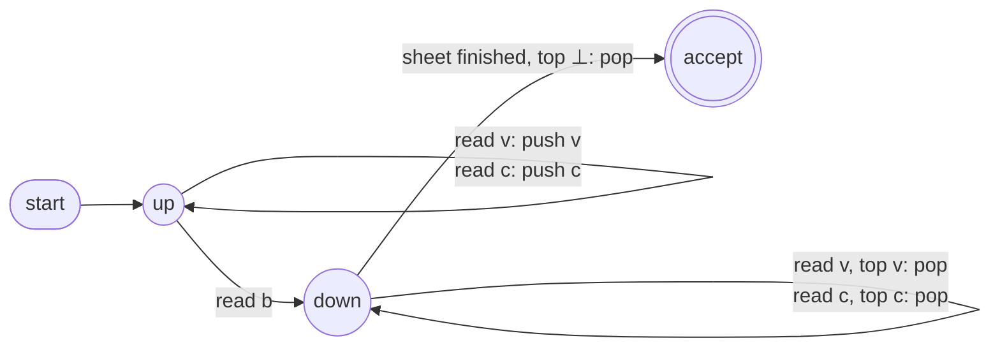
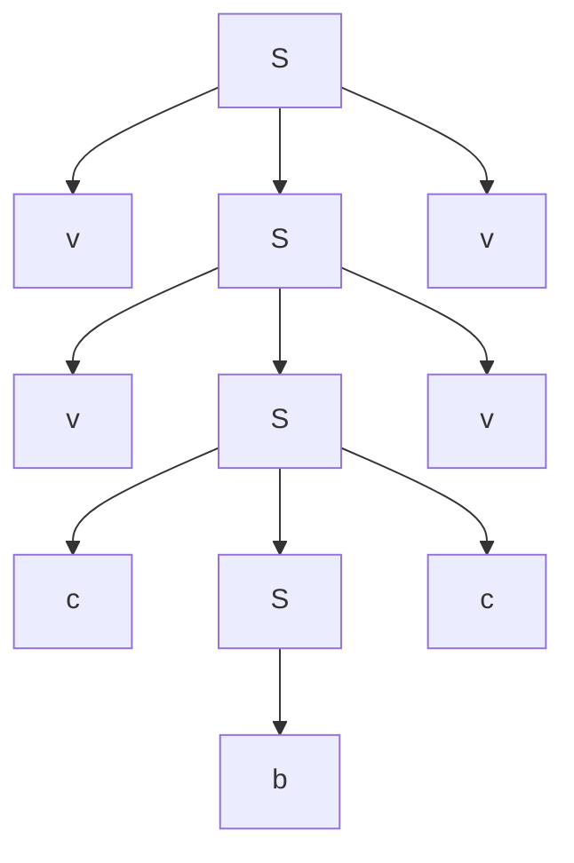

# Grammars and a stack: machines that handle nesting

[Syllabus](../../../SYLLABUS.md) → [Computability and complexity](../README.md) → [Models of Computation](../README.md#s01) → Grammars and a stack

---

## General Overview

Some songs are built in **arch form**. The sections climb to a bridge in the middle, then come back down in mirror order. Bartók's fourth and fifth string quartets use this shape across their five movements: the first and last movements pair up, and so do the second and fourth, around the third. Write each section as one letter: v for a verse, c for a chorus, b for the bridge.

The sheet `vvcbcvv` reads verse, verse, chorus, bridge, chorus, verse, verse. That is 7 sections. The chorus just before the bridge pairs with the chorus just after it. The opening verse pairs with the closing verse. Each pair wraps everything between its two halves, the way a pair of brackets wraps a formula. That wrapping is called **nesting**.

An ordinary pop song asks less: any number of verse-chorus rounds, then a bridge and a last chorus. A machine with fixed memory checks that shape, since it only needs to know which section may come next. An arch song is different. To check one, a machine must remember every section it has heard before the bridge, then tick them off last-first. A machine with fixed memory cannot do this for songs of any length ([Pumping and Myhill-Nerode](04-pumping-lemma-and-myhill-nerode.md) proves why). This card adds two tools that can:

- a **grammar**: a short list of rules that builds every allowed sheet, and nothing else;
- a **stack machine**: a fixed-memory machine plus a pile of symbols. It may add a symbol to the top (**push**) or take the top one off (**pop**), and it reads only the top.

**A grammar builds nested strings by rewriting one symbol at a time, a stack machine checks them by keeping the open sections on a pile, and the two describe exactly the same sets of strings.**

**What kind of fact this is:** a theorem. The half "every grammar has a matching stack machine" is proved on this card in Why it works. The half "every stack machine has a matching grammar" is stated with its key steps and a named source. Grammar, stack machine and parse tree are definitions.

### The picture: the stack machine that checks arch songs



In state **up** the machine piles up every section it hears. The bridge switches it to **down**, where each section must match the top of the pile. The symbol ⊥ sits at the bottom from the start, so the machine can see an empty pile. The double circle is the accepting state.

---

## The formula

Notation from [Finite automata](01-finite-automata-and-regular-languages.md): an **alphabet** $`\Sigma`$ is the set of letters allowed, here $`\Sigma = \{v, c, b\}`$. A **string** $`w`$ is a row of letters, $`|w| = n`$ is its length, $`\varepsilon`$ is the empty string, $`\Sigma^*`$ is the set of all strings, and a **language** is any set of strings.

A grammar uses **variables**, capital letters that stand for "any string of this kind still to be written". Here one variable is enough: $`S`$, the start variable, stands for "any arch song". A **rule** $`A \to u`$ says: the variable $`A`$ may be replaced by the string $`u`$. The bar $`\mid`$ separates rules for the same variable.

```math
S \;\to\; v\,S\,v \;\mid\; c\,S\,c \;\mid\; b
```

**Read it aloud:** "An arch song is a verse wrapped round a smaller arch song, or a chorus wrapped round one, or just the bridge."

One **rewriting step**, written $`\Rightarrow`$, replaces one variable using one rule. Many steps in a row are written $`\Rightarrow^*`$. The sheet is built in four steps, always rewriting the leftmost variable:

```math
S \;\Rightarrow\; vSv \;\Rightarrow\; vvSvv \;\Rightarrow\; vvcScvv \;\Rightarrow\; vvcbcvv
```

The **language of the grammar** $`G`$ is every string of plain letters that $`S`$ can reach:

```math
L(G) = \{\, w \in \Sigma^* : S \Rightarrow^* w \,\}
```

A grammar is **context-free** when every rule has one variable alone on its left. That variable may then be rewritten wherever it stands, whatever its neighbours are: the rule ignores the context.

A **stack machine** (the textbook name is **pushdown automaton**) is a finite automaton plus a pile. It has states $`Q`$, a start state $`q_0`$, accepting states $`F`$, and a **stack alphabet** $`\Gamma`$: the symbols the pile may hold. Its **move rule** $`\delta`$ looks at three things and answers with two:

```math
\delta(q,\; a,\; X) \;\ni\; (q',\; \gamma)
```

**Read it aloud:** "In state $`q`$, reading letter $`a`$ (or $`\varepsilon`$, nothing) with $`X`$ on top of the pile (or nothing), the machine may pop $`X`$, push the string $`\gamma`$ and go to state $`q'`$." The sign $`\ni`$ reads "contains this choice": a stack machine may have several moves to choose from. It **accepts** $`w`$ when some run reads all of $`w`$ and ends in an accepting state. $`L(M)`$ is the set of strings machine $`M`$ accepts.

The theorem joins the two:

```math
L = L(G) \text{ for some context-free grammar } G \;\Longleftrightarrow\; L = L(M) \text{ for some stack machine } M
```

**Read it aloud:** "A language has a context-free grammar exactly when some stack machine accepts it." Such a language is called **context-free**.

| Symbol | Plain meaning | In our example | Push it up and the answer… |
| --- | --- | --- | --- |
| $`\Sigma`$, $`\Sigma^*`$, $`\in`$ | the alphabet: letters a sheet may use; the set of all strings of those letters; "is in" | $`\{v, c, b\}`$; $`vvcbcvv \in \Sigma^*`$ | more letters, more sheets to sort |
| $`w`$, $`n`$, $`l`$ | a sheet; its length $`n = \lvert w\rvert`$; the length $`l`$ of a stretch inside it | `vvcbcvv`, $`n = 7`$ | stack run: $`n + 1`$ moves; table method: $`(n^3 - n)/6`$ splits |
| $`\varepsilon`$ | the empty string; on a move, "read nothing" | the last move reads $`\varepsilon`$ | — |
| $`S`$, $`A`$ and other capitals | variables: $`S`$ the start, "any arch song still to be written"; $`V, C, P, R`$ in normal form; $`A_{pq}`$ in Step 4 | $`S`$ rewritten four times | — |
| $`A \to u`$, $`\mid`$ | a rule: variable $`A`$ may become string $`u`$; the bar separates rules for the same variable | $`S \to vSv \mid cSc \mid b`$ | more rules, more songs: two extra rules give 341 songs up to 9 sections, not 31 |
| $`\Rightarrow`$, $`\Rightarrow^*`$ | one rewriting step; any number of steps | $`S \Rightarrow^* vvcbcvv`$ | — |
| $`L(G)`$, $`L(M)`$, $`M_G`$ | the strings a grammar builds; the strings a machine accepts; the machine the Step 3 recipe builds from $`G`$ | 31 arch songs of 9 sections or fewer | — |
| $`\Gamma`$, $`\bot`$ | the stack alphabet: symbols the pile may hold; the bottom marker, on top only when the pile is empty | $`\{v, c, \bot\}`$; $`\bot`$ popped by the last move | — |
| $`Q`$, $`q_0`$, $`F`$ | the states, the start state, the accepting states; $`p, q, q', r, s, f`$ name single states | up, down, accept; start up; accept | — |
| $`\delta`$, $`a`$, $`a'`$, $`X`$, $`\gamma`$, $`\ni`$ | the move rule: state, letter $`a`$ (or $`a'`$) read, symbol $`X`$ on top in; new state and string $`\gamma`$ pushed out; $`\ni`$ reads "contains this choice" | in up, read v: push v | more moves, more runs to search |
| $`d`$ | depth: how many section pairs wrap the bridge | $`d = 3`$ | $`2^d`$ arch songs of that depth; a pile capped at 3 fails at $`d = 4`$ |

### When it holds

- **Every rule has one variable alone on its left.** A rule such as $`vS \to vvS`$ looks at a neighbour. Then the grammar is not context-free, and the one-state machine of Why it works cannot follow it. Such grammars climb the next rungs of [The language ladder](06-chomsky-hierarchy-and-the-language-ladder.md).
- **The pile has no height limit.** Cap it at 3 and it has only 15 possible contents: a finite automaton again, which rejects the depth-4 song `vvccbccvv`.
- **Only the top of the pile is read.** Read from the bottom instead (a **queue**: first in, first out) and the machine checks repetition, not mirroring.
- **The machine may guess.** The bridge marks the middle, so one fixed path works. With no bridge, as in `vccv`, the machine must guess the middle. That no non-guessing stack machine accepts exactly the even mirrors is a theorem stated here without proof (Sipser, section 2.4, treats such machines).
- **A grammar fixes the strings, not always one reading of them.** The arch grammar builds each arch song in exactly one way; $`S \to SS \mid v \mid c \mid b`$ builds `vvcbcvv` in 132 ways.

---

## Why it works

### Step 0: last opened, first closed

Nesting has one shape: whatever opened last must close first. In `vvcbcvv` the chorus opened last before the bridge, so it closes first after the bridge.

A pile does exactly this. The last symbol pushed is the first one popped. A grammar rule shows the same shape from the other side: $`S \to vSv`$ puts a matching pair round a smaller song, and the smaller song must be finished before the outer pair closes.

### Step 1: the grammar builds exactly the arch songs

Each use of $`S \to vSv`$ or $`S \to cSc`$ adds one matching pair round the middle. The only way to finish is $`S \to b`$, which puts the bridge in the exact centre. So every string the grammar builds is an arch song.

The other way round: take any arch song longer than one section. Its first and last sections match, and between them sits a shorter arch song. Peel the outer pair again and again until only `b` is left. Each peel is one rule used backwards. This is induction on the length.

A record of which rule rewrote which variable is a **parse tree**: a rooted tree ([Trees](../../04-Combinatorics%20and%20graphs/10-Trees%20and%20Cheapest%20Routes/01-trees.md)) whose inner points are variables and whose leaves are letters. Here is the parse tree of the sheet (schematic):



Read the leaves left to right and they spell `vvcbcvv`. Each $`S`$ with three children is one use of a wrapping rule.

### Step 2: the hand-built machine accepts exactly the arch songs

Here is the machine of the first picture as a table. "Read" is the letter consumed, "pop" the symbol taken off the top, "push" the symbol put on.

| state | read | pop | push | next |
| --- | --- | --- | --- | --- |
| up | v | — | v | up |
| up | c | — | c | up |
| up | b | — | — | down |
| down | v | v | — | down |
| down | c | c | — | down |
| down | $`\varepsilon`$ | ⊥ | — | accept |

Two facts hold at every moment, and together they prove the machine correct:

- **In state up**, the pile above ⊥ holds the sections read so far, in order, the latest on top.
- **In state down**, the pile above ⊥ holds the sections still owed, the next one owed on top.

So the machine accepts exactly when the sections after the bridge undo the ones before it, last-first: the definition of an arch song.

### Step 3: every grammar has a stack machine

A recipe builds a stack machine for **any** context-free grammar. It needs one working state, and its pile holds both letters and variables. Its moves are:

1. Start with ⊥ on the pile, then push $`S`$.
2. If a variable is on top, pop it and push the right side of one of its rules, leftmost symbol on top. Read nothing.
3. If a letter is on top and the next letter of the sheet is the same, pop it and read it.
4. If ⊥ is on top and the sheet is finished, accept.

Move 2 is a choice: the machine guesses which rule to use, as a [Guessing machines](02-nondeterminism-and-the-subset-construction.md) machine guesses its next state. It accepts when some run of guesses works.

Call the recipe's machine $`M_G`$. The reason it works is one fact: **the letters read so far, followed by the pile read from top to bottom, always spell the latest line of a leftmost derivation.** On `vvcbcvv` the recipe's machine takes 13 moves, and the lines it spells are exactly $`S \Rightarrow vSv \Rightarrow vvSvv \Rightarrow vvcScvv \Rightarrow vvcbcvv`$.

<details>
<summary>Detailed proof: the recipe's machine accepts exactly the strings the grammar builds</summary>

Call a run's **line** the letters read so far followed by the pile from top to bottom, with ⊥ left out. A **leftmost derivation** is one that always rewrites the leftmost variable.

**Claim.** After any run of the machine, the line is a line of some leftmost derivation from $`S`$, and every variable in it sits on the pile.

**Proof, by induction on the number of moves.** After the first move the line is $`S`$. A move of kind 2 replaces the top variable $`A`$ by $`u`$, for a rule $`A \to u`$. The read part of the line holds only letters, and $`A`$ is the first symbol of the pile part, so $`A`$ is the leftmost variable of the line. The new line is one leftmost step on. A move of kind 3 moves a letter from the pile to the "read" part, so the line does not change.

So when the machine accepts, the pile is empty, the whole sheet $`w`$ has been read, and the line is $`w`$ itself: $`S \Rightarrow^* w`$.

**Converse.** Take a leftmost derivation of $`w`$. Run the machine choosing, at each kind-2 move, the rule the derivation used next; between those, match letters with kind-3 moves. Before each rewrite the leftmost variable is on top of the pile, because every letter to its left has already been read. So the run follows the derivation to the end and accepts.

$`\displaystyle L(M_G) = L(G).`$

</details>

### Step 4: every stack machine has a grammar

The other half of the theorem is stated here with its key steps; the full proof is Lemma 2.27 in Sipser's textbook.

1. Adjust the machine so it has one accepting state, empties its pile before accepting, and on every move either pushes one symbol or pops one, never both.
2. For each pair of states $`p`$ and $`q`$, make a variable $`A_{pq}`$. It stands for "the strings that take the machine from $`p`$ with some pile to $`q`$ with the same pile, never dipping below it".
3. Such a run either returns to its starting pile height somewhere in the middle, at a state $`r`$, which gives the rule $`A_{pq} \to A_{pr} A_{rq}`$, or it pushes a symbol at the first move and pops that same symbol at the last move, which gives $`A_{pq} \to a\,A_{rs}\,a'`$ for the letters $`a`$ and $`a'`$ read at those two moves (either may be $`\varepsilon`$). A run of no moves gives $`A_{pp} \to \varepsilon`$: without these rules the grammar would finish no string.
4. The start variable is $`A_{q_0 f}`$, for start state $`q_0`$ and accepting state $`f`$.

### Step 5: a second road with no pile at all

The **table method** (known as CYK) checks a sheet against a grammar without running any machine. It needs the grammar in **Chomsky normal form**: every rule turns one variable into exactly two variables, or into exactly one letter. The arch grammar becomes:

```math
S \to VP \mid CR \mid b, \qquad P \to SV, \qquad R \to SC, \qquad V \to v, \qquad C \to c
```

Here $`V`$ stands for "a verse", $`C`$ for "a chorus", $`P`$ for "a song followed by a verse" and $`R`$ for "a song followed by a chorus".

The table has one cell for each stretch of the sheet, listing every variable that can build it. Single letters come straight from the one-letter rules. A longer stretch is cut into a left part and a right part at every possible point (a **split**); if one variable builds the left part, a second builds the right, and a rule turns some variable into that pair, then that variable goes in the cell. The sheet is accepted when $`S`$ appears in the cell for the whole sheet.

Counting the splits: a stretch of length $`l`$ starts at one of $`n - l + 1`$ places and splits at $`l - 1`$ points, so

```math
\sum_{l=2}^{n} (n - l + 1)(l - 1) \;=\; \frac{n^3 - n}{6}
```

For 7 sections that is 56 splits. Store a count of trees in each cell instead of a yes or no, and the table counts parse trees too.

---

## Worked numbers, by hand

The hand-built machine on `vvcbcvv`. The pile is written bottom to top, so its top is the last symbol.

| Step | Arithmetic | Value |
| --- | --- | --- |
| 1 | state up, read v: push v | ⊥v |
| 2 | state up, read v: push v | ⊥vv |
| 3 | state up, read c: push c | ⊥vvc |
| 4 | state up, read b: go to down, pile unchanged | ⊥vvc |
| 5 | state down, read c, top is c: pop | ⊥vv |
| 6 | state down, read v, top is v: pop | ⊥v |
| 7 | state down, read v, top is v: pop | ⊥ |
| 8 | sheet finished, top is ⊥: pop, go to accept | (empty) |
| **Result** | 8 moves, all 7 sections read, accepting state reached | **accepted** |

The song is a true arch: each of the three sections after the bridge answered the section that opened last and was still waiting.

Now a bad sheet, `vvcbvcv`. Steps 1 to 4 run as before and leave ⊥vvc. Section 5 is a verse, but the top of the pile is a chorus. No move fits, so the machine is stuck after 4 sections and **rejects**. The machine built from the grammar rejects it too.

The table method on `vvcbcvv` makes 56 splits and finds exactly 1 parse tree.

### What breaks if you drop a piece

| Mistake | Comes out at | What went wrong |
| --- | --- | --- |
| Read the pile from the bottom (a queue) | `vvcbvvc` accepted, `vvcbcvv` rejected; 31 sheets accepted, only 13 of them arch songs | First in, first out checks that the second half repeats the first, not that it mirrors it |
| Cap the pile at 3 symbols | `vvccbccvv` rejected; 16 of 31 arch songs missed | A capped pile has 15 possible contents: fixed memory, a finite automaton again |
| Remove the bridge and keep one fixed path | `vccv` rejected by the hand-built machine; a guessing machine accepts all 31 even mirrors among 511 sheets | Without a marked middle, the switch from up to down must be guessed |
| Use the grammar $`S \to SS \mid v \mid c \mid b`$ | 132 parse trees for `vvcbcvv` | The grammar is **ambiguous** (one string, many parse trees); it also builds every non-empty sheet, mirror or not |

Every entry is printed by both checks below.

---

## Code, from first principles, and it actually runs

The code writes the stack machine out from scratch: a table of moves and a search that tries every choice. Later cards copy this part. It then reaches the answer for **every sheet of 0 to 9 sections**, 29,524 sheets in all, by **five independent roads**: the hand-built machine, the machine built from the grammar by the Step 3 recipe, the table method on Chomsky normal form, a list of every string the grammar can build, and the plain definition (one bridge, in the middle, a mirror). All five agree on every sheet. A closed form checks the counts: $`2^d`$ arch songs of depth $`d`$, $`(n^3 - n)/6`$ splits, and the parse trees of the ambiguous grammar against a binomial formula.

### Python

```python
# Grammars and a stack -- the check behind the card.  Standard library only; nothing is imported.
# A song sheet is a string of sections: v verse, c chorus, b bridge.  An arch song climbs to one
# bridge and comes back down in mirror order, and the grammar  S -> vSv | cSc | b  says exactly that.
# Five roads must agree on all 29524 sheets of 0 to 9 sections: a stack machine built by hand, a
# stack machine built from the grammar, the table method (CYK) on Chomsky normal form, the
# grammar's strings listed by derivation, and the plain definition (one b, in the middle, a mirror).

# ---- the stack machine, written out here first (later cards copy this part) ----
# A move is (state, read, pop, push, next).  '' means read nothing or pop nothing; push is written
# top first.  The stack is a string whose last letter is the top; Z is the bottom marker, shown as ⊥.
# run() tries every choice, depth first, and returns the moves of a run that reaches state "yes"
# with the whole sheet read, or None.  Every stack symbol above Z costs at least one more section,
# so a run holding more of them than sections left is dropped: that keeps the search finite.
def run(moves, w, start="up", cap=None):
    todo, seen, far = [(start, 0, "Z", ())], set(), 0
    while todo:
        q, i, st, path = todo.pop()
        far = max(far, i)
        if q == "yes" and i == len(w): return path, far
        if (q, i, st) in seen: continue
        seen.add((q, i, st))
        for p, a, x, y, r in reversed(moves):
            if p != q or (a and w[i:i + 1] != a) or not st.endswith(x): continue
            s2, i2 = st[:len(st) - len(x)] + y[::-1], i + len(a)
            if len(s2) - 1 > len(w) - i2 or (cap is not None and len(s2) - 1 > cap): continue
            todo.append((r, i2, s2, path + ((a or "ε", s2),)))
    return None, far
HAND = [("up", "v", "", "v", "up"), ("up", "c", "", "c", "up"), ("up", "b", "", "", "down"),
        ("down", "v", "v", "", "down"), ("down", "c", "c", "", "down"), ("down", "", "Z", "", "yes")]
GUESS = [m for m in HAND if m[1] != "b"] + [("up", "", "", "", "down")]   # no bridge: guess the middle
RULES = [("S", "vSv"), ("S", "cSc"), ("S", "b")]
def from_grammar(rules):  # one state does the work: swap the top variable for a rule, or match a letter
    return ([("start", "", "", "S", "loop")] + [("loop", "", A, u, "loop") for A, u in rules]
            + [("loop", t, t, "", "loop") for t in "vcb"] + [("loop", "", "Z", "", "yes")])
GRAM = from_grammar(RULES)
def ok(moves, w, start="up", cap=None): return run(moves, w, start, cap)[0] is not None
# ---- road 3: the table method on Chomsky normal form, counting parse trees ----
CNF_BIN = [("S", "V", "P"), ("S", "C", "R"), ("P", "S", "V"), ("R", "S", "C")]
CNF_ONE = {"v": ["V"], "c": ["C"], "b": ["S"]}
def cyk(w, bins, ones):   # T[i, l]: for each variable, how many parse trees give w[i:i+l]
    n, splits = len(w), 0
    T = {(i, 1): {A: 1 for A in ones[w[i]]} for i in range(n)}
    for l in range(2, n + 1):
        for i in range(n - l + 1):
            cell = {}
            for k in range(1, l):
                splits += 1
                for A, B, C in bins:
                    m = T[i, k].get(B, 0) * T[i + k, l - k].get(C, 0)
                    if m: cell[A] = cell.get(A, 0) + m
            T[i, l] = cell
    return (T[0, n].get("S", 0) if n else 0), splits
# ---- road 4: list the grammar's strings; road 5: the plain definition ----
def listed(rules, nmax):  # expand the leftmost S every way; a form longer than nmax can only grow
    forms, done = ["S"], set()
    while forms:
        f = forms.pop(); j = f.find("S")
        if j < 0: done.add(f); continue
        forms += [g for g in (f[:j] + u + f[j + 1:] for _, u in rules) if len(g) <= nmax]
    return done
def arch(w): return len(w) % 2 == 1 and w.count("b") == 1 and w[len(w) // 2] == "b" and w == w[::-1]
def sheets(alpha, nmax):
    lvl, out = [""], [""]
    for _ in range(nmax): lvl = [s + a for s in lvl for a in alpha]; out += lvl
    return out
def queue_ok(w):          # the mistake: read the first half back first in, first out
    line, down = [], False
    for a in w:
        if not down:
            if a == "b": down = True
            else: line.append(a)
        elif not line or line.pop(0) != a: return False
    return down and not line
def choose(n, k):
    r = 1
    for j in range(k): r = r * (n - j) // (j + 1)
    return r
def show(st): return st.replace("Z", "⊥") or "(empty)"
SONG, BAD, DEEP = "vvcbcvv", "vvcbvcv", "vvccbccvv"
print(f"song sheet {SONG}: {len(SONG)} sections, verse verse chorus bridge chorus verse verse")
path, _ = run(HAND, SONG)
print("hand-built machine, move by move (stack bottom to top):")
for k, (a, st) in enumerate(path, 1): print(f"  move {k}  read {a}  stack {show(st)}")
gpath, i, forms = run(GRAM, SONG, "start")[0], 0, []
for a, st in gpath:
    i += a != "ε"; f = SONG[:i] + st[::-1].replace("Z", "")
    if not forms or forms[-1] != f: forms.append(f)
trees, splits7 = cyk(SONG, CNF_BIN, CNF_ONE)
print(f"grammar-built machine: {len(gpath)} moves; derivation {' ⇒ '.join(forms)}")
print(f"parse trees for {SONG}: {trees}; table method used {splits7} splits")
bad_far = run(HAND, BAD)[1]
print(f"bad sheet {BAD}: hand-built {'accepts' if ok(HAND, BAD) else 'rejects'}, grammar-built "
      f"{'accepts' if ok(GRAM, BAD, 'start') else 'rejects'}; stuck after {bad_far} sections")
ALL, LIST = sheets("vcb", 9), listed(RULES, 9)
votes = [(ok(HAND, w), ok(GRAM, w, "start"), cyk(w, CNF_BIN, CNF_ONE)[0] > 0, w in LIST, arch(w)) for w in ALL]
agree, yes = sum(len(set(v)) == 1 for v in votes), [w for w, v in zip(ALL, votes) if v[4]]
bylen = [sum(len(w) == n for w in yes) for n in (1, 3, 5, 7, 9)]
most = max(cyk(w, CNF_BIN, CNF_ONE)[0] for w in yes)
print(f"all sheets of 0 to 9 sections: {len(ALL)}; all five roads agree on {agree}")
print(f"arch songs of 1 3 5 7 9 sections: {' '.join(map(str, bylen))}; total {len(yes)}; most parse trees {most}")
def arch_of(n): h = ("vc" * n)[:(n - 1) // 2]; return h + "b" + h[::-1]
big = {n: (len(run(HAND, arch_of(n))[0]), cyk(arch_of(n), CNF_BIN, CNF_ONE)[1]) for n in (7, 15, 101)}
print("cost at 7, 15, 101 sections: stack moves " + ", ".join(str(big[n][0]) for n in big)
      + "; table splits " + ", ".join(str(big[n][1]) for n in big))
print("what breaks:")
qa = [w for w in ALL if queue_ok(w)]
print(f"  queue for stack: vvcbvvc {'accepted' if queue_ok('vvcbvvc') else 'rejected'}, {SONG} "
      f"{'accepted' if queue_ok(SONG) else 'rejected'}; accepts {len(qa)} sheets, {sum(arch(w) for w in qa)} of them arch")
hold3 = len(sheets("vc", 3)); miss3 = sum(not ok(HAND, w, cap=3) for w in yes)
print(f"  fixed memory, stack capped at 3 ({hold3} contents): {DEEP} "
      f"{'accepted' if ok(HAND, DEEP, cap=3) else 'rejected'}; misses {miss3} of {len(yes)} arch songs")
EVEN = sheets("vc", 8); ga = [w for w in EVEN if ok(GUESS, w)]; mirrors = sum(len(w) % 2 == 0 and w == w[::-1] for w in ga)
print(f"  no bridge: vccv hand-built {'accepts' if ok(HAND, 'vccv') else 'rejects'}, guessing machine "
      f"{'accepts' if ok(GUESS, 'vccv') else 'rejects'}; of {len(EVEN)} bridge-less sheets it accepts "
      f"{len(ga)}, even mirrors {mirrors}")
AMB_BIN, AMB_ONE = [("S", "S", "S")], {t: ["S"] for t in "vcb"}
amb7, amb9 = cyk(SONG, AMB_BIN, AMB_ONE)[0], cyk(DEEP, AMB_BIN, AMB_ONE)[0]
print(f"  grammar S -> SS | v | c | b: {SONG} has {amb7} parse trees, closed form {choose(12, 6) // 7}")
print("try changing:")
L11 = listed(RULES, 11)
print(f"  cap 4: misses {sum(not ok(HAND, w, cap=4) for w in yes)} of {len(yes)} up to 9 sections, "
      f"{sum(not ok(HAND, w, cap=4) for w in L11)} of {len(L11)} up to 11")
R2 = RULES + [("S", "vSc"), ("S", "cSv")]; L2 = listed(R2, 9); G2 = from_grammar(R2)
print(f"  add S -> vSc | cSv: {len(L2)} songs up to 9 sections; grammar-built accepts "
      f"{sum(ok(G2, w, 'start') for w in L2)}, hand-built {sum(ok(HAND, w) for w in L2)}")
print(f"  ambiguous grammar on {DEEP}: {amb9} parse trees, closed form {choose(16, 8) // 9}")
print(f"  arch songs up to 15 sections: {len(listed(RULES, 15))}")
assert path[-1] == ("ε", "") and [st for _, st in path[:3]] == ["Zv", "Zvv", "Zvvc"] and len(path) == len(SONG) + 1
assert forms == ["S", "vSv", "vvSvv", "vvcScvv", SONG] and len(gpath) == 13 and trees == 1
assert not ok(HAND, BAD) and not ok(GRAM, BAD, "start") and bad_far == 4
assert agree == len(ALL) == 29524 and bylen == [2 ** k for k in range(5)] and most == 1
assert all(big[n] == (n + 1, (n ** 3 - n) // 6) for n in big) and big[101][1] == 171700
assert len(qa) == 31 and sum(arch(w) for w in qa) == 13 and not queue_ok(SONG)
assert miss3 == 16 and not ok(HAND, DEEP, cap=3) and ok(HAND, DEEP) and hold3 == 15
assert len(ga) == 31 and mirrors == 31 and not ok(HAND, "vccv")
assert amb7 == choose(12, 6) // 7 == 132 and amb9 == choose(16, 8) // 9 == 1430
assert len(L2) == 341 == sum(ok(G2, w, "start") for w in L2) and len(listed(RULES, 15)) == 255
print("ALL CHECKS PASS")
```

**Ran 2026-11-19 on macOS, Python 3.14.10, standard library only. All checks passed. Output, pasted from the run:**

```
song sheet vvcbcvv: 7 sections, verse verse chorus bridge chorus verse verse
hand-built machine, move by move (stack bottom to top):
  move 1  read v  stack ⊥v
  move 2  read v  stack ⊥vv
  move 3  read c  stack ⊥vvc
  move 4  read b  stack ⊥vvc
  move 5  read c  stack ⊥vv
  move 6  read v  stack ⊥v
  move 7  read v  stack ⊥
  move 8  read ε  stack (empty)
grammar-built machine: 13 moves; derivation S ⇒ vSv ⇒ vvSvv ⇒ vvcScvv ⇒ vvcbcvv
parse trees for vvcbcvv: 1; table method used 56 splits
bad sheet vvcbvcv: hand-built rejects, grammar-built rejects; stuck after 4 sections
all sheets of 0 to 9 sections: 29524; all five roads agree on 29524
arch songs of 1 3 5 7 9 sections: 1 2 4 8 16; total 31; most parse trees 1
cost at 7, 15, 101 sections: stack moves 8, 16, 102; table splits 56, 560, 171700
what breaks:
  queue for stack: vvcbvvc accepted, vvcbcvv rejected; accepts 31 sheets, 13 of them arch
  fixed memory, stack capped at 3 (15 contents): vvccbccvv rejected; misses 16 of 31 arch songs
  no bridge: vccv hand-built rejects, guessing machine accepts; of 511 bridge-less sheets it accepts 31, even mirrors 31
  grammar S -> SS | v | c | b: vvcbcvv has 132 parse trees, closed form 132
try changing:
  cap 4: misses 0 of 31 up to 9 sections, 32 of 63 up to 11
  add S -> vSc | cSv: 341 songs up to 9 sections; grammar-built accepts 341, hand-built 31
  ambiguous grammar on vvccbccvv: 1430 parse trees, closed form 1430
  arch songs up to 15 sections: 255
ALL CHECKS PASS
```

### Rust

Same numbers, same labels, built with `rustc --edition 2021 -O`.

```rust
// Grammars and a stack -- the same check as the Python, in Rust.  std only, no crates.
// A song sheet is a string of sections: v verse, c chorus, b bridge.  An arch song climbs to one
// bridge and comes back down in mirror order, and the grammar  S -> vSv | cSc | b  says exactly that.
// Five roads must agree on all 29524 sheets of 0 to 9 sections: a stack machine built by hand, a
// stack machine built from the grammar, the table method (CYK) on Chomsky normal form, the
// grammar's strings listed by derivation, and the plain definition (one b, in the middle, a mirror).
use std::collections::{HashMap, HashSet};

// ---- the stack machine, written out here first (later cards copy this part) ----
// A move is (state, read, pop, push, next).  "" means read nothing or pop nothing; push is written
// top first.  The stack is a string whose last letter is the top; Z is the bottom marker, shown as ⊥.
// run() tries every choice, depth first, and returns the moves of a run that reaches state "yes"
// with the whole sheet read.  Every stack symbol above Z costs at least one more section, so a run
// holding more of them than sections left is dropped: that keeps the search finite.
type Mv = (String, String, String, String, String);
type Path = Vec<(String, String)>;
fn mv(p: &str, a: &str, x: &str, y: &str, r: &str) -> Mv { (p.into(), a.into(), x.into(), y.into(), r.into()) }
fn run(moves: &[Mv], w: &str, start: &str, cap: Option<usize>) -> (Option<Path>, usize) {
    let mut todo: Vec<(String, usize, String, Path)> = vec![(start.into(), 0, "Z".into(), vec![])];
    let (mut seen, mut far) = (HashSet::new(), 0);
    while let Some((q, i, st, path)) = todo.pop() {
        far = far.max(i);
        if q == "yes" && i == w.len() { return (Some(path), far); }
        if !seen.insert((q.clone(), i, st.clone())) { continue; }
        for (p, a, x, y, r) in moves.iter().rev() {
            if *p != q || (!a.is_empty() && w.get(i..i + 1) != Some(a.as_str())) || !st.ends_with(x.as_str()) { continue; }
            let s2 = format!("{}{}", &st[..st.len() - x.len()], y.chars().rev().collect::<String>());
            let i2 = i + a.len();
            if s2.len() as i64 - 1 > (w.len() - i2) as i64 || cap.map_or(false, |c| s2.len() as i64 - 1 > c as i64) { continue; }
            let mut p2 = path.clone(); p2.push((if a.is_empty() { "ε".into() } else { a.clone() }, s2.clone()));
            todo.push((r.clone(), i2, s2, p2));
        }
    }
    (None, far)
}
fn ok(m: &[Mv], w: &str, start: &str, cap: Option<usize>) -> bool { run(m, w, start, cap).0.is_some() }
fn from_grammar(rules: &[(&str, &str)]) -> Vec<Mv> {  // one state: swap the top variable for a rule, or match a letter
    let mut m = vec![mv("start", "", "", "S", "loop")];
    for (a, u) in rules { m.push(mv("loop", "", a, u, "loop")); }
    for t in ["v", "c", "b"] { m.push(mv("loop", t, t, "", "loop")); }
    m.push(mv("loop", "", "Z", "", "yes")); m
}
// ---- road 3: the table method on Chomsky normal form, counting parse trees ----
fn cyk(w: &str, bins: &[(char, char, char)], ones: &[(char, char)]) -> (u64, u64) {
    let (n, mut splits, ch) = (w.len(), 0u64, w.chars().collect::<Vec<char>>());
    let mut t: HashMap<(usize, usize), HashMap<char, u64>> = HashMap::new();
    for i in 0..n { t.insert((i, 1), ones.iter().filter(|o| o.0 == ch[i]).map(|o| (o.1, 1)).collect()); }
    for l in 2..=n {
        for i in 0..=n - l {
            let mut cell: HashMap<char, u64> = HashMap::new();
            for k in 1..l {
                splits += 1;
                for &(a, b, c) in bins {
                    let m = t[&(i, k)].get(&b).unwrap_or(&0) * t[&(i + k, l - k)].get(&c).unwrap_or(&0);
                    if m > 0 { *cell.entry(a).or_insert(0) += m; }
                }
            }
            t.insert((i, l), cell);
        }
    }
    (if n > 0 { *t[&(0, n)].get(&'S').unwrap_or(&0) } else { 0 }, splits)
}
// ---- road 4: list the grammar's strings; road 5: the plain definition ----
fn listed(rules: &[(&str, &str)], nmax: usize) -> HashSet<String> {
    let (mut forms, mut done) = (vec!["S".to_string()], HashSet::new());
    while let Some(f) = forms.pop() {
        match f.find('S') {
            None => { done.insert(f); }
            Some(j) => for (_, u) in rules { let g = format!("{}{}{}", &f[..j], u, &f[j + 1..]); if g.len() <= nmax { forms.push(g); } },
        }
    }; done
}
fn rev(w: &str) -> String { w.chars().rev().collect() }
fn arch(w: &str) -> bool { w.len() % 2 == 1 && w.matches('b').count() == 1 && &w[w.len() / 2..w.len() / 2 + 1] == "b" && w == rev(w) }
fn sheets(alpha: &str, nmax: usize) -> Vec<String> {
    let (mut lvl, mut out) = (vec![String::new()], vec![String::new()]);
    for _ in 0..nmax {
        lvl = lvl.iter().flat_map(|s| alpha.chars().map(move |a| format!("{}{}", s, a))).collect();
        out.extend(lvl.iter().cloned());
    }; out
}
fn queue_ok(w: &str) -> bool {  // the mistake: read the first half back first in, first out
    let (mut line, mut down) = (std::collections::VecDeque::new(), false);
    for a in w.chars() {
        if !down { if a == 'b' { down = true; } else { line.push_back(a); } }
        else if line.pop_front() != Some(a) { return false; }
    }
    down && line.is_empty()
}
fn choose(n: u64, k: u64) -> u64 { (0..k).fold(1, |r, j| r * (n - j) / (j + 1)) }
fn show(st: &str) -> String { if st.is_empty() { "(empty)".into() } else { st.replace('Z', "⊥") } }
fn word(b: bool, y: &str, n: &str) -> String { (if b { y } else { n }).to_string() }
fn arch_of(n: usize) -> String { let h: String = "vc".repeat(n)[..(n - 1) / 2].to_string(); format!("{}b{}", h, rev(&h)) }
fn main() {
    let hand = vec![mv("up", "v", "", "v", "up"), mv("up", "c", "", "c", "up"), mv("up", "b", "", "", "down"),
                    mv("down", "v", "v", "", "down"), mv("down", "c", "c", "", "down"), mv("down", "", "Z", "", "yes")];
    let mut guess: Vec<Mv> = hand.iter().filter(|m| m.1 != "b").cloned().collect();
    guess.push(mv("up", "", "", "", "down"));  // no bridge: guess the middle
    let rules = [("S", "vSv"), ("S", "cSc"), ("S", "b")]; let gram = from_grammar(&rules);
    let cb = [('S', 'V', 'P'), ('S', 'C', 'R'), ('P', 'S', 'V'), ('R', 'S', 'C')];
    let co = [('v', 'V'), ('c', 'C'), ('b', 'S')];
    let (song, bad, deep) = ("vvcbcvv", "vvcbvcv", "vvccbccvv");
    println!("song sheet {}: {} sections, verse verse chorus bridge chorus verse verse", song, song.len());
    let path = run(&hand, song, "up", None).0.unwrap(); println!("hand-built machine, move by move (stack bottom to top):");
    for (k, (a, st)) in path.iter().enumerate() { println!("  move {}  read {}  stack {}", k + 1, a, show(st)); }
    let gpath = run(&gram, song, "start", None).0.unwrap();
    let (mut i, mut forms) = (0, Vec::<String>::new());
    for (a, st) in &gpath {
        if a != "ε" { i += 1; }
        let f = format!("{}{}", &song[..i], rev(st).replace('Z', ""));
        if forms.last() != Some(&f) { forms.push(f); }
    }
    let (trees, splits7) = cyk(song, &cb, &co);
    println!("grammar-built machine: {} moves; derivation {}", gpath.len(), forms.join(" ⇒ "));
    println!("parse trees for {}: {}; table method used {} splits", song, trees, splits7);
    let bad_far = run(&hand, bad, "up", None).1;
    println!("bad sheet {}: hand-built {}, grammar-built {}; stuck after {} sections", bad,
             word(ok(&hand, bad, "up", None), "accepts", "rejects"), word(ok(&gram, bad, "start", None), "accepts", "rejects"), bad_far);
    let (all, list) = (sheets("vcb", 9), listed(&rules, 9));
    let (mut agree, mut yes) = (0, Vec::<String>::new());
    for w in &all {
        let v = [ok(&hand, w, "up", None), ok(&gram, w, "start", None), cyk(w, &cb, &co).0 > 0, list.contains(w), arch(w)];
        if v.iter().all(|&b| b == v[0]) { agree += 1; }
        if v[4] { yes.push(w.clone()); }
    }
    let bylen: Vec<usize> = [1, 3, 5, 7, 9].iter().map(|&n| yes.iter().filter(|w| w.len() == n).count()).collect();
    let most = yes.iter().map(|w| cyk(w, &cb, &co).0).max().unwrap();
    println!("all sheets of 0 to 9 sections: {}; all five roads agree on {}", all.len(), agree);
    println!("arch songs of 1 3 5 7 9 sections: {}; total {}; most parse trees {}",
             bylen.iter().map(|x| x.to_string()).collect::<Vec<_>>().join(" "), yes.len(), most);
    let big: Vec<(usize, usize, u64)> = [7, 15, 101].iter()
        .map(|&n| (n, run(&hand, &arch_of(n), "up", None).0.unwrap().len(), cyk(&arch_of(n), &cb, &co).1)).collect();
    println!("cost at 7, 15, 101 sections: stack moves {}; table splits {}",
             big.iter().map(|b| b.1.to_string()).collect::<Vec<_>>().join(", "), big.iter().map(|b| b.2.to_string()).collect::<Vec<_>>().join(", "));
    println!("what breaks:"); let qa: Vec<&String> = all.iter().filter(|w| queue_ok(w)).collect(); let qarch = qa.iter().filter(|w| arch(w)).count();
    println!("  queue for stack: vvcbvvc {}, {} {}; accepts {} sheets, {} of them arch", word(queue_ok("vvcbvvc"), "accepted", "rejected"),
             song, word(queue_ok(song), "accepted", "rejected"), qa.len(), qarch);
    let (hold3, miss3) = (sheets("vc", 3).len(), yes.iter().filter(|w| !ok(&hand, w, "up", Some(3))).count());
    println!("  fixed memory, stack capped at 3 ({} contents): {} {}; misses {} of {} arch songs", hold3, deep,
             word(ok(&hand, deep, "up", Some(3)), "accepted", "rejected"), miss3, yes.len());
    let even = sheets("vc", 8); let ga: Vec<&String> = even.iter().filter(|w| ok(&guess, w, "up", None)).collect();
    let mirrors = ga.iter().filter(|w| w.len() % 2 == 0 && **w == &rev(w)).count();
    println!("  no bridge: vccv hand-built {}, guessing machine {}; of {} bridge-less sheets it accepts {}, even mirrors {}",
             word(ok(&hand, "vccv", "up", None), "accepts", "rejects"), word(ok(&guess, "vccv", "up", None), "accepts", "rejects"),
             even.len(), ga.len(), mirrors);
    let (ab, ao) = ([('S', 'S', 'S')], [('v', 'S'), ('c', 'S'), ('b', 'S')]);
    let (amb7, amb9) = (cyk(song, &ab, &ao).0, cyk(deep, &ab, &ao).0);
    println!("  grammar S -> SS | v | c | b: {} has {} parse trees, closed form {}", song, amb7, choose(12, 6) / 7);
    println!("try changing:"); let l11 = listed(&rules, 11);
    let (m4a, m4b) = (yes.iter().filter(|w| !ok(&hand, w, "up", Some(4))).count(), l11.iter().filter(|w| !ok(&hand, w, "up", Some(4))).count());
    println!("  cap 4: misses {} of {} up to 9 sections, {} of {} up to 11", m4a, yes.len(), m4b, l11.len());
    let r2 = [("S", "vSv"), ("S", "cSc"), ("S", "b"), ("S", "vSc"), ("S", "cSv")];
    let (l2, g2) = (listed(&r2, 9), from_grammar(&r2));
    let (g2ok, h2ok) = (l2.iter().filter(|w| ok(&g2, w, "start", None)).count(), l2.iter().filter(|w| ok(&hand, w, "up", None)).count());
    println!("  add S -> vSc | cSv: {} songs up to 9 sections; grammar-built accepts {}, hand-built {}", l2.len(), g2ok, h2ok);
    println!("  ambiguous grammar on {}: {} parse trees, closed form {}", deep, amb9, choose(16, 8) / 9);
    let l15 = listed(&rules, 15).len(); println!("  arch songs up to 15 sections: {}", l15);
    let st3: Vec<&str> = path[..3].iter().map(|p| p.1.as_str()).collect();
    assert!(path.last().unwrap() == &("ε".to_string(), String::new()) && st3 == ["Zv", "Zvv", "Zvvc"] && path.len() == song.len() + 1);
    assert!(forms == ["S", "vSv", "vvSvv", "vvcScvv", song] && gpath.len() == 13 && trees == 1);
    assert!(!ok(&hand, bad, "up", None) && !ok(&gram, bad, "start", None) && bad_far == 4);
    assert!(agree == all.len() && agree == 29524 && bylen == [1, 2, 4, 8, 16] && most == 1);
    assert!(big.iter().all(|&(n, m, s)| m == n + 1 && s as usize == (n * n * n - n) / 6) && big[2].2 == 171700);
    assert!(qa.len() == 31 && qarch == 13 && !queue_ok(song));
    assert!(miss3 == 16 && !ok(&hand, deep, "up", Some(3)) && ok(&hand, deep, "up", None) && hold3 == 15);
    assert!(ga.len() == 31 && mirrors == 31 && !ok(&hand, "vccv", "up", None));
    assert!(amb7 == 132 && amb7 == choose(12, 6) / 7 && amb9 == 1430 && amb9 == choose(16, 8) / 9);
    assert!(l2.len() == 341 && g2ok == 341 && l15 == 255);
    println!("ALL CHECKS PASS");
}
```

**Ran 2026-11-19 on macOS, rustc 1.98.1, no crates. All checks passed. Output, pasted from the run:**

```
song sheet vvcbcvv: 7 sections, verse verse chorus bridge chorus verse verse
hand-built machine, move by move (stack bottom to top):
  move 1  read v  stack ⊥v
  move 2  read v  stack ⊥vv
  move 3  read c  stack ⊥vvc
  move 4  read b  stack ⊥vvc
  move 5  read c  stack ⊥vv
  move 6  read v  stack ⊥v
  move 7  read v  stack ⊥
  move 8  read ε  stack (empty)
grammar-built machine: 13 moves; derivation S ⇒ vSv ⇒ vvSvv ⇒ vvcScvv ⇒ vvcbcvv
parse trees for vvcbcvv: 1; table method used 56 splits
bad sheet vvcbvcv: hand-built rejects, grammar-built rejects; stuck after 4 sections
all sheets of 0 to 9 sections: 29524; all five roads agree on 29524
arch songs of 1 3 5 7 9 sections: 1 2 4 8 16; total 31; most parse trees 1
cost at 7, 15, 101 sections: stack moves 8, 16, 102; table splits 56, 560, 171700
what breaks:
  queue for stack: vvcbvvc accepted, vvcbcvv rejected; accepts 31 sheets, 13 of them arch
  fixed memory, stack capped at 3 (15 contents): vvccbccvv rejected; misses 16 of 31 arch songs
  no bridge: vccv hand-built rejects, guessing machine accepts; of 511 bridge-less sheets it accepts 31, even mirrors 31
  grammar S -> SS | v | c | b: vvcbcvv has 132 parse trees, closed form 132
try changing:
  cap 4: misses 0 of 31 up to 9 sections, 32 of 63 up to 11
  add S -> vSc | cSv: 341 songs up to 9 sections; grammar-built accepts 341, hand-built 31
  ambiguous grammar on vvccbccvv: 1430 parse trees, closed form 1430
  arch songs up to 15 sections: 255
ALL CHECKS PASS
```

### Lean

Lean proves the card's theorem for every alphabet, proves both arch-song facts for sheets of every length, and checks the worked numbers.

- A language has a context-free grammar exactly when some stack machine accepts it. Both halves are proved, including the Step 4 half, which the card states without proof.
- Here a stack machine has finitely many states and an unlimited pile read only at the top, and it may guess.
- Take the grammar $`S \to vSv \mid cSc \mid b`$. Then the strings it builds are exactly the arch songs.
- In Lean, an arch song is a sheet that reads the same backwards and has exactly one bridge.
- The hand-built machine of Step 2 accepts exactly the arch songs. Its first move puts ⊥ on the pile.
- The sheets `vvcbcvv` and `vvccbccvv` are arch songs; `vvcbvcv` and `vccv` are not.
- Take $`n = 7`$, 15 and 101 sections. Then $`(n^3 - n)/6`$ gives 56, 560 and 171,700 splits.
- At 7 and 15 sections, adding the splits stretch by stretch also gives 56 and 560.
- The sums behind the card's counts are right: 31 and 255 arch songs, 29,524 sheets and 15 capped-pile contents.
- The closed forms for the ambiguous grammar give 132 parse trees on 7 sections and 1430 on 9.

Counting actual sheets and parse trees, the move-by-move runs, the table method and the what-breaks cases are left to the Python and Rust checks.

```lean
-- Grammars and a stack: a language has a context-free grammar exactly when some stack machine accepts it, and the arch grammar and the hand-built stack machine both pick out exactly the arch songs.
import Mathlib.Computability.ContextFreeGrammar
import Mathlib.Data.Nat.Choose.Basic
import Mathlib.Algebra.BigOperators.Intervals
import Mathlib.Tactic.DeriveFintype
import Mathlib.Tactic.NormNum

/-! ## Stack machines

Mathlib has context-free grammars (`ContextFreeGrammar`, `ContextFreeGrammar.language`,
`Language.IsContextFree`) but no stack machines, so the card's stack machine is defined here.
A configuration is (state, letters still to read, pile), with the top of the pile at the head
of the list. -/

/-- A stack machine (pushdown automaton) over the alphabet `T`: finitely many states `Q`,
a finite stack alphabet `Γ`, a start state, a set of accepting states, and a finite table of
moves. A move `(q, a, X, q', γ)` is one choice in δ(q, a, X) ∋ (q', γ): in state `q`, reading
letter `a` (`none` reads nothing, ε), with `X` on top of the pile (`none` looks at nothing),
pop `X`, push the string `γ` (its first symbol ends on top) and go to state `q'`. -/
structure PDA (T : Type) where
  /-- The states. -/
  Q : Type
  /-- The stack alphabet. -/
  Γ : Type
  [finQ : Fintype Q]
  [finΓ : Fintype Γ]
  /-- The start state q₀. -/
  start : Q
  /-- The accepting states F. -/
  accept : Set Q
  /-- The move rule δ, as a finite table of choices. -/
  moves : Finset (Q × Option T × Option Γ × Q × List Γ)

namespace PDA

variable {T : Type}

/-- One move of the machine: a listed move whose letter (if any) is the next letter of the
input and whose popped symbol (if any) is the top of the pile. -/
inductive Step (M : PDA T) : M.Q × List T × List M.Γ → M.Q × List T × List M.Γ → Prop
  | move {q q' : M.Q} {a : Option T} {X : Option M.Γ} {γ : List M.Γ} {w : List T}
      {s : List M.Γ} :
      (q, a, X, q', γ) ∈ M.moves → Step M (q, a.toList ++ w, X.toList ++ s) (q', w, γ ++ s)

/-- `L(M)`: the machine accepts `w` when some run, started in the start state with an empty
pile, reads all of `w` and ends in an accepting state. -/
def language (M : PDA T) : Language T :=
  {w | ∃ q ∈ M.accept, ∃ s : List M.Γ,
    Relation.ReflTransGen M.Step (M.start, w, []) (q, [], s)}

end PDA

theorem pda_step_iff {T : Type} (M : PDA T) (c c' : M.Q × List T × List M.Γ) :
    M.Step c c' ↔ ∃ q a X q' γ w s, (q, a, X, q', γ) ∈ M.moves ∧
      c = (q, a.toList ++ w, X.toList ++ s) ∧ c' = (q', w, γ ++ s) := by
  constructor
  · rintro ⟨hm⟩
    exact ⟨_, _, _, _, _, _, _, hm, rfl, rfl⟩
  · rintro ⟨q, a, X, q', γ, w, s, hm, rfl, rfl⟩
    exact PDA.Step.move hm

theorem pda_reach_lift {T : Type} {M : PDA T} {c c' : M.Q × List T × List M.Γ}
    (h : Relation.ReflTransGen M.Step c c') (u : List T) (s : List M.Γ) :
    Relation.ReflTransGen M.Step (c.1, c.2.1 ++ u, c.2.2 ++ s) (c'.1, c'.2.1 ++ u, c'.2.2 ++ s) := by
  induction h with
  | refl => exact Relation.ReflTransGen.refl
  | tail _ hst ih =>
    refine ih.tail ?_
    rw [pda_step_iff] at hst ⊢
    obtain ⟨q, a, X, q', γ, w, s0, hm, rfl, rfl⟩ := hst
    exact ⟨q, a, X, q', γ, w ++ u, s0 ++ s, hm, by simp, by simp⟩

theorem pda_reach_lift' {T : Type} {M : PDA T} {p q : M.Q} {w w' : List T} {α β : List M.Γ}
    (h : Relation.ReflTransGen M.Step (p, w, α) (q, w', β)) (u : List T) (s : List M.Γ) :
    Relation.ReflTransGen M.Step (p, w ++ u, α ++ s) (q, w' ++ u, β ++ s) :=
  pda_reach_lift h u s

/-- Leftmost derivations. -/
inductive CFGen {T : Type} (g : ContextFreeGrammar T) : List (Symbol T g.NT) → List T → Prop
  | nil : CFGen g [] []
  | term (t : T) {α : List (Symbol T g.NT)} {w : List T} :
      CFGen g α w → CFGen g (.terminal t :: α) (t :: w)
  | nt {r : ContextFreeRule T g.NT} {α : List (Symbol T g.NT)} {w : List T} :
      r ∈ g.rules → CFGen g (r.output ++ α) w → CFGen g (.nonterminal r.input :: α) w

theorem cfgen_terminals {T : Type} {g : ContextFreeGrammar T} (w : List T) :
    CFGen g (w.map .terminal) w := by
  induction w with
  | nil => exact .nil
  | cons t w ih => exact .term t ih

theorem cfgen_expand {T : Type} {g : ContextFreeGrammar T} {r : ContextFreeRule T g.NT}
    (hr : r ∈ g.rules) (q : List (Symbol T g.NT)) {γ : List (Symbol T g.NT)} {w : List T}
    (h : CFGen g γ w) :
    ∀ p, γ = p ++ (r.output ++ q) → CFGen g (p ++ (.nonterminal r.input :: q)) w := by
  induction h with
  | nil =>
    intro p hp
    obtain ⟨rfl, hp'⟩ := List.append_eq_nil_iff.mp hp.symm
    exact .nt hr (by rw [hp']; exact .nil)
  | term t hα ih =>
    intro p hp
    rcases p with _ | ⟨x, p⟩
    · exact .nt hr (by rw [List.nil_append] at hp; rw [← hp]; exact .term t hα)
    · simp only [List.cons_append, List.cons.injEq] at hp
      obtain ⟨rfl, rfl⟩ := hp
      exact .term t (ih p rfl)
  | @nt r' α w hr' hα ih =>
    intro p hp
    rcases p with _ | ⟨x, p⟩
    · exact .nt hr (by rw [List.nil_append] at hp; rw [← hp]; exact .nt hr' hα)
    · simp only [List.cons_append, List.cons.injEq] at hp
      obtain ⟨rfl, rfl⟩ := hp
      have := ih (r'.output ++ p) (by simp)
      exact .nt hr' (by simpa using this)

theorem cfgen_of_derives {T : Type} {g : ContextFreeGrammar T} {α : List (Symbol T g.NT)}
    {w : List T} (h : g.Derives α (w.map .terminal)) : CFGen g α w := by
  induction h using Relation.ReflTransGen.head_induction_on with
  | refl => exact cfgen_terminals w
  | head hp _ ih =>
    obtain ⟨r, hr, hrw⟩ := hp
    obtain ⟨p, q, rfl, rfl⟩ := hrw.exists_parts
    have := cfgen_expand hr q ih p (by simp)
    simpa using this
/-- Nonterminals of the grammar built from a stack machine. -/
inductive PNT (Q Γ : Type)
  | emp (p q : Q)
  | pop (p : Q) (Y : Γ) (q : Q)
  | seq (p : Q) (γ : List Γ) (q : Q)

section PDAGrammar

variable {T : Type} (N : PDA T)

attribute [local instance] PDA.finQ PDA.finΓ

/-- The terminal list read by one move. -/
def tmOf (a : Option T) : List (Symbol T (PNT N.Q N.Γ)) := a.toList.map .terminal

open Classical in
/-- The stack strings that can name a `seq` nonterminal: suffixes of pushed strings. -/
noncomputable def pSuffixes : Finset (List N.Γ) :=
  N.moves.biUnion fun m => m.2.2.2.2.tails.toFinset

open Classical in
/-- The rules contributed by one move. -/
noncomputable def moveRules : N.Q × Option T × Option N.Γ × N.Q × List N.Γ →
    Finset (ContextFreeRule T (PNT N.Q N.Γ))
  | (p, a, none, q, γ) =>
      (Finset.univ : Finset (N.Q × N.Q)).image
        (fun sr => ⟨.emp p sr.2, tmOf N a ++ [.nonterminal (.seq q γ sr.1),
          .nonterminal (.emp sr.1 sr.2)]⟩) ∪
      (Finset.univ : Finset (N.Γ × N.Q × N.Q)).image
        (fun x => ⟨.pop p x.1 x.2.2, tmOf N a ++ [.nonterminal (.seq q γ x.2.1),
          .nonterminal (.pop x.2.1 x.1 x.2.2)]⟩)
  | (p, a, some Y, q, γ) =>
      (Finset.univ : Finset N.Q).image (fun t => ⟨.pop p Y t, tmOf N a ++ [.nonterminal (.seq q γ t)]⟩)

open Classical in
/-- The rules contributed by one suffix. -/
noncomputable def suffixRules : List N.Γ → Finset (ContextFreeRule T (PNT N.Q N.Γ))
  | [] => ∅
  | Y :: β => (Finset.univ : Finset (N.Q × N.Q × N.Q)).image
      (fun x => ⟨.seq x.1 (Y :: β) x.2.2, [.nonterminal (.pop x.1 Y x.2.1), .nonterminal (.seq x.2.1 β x.2.2)]⟩)

open Classical in
/-- The grammar of a stack machine, from state `p₀` with an empty pile to state `r₀` with an
empty pile. -/
noncomputable abbrev pdaGrammar (p₀ r₀ : N.Q) : ContextFreeGrammar T where
  NT := PNT N.Q N.Γ
  initial := .emp p₀ r₀
  rules :=
    (Finset.univ : Finset N.Q).image (fun p => ⟨.emp p p, []⟩) ∪
    (Finset.univ : Finset N.Q).image (fun p => ⟨.seq p [] p, []⟩) ∪
    N.moves.biUnion (moveRules N) ∪
    (pSuffixes N).biUnion (suffixRules N)

/-- Meaning of each nonterminal. -/
def PSem : PNT N.Q N.Γ → List T → Prop
  | .emp p q, w => Relation.ReflTransGen N.Step (p, w, []) (q, [], [])
  | .pop p Y q, w => Relation.ReflTransGen N.Step (p, w, [Y]) (q, [], [])
  | .seq p γ q, w => Relation.ReflTransGen N.Step (p, w, γ) (q, [], [])

/-- Meaning of a sentential form. -/
def FSem : List (Symbol T (PNT N.Q N.Γ)) → List T → Prop
  | [], w => w = []
  | .terminal t :: α, w => ∃ w', w = t :: w' ∧ FSem α w'
  | .nonterminal X :: α, w => ∃ w1 w2, w = w1 ++ w2 ∧ PSem N X w1 ∧ FSem α w2

end PDAGrammar

section PDAGrammarProofs

variable {T : Type} {N : PDA T}

attribute [local instance] PDA.finQ PDA.finΓ

theorem fsem_append (α β : List (Symbol T (PNT N.Q N.Γ))) (w : List T) :
    FSem N (α ++ β) w ↔ ∃ w1 w2, w = w1 ++ w2 ∧ FSem N α w1 ∧ FSem N β w2 := by
  induction α generalizing w with
  | nil => simp [FSem]
  | cons x α ih =>
    cases x with
    | terminal t =>
      simp only [List.cons_append, FSem, ih]
      constructor
      · rintro ⟨w', rfl, w1, w2, rfl, h1, h2⟩
        exact ⟨t :: w1, w2, rfl, ⟨w1, rfl, h1⟩, h2⟩
      · rintro ⟨_, w2, rfl, ⟨w1, rfl, h1⟩, h2⟩
        exact ⟨w1 ++ w2, rfl, w1, w2, rfl, h1, h2⟩
    | nonterminal X =>
      simp only [List.cons_append, FSem, ih]
      constructor
      · rintro ⟨w1, w', rfl, hX, w2, w3, rfl, h2, h3⟩
        exact ⟨w1 ++ w2, w3, by simp, ⟨w1, w2, rfl, hX, h2⟩, h3⟩
      · rintro ⟨_, w3, rfl, ⟨w1, w2, rfl, hX, h2⟩, h3⟩
        exact ⟨w1, w2 ++ w3, by simp, hX, w2, w3, rfl, h2, h3⟩

theorem fsem_tm (a : Option T) (β : List (Symbol T (PNT N.Q N.Γ))) (w : List T) :
    FSem N (tmOf N a ++ β) w ↔ ∃ w', w = a.toList ++ w' ∧ FSem N β w' := by
  cases a with
  | none => simp [tmOf]
  | some t => simp [tmOf, FSem]

theorem fsem_nt2 (X Y : PNT N.Q N.Γ) (w : List T) :
    FSem N [.nonterminal X, .nonterminal Y] w ↔
      ∃ w1 w2, w = w1 ++ w2 ∧ PSem N X w1 ∧ PSem N Y w2 := by
  simp [FSem]

theorem fsem_nt1 (X : PNT N.Q N.Γ) (w : List T) :
    FSem N [.nonterminal X] w ↔ PSem N X w := by
  simp [FSem]

theorem pda_rules_cases {p₀ r₀ : N.Q} (r : ContextFreeRule T (PNT N.Q N.Γ))
    (hr : r ∈ (pdaGrammar N p₀ r₀).rules) :
    (∃ p, r = ⟨.emp p p, []⟩) ∨ (∃ p, r = ⟨.seq p [] p, []⟩) ∨
    (∃ p a q γ, (p, a, none, q, γ) ∈ N.moves ∧
      ((∃ s r', r = ⟨.emp p r', tmOf N a ++ [.nonterminal (.seq q γ s), .nonterminal (.emp s r')]⟩) ∨
       (∃ Y t u, r = ⟨.pop p Y u, tmOf N a ++ [.nonterminal (.seq q γ t),
          .nonterminal (.pop t Y u)]⟩))) ∨
    (∃ p a Y q γ, (p, a, some Y, q, γ) ∈ N.moves ∧
      ∃ t, r = ⟨.pop p Y t, tmOf N a ++ [.nonterminal (.seq q γ t)]⟩) ∨
    (∃ Y β, (Y :: β) ∈ pSuffixes N ∧ ∃ q t s,
      r = ⟨.seq q (Y :: β) s, [.nonterminal (.pop q Y t), .nonterminal (.seq t β s)]⟩) := by
  unfold pdaGrammar at hr
  simp only [Finset.mem_union, Finset.mem_image, Finset.mem_univ, true_and,
    Finset.mem_biUnion] at hr
  rcases hr with ((⟨p, rfl⟩ | ⟨p, rfl⟩) | ⟨⟨p, a, X, q, γ⟩, hm, hr⟩) | ⟨γ, hγ, hr⟩
  · exact Or.inl ⟨p, rfl⟩
  · exact Or.inr (Or.inl ⟨p, rfl⟩)
  · cases X with
    | none =>
      simp only [moveRules, Finset.mem_union, Finset.mem_image, Finset.mem_univ, true_and,
        Prod.exists] at hr
      refine Or.inr (Or.inr (Or.inl ⟨p, a, q, γ, hm, ?_⟩))
      rcases hr with ⟨s, r', rfl⟩ | ⟨Y, t, u, rfl⟩
      · exact Or.inl ⟨s, r', rfl⟩
      · exact Or.inr ⟨Y, t, u, rfl⟩
    | some Y =>
      simp only [moveRules, Finset.mem_image, Finset.mem_univ, true_and] at hr
      obtain ⟨t, rfl⟩ := hr
      exact Or.inr (Or.inr (Or.inr (Or.inl ⟨p, a, Y, q, γ, hm, t, rfl⟩)))
  · cases γ with
    | nil => simp [suffixRules] at hr
    | cons Y β =>
      simp only [suffixRules, Finset.mem_image, Finset.mem_univ, true_and, Prod.exists] at hr
      obtain ⟨q, t, s, rfl⟩ := hr
      exact Or.inr (Or.inr (Or.inr (Or.inr ⟨Y, β, hγ, q, t, s, rfl⟩)))

theorem pda_rule_sound {p₀ r₀ : N.Q} (r : ContextFreeRule T (PNT N.Q N.Γ))
    (hr : r ∈ (pdaGrammar N p₀ r₀).rules) (w : List T) (h : FSem N r.output w) :
    PSem N r.input w := by
  rcases pda_rules_cases r hr with ⟨p, rfl⟩ | ⟨p, rfl⟩ |
    ⟨p, a, q, γ, hm, ⟨s, r', rfl⟩ | ⟨Y, t, u, rfl⟩⟩ | ⟨p, a, Y, q, γ, hm, t, rfl⟩ |
    ⟨Y, β, -, q, t, s, rfl⟩
  · simp only [FSem] at h
    subst h
    exact Relation.ReflTransGen.refl
  · simp only [FSem] at h
    subst h
    exact Relation.ReflTransGen.refl
  · rw [fsem_tm, ] at h
    obtain ⟨w', rfl, h⟩ := h
    rw [fsem_nt2] at h
    obtain ⟨w1, w2, rfl, h1, h2⟩ := h
    have hs : N.Step (p, a.toList ++ (w1 ++ w2), [] ++ []) (q, w1 ++ w2, γ ++ []) :=
      PDA.Step.move (X := none) hm
    have h1' := pda_reach_lift' (h1 : Relation.ReflTransGen N.Step (q, w1, γ) (s, [], [])) w2 []
    simp only [List.append_nil, List.nil_append] at hs h1'
    exact Relation.ReflTransGen.head hs (h1'.trans h2)
  · rw [fsem_tm, ] at h
    obtain ⟨w', rfl, h⟩ := h
    rw [fsem_nt2] at h
    obtain ⟨w1, w2, rfl, h1, h2⟩ := h
    have hs : N.Step (p, a.toList ++ (w1 ++ w2), [] ++ [Y]) (q, w1 ++ w2, γ ++ [Y]) :=
      PDA.Step.move (X := none) hm
    have h1' := pda_reach_lift' (h1 : Relation.ReflTransGen N.Step (q, w1, γ) (t, [], [])) w2 [Y]
    simp only [List.nil_append] at hs h1'
    exact Relation.ReflTransGen.head hs (h1'.trans h2)
  · rw [fsem_tm, ] at h
    obtain ⟨w', rfl, h⟩ := h
    rw [fsem_nt1] at h
    have hs : N.Step (p, a.toList ++ w', [Y] ++ []) (q, w', γ ++ []) :=
      PDA.Step.move (X := some Y) hm
    simp only [List.append_nil] at hs
    exact Relation.ReflTransGen.head hs h
  · rw [fsem_nt2] at h
    obtain ⟨w1, w2, rfl, h1, h2⟩ := h
    have h1' := pda_reach_lift' (h1 : Relation.ReflTransGen N.Step (q, w1, [Y]) (t, [], [])) w2 β
    simp only [List.nil_append, List.singleton_append] at h1'
    exact h1'.trans h2

theorem pda_gen_sound {p₀ r₀ : N.Q} {α : List (Symbol T (pdaGrammar N p₀ r₀).NT)} {w : List T}
    (h : CFGen (pdaGrammar N p₀ r₀) α w) : FSem N α w := by
  induction h with
  | nil => rfl
  | term t _ ih => exact ⟨_, rfl, ih⟩
  | @nt r α w hr _ ih =>
    obtain ⟨w1, w2, rfl, h1, h2⟩ := (fsem_append _ _ _).mp ih
    exact ⟨w1, w2, rfl, pda_rule_sound r hr w1 h1, h2⟩

end PDAGrammarProofs

section PDAGrammarComplete

variable {T : Type} {N : PDA T}

attribute [local instance] PDA.finQ PDA.finΓ

/-- A chain of `pop` nonterminals that empties the pile `α`, from state `p` to state `s`. -/
inductive PChain (N : PDA T) : N.Q → List N.Γ → N.Q → List (Symbol T (PNT N.Q N.Γ)) → Prop
  | nil (p : N.Q) : PChain N p [] p []
  | cons {p : N.Q} {Y : N.Γ} {t : N.Q} {β : List N.Γ} {s : N.Q}
      {F : List (Symbol T (PNT N.Q N.Γ))} :
      PChain N t β s F → PChain N p (Y :: β) s (.nonterminal (.pop p Y t) :: F)

theorem pChain_append {q s : N.Q} {γ β : List N.Γ} {F : List (Symbol T (PNT N.Q N.Γ))}
    (h : PChain N q (γ ++ β) s F) :
    ∃ t F1 F2, F = F1 ++ F2 ∧ PChain N q γ t F1 ∧ PChain N t β s F2 := by
  induction γ generalizing q F with
  | nil => exact ⟨q, [], F, rfl, .nil q, h⟩
  | cons Y γ ih =>
    cases h with
    | @cons _ _ t _ _ F h =>
      obtain ⟨t', F1, F2, rfl, h1, h2⟩ := ih h
      exact ⟨t', _ :: F1, F2, rfl, .cons h1, h2⟩

theorem pda_mem_pSuffixes {γ : List N.Γ}
    (h : ∃ m ∈ N.moves, γ <:+ m.2.2.2.2) : γ ∈ pSuffixes N := by
  classical
  obtain ⟨m, hm, hs⟩ := h
  unfold pSuffixes
  rw [Finset.mem_biUnion]
  exact ⟨m, hm, by simpa [List.mem_tails] using hs⟩

theorem pda_rule_mem {p₀ r₀ : N.Q} :
    (∀ p, (⟨.emp p p, []⟩ : ContextFreeRule T (PNT N.Q N.Γ)) ∈ (pdaGrammar N p₀ r₀).rules) ∧
    (∀ p, (⟨.seq p [] p, []⟩ : ContextFreeRule T (PNT N.Q N.Γ)) ∈ (pdaGrammar N p₀ r₀).rules) ∧
    (∀ p a q γ, (p, a, none, q, γ) ∈ N.moves → ∀ s r',
      (⟨.emp p r', tmOf N a ++ [.nonterminal (.seq q γ s), .nonterminal (.emp s r')]⟩ :
        ContextFreeRule T (PNT N.Q N.Γ)) ∈ (pdaGrammar N p₀ r₀).rules) ∧
    (∀ p a q γ, (p, a, none, q, γ) ∈ N.moves → ∀ Y t u,
      (⟨.pop p Y u, tmOf N a ++ [.nonterminal (.seq q γ t), .nonterminal (.pop t Y u)]⟩ :
        ContextFreeRule T (PNT N.Q N.Γ)) ∈ (pdaGrammar N p₀ r₀).rules) ∧
    (∀ p a Y q γ, (p, a, some Y, q, γ) ∈ N.moves → ∀ t,
      (⟨.pop p Y t, tmOf N a ++ [.nonterminal (.seq q γ t)]⟩ :
        ContextFreeRule T (PNT N.Q N.Γ)) ∈ (pdaGrammar N p₀ r₀).rules) ∧
    (∀ Y β, (Y :: β) ∈ pSuffixes N → ∀ q t s,
      (⟨.seq q (Y :: β) s, [.nonterminal (.pop q Y t), .nonterminal (.seq t β s)]⟩ :
        ContextFreeRule T (PNT N.Q N.Γ)) ∈ (pdaGrammar N p₀ r₀).rules) := by
  unfold pdaGrammar
  refine ⟨?_, ?_, ?_, ?_, ?_, ?_⟩
  · intro p
    simp only [Finset.mem_union, Finset.mem_image, Finset.mem_univ, true_and]
    exact Or.inl (Or.inl (Or.inl ⟨p, rfl⟩))
  · intro p
    simp only [Finset.mem_union, Finset.mem_image, Finset.mem_univ, true_and]
    exact Or.inl (Or.inl (Or.inr ⟨p, rfl⟩))
  · intro p a q γ hm s r'
    simp only [Finset.mem_union, Finset.mem_biUnion]
    refine Or.inl (Or.inr ⟨_, hm, ?_⟩)
    simp only [moveRules, Finset.mem_union, Finset.mem_image, Finset.mem_univ, true_and]
    exact Or.inl ⟨(s, r'), rfl⟩
  · intro p a q γ hm Y t u
    simp only [Finset.mem_union, Finset.mem_biUnion]
    refine Or.inl (Or.inr ⟨_, hm, ?_⟩)
    simp only [moveRules, Finset.mem_union, Finset.mem_image, Finset.mem_univ, true_and]
    exact Or.inr ⟨(Y, t, u), rfl⟩
  · intro p a Y q γ hm t
    simp only [Finset.mem_union, Finset.mem_biUnion]
    refine Or.inl (Or.inr ⟨_, hm, ?_⟩)
    simp only [moveRules, Finset.mem_image, Finset.mem_univ, true_and]
    exact ⟨t, rfl⟩
  · intro Y β hγ q t s
    simp only [Finset.mem_union, Finset.mem_biUnion]
    refine Or.inr ⟨_, hγ, ?_⟩
    simp only [suffixRules, Finset.mem_image, Finset.mem_univ, true_and]
    exact ⟨(q, t, s), rfl⟩

theorem cfg_produces_of_mem {g : ContextFreeGrammar T} {r : ContextFreeRule T g.NT}
    (hr : r ∈ g.rules) : g.Produces [.nonterminal r.input] r.output :=
  ⟨r, hr, ContextFreeRule.Rewrites.input_output⟩

theorem cfg_derives_expand {g : ContextFreeGrammar T} {X S : g.NT}
    {pre Z rest F1 W : List (Symbol T g.NT)}
    (hP : g.Produces [.nonterminal X] (pre ++ [.nonterminal S] ++ Z))
    (hS : g.Derives [.nonterminal S] F1) (hd : g.Derives (F1 ++ (Z ++ rest)) W) :
    g.Derives (.nonterminal X :: rest) (pre ++ W) := by
  have h1 := (hP.append_right rest).single
  have h2 := ((hS.append_right (Z ++ rest)).append_left pre)
  have h3 := hd.append_left pre
  simp only [List.singleton_append, List.append_assoc] at h1 h2
  exact h1.trans (h2.trans h3)

theorem pChain_seq {p₀ r₀ q t : N.Q} {γ : List N.Γ} {F : List (Symbol T (PNT N.Q N.Γ))}
    (hγ : ∃ m ∈ N.moves, γ <:+ m.2.2.2.2) (h : PChain N q γ t F) :
    (pdaGrammar N p₀ r₀).Derives [.nonterminal (.seq q γ t)] F := by
  induction h with
  | nil p => exact (cfg_produces_of_mem ((pda_rule_mem (p₀ := p₀) (r₀ := r₀)).2.1 p)).single
  | @cons p Y t β s F _ ih =>
    obtain ⟨m, hm, hs⟩ := hγ
    have hmem := (pda_rule_mem (p₀ := p₀) (r₀ := r₀)).2.2.2.2.2 Y β
      (pda_mem_pSuffixes ⟨m, hm, hs⟩) p t s
    have ih' := ih ⟨m, hm, (List.suffix_cons Y β).trans hs⟩
    have h1 := cfg_produces_of_mem hmem
    have := cfg_derives_expand (g := pdaGrammar N p₀ r₀) (X := PNT.seq p (Y :: β) s) (S := PNT.seq t β s)
      (pre := [.nonterminal (.pop p Y t)]) (Z := []) (rest := []) h1 ih'
      (by simpa using Relation.ReflTransGen.refl)
    simpa using this

theorem pda_complete {p₀ r₀ : N.Q} (c : N.Q × List T × List N.Γ)
    (h : Relation.ReflTransGen N.Step c (r₀, [], [])) :
    ∃ s F, PChain N c.1 c.2.2 s F ∧
      (pdaGrammar N p₀ r₀).Derives (F ++ [.nonterminal (.emp s r₀)]) (c.2.1.map .terminal) := by
  have hR := pda_rule_mem (N := N) (p₀ := p₀) (r₀ := r₀)
  induction h using Relation.ReflTransGen.head_induction_on with
  | refl =>
    exact ⟨r₀, [], .nil r₀, (cfg_produces_of_mem (hR.1 r₀)).single⟩
  | head hst _ ih =>
    obtain ⟨s, F, hch, hd⟩ := ih
    rw [pda_step_iff] at hst
    obtain ⟨p, a, X, q, γ, w', β, hm, rfl, rfl⟩ := hst
    obtain ⟨t, F1, F2, rfl, h1, h2⟩ := pChain_append hch
    have hseq : (pdaGrammar N p₀ r₀).Derives [.nonterminal (.seq q γ t)] F1 :=
      pChain_seq ⟨_, hm, List.suffix_refl _⟩ h1
    have hmap : (a.toList ++ w').map (Symbol.terminal (N := PNT N.Q N.Γ)) =
        tmOf N a ++ w'.map .terminal := by simp [tmOf]
    cases X with
    | some Y =>
      refine ⟨s, _, .cons h2, ?_⟩
      have hP := cfg_produces_of_mem (hR.2.2.2.2.1 p a Y q γ hm t)
      have := cfg_derives_expand (g := pdaGrammar N p₀ r₀) (pre := tmOf N a) (Z := []) (rest := F2 ++ [.nonterminal (.emp s r₀)])
        (by simpa using hP) hseq (by simpa using hd)
      simpa [hmap] using this
    | none =>
      cases β with
      | nil =>
        cases h2
        refine ⟨p, [], .nil p, ?_⟩
        have hP := cfg_produces_of_mem (hR.2.2.1 p a q γ hm s r₀)
        have := cfg_derives_expand (g := pdaGrammar N p₀ r₀) (pre := tmOf N a) (Z := [.nonterminal (.emp s r₀)]) (rest := [])
          (by simpa using hP) hseq (by simpa using hd)
        simpa [hmap] using this
      | cons Y β =>
        cases h2 with
        | @cons _ _ u _ _ F3 h3 =>
          refine ⟨s, _, .cons h3, ?_⟩
          have hP := cfg_produces_of_mem (hR.2.2.2.1 p a q γ hm Y t u)
          have := cfg_derives_expand (g := pdaGrammar N p₀ r₀) (pre := tmOf N a) (Z := [.nonterminal (.pop t Y u)])
            (rest := F3 ++ [.nonterminal (.emp s r₀)])
            (by simpa using hP) hseq (by simpa using hd)
          simpa [hmap] using this

theorem pdaGrammar_language (p₀ r₀ : N.Q) :
    (pdaGrammar N p₀ r₀).language =
      {w | Relation.ReflTransGen N.Step (p₀, w, []) (r₀, [], [])} := by
  ext w
  rw [ContextFreeGrammar.mem_language_iff]
  change _ ↔ Relation.ReflTransGen N.Step (p₀, w, []) (r₀, [], [])
  constructor
  · intro h
    have := pda_gen_sound (cfgen_of_derives h)
    obtain ⟨w1, w2, rfl, h1, h2⟩ := this
    simp only [FSem] at h2
    subst h2
    simpa [PSem] using h1
  · intro h
    obtain ⟨s, F, hch, hd⟩ := pda_complete (p₀ := p₀) _ h
    cases hch
    simpa using hd

end PDAGrammarComplete

section PlusPDA

variable {T : Type}

attribute [local instance] PDA.finQ PDA.finΓ

open Classical in
/-- The machine `M` with a drain state `none`: from an accepting state it may jump to `none`,
and there it may pop any symbol. It reaches `none` with an empty pile exactly when `M` accepts. -/
noncomputable abbrev plusPDA (M : PDA T) : PDA T where
  Q := Option M.Q
  Γ := M.Γ
  start := some M.start
  accept := ∅
  moves := M.moves.image (fun m => (some m.1, m.2.1, m.2.2.1, some m.2.2.2.1, m.2.2.2.2)) ∪
    (Finset.univ.filter (· ∈ M.accept)).image (fun f => (some f, none, none, none, [])) ∪
    (Finset.univ : Finset M.Γ).image (fun Y => (none, none, some Y, none, []))

theorem plus_step_cases (M : PDA T) {e e' : Option M.Q × List T × List M.Γ}
    (h : (plusPDA M).Step e e') :
    (∃ p a X q γ w s, (p, a, X, q, γ) ∈ M.moves ∧ e = (some p, a.toList ++ w, X.toList ++ s) ∧
      e' = (some q, w, γ ++ s)) ∨
    (∃ f ∈ M.accept, ∃ w s, e = (some f, w, s) ∧ e' = (none, w, s)) ∨
    (∃ Y w s, e = (none, w, Y :: s) ∧ e' = (none, w, s)) := by
  rw [pda_step_iff] at h
  obtain ⟨q, a, X, q', γ, w, s, hm, rfl, rfl⟩ := h
  simp only [Finset.mem_union, Finset.mem_image, Finset.mem_filter, Finset.mem_univ,
    true_and] at hm
  rcases hm with (⟨⟨p, a', X', q'', γ'⟩, hm, h⟩ | ⟨f, hf, h⟩) | ⟨Y, h⟩
  · simp only [Prod.mk.injEq] at h
    obtain ⟨rfl, rfl, rfl, rfl, rfl⟩ := h
    exact Or.inl ⟨p, a', X', q'', γ', w, s, hm, rfl, rfl⟩
  · simp only [Prod.mk.injEq] at h
    obtain ⟨rfl, rfl, rfl, rfl, rfl⟩ := h
    exact Or.inr (Or.inl ⟨f, hf, w, s, by simp, by simp⟩)
  · simp only [Prod.mk.injEq] at h
    obtain ⟨rfl, rfl, rfl, rfl, rfl⟩ := h
    exact Or.inr (Or.inr ⟨Y, w, s, by simp, by simp⟩)

theorem plus_reach_lift (M : PDA T) {c c' : M.Q × List T × List M.Γ}
    (h : Relation.ReflTransGen M.Step c c') :
    Relation.ReflTransGen (plusPDA M).Step (some c.1, c.2.1, c.2.2) (some c'.1, c'.2.1, c'.2.2) := by
  induction h with
  | refl => exact Relation.ReflTransGen.refl
  | tail _ hst ih =>
    refine ih.tail ?_
    rw [pda_step_iff] at hst
    obtain ⟨q, a, X, q', γ, w, s, hm, rfl, rfl⟩ := hst
    refine PDA.Step.move (M := plusPDA M) ?_
    simp only [Finset.mem_union, Finset.mem_image]
    exact Or.inl (Or.inl ⟨_, hm, rfl⟩)

theorem plus_drain (M : PDA T) (w : List T) (s : List M.Γ) :
    Relation.ReflTransGen (plusPDA M).Step (none, w, s) (none, w, []) := by
  induction s with
  | nil => exact Relation.ReflTransGen.refl
  | cons Y s ih =>
    refine Relation.ReflTransGen.head ?_ ih
    refine PDA.Step.move (M := plusPDA M) (a := none) (X := some Y) (γ := []) ?_
    simp only [Finset.mem_union, Finset.mem_image, Finset.mem_univ, true_and]
    exact Or.inr ⟨Y, rfl⟩

/-- What a run of the drained machine knows about the original machine. -/
def PlusInv (M : PDA T) (w : List T) (e : Option M.Q × List T × List M.Γ) : Prop :=
  (∃ q, e.1 = some q ∧ Relation.ReflTransGen M.Step (M.start, w, []) (q, e.2.1, e.2.2)) ∨
  (e.1 = none ∧ ∃ f ∈ M.accept, ∃ s, Relation.ReflTransGen M.Step (M.start, w, []) (f, e.2.1, s))

theorem plusInv_step (M : PDA T) (w : List T) {e e' : Option M.Q × List T × List M.Γ}
    (he : PlusInv M w e) (h : (plusPDA M).Step e e') : PlusInv M w e' := by
  rcases plus_step_cases M h with ⟨p, a, X, q, γ, w0, s, hm, rfl, rfl⟩ |
    ⟨f, hf, w0, s, rfl, rfl⟩ | ⟨Y, w0, s, rfl, rfl⟩
  · rcases he with ⟨q0, hq, hr⟩ | ⟨hq, -⟩
    · simp only [Option.some.injEq] at hq
      subst hq
      exact Or.inl ⟨q, rfl, hr.tail (PDA.Step.move hm)⟩
    · simp at hq
  · rcases he with ⟨q0, hq, hr⟩ | ⟨hq, -⟩
    · simp only [Option.some.injEq] at hq
      subst hq
      exact Or.inr ⟨rfl, f, hf, s, hr⟩
    · simp at hq
  · rcases he with ⟨q0, hq, -⟩ | ⟨-, f, hf, s', hr⟩
    · simp at hq
    · exact Or.inr ⟨rfl, f, hf, s', hr⟩

theorem plus_language (M : PDA T) :
    M.language = {w | Relation.ReflTransGen (plusPDA M).Step (some M.start, w, []) (none, [], [])} := by
  ext w
  change (∃ q ∈ M.accept, ∃ s : List M.Γ,
    Relation.ReflTransGen M.Step (M.start, w, []) (q, [], s)) ↔ _
  constructor
  · rintro ⟨f, hf, s, h⟩
    have h1 := plus_reach_lift M h
    have h2 : (plusPDA M).Step (some f, [], s) (none, [], s) := by
      refine PDA.Step.move (M := plusPDA M) (a := none) (X := none) (γ := []) (w := []) (s := s) ?_
      simp only [Finset.mem_union, Finset.mem_image, Finset.mem_filter, Finset.mem_univ, true_and]
      exact Or.inl (Or.inr ⟨f, hf, rfl⟩)
    exact (h1.tail h2).trans (plus_drain M [] s)
  · intro h
    have key : ∀ e', Relation.ReflTransGen (plusPDA M).Step (some M.start, w, []) e' →
        PlusInv M w e' := by
      intro e' h
      induction h with
      | refl => exact Or.inl ⟨M.start, rfl, Relation.ReflTransGen.refl⟩
      | tail _ hs ih => exact plusInv_step M w ih hs
    rcases key _ h with ⟨q, hq, -⟩ | ⟨-, f, hf, s, hr⟩
    · simp at hq
    · exact ⟨f, hf, s, hr⟩

end PlusPDA

section GrammarPDA

variable {T : Type}

open Classical in
/-- The finitely many symbols a grammar's rules mention, with its start variable. -/
noncomputable def cfgSyms (g : ContextFreeGrammar T) : Finset (Symbol T g.NT) :=
  insert (.nonterminal g.initial)
    (g.rules.biUnion fun r => insert (.nonterminal r.input) r.output.toFinset)

open Classical in
/-- A symbol as a pile symbol (`none` is the bottom marker). -/
noncomputable def cfgEnc (g : ContextFreeGrammar T) (x : Symbol T g.NT) : Option (cfgSyms g) :=
  if h : x ∈ cfgSyms g then some ⟨x, h⟩ else none

open Classical in
/-- The letters a grammar's rules mention. -/
noncomputable def cfgTerms (g : ContextFreeGrammar T) : Finset T :=
  (cfgSyms g).biUnion fun x => match x with
    | .terminal t => {t}
    | .nonterminal _ => ∅

open Classical in
/-- The stack machine of a grammar: state 0 starts, state 1 expands and matches, state 2
accepts. -/
noncomputable abbrev cfgPDA (g : ContextFreeGrammar T) : PDA T where
  Q := Fin 3
  Γ := Option (cfgSyms g)
  start := 0
  accept := {2}
  moves := insert (0, none, none, 1, [cfgEnc g (.nonterminal g.initial), none])
    (insert (1, none, some none, 2, [])
      (g.rules.image (fun r => (1, none, some (cfgEnc g (.nonterminal r.input)), 1,
          r.output.map (cfgEnc g))) ∪
        (cfgTerms g).image (fun t => (1, some t, some (cfgEnc g (.terminal t)), 1, []))))

theorem cfgSyms_mem (g : ContextFreeGrammar T) :
    Symbol.nonterminal g.initial ∈ cfgSyms g ∧
    ∀ r ∈ g.rules, Symbol.nonterminal r.input ∈ cfgSyms g ∧ ∀ x ∈ r.output, x ∈ cfgSyms g := by
  classical
  unfold cfgSyms
  refine ⟨Finset.mem_insert_self _ _, fun r hr => ⟨?_, fun x hx => ?_⟩⟩
  · exact Finset.mem_insert_of_mem (Finset.mem_biUnion.mpr ⟨r, hr, Finset.mem_insert_self _ _⟩)
  · exact Finset.mem_insert_of_mem (Finset.mem_biUnion.mpr
      ⟨r, hr, Finset.mem_insert_of_mem (List.mem_toFinset.mpr hx)⟩)

theorem cfgTerms_mem (g : ContextFreeGrammar T) (t : T) :
    t ∈ cfgTerms g ↔ Symbol.terminal t ∈ cfgSyms g := by
  classical
  unfold cfgTerms
  rw [Finset.mem_biUnion]
  constructor
  · rintro ⟨x, hx, ht⟩
    cases x with
    | terminal t' =>
      simp only [Finset.mem_singleton] at ht
      subst ht
      exact hx
    | nonterminal _ => simp at ht
  · intro h
    exact ⟨_, h, by simp⟩

theorem cfgEnc_of_mem (g : ContextFreeGrammar T) {x : Symbol T g.NT} (h : x ∈ cfgSyms g) :
    cfgEnc g x = some ⟨x, h⟩ := by
  unfold cfgEnc
  rw [dite_eq_left]

theorem cfgEnc_inj (g : ContextFreeGrammar T) {x y : Symbol T g.NT} (hx : x ∈ cfgSyms g)
    (hy : y ∈ cfgSyms g) (h : cfgEnc g x = cfgEnc g y) : x = y := by
  rw [cfgEnc_of_mem g hx, cfgEnc_of_mem g hy] at h
  simpa using h

theorem cfgEnc_ne_none (g : ContextFreeGrammar T) {x : Symbol T g.NT} (hx : x ∈ cfgSyms g) :
    cfgEnc g x ≠ none := by
  rw [cfgEnc_of_mem g hx]
  simp

theorem cfg_step_cases (g : ContextFreeGrammar T)
    {e e' : Fin 3 × List T × List (Option (cfgSyms g))} (h : (cfgPDA g).Step e e') :
    ∃ w s, (e = (0, w, s) ∧ e' = (1, w, [cfgEnc g (.nonterminal g.initial), none] ++ s)) ∨
      (e = (1, w, none :: s) ∧ e' = (2, w, s)) ∨
      (∃ r ∈ g.rules, e = (1, w, cfgEnc g (.nonterminal r.input) :: s) ∧
        e' = (1, w, r.output.map (cfgEnc g) ++ s)) ∨
      (∃ t, Symbol.terminal t ∈ cfgSyms g ∧ e = (1, t :: w, cfgEnc g (.terminal t) :: s) ∧
        e' = (1, w, s)) := by
  rw [pda_step_iff] at h
  obtain ⟨q, a, X, q', γ, w, s, hm, rfl, rfl⟩ := h
  refine ⟨w, s, ?_⟩
  simp only [Finset.mem_insert, Finset.mem_union, Finset.mem_image, Prod.mk.injEq] at hm
  rcases hm with ⟨rfl, rfl, rfl, rfl, rfl⟩ | ⟨rfl, rfl, rfl, rfl, rfl⟩ |
    ⟨r, hr, rfl, rfl, rfl, rfl, rfl⟩ | ⟨t, ht, rfl, rfl, rfl, rfl, rfl⟩
  · exact Or.inl ⟨rfl, rfl⟩
  · exact Or.inr (Or.inl ⟨rfl, rfl⟩)
  · exact Or.inr (Or.inr (Or.inl ⟨r, hr, rfl, rfl⟩))
  · exact Or.inr (Or.inr (Or.inr ⟨t, (cfgTerms_mem g t).mp ht, rfl, rfl⟩))

/-- What a run of the grammar's machine knows. -/
def CfgInv (g : ContextFreeGrammar T) (w : List T)
    (e : Fin 3 × List T × List (Option (cfgSyms g))) : Prop :=
  e = (0, w, []) ∨
  (∃ p α, e.1 = 1 ∧ w = p ++ e.2.1 ∧ (∀ x ∈ α, x ∈ cfgSyms g) ∧
    e.2.2 = α.map (cfgEnc g) ++ [none] ∧
    g.Derives [.nonterminal g.initial] (p.map .terminal ++ α)) ∨
  (∃ p, e.1 = 2 ∧ w = p ++ e.2.1 ∧ g.Derives [.nonterminal g.initial] (p.map .terminal))

theorem cfgInv_step (g : ContextFreeGrammar T) (w : List T)
    {e e' : Fin 3 × List T × List (Option (cfgSyms g))}
    (he : CfgInv g w e) (h : (cfgPDA g).Step e e') : CfgInv g w e' := by
  obtain ⟨w0, s, ⟨rfl, rfl⟩ | ⟨rfl, rfl⟩ | ⟨r, hr, rfl, rfl⟩ | ⟨t, ht, rfl, rfl⟩⟩ :=
    cfg_step_cases g h
  · rcases he with he | ⟨p, α, hq, -⟩ | ⟨p, hq, -⟩
    · simp only [Prod.mk.injEq] at he
      obtain ⟨rfl, rfl⟩ := he.2
      refine Or.inr (Or.inl ⟨[], [.nonterminal g.initial], rfl, by simp, ?_, by simp,
        by simpa using (Relation.ReflTransGen.refl :
          g.Derives [.nonterminal g.initial] [.nonterminal g.initial])⟩)
      simpa using (cfgSyms_mem g).1
    · simp at hq
    · simp at hq
  · -- accept move
    rcases he with he | ⟨p, α, -, hw, hα, hs, hd⟩ | ⟨p, hq, -⟩
    · simp only [Prod.mk.injEq] at he
      exact absurd he.1 (by decide)
    · simp only at hw hs
      rcases α with _ | ⟨x, α⟩
      · simp only [List.map_nil, List.nil_append, List.cons.injEq] at hs
        obtain ⟨-, rfl⟩ := hs
        exact Or.inr (Or.inr ⟨p, rfl, hw, by simpa using hd⟩)
      · simp only [List.map_cons, List.cons_append, List.cons.injEq] at hs
        exact absurd hs.1.symm (cfgEnc_ne_none g (hα x List.mem_cons_self))
    · simp at hq
  · -- expand move
    rcases he with he | ⟨p, α, -, hw, hα, hs, hd⟩ | ⟨p, hq, -⟩
    · simp only [Prod.mk.injEq] at he
      exact absurd he.1 (by decide)
    · simp only at hw hs
      have hA := ((cfgSyms_mem g).2 r hr)
      rcases α with _ | ⟨x, α⟩
      · simp only [List.map_nil, List.nil_append, List.cons.injEq] at hs
        exact absurd hs.1 (cfgEnc_ne_none g hA.1)
      · simp only [List.map_cons, List.cons_append, List.cons.injEq] at hs
        obtain ⟨hx, rfl⟩ := hs
        have hx' := cfgEnc_inj g hA.1 (hα x List.mem_cons_self) hx
        subst hx'
        refine Or.inr (Or.inl ⟨p, r.output ++ α, rfl, hw, ?_, by simp, ?_⟩)
        · intro y hy
          rcases List.mem_append.mp hy with hy | hy
          · exact hA.2 y hy
          · exact hα y (List.mem_cons_of_mem _ hy)
        · refine hd.tail ⟨r, hr, ?_⟩
          have := ContextFreeRule.rewrites_of_exists_parts r (p.map Symbol.terminal) α
          simpa using this
    · simp at hq
  · -- match move
    rcases he with he | ⟨p, α, -, hw, hα, hs, hd⟩ | ⟨p, hq, -⟩
    · simp only [Prod.mk.injEq] at he
      exact absurd he.1 (by decide)
    · simp only at hw hs
      rcases α with _ | ⟨x, α⟩
      · simp only [List.map_nil, List.nil_append, List.cons.injEq] at hs
        exact absurd hs.1 (cfgEnc_ne_none g ht)
      · simp only [List.map_cons, List.cons_append, List.cons.injEq] at hs
        obtain ⟨hx, rfl⟩ := hs
        have hx' := cfgEnc_inj g ht (hα x List.mem_cons_self) hx
        subst hx'
        refine Or.inr (Or.inl ⟨p ++ [t], α, rfl, by simp [hw], fun y hy => hα y
          (List.mem_cons_of_mem _ hy), rfl, by simpa using hd⟩)
    · simp at hq

theorem cfg_run (g : ContextFreeGrammar T) {α : List (Symbol T g.NT)} {w : List T}
    (h : CFGen g α w) : (∀ x ∈ α, x ∈ cfgSyms g) → ∀ u s,
      Relation.ReflTransGen (cfgPDA g).Step (1, w ++ u, α.map (cfgEnc g) ++ s) (1, u, s) := by
  induction h with
  | nil => intro _ u s; exact Relation.ReflTransGen.refl
  | @term t α w _ ih =>
    intro hα u s
    have ht : Symbol.terminal t ∈ cfgSyms g := hα _ List.mem_cons_self
    have hs : (cfgPDA g).Step (1, t :: (w ++ u), cfgEnc g (.terminal t) :: (α.map (cfgEnc g) ++ s))
        (1, w ++ u, α.map (cfgEnc g) ++ s) := by
      refine PDA.Step.move (M := cfgPDA g) (a := some t) (X := some (cfgEnc g (.terminal t)))
        (γ := []) ?_
      simp only [Finset.mem_insert, Finset.mem_union, Finset.mem_image]
      exact Or.inr (Or.inr (Or.inr ⟨t, (cfgTerms_mem g t).mpr ht, rfl⟩))
    exact Relation.ReflTransGen.head hs (ih (fun x hx => hα x (List.mem_cons_of_mem _ hx)) u s)
  | @nt r α w hr _ ih =>
    intro hα u s
    have hA := (cfgSyms_mem g).2 r hr
    have hs : (cfgPDA g).Step (1, w ++ u, cfgEnc g (.nonterminal r.input) :: (α.map (cfgEnc g) ++ s))
        (1, w ++ u, r.output.map (cfgEnc g) ++ (α.map (cfgEnc g) ++ s)) := by
      refine PDA.Step.move (M := cfgPDA g) (a := none)
        (X := some (cfgEnc g (.nonterminal r.input))) (γ := r.output.map (cfgEnc g)) ?_
      simp only [Finset.mem_insert, Finset.mem_union, Finset.mem_image]
      exact Or.inr (Or.inr (Or.inl ⟨r, hr, rfl⟩))
    have := ih (by
      intro y hy
      rcases List.mem_append.mp hy with hy | hy
      · exact hA.2 y hy
      · exact hα y (List.mem_cons_of_mem _ hy)) u s
    rw [List.map_append, List.append_assoc] at this
    exact Relation.ReflTransGen.head hs this

theorem cfgPDA_language (g : ContextFreeGrammar T) : (cfgPDA g).language = g.language := by
  ext w
  change (∃ q ∈ ({2} : Set (Fin 3)), ∃ s : List (Option (cfgSyms g)),
    Relation.ReflTransGen (cfgPDA g).Step (0, w, []) (q, [], s)) ↔
    g.Derives [.nonterminal g.initial] (w.map .terminal)
  constructor
  · rintro ⟨q, hq, s, h⟩
    have key : ∀ e', Relation.ReflTransGen (cfgPDA g).Step (0, w, []) e' → CfgInv g w e' := by
      intro e' h
      induction h with
      | refl => exact Or.inl rfl
      | tail _ hs ih => exact cfgInv_step g w ih hs
    rw [Set.mem_singleton_iff] at hq
    subst hq
    rcases key _ h with he | ⟨p, α, hq, -⟩ | ⟨p, -, hw, hd⟩
    · simp at he
    · simp at hq
    · simp only [List.append_nil] at hw
      subst hw
      exact hd
  · intro h
    refine ⟨2, rfl, [], ?_⟩
    have hgen := cfgen_of_derives h
    have hinit := (cfgSyms_mem g).1
    have h0 : (cfgPDA g).Step (0, w, []) (1, w, [cfgEnc g (.nonterminal g.initial), none]) := by
      refine PDA.Step.move (M := cfgPDA g) (q := 0) (q' := 1) (a := none) (X := none)
        (γ := [cfgEnc g (.nonterminal g.initial), none]) (w := w) (s := []) ?_
      simp only [Finset.mem_insert, Finset.mem_union, Finset.mem_image]
      exact Or.inl trivial
    have h1 := cfg_run g hgen (by simpa using hinit) [] [none]
    simp only [List.append_nil, List.map_cons, List.map_nil, List.cons_append,
      List.nil_append] at h1
    have h2 : (cfgPDA g).Step (1, [], [none]) (2, [], []) := by
      refine PDA.Step.move (M := cfgPDA g) (q := 1) (q' := 2) (a := none) (X := some none)
        (γ := []) (w := []) (s := []) ?_
      simp only [Finset.mem_insert, Finset.mem_union, Finset.mem_image]
      exact Or.inr (Or.inl trivial)
    exact (Relation.ReflTransGen.head h0 h1).tail h2

end GrammarPDA

#print axioms pda_step_iff
#print axioms pda_reach_lift
#print axioms pda_reach_lift'
#print axioms cfgen_terminals
#print axioms cfgen_expand
#print axioms cfgen_of_derives
#print axioms fsem_append
#print axioms fsem_tm
#print axioms fsem_nt2
#print axioms fsem_nt1
#print axioms pda_rules_cases
#print axioms pda_rule_sound
#print axioms pda_gen_sound
#print axioms pChain_append
#print axioms pda_mem_pSuffixes
#print axioms pda_rule_mem
#print axioms cfg_produces_of_mem
#print axioms cfg_derives_expand
#print axioms pChain_seq
#print axioms pda_complete
#print axioms pdaGrammar_language
#print axioms plus_step_cases
#print axioms plus_reach_lift
#print axioms plus_drain
#print axioms plusInv_step
#print axioms plus_language
#print axioms cfgSyms_mem
#print axioms cfgTerms_mem
#print axioms cfgEnc_of_mem
#print axioms cfgEnc_inj
#print axioms cfgEnc_ne_none
#print axioms cfg_step_cases
#print axioms cfgInv_step
#print axioms cfg_run
#print axioms cfgPDA_language

/-- **Grammars and stack machines describe the same languages.** A language has a
context-free grammar (every rule has one variable alone on its left) exactly when some stack
machine (finite states, a pile with no height limit read only at the top, guessing allowed)
accepts it. -/
theorem context_free_iff_stack_machine {T : Type} (L : Language T) :
    L.IsContextFree ↔ ∃ M : PDA T, M.language = L := by
  constructor
  · rintro ⟨g, rfl⟩
    exact ⟨cfgPDA g, cfgPDA_language g⟩
  · rintro ⟨M, rfl⟩
    exact ⟨pdaGrammar (plusPDA M) (some M.start) none,
      (pdaGrammar_language _ _).trans (plus_language M).symm⟩

/-! ## Arch songs -/

/-- The sections of a song: verse, chorus, bridge. -/
inductive SongPart
  | v
  | c
  | b
  deriving DecidableEq

open SongPart

/-- An arch song: the sheet reads the same backwards (a mirror) and has exactly one bridge.
In a mirror the single bridge is forced into the exact middle. -/
def IsArchSong (w : List SongPart) : Prop :=
  w.reverse = w ∧ w.count SongPart.b = 1

instance : DecidablePred IsArchSong := fun w =>
  inferInstanceAs (Decidable (w.reverse = w ∧ w.count SongPart.b = 1))

/-- The arch grammar S → vSv | cSc | b, with one variable `S` (here the single element of
`Unit`). -/
def archGrammar : ContextFreeGrammar SongPart where
  NT := Unit
  initial := ()
  rules :=
    {⟨(), [.terminal v, .nonterminal (), .terminal v]⟩,
     ⟨(), [.terminal c, .nonterminal (), .terminal c]⟩,
     ⟨(), [.terminal b]⟩}

theorem list_append_cons_cancel {α : Type} {a : α} :
    ∀ {x x' y y' : List α}, x ++ a :: y = x' ++ a :: y' → a ∉ x → a ∉ x' → x = x' ∧ y = y'
  | [], [], _, _, h, _, _ => by simpa using h
  | [], z :: x', _, _, h, _, h' => by
      simp only [List.nil_append, List.cons_append, List.cons.injEq] at h
      exact absurd (h.1 ▸ List.mem_cons_self) h'
  | z :: x, [], _, _, h, h1, _ => by
      simp only [List.nil_append, List.cons_append, List.cons.injEq] at h
      exact absurd (h.1 ▸ List.mem_cons_self) h1
  | z :: x, z' :: x', _, _, h, h1, h2 => by
      simp only [List.cons_append, List.cons.injEq] at h
      obtain ⟨rfl, h⟩ := h
      have := list_append_cons_cancel h (fun hm => h1 (List.mem_cons_of_mem _ hm))
        (fun hm => h2 (List.mem_cons_of_mem _ hm))
      exact ⟨by rw [this.1], this.2⟩

theorem list_append_cons_cancel' {α : Type} {a : α} {x x' y y' : List α}
    (h : x ++ a :: y = x' ++ a :: y') (h1 : a ∉ x') (h2 : a ∉ y') : x = x' ∧ y = y' := by
  classical
  have hc := congrArg (List.count a) h
  simp only [List.count_append, List.count_cons_self, List.count_eq_zero.mpr h1,
    List.count_eq_zero.mpr h2] at hc
  exact list_append_cons_cancel h (List.count_eq_zero.mp (by omega)) h1

theorem arch_song_iff (w : List SongPart) :
    IsArchSong w ↔ ∃ u : List SongPart, b ∉ u ∧ w = u ++ b :: u.reverse := by
  constructor
  · rintro ⟨hr, hc⟩
    have hb : b ∈ w := List.count_pos_iff.mp (by omega)
    obtain ⟨s, t, rfl⟩ := List.append_of_mem hb
    simp only [List.count_append, List.count_cons_self] at hc
    have hs : b ∉ s := List.count_eq_zero.mp (by omega)
    have ht : b ∉ t := List.count_eq_zero.mp (by omega)
    refine ⟨s, hs, ?_⟩
    simp only [List.reverse_append, List.reverse_cons, List.append_assoc, List.singleton_append] at hr
    have := list_append_cons_cancel hr (by simpa using ht) hs
    rw [← this.1, List.reverse_reverse]
  · rintro ⟨u, hu, rfl⟩
    refine ⟨by simp, ?_⟩
    simp [List.count_append, List.count_eq_zero.mpr hu, List.count_reverse]

theorem archGrammar_rules_cases (r : ContextFreeRule SongPart archGrammar.NT)
    (hr : r ∈ archGrammar.rules) :
    r = ⟨archGrammar.initial, [.terminal v, .nonterminal archGrammar.initial, .terminal v]⟩ ∨
    r = ⟨archGrammar.initial, [.terminal c, .nonterminal archGrammar.initial, .terminal c]⟩ ∨
    r = ⟨archGrammar.initial, [.terminal b]⟩ := by
  have h : ∀ r : ContextFreeRule SongPart Unit, r ∈ archGrammar.rules →
      r = ⟨(), [.terminal v, .nonterminal (), .terminal v]⟩ ∨
      r = ⟨(), [.terminal c, .nonterminal (), .terminal c]⟩ ∨
      r = ⟨(), [.terminal b]⟩ := by
    intro r hr
    unfold archGrammar at hr
    simp at hr
    exact hr
  exact h r hr

theorem archGrammar_rules_mem (x : SongPart) :
    (⟨archGrammar.initial, [.terminal b]⟩ : ContextFreeRule SongPart archGrammar.NT) ∈
      archGrammar.rules ∧
    (x ≠ b → (⟨archGrammar.initial, [.terminal x, .nonterminal archGrammar.initial, .terminal x]⟩ :
      ContextFreeRule SongPart archGrammar.NT) ∈ archGrammar.rules) := by
  have h : (⟨(), [.terminal b]⟩ : ContextFreeRule SongPart Unit) ∈ archGrammar.rules ∧
      (x ≠ b → (⟨(), [.terminal x, .nonterminal (), .terminal x]⟩ :
        ContextFreeRule SongPart Unit) ∈ archGrammar.rules) := by
    unfold archGrammar
    cases x <;> simp
  exact h

theorem archGrammar_produces_of (r : ContextFreeRule SongPart archGrammar.NT)
    (hr : r ∈ archGrammar.rules) (hin : r.input = archGrammar.initial)
    (P Q : List (Symbol SongPart archGrammar.NT)) :
    archGrammar.Produces (P ++ [.nonterminal archGrammar.initial] ++ Q) (P ++ r.output ++ Q) :=
  ⟨r, hr, hin ▸ ContextFreeRule.rewrites_of_exists_parts _ P Q⟩

def ArchForm (x : List (Symbol SongPart archGrammar.NT)) : Prop :=
  ∃ u : List SongPart, b ∉ u ∧
    (x = u.map .terminal ++ [.nonterminal archGrammar.initial] ++ u.reverse.map .terminal ∨
     x = u.map .terminal ++ [.terminal b] ++ u.reverse.map .terminal)

theorem archForm_produces {x y : List (Symbol SongPart archGrammar.NT)} (hx : ArchForm x)
    (h : archGrammar.Produces x y) : ArchForm y := by
  obtain ⟨r, hr, hrw⟩ := h
  obtain ⟨P, Q, rfl, rfl⟩ := hrw.exists_parts
  obtain ⟨u, hu, hx⟩ := hx
  have hin : r.input = archGrammar.initial := rfl
  rcases hx with hx | hx
  · rw [hin] at hx
    simp only [List.append_assoc, List.singleton_append] at hx
    have hc := list_append_cons_cancel' hx (by simp) (by simp)
    obtain ⟨rfl, rfl⟩ := hc
    rcases archGrammar_rules_cases r hr with rfl | rfl | rfl
    · refine ⟨u ++ [v], by simp [hu], Or.inl ?_⟩
      simp
    · refine ⟨u ++ [c], by simp [hu], Or.inl ?_⟩
      simp
    · exact ⟨u, hu, Or.inr (by simp)⟩
  · exfalso
    have : (Symbol.nonterminal r.input : Symbol SongPart archGrammar.NT) ∈
        u.map .terminal ++ [.terminal b] ++ u.reverse.map .terminal := by
      rw [← hx]; simp
    simp at this

theorem archForm_derives {y : List (Symbol SongPart archGrammar.NT)}
    (h : archGrammar.Derives [.nonterminal archGrammar.initial] y) : ArchForm y := by
  induction h with
  | refl => exact ⟨[], by simp, Or.inl (by simp)⟩
  | tail _ hp ih => exact archForm_produces ih hp

theorem archGrammar_derives_arch (u : List SongPart) (hu : b ∉ u) :
    archGrammar.Derives [.nonterminal archGrammar.initial]
      (u.map .terminal ++ [.nonterminal archGrammar.initial] ++ u.reverse.map .terminal) := by
  induction u with
  | nil => simpa using Relation.ReflTransGen.refl
  | cons x u ih =>
    have hxb : x ≠ b := fun h => hu (h ▸ List.mem_cons_self)
    have ih := ih (fun h => hu (List.mem_cons_of_mem _ h))
    have h1 := archGrammar_produces_of _ ((archGrammar_rules_mem x).2 hxb) rfl [] []
    have h2 := (ih.append_left [.terminal x]).append_right [.terminal x]
    have := h1.trans_derives h2
    simpa using this

#print axioms list_append_cons_cancel
#print axioms list_append_cons_cancel'
#print axioms arch_song_iff
#print axioms archGrammar_rules_cases
#print axioms archGrammar_rules_mem
#print axioms archGrammar_produces_of
#print axioms archForm_produces
#print axioms archForm_derives
#print axioms archGrammar_derives_arch

/-- **The grammar builds exactly the arch songs.** The strings of letters that S → vSv | cSc | b
can reach from S are exactly the arch songs. -/
theorem archGrammar_language_eq_arch_songs :
    archGrammar.language = {w | IsArchSong w} := by
  ext w
  rw [ContextFreeGrammar.mem_language_iff]
  change _ ↔ IsArchSong w
  rw [arch_song_iff]
  constructor
  · intro h
    obtain ⟨u, hu, hx | hx⟩ := archForm_derives h
    · exfalso
      have : (Symbol.nonterminal archGrammar.initial : Symbol SongPart archGrammar.NT) ∈
          w.map .terminal := by rw [hx]; simp
      simp at this
    · refine ⟨u, hu, ?_⟩
      have : w.map (Symbol.terminal (N := archGrammar.NT)) =
          (u ++ b :: u.reverse).map .terminal := by rw [hx]; simp
      exact List.map_injective_iff.mpr (fun _ _ h => Symbol.terminal.inj h) this
  · rintro ⟨u, hu, rfl⟩
    have h1 := archGrammar_derives_arch u hu
    have h2 := archGrammar_produces_of _ (archGrammar_rules_mem b).1 rfl
        (u.map .terminal) (u.reverse.map .terminal)
    have := h1.trans_produces h2
    simpa using this

/-- The states of the hand-built machine: start, up, down, accept. -/
inductive HState
  | start
  | up
  | down
  | accept
  deriving DecidableEq

instance : Fintype HState :=
  ⟨{.start, .up, .down, .accept}, by intro x; cases x <;> simp⟩

/-- The pile symbols of the hand-built machine: v, c and the bottom marker ⊥. -/
inductive HStack
  | v
  | c
  | bot
  deriving DecidableEq

instance : Fintype HStack :=
  ⟨{.v, .c, .bot}, by intro x; cases x <;> simp⟩

/-- The card's hand-built machine. From start, put ⊥ on the pile and go to up. In up, push
every verse or chorus read; the bridge switches to down. In down, each section read must
match the top, which is popped. With the sheet finished and ⊥ on top, pop it and accept. -/
def handMachine : PDA SongPart where
  Q := HState
  Γ := HStack
  start := .start
  accept := {.accept}
  moves :=
    {(.start, none, none, .up, [.bot]),
     (.up, some v, none, .up, [.v]),
     (.up, some c, none, .up, [.c]),
     (.up, some b, none, .down, []),
     (.down, some v, some .v, .down, []),
     (.down, some c, some .c, .down, []),
     (.down, none, some .bot, .accept, [])}

def hsym : SongPart → HStack
  | .v => .v
  | .c => .c
  | .b => .bot

def HInv (w : List SongPart) (cfg : HState × List SongPart × List HStack) : Prop :=
  cfg = (.start, w, []) ∨
  (∃ u : List SongPart, b ∉ u ∧ cfg.1 = .up ∧ w = u ++ cfg.2.1 ∧ cfg.2.2 = u.reverse.map hsym ++ [.bot]) ∨
  (∃ y z : List SongPart, b ∉ y ∧ b ∉ z ∧ cfg.1 = .down ∧ w = z.reverse ++ y.reverse ++ b :: y ++ cfg.2.1 ∧
    cfg.2.2 = z.map hsym ++ [.bot]) ∨
  (∃ u : List SongPart, b ∉ u ∧ cfg.1 = .accept ∧ w = u ++ b :: u.reverse ++ cfg.2.1)

theorem hand_moves_cases (m : HState × Option SongPart × Option HStack × HState × List HStack)
    (hm : m ∈ handMachine.moves) :
    m = (.start, none, none, .up, [.bot]) ∨ m = (.up, some v, none, .up, [.v]) ∨
    m = (.up, some c, none, .up, [.c]) ∨ m = (.up, some b, none, .down, []) ∨
    m = (.down, some v, some .v, .down, []) ∨ m = (.down, some c, some .c, .down, []) ∨
    m = (.down, none, some .bot, .accept, []) := by
  unfold handMachine at hm
  simpa using hm

theorem hand_step_cases {e e' : HState × List SongPart × List HStack}
    (h : handMachine.Step e e') : ∃ (w : List SongPart) (s : List HStack),
    (e = (.start, w, s) ∧ e' = (.up, w, .bot :: s)) ∨
    (e = (.up, v :: w, s) ∧ e' = (.up, w, .v :: s)) ∨
    (e = (.up, c :: w, s) ∧ e' = (.up, w, .c :: s)) ∨
    (e = (.up, b :: w, s) ∧ e' = (.down, w, s)) ∨
    (e = (.down, v :: w, .v :: s) ∧ e' = (.down, w, s)) ∨
    (e = (.down, c :: w, .c :: s) ∧ e' = (.down, w, s)) ∨
    (e = (.down, w, .bot :: s) ∧ e' = (.accept, w, s)) := by
  rcases h with ⟨hm⟩
  rename_i w s
  refine ⟨w, s, ?_⟩
  rcases hand_moves_cases _ hm with h | h | h | h | h | h | h <;> cases h
  · exact Or.inl ⟨rfl, rfl⟩
  · exact Or.inr (Or.inl ⟨rfl, rfl⟩)
  · exact Or.inr (Or.inr (Or.inl ⟨rfl, rfl⟩))
  · exact Or.inr (Or.inr (Or.inr (Or.inl ⟨rfl, rfl⟩)))
  · exact Or.inr (Or.inr (Or.inr (Or.inr (Or.inl ⟨rfl, rfl⟩))))
  · exact Or.inr (Or.inr (Or.inr (Or.inr (Or.inr (Or.inl ⟨rfl, rfl⟩)))))
  · exact Or.inr (Or.inr (Or.inr (Or.inr (Or.inr (Or.inr ⟨rfl, rfl⟩)))))

theorem hsym_inj {x y : SongPart} (h : hsym x = hsym y) : x = y := by
  cases x <;> cases y <;> first | rfl | exact absurd h (by decide)

theorem hInv_step (w : List SongPart) (e e' : HState × List SongPart × List HStack)
    (hc : HInv w e) (h : handMachine.Step e e') : HInv w e' := by
  obtain ⟨w0, s, ⟨rfl, rfl⟩ | ⟨rfl, rfl⟩ | ⟨rfl, rfl⟩ | ⟨rfl, rfl⟩ | ⟨rfl, rfl⟩ | ⟨rfl, rfl⟩ |
    ⟨rfl, rfl⟩⟩ := hand_step_cases h <;> unfold HInv at hc ⊢ <;>
    simp only [Prod.mk.injEq, reduceCtorEq, false_and, and_false, false_or, or_false,
      exists_false, true_and] at hc ⊢
  · obtain ⟨rfl, rfl⟩ := hc
    exact ⟨[], by simp, by simp, by simp⟩
  · obtain ⟨u, hu, rfl, rfl⟩ := hc
    exact ⟨u ++ [v], by simp [hu], by simp, by simp [hsym]⟩
  · obtain ⟨u, hu, rfl, rfl⟩ := hc
    exact ⟨u ++ [c], by simp [hu], by simp, by simp [hsym]⟩
  · obtain ⟨u, hu, rfl, rfl⟩ := hc
    exact ⟨[], u.reverse, by simp, by simpa using hu, by simp, rfl⟩
  · obtain ⟨y, z, hy, hz, rfl, hs⟩ := hc
    rcases z with _ | ⟨z0, z⟩
    · simp at hs
    · simp only [List.map_cons, List.cons_append, List.cons.injEq] at hs
      obtain ⟨h0, rfl⟩ := hs
      obtain rfl : z0 = v := hsym_inj (y := v) h0.symm
      exact ⟨y ++ [v], z, by simp [hy], fun h => hz (List.mem_cons_of_mem _ h), by simp, rfl⟩
  · obtain ⟨y, z, hy, hz, rfl, hs⟩ := hc
    rcases z with _ | ⟨z0, z⟩
    · simp at hs
    · simp only [List.map_cons, List.cons_append, List.cons.injEq] at hs
      obtain ⟨h0, rfl⟩ := hs
      obtain rfl : z0 = c := hsym_inj (y := c) h0.symm
      exact ⟨y ++ [c], z, by simp [hy], fun h => hz (List.mem_cons_of_mem _ h), by simp, rfl⟩
  · obtain ⟨y, z, hy, hz, rfl, hs⟩ := hc
    rcases z with _ | ⟨z0, z⟩
    · exact ⟨y.reverse, by simpa using hy, by simp⟩
    · simp only [List.map_cons, List.cons_append, List.cons.injEq] at hs
      obtain rfl : z0 = b := hsym_inj (y := b) hs.1.symm
      exact absurd List.mem_cons_self hz

theorem hand_mem_moves (x : SongPart) (hx : x ≠ b) :
    ((HState.start, none, none, HState.up, [HStack.bot]) :
      HState × Option SongPart × Option HStack × HState × List HStack) ∈ handMachine.moves ∧
    ((HState.up, some x, none, HState.up, [hsym x]) :
      HState × Option SongPart × Option HStack × HState × List HStack) ∈ handMachine.moves ∧
    ((HState.up, some b, none, HState.down, []) :
      HState × Option SongPart × Option HStack × HState × List HStack) ∈ handMachine.moves ∧
    ((HState.down, some x, some (hsym x), HState.down, []) :
      HState × Option SongPart × Option HStack × HState × List HStack) ∈ handMachine.moves ∧
    ((HState.down, none, some HStack.bot, HState.accept, []) :
      HState × Option SongPart × Option HStack × HState × List HStack) ∈ handMachine.moves := by
  unfold handMachine
  cases x <;> simp_all [hsym]

theorem hand_up_run (u : List SongPart) (hu : b ∉ u) (w : List SongPart) (s : List HStack) :
    Relation.ReflTransGen handMachine.Step (HState.up, u ++ w, s)
      (HState.up, w, u.reverse.map hsym ++ s) := by
  induction u generalizing s with
  | nil => exact Relation.ReflTransGen.refl
  | cons x u ih =>
    have hx : x ≠ b := fun h => hu (h ▸ List.mem_cons_self)
    have h1 : handMachine.Step (HState.up, x :: u ++ w, s) (HState.up, u ++ w, hsym x :: s) :=
      PDA.Step.move (M := handMachine) (w := u ++ w) (s := s) (hand_mem_moves x hx).2.1
    have h2 := ih (fun h => hu (List.mem_cons_of_mem _ h)) (hsym x :: s)
    have h3 := Relation.ReflTransGen.head h1 h2
    simpa using h3

theorem hand_down_run (z : List SongPart) (hz : b ∉ z) (w : List SongPart) (s : List HStack) :
    Relation.ReflTransGen handMachine.Step (HState.down, z ++ w, z.map hsym ++ s)
      (HState.down, w, s) := by
  induction z with
  | nil => exact Relation.ReflTransGen.refl
  | cons x z ih =>
    have hx : x ≠ b := fun h => hz (h ▸ List.mem_cons_self)
    have h1 : handMachine.Step (HState.down, x :: z ++ w, hsym x :: (z.map hsym ++ s))
        (HState.down, z ++ w, z.map hsym ++ s) :=
      PDA.Step.move (M := handMachine) (w := z ++ w) (s := z.map hsym ++ s)
        (hand_mem_moves x hx).2.2.2.1
    exact Relation.ReflTransGen.head h1 (ih (fun h => hz (List.mem_cons_of_mem _ h)))

#print axioms hand_moves_cases
#print axioms hand_step_cases
#print axioms hsym_inj
#print axioms hInv_step
#print axioms hand_mem_moves
#print axioms hand_up_run
#print axioms hand_down_run

/-- **The hand-built machine accepts exactly the arch songs.** -/
theorem handMachine_language_eq_arch_songs :
    handMachine.language = {w | IsArchSong w} := by
  ext w
  change (∃ q ∈ handMachine.accept, ∃ s : List handMachine.Γ,
    Relation.ReflTransGen handMachine.Step (handMachine.start, w, []) (q, [], s)) ↔ IsArchSong w
  rw [arch_song_iff]
  constructor
  · rintro ⟨q, hq, s, h⟩
    have key : ∀ e', Relation.ReflTransGen handMachine.Step (HState.start, w, []) e' →
        HInv w e' := by
      intro e' h
      induction h with
      | refl => exact Or.inl rfl
      | tail _ hs ih => exact hInv_step w _ _ ih hs
    have hq' : q = HState.accept := hq
    subst hq'
    have := key _ h
    unfold HInv at this
    simp only [reduceCtorEq, false_and, and_false, false_or, exists_false,
      true_and, List.append_nil] at this
    rcases this with h | h
    · cases h
    · exact h
  · rintro ⟨u, hu, rfl⟩
    have hm := hand_mem_moves v (by decide)
    refine ⟨HState.accept, rfl, [], ?_⟩
    have h0 : handMachine.Step (HState.start, u ++ b :: u.reverse, [])
        (HState.up, u ++ b :: u.reverse, [HStack.bot]) :=
      PDA.Step.move (M := handMachine) (w := u ++ b :: u.reverse) (s := []) hm.1
    have h1 := hand_up_run u hu (b :: u.reverse) [HStack.bot]
    have h2 : handMachine.Step (HState.up, b :: u.reverse, u.reverse.map hsym ++ [HStack.bot])
        (HState.down, u.reverse, u.reverse.map hsym ++ [HStack.bot]) :=
      PDA.Step.move (M := handMachine) (w := u.reverse) (s := u.reverse.map hsym ++ [HStack.bot])
        hm.2.2.1
    have h3 := hand_down_run u.reverse (by simpa using hu) [] [HStack.bot]
    rw [List.append_nil] at h3
    have h4 : handMachine.Step (HState.down, [], [HStack.bot]) (HState.accept, [], []) :=
      PDA.Step.move (M := handMachine) (w := []) (s := []) hm.2.2.2.2
    exact (Relation.ReflTransGen.head h0 h1).trans
      ((Relation.ReflTransGen.head h2 h3).tail h4)

/-! ## The card's worked numbers -/

-- The song sheet vvcbcvv is an arch song; the bad sheet vvcbvcv is not.
example : IsArchSong [v, v, c, b, c, v, v] := by decide
example : ¬ IsArchSong [v, v, c, b, v, c, v] := by decide
-- The depth-4 song vvccbccvv is an arch song; vccv, with no bridge, is not.
example : IsArchSong [v, v, c, c, b, c, c, v, v] := by decide
example : ¬ IsArchSong [v, c, c, v] := by decide
-- Table-method splits: the sum over stretch lengths equals (n³ − n)/6; 56 at 7 sections.
example : ∑ l ∈ Finset.Icc 2 7, (7 - l + 1) * (l - 1) = 56 := by decide
example : ∑ l ∈ Finset.Icc 2 15, (15 - l + 1) * (l - 1) = 560 := by decide
example : (7 ^ 3 - 7) / 6 = 56 ∧ (15 ^ 3 - 15) / 6 = 560 ∧ (101 ^ 3 - 101) / 6 = 171700 := by
  norm_num
-- Arch songs of 1, 3, 5, 7, 9 sections: 1 + 2 + 4 + 8 + 16 = 31; up to 15 sections, 255.
example : ∑ d ∈ Finset.range 5, 2 ^ d = 31 ∧ ∑ d ∈ Finset.range 8, 2 ^ d = 255 := by decide
-- All sheets of 0 to 9 sections over three letters: 29,524.
example : ∑ k ∈ Finset.range 10, 3 ^ k = 29524 := by decide
-- A pile capped at 3 symbols of v or c has 1 + 2 + 4 + 8 = 15 possible contents.
example : ∑ k ∈ Finset.range 4, 2 ^ k = 15 := by decide
-- The ambiguous grammar S → SS | v | c | b: closed form C(12, 6)/7 = 132 parse trees on
-- 7 sections, C(16, 8)/9 = 1430 on 9.
example : Nat.choose 12 6 / 7 = 132 := by decide
example : Nat.choose 16 8 / 9 = 1430 := by decide

#print axioms context_free_iff_stack_machine
#print axioms archGrammar_language_eq_arch_songs
#print axioms handMachine_language_eq_arch_songs
```

**Checked 2026-11-19 on macOS, Lean 4.36.0-rc2, Mathlib v4.36.0-rc2. Every proof is complete and uses only Lean's standard axioms. Output, pasted from the run:**

```
'pda_step_iff' depends on axioms: [propext, Classical.choice, Quot.sound]
'pda_reach_lift' depends on axioms: [propext, Classical.choice, Quot.sound]
'pda_reach_lift'' depends on axioms: [propext, Classical.choice, Quot.sound]
'cfgen_terminals' depends on axioms: [propext, Classical.choice, Quot.sound]
'cfgen_expand' depends on axioms: [propext, Classical.choice, Quot.sound]
'cfgen_of_derives' depends on axioms: [propext, Classical.choice, Quot.sound]
'fsem_append' depends on axioms: [propext, Classical.choice, Quot.sound]
'fsem_tm' depends on axioms: [propext, Classical.choice, Quot.sound]
'fsem_nt2' depends on axioms: [propext, Classical.choice, Quot.sound]
'fsem_nt1' depends on axioms: [propext, Classical.choice, Quot.sound]
'pda_rules_cases' depends on axioms: [propext, Classical.choice, Quot.sound]
'pda_rule_sound' depends on axioms: [propext, Classical.choice, Quot.sound]
'pda_gen_sound' depends on axioms: [propext, Classical.choice, Quot.sound]
'pChain_append' depends on axioms: [propext, Classical.choice, Quot.sound]
'pda_mem_pSuffixes' depends on axioms: [propext, Classical.choice, Quot.sound]
'pda_rule_mem' depends on axioms: [propext, Classical.choice, Quot.sound]
'cfg_produces_of_mem' depends on axioms: [propext, Classical.choice, Quot.sound]
'cfg_derives_expand' depends on axioms: [propext, Classical.choice, Quot.sound]
'pChain_seq' depends on axioms: [propext, Classical.choice, Quot.sound]
'pda_complete' depends on axioms: [propext, Classical.choice, Quot.sound]
'pdaGrammar_language' depends on axioms: [propext, Classical.choice, Quot.sound]
'plus_step_cases' depends on axioms: [propext, Classical.choice, Quot.sound]
'plus_reach_lift' depends on axioms: [propext, Classical.choice, Quot.sound]
'plus_drain' depends on axioms: [propext, Classical.choice, Quot.sound]
'plusInv_step' depends on axioms: [propext, Classical.choice, Quot.sound]
'plus_language' depends on axioms: [propext, Classical.choice, Quot.sound]
'cfgSyms_mem' depends on axioms: [propext, Classical.choice, Quot.sound]
'cfgTerms_mem' depends on axioms: [propext, Classical.choice, Quot.sound]
'cfgEnc_of_mem' depends on axioms: [propext, Classical.choice, Quot.sound]
'cfgEnc_inj' depends on axioms: [propext, Classical.choice, Quot.sound]
'cfgEnc_ne_none' depends on axioms: [propext, Classical.choice, Quot.sound]
'cfg_step_cases' depends on axioms: [propext, Classical.choice, Quot.sound]
'cfgInv_step' depends on axioms: [propext, Classical.choice, Quot.sound]
'cfg_run' depends on axioms: [propext, Classical.choice, Quot.sound]
'cfgPDA_language' depends on axioms: [propext, Classical.choice, Quot.sound]
'list_append_cons_cancel' depends on axioms: [propext]
'list_append_cons_cancel'' depends on axioms: [propext, Classical.choice, Quot.sound]
'arch_song_iff' depends on axioms: [propext, Quot.sound]
'archGrammar_rules_cases' depends on axioms: [propext, Classical.choice, Quot.sound]
'archGrammar_rules_mem' depends on axioms: [propext, Classical.choice, Quot.sound]
'archGrammar_produces_of' depends on axioms: [propext, Classical.choice, Quot.sound]
'archForm_produces' depends on axioms: [propext, Classical.choice, Quot.sound]
'archForm_derives' depends on axioms: [propext, Classical.choice, Quot.sound]
'archGrammar_derives_arch' depends on axioms: [propext, Classical.choice, Quot.sound]
'hand_moves_cases' depends on axioms: [propext, Classical.choice, Quot.sound]
'hand_step_cases' depends on axioms: [propext, Classical.choice, Quot.sound]
'hsym_inj' does not depend on any axioms
'hInv_step' depends on axioms: [propext, Classical.choice, Quot.sound]
'hand_mem_moves' depends on axioms: [propext, Classical.choice, Quot.sound]
'hand_up_run' depends on axioms: [propext, Classical.choice, Quot.sound]
'hand_down_run' depends on axioms: [propext, Classical.choice, Quot.sound]
'context_free_iff_stack_machine' depends on axioms: [propext, Classical.choice, Quot.sound]
'archGrammar_language_eq_arch_songs' depends on axioms: [propext, Classical.choice, Quot.sound]
'handMachine_language_eq_arch_songs' depends on axioms: [propext, Classical.choice, Quot.sound]
```

> [!TIP]
> **Try changing**
> - Guess first: does a pile capped at 4 fix the problem? Set `cap=4`. It misses 0 of the 31 arch songs up to 9 sections, but 32 of the 63 up to 11. Every fixed cap fails one level deeper.
> - Guess first: what must change to let a chorus answer a verse? Add the rules $`S \to vSc`$ and $`S \to cSv`$ (the list `R2`). There are now 341 songs up to 9 sections. The machine built from the grammar accepts all 341 with no other change; the hand-built machine still accepts only 31 of them.
> - Guess first: how many readings does the ambiguous grammar give the 9-section `vvccbccvv`? It gives 1430, and the closed form agrees.
> - Guess first: how fast does the work grow? Up to 15 sections there are 255 arch songs. On a 15-section song the pile takes 16 moves and the table 560 splits; at 101 sections the pile takes 102 moves and the table 171,700 splits.

---

## The usual mistake

> [!warning]
> **Thinking a big enough fixed memory will do.** It never does. A pile capped at 3 has 15 possible contents and misses 16 of the 31 arch songs up to 9 sections. Raise the cap to 4 and it still misses 32 of the 63 up to 11 sections. Nesting has no depth limit, so only an unbounded pile works.
>
> - **Reading the pile from the wrong end.** A queue checks repetition, not mirroring: it accepts 31 sheets, only 13 of them arch songs, and rejects `vvcbcvv` itself.
> - **Trusting a grammar to give one reading.** $`S \to SS \mid v \mid c \mid b`$ gives `vvcbcvv` 132 parse trees, and `vvccbccvv` 1430. A compiler needs one tree per program, so it needs a grammar with no ambiguity.
> - **Expecting a machine without guesses to handle every grammar.** The bridge-less mirror `vccv` is rejected by the hand-built machine; only a guessing machine accepts all 31 even mirrors among 511 sheets.

---

## Where you meet it in real life

- **Compilers and code editors.** The syntax of almost every programming language is written as a context-free grammar. The parser that reads the program is a stack machine, and an editor matches brackets with a pile.
- **Data files.** JSON objects inside objects, and HTML tags inside tags, are nesting. A reader keeps the open tags on a pile and pops each one at its closing tag.
- **Calculators.** Working out $`2 \times (3 + 4)`$ means holding the $`2 \times`$ while the bracket is worked. Calculators and spreadsheets keep it on a pile.
- **Running programs.** When one function calls another, the computer pushes the return address on the **call stack** and pops it when the call ends.
- **Human language.** Grammars of this kind were first written down in 1956 to describe sentences, which nest phrases inside phrases.

> **Say it back**
> Nesting means whatever opened last closes first. A context-free grammar builds nested strings with rules that rewrite one variable at a time, and a parse tree records how. A stack machine checks them by pushing each opening onto a pile and popping it at its partner. Every grammar has a stack machine whose runs spell its leftmost derivations, and every stack machine has a grammar. A fixed memory, however large, fails one level deeper.

---

## What this builds on

- [Pumping and Myhill-Nerode](04-pumping-lemma-and-myhill-nerode.md): the proof that fixed memory cannot match unlimited nesting, which is why the pile is needed.
- [Trees](../../04-Combinatorics%20and%20graphs/10-Trees%20and%20Cheapest%20Routes/01-trees.md): a parse tree is a rooted tree, with one route from the start variable to each letter.
- [Finite automata](01-finite-automata-and-regular-languages.md): the states, move rule and accepting states that a stack machine extends with a pile.
- [Guessing machines](02-nondeterminism-and-the-subset-construction.md): the choice of moves that lets the recipe's machine guess which rule comes next.

## Where this goes next

- [The language ladder](06-chomsky-hierarchy-and-the-language-ladder.md): the next card. Regular languages, context-free languages and the rungs above them, and the proof that each rung holds strictly more.
- [Turing machines](07-turing-machines.md): the pile replaced by a tape the machine can read and write anywhere.

The question this card leaves open: a single pile can match one kind of pair, so can it check three counts at once, such as equal numbers of verses, choruses and bridges?

---

## Sources

Verified 2026-11-19: every link below resolves to the publisher's page.

- Chomsky, Noam. "Three Models for the Description of Language." *IRE Transactions on Information Theory* 2, no. 3 (1956): 113–124. [doi:10.1109/TIT.1956.1056813](https://doi.org/10.1109/TIT.1956.1056813). The first context-free (phrase-structure) grammars, written for human sentences.
- Chomsky, Noam. "On Certain Formal Properties of Grammars." *Information and Control* 2, no. 2 (1959): 137–167. [doi:10.1016/S0019-9958(59)90362-6](https://doi.org/10.1016/S0019-9958(59)90362-6). The normal form used by the table method.
- Schützenberger, M. P. "On Context-Free Languages and Push-Down Automata." *Information and Control* 6, no. 3 (1963): 246–264. [doi:10.1016/S0019-9958(63)90306-1](https://doi.org/10.1016/S0019-9958(63)90306-1). The link between grammars and stack machines.
- Younger, Daniel H. "Recognition and Parsing of Context-Free Languages in Time n³." *Information and Control* 10, no. 2 (1967): 189–208. [doi:10.1016/S0019-9958(67)80007-X](https://doi.org/10.1016/S0019-9958(67)80007-X). The table method and its $`n^3`$ cost.
- Sipser, Michael. *Introduction to the Theory of Computation*, 3rd ed. Cengage, 2013. [Publisher page](https://www.cengage.com/c/introduction-to-the-theory-of-computation-3e-sipser/9781133187790). Chapter 2: both directions of the theorem (Lemma 2.21 and Lemma 2.27) and non-guessing stack machines (section 2.4).
